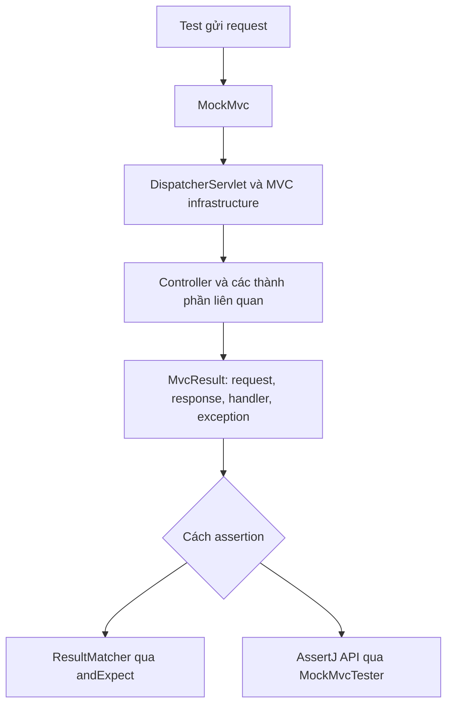

# Phân biệt assertion của AssertJ với `ResultMatcher` truyền thống

Trong kiểm thử Spring MVC bằng `MockMvc`, có hai cách phổ biến để xác nhận kết quả của một request. Cách truyền thống dùng các `ResultMatcher` như `status().isOk()`, `content().json(...)`, `jsonPath(...)`, `view().name(...)` và `model().attribute(...)`. Từ Spring Framework 6.2, `MockMvcTester` cung cấp API assertion dựa trên AssertJ, cho phép viết các kiểm tra theo dạng fluent như `hasStatusOk()`, `bodyText()` và `bodyJson()`.

Hai cách này cùng kiểm tra kết quả do Spring MVC xử lý thông qua `MockMvc`. Khác biệt nằm ở giao diện assertion và cách tổ chức test. `ResultMatcher` là hợp đồng callback của Spring Test để kiểm tra một `MvcResult`; AssertJ là thư viện assertion tổng quát, còn `MockMvcTester` kết nối kết quả MockMvc với các assertion chuyên biệt của AssertJ.

## 1. Vai trò của MockMvc trong cả hai cách

`MockMvc` thực hiện request mô phỏng qua `DispatcherServlet` và hạ tầng Spring MVC đã được cấu hình cho test. Request không đi qua HTTP server thật. Sau khi controller, filter, interceptor, message converter, view resolver hoặc exception resolver xử lý request, Spring Test cung cấp kết quả để test kiểm tra.

Luồng xử lý cơ bản:



Vì cả hai đều dựa trên kết quả MockMvc, chúng có thể kiểm tra cùng một loại hành vi: HTTP status, header, response body, JSON path, view name, model attribute, redirect, forward và exception được xử lý. Chuyển từ `ResultMatcher` sang `MockMvcTester` không làm test trở thành browser test hoặc integration test với server thật.

## 2. `ResultMatcher` truyền thống là gì?

`ResultMatcher` là functional interface của Spring Test, thuộc package `org.springframework.test.web.servlet`. Nó nhận một `MvcResult` sau khi request đã được thực hiện và kiểm tra điều kiện mong muốn. Phương thức `MockMvc.perform(...)` trả về `ResultActions`; test nối các matcher bằng `andExpect(...)`.

Ví dụ:

```java
mockMvc.perform(get("/api/greetings")
                .accept(MediaType.APPLICATION_JSON))
        .andExpect(status().isOk())
        .andExpect(content().contentTypeCompatibleWith(MediaType.APPLICATION_JSON))
        .andExpect(jsonPath("$.message").value("Hello, Lan"));
```

Các matcher `status()`, `content()` và `jsonPath()` thường được lấy từ `MockMvcResultMatchers`. Mỗi matcher mô tả một điều kiện trên kết quả. `andExpect` gọi matcher đó với `MvcResult`; nếu điều kiện không đạt, assertion thất bại và test bị đánh dấu failed.

### Các matcher thường dùng

| Matcher | Mục đích | Ví dụ |
| --- | --- | --- |
| `status()` | Kiểm tra HTTP status | `status().isOk()` |
| `header()` | Kiểm tra response header | `header().exists("ETag")` |
| `content()` | Kiểm tra body hoặc content type | `content().string("Hello")` |
| `jsonPath()` | Kiểm tra giá trị trong JSON | `jsonPath("$.message").value("Hello")` |
| `cookie()` | Kiểm tra cookie | `cookie().exists("SESSION")` |
| `view()` | Kiểm tra tên view logic | `view().name("home")` |
| `model()` | Kiểm tra model và binding errors | `model().attributeExists("product")` |
| `redirectedUrl()` | Kiểm tra URL redirect | `redirectedUrl("/login")` |
| `forwardedUrl()` | Kiểm tra URL forward | `forwardedUrl("/WEB-INF/views/home.jsp")` |
| `request()` | Kiểm tra thuộc tính của request | `request().asyncStarted()` |
| `flash()` | Kiểm tra flash attribute | `flash().attribute("notice", "Saved")` |

Các matcher được nối tuần tự trong cùng một `ResultActions`. Điều này tạo ra một pipeline rõ ràng: thực hiện request một lần, sau đó kiểm tra nhiều điều kiện của cùng kết quả.

## 3. AssertJ là gì trong ngữ cảnh MockMvc?

AssertJ là thư viện assertion Java cung cấp API `assertThat(...)` và các assertion có thể nối tiếp. Thay vì gọi một hàm matcher cho từng điều kiện, test bắt đầu từ đối tượng cần kiểm tra rồi gọi các phương thức mô tả kỳ vọng.

Ví dụ AssertJ thuần:

```java
assertThat(response.getStatus()).isEqualTo(200);
assertThat(response.getContentAsString()).contains("Hello");
```

Ở đây AssertJ không biết gì riêng về Spring MVC. Nó chỉ kiểm tra các giá trị Java được truyền vào. Spring Framework 6.2 bổ sung `MockMvcTester`, một API dựa trên AssertJ để kiểm tra trực tiếp kết quả request MockMvc mà không phải tự trích từng trường từ `MvcResult`.

Ví dụ với `MockMvcTester`:

```java
assertThat(mockMvcTester.get().uri("/api/greetings")
                .accept(MediaType.APPLICATION_JSON))
        .hasStatusOk()
        .bodyJson()
        .extractingPath("$.message")
        .isEqualTo("Hello, Lan");
```

Đoạn code diễn đạt theo chuỗi: gửi GET request, xác nhận status thành công, đọc body dưới dạng JSON, lấy trường `message` rồi so sánh giá trị. Các assertion này được cung cấp bởi API AssertJ của Spring dành cho kết quả MockMvc.

## 4. MockMvcTester và yêu cầu phiên bản

`MockMvcTester` được giới thiệu trong Spring Framework 6.2. API này nằm trong package `org.springframework.test.web.servlet.assertj` và cần AssertJ có trên test classpath.

| Môi trường | Cách sử dụng |
| --- | --- |
| Spring Framework 6.2 trở lên | Có thể dùng `MockMvcTester` nếu AssertJ được thêm vào test classpath |
| Spring Framework 6.1 hoặc cũ hơn | Dùng `MockMvc` với `ResultMatcher`; có thể dùng AssertJ thủ công trên `MvcResult` |
| Spring Boot 3.4 trở lên | Có thể inject `MockMvcTester` trong test khi cấu hình MockMvc và AssertJ được Boot hỗ trợ |
| Spring Boot cũ hơn | Kiểm tra phiên bản Spring Framework được quản lý và tự tạo `MockMvcTester` nếu Framework đã hỗ trợ |

Với Spring Boot, dependency `spring-boot-starter-test` thường đã đưa AssertJ và Spring Test vào test classpath. Với dự án Spring Framework không dùng Boot, cần khai báo các dependency test tương ứng, ví dụ Spring Test và AssertJ.

Nếu đã có một instance `MockMvc`, có thể tạo tester trực tiếp:

```java
import org.springframework.test.web.servlet.assertj.MockMvcTester;

MockMvcTester mockMvcTester = MockMvcTester.create(mockMvc);
```

Trong Spring Boot 3.4+ với cấu hình test MVC thích hợp, có thể inject tester:

```java
@WebMvcTest(GreetingController.class)
class GreetingControllerTest {
    @Autowired
    private MockMvcTester mockMvcTester;
}
```

Nếu project báo không tìm thấy `MockMvcTester`, trước tiên kiểm tra phiên bản Spring Framework mà dependency management đang chọn. Thêm import không thể khắc phục khi `spring-test` thực tế vẫn là phiên bản trước 6.2.

## 5. So sánh cùng một test bằng hai phong cách

Giả sử controller trả JSON:

```java
@RestController
class GreetingController {
    @GetMapping("/api/greetings")
    Greeting greeting(@RequestParam(defaultValue = "World") String name) {
        return new Greeting("Hello, " + name);
    }
}

record Greeting(String message) {
}
```

### Cách A: MockMvc và ResultMatcher

```java
@Autowired
MockMvc mockMvc;

@Test
void returnsGreetingUsingResultMatchers() throws Exception {
    mockMvc.perform(get("/api/greetings")
                    .param("name", "Lan")
                    .accept(MediaType.APPLICATION_JSON))
            .andExpect(status().isOk())
            .andExpect(content().contentTypeCompatibleWith(MediaType.APPLICATION_JSON))
            .andExpect(jsonPath("$.message").value("Hello, Lan"));
}
```

### Cách B: MockMvcTester và AssertJ

```java
@Autowired
MockMvcTester mockMvcTester;

@Test
void returnsGreetingUsingAssertJ() {
    assertThat(mockMvcTester.get().uri("/api/greetings")
                    .param("name", "Lan")
                    .accept(MediaType.APPLICATION_JSON))
            .hasStatusOk()
            .bodyJson()
            .extractingPath("$.message")
            .isEqualTo("Hello, Lan");
}
```

Hai test bảo vệ cùng contract: GET `/api/greetings?name=Lan` phải trả HTTP 200 và JSON có `message` bằng `Hello, Lan`. Cách truyền thống biểu diễn mỗi điều kiện bằng một matcher của Spring; cách AssertJ bắt đầu từ kết quả request và nối các assertion chuyên biệt.

## 6. So sánh status, header và response body

Với `ResultMatcher`, status và header thường được kiểm tra như sau:

```java
mockMvc.perform(get("/api/version"))
        .andExpect(status().isOk())
        .andExpect(header().string("X-Api-Version", "v1"))
        .andExpect(content().contentTypeCompatibleWith(MediaType.TEXT_PLAIN))
        .andExpect(content().string("v1"));
```

Với `MockMvcTester`, có thể nối assertion status, content type và body:

```java
assertThat(mockMvcTester.get().uri("/api/version"))
        .hasStatusOk()
        .hasContentTypeCompatibleWith(MediaType.TEXT_PLAIN)
        .bodyText()
        .isEqualTo("v1");
```

Các assertion theo kiểu AssertJ có thể đọc như một câu mô tả kỳ vọng. Khi cần kiểm tra header tùy chỉnh hoặc một chi tiết chưa có assertion chuyên biệt, có thể đọc kết quả thô hoặc dùng API matcher truyền thống. Không nên giả định mọi matcher cũ đều có một phương thức AssertJ tương ứng một-một.

## 7. So sánh JSON assertion

Với JSON, `ResultMatcher` thường dùng `jsonPath()` hoặc `content().json(...)`:

```java
mockMvc.perform(get("/api/products/42")
                .accept(MediaType.APPLICATION_JSON))
        .andExpect(status().isOk())
        .andExpect(jsonPath("$.id").value(42))
        .andExpect(jsonPath("$.name").value("Notebook"))
        .andExpect(jsonPath("$.active").value(true));
```

Với `MockMvcTester`, có thể truy cập body JSON rồi trích xuất theo JSONPath:

```java
assertThat(mockMvcTester.get().uri("/api/products/42")
                .accept(MediaType.APPLICATION_JSON))
        .hasStatusOk()
        .bodyJson()
        .extractingPath("$.id")
        .isEqualTo(42);
```

Có thể kiểm tra toàn bộ JSON bằng matcher truyền thống:

```java
mockMvc.perform(get("/api/products/42"))
        .andExpect(content().json("""
                {
                  "id": 42,
                  "name": "Notebook",
                  "active": true
                }
                """));
```

Hoặc dùng assertion body JSON của tester để so sánh nội dung JSON theo chế độ phù hợp với contract của test. Khi chỉ quan tâm một trường, trích xuất JSONPath giúp assertion tập trung vào dữ liệu quan trọng và ít phụ thuộc vào những trường không liên quan.

## 8. Kiểm tra view name và model

Các matcher truyền thống hỗ trợ tốt ứng dụng MVC trả về view:

```java
mockMvc.perform(get("/products/42"))
        .andExpect(status().isOk())
        .andExpect(view().name("products/detail"))
        .andExpect(model().attributeExists("product"))
        .andExpect(model().attribute("pageTitle", "Product detail"));
```

Với `MockMvcTester`, có thể dùng các assertion chuyên biệt cho view và model:

```java
assertThat(mockMvcTester.get().uri("/products/42"))
        .hasStatusOk()
        .hasViewName("products/detail")
        .model()
        .containsEntry("pageTitle", "Product detail");
```

Trong cả hai cách, view name là tên logic mà controller trả về; test này không nhất thiết render template thật. Nếu muốn xác nhận HTML cuối cùng, cần cấu hình view resolver/template engine và assertion nội dung response hoặc dùng HtmlUnit khi cần thao tác với form.

## 9. `ResultMatcher` là contract, còn AssertJ là thư viện assertion

Hai khái niệm này không phải hai thư viện cạnh tranh cùng một loại:

| Khái niệm | Bản chất | Cách tham gia vào test |
| --- | --- | --- |
| `ResultMatcher` | Functional interface của Spring Test | Được truyền vào `andExpect(...)` để kiểm tra `MvcResult` |
| `MockMvcResultMatchers` | Bộ factory tạo matcher dựng sẵn | Cung cấp `status()`, `content()`, `jsonPath()`, `view()`, `model()`... |
| AssertJ | Thư viện assertion tổng quát | Cung cấp `assertThat(...)` và các assertion fluent |
| `MockMvcTester` | API Spring tích hợp MockMvc với AssertJ | Cung cấp assertion chuyên biệt trên kết quả request |

Do `ResultMatcher` nhận `MvcResult`, ta vẫn có thể dùng AssertJ bên trong một matcher tùy chỉnh:

```java
ResultMatcher responseContainsGreeting = result ->
        assertThat(result.getResponse().getContentAsString())
                .contains("Hello");

mockMvc.perform(get("/api/greetings"))
        .andExpect(status().isOk())
        .andExpect(responseContainsGreeting);
```

Đây là cách kết hợp hai cơ chế: pipeline vẫn dùng `andExpect(ResultMatcher)`, còn phần kiểm tra nội dung được viết bằng AssertJ. Cách này hữu ích khi matcher dựng sẵn không biểu đạt được một điều kiện riêng của ứng dụng.

## 10. Tạo custom ResultMatcher

Khi một điều kiện xuất hiện ở nhiều test, có thể đóng gói thành matcher riêng để tránh lặp code:

```java
static ResultMatcher responseHeaderContains(String name, String expectedPart) {
    return result -> assertThat(result.getResponse().getHeader(name))
            .contains(expectedPart);
}
```

Sử dụng:

```java
mockMvc.perform(get("/api/version"))
        .andExpect(responseHeaderContains("X-Api-Version", "v1"));
```

Custom `ResultMatcher` phù hợp khi đội dự án đã có bộ matcher chung hoặc cần tương thích với các test đang dùng MockMvc truyền thống. Nếu chỉ là assertion một lần, dùng AssertJ trực tiếp trên `MvcResult` sau `andReturn()` có thể đơn giản hơn:

```java
MvcResult result = mockMvc.perform(get("/api/version"))
        .andReturn();

assertThat(result.getResponse().getStatus()).isEqualTo(200);
assertThat(result.getResponse().getHeader("X-Api-Version")).contains("v1");
```

Không nên tạo custom matcher cho mọi assertion nhỏ. Matcher riêng nên đại diện cho một quy tắc có ý nghĩa hoặc được tái sử dụng.

## 11. Lấy kết quả thô khi cần kiểm tra đặc biệt

MockMvc truyền thống cung cấp `andReturn()` để lấy `MvcResult`, sau đó đọc request, response, handler, model and view hoặc exception:

```java
MvcResult result = mockMvc.perform(get("/products/42"))
        .andExpect(status().isOk())
        .andReturn();

assertThat(result.getResponse().getStatus()).isEqualTo(200);
assertThat(result.getModelAndView()).isNotNull();
assertThat(result.getModelAndView().getViewName())
        .isEqualTo("products/detail");
```

`MvcResult` là dữ liệu kết quả gốc của Spring Test. Nó hữu ích khi cần kiểm tra chi tiết chưa có matcher hoặc cần dùng API AssertJ tổng quát. Cần kiểm tra null trước khi truy cập `getModelAndView()` vì REST endpoint trả body thường không có kết quả view/model.

Với `MockMvcTester`, mục tiêu chính là dùng assertion facade. Khi cần truy cập chi tiết thấp hơn hoặc cần một hành vi mà API tester không cung cấp, có thể tiếp tục dùng `MockMvc` gốc trong test hoặc giữ một đường kiểm tra phù hợp với API đang có. Không nên ép mọi trường hợp vào một kiểu assertion duy nhất.

## 12. Cách đọc lỗi khi assertion thất bại

Với `ResultMatcher`, lỗi thường chỉ ra matcher nào thất bại và giá trị mong đợi/giá trị thực tế. Ví dụ status mong đợi 200 nhưng nhận 404:

```java
mockMvc.perform(get("/missing"))
        .andExpect(status().isOk());
```

Thông báo lỗi của matcher giúp nhận ra status không đúng. Có thể thêm `.andDo(print())` trong lúc chẩn đoán để xem request và response:

```java
mockMvc.perform(get("/missing"))
        .andDo(print())
        .andExpect(status().isOk());
```

Với AssertJ, thông báo thường được trình bày theo assertion chain, ví dụ kỳ vọng status thành công hoặc một giá trị JSON cụ thể. Body assertion có thể cung cấp thông tin về JSON path hoặc nội dung không khớp. Khi cần toàn bộ request/response, có thể dùng `MockMvc` logging hoặc lấy kết quả thô theo cách phù hợp.

Không nên nhầm assertion failure với exception phát sinh trong ứng dụng. Assertion failure nghĩa là request đã tạo ra một kết quả nhưng kết quả không đáp ứng kỳ vọng. Exception từ controller, filter hoặc converter là lỗi trong quá trình xử lý request; Spring có thể xử lý exception đó thành response qua `@ExceptionHandler`/`HandlerExceptionResolver`, hoặc để exception truyền ra ngoài test. Cần phân biệt hai trường hợp khi đọc stack trace.

## 13. Nên chọn phong cách nào?

| Tình huống | Gợi ý |
| --- | --- |
| Dự án đang dùng Spring Framework trước 6.2 | Dùng `ResultMatcher`; dùng AssertJ thủ công nếu cần |
| Dự án đã dùng Spring Framework 6.2+ và AssertJ | Có thể dùng `MockMvcTester` cho test mới |
| Test có nhiều matcher Spring dựng sẵn hoặc custom `ResultMatcher` | Giữ pipeline `perform(...).andExpect(...)` |
| Test tập trung vào JSON/body và thích assertion fluent | `MockMvcTester` thường ngắn gọn, dễ đọc |
| Cần kiểm tra dữ liệu `MvcResult` rất đặc thù | `andReturn()` và AssertJ trực tiếp có thể phù hợp |
| Codebase có convention assertion thống nhất | Ưu tiên convention chung để test dễ bảo trì |

Không cần chuyển toàn bộ test cũ chỉ vì có API mới. Có thể dùng `MockMvcTester` cho test mới và giữ `ResultMatcher` ở những test có matcher tùy chỉnh hoặc cấu trúc đã ổn định. Nếu muốn chuẩn hóa phong cách trong một module, hãy chọn cách biểu đạt dễ đọc và nhất quán với nhóm phát triển.

## 14. Các lỗi thường gặp khi sử dụng hai API

| Hiện tượng | Nguyên nhân có thể có | Cách xử lý |
| --- | --- | --- |
| Không import được `MockMvcTester` | `spring-test` đang ở phiên bản trước 6.2 | Kiểm tra dependency tree và phiên bản Spring Framework thực tế |
| `MockMvcTester` không được inject | Boot version hoặc test auto-configuration chưa hỗ trợ, hoặc thiếu AssertJ | Kiểm tra phiên bản Boot, AssertJ và cấu hình MockMvc; có thể tạo tester từ `MockMvc` |
| `assertThat(...)` không nhận kết quả như mong muốn | Import nhầm `assertThat` hoặc kiểu đầu vào không phải kết quả MockMvc tester | Dùng `org.assertj.core.api.Assertions.assertThat` và API tester đúng phiên bản |
| Matcher `jsonPath` không tìm thấy field | Body không phải JSON, path sai hoặc response khác dự kiến | Kiểm tra content type/body và JSON path |
| View assertion thất bại | Handler trả REST body, redirect hoặc view name khác | Dùng matcher tương ứng với kiểu kết quả thực tế |
| AssertJ chain khó đọc | Nối quá nhiều điều kiện không cùng ý nghĩa | Tách thành các assertion nhỏ hoặc dùng biến kết quả trung gian |
| Custom matcher gây khó bảo trì | Matcher quá tổng quát hoặc phụ thuộc implementation nội bộ | Chỉ đóng gói quy tắc có ý nghĩa và giữ thông báo lỗi rõ |
| Assertion failure bị hiểu là lỗi controller | Không phân biệt response sai với exception chưa được xử lý | Đọc matcher failure, response và exception trong `MvcResult` |

## 15. Nguyên tắc viết assertion dễ bảo trì

1. Hiểu rằng `ResultMatcher` là callback kiểm tra `MvcResult`, còn AssertJ là thư viện assertion; `MockMvcTester` kết nối AssertJ với MockMvc.
2. Dùng `MockMvcTester` khi dự án chạy Spring Framework 6.2 trở lên và có AssertJ trong test classpath.
3. Dùng matcher dựng sẵn cho status, header, content, JSON path, view và model nếu pipeline truyền thống đang rõ ràng.
4. Giữ một request cho nhiều assertion liên quan để không lặp thao tác gọi endpoint.
5. Chọn assertion tập trung vào contract quan trọng như status, media type, body field, view name hoặc model attribute.
6. Dùng custom `ResultMatcher` khi một quy tắc kiểm tra cần được tái sử dụng trong pipeline MockMvc truyền thống.
7. Dùng `andReturn()` khi cần kiểm tra trực tiếp dữ liệu `MvcResult` mà matcher dựng sẵn không đáp ứng.
8. Không chuyển đổi toàn bộ test cũ một cách máy móc; giữ phong cách nhất quán và dễ đọc trong phạm vi module.
9. Phân biệt assertion failure với exception phát sinh trong quá trình dispatch để tìm đúng nguyên nhân.

`ResultMatcher` và assertion AssertJ đều giúp xác nhận hành vi của Spring MVC sau khi MockMvc xử lý request. `ResultMatcher` biểu đạt kỳ vọng theo pipeline `andExpect`, còn `MockMvcTester` cung cấp cách viết fluent dựa trên AssertJ từ Spring Framework 6.2. Chọn API theo phiên bản nền tảng, convention của dự án và độ rõ ràng của assertion sẽ giúp test tập trung vào contract mà ứng dụng cần bảo vệ.
