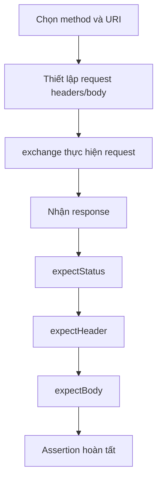

# `exchange` và chuỗi `expectStatus`, `expectHeader`, `expectBody`

`WebTestClient` cung cấp API fluent để gửi một HTTP request và xác nhận response theo từng phần. Sau khi mô tả method, URL, header và body của request, test gọi `exchange()` để thực hiện request. Kết quả trả về cho phép nối các bước `expectStatus()`, `expectHeader()` và `expectBody()` để kiểm tra status code, response header và nội dung body.

Trong Spring Framework Testing, `WebTestClient` có thể kiểm thử cả ứng dụng WebFlux lẫn Spring MVC. Khi mục tiêu là kiểm tra ứng dụng Spring MVC mà không khởi động server thật, dùng `MockMvcWebTestClient` để kết nối WebTestClient với MockMvc. Nhờ vậy, cùng một chuỗi `exchange()` và `expect...` có thể kiểm tra HTTP contract trong khi request phía server vẫn đi qua `DispatcherServlet` và hạ tầng MVC mô phỏng.

## 1. Tổng quan chuỗi request và assertion

Một request test bằng WebTestClient thường có cấu trúc:

```java
webTestClient.get()
        .uri("/api/products/42")
        .accept(MediaType.APPLICATION_JSON)
        .exchange()
        .expectStatus().isOk()
        .expectHeader().contentTypeCompatibleWith(MediaType.APPLICATION_JSON)
        .expectBody()
        .jsonPath("$.id").isEqualTo(42);
```

Mỗi phần có trách nhiệm riêng:

1. `get()` chọn HTTP method; có thể thay bằng `post()`, `put()`, `patch()`, `delete()` và các method khác.
2. `uri(...)` chỉ định đường dẫn hoặc URI đích.
3. Các phương thức request như `accept(...)`, `contentType(...)`, `header(...)` và `bodyValue(...)` thiết lập thông tin gửi lên.
4. `exchange()` thực hiện request và trả về response specification.
5. `expectStatus()` kiểm tra HTTP status.
6. `expectHeader()` kiểm tra header của response.
7. `expectBody()` đọc và xác nhận response body.

Không cần gọi riêng một hàm assertion cho từng `MvcResult` như cách dùng `MockMvc.perform(...).andExpect(...)`. WebTestClient biểu đạt quá trình kiểm tra bằng chuỗi method trên response.



## 2. WebTestClient dùng với Spring MVC và MockMvc

`WebTestClient` thuộc package `org.springframework.test.web.reactive.server`. Tên package có chữ `reactive` vì API này được thiết kế theo phong cách WebFlux, nhưng client cũng có thể được kết nối với Spring MVC thông qua adapter MockMvc.

Đối với Spring MVC, lớp tích hợp là `MockMvcWebTestClient`, thuộc package `org.springframework.test.web.servlet.client`. Lớp này tạo WebTestClient nhưng chuyển request vào MockMvc thay vì gửi qua mạng tới một server đang chạy.

```java
import org.springframework.test.web.reactive.server.WebTestClient;
import org.springframework.test.web.servlet.client.MockMvcWebTestClient;
import org.springframework.web.context.WebApplicationContext;

WebTestClient webTestClient = MockMvcWebTestClient
        .bindToApplicationContext(webApplicationContext)
        .configureClient()
        .baseUrl("http://localhost")
        .build();
```

Đoạn cấu hình này sử dụng `WebApplicationContext` đã được Spring Test nạp. Các controller, handler mapping, message converter, exception resolver, interceptor và các bean MVC liên quan sẽ được lấy từ context đó.

Test class có thể được cấu hình như sau:

```java
@ExtendWith(SpringExtension.class)
@WebAppConfiguration
@ContextConfiguration(classes = WebTestConfig.class)
class ProductApiTest {
    @Autowired
    private WebApplicationContext webApplicationContext;

    private WebTestClient webTestClient;

    @BeforeEach
    void setUp() {
        webTestClient = MockMvcWebTestClient
                .bindToApplicationContext(webApplicationContext)
                .configureClient()
                .baseUrl("http://localhost")
                .build();
    }
}
```

`@WebAppConfiguration` tạo môi trường web mô phỏng cho `WebApplicationContext`; `@ContextConfiguration` cung cấp cấu hình bean cần thiết. Có thể dùng cấu hình Java hoặc XML tùy dự án.

### Thiết lập trực tiếp với controller

Nếu chỉ cần kiểm tra một vài controller với cấu hình MVC tối thiểu, có thể bind trực tiếp tới controller:

```java
WebTestClient webTestClient = MockMvcWebTestClient
        .bindToController(new ProductController())
        .build();
```

Cách này phù hợp cho test tập trung vào controller. Các thành phần như controller advice, validator, interceptor hoặc converter tùy chỉnh cần được đăng ký trong builder nếu test phụ thuộc vào chúng. Khi muốn dùng đúng cấu hình MVC của ứng dụng, nên bind vào `WebApplicationContext`.

## 3. `exchange()` thực hiện request

`exchange()` là ranh giới giữa phần mô tả request và phần kiểm tra response. Trước khi gọi `exchange()`, test thiết lập method, URI, query parameter, header, cookie và body. Sau khi gọi, request được gửi đi và test nhận response specification để bắt đầu assertion.

Ví dụ GET đơn giản:

```java
webTestClient.get()
        .uri("/api/products")
        .exchange()
        .expectStatus().isOk();
```

Ví dụ GET có path variable và query parameter:

```java
webTestClient.get()
        .uri(uriBuilder -> uriBuilder
                .path("/api/products/{id}")
                .queryParam("includeReviews", true)
                .build(42))
        .exchange()
        .expectStatus().isOk();
```

Có thể truyền URI template và biến trực tiếp:

```java
webTestClient.get()
        .uri("/api/products/{id}", 42)
        .exchange()
        .expectStatus().isOk();
```

Với POST, PUT hoặc PATCH, thường cần thiết lập request body trước khi exchange:

```java
webTestClient.post()
        .uri("/api/products")
        .contentType(MediaType.APPLICATION_JSON)
        .bodyValue(new CreateProductRequest("Notebook", 12.5))
        .exchange()
        .expectStatus().isCreated();
```

`bodyValue(...)` yêu cầu WebTestClient ghi object thành body theo codec phù hợp với content type. Khi gửi JSON, test cần Jackson hoặc JSON codec tương ứng có trong test classpath. Nếu muốn gửi chuỗi JSON đã tạo sẵn, có thể dùng `.bodyValue(jsonString)` với content type thích hợp, nhưng cần bảo đảm chuỗi đó chính là JSON hợp lệ.

## 4. Kiểm tra HTTP status bằng `expectStatus()`

`expectStatus()` trả về status assertion spec. API này cung cấp các phương thức kiểm tra status thường dùng:

| Phương thức | Status được kiểm tra |
| --- | --- |
| `isOk()` | 200 OK |
| `isCreated()` | 201 Created |
| `isAccepted()` | 202 Accepted |
| `isNoContent()` | 204 No Content |
| `isBadRequest()` | 400 Bad Request |
| `isUnauthorized()` | 401 Unauthorized |
| `isForbidden()` | 403 Forbidden |
| `isNotFound()` | 404 Not Found |
| `isNotAcceptable()` | 406 Not Acceptable |
| `isUnsupportedMediaType()` | 415 Unsupported Media Type |
| `is4xxClientError()` | Bất kỳ status thuộc nhóm 4xx |
| `is5xxServerError()` | Bất kỳ status thuộc nhóm 5xx |
| `isEqualTo(HttpStatus)` | So sánh với status cụ thể |

Ví dụ kiểm tra tạo tài nguyên:

```java
webTestClient.post()
        .uri("/api/products")
        .contentType(MediaType.APPLICATION_JSON)
        .bodyValue(new CreateProductRequest("Notebook", 12.5))
        .exchange()
        .expectStatus().isCreated();
```

Nếu cần status chính xác không có method tiện ích, dùng `isEqualTo(...)`:

```java
webTestClient.get()
        .uri("/api/products/42")
        .exchange()
        .expectStatus().isEqualTo(HttpStatus.OK);
```

Hoặc kiểm tra nhóm lỗi khi test chỉ quan tâm request thất bại ở phía client:

```java
webTestClient.get()
        .uri("/api/products/unknown")
        .exchange()
        .expectStatus().is4xxClientError();
```

Với API contract ổn định, nên kiểm tra status cụ thể như 404 hoặc 400 thay vì chỉ kiểm tra cả nhóm 4xx. Assertion càng cụ thể càng giúp phát hiện khi hành vi endpoint thay đổi ngoài dự kiến.

## 5. Kiểm tra response header bằng `expectHeader()`

`expectHeader()` trả về header assertion spec. Có thể kiểm tra `Content-Type`, `Location`, `ETag`, `Cache-Control`, header tùy chỉnh và sự tồn tại hoặc vắng mặt của header.

```java
webTestClient.get()
        .uri("/api/products/42")
        .accept(MediaType.APPLICATION_JSON)
        .exchange()
        .expectStatus().isOk()
        .expectHeader().contentType(MediaType.APPLICATION_JSON);
```

Nếu response có thể kèm tham số như charset, kiểm tra tính tương thích của media type:

```java
.expectHeader()
.contentTypeCompatibleWith(MediaType.APPLICATION_JSON);
```

Một số assertion header hữu ích:

| Phương thức | Công dụng |
| --- | --- |
| `contentType(mediaType)` | Kiểm tra Content-Type |
| `contentTypeCompatibleWith(mediaType)` | Kiểm tra media type tương thích |
| `exists(name)` | Kiểm tra header tồn tại |
| `doesNotExist(name)` | Kiểm tra header không tồn tại |
| `valueEquals(name, values...)` | Kiểm tra giá trị header |
| `values(name, consumer)` | Đọc và kiểm tra danh sách giá trị header |
| `location(uri)` | Kiểm tra header Location |
| `cacheControl(value)` | Kiểm tra Cache-Control |
| `lastModified(timestamp)` | Kiểm tra Last-Modified |
| `etag(value)` | Kiểm tra ETag |

Ví dụ kiểm tra header tùy chỉnh và cache:

```java
webTestClient.get()
        .uri("/api/products/42")
        .exchange()
        .expectStatus().isOk()
        .expectHeader().valueEquals("X-Api-Version", "v1")
        .expectHeader().cacheControl(org.springframework.http.CacheControl.noStore());
```

Ví dụ kiểm tra redirect:

```java
webTestClient.post()
        .uri("/api/products")
        .contentType(MediaType.APPLICATION_JSON)
        .bodyValue(new CreateProductRequest("Notebook", 12.5))
        .exchange()
        .expectStatus().is3xxRedirection()
        .expectHeader().location(java.net.URI.create("/api/products"));
```

`Location` thường chứa URI đích của redirect hoặc tài nguyên vừa được tạo. Hãy kiểm tra giá trị đúng với contract ứng dụng, đặc biệt khi ứng dụng có context path hoặc tạo absolute URL.

## 6. Kiểm tra response body bằng `expectBody()`

`expectBody()` dùng khi muốn kiểm tra body dưới dạng byte, text, JSON hoặc cấu trúc dữ liệu. Có ba dạng thường gặp:

- `expectBody()` để kiểm tra body thô, JSON path hoặc nội dung JSON.
- `expectBody(Class<T>)` để deserialize body thành một kiểu Java.
- `expectBodyList(Class<T>)` để deserialize body thành danh sách phần tử cùng kiểu.

### Body dạng text

```java
webTestClient.get()
        .uri("/api/greeting")
        .exchange()
        .expectStatus().isOk()
        .expectBody(String.class)
        .isEqualTo("Hello, world");
```

### Body JSON theo JSONPath

```java
webTestClient.get()
        .uri("/api/products/42")
        .accept(MediaType.APPLICATION_JSON)
        .exchange()
        .expectStatus().isOk()
        .expectBody()
        .jsonPath("$.id").isEqualTo(42)
        .jsonPath("$.name").isEqualTo("Notebook")
        .jsonPath("$.active").isEqualTo(true);
```

Mỗi `jsonPath(...)` trả về một path assertion để xác nhận giá trị trong JSON. JSONPath giúp test kiểm tra một phần response mà không cần so sánh toàn bộ chuỗi JSON.

### Deserialize thành object

```java
webTestClient.get()
        .uri("/api/products/42")
        .accept(MediaType.APPLICATION_JSON)
        .exchange()
        .expectStatus().isOk()
        .expectBody(ProductView.class)
        .value(product -> {
            assertThat(product.id()).isEqualTo(42L);
            assertThat(product.name()).isEqualTo("Notebook");
        });
```

`value(...)` cho phép sử dụng AssertJ hoặc JUnit assertion thông thường trên object đã deserialize. Cách này hữu ích khi cần kiểm tra nhiều thuộc tính, kiểu dữ liệu hoặc quan hệ giữa các trường.

### Body là danh sách

```java
webTestClient.get()
        .uri("/api/products")
        .accept(MediaType.APPLICATION_JSON)
        .exchange()
        .expectStatus().isOk()
        .expectBodyList(ProductView.class)
        .hasSize(2);
```

Khi body có generic type phức tạp như `List<ProductView>` hoặc `Map<String, List<ProductView>>`, dùng `ParameterizedTypeReference` để giữ thông tin generic:

```java
ParameterizedTypeReference<List<ProductView>> productListType =
        new ParameterizedTypeReference<>() {};

webTestClient.get()
        .uri("/api/products")
        .exchange()
        .expectStatus().isOk()
        .expectBody(productListType)
        .value(products -> assertThat(products).hasSize(2));
```

## 7. Kiểm tra body rỗng và response không có nội dung

Với endpoint trả về 204 No Content, test nên xác nhận status và body rỗng:

```java
webTestClient.delete()
        .uri("/api/products/42")
        .exchange()
        .expectStatus().isNoContent()
        .expectBody().isEmpty();
```

Một lựa chọn khác là yêu cầu kiểu `Void` nếu không cần đọc body:

```java
webTestClient.delete()
        .uri("/api/products/42")
        .exchange()
        .expectStatus().isNoContent()
        .expectBody(Void.class);
```

Không nên gọi JSON path trên response không có body. Nếu endpoint trả 204, contract của nó là hoàn tất thao tác mà không có representation trong response body.

## 8. Ghép nhiều nhóm expectation trong một request

Một lợi thế của API fluent là có thể kiểm tra status, header và body của cùng một response theo trình tự dễ đọc:

```java
webTestClient.get()
        .uri("/api/products/42")
        .accept(MediaType.APPLICATION_JSON)
        .exchange()
        .expectStatus().isOk()
        .expectHeader().contentTypeCompatibleWith(MediaType.APPLICATION_JSON)
        .expectHeader().valueEquals("X-Api-Version", "v1")
        .expectBody()
        .jsonPath("$.id").isEqualTo(42)
        .jsonPath("$.name").isEqualTo("Notebook");
```

Test chỉ gửi một request. Các expectation tiếp theo cùng kiểm tra response đó, không gọi endpoint thêm lần nữa. Điều này quan trọng nếu request có side effect như tạo đơn hàng hoặc cập nhật dữ liệu.

Khi có nhiều assertion trên body, có thể tách body sang object rồi kiểm tra:

```java
webTestClient.get()
        .uri("/api/products/42")
        .exchange()
        .expectStatus().isOk()
        .expectBody(ProductView.class)
        .value(product -> assertThat(product)
                .extracting(ProductView::id, ProductView::name)
                .containsExactly(42L, "Notebook"));
```

Chọn cách kiểm tra body phù hợp: JSONPath thuận tiện cho contract JSON, còn deserialize object giúp kiểm tra kiểu dữ liệu và nhiều điều kiện trong Java.

## 9. Request body, Content-Type và Accept

`Content-Type` mô tả định dạng request body; `Accept` mô tả định dạng response mà client muốn nhận. WebTestClient cung cấp `.contentType(...)` và `.accept(...)` trước `exchange()`:

```java
webTestClient.post()
        .uri("/api/products")
        .contentType(MediaType.APPLICATION_JSON)
        .accept(MediaType.APPLICATION_JSON)
        .bodyValue(new CreateProductRequest("Notebook", 12.5))
        .exchange()
        .expectStatus().isCreated()
        .expectHeader().contentTypeCompatibleWith(MediaType.APPLICATION_JSON)
        .expectBody(ProductView.class)
        .value(product -> assertThat(product.name()).isEqualTo("Notebook"));
```

Nếu request gửi media type không được endpoint hỗ trợ, có thể nhận 415 Unsupported Media Type. Nếu `Accept` yêu cầu representation mà endpoint không thể tạo, có thể nhận 406 Not Acceptable. Test có thể xác nhận các tình huống này:

```java
webTestClient.post()
        .uri("/api/products")
        .contentType(MediaType.TEXT_PLAIN)
        .bodyValue("Notebook")
        .exchange()
        .expectStatus().isUnsupportedMediaType();

webTestClient.get()
        .uri("/api/products/42")
        .accept(MediaType.APPLICATION_XML)
        .exchange()
        .expectStatus().isNotAcceptable();
```

Các expectation 415 và 406 phụ thuộc mapping `consumes`/`produces` và converter được cấu hình. Nếu ứng dụng hỗ trợ XML hoặc media type khác, hãy điều chỉnh test theo contract thực tế.

## 10. Lấy kết quả body để assertion tùy chỉnh

Khi muốn dùng thư viện assertion khác hoặc kiểm tra một cấu trúc phức tạp, có thể dùng `consumeWith(...)` hoặc `returnResult()`.

Ví dụ dùng `consumeWith`:

```java
webTestClient.get()
        .uri("/api/products/42")
        .exchange()
        .expectStatus().isOk()
        .expectBody(ProductView.class)
        .consumeWith(result -> {
            ProductView product = result.getResponseBody();
            assertThat(product).isNotNull();
            assertThat(product.id()).isEqualTo(42L);
        });
```

`consumeWith` nhận kết quả sau khi body được đọc và cho phép thực hiện assertion tùy chỉnh. `returnResult()` trả về exchange result để test có thể sử dụng ở bước sau:

```java
EntityExchangeResult<ProductView> result = webTestClient.get()
        .uri("/api/products/42")
        .exchange()
        .expectStatus().isOk()
        .expectBody(ProductView.class)
        .returnResult();

assertThat(result.getResponseBody()).isNotNull();
assertThat(result.getResponseBody().name()).isEqualTo("Notebook");
```

Với response body thô, có thể dùng `expectBody()` rồi lấy kết quả tương ứng. Cần chọn kiểu result phù hợp với overload `expectBody` đang dùng.

## 11. Kết hợp WebTestClient với assertion MVC đặc thù

Khi dùng `MockMvcWebTestClient`, request được xử lý qua MockMvc nên test vẫn có thể cần kiểm tra các chi tiết riêng của Spring MVC như model attribute hoặc view name. Có thể lấy `EntityExchangeResult` từ chuỗi expectation rồi chuyển về `ResultActions` bằng `MockMvcWebTestClient.resultActionsFor(...)`.

```java
EntityExchangeResult<String> result = webTestClient.get()
        .uri("/products/42")
        .exchange()
        .expectStatus().isOk()
        .expectBody(String.class)
        .returnResult();

MockMvcWebTestClient.resultActionsFor(result)
        .andExpect(view().name("products/detail"))
        .andExpect(model().attributeExists("product"));
```

Đoạn code kết hợp hai lớp assertion:

- `WebTestClient` kiểm tra HTTP response theo chuỗi status, header và body.
- `resultActionsFor(...)` mở lại các assertion đặc thù MVC dựa trên kết quả MockMvc tương ứng, như `view()` và `model()`.

Điều này hữu ích khi một test cần xác nhận cả HTTP contract lẫn kết quả xử lý nội bộ của controller. Nếu chỉ cần status/header/body, không cần chuyển sang `ResultActions`.

## 12. Phân biệt WebTestClient với MockMvcTester

Spring Framework có nhiều API kiểm thử HTTP với cú pháp gần nhau. Cần chọn đúng loại cho chủ đề test:

| API | Cách bắt đầu | Cách assertion | Phạm vi |
| --- | --- | --- | --- |
| `MockMvc` | `mockMvc.perform(get(...))` | `andExpect(ResultMatcher)` | Spring MVC, request/response mô phỏng |
| `MockMvcTester` | `mockMvcTester.get().uri(...)` | AssertJ như `hasStatusOk()`, `bodyJson()` | Spring MVC, fluent assertions từ Spring Framework 6.2 |
| `WebTestClient` | `webTestClient.get().uri(...)` | `exchange().expectStatus().expectHeader().expectBody()` | WebFlux hoặc MVC khi bind qua adapter |
| `MockMvcWebTestClient` | Builder kết nối WebTestClient với MockMvc | Vẫn dùng chuỗi WebTestClient; có thể bridge sang MVC assertions | Spring MVC mà không cần server thật |

`MockMvcTester` và `WebTestClient` không có cùng API. Nếu đề bài yêu cầu `exchange()`, `expectStatus()`, `expectHeader()` và `expectBody()`, đó là chuỗi assertion của WebTestClient. Với ứng dụng MVC, cần bind WebTestClient bằng `MockMvcWebTestClient` để request đi qua MockMvc.

## 13. Khi nào cần WebTestClient với server thật?

`WebTestClient` có thể được bind với controller, application context, router function hoặc một server đang chạy. Cách bind quyết định request được thực hiện như thế nào.

Khi bind với `MockMvcWebTestClient`, request được xử lý trong môi trường mô phỏng. Không có socket mạng hoặc servlet container thật. Đây là lựa chọn phù hợp để kiểm tra MVC handler, status, header và body nhanh chóng.

Khi cần kiểm tra ứng dụng đang chạy qua cổng HTTP thật, có thể kết nối WebTestClient tới server đang hoạt động hoặc dùng cấu hình integration test khởi động server. Trường hợp đó phù hợp để kiểm tra network, connector, TLS, cấu hình server và tương tác triển khai. Nó có chi phí cao hơn và thuộc phạm vi kiểm thử khác.

| Mục tiêu | Cách bind phù hợp |
| --- | --- |
| Test controller MVC đơn giản | `MockMvcWebTestClient.bindToController(...)` |
| Test cấu hình MVC trong Spring context | `MockMvcWebTestClient.bindToApplicationContext(...)` |
| Test WebFlux controller/router | WebTestClient bind với WebFlux infrastructure |
| Test HTTP qua server đang chạy | `WebTestClient.bindToServer()` hoặc client kết nối tới base URL server |

## 14. Lỗi thường gặp khi viết chuỗi expectation

| Hiện tượng | Nguyên nhân có thể có | Cách xử lý |
| --- | --- | --- |
| Không tìm thấy `MockMvcWebTestClient` | Phiên bản Spring Test quá cũ hoặc thiếu module test phù hợp | Kiểm tra phiên bản `spring-test` và dependency |
| `exchange()` trả status 404 | URI không khớp mapping hoặc controller chưa được đăng ký | Kiểm tra URL, component scan và context test |
| Nhận 415 khi gửi JSON | Thiếu `Content-Type`, mapping `consumes` không khớp hoặc converter không hỗ trợ | Đặt `.contentType(APPLICATION_JSON)` và kiểm tra converter |
| Nhận 406 khi yêu cầu JSON | `Accept` không khớp `produces` hoặc converter không ghi được response | Kiểm tra `.accept(...)`, mapping và message converter |
| `expectBody(Class)` không deserialize được | Body không đúng media type hoặc JSON không khớp kiểu Java | Kiểm tra response Content-Type, body và DTO |
| JSONPath không tìm thấy field | Body không phải JSON hoặc path sai | Xem response thực tế và điều chỉnh JSONPath |
| Header assertion thất bại | Header vắng mặt hoặc giá trị có tham số/format khác | Kiểm tra header thực tế và dùng matcher tương thích nếu phù hợp |
| Body assertion thất bại dù status đúng | Controller trả nội dung khác contract | Kiểm tra DTO, serialization và dữ liệu response |
| MVC view/model assertion không dùng được | Chỉ kiểm tra HTTP response mà chưa bridge về MockMvc result | Lấy `EntityExchangeResult` rồi gọi `resultActionsFor(...)` |

Khi chẩn đoán, nên kiểm tra theo thứ tự: request method/URI, request headers/body, status, response headers, rồi body. Status 4xx thường cho biết request không đáp ứng mapping hoặc dữ liệu; status 5xx thường gợi ý lỗi phía server. Nếu test dùng MockMvc adapter, cũng có thể kiểm tra exception và MVC result thông qua bridge khi cần.

## 15. Nguyên tắc tổ chức test với `exchange()` và `expect...`

1. Dùng WebTestClient khi muốn biểu đạt HTTP request/response bằng chuỗi fluent.
2. Với Spring MVC không có server thật, tạo client bằng `MockMvcWebTestClient` và bind vào controller hoặc `WebApplicationContext`.
3. Gọi `exchange()` đúng một lần cho mỗi request rồi nối các expectation trên cùng response.
4. Dùng `expectStatus()` để kiểm tra status cụ thể; tránh chỉ kiểm tra nhóm status nếu contract cần chính xác.
5. Dùng `expectHeader()` để xác nhận media type, Location, cache hoặc header tùy chỉnh.
6. Dùng `expectBody()` với JSONPath cho assertion theo trường; dùng `expectBody(Class)` khi cần object Java; dùng `expectBodyList` cho danh sách.
7. Xác nhận body rỗng cho response 204 và không thực hiện JSON assertion trên response không có body.
8. Dùng `returnResult()` hoặc `consumeWith(...)` khi cần assertion tùy chỉnh hoặc xử lý kết quả ở bước sau.
9. Với MVC-specific assertion như view name và model, bridge kết quả bằng `MockMvcWebTestClient.resultActionsFor(...)`.
10. Chọn bind-to-mock hay server thật theo phạm vi cần kiểm tra: MVC logic hay hành vi triển khai qua HTTP.

`exchange()` đánh dấu thời điểm request được thực hiện; `expectStatus()`, `expectHeader()` và `expectBody()` mô tả những điều kiện mà response phải đáp ứng. Với `MockMvcWebTestClient`, cú pháp này mang phong cách WebTestClient đến kiểm thử Spring MVC mà vẫn sử dụng MockMvc ở phía server. Khi chọn đúng kiểu bind và kiểm tra cả status, header lẫn body, test sẽ mô tả đầy đủ hơn HTTP contract của endpoint.
