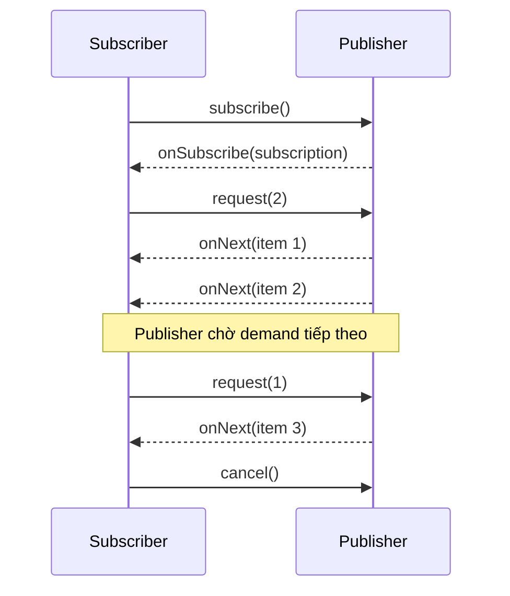
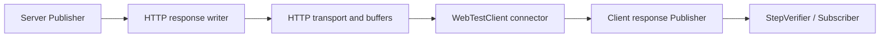

# Kiểm tra tác động của backpressure theo phạm vi bài

## 1. Backpressure là gì trong một luồng phản ứng?

Trong Reactive Streams, một `Subscriber` không phải nhận tất cả dữ liệu ngay khi `Publisher` tạo ra. Subscriber có thể yêu cầu số phần tử mà nó sẵn sàng xử lý thông qua `Subscription.request(n)`. Publisher phát tối đa số phần tử đã được yêu cầu, cho đến khi có thêm demand hoặc subscription bị hủy.

Backpressure là cơ chế điều tiết tốc độ phát dữ liệu theo nhu cầu của subscriber. Nó giúp một consumer xử lý chậm không buộc producer phải tạo vô hạn dữ liệu trong bộ nhớ. Khi consumer cần dừng, `Subscription.cancel()` cho phép kết thúc việc tiêu thụ và yêu cầu chuỗi xử lý giải phóng công việc liên quan.



Ba tín hiệu cần quan sát khi kiểm thử backpressure là:

- **Demand**: số phần tử subscriber yêu cầu bằng `request(n)`.
- **Emission**: số phần tử publisher thực sự phát bằng `onNext`.
- **Cancellation**: thời điểm subscriber hủy subscription.

Một test chỉ kiểm tra body cuối cùng có đủ dữ liệu chưa xác nhận được hành vi backpressure. Muốn kiểm tra tác động của demand, test cần điều khiển tốc độ tiêu thụ hoặc quan sát publisher ở đúng ranh giới cần kiểm tra.

## 2. Backpressure trong Reactive Streams và HTTP là hai ranh giới khác nhau

Trong ứng dụng WebFlux, một controller có thể trả `Flux<T>`. Publisher ở phía server phát dữ liệu cho HTTP response writer. Ở phía client, `WebTestClient` giải mã response thành một publisher khác để test tiêu thụ.



Backpressure của Reactive Streams tồn tại giữa các publisher/subscriber trong từng tầng. Giao thức HTTP không mang nguyên xi lời gọi `Subscription.request(n)` từ client sang publisher ở server. TCP flow control hoặc HTTP/2 flow control có thể điều tiết việc truyền byte, nhưng không đồng nghĩa một request `request(1)` ở phía test sẽ làm publisher phía server phát đúng một object.

Giữa server và client còn có encoder, decoder, buffer, socket và connector. Các thành phần này có thể yêu cầu trước hoặc lưu tạm dữ liệu. Vì vậy, khi kiểm thử qua HTTP, cần phân biệt:

1. Client response publisher có tôn trọng demand của subscriber hay không.
2. Publisher nguồn phía server nhận demand và cancellation như thế nào.
3. Toàn bộ đường truyền có giới hạn buffer hoặc điều tiết tốc độ theo cấu hình mong muốn hay không.

`WebTestClient` có thể kiểm tra rất tốt hành vi tiêu thụ response ở phía client. Để kết luận về publisher nguồn, cần instrument hoặc kiểm thử publisher đó ở phía server. Không nên suy ra lượng demand phía server bằng đúng số lượng mà `StepVerifier` yêu cầu ở phía client.

## 3. Dùng StepVerifier điều khiển demand

`StepVerifier` của Reactor Test cho phép tạo subscriber với demand ban đầu xác định. Tham số thứ hai của `StepVerifier.create(publisher, initialRequest)` đặt lượng request ban đầu.

Ví dụ, subscriber bắt đầu với demand bằng 0, sau đó yêu cầu hai phần tử:

```java
AtomicLong requested = new AtomicLong();

Flux<Integer> source = Flux.range(1, 5)
        .doOnRequest(requested::addAndGet);

StepVerifier.create(source, 0)
        .expectSubscription()
        .expectNoEvent(Duration.ofMillis(100))
        .thenRequest(2)
        .expectNext(1, 2)
        .thenCancel()
        .verify(Duration.ofSeconds(2));

assertThat(requested.get()).isEqualTo(2);
```

Trong ví dụ này:

- `create(source, 0)` đăng ký subscriber nhưng chưa yêu cầu phần tử nào.
- `expectSubscription()` xác nhận subscription đã được thiết lập.
- `expectNoEvent(...)` xác nhận chưa có phần tử được phát tới subscriber trong khoảng thời gian kiểm tra.
- `thenRequest(2)` tạo demand cho hai phần tử.
- `expectNext(1, 2)` xác nhận đúng hai phần tử được tiêu thụ.
- `thenCancel()` hủy subscription sau assertion.
- `doOnRequest(...)` ghi lại demand mà publisher nguồn nhận được.

Đây là kiểm thử trực tiếp publisher trong cùng tiến trình. Với `Flux.range`, demand hai phần tử được truyền tới nguồn theo đúng số lượng yêu cầu. Kết quả này cho thấy cách kiểm tra tín hiệu backpressure ở tầng Reactive Streams mà không có buffer của HTTP transport chen vào.

## 4. Kiểm tra response streaming qua WebTestClient

Với endpoint trả response dạng stream, `WebTestClient` có thể lấy publisher từ response bằng `returnResult(...)`. Test sau bắt đầu với demand bằng 0, yêu cầu một vài phần tử rồi hủy subscription.

```java
@SpringBootTest(webEnvironment = SpringBootTest.WebEnvironment.RANDOM_PORT)
@AutoConfigureWebTestClient
class NumberStreamHttpTest {

    @Autowired
    private WebTestClient webTestClient;

    @Test
    void clientConsumesStreamOnlyWhenItRequestsData() {
        FluxExchangeResult<Integer> result = webTestClient.get()
                .uri("/api/numbers")
                .accept(MediaType.APPLICATION_NDJSON)
                .exchange()
                .expectStatus().isOk()
                .returnResult(Integer.class);

        StepVerifier.create(result.getResponseBody(), 0)
                .expectSubscription()
                .expectNoEvent(Duration.ofMillis(100))
                .thenRequest(2)
                .expectNext(1, 2)
                .thenCancel()
                .verify(Duration.ofSeconds(5));
    }
}
```

Endpoint minh họa ở phía server:

```java
@RestController
class NumberStreamController {

    @GetMapping(value = "/api/numbers", produces = MediaType.APPLICATION_NDJSON_VALUE)
    Flux<Integer> numbers() {
        return Flux.range(1, 100);
    }
}
```

`returnResult(Integer.class)` không gom toàn bộ response thành một `List`. Nó trả về `FluxExchangeResult` có `getResponseBody()` là publisher để test điều khiển việc tiêu thụ. Nếu dùng `expectBodyList(...)`, WebTestClient sẽ thu thập body trước khi assertion, do đó test không còn kiểm soát demand theo từng bước như ví dụ trên.

Test này chứng minh publisher response ở ranh giới API client chỉ phát phần tử cho subscriber theo demand mà `StepVerifier` cấp. Nó không chứng minh server chỉ tạo đúng hai phần tử. Connector có thể đọc trước và buffer dữ liệu từ socket; HTTP server cũng có thể request trước từ publisher nguồn.

## 5. Quan sát demand và cancellation ở publisher phía server

Khi cần hiểu server có nhận demand và cancellation ra sao, hãy instrument publisher nguồn bằng các hook như `doOnRequest`, `doOnNext` và `doOnCancel`.

Một probe nhỏ có thể ghi lại tín hiệu:

```java
@Component
class StreamProbe {

    private final AtomicLong requested = new AtomicLong();
    private final AtomicLong emitted = new AtomicLong();
    private final AtomicBoolean cancelled = new AtomicBoolean();

    void recordRequest(long n) {
        requested.addAndGet(n);
    }

    void recordEmission() {
        emitted.incrementAndGet();
    }

    void recordCancellation() {
        cancelled.set(true);
    }

    void reset() {
        requested.set(0);
        emitted.set(0);
        cancelled.set(false);
    }

    long requested() {
        return requested.get();
    }

    long emitted() {
        return emitted.get();
    }

    boolean cancelled() {
        return cancelled.get();
    }
}
```

Controller gắn probe vào publisher:

```java
@RestController
class ObservedStreamController {

    private final StreamProbe probe;

    ObservedStreamController(StreamProbe probe) {
        this.probe = probe;
    }

    @GetMapping(value = "/api/observed-numbers", produces = MediaType.APPLICATION_NDJSON_VALUE)
    Flux<Integer> numbers() {
        return Flux.<Integer, Integer>generate(
                        () -> 0,
                        (state, sink) -> {
                            int next = state + 1;
                            sink.next(next);
                            return next;
                        })
                .doOnRequest(probe::recordRequest)
                .doOnNext(value -> probe.recordEmission())
                .doOnCancel(probe::recordCancellation);
    }
}
```

`Flux.generate(...)` tạo dữ liệu đồng bộ theo demand mà subscriber phía server cấp cho publisher. Probe giúp quan sát request, emission và cancellation tại ranh giới nguồn. Trong ứng dụng thật, probe nên được thay bằng metric, tracing hoặc một test-only component có vòng đời được kiểm soát; không nên để bộ đếm dùng chung giữa các request production.

Khi chạy test HTTP, có thể lấy probe từ ApplicationContext rồi xác nhận server publisher đã nhận demand:

```java
@SpringBootTest(webEnvironment = SpringBootTest.WebEnvironment.RANDOM_PORT)
@AutoConfigureWebTestClient
class ObservedStreamHttpTest {

    @Autowired
    private WebTestClient client;

    @Autowired
    private StreamProbe probe;

    @BeforeEach
    void resetProbe() {
        probe.reset();
    }

    @Test
    void observesServerPublisherSignals() {
        FluxExchangeResult<Integer> result = client.get()
                .uri("/api/observed-numbers")
                .accept(MediaType.APPLICATION_NDJSON)
                .exchange()
                .expectStatus().isOk()
                .returnResult(Integer.class);

        StepVerifier.create(result.getResponseBody(), 0)
                .expectSubscription()
                .expectNoEvent(Duration.ofMillis(100))
                .thenRequest(2)
                .expectNext(1, 2)
                .thenCancel()
                .verify(Duration.ofSeconds(5));

        assertThat(probe.requested()).isGreaterThan(0L);
        assertThat(probe.emitted()).isGreaterThan(0L);
    }
}
```

Các assertion cuối xác nhận publisher nguồn đã nhận demand và phát dữ liệu. Không nên thay chúng bằng `assertThat(probe.requested()).isEqualTo(2)`: server writer và transport có thể request theo lô, đọc trước hoặc buffer nhiều phần tử. Số lượng demand phía server không nhất thiết bằng số lượng demand mà test subscriber yêu cầu.

Nếu cần xác nhận cancellation tới tận publisher nguồn, hãy dùng một nguồn không hoàn tất tự nhiên, ghi nhận `doOnCancel`, và chờ tín hiệu trong một khoảng thời gian hữu hạn. Việc cancellation truyền tới nguồn có thể phụ thuộc connector, server container và cách response được đóng. Hãy kiểm tra hành vi cụ thể của stack đang dùng, không coi việc client hủy subscription là bằng chứng tự động rằng mọi tầng đã dừng ngay lập tức.

## 6. Kiểm tra tác động của cancellation

`cancel()` là một phần quan trọng của backpressure. Khi consumer không còn cần dữ liệu, subscription được hủy để producer có thể ngừng công việc. Trong một luồng HTTP dài hạn như SSE, client có thể đóng response body trước khi server hoàn tất stream.

```java
FluxExchangeResult<ServerSentEvent<Long>> result = client.get()
        .uri("/api/events")
        .accept(MediaType.TEXT_EVENT_STREAM)
        .exchange()
        .expectStatus().isOk()
        .returnResult(new ParameterizedTypeReference<ServerSentEvent<Long>>() {});

StepVerifier.create(result.getResponseBody(), 0)
        .expectSubscription()
        .thenRequest(1)
        .assertNext(event -> assertThat(event.data()).isEqualTo(1L))
        .thenCancel()
        .verify(Duration.ofSeconds(5));
```

Test chủ động chỉ tiêu thụ một event rồi hủy response publisher. Nếu endpoint tạo stream vô hạn, điều này tránh việc test chờ body hoàn tất. Để kiểm tra server có giải phóng tài nguyên sau khi client ngắt kết nối, cần instrument nguồn bằng `doOnCancel` hoặc kiểm tra tài nguyên liên quan. Assertion cancellation nên có timeout để tránh test treo.

Không dùng một publisher hữu hạn rất ngắn rồi kết luận cancellation đã được truyền về server: publisher có thể phát xong toàn bộ dữ liệu trước khi client hủy. Muốn quan sát cancellation, nguồn phải còn hoạt động khi client kết thúc subscription.

## 7. Phân biệt backpressure với buffering và dropping

Backpressure điều tiết demand giữa publisher và subscriber. Một số operator có thể thay đổi cách xử lý khi nguồn phát nhanh hơn consumer:

| Operator | Hành vi khi downstream không theo kịp | Điều cần kiểm thử |
|---|---|---|
| `onBackpressureBuffer(...)` | Lưu tạm phần tử chờ tiêu thụ, có thể áp giới hạn dung lượng | Số phần tử được buffer, hành vi khi buffer đầy và overflow strategy |
| `onBackpressureDrop(...)` | Bỏ phần tử không thể chuyển ngay xuống downstream | Phần tử nào bị bỏ và callback drop có được gọi không |
| `onBackpressureLatest()` | Giữ giá trị mới nhất trong lúc downstream chưa tiêu thụ kịp | Consumer nhận giá trị mới nhất theo đúng semantics |
| `limitRate(...)` | Chia demand upstream thành các lô nhỏ hơn | Mẫu request upstream và số lượng prefetch |

Không thể kiểm tra đầy đủ các operator này chỉ bằng một request HTTP kết thúc nhanh. Cần tạo một nguồn có thể phát độc lập với demand (hot source) hoặc kiểm thử operator trực tiếp bằng Reactor Test để tái hiện tình huống producer nhanh hơn consumer.

Ví dụ kiểm tra operator drop với một hot source có thể dùng `Sinks.Many` và subscriber có demand ban đầu bằng 0. Cấu hình sink, buffer và thời điểm phát phải được thiết kế sao cho các giá trị phát ra trước demand không tự bị giữ trong một buffer khác của sink. Khi test, ghi lại danh sách bị drop và danh sách nhận được để chứng minh đúng semantics.

Với operator buffer có giới hạn, cần kiểm tra cả trường hợp buffer chưa đầy và trường hợp vượt giới hạn. Tùy overload và overflow strategy, publisher có thể báo lỗi, bỏ phần tử hoặc áp dụng hành vi khác. Assertion phải khớp strategy mà ứng dụng đã chọn.

## 8. Kiểm tra `limitRate` và lượng demand upstream

`limitRate(n)` điều tiết request từ downstream thành các lô request upstream. Nó hữu ích khi nguồn có thể tạo nhiều dữ liệu và muốn giới hạn số phần tử được yêu cầu trong mỗi lượt.

```java
AtomicLong upstreamDemand = new AtomicLong();

Flux<Integer> source = Flux.range(1, 20)
        .doOnRequest(upstreamDemand::addAndGet)
        .limitRate(4);

StepVerifier.create(source, 0)
        .expectSubscription()
        .thenRequest(2)
        .expectNext(1, 2)
        .thenCancel()
        .verify(Duration.ofSeconds(2));

assertThat(upstreamDemand.get()).isPositive();
```

`limitRate(4)` có thể request upstream theo ngưỡng và cơ chế replenishment của Reactor. Không nên mặc định rằng tổng demand quan sát được luôn đúng bằng 4 hoặc bằng số phần tử downstream đã nhận; các tham số prefetch và low-tide ảnh hưởng đến mẫu request. Khi cần kiểm tra chính xác request pattern, hãy xác định rõ overload, cấu hình và phiên bản Reactor đang dùng, sau đó quan sát bằng `doOnRequest`.

Khi `limitRate` nằm ở phía server trước HTTP writer, server có thể còn các lớp buffering khác. Kiểm tra operator trực tiếp bằng `StepVerifier` cho kết luận rõ hơn về semantics của nó; real-server test bổ sung bằng chứng rằng endpoint vẫn truyền response đúng khi được tiêu thụ qua HTTP.

## 9. Backpressure trong request body và response body

Backpressure có thể xuất hiện ở cả hai hướng:

- **Request body**: server nhận dữ liệu từ client. Với WebFlux, controller có thể nhận `Flux<T>`; ứng dụng nên xử lý publisher theo demand và tránh gom toàn bộ request body vào bộ nhớ khi payload lớn.
- **Response body**: server phát dữ liệu cho client. Client có thể tiêu thụ publisher theo nhu cầu, hủy subscription hoặc xử lý stream từng phần.

Ví dụ endpoint nhận một luồng số và trả về số lượng phần tử:

```java
@PostMapping(value = "/api/import", consumes = MediaType.APPLICATION_NDJSON_VALUE)
Mono<ImportSummary> importItems(@RequestBody Flux<ImportItem> items) {
    return items
            .count()
            .map(count -> new ImportSummary(count));
}
```

Test có thể gửi một publisher hữu hạn:

```java
Flux<ImportItem> items = Flux.just(
        new ImportItem("A"),
        new ImportItem("B"),
        new ImportItem("C"));

client.post()
        .uri("/api/import")
        .contentType(MediaType.APPLICATION_NDJSON)
        .body(items, ImportItem.class)
        .exchange()
        .expectStatus().isOk()
        .expectBody(ImportSummary.class)
        .value(summary -> assertThat(summary.count()).isEqualTo(3));
```

Test này xác nhận request stream được gửi và xử lý đúng về mặt HTTP. Để xác nhận server tiêu thụ request body theo demand, cần instrument publisher ở phía client và pipeline xử lý ở server. Đối với request body qua mạng, connector và socket cũng có buffer; không thể kết luận một request upstream tương ứng với một record JSON.

Nếu ứng dụng dùng `collectList()` hoặc một thao tác gom toàn bộ body, test có thể vẫn thành công với payload nhỏ nhưng không chứng minh khả năng xử lý luồng lớn có giới hạn bộ nhớ. Hãy bổ sung test với kích thước dữ liệu thực tế, giới hạn body, metric bộ nhớ hoặc kiểm tra pipeline xử lý khi yêu cầu vận hành cần bảo đảm đó.

## 10. Thiết kế test để tránh kết luận sai

Một test backpressure tốt cần nói rõ ranh giới mà nó đang đo:

| Mục tiêu | Cách kiểm thử phù hợp | Có thể kết luận |
|---|---|---|
| Publisher tuân thủ `request(n)` | `StepVerifier` trực tiếp trên publisher và `doOnRequest` | Demand và emission tại publisher đó |
| Client response publisher tuân thủ demand | `WebTestClient.returnResult(...)` kết hợp `StepVerifier` | Subscriber ở phía client chỉ nhận theo demand của nó |
| Server publisher nhận demand/cancel ra sao | Instrument publisher server bằng `doOnRequest`/`doOnCancel` trong real-server test | Tín hiệu quan sát được tại nguồn server; có thể chịu ảnh hưởng buffering/transport |
| Operator buffer/drop/latest hoạt động đúng | Test operator trực tiếp với hot source và consumer demand được điều khiển | Semantics của operator trong điều kiện đã dựng |
| HTTP stream hoạt động qua mạng | `bindToServer()` hoặc Spring Boot `RANDOM_PORT` | Hành vi response qua HTTP stack đang chạy |
| Hệ thống giữ được tải lớn trong production | Load test, metrics và quan sát tài nguyên trên môi trường gần production | Hành vi tải theo cấu hình và hạ tầng đã đo |

Không nên dùng một test đơn lẻ để khẳng định mọi tầng đều có backpressure đúng. Unit test publisher kiểm tra semantics Reactor; WebTestClient kiểm tra response qua HTTP; load test và metrics mới giúp đánh giá hành vi khi tải lớn và khi tốc độ producer/consumer chênh lệch trong hạ tầng thực.

## 11. Các lỗi thường gặp khi kiểm tra backpressure

| Hiện tượng | Nguyên nhân thường gặp | Cách xử lý |
|---|---|---|
| Test nhận dữ liệu dù initial request bằng 0 | Test quan sát một publisher khác với publisher dự kiến hoặc assertion đặt trước subscription | Dùng `StepVerifier.create(publisher, 0)`, `expectSubscription()` rồi mới kiểm tra demand |
| Server phát nhiều phần tử hơn client yêu cầu | HTTP writer, connector hoặc socket đã buffer/prefetch | Không giả định demand xuyên HTTP là một-một; instrument nguồn server riêng |
| `doOnCancel` không được gọi ngay | Publisher đã hoàn tất, server chưa nhận biết connection đóng hoặc transport có độ trễ | Dùng nguồn còn hoạt động, timeout hữu hạn và kiểm tra cancellation ở đúng tầng |
| Test treo khi đọc response | Endpoint trả stream không kết thúc nhưng test gom toàn bộ body | Dùng `returnResult`, `StepVerifier`, `thenCancel()` và timeout |
| Bộ nhớ tăng khi consumer chậm | Operator hoặc transport buffer không giới hạn, hoặc ứng dụng gom dữ liệu | Kiểm tra buffer, overflow strategy, `collectList()` và giới hạn codec |
| Phần tử bị mất | Đang dùng `onBackpressureDrop` hoặc overflow strategy có thể bỏ dữ liệu | Kiểm tra semantics operator và xác nhận dữ liệu bị drop có chủ đích |
| Request count không bằng số phần tử nhận | Operator có prefetch hoặc request theo lô | Kiểm tra mẫu demand thay vì giả định mỗi phần tử tương ứng một request |

Khi debug, ghi nhận cả demand, emission, cancellation và số phần tử thực tế tới consumer. Nếu có HTTP, đặt probe ở cả publisher nguồn và publisher response phía client để xác định tầng nào tạo ra buffer hoặc thay đổi nhịp tiêu thụ.

## 12. Quy trình kiểm thử backpressure theo phạm vi

1. Xác định publisher nào cần kiểm tra: nguồn dữ liệu, request body, response body hay một operator.
2. Kiểm thử trực tiếp publisher bằng `StepVerifier` để điều khiển demand và xác nhận `request(n)`.
3. Nếu publisher được dùng trong endpoint, thêm `doOnRequest`, `doOnNext` và `doOnCancel` ở phía server để quan sát tín hiệu nguồn.
4. Dùng `WebTestClient` lấy response publisher bằng `returnResult(...)`, sau đó điều khiển consumer demand bằng `StepVerifier`.
5. Hủy subscription khi đã nhận đủ dữ liệu cần thiết và kiểm tra cancellation ở tầng có thể quan sát.
6. Đánh giá buffer, codec, transport và giới hạn bộ nhớ riêng; không suy ra chúng chỉ từ số phần tử subscriber nhận.
7. Với yêu cầu tải lớn, bổ sung load test và metric thay vì kéo dài một integration test đơn lẻ.

Backpressure cần được kiểm tra theo đúng publisher và ranh giới tiêu thụ. `StepVerifier` xác nhận demand ở tầng Reactive Streams; `WebTestClient` xác nhận response publisher ở phía client qua HTTP; probe ở server giúp quan sát demand và cancellation tại nguồn. Phân biệt các tầng này giúp test đưa ra kết luận chính xác về khả năng điều tiết dữ liệu, buffering và dừng luồng khi consumer không còn cần dữ liệu.
