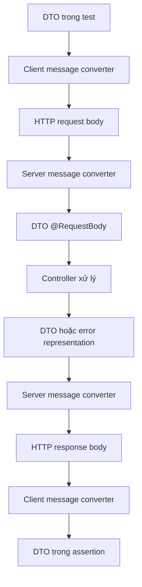

# Kiểm tra tuần tự hóa, giải tuần tự hóa và ánh xạ lỗi

Khi kiểm thử REST API bằng `RestTestClient`, một request và response đi qua nhiều bước chuyển đổi dữ liệu. Object Java trong test được tuần tự hóa thành HTTP request body; Spring MVC hoặc WebFlux giải tuần tự hóa body thành tham số của controller; controller trả object hoặc lỗi; server tuần tự hóa kết quả thành response; cuối cùng `RestTestClient` giải tuần tự hóa response thành kiểu dữ liệu mà test yêu cầu.

Kiểm tra riêng status code là chưa đủ để xác nhận hợp đồng dữ liệu. Một endpoint có thể trả 201 nhưng JSON thiếu trường, sai kiểu hoặc không tương thích với DTO client. Tương tự, lỗi nghiệp vụ có thể bị ánh xạ thành status hoặc error body không đúng contract. Test nên xác nhận cả quá trình chuyển đổi request/response và cách lỗi được biểu diễn qua HTTP.

## 1. Bốn bước chuyển đổi trong một REST request

Một test dùng object Java làm request body và đọc response thành DTO có thể kiểm tra bốn bước:

1. **Client serialization:** `RestTestClient` chuyển object Java thành bytes theo `Content-Type` của request.
2. **Server deserialization:** message converter của ứng dụng đọc bytes và tạo object cho tham số `@RequestBody`.
3. **Server serialization:** object hoặc error representation do controller trả về được chuyển thành response body theo `Accept`, `produces` và converter phía server.
4. **Client deserialization:** `RestTestClient` đọc response body thành kiểu Java mà test yêu cầu, dựa trên `Content-Type` của response và converter phía client.



Mỗi phía có thể dùng bộ converter và cấu hình khác nhau. Trong một test bind trực tiếp vào application context, các bước vẫn diễn ra trong môi trường mô phỏng nhưng sử dụng cấu hình MVC/WebFlux đã được nạp. Khi bind tới server thật, request đi qua HTTP stack và server đang chạy.

## 2. Message converter và media type

Spring dùng `HttpMessageConverter` trong Spring MVC để đọc request body và ghi response body. WebFlux sử dụng hệ thống codec tương ứng. `RestTestClient` cũng cần converter phía client để serialize request và deserialize response.

Một số dạng dữ liệu thường gặp:

| Media type | Dữ liệu | Converter thường dùng trong Spring MVC |
| --- | --- | --- |
| `application/json` | JSON | `MappingJackson2HttpMessageConverter` trong các phiên bản Spring tương ứng |
| `application/xml` | XML | Converter XML khi thư viện hỗ trợ đã có trên classpath |
| `text/plain` | Văn bản | `StringHttpMessageConverter` |
| `application/octet-stream` | Bytes | `ByteArrayHttpMessageConverter` |
| `application/x-www-form-urlencoded` | Form key/value | `FormHttpMessageConverter` |
| `multipart/form-data` | Form nhiều phần/file | Converter multipart và các part converter phù hợp |

`Content-Type` mô tả định dạng của request body. `Accept` mô tả định dạng response client muốn nhận. Khi test gửi DTO JSON, cần đặt `Content-Type: application/json`; nếu muốn nhận DTO JSON, nên đặt `Accept: application/json`.

```java
restTestClient.post()
        .uri("/api/products")
        .contentType(MediaType.APPLICATION_JSON)
        .accept(MediaType.APPLICATION_JSON)
        .body(new CreateProductRequest("Notebook", 12.5))
        .exchange()
        .expectStatus().isCreated()
        .expectHeader().contentTypeCompatibleWith(MediaType.APPLICATION_JSON)
        .expectBody(ProductView.class)
        .value(product -> assertThat(product.name()).isEqualTo("Notebook"));
```

Nếu request khai báo sai `Content-Type`, server có thể không tìm được converter đọc body và trả 415 Unsupported Media Type. Nếu `Accept` không tương thích với representation mà endpoint có thể tạo, server có thể trả 406 Not Acceptable.

## 3. Chuẩn bị test client và application context

`RestTestClient` là API kiểm thử REST service được giới thiệu trong Spring Framework 7.0. Có thể bind client với controller, application context, router function hoặc một server đang chạy. Khi kiểm tra converter, exception handler và cấu hình thật của ứng dụng, bind vào application context thường phù hợp hơn vì test sử dụng các bean và cấu hình đã đăng ký.

Ví dụ cấu hình test Spring MVC:

```java
@SpringJUnitConfig(WebTestConfig.class)
@WebAppConfiguration
class ProductApiTest {
    @Autowired
    private WebApplicationContext applicationContext;

    private RestTestClient restTestClient;

    @BeforeEach
    void setUp() {
        restTestClient = RestTestClient
                .bindToApplicationContext(applicationContext)
                .build();
    }
}
```

`WebTestConfig` cần đăng ký controller, MVC configuration, message converter, validation và `@RestControllerAdvice` mà test muốn kiểm tra. Với WebFlux, dùng application context hoặc router function tương ứng với ứng dụng reactive.

Nếu test chỉ cần một controller đơn giản, có thể bind trực tiếp:

```java
RestTestClient restTestClient = RestTestClient
        .bindToController(new ProductController(productService))
        .build();
```

Khi bind trực tiếp, các thành phần bổ sung như controller advice, validator hoặc converter tùy chỉnh cần được đăng ký trong builder theo API của phiên bản đang dùng. Nếu mục tiêu là kiểm tra cấu hình toàn ứng dụng, nên dùng `bindToApplicationContext(...)`.

Để kiểm tra ứng dụng đã khởi động qua HTTP thật, dùng `bindToServer()` và cấu hình base URL. Phạm vi này còn bao gồm network, server connector và cấu hình triển khai, khác với test bind vào mock infrastructure.

## 4. Kiểm tra request serialization và server deserialization

Giả sử API nhận yêu cầu tạo sản phẩm:

```java
public record CreateProductRequest(
        @NotBlank String name,
        @Positive BigDecimal price) {
}

public record ProductView(
        Long id,
        String name,
        BigDecimal price) {
}
```

Controller nhận request bằng `@RequestBody`:

```java
@RestController
@RequestMapping("/api/products")
class ProductController {
    @PostMapping(consumes = MediaType.APPLICATION_JSON_VALUE,
                 produces = MediaType.APPLICATION_JSON_VALUE)
    ResponseEntity<ProductView> create(
            @Valid @RequestBody CreateProductRequest request) {
        ProductView result = new ProductView(
                42L, request.name(), request.price());
        return ResponseEntity.status(HttpStatus.CREATED).body(result);
    }
}
```

Test gửi object Java làm request body:

```java
@Test
void serializesRequestAndBindsItToController() {
    CreateProductRequest request = new CreateProductRequest(
            "Notebook", new BigDecimal("12.50"));

    restTestClient.post()
            .uri("/api/products")
            .contentType(MediaType.APPLICATION_JSON)
            .accept(MediaType.APPLICATION_JSON)
            .body(request)
            .exchange()
            .expectStatus().isCreated()
            .expectBody(ProductView.class)
            .value(product -> {
                assertThat(product.id()).isEqualTo(42L);
                assertThat(product.name()).isEqualTo("Notebook");
                assertThat(product.price()).isEqualByComparingTo("12.50");
            });
}
```

Khi test thành công, client converter đã tạo request body mà server converter có thể đọc thành `CreateProductRequest`. Controller nhận được giá trị mong đợi và tạo response. Test này xác nhận sự tương thích của hai phía trong cùng một luồng.

Để chứng minh rõ hơn dữ liệu đã được bind vào đúng thuộc tính, controller có thể phản hồi các giá trị nhận được hoặc gọi service với request đó. Nếu cần xác nhận chính xác JSON bytes trên đường truyền, cần kiểm tra ở ranh giới HTTP client outbound riêng; `RestTestClient` chủ yếu kiểm tra endpoint và kết quả xử lý của server.

## 5. Kiểm tra response deserialization

Sau khi server trả JSON, test có thể yêu cầu `RestTestClient` chuyển body thành DTO:

```java
restTestClient.get()
        .uri("/api/products/{id}", 42)
        .accept(MediaType.APPLICATION_JSON)
        .exchange()
        .expectStatus().isOk()
        .expectHeader().contentTypeCompatibleWith(MediaType.APPLICATION_JSON)
        .expectBody(ProductView.class)
        .value(product -> {
            assertThat(product.id()).isEqualTo(42L);
            assertThat(product.name()).isEqualTo("Notebook");
        });
```

`expectBody(ProductView.class)` yêu cầu converter phía client đọc response body thành `ProductView`. Nếu JSON thiếu trường tùy chọn, giá trị Java có thể là `null` hoặc giá trị mặc định tùy kiểu. Nếu JSON có trường không tương thích kiểu hoặc cấu trúc không thể deserialize, converter có thể phát sinh lỗi đọc message.

Nếu chỉ cần kiểm tra một vài trường JSON mà không cần tạo DTO, dùng JSONPath:

```java
restTestClient.get()
        .uri("/api/products/42")
        .exchange()
        .expectStatus().isOk()
        .expectBody()
        .jsonPath("$.id").isEqualTo(42)
        .jsonPath("$.name").isEqualTo("Notebook");
```

JSONPath kiểm tra representation JSON trực tiếp. Nó hữu ích khi test tập trung vào HTTP contract và không muốn phụ thuộc vào một DTO Java cụ thể.

## 6. Giải tuần tự hóa collection và kiểu generic

Khi response là danh sách, không nên deserialize vào `List.class` rồi kỳ vọng các phần tử tự có kiểu DTO. Java type erasure làm mất kiểu phần tử nếu không cung cấp generic type đầy đủ.

Sử dụng `ParameterizedTypeReference`:

```java
ParameterizedTypeReference<List<ProductView>> productListType =
        new ParameterizedTypeReference<>() {};

restTestClient.get()
        .uri("/api/products")
        .accept(MediaType.APPLICATION_JSON)
        .exchange()
        .expectStatus().isOk()
        .expectBody(productListType)
        .value(products -> {
            assertThat(products).hasSize(2);
            assertThat(products.get(0).name()).isEqualTo("Notebook");
        });
```

Cùng cách này có thể kiểm tra kiểu lồng nhau:

```java
ParameterizedTypeReference<ApiEnvelope<List<ProductView>>> responseType =
        new ParameterizedTypeReference<>() {};

restTestClient.get()
        .uri("/api/products")
        .exchange()
        .expectBody(responseType)
        .value(envelope -> assertThat(envelope.data()).isNotEmpty());
```

`ParameterizedTypeReference` giữ metadata kiểu generic để converter có thể deserialize phần tử thành `ProductView` thay vì map tổng quát. Cách này cũng giúp assertion có type safety tốt hơn.

## 7. Kiểm tra converter tùy chỉnh

Ứng dụng có thể dùng media type hoặc kiểu dữ liệu riêng, chẳng hạn định dạng vendor JSON `application/vnd.example.product+json`, XML hoặc một format nội bộ. Khi đó test cần sử dụng đúng cấu hình converter mà ứng dụng triển khai.

Với Spring MVC, converter có thể được đăng ký qua `WebMvcConfigurer`:

```java
@Configuration
@EnableWebMvc
class ApiWebConfig implements WebMvcConfigurer {
    @Override
    public void extendMessageConverters(
            List<HttpMessageConverter<?>> converters) {
        // Đăng ký hoặc điều chỉnh converter tùy chỉnh tại đây.
    }
}
```

Nên dùng `extendMessageConverters(...)` khi muốn bổ sung hoặc điều chỉnh converter mặc định. `configureMessageConverters(...)` có thể thay thế danh sách converter mặc định nếu cấu hình không thêm lại các converter cần thiết; vì vậy phải hiểu tác động trước khi dùng.

Test cần đặt media type tương ứng:

```java
restTestClient.post()
        .uri("/api/products")
        .contentType(MediaType.parseMediaType(
                "application/vnd.example.product+json"))
        .accept(MediaType.APPLICATION_JSON)
        .body(request)
        .exchange()
        .expectStatus().isCreated();
```

Để xác nhận converter tùy chỉnh thực sự được sử dụng, test nên gửi và nhận dữ liệu qua endpoint có mapping `consumes`/`produces` phù hợp. Nếu converter chỉ được đăng ký ở phía server nhưng client test không có converter ghi hoặc đọc media type tương ứng, lỗi có thể xảy ra ở phía client trước hoặc sau khi server xử lý request.

## 8. Ánh xạ exception thành HTTP response

Trong REST API, exception nghiệp vụ không nên để lộ stack trace hoặc chi tiết nội bộ ra response. Spring MVC có thể ánh xạ exception thành HTTP status và error body thông qua:

- `@ResponseStatus` trên exception hoặc handler method.
- `ResponseStatusException` được ném từ controller/service.
- `@ExceptionHandler` trong controller.
- `@RestControllerAdvice` để xử lý exception dùng chung.
- `ProblemDetail` để biểu diễn lỗi theo định dạng Problem Details.

Ví dụ exception nghiệp vụ:

```java
class ProductNotFoundException extends RuntimeException {
    ProductNotFoundException(long id) {
        super("Product " + id + " was not found");
    }
}
```

Controller ném exception khi không tìm thấy tài nguyên:

```java
@GetMapping("/{id}")
ProductView find(@PathVariable long id) {
    return productService.findById(id)
            .orElseThrow(() -> new ProductNotFoundException(id));
}
```

Global exception handler chuyển exception thành 404 và `ProblemDetail`:

```java
@RestControllerAdvice
class ApiExceptionHandler {
    @ExceptionHandler(ProductNotFoundException.class)
    ResponseEntity<ProblemDetail> handleProductNotFound(
            ProductNotFoundException exception) {
        ProblemDetail problem = ProblemDetail.forStatusAndDetail(
                HttpStatus.NOT_FOUND, exception.getMessage());
        problem.setTitle("Product not found");
        problem.setProperty("code", "PRODUCT_NOT_FOUND");
        return ResponseEntity.status(HttpStatus.NOT_FOUND).body(problem);
    }
}
```

Spring có thể ghi `ProblemDetail` dưới media type `application/problem+json`. Test nên yêu cầu và kiểm tra đúng status, media type cùng các thuộc tính error body.

## 9. Kiểm tra error mapping bằng RestTestClient

Test cho trường hợp không tìm thấy sản phẩm:

```java
@Test
void mapsMissingProductToProblemDetail() {
    restTestClient.get()
            .uri("/api/products/{id}", 999)
            .accept(MediaType.APPLICATION_PROBLEM_JSON)
            .exchange()
            .expectStatus().isNotFound()
            .expectHeader().contentTypeCompatibleWith(
                    MediaType.APPLICATION_PROBLEM_JSON)
            .expectBody(ProblemDetail.class)
            .value(problem -> {
                assertThat(problem.getStatus()).isEqualTo(404);
                assertThat(problem.getTitle()).isEqualTo("Product not found");
                assertThat(problem.getDetail()).contains("999");
                assertThat(problem.getProperties()).containsEntry(
                        "code", "PRODUCT_NOT_FOUND");
            });
}
```

Test này xác nhận ba phần của error contract:

1. Exception nghiệp vụ được ánh xạ thành HTTP 404.
2. Response có media type Problem Details.
3. Error body có status, title, detail và mã lỗi mà client có thể sử dụng.

Không nên chỉ kiểm tra `is4xxClientError()` nếu API cam kết rõ 404. Một thay đổi ngoài ý muốn từ 404 sang 400 có thể làm client xử lý sai, dù cả hai đều là lỗi phía client.

Nếu dự án trả error DTO riêng thay cho `ProblemDetail`, dùng `.expectBody(ApiError.class)` và kiểm tra các trường tương ứng. Điều quan trọng là test phải phản ánh định dạng lỗi đã công bố cho client.

## 10. Kiểm tra lỗi validation và lỗi đọc request body

Lỗi validation thường phát sinh khi `@Valid` kiểm tra DTO sau khi request body đã được deserialize:

```java
@PostMapping
ResponseEntity<ProductView> create(
        @Valid @RequestBody CreateProductRequest request) {
    // Xử lý khi dữ liệu hợp lệ.
}
```

Nếu `name` rỗng hoặc `price` không dương, Spring có thể ánh xạ `MethodArgumentNotValidException` thành 400. Nếu ứng dụng có `@RestControllerAdvice` chuẩn hóa validation error, test nên xác nhận error format đó:

```java
restTestClient.post()
        .uri("/api/products")
        .contentType(MediaType.APPLICATION_JSON)
        .accept(MediaType.APPLICATION_PROBLEM_JSON)
        .body(new CreateProductRequest("", new BigDecimal("-1")))
        .exchange()
        .expectStatus().isBadRequest()
        .expectBody(ProblemDetail.class)
        .value(problem -> {
            assertThat(problem.getStatus()).isEqualTo(400);
            assertThat(problem.getTitle()).isEqualTo("Validation failed");
        });
```

Lỗi đọc body xảy ra sớm hơn validation. Ví dụ JSON sai cú pháp hoặc kiểu dữ liệu không thể chuyển đổi có thể làm phát sinh `HttpMessageNotReadableException`, thường được ánh xạ thành 400 Bad Request.

```java
restTestClient.post()
        .uri("/api/products")
        .contentType(MediaType.APPLICATION_JSON)
        .body("{invalid-json")
        .exchange()
        .expectStatus().isBadRequest();
```

Test JSON sai cú pháp không chứng minh Bean Validation hoạt động; nó kiểm tra khả năng đọc request body. Muốn kiểm tra validation, hãy gửi JSON hợp lệ về cú pháp nhưng vi phạm constraint.

## 11. Phân biệt các lỗi HTTP thường gặp

Các lỗi liên quan đến request serialization, deserialization và mapping thường có status khác nhau:

| Status | Nguyên nhân thường gặp | Assertion nên kiểm tra |
| --- | --- | --- |
| 400 Bad Request | JSON sai cú pháp, kiểu dữ liệu không đọc được, validation thất bại | Status và error body mô tả lỗi đầu vào |
| 401 Unauthorized | Thiếu hoặc sai thông tin xác thực | Status và header `WWW-Authenticate` nếu contract yêu cầu |
| 403 Forbidden | Đã xác thực nhưng không có quyền hoặc CSRF không hợp lệ | Status và error representation nếu có |
| 404 Not Found | Tài nguyên không tồn tại | Status và mã lỗi nghiệp vụ |
| 406 Not Acceptable | Không thể tạo response theo `Accept` | Status; kiểm tra endpoint hỗ trợ media type nào |
| 415 Unsupported Media Type | Request `Content-Type` không được hỗ trợ | Status và mapping `consumes`/converter |
| 500 Internal Server Error | Lỗi server không được xử lý theo contract riêng | Status và error response an toàn, không lộ chi tiết nội bộ |

Không nên gộp mọi trường hợp thành một assertion chung. Ví dụ JSON sai cú pháp thường là 400, còn JSON gửi với `Content-Type` không được hỗ trợ thường là 415. Phân biệt hai trường hợp giúp xác định lỗi nằm ở nội dung body hay media type.

## 12. Kiểm tra `ResponseStatusException` và `@ResponseStatus`

Với lỗi đơn giản, controller có thể ném `ResponseStatusException`:

```java
@GetMapping("/{id}")
ProductView find(@PathVariable long id) {
    if (id < 1) {
        throw new ResponseStatusException(
                HttpStatus.BAD_REQUEST, "id must be positive");
    }
    return productService.findById(id)
            .orElseThrow(() -> new ResponseStatusException(
                    HttpStatus.NOT_FOUND, "Product not found"));
}
```

Test xác nhận status:

```java
restTestClient.get()
        .uri("/api/products/0")
        .exchange()
        .expectStatus().isBadRequest();

restTestClient.get()
        .uri("/api/products/999")
        .exchange()
        .expectStatus().isNotFound();
```

Một exception tùy chỉnh có thể dùng `@ResponseStatus(HttpStatus.NOT_FOUND)`. Tuy nhiên, nếu API cần một error body ổn định với mã lỗi, title, detail hoặc trường bổ sung, `@RestControllerAdvice` thường cho phép kiểm soát representation rõ ràng hơn.

## 13. Kiểm tra lỗi không làm lộ thông tin nội bộ

Error response là một phần của API contract và cũng là ranh giới bảo mật. Test nên bảo đảm response chứa thông tin hữu ích cho client nhưng không chứa stack trace, SQL, đường dẫn file hoặc chi tiết hạ tầng.

Ví dụ:

```java
restTestClient.get()
        .uri("/api/products/999")
        .accept(MediaType.APPLICATION_PROBLEM_JSON)
        .exchange()
        .expectStatus().isNotFound()
        .expectBody()
        .jsonPath("$.code").isEqualTo("PRODUCT_NOT_FOUND")
        .jsonPath("$.detail").value(detail ->
                assertThat(detail.toString()).doesNotContain("SQLException"))
        .jsonPath("$.trace").doesNotExist();
```

Tên trường cụ thể phụ thuộc error schema của ứng dụng. Không nên kiểm tra một field `trace` nếu contract không định nghĩa nó; thay vào đó, xác nhận những thông tin nhạy cảm không xuất hiện trong response body thực tế hoặc dùng error DTO chỉ chứa các trường công khai.

Đối với lỗi 500, nên kiểm tra mã lỗi chung và thông điệp an toàn. Chi tiết exception nên được ghi trong log phía server với correlation ID để đội vận hành truy vết.

## 14. Phân biệt RestTestClient với kiểm thử outbound RestClient

Tên gọi gần nhau nhưng hai bài toán khác nhau:

| Công cụ | Đối tượng được kiểm tra | Mục tiêu |
| --- | --- | --- |
| `RestTestClient` | REST endpoint của ứng dụng đang test | Gửi request đến controller/router và kiểm tra status, header, body, error mapping |
| `RestClient` | HTTP client mà ứng dụng dùng để gọi dịch vụ bên ngoài | Kiểm tra request outbound, converter, response mapping và xử lý lỗi của client code |
| `MockRestServiceServer` | Transport boundary của `RestClient` hoặc `RestTemplate` | Giả lập HTTP server bên ngoài, kiểm tra request và cung cấp response giả |

Nếu cần kiểm tra một service dùng `RestClient` gọi sang hệ thống khác, hãy dùng `MockRestServiceServer`:

```java
RestClient.Builder builder = RestClient.builder()
        .baseUrl("https://catalog.example.test");

MockRestServiceServer mockServer =
        MockRestServiceServer.bindTo(builder).build();

RestClient restClient = builder.build();
```

Sau đó thiết lập kỳ vọng request và response giả:

```java
mockServer.expect(requestTo("https://catalog.example.test/products/42"))
        .andExpect(method(HttpMethod.GET))
        .andExpect(header(HttpHeaders.ACCEPT, MediaType.APPLICATION_JSON_VALUE))
        .andRespond(withSuccess("""
                {"id":42,"name":"Notebook","price":12.50}
                """, MediaType.APPLICATION_JSON));

ProductView product = restClient.get()
        .uri("/products/42")
        .accept(MediaType.APPLICATION_JSON)
        .retrieve()
        .body(ProductView.class);

assertThat(product.name()).isEqualTo("Notebook");
mockServer.verify();
```

`MockRestServiceServer` xác nhận request outbound và response deserialization của `RestClient`. Đây là cách phù hợp để kiểm tra serialization chính xác của HTTP client mà không gọi mạng thật. `RestTestClient` tập trung vào việc kiểm tra endpoint của ứng dụng.

## 15. Lỗi thường gặp và cách xử lý

| Hiện tượng | Nguyên nhân có thể có | Cách xử lý |
| --- | --- | --- |
| Server trả 415 khi gửi DTO | Request thiếu/sai `Content-Type` hoặc server không có converter đọc kiểu đó | Đặt media type đúng và kiểm tra converter phía server |
| Server trả 400 với JSON hợp lệ | Kiểu JSON không khớp DTO hoặc binding/validation thất bại | Kiểm tra field name, kiểu dữ liệu, constructor và validation constraint |
| Client không deserialize được response | `Content-Type` response không phù hợp hoặc thiếu converter phía client | Kiểm tra response header và cấu hình client converter |
| DTO có field `null` dù JSON có dữ liệu | Tên field, visibility, constructor hoặc mapping không khớp | Kiểm tra cấu hình Jackson/serializer và DTO |
| Collection chỉ chứa map thay vì DTO | Kiểu generic bị mất khi deserialize | Dùng `ParameterizedTypeReference<List<...>>` |
| Test nhận 406 | `Accept` không tương thích `produces` hoặc converter không ghi được representation | Kiểm tra `Accept`, mapping và converter phía server |
| Lỗi nghiệp vụ trả status 500 | Exception handler chưa được nạp hoặc exception chưa được ánh xạ | Đăng ký `@RestControllerAdvice` và kiểm tra context test |
| Error body không đúng schema | Handler trả sai DTO hoặc content negotiation không đúng | Assert status, media type và từng trường error body |
| JSON sai cú pháp bị nhầm với validation | Request chưa deserialize được nên chưa đến Bean Validation | Tách test malformed JSON và test JSON hợp lệ nhưng vi phạm constraint |
| Test không dùng converter tùy chỉnh | Bind client/controller thiếu cấu hình MVC của ứng dụng | Bind vào application context hoặc đăng ký converter trong builder |

Khi gặp lỗi, hãy xác định lỗi xảy ra ở phía client hay server. Nếu request chưa serialize được, controller chưa nhận request. Nếu server trả 400/415, xem `Content-Type`, body và converter đọc. Nếu server đã trả response nhưng test không deserialize được, xem response `Content-Type`, kiểu đích và converter phía client. Nếu status đúng nhưng error body sai, kiểm tra `@RestControllerAdvice` và view/representation của lỗi.

## 16. Nguyên tắc viết test serialization, deserialization và error mapping

1. Dùng DTO đại diện contract request/response và đặt `Content-Type`/`Accept` rõ ràng.
2. Kiểm tra request object được bind đúng vào controller bằng cách xác nhận dữ liệu phản hồi hoặc tác động nghiệp vụ.
3. Dùng `expectBody(Class)` để xác nhận response deserialization thành DTO.
4. Dùng `ParameterizedTypeReference` khi response có collection hoặc generic type lồng nhau.
5. Phân biệt lỗi media type 415, lỗi đọc body 400, lỗi validation 400 và lỗi response negotiation 406.
6. Kiểm tra exception nghiệp vụ được ánh xạ thành status và error representation ổn định.
7. Dùng `ProblemDetail` hoặc error DTO để kiểm tra title, detail, mã lỗi và các thuộc tính công khai.
8. Không để error response lộ stack trace hoặc thông tin hạ tầng.
9. Nạp đúng application context khi test cần converter, validator hoặc `@RestControllerAdvice` của ứng dụng.
10. Dùng `MockRestServiceServer` cho outbound `RestClient`/`RestTemplate`; dùng `RestTestClient` để kiểm thử REST endpoint.

Một bài test REST đáng tin cậy xác nhận toàn bộ đường đi của dữ liệu: request được serialize đúng, server bind được DTO, response được serialize theo media type đã công bố, client đọc được kiểu dữ liệu mong đợi và lỗi được ánh xạ thành HTTP response ổn định. Khi tách rõ converter phía client, converter phía server và exception handling, test sẽ chỉ ra chính xác tầng nào đang vi phạm contract.
