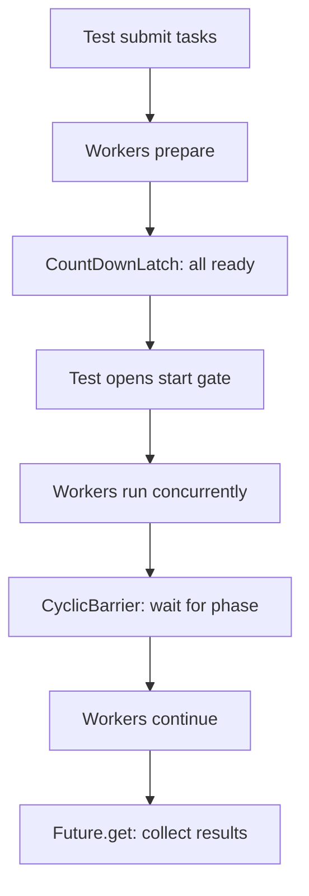

# Latch, barrier và Future cho thứ tự có thể kiểm soát

## 1. Vì sao kiểm thử bất đồng bộ cần điều khiển thứ tự?

Một bài kiểm thử đồng bộ thường gọi phương thức rồi kiểm tra kết quả ngay sau khi phương thức trả về. Với xử lý bất đồng bộ hoặc song song, nhiều công việc có thể chạy trên các thread khác nhau. Thứ tự bắt đầu, thời điểm hoàn tất và thời điểm một thread nhìn thấy dữ liệu của thread khác phụ thuộc vào lịch chạy của hệ điều hành và executor.

Nếu test dùng `Thread.sleep(...)` để chờ một tác vụ, test chỉ đoán rằng tác vụ đã có đủ thời gian chạy. Máy nhanh có thể làm test chạy qua, máy chậm hoặc CI tải cao có thể làm test thất bại. Sleep cũng không chứng minh rằng thread đã đến đúng điểm đồng bộ mà test muốn kiểm tra.

Java cung cấp các primitive đồng bộ giúp test dựng một thứ tự xác định:

- `CountDownLatch` cho phép một hoặc nhiều thread chờ cho đến khi một bộ đếm về 0.
- `CyclicBarrier` cho phép một nhóm thread gặp nhau tại cùng một điểm trước khi cùng đi tiếp.
- `Future` đại diện cho kết quả của một công việc được thực thi bất đồng bộ; test có thể chờ, lấy kết quả, nhận lỗi hoặc hủy công việc.

Các công cụ này không làm cho thread chạy theo một lịch cố định. Chúng tạo ra những điểm đồng bộ rõ ràng để test kiểm soát điều kiện bắt đầu, điều kiện tiếp tục và cách thu nhận kết quả.

## 2. `CountDownLatch`: chờ nhiều công việc hoàn tất hoặc mở cổng bắt đầu

`CountDownLatch` được khởi tạo với một số đếm. Mỗi lần gọi `countDown()` làm số đếm giảm một đơn vị. Thread gọi `await()` sẽ chờ cho đến khi số đếm về 0. Khi đã về 0, latch không thể được đặt lại.

```java
CountDownLatch latch = new CountDownLatch(2);

Future<?> first = executor.submit(() -> {
    try {
        prepareFirstResource();
    } finally {
        latch.countDown();
    }
});

Future<?> second = executor.submit(() -> {
    try {
        prepareSecondResource();
    } finally {
        latch.countDown();
    }
});

boolean completed = latch.await(2, TimeUnit.SECONDS);
assertThat(completed).isTrue();
first.get(1, TimeUnit.SECONDS);
second.get(1, TimeUnit.SECONDS);
```

Trong ví dụ, thread kiểm thử chỉ tiếp tục khi cả hai công việc đã gọi `countDown()`. `finally` bảo đảm bộ đếm được giảm kể cả khi phần chuẩn bị ném exception; hai lệnh `Future.get(...)` sau đó làm lộ lỗi của từng worker. Overload `await(timeout, unit)` trả về `false` nếu hết thời gian mà latch chưa về 0. Dùng timeout giúp test kết thúc với lỗi rõ ràng thay vì treo vô hạn.

`CountDownLatch` cũng có thể được dùng theo chiều ngược lại: nhiều worker báo rằng chúng đã sẵn sàng, sau đó test mở một cổng chung để tất cả bắt đầu gần như cùng lúc.

```java
CountDownLatch ready = new CountDownLatch(3);
CountDownLatch start = new CountDownLatch(1);

Callable<Void> worker = () -> {
    ready.countDown();
    start.await();
    performConcurrentWork();
    return null;
};
```

`ready` là latch đếm xuống khi worker đã đến điểm chờ. `start` là latch một lần mở: ban đầu có số đếm 1, mọi worker chờ ở `await()`, và test gọi `start.countDown()` để thả tất cả. Đây là kỹ thuật hữu ích khi muốn tạo tranh chấp đồng thời có thể lặp lại, ví dụ nhiều request cùng cập nhật một tài nguyên.

### 2.1. Phân biệt latch chờ hoàn tất và latch mở cổng

| Mục đích | Cách khởi tạo | Thread nào gọi `countDown()`? | Thread nào gọi `await()`? |
|---|---|---|---|
| Chờ N công việc hoàn tất | `new CountDownLatch(N)` | Mỗi worker khi hoàn tất phần việc cần theo dõi | Test hoặc thread điều phối |
| Chờ N worker sẵn sàng rồi bắt đầu | `new CountDownLatch(N)` cho `ready` và `new CountDownLatch(1)` cho `start` | Worker giảm `ready`; test giảm `start` | Worker chờ `start`; test chờ `ready` |

Không gọi `countDown()` chỉ vì worker đã được submit vào executor. Nó nên được gọi tại điểm mà test muốn xác nhận, ví dụ sau khi worker đã chuẩn bị xong hoặc sau khi công việc đã hoàn tất.

### 2.2. Các đặc tính cần nhớ

- `countDown()` không chặn thread và gọi thêm khi bộ đếm đã bằng 0 không làm thay đổi kết quả.
- `await()` không có timeout có thể chờ mãi nếu một worker không bao giờ gọi `countDown()`.
- `await(timeout, unit)` trả về boolean; test phải kiểm tra kết quả này.
- `await()` có thể ném `InterruptedException`; giữ đúng trạng thái interrupt hoặc truyền exception theo chữ ký phương thức.
- Một latch chỉ dùng một lần. Nếu cần nhiều vòng đồng bộ, hãy cân nhắc `CyclicBarrier` hoặc tạo latch mới cho từng vòng.

Các thao tác trước `countDown()` có quan hệ happens-before với những thao tác tiếp theo sau khi `await()` trên cùng latch trả về thành công. Vì thế latch không chỉ đánh thức thread; nó còn tạo ranh giới visibility cho dữ liệu được chuẩn bị trước đó.

## 3. Dùng hai latch để dựng một bài test đồng thời xác định

Ví dụ sau có hai worker cùng chờ ở cổng bắt đầu. Test chỉ mở cổng sau khi cả hai worker đã sẵn sàng. Sau đó test chờ kết quả qua `Future`.

```java
@Test
void startsTwoWorkersOnlyAfterBothAreReady() throws Exception {
    ExecutorService executor = Executors.newFixedThreadPool(2);
    CountDownLatch ready = new CountDownLatch(2);
    CountDownLatch start = new CountDownLatch(1);

    Callable<Integer> task = () -> {
        ready.countDown();
        if (!start.await(2, TimeUnit.SECONDS)) {
            throw new TimeoutException("Start gate was not opened");
        }
        return calculateValue();
    };

    Future<Integer> first = executor.submit(task);
    Future<Integer> second = executor.submit(task);

    try {
        assertThat(ready.await(2, TimeUnit.SECONDS)).isTrue();
        start.countDown();

        assertThat(first.get(2, TimeUnit.SECONDS)).isEqualTo(10);
        assertThat(second.get(2, TimeUnit.SECONDS)).isEqualTo(10);
    } finally {
        // Mở cổng kể cả khi assertion trước đó thất bại.
        start.countDown();
        executor.shutdownNow();
        executor.awaitTermination(2, TimeUnit.SECONDS);
    }
}
```

Trong test thực tế, `calculateValue()` là phần xử lý cần chạy song song. Điều quan trọng là cả hai worker phải gọi `ready.countDown()` trước khi chờ `start`. Nếu một worker bị lỗi trước điểm đó, `ready.await(...)` hết thời gian và test báo lỗi thay vì treo.

`finally` mở cổng một lần nữa để tránh giữ worker ở trạng thái chờ khi một assertion thất bại. Sau đó executor được yêu cầu dừng. Nếu tác vụ cần thời gian để kết thúc sạch sẽ, có thể gọi `shutdown()` trước, chờ `awaitTermination(...)`, rồi mới gọi `shutdownNow()` khi vượt quá thời hạn.

Không nên dùng một `CountDownLatch` tĩnh dùng chung giữa nhiều test. Trạng thái latch là mutable và một khi về 0 thì không thể phục hồi. Mỗi test nên tạo latch mới để tránh phụ thuộc thứ tự chạy hoặc làm test song song ảnh hưởng lẫn nhau.

## 4. Kiểm tra race condition bằng start gate

Một ví dụ thường gặp là nhiều thread cùng tăng một bộ đếm. Nếu thao tác tăng không nguyên tử, các thread có thể ghi đè kết quả của nhau.

```java
class UnsafeCounter {
    private int value;

    void increment() {
        value++;
    }

    int value() {
        return value;
    }
}
```

Test có thể tạo nhiều worker, giữ chúng ở start gate, rồi thả cùng lúc:

```java
@Test
void exposesConcurrentUpdates() throws Exception {
    int workers = 8;
    int incrementsPerWorker = 1_000;
    ExecutorService executor = Executors.newFixedThreadPool(workers);
    CountDownLatch ready = new CountDownLatch(workers);
    CountDownLatch start = new CountDownLatch(1);
    CountDownLatch finished = new CountDownLatch(workers);
    UnsafeCounter counter = new UnsafeCounter();

    try {
        List<Future<?>> futures = IntStream.range(0, workers)
                .mapToObj(index -> executor.submit((Callable<Void>) () -> {
                    ready.countDown();
                    try {
                        if (!start.await(2, TimeUnit.SECONDS)) {
                            throw new TimeoutException("Start gate timed out");
                        }
                        for (int i = 0; i < incrementsPerWorker; i++) {
                            counter.increment();
                        }
                    } finally {
                        finished.countDown();
                    }
                    return null;
                }))
                .toList();

        assertThat(ready.await(2, TimeUnit.SECONDS)).isTrue();
        start.countDown();
        assertThat(finished.await(5, TimeUnit.SECONDS)).isTrue();
        for (Future<?> future : futures) {
            future.get(1, TimeUnit.SECONDS);
        }

        assertThat(counter.value()).isEqualTo(workers * incrementsPerWorker);
    } finally {
        start.countDown();
        executor.shutdownNow();
        executor.awaitTermination(2, TimeUnit.SECONDS);
    }
}
```

Test này tăng khả năng các thao tác đan xen bằng cách đưa các worker đến cùng một điểm rồi mở cổng. Tuy nhiên, một race condition không nhất thiết xuất hiện trong mọi lần chạy. Test đồng thời có thể giúp tái hiện lỗi, nhưng không thay thế việc chọn cơ chế đồng bộ đúng trong production, chẳng hạn `AtomicInteger`, `synchronized` hoặc lock phù hợp.

Nếu muốn test một counter an toàn, thay `UnsafeCounter` bằng implementation dùng `AtomicInteger` rồi xác nhận tổng cuối cùng. Không dùng kết quả của một lần chạy counter không an toàn để kết luận nó luôn đúng hoặc luôn sai.

## 5. `CyclicBarrier`: nhiều worker gặp nhau tại một điểm

`CyclicBarrier` được khởi tạo với số lượng parties. Mỗi thread gọi `await()` khi đã đến barrier. Khi đủ số parties, barrier mở và các thread tiếp tục. Khác với `CountDownLatch`, barrier có thể tái sử dụng cho vòng đồng bộ tiếp theo sau khi nhóm thread đã đi qua vòng hiện tại.

```java
CyclicBarrier barrier = new CyclicBarrier(3);

Callable<Void> worker = () -> {
    prepareLocalState();
    barrier.await();
    runNextPhase();
    return null;
};
```

Trong ví dụ, barrier có ba parties. Nếu chỉ có hai worker gọi `await()`, chúng sẽ tiếp tục chờ cho đến khi party thứ ba đến hoặc barrier bị phá vỡ. Số parties phải khớp với số thread thực sự tham gia mỗi vòng.

### 5.1. Dùng barrier để kiểm tra hai giai đoạn xử lý

```java
@Test
void waitsUntilBothWorkersFinishPreparation() throws Exception {
    ExecutorService executor = Executors.newFixedThreadPool(2);
    CyclicBarrier barrier = new CyclicBarrier(2);

    Future<String> first = executor.submit(() -> {
        prepareFirstPart();
        barrier.await(2, TimeUnit.SECONDS);
        return "first-ready";
    });

    Future<String> second = executor.submit(() -> {
        prepareSecondPart();
        barrier.await(2, TimeUnit.SECONDS);
        return "second-ready";
    });

    try {
        assertThat(first.get(3, TimeUnit.SECONDS)).isEqualTo("first-ready");
        assertThat(second.get(3, TimeUnit.SECONDS)).isEqualTo("second-ready");
    } finally {
        executor.shutdownNow();
        executor.awaitTermination(2, TimeUnit.SECONDS);
    }
}
```

Barrier bảo đảm cả hai worker đã gọi đến điểm đồng bộ trước khi một worker nào có thể đi qua barrier. Nó không bảo đảm worker thứ nhất sẽ chạy phần sau trước worker thứ hai. Sau khi barrier mở, scheduler vẫn quyết định thứ tự thực thi.

Nếu bài toán cần thứ tự cụ thể, ví dụ B chỉ được chạy sau khi A hoàn tất, dùng latch hoặc một dependency giữa các công việc. Barrier dành cho điểm hội tụ của nhiều worker, không phải công cụ xếp hàng tuần tự.

### 5.2. Barrier action

`CyclicBarrier` có thể nhận một `Runnable` chạy một lần khi party cuối cùng đến barrier, trước khi các party được giải phóng:

```java
AtomicInteger completedPhases = new AtomicInteger();

CyclicBarrier barrier = new CyclicBarrier(2, completedPhases::incrementAndGet);
```

Barrier action phù hợp cho thao tác ngắn, đồng bộ trạng thái của phase hoặc ghi nhận rằng mọi worker đã đến điểm gặp. Action chạy trên thread đến barrier cuối cùng. Không đặt công việc blocking dài hoặc chờ một trong các party khác trong action, vì điều đó có thể làm cả nhóm bị kẹt.

## 6. Tái sử dụng barrier cho nhiều phase

Một barrier có thể dùng lại sau khi tất cả parties vượt qua vòng hiện tại. Điều này phù hợp với thuật toán chia thành nhiều phase, ví dụ mỗi worker tính toán phần dữ liệu riêng, đồng bộ, rồi mới xử lý vòng tiếp theo.

```java
@Test
void synchronizesTwoPhases() throws Exception {
    ExecutorService executor = Executors.newFixedThreadPool(2);
    AtomicInteger barrierTrips = new AtomicInteger();
    CyclicBarrier barrier = new CyclicBarrier(2, barrierTrips::incrementAndGet);

    Callable<Integer> worker = () -> {
        int localTotal = 0;

        localTotal += calculatePhaseOne();
        barrier.await(2, TimeUnit.SECONDS);

        localTotal += calculatePhaseTwo();
        barrier.await(2, TimeUnit.SECONDS);

        return localTotal;
    };

    Future<Integer> first = executor.submit(worker);
    Future<Integer> second = executor.submit(worker);

    try {
        assertThat(first.get(5, TimeUnit.SECONDS)).isEqualTo(30);
        assertThat(second.get(5, TimeUnit.SECONDS)).isEqualTo(30);
        assertThat(barrierTrips.get()).isEqualTo(2);
    } finally {
        executor.shutdownNow();
        executor.awaitTermination(2, TimeUnit.SECONDS);
    }
}
```

Mỗi worker đi qua barrier hai lần. Barrier action chạy một lần ở cuối mỗi phase, do đó bộ đếm `barrierTrips` đạt 2. Trong test thực tế, các giá trị trả về và `calculatePhase...()` phải phù hợp với thuật toán đang kiểm tra.

Barrier chỉ tái sử dụng an toàn sau khi phase trước hoàn tất. Nếu một party bị lỗi hoặc timeout khi đang chờ, barrier có thể chuyển sang trạng thái broken và các party còn lại nhận `BrokenBarrierException`. Không được giả định barrier sẽ tự phục hồi và tiếp tục phase kế tiếp.

## 7. Broken barrier, timeout và interrupt

Barrier có thể bị phá vỡ khi một party bị interrupt, timeout hoặc thất bại trong lúc chờ. Các thread còn lại đang chờ cùng barrier sẽ được đánh thức với `BrokenBarrierException`.

```java
try {
    barrier.await(2, TimeUnit.SECONDS);
} catch (InterruptedException ex) {
    Thread.currentThread().interrupt();
    throw new IllegalStateException("Worker interrupted", ex);
} catch (BrokenBarrierException | TimeoutException ex) {
    throw new IllegalStateException("Could not complete the phase", ex);
}
```

Nếu muốn dùng lại sau khi barrier broken, có thể gọi `reset()` khi mọi thread tham gia đã được xử lý và không còn thread nào đang chờ theo vòng cũ. `reset()` không nên được dùng như cách che lỗi đồng bộ; trước tiên cần tìm lý do party không đến được barrier.

`CountDownLatch` và `CyclicBarrier` đều có thể chờ với timeout. Hãy đặt timeout cho cả điểm đồng bộ và `Future.get(...)`. Nếu chỉ đặt timeout ở Future bên ngoài nhưng worker đang chờ vô hạn trong latch hoặc barrier, executor có thể không dừng được sạch sẽ.

## 8. `Future`: chờ kết quả của công việc bất đồng bộ

`Future<T>` đại diện cho kết quả sẽ có trong tương lai của một tác vụ. Khi submit `Callable<T>` vào `ExecutorService`, executor trả về Future để caller lấy kết quả sau.

```java
ExecutorService executor = Executors.newSingleThreadExecutor();

try {
    Future<Integer> future = executor.submit(() -> calculateTotal(10, 20));

    Integer result = future.get(2, TimeUnit.SECONDS);
    assertThat(result).isEqualTo(30);
} finally {
    executor.shutdownNow();
    executor.awaitTermination(2, TimeUnit.SECONDS);
}
```

Các phương thức quan trọng:

| Phương thức | Ý nghĩa |
|---|---|
| `get()` | Chờ hoàn tất và trả kết quả; có thể chờ vô hạn |
| `get(timeout, unit)` | Chờ tối đa thời gian chỉ định, nếu hết hạn ném `TimeoutException` |
| `isDone()` | Cho biết tác vụ đã hoàn tất, bị hủy hoặc kết thúc bằng exception |
| `isCancelled()` | Cho biết Future đã bị hủy |
| `cancel(true)` | Yêu cầu hủy; có thể interrupt thread đang chạy nếu tác vụ hỗ trợ interrupt |

`isDone()` không lấy kết quả và cũng không chờ. Nếu test cần kết quả hoặc cần biết exception của task, phải gọi `get()`.

### 8.1. Lỗi trong task được chuyển về caller

Nếu `Callable` ném exception, `Future.get()` ném `ExecutionException`; nguyên nhân thật nằm trong `getCause()`:

```java
Future<String> future = executor.submit(() -> {
    throw new IllegalArgumentException("Invalid input");
});

ExecutionException error = assertThrows(
        ExecutionException.class,
        () -> future.get(2, TimeUnit.SECONDS));

assertThat(error.getCause())
        .isInstanceOf(IllegalArgumentException.class)
        .hasMessage("Invalid input");
```

Điều này giúp test xác nhận lỗi phát sinh ở thread thực thi. Nếu chỉ kiểm tra `future.isDone()`, test có thể bỏ sót một task đã hoàn tất do lỗi.

### 8.2. Timeout không tự hủy task

```java
Future<String> future = executor.submit(() -> performSlowWork());

assertThrows(TimeoutException.class,
        () -> future.get(100, TimeUnit.MILLISECONDS));
```

`TimeoutException` chỉ cho biết caller đã chờ quá thời hạn. Task có thể vẫn tiếp tục chạy. Nếu muốn yêu cầu hủy, gọi `future.cancel(true)` và bảo đảm task phản ứng đúng với interrupt.

`cancel(true)` là yêu cầu best-effort. Nó không thể buộc dừng một tác vụ đang bỏ qua interrupt hoặc đang mắc trong một API không hỗ trợ hủy. Code bất đồng bộ nên kiểm tra interrupt hoặc dùng API có timeout/cancellation phù hợp.

### 8.3. `Future.get()` tạo điểm đồng bộ và bảo đảm visibility

Theo memory consistency guarantee của `Future`, các hành động trong computation bất đồng bộ xảy ra trước những hành động tiếp theo sau khi thread khác gọi `get()` thành công trên Future tương ứng. Vì thế, test có thể chờ Future hoàn tất rồi đọc kết quả mà task đã tạo.

Không nên đọc một biến mutable được worker cập nhật trong lúc task còn chạy rồi kỳ vọng giá trị đã ổn định. Hãy lấy kết quả qua Future hoặc dùng biến đồng bộ như atomic, lock hoặc concurrent collection khi cần chia sẻ trạng thái.

## 9. `Future` không đảm bảo thứ tự thực thi

Nếu submit nhiều task liên tiếp, thứ tự gọi `submit()` không đảm bảo thứ tự chúng bắt đầu hoặc kết thúc. Tương tự, gọi `futureA.get()` trước `futureB.get()` chỉ có nghĩa thread test chờ lấy kết quả A trước; nó không chứng minh task A đã chạy trước task B.

```java
Future<String> first = executor.submit(() -> doFirstWork());
Future<String> second = executor.submit(() -> doSecondWork());

String firstResult = first.get(2, TimeUnit.SECONDS);
String secondResult = second.get(2, TimeUnit.SECONDS);
```

Hai task vẫn có thể chạy song song hoặc task thứ hai hoàn tất trước task thứ nhất. Nếu thứ tự nghiệp vụ là bắt buộc, hãy biểu diễn dependency bằng latch, queue, chain của `CompletableFuture` hoặc một cơ chế điều phối rõ ràng.

Ví dụ, task B phải đợi task A hoàn tất một bước chuẩn bị:

```java
CountDownLatch firstStepDone = new CountDownLatch(1);

Future<String> first = executor.submit(() -> {
    try {
        performFirstStep();
        return "first-done";
    } finally {
        firstStepDone.countDown();
    }
});

Future<String> second = executor.submit(() -> {
    if (!firstStepDone.await(2, TimeUnit.SECONDS)) {
        throw new TimeoutException("First step did not finish");
    }
    performSecondStep();
    return "second-done";
});
```

Latch trên bảo đảm B không bắt đầu bước phụ thuộc trước khi A đã đi qua bước đầu tiên. Vì `countDown()` nằm trong `finally`, B vẫn được giải phóng nếu A thất bại; test phải gọi `first.get()` để phát hiện lỗi của A thay vì chỉ nhìn kết quả B. Nếu B chỉ được phép chạy khi A thành công, cần truyền trạng thái thành công/thất bại rõ ràng hoặc dùng `CompletableFuture.thenApply/thenCompose` để nối dependency.

## 10. Kết hợp Latch, Barrier và Future

Ba công cụ có vai trò khác nhau và thường được dùng cùng nhau:



- Latch phù hợp với tín hiệu một lần: chờ N worker sẵn sàng hoặc chờ N tác vụ hoàn tất.
- Barrier phù hợp với điểm gặp của một nhóm worker ở mỗi phase.
- Future phù hợp để lấy kết quả, quan sát exception, timeout hoặc hủy từng task.

Không dùng barrier chỉ để chờ task hoàn tất nếu latch biểu đạt ý định rõ hơn. Không dùng Future để suy luận thứ tự giữa các task nếu không có dependency. Không dùng latch một lần cho một thuật toán cần đồng bộ nhiều vòng.

## 11. Áp dụng khi kiểm thử Spring `@Async`

Trong Spring, `@Async` cho phép phương thức chạy trên executor được cấu hình. Phương thức có thể trả `Future<T>` hoặc `CompletableFuture<T>` để caller quan sát kết quả. Một test có thể gọi bean Spring rồi chờ Future với timeout.

```java
@Service
class ReportService {

    @Async
    public CompletableFuture<String> generateReport(String reportId) {
        String result = doGenerate(reportId);
        return CompletableFuture.completedFuture(result);
    }
}
```

```java
@SpringBootTest
class ReportServiceTest {

    @Autowired
    private ReportService reportService;

    @Test
    void generatesReportAsynchronously() throws Exception {
        CompletableFuture<String> future = reportService.generateReport("R-100");

        assertThat(future.get(3, TimeUnit.SECONDS)).isEqualTo("READY");
    }
}
```

Ví dụ minh họa cách chờ kết quả của lời gọi `@Async`. Ứng dụng cần bật async processing, thường bằng `@EnableAsync`, và cấu hình executor phù hợp. Trong ứng dụng thực tế, `doGenerate(...)` là công việc cần xử lý. `@Async` hoạt động qua Spring proxy; lời gọi phải đi qua bean được Spring quản lý. Gọi một phương thức `@Async` từ một phương thức khác trong cùng object thường không đi qua proxy, vì vậy không tạo tác vụ bất đồng bộ như mong đợi.

Nếu cần xác nhận tác vụ bắt đầu hoặc dừng tại một điểm cụ thể, có thể inject một dependency test dùng `CountDownLatch` hoặc một test executor được cấu hình rõ ràng. Không nên dùng `Thread.sleep(...)` để đoán rằng executor đã chạy xong.

Với `@Async`, thread xử lý khác với thread test. Transaction gắn với test method không tự truyền sang thread async. Nếu công việc cần transaction, hãy cấu hình transaction ở phương thức/service chạy trong executor và kiểm thử ranh giới transaction riêng.

## 12. Cấu hình executor và dọn dẹp sau test

Test concurrency cần quản lý vòng đời executor. Một executor không được shutdown có thể giữ thread sống sau khi test hoàn tất và làm chậm hoặc treo tiến trình test.

Mẫu dọn dẹp thường dùng:

```java
executor.shutdown();
if (!executor.awaitTermination(2, TimeUnit.SECONDS)) {
    executor.shutdownNow();
    executor.awaitTermination(2, TimeUnit.SECONDS);
}
```

`shutdown()` ngừng nhận task mới nhưng cho phép task đã submit hoàn tất. `shutdownNow()` yêu cầu dừng ngay bằng cách interrupt các worker đang chạy và trả về các task chưa bắt đầu. Sau khi gọi `shutdownNow()`, vẫn nên chờ `awaitTermination(...)` trong một thời hạn hữu hạn.

Các quy tắc thực tế:

- Dùng executor cục bộ cho test đơn giản; nếu dùng Spring-managed executor, tránh tự shutdown bean dùng chung của ApplicationContext.
- Chọn số thread đủ để đáp ứng số worker đang chờ barrier/latch. Nếu tất cả thread trong pool đều bị block chờ một task khác chưa được schedule, test có thể deadlock.
- Luôn đặt timeout cho `await()`, `barrier.await(...)` và `Future.get(...)`.
- Mở latch trong `finally` để giải phóng worker nếu assertion thất bại.
- Không chia sẻ latch, barrier hoặc mutable state giữa các test chạy song song nếu chưa có cơ chế cô lập.
- Kiểm tra exception của mọi Future; đừng bỏ qua task chỉ vì test đã thấy một kết quả khác.
- Không nuốt `InterruptedException`; nếu không thể truyền exception, khôi phục interrupt bằng `Thread.currentThread().interrupt()`.

## 13. Những lỗi thường gặp và cách xử lý

| Hiện tượng | Nguyên nhân thường gặp | Cách xử lý |
|---|---|---|
| Test treo ở `CountDownLatch.await()` | Một worker không gọi `countDown()` hoặc bị lỗi trước điểm đó | Dùng `await(timeout, unit)`, đặt `countDown()` ở đúng điểm và kiểm tra Future |
| Worker không vượt qua start gate | Test quên gọi `start.countDown()` | Mở gate sau khi xác nhận đủ worker sẵn sàng và mở lại trong `finally` |
| `CyclicBarrier` bị broken | Một party timeout, bị interrupt hoặc không đến barrier | Kiểm tra số parties, timeout và exception của từng worker |
| Barrier chờ mãi | Số thread tham gia ít hơn số parties hoặc executor thiếu thread | Đồng bộ số parties với số worker và cấp đủ thread trong pool |
| Test cho kết quả không ổn định | Dùng sleep hoặc giả định thứ tự scheduler | Dùng latch/barrier để điều khiển điểm đồng bộ và Future để lấy kết quả |
| `Future.get()` ném `ExecutionException` | Task kết thúc do exception | Kiểm tra `getCause()` để xác định lỗi gốc |
| Test timeout nhưng task vẫn chạy | `get(timeout)` không tự hủy task | Gọi `cancel(true)` khi phù hợp và làm cho task phản ứng với interrupt |
| Thread còn sống sau test | Executor chưa shutdown hoặc task bỏ qua interrupt | Shutdown executor, chờ termination và đặt timeout trong task |
| Task B chạy dù task A thất bại | Latch chỉ báo A đã rời một bước, không biểu diễn thành công | Truyền kết quả/lỗi rõ ràng hoặc dùng dependency chain |

## 14. Chọn công cụ theo mục tiêu kiểm thử

| Mục tiêu | Công cụ nên dùng | Lý do |
|---|---|---|
| Chờ một số công việc hoàn tất | `CountDownLatch` | Bộ đếm một lần về 0 |
| Cho nhiều worker bắt đầu sau khi cùng sẵn sàng | Hai `CountDownLatch` | Một latch gom tín hiệu ready, một latch làm start gate |
| Đồng bộ nhiều worker giữa các phase | `CyclicBarrier` | Tất cả parties phải đến trước khi tiếp tục; có thể tái sử dụng |
| Lấy kết quả và exception của task | `Future.get(...)` | Caller chờ và nhận kết quả có timeout |
| Yêu cầu hủy task | `Future.cancel(true)` | Gửi yêu cầu cancellation/interrupt |
| Ép thứ tự A trước B | Latch hoặc dependency chain | Biểu diễn quan hệ phụ thuộc tường minh |

Khi kiểm thử xử lý bất đồng bộ trong Spring, hãy xác định rõ điểm nào cần đồng bộ, ai phát tín hiệu và ai chờ tín hiệu đó. Latch phù hợp với sự kiện một lần, barrier phù hợp với điểm gặp giữa nhiều worker, còn Future phù hợp với kết quả và lỗi của từng tác vụ. Dùng đúng công cụ, timeout hữu hạn và cleanup executor giúp test song song có thể lặp lại, dễ chẩn đoán và không phụ thuộc vào việc thread tình cờ được scheduler chạy nhanh hay chậm.
