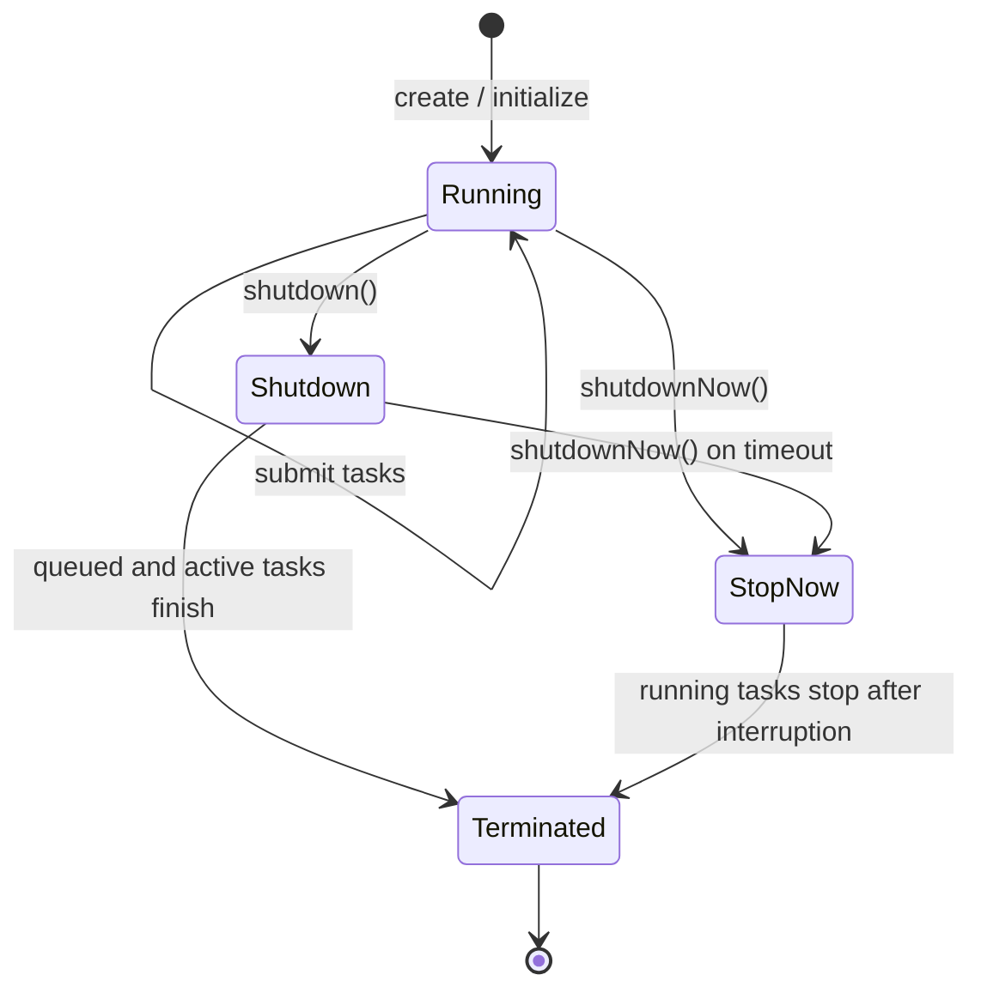

# Thu hồi executor và xác nhận không còn tác vụ sau kiểm thử

Các bài kiểm thử bất đồng bộ thường tạo hoặc sử dụng một `ExecutorService`, `TaskExecutor` hay `ThreadPoolTaskExecutor` để chạy tác vụ ngoài luồng test chính. Nếu executor không được đóng đúng cách, thread nền có thể tiếp tục chạy sau khi test kết thúc, giữ tài nguyên, làm rò rỉ trạng thái sang test khác hoặc khiến tiến trình test không thoát.

Một bài test đáng tin cậy cần quản lý toàn bộ vòng đời tác vụ: biết tác vụ nào đã được gửi, chờ những tác vụ cần hoàn thành, hủy công việc còn lại khi cần, đóng executor và xác nhận thread pool đã kết thúc. Chỉ kiểm tra kết quả nghiệp vụ mà không kiểm tra việc thu hồi executor có thể che giấu lỗi rò rỉ thread.

## 1. Vòng đời của một executor

`Executor` chỉ định nghĩa cách gửi `Runnable` để thực thi. `ExecutorService` mở rộng abstraction đó với quản lý vòng đời, trả về `Future`, shutdown và chờ kết thúc. Các implementation như `ThreadPoolExecutor` duy trì worker thread, hàng đợi tác vụ và trạng thái shutdown.

Vòng đời thường có các trạng thái:



Hai thao tác kết thúc chính có ngữ nghĩa khác nhau:

| API | Hành vi | Tác động lên tác vụ |
| --- | --- | --- |
| `shutdown()` | Ngừng nhận tác vụ mới | Tác vụ đã được submit vẫn có thể chạy đến hết |
| `shutdownNow()` | Cố gắng dừng executor ngay lập tức | Gửi interrupt cho tác vụ đang chạy và trả về các tác vụ còn nằm trong queue, chưa bắt đầu |
| `awaitTermination(timeout, unit)` | Chờ executor kết thúc trong thời hạn | Trả `true` nếu executor đã terminate, `false` nếu hết thời gian |
| `isShutdown()` | Kiểm tra executor đã nhận lệnh shutdown chưa | Không chứng minh tác vụ đã kết thúc |
| `isTerminated()` | Kiểm tra executor đã kết thúc hoàn toàn chưa | Chỉ `true` sau khi mọi tác vụ đang chạy đã kết thúc |

`shutdown()` không chờ tác vụ kết thúc. Muốn xác nhận không còn worker đang chạy, phải gọi `awaitTermination(...)` sau shutdown và kiểm tra trạng thái kết thúc.

## 2. Thu hồi `ExecutorService` trong test

Với executor được tạo riêng cho test, cách rõ ràng nhất là tạo nó trong `@BeforeEach` hoặc ngay trong test, sau đó đóng trong `@AfterEach` hoặc khối `finally`.

```java
class AsyncJobTest {
    private ExecutorService executor;

    @BeforeEach
    void setUp() {
        executor = Executors.newFixedThreadPool(2);
    }

    @AfterEach
    void tearDown() throws InterruptedException {
        executor.shutdown();

        if (!executor.awaitTermination(5, TimeUnit.SECONDS)) {
            executor.shutdownNow();
            assertThat(executor.awaitTermination(5, TimeUnit.SECONDS))
                    .as("executor should terminate after forced shutdown")
                    .isTrue();
        }

        assertThat(executor.isShutdown()).isTrue();
        assertThat(executor.isTerminated()).isTrue();
    }

    @Test
    void runsJob() throws Exception {
        Future<String> result = executor.submit(() -> "completed");

        assertThat(result.get(2, TimeUnit.SECONDS)).isEqualTo("completed");
    }
}
```

`Future.get(timeout, unit)` vừa lấy kết quả vừa đặt giới hạn thời gian chờ. Nếu tác vụ bị treo, test thất bại với timeout thay vì chờ vô hạn. Phần `tearDown()` vẫn thực hiện shutdown để thu hồi executor.

Trong thực tế, có thể đưa logic shutdown vào một helper dùng chung. Helper nên gọi `shutdown()` trước, chờ trong một khoảng thời gian hữu hạn, rồi dùng `shutdownNow()` khi quá hạn. Sau đó tiếp tục chờ để xác nhận các worker đã kết thúc.

## 3. Phân biệt queue rỗng và executor đã terminate

Một hàng đợi rỗng không có nghĩa executor đã hết tác vụ. Worker có thể đã lấy task ra khỏi queue và đang chạy nó. Ngược lại, executor có thể đang ở trạng thái shutdown nhưng vẫn còn các task chờ hoàn tất.

Với `ThreadPoolExecutor`, các thông tin thường dùng để quan sát là:

| API | Ý nghĩa | Giới hạn |
| --- | --- | --- |
| `getQueue().isEmpty()` | Không còn task đang đợi trong queue | Không phát hiện task đã được worker lấy ra và đang chạy |
| `getActiveCount()` | Số worker đang thực thi task tại thời điểm lấy mẫu | Là số liệu ước lượng, có thể thay đổi ngay sau khi đọc |
| `getTaskCount()` | Ước lượng tổng số task đã được lên lịch thực thi | Không cho biết chính xác task nào đã hoàn tất |
| `getCompletedTaskCount()` | Số task đã hoàn tất | Không thay thế trạng thái terminate |
| `isTerminated()` | Executor đã kết thúc sau shutdown | Là điều kiện mạnh để xác nhận pool không còn worker thực thi task |

Vì vậy, kiểm tra `isTerminated()` sau `awaitTermination(...)` là bằng chứng chính. `queue.isEmpty()` và `getActiveCount() == 0` là các assertion bổ sung hữu ích khi cần chẩn đoán.

```java
ThreadPoolExecutor pool = (ThreadPoolExecutor) executor;

executor.shutdown();
assertThat(executor.awaitTermination(5, TimeUnit.SECONDS)).isTrue();

assertThat(pool.isTerminated()).isTrue();
assertThat(pool.getActiveCount()).isZero();
assertThat(pool.getQueue()).isEmpty();
```

Không nên kiểm tra `getActiveCount()` ngay sau khi submit rồi kết luận task đã kết thúc. Tác vụ có thể chưa được worker lấy ra hoặc số liệu có thể thay đổi giữa hai lần đọc.

## 4. Chờ tác vụ hoàn tất một cách xác định

Test bất đồng bộ nên đồng bộ hóa bằng `Future`, `CountDownLatch`, `CyclicBarrier` hoặc cơ chế đồng bộ phù hợp với hành vi đang kiểm tra. Tránh dùng `Thread.sleep()` để phỏng đoán rằng task đã chạy xong.

Ví dụ dùng `CountDownLatch` để xác nhận task đã bắt đầu và kết thúc:

```java
@Test
void waitsForBackgroundTaskBeforeShuttingDown() throws Exception {
    CountDownLatch started = new CountDownLatch(1);
    CountDownLatch finished = new CountDownLatch(1);

    Future<?> future = executor.submit(() -> {
        started.countDown();
        try {
            performWork();
        } finally {
            finished.countDown();
        }
    });

    assertThat(started.await(2, TimeUnit.SECONDS)).isTrue();
    future.get(2, TimeUnit.SECONDS);
    assertThat(finished.await(2, TimeUnit.SECONDS)).isTrue();
}
```

`started` cho biết worker đã bắt đầu thực thi. `finished` được giảm trong `finally`, do đó test vẫn được thông báo khi tác vụ kết thúc bằng exception. Nếu tác vụ ném exception nhưng không có `Future` để đọc kết quả, test cần một kênh ghi nhận lỗi riêng hoặc dùng `Future` để exception được truyền về test thread.

Nếu task cần test điều khiển thời điểm kết thúc, dùng latch làm cổng đồng bộ:

```java
CountDownLatch release = new CountDownLatch(1);
CountDownLatch finished = new CountDownLatch(1);

Future<?> future = executor.submit(() -> {
    try {
        release.await();
        performWork();
    } finally {
        finished.countDown();
    }
});

assertThat(finished.getCount()).isEqualTo(1);
release.countDown();

future.get(2, TimeUnit.SECONDS);
assertThat(finished.await(1, TimeUnit.SECONDS)).isTrue();
```

Test có thể kiểm soát chính xác thời điểm task được giải phóng và chờ `Future` hoàn tất. Khi test có assertion thất bại trước khi gọi `release.countDown()`, cần bảo đảm cleanup vẫn giải phóng latch hoặc interrupt task để không giữ worker mãi mãi.

## 5. Xử lý timeout và interrupt đúng cách

`shutdownNow()` không cưỡng chế dừng thread bằng cách kết thúc nó ngay lập tức. Phương thức này gửi interrupt tới các thread đang chạy và trả về các task chưa bắt đầu. Task cần phản hồi interruption để executor có thể terminate.

Một task có thể hỗ trợ dừng như sau:

```java
void processUntilStopped() {
    while (!Thread.currentThread().isInterrupted()) {
        doOneUnitOfWork();
    }
}
```

Nếu task chờ bằng `sleep()`, `wait()` hoặc `CountDownLatch.await()`, interruption thường làm phát sinh `InterruptedException`. Khi bắt exception nhưng không thể ném tiếp, cần khôi phục trạng thái interrupt:

```java
try {
    blockingOperation();
} catch (InterruptedException ex) {
    Thread.currentThread().interrupt();
    return;
}
```

Một helper shutdown có thể áp dụng quy trình:

```java
static void shutdownAndAwaitTermination(ExecutorService pool)
        throws InterruptedException {
    pool.shutdown();

    if (!pool.awaitTermination(5, TimeUnit.SECONDS)) {
        List<Runnable> notStarted = pool.shutdownNow();
        if (!pool.awaitTermination(5, TimeUnit.SECONDS)) {
            throw new AssertionError("Executor did not terminate");
        }
        if (!notStarted.isEmpty()) {
            // Ghi nhận các task chưa từng bắt đầu nếu test cần bảo đảm tất cả đã chạy.
        }
    }
}
```

Nếu `awaitTermination(...)` ném `InterruptedException`, cleanup nên tiếp tục yêu cầu dừng executor rồi khôi phục interrupt status của thread test trước khi kết thúc. Không nên nuốt interruption vì nó có thể làm hỏng cơ chế hủy test hoặc shutdown của runner.

## 6. Dùng `ThreadPoolTaskExecutor` của Spring

`ThreadPoolTaskExecutor` là implementation `TaskExecutor` của Spring, bọc một `ThreadPoolExecutor` và tích hợp lifecycle của Spring container. Bean được Spring quản lý sẽ được đóng khi application context bị hủy.

Ví dụ cấu hình executor:

```java
@Bean
ThreadPoolTaskExecutor applicationTaskExecutor() {
    ThreadPoolTaskExecutor executor = new ThreadPoolTaskExecutor();
    executor.setCorePoolSize(2);
    executor.setMaxPoolSize(2);
    executor.setQueueCapacity(10);
    executor.setThreadNamePrefix("app-async-");
    executor.setWaitForTasksToCompleteOnShutdown(true);
    executor.setAwaitTerminationSeconds(5);
    return executor;
}
```

Hai thuộc tính shutdown đáng chú ý:

| Cấu hình | Ý nghĩa |
| --- | --- |
| `setWaitForTasksToCompleteOnShutdown(true)` | Khi Spring đóng executor, cho phép task đã submit tiếp tục hoàn tất thay vì gọi `shutdownNow()` ngay |
| `setAwaitTerminationSeconds(5)` | Spring chờ tối đa số giây đã cấu hình để executor terminate trong quá trình shutdown |

Nếu đặt `waitForTasksToCompleteOnShutdown(false)`, Spring yêu cầu dừng ngay bằng cơ chế interrupt và các task đang chờ có thể không được chạy. Dù chọn chính sách nào, task dài cần có giới hạn thời gian và phản hồi interruption.

`ThreadPoolTaskExecutor` cũng có các API quan sát như `getActiveCount()` và `getThreadPoolExecutor()`. API sau trả về executor nền khi đã khởi tạo; có thể dùng để kiểm tra queue, trạng thái shutdown và termination trong test.

## 7. Quản lý executor do Spring context sở hữu

Khi executor là singleton bean, application context chịu trách nhiệm gọi lifecycle destroy của bean. Spring Test có thể cache context giữa nhiều test class, do đó không nên tự gọi `shutdown()` trên bean dùng chung trong `@AfterEach` rồi mong test tiếp theo vẫn dùng được bean đó.

Có hai cách tổ chức phù hợp:

- Với executor dùng chung trong application context, để Spring đóng bean khi context bị hủy. Cấu hình chính sách chờ hoàn tất bằng `setWaitForTasksToCompleteOnShutdown` và `setAwaitTerminationSeconds`.
- Với executor chỉ dùng cho một test hoặc một test class, tạo instance riêng và đóng tường minh trong cleanup. Cách này cho phép assertion termination ngay tại test mà không ảnh hưởng context cache.

Ví dụ executor riêng cho test:

```java
class SpringExecutorLifecycleTest {
    private ThreadPoolTaskExecutor executor;

    @BeforeEach
    void setUp() {
        executor = new ThreadPoolTaskExecutor();
        executor.setCorePoolSize(1);
        executor.setMaxPoolSize(1);
        executor.setQueueCapacity(5);
        executor.setThreadNamePrefix("test-worker-");
        executor.setWaitForTasksToCompleteOnShutdown(true);
        executor.setAwaitTerminationSeconds(5);
        executor.initialize();
    }

    @AfterEach
    void tearDown() throws InterruptedException {
        executor.shutdown();

        ThreadPoolExecutor pool = executor.getThreadPoolExecutor();
        assertThat(pool.awaitTermination(5, TimeUnit.SECONDS)).isTrue();
        assertThat(pool.isTerminated()).isTrue();
        assertThat(pool.getActiveCount()).isZero();
        assertThat(pool.getQueue()).isEmpty();
    }
}
```

Ở đây executor không phải bean của Spring context; test chủ động gọi `initialize()` và `shutdown()`. Vì instance riêng cho test, đóng nó sau mỗi test không làm hỏng bean được cache cho test khác.

## 8. Kiểm tra phương thức `@Async`

Spring `@Async` chuyển lời gọi phương thức qua executor được cấu hình. Test nên gọi bean qua Spring proxy và chờ kết quả bất đồng bộ trước khi kết thúc.

```java
@Configuration
@EnableAsync
class AsyncTestConfig {
    @Bean("taskExecutor")
    ThreadPoolTaskExecutor taskExecutor() {
        ThreadPoolTaskExecutor executor = new ThreadPoolTaskExecutor();
        executor.setCorePoolSize(1);
        executor.setMaxPoolSize(1);
        executor.setQueueCapacity(10);
        executor.setThreadNamePrefix("async-test-");
        executor.setWaitForTasksToCompleteOnShutdown(true);
        executor.setAwaitTerminationSeconds(5);
        return executor;
    }
}
```

Service trả về `CompletableFuture`:

```java
@Service
class ReportService {
    @Async("taskExecutor")
    public CompletableFuture<String> generate() {
        return CompletableFuture.completedFuture("report-ready");
    }
}
```

Test chờ kết quả:

```java
@SpringJUnitConfig({AsyncTestConfig.class, ReportService.class})
class ReportServiceTest {
    @Autowired
    private ReportService reportService;

    @Test
    void completesAsyncWork() throws Exception {
        CompletableFuture<String> result = reportService.generate();

        assertThat(result.get(2, TimeUnit.SECONDS)).isEqualTo("report-ready");
    }
}
```

Gọi phương thức qua bean được inject để lời gọi đi qua proxy `@Async`. Nếu một phương thức trong cùng object gọi trực tiếp phương thức `@Async` khác (self-invocation), lời gọi nội bộ không đi qua proxy theo cơ chế proxy mặc định và có thể chạy đồng bộ.

Nếu phương thức `@Async` trả về `void`, test không có `Future` để chờ hoặc lấy exception. Khi đó, nên dùng một tín hiệu đồng bộ như `CountDownLatch`, hoặc thiết kế API trả về `CompletableFuture` nếu người gọi cần biết khi nào công việc hoàn tất. Với lỗi của phương thức `void @Async`, cấu hình `AsyncUncaughtExceptionHandler` để ghi nhận exception.

## 9. Tránh shutdown executor dùng chung sau mỗi test

Spring TestContext Framework cache application context để giảm thời gian chạy test. Nhiều test class có thể nhận cùng một instance singleton bean. Nếu một test gọi `shutdown()` trên `ThreadPoolTaskExecutor` dùng chung trong `@AfterEach`, test class tiếp theo có thể nhận lại context đã cache nhưng executor đã bị đóng.

Ví dụ không phù hợp với bean singleton dùng chung:

```java
@AfterEach
void tearDown() {
    applicationTaskExecutor.shutdown();
}
```

Đoạn cleanup này chỉ phù hợp khi test sở hữu executor và bảo đảm không có test khác sử dụng cùng instance. Với bean do Spring quản lý, nên để context lifecycle đóng executor. Nếu cần ép đóng context sau một test class, `@DirtiesContext(classMode = DirtiesContext.ClassMode.AFTER_CLASS)` đánh dấu context không được tái sử dụng và Spring sẽ đóng nó sau class.

`@DirtiesContext` có chi phí vì context phải được tạo lại cho các test sau. Không nên dùng nó như giải pháp mặc định cho mọi test bất đồng bộ; executor riêng cho test thường đơn giản hơn nếu mục tiêu chỉ là kiểm tra shutdown.

## 10. Xác nhận không còn tác vụ chờ hoặc đang chạy

Để chứng minh test không để lại công việc, cần xác định rõ điều kiện kết thúc mong đợi:

1. Tất cả task bắt buộc phải chạy đã hoàn tất hoặc đã bị hủy có chủ đích.
2. Không còn task trong queue sau khi executor terminate.
3. Không còn worker active.
4. Executor đã ở trạng thái terminated.

Ví dụ với `ThreadPoolTaskExecutor` riêng:

```java
@Test
void leavesNoWorkBehind() throws Exception {
    CountDownLatch finished = new CountDownLatch(3);

    for (int i = 0; i < 3; i++) {
        executor.execute(() -> {
            try {
                processItem();
            } finally {
                finished.countDown();
            }
        });
    }

    assertThat(finished.await(3, TimeUnit.SECONDS)).isTrue();

    executor.shutdown();
    ThreadPoolExecutor pool = executor.getThreadPoolExecutor();

    assertThat(pool.awaitTermination(5, TimeUnit.SECONDS)).isTrue();
    assertThat(pool.isTerminated()).isTrue();
    assertThat(pool.getActiveCount()).isZero();
    assertThat(pool.getQueue()).isEmpty();
}
```

Trong ví dụ, latch xác nhận ba task đã hoàn tất trước khi shutdown. `awaitTermination` sau shutdown xác nhận worker pool đã kết thúc. Hai lớp assertion bảo vệ hai điều khác nhau: công việc dự kiến đã hoàn thành và executor đã được thu hồi.

Nếu test chấp nhận hủy các task chưa bắt đầu khi timeout, cần ghi nhận danh sách trả về từ `shutdownNow()` và xác nhận queue không còn task. Không được diễn giải việc queue bị xóa là các task đã chạy thành công; đó là các task chưa bắt đầu và đã bị loại khỏi executor.

## 11. Kiểm tra tác vụ bị hủy và trạng thái Future

Nếu test cần hủy một task cụ thể, dùng `Future.cancel(true)` để yêu cầu interrupt:

```java
CountDownLatch started = new CountDownLatch(1);

Future<?> future = executor.submit(() -> {
    started.countDown();
    try {
        new CountDownLatch(1).await();
    } catch (InterruptedException ex) {
        Thread.currentThread().interrupt();
    }
});

assertThat(started.await(2, TimeUnit.SECONDS)).isTrue();
assertThat(future.cancel(true)).isTrue();
assertThat(future.isCancelled()).isTrue();
```

`cancel(true)` yêu cầu interrupt thread đang chạy nếu task đã bắt đầu. Nó không đảm bảo task đã dừng ngay tại thời điểm method trả về. Vì vậy, vẫn cần chờ tín hiệu task kết thúc hoặc chờ executor terminate.

`Future.isDone()` trả `true` khi task hoàn tất bình thường, ném exception hoặc bị cancel. Nó không phân biệt thành công và thất bại; dùng `get()` để lấy kết quả và quan sát exception, hoặc kiểm tra `isCancelled()` khi cần xác nhận việc hủy.

## 12. Tác vụ lặp lại và scheduler

`ScheduledExecutorService` và `ThreadPoolTaskScheduler` có thể chạy tác vụ định kỳ. Nếu test đăng ký fixed-rate hoặc fixed-delay task nhưng không hủy `ScheduledFuture`, tác vụ có thể tiếp tục chạy sau khi assertion kết thúc.

Ví dụ:

```java
ScheduledExecutorService scheduler = Executors.newSingleThreadScheduledExecutor();
ScheduledFuture<?> scheduled = scheduler.scheduleAtFixedRate(
        this::refreshCache, 0, 1, TimeUnit.SECONDS);

try {
    assertThat(refreshStarted.await(2, TimeUnit.SECONDS)).isTrue();
} finally {
    scheduled.cancel(true);
    scheduler.shutdown();
    assertThat(scheduler.awaitTermination(5, TimeUnit.SECONDS)).isTrue();
}
```

Hủy `ScheduledFuture` ngăn lần chạy tiếp theo và có thể interrupt lần chạy hiện tại khi truyền `true`. Sau đó vẫn cần shutdown scheduler và chờ termination. Với task định kỳ có khả năng chạy lâu, hãy bảo đảm code phản hồi interruption.

Trong Spring, `ThreadPoolTaskScheduler` cũng được quản lý lifecycle như một bean. Cấu hình shutdown và chờ termination phù hợp với chính sách ứng dụng; với scheduler riêng của test, hãy giữ `ScheduledFuture` để hủy rõ ràng trong cleanup.

## 13. Song song giữa các test và rò rỉ trạng thái

Khi JUnit chạy test song song, nhiều test có thể cùng submit task vào một executor. Một test gọi shutdown trong khi test khác còn dùng pool có thể gây `RejectedExecutionException` hoặc lỗi ngẫu nhiên.

Các nguyên tắc cần áp dụng:

- Không dùng chung executor mutable giữa test độc lập nếu mỗi test cần tự đóng executor.
- Tạo executor riêng cho từng test, hoặc quản lý một executor dùng chung ở cấp suite với lifecycle rõ ràng.
- Không gọi shutdown từ một test nếu test khác vẫn phụ thuộc vào bean singleton đó.
- Chờ task của test hiện tại hoàn tất trước khi assertion kết thúc.
- Không dùng thread name hoặc active count làm cơ chế duy nhất để xác định task thuộc test nào.
- Khi cần xác nhận không có thread rò rỉ, dùng thread name prefix riêng cho executor test và kiểm tra lifecycle chính thức của pool thay vì quét thread toàn JVM một cách mong manh.

Nếu test cần chứng minh thread của một executor cụ thể đã kết thúc, `ThreadPoolExecutor.isTerminated()` đáng tin cậy hơn việc tìm kiếm mọi thread trong JVM. JVM còn có thể chứa thread của test runner, logging, database pool hoặc framework khác; không nên yêu cầu toàn bộ JVM không còn thread.

## 14. Lỗi thường gặp và cách xử lý

| Hiện tượng | Nguyên nhân có thể có | Cách xử lý |
| --- | --- | --- |
| Test kết thúc nhưng process không thoát | Executor còn worker thread sống | Gọi shutdown và chờ termination trong cleanup |
| `isShutdown()` là true nhưng task vẫn chạy | Shutdown không chờ task đang chạy kết thúc | Dùng `awaitTermination()` rồi kiểm tra `isTerminated()` |
| Queue rỗng nhưng worker vẫn chạy | Task đã được worker lấy ra khỏi queue | Kiểm tra active task và termination |
| `shutdownNow()` nhưng executor không terminate | Task bỏ qua interrupt hoặc mắc trong thao tác không thể hủy | Thiết kế task phản hồi interruption và có timeout cho I/O |
| Test sau nhận `RejectedExecutionException` | Test trước đã shutdown bean executor dùng chung trong context cache | Để Spring quản lý lifecycle hoặc tạo executor riêng cho test |
| Test đôi lúc thất bại khi kiểm tra active count | Đọc metric trong khi task vẫn chuyển trạng thái | Đồng bộ bằng Future/latch và chờ termination trước assertion |
| Task lỗi nhưng test vẫn pass | Fire-and-forget task không truyền exception về test | Dùng Future hoặc ghi nhận exception qua handler/latch |
| Scheduled task tiếp tục chạy | Không giữ hoặc không cancel `ScheduledFuture` | Cancel task và shutdown scheduler |
| `awaitTermination` timeout | Task quá lâu, deadlock hoặc không phản hồi interrupt | Điều tra task, đặt timeout và dùng shutdownNow khi cần |

## 15. Nguyên tắc viết test không để lại tác vụ

1. Xác định executor thuộc quyền sở hữu của test hay application context.
2. Với executor riêng, đóng trong `@AfterEach` hoặc `finally` để cleanup vẫn chạy khi assertion thất bại.
3. Gọi `shutdown()` để ngừng nhận task mới; chờ `awaitTermination()` trong thời hạn hữu hạn.
4. Nếu quá thời hạn, gọi `shutdownNow()` và chờ thêm một khoảng thời gian để xác nhận worker dừng.
5. Dùng `Future.get(timeout, unit)` hoặc latch để đồng bộ task; tránh `Thread.sleep()`.
6. Kiểm tra `isTerminated()` sau khi chờ; queue rỗng hoặc `isShutdown()` riêng lẻ không đủ.
7. Với `ThreadPoolTaskExecutor`, cấu hình chính sách chờ hoàn tất và thời gian chờ shutdown phù hợp.
8. Để Spring đóng executor bean dùng chung khi context bị hủy; không shutdown bean đó sau từng test nếu context được cache.
9. Với `@Async`, gọi qua Spring proxy và dùng `Future`/`CompletableFuture` nếu cần chờ kết quả.
10. Hủy `ScheduledFuture` cho tác vụ lặp lại và kiểm tra scheduler đã terminate.

Thu hồi executor là một phần của tính đúng đắn của kiểm thử bất đồng bộ. Test cần chờ những công việc dự kiến hoàn tất, đóng executor theo đúng chủ sở hữu và xác nhận trạng thái terminated. Khi kết hợp đồng bộ hóa xác định với timeout và chính sách shutdown rõ ràng, test sẽ không để lại worker hoặc task chờ làm ảnh hưởng đến các bài kiểm thử khác.
