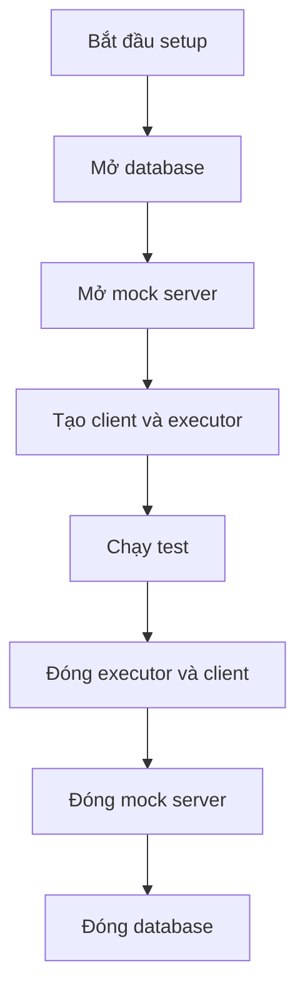

# Khôi phục dữ liệu và đóng tài nguyên khi khởi tạo thất bại

## 1. Vì sao setup test phải có đường phục hồi?

Một integration test thường cần chuẩn bị nhiều thành phần trước khi chạy assertion: database, schema, container, mock HTTP server, message broker, thư mục tạm, executor hoặc một Spring `ApplicationContext`. Quá trình khởi tạo có thể thất bại ở bất kỳ bước nào. Ví dụ database đã chạy nhưng mock server không bind được cổng; broker đã kết nối nhưng migration thất bại; hoặc một bean khởi tạo xong nhưng bean tiếp theo ném exception.

Nếu test chỉ dọn dẹp ở cuối luồng thành công, lỗi giữa chừng có thể để lại container, thread, socket, file hoặc dữ liệu dang dở. Những tài nguyên còn sót lại làm các test sau phụ thuộc vào thứ tự chạy, chiếm cổng, giữ kết nối hoặc làm database bẩn.

Một setup đáng tin cậy cần bảo đảm ba điều:

1. **Ghi nhận tài nguyên ngay sau khi lấy được nó.** Khi bước tiếp theo lỗi, test biết những gì cần đóng.
2. **Đóng theo thứ tự ngược với lúc mở.** Tài nguyên phụ thuộc phải được dừng trước tài nguyên mà nó đang sử dụng.
3. **Giữ nguyên lỗi khởi tạo ban đầu.** Nếu cleanup cũng lỗi, lỗi cleanup phải được ghi nhận như lỗi phụ thay vì che mất nguyên nhân đầu tiên.

Khôi phục dữ liệu cũng cần có ranh giới rõ ràng. Rollback transaction có thể đủ cho test chạy trong cùng thread và cùng transaction, nhưng không tự hoàn tác các thay đổi do HTTP request thật, `@Async` hoặc một worker khác đã commit.

## 2. Nguyên tắc acquire và release

Hãy xem setup như một chuỗi cấp phát tài nguyên:



Nếu database được mở trước mock server, mock server được mở trước executor, thì khi kết thúc nên đóng executor trước, tiếp đến mock server, rồi database. Executor có thể đang sử dụng database hoặc gửi request tới mock server; đóng database trước có thể làm tác vụ đang chạy thất bại trong quá trình cleanup.

Quy tắc chung là **last acquired, first released**. Quy tắc này giống cách Java xử lý nhiều resource trong `try-with-resources`.

### 2.1. Dùng `try-with-resources` cho resource có `close()`

Nếu một resource triển khai `AutoCloseable`, ưu tiên `try-with-resources`:

```java
try (MockWebServer server = new MockWebServer()) {
    server.start();

    WebTestClient client = WebTestClient.bindToServer()
            .baseUrl(server.url("/").toString())
            .build();

    // Gửi request và kiểm tra response.
}
```

Khi rời khỏi khối `try`, Java gọi `close()` kể cả khi phần thân ném exception. Nếu phần thân đã có lỗi rồi `close()` cũng lỗi, exception từ cleanup được gắn vào lỗi chính dưới dạng suppressed exception. Nhờ vậy, lỗi gốc không bị mất.

`try-with-resources` cũng xử lý nhiều resource theo thứ tự đóng ngược với thứ tự khai báo:

```java
try (DatabaseContainer database = startDatabase();
     MockWebServer server = startMockServer(database)) {

    runIntegrationTest(database, server);
}
```

Trong ví dụ, `server` được đóng trước `database`. Nếu khởi tạo resource thứ hai thất bại sau khi resource thứ nhất đã được tạo thành công, Java vẫn đóng resource thứ nhất. Điều kiện là factory của resource thứ hai phải tự dọn phần cấp phát nội bộ nếu chính nó thất bại trước khi trả về một đối tượng có thể đóng.

### 2.2. Đăng ký resource ngay khi tạo được

Khi setup gồm nhiều bước động, có thể dùng một scope quản lý các resource. Scope lưu từng resource sau khi acquire thành công và đóng chúng theo thứ tự ngược lại.

```java
final class ResourceScope implements AutoCloseable {

    private final Deque<AutoCloseable> resources = new ArrayDeque<>();
    private boolean closed;

    <T extends AutoCloseable> T add(T resource) {
        if (closed) {
            throw new IllegalStateException("Resource scope is already closed");
        }
        resources.push(resource);
        return resource;
    }

    @Override
    public void close() throws Exception {
        if (closed) {
            return;
        }
        closed = true;

        Exception firstFailure = null;
        while (!resources.isEmpty()) {
            try {
                resources.pop().close();
            } catch (Exception closeFailure) {
                if (firstFailure == null) {
                    firstFailure = closeFailure;
                } else {
                    firstFailure.addSuppressed(closeFailure);
                }
            }
        }

        if (firstFailure != null) {
            throw firstFailure;
        }
    }
}
```

`add(...)` dùng `push`, do đó resource mới nhất nằm ở đầu deque và được đóng trước. Scope vẫn tiếp tục đóng các resource còn lại nếu một lần `close()` thất bại; lỗi đầu tiên được ném ra, các lỗi cleanup tiếp theo được gắn suppressed.

Sử dụng scope với `try-with-resources`:

```java
try (ResourceScope resources = new ResourceScope()) {
    DatabaseContainer database = resources.add(startDatabase());

    MockWebServer server = resources.add(new MockWebServer());
    server.start();

    ExecutorService executor = Executors.newFixedThreadPool(4);
    resources.add(() -> stopExecutor(executor));

    runTestScenario(database, server, executor);
}
```

Đoạn ví dụ cuối minh họa ý tưởng đăng ký resource theo thứ tự acquire; trong code thực tế, hãy bọc executor bằng một adapter `AutoCloseable` nếu cần gọi `shutdown()` và chờ `awaitTermination()` trước khi `shutdownNow()`. Quan trọng là đăng ký đối tượng quản lý ngay khi nó đã được tạo, trước các bước khởi tạo có thể ném exception.

Nếu `startDatabase()` hoặc constructor của một resource cấp phát nhiều thành phần bên trong rồi ném exception trước khi trả về, scope bên ngoài không thể đóng một đối tượng mà nó chưa nhận được. Factory/constructor đó phải tự rollback phần cấp phát nội bộ trong `catch` hoặc `finally`.

## 3. Khởi tạo nhiều resource trong JUnit và dọn dẹp khi setup lỗi

Với resource sống trong suốt một test class, có thể dùng `@BeforeAll` và `@AfterAll`. Nhưng không nên giả định mọi bước trong `@BeforeAll` đều thành công trước khi cleanup được đăng ký.

```java
@TestInstance(TestInstance.Lifecycle.PER_CLASS)
class ExternalServiceIntegrationTest {

    private ResourceScope resources;
    private DatabaseContainer database;
    private MockWebServer server;

    @BeforeAll
    void startEnvironment() throws Exception {
        resources = new ResourceScope();
        try {
            database = resources.add(startDatabase());

            server = resources.add(new MockWebServer());
            server.start();

            initializeSchema(database);
        } catch (Exception | Error setupFailure) {
            try {
                resources.close();
            } catch (Exception cleanupFailure) {
                setupFailure.addSuppressed(cleanupFailure);
            }
            throw setupFailure;
        }
    }

    @AfterAll
    void stopEnvironment() throws Exception {
        if (resources != null) {
            resources.close();
        }
    }
}
```

Ví dụ này đăng ký database ngay sau khi khởi động, rồi đăng ký mock server trước khi gọi `start()`. Nếu server start hoặc schema initialization thất bại, catch đóng các resource đã đăng ký. `ResourceScope.close()` có tính idempotent nên việc cleanup bổ sung từ lifecycle callback không đóng lại resource lần thứ hai.

Trong dự án thật, các method `startDatabase()` và `initializeSchema(...)` cần được triển khai theo loại hạ tầng đang dùng. Ví dụ không yêu cầu một database cụ thể.

Không nên chỉ viết cleanup ở `@AfterAll` rồi để `@BeforeAll` thực hiện nhiều bước không có rollback. Lifecycle callback sau cùng có thể không chạy trong mọi kiểu khởi tạo thất bại hoặc extension failure mà test setup gặp phải. Tự xử lý lỗi ngay trong bước khởi tạo giúp bảo đảm những resource đã acquire được giải phóng ngay khi setup thất bại.

Với resource cho từng test method, dùng `@BeforeEach`/`@AfterEach` và cùng nguyên tắc: nếu setup giữa chừng lỗi, tự đóng những phần đã tạo trước khi ném exception. Nếu có thể, đóng gói setup trong một factory trả về fixture `AutoCloseable` rồi dùng fixture bằng `try-with-resources` trong test.

## 4. Fixture tự đóng bằng `AutoCloseable`

Một fixture có thể gom nhiều resource và dữ liệu test vào một đối tượng duy nhất. Test mở fixture trong `try-with-resources`, sau đó luôn đóng nó khi kết thúc.

```java
final class ApiTestFixture implements AutoCloseable {

    private final ResourceScope resources = new ResourceScope();
    private final DatabaseContainer database;
    private final MockWebServer server;

    private ApiTestFixture() throws Exception {
        try {
            database = resources.add(startDatabase());

            server = resources.add(new MockWebServer());
            server.start();

            initializeSchema(database);
            seedBaselineData(database);
        } catch (Exception | Error setupFailure) {
            try {
                resources.close();
            } catch (Exception cleanupFailure) {
                setupFailure.addSuppressed(cleanupFailure);
            }
            throw setupFailure;
        }
    }

    static ApiTestFixture start() throws Exception {
        return new ApiTestFixture();
    }

    DatabaseContainer database() {
        return database;
    }

    MockWebServer server() {
        return server;
    }

    @Override
    public void close() throws Exception {
        resources.close();
    }
}
```

Test sử dụng fixture:

```java
@Test
void callsExternalApi() throws Exception {
    try (ApiTestFixture fixture = ApiTestFixture.start()) {
        WebTestClient client = WebTestClient.bindToServer()
                .baseUrl(fixture.server().url("/").toString())
                .build();

        // Chuẩn bị response giả, gọi endpoint và assertion.
    }
}
```

Nếu `initializeSchema(...)` hoặc `seedBaselineData(...)` lỗi, constructor đóng các resource đã đăng ký trước khi truyền lỗi ra ngoài. Nếu test body lỗi, `try-with-resources` đóng fixture. Nếu `close()` cũng lỗi, Java giữ lỗi test làm lỗi chính và ghi lỗi cleanup trong suppressed exceptions.

Một constructor không nên làm side effect lớn nếu có thể tránh. Có thể dùng factory `start()` để thể hiện rõ đây là thao tác có thể thất bại và trả về fixture chỉ sau khi mọi bước setup đã hoàn tất.

## 5. Giữ nguyên lỗi gốc khi cleanup cũng thất bại

Giả sử database start thành công nhưng mock server không khởi động được. Trong lúc đóng database, Docker daemon lại trả lỗi. Nếu cleanup exception thay thế lỗi bind cổng, nguyên nhân thật của setup sẽ khó tìm.

Khi cleanup thủ công, dùng `addSuppressed(...)` để giữ cả hai:

```java
try {
    startMockServer();
} catch (IOException setupFailure) {
    try {
        database.close();
    } catch (Exception cleanupFailure) {
        setupFailure.addSuppressed(cleanupFailure);
    }
    throw setupFailure;
}
```

Khi dùng `try-with-resources`, Java tự áp dụng cơ chế suppressed exception. Khi tự quản lý danh sách resource, hãy tiếp tục cleanup các resource còn lại ngay cả khi một lần đóng thất bại.

Khi điều tra lỗi, xem cả exception chính và danh sách suppressed exceptions. Exception chính giải thích vì sao setup hoặc test thất bại; suppressed exceptions cho biết bước cleanup nào cũng gặp vấn đề.

## 6. Spring ApplicationContext khi khởi tạo bean thất bại

Spring quản lý vòng đời của các bean trong `ApplicationContext`. Khi context được đóng bình thường, Spring gọi các destruction callback đã đăng ký, ví dụ `@PreDestroy`, `DisposableBean.destroy()` hoặc phương thức đóng được khai báo trong `@Bean`.

Nếu refresh context thất bại, Spring cố gắng hủy các singleton đã tạo thành công trong quá trình refresh. Tuy nhiên, một bean đang khởi tạo dở có thể chưa được đăng ký đầy đủ với cơ chế destruction của container. Nếu phương thức khởi tạo tự mở socket hoặc container rồi ném exception giữa chừng, bean đó phải tự đóng phần tài nguyên đã tạo trước khi ném lỗi.

Một bean đã khởi tạo thành công có thể khai báo phương thức đóng:

```java
@Configuration
class TestInfrastructureConfiguration {

    @Bean(destroyMethod = "close")
    ManagedMockServer managedMockServer() throws IOException {
        ManagedMockServer server = new ManagedMockServer();
        try {
            server.start();
            return server;
        } catch (IOException | RuntimeException | Error setupFailure) {
            try {
                server.close();
            } catch (Exception cleanupFailure) {
                setupFailure.addSuppressed(cleanupFailure);
            }
            throw setupFailure;
        }
    }
}
```

`destroyMethod = "close"` yêu cầu Spring đóng bean khi context đóng. Phần `catch` xử lý tình huống `start()` thất bại trước khi factory method trả bean về cho container. Đây là hai đường cleanup khác nhau: cleanup nội bộ cho khởi tạo dở và destruction callback cho bean đã được tạo thành công.

Nếu bean tự triển khai `DisposableBean`, có thể dùng `destroy()`. Nếu dùng `@PreDestroy`, cần bảo đảm Jakarta Annotations có mặt trên classpath và callback nằm trên bean được Spring quản lý. Không tạo một resource thủ công trong static field rồi kỳ vọng Spring tự tìm và đóng nó.

### 6.1. `@DirtiesContext` không thay thế cleanup tài nguyên bên ngoài

`@DirtiesContext` đánh dấu Spring test context cần được loại khỏi cache và đóng. Việc đóng context sẽ gọi lifecycle cleanup của các bean do Spring quản lý. Nó không tự biết về file, socket, executor hoặc container được tạo thủ công bên ngoài context.

Nếu test tự mở `MockWebServer`, executor hoặc thư mục tạm, hãy đăng ký nó với lifecycle phù hợp hoặc tự đóng. Chỉ thêm `@DirtiesContext` không bảo đảm tài nguyên ngoài Spring được giải phóng.

## 7. Dùng JUnit Extension Store cho tài nguyên theo vòng đời test context

Khi một extension quản lý resource dùng chung cho một test class hoặc một test context, `ExtensionContext.Store` có thể giữ resource. JUnit đóng các `CloseableResource` khi store tương ứng kết thúc vòng đời.

```java
class ExternalEnvironmentExtension implements BeforeAllCallback {

    private static final ExtensionContext.Namespace NAMESPACE =
            ExtensionContext.Namespace.create(ExternalEnvironmentExtension.class);

    @Override
    public void beforeAll(ExtensionContext context) throws Exception {
        Environment environment = context.getStore(NAMESPACE)
                .getOrComputeIfAbsent(
                        Environment.class,
                        key -> new Environment(),
                        Environment.class);

        environment.start();
    }

    static final class Environment implements ExtensionContext.Store.CloseableResource {

        private final ResourceScope resources = new ResourceScope();

        void start() throws Exception {
            try {
                resources.add(startDatabase());
                MockWebServer server = resources.add(new MockWebServer());
                server.start();
            } catch (Exception | Error setupFailure) {
                try {
                    resources.close();
                } catch (Exception cleanupFailure) {
                    setupFailure.addSuppressed(cleanupFailure);
                }
                throw setupFailure;
            }
        }

        @Override
        public void close() throws Throwable {
            resources.close();
        }
    }
}
```

Store giữ `Environment` trước khi gọi `start()`. Nếu start thất bại, `Environment` đã được đăng ký với store; đoạn catch vẫn đóng ngay các resource đã mở. Khi store kết thúc, JUnit gọi `close()` như một lớp bảo vệ vòng đời cuối cùng. `ResourceScope` idempotent nên cleanup không gây đóng lặp.

Đây là mẫu dành cho extension cần quản lý resource ở phạm vi context. Với một test đơn lẻ, `try-with-resources` thường đơn giản hơn. Không nên dùng Store như một registry toàn cục nếu resource phải được cô lập theo từng test.

## 8. Testcontainers và mock server: để extension quản lý vòng đời

Nếu dùng Testcontainers với JUnit 5, `@Testcontainers` và `@Container` cho phép extension quản lý start/stop container theo vòng đời class hoặc test method:

```java
@Testcontainers
@SpringBootTest
class RepositoryIntegrationTest {

    @Container
    static final PostgreSQLContainer<?> postgres =
            new PostgreSQLContainer<>("postgres:16-alpine");

    @DynamicPropertySource
    static void databaseProperties(DynamicPropertyRegistry registry) {
        registry.add("spring.datasource.url", postgres::getJdbcUrl);
        registry.add("spring.datasource.username", postgres::getUsername);
        registry.add("spring.datasource.password", postgres::getPassword);
    }
}
```

Container tĩnh được quản lý theo vòng đời test class bởi Testcontainers extension. Các giá trị `@DynamicPropertySource` được cung cấp để Spring cấu hình datasource theo endpoint thực tế của container. Hãy bảo đảm container được khởi động trước khi Spring cần đọc các thuộc tính kết nối, theo cơ chế lifecycle của extension và phiên bản thư viện đang dùng.

Không cần gọi `start()`/`stop()` thủ công thêm lần nữa nếu `@Container` đã quản lý nó. Nếu tự khởi động container bằng code riêng, phải có `try/finally` hoặc một đối tượng `AutoCloseable` sở hữu vòng đời đó.

Với `MockWebServer`, có thể dùng `try-with-resources`, JUnit extension hoặc Spring bean có `destroyMethod = "shutdown"`/`close` tùy API của phiên bản. Chọn đúng phương thức kết thúc được thư viện cung cấp và đăng ký nó ngay sau khi tạo server.

## 9. Khôi phục dữ liệu database sau test

Có nhiều chiến lược để giữ database sạch giữa các test. Chọn chiến lược theo transaction boundary và loại ứng dụng đang chạy.

### 9.1. Rollback transaction của test

Với repository hoặc service được gọi trong cùng thread và tham gia transaction của test, `@Transactional` trên test thường giúp rollback thay đổi sau mỗi test:

```java
@SpringBootTest
@Transactional
class OrderRepositoryTest {

    @Autowired
    private OrderRepository orderRepository;

    @Test
    void createsOrder() {
        orderRepository.save(new Order("ORDER-01"));

        assertThat(orderRepository.findByCode("ORDER-01")).isPresent();
    }
}
```

Spring Test mặc định rollback transaction test sau khi test hoàn tất, trừ khi cấu hình khác như `@Commit` hoặc `@Rollback(false)`. Cách này hiệu quả cho test cùng transaction manager và cùng thread.

Không giả định rollback này bao trùm mọi công việc phát sinh từ test. Với `RANDOM_PORT`, HTTP request được xử lý trên thread server; với `@Async`, tác vụ chạy trên executor; với message listener, consumer chạy ở thread khác. Các transaction đó có thể commit độc lập và dữ liệu sẽ còn lại sau khi transaction test rollback.

### 9.2. Dọn dữ liệu rõ ràng sau test

Với real HTTP integration test hoặc tác vụ async, có thể dọn dữ liệu trong `@AfterEach`:

```java
@SpringBootTest(webEnvironment = SpringBootTest.WebEnvironment.RANDOM_PORT)
class OrderHttpIntegrationTest {

    @Autowired
    private OrderRepository orderRepository;

    @AfterEach
    void cleanDatabase() {
        orderRepository.deleteByTestRunId(TEST_RUN_ID);
    }
}
```

Ví dụ dùng một định danh dành riêng cho test run. Trong test chạy song song, nên tạo id duy nhất cho từng method thay vì dùng hằng số chung. Cleanup nên xóa theo đúng phạm vi dữ liệu của test để không ảnh hưởng test khác.

Nếu có quan hệ khóa ngoại, xóa theo thứ tự phụ thuộc: bảng con trước bảng cha, hoặc dùng cascade đã được thiết kế rõ ràng. Đảm bảo cleanup chạy trong transaction riêng phù hợp và chờ các tác vụ bất đồng bộ kết thúc trước khi xóa dữ liệu mà chúng còn có thể ghi.

### 9.3. Dùng `@Sql` để chuẩn bị và dọn dữ liệu

Spring Test hỗ trợ chạy SQL script ở các phase của test:

```java
@SpringBootTest
@Sql(
        scripts = "/sql/order-test-data.sql",
        executionPhase = Sql.ExecutionPhase.BEFORE_TEST_METHOD)
@Sql(
        scripts = "/sql/clean-order-test-data.sql",
        executionPhase = Sql.ExecutionPhase.AFTER_TEST_METHOD)
class OrderControllerIntegrationTest {
    // Test sử dụng dữ liệu đã seed.
}
```

Script setup tạo dữ liệu cần thiết; script cleanup xóa dữ liệu sau test. Cần viết cleanup idempotent để chạy lại không gây lỗi nếu dữ liệu đã được xóa một phần. Nếu setup script thất bại giữa chừng trước khi test method bắt đầu, không nên phụ thuộc hoàn toàn vào callback `AFTER_TEST_METHOD`; hãy bảo đảm fixture hoặc lifecycle owner có thể gọi cleanup cho trạng thái khởi tạo một phần.

Với test chạy song song hoặc database dùng chung, không nên dùng các script xóa toàn bảng như `DELETE FROM orders` nếu các test khác cũng đang sử dụng bảng đó. Dùng namespace, tenant hoặc test-run id để giới hạn phạm vi dữ liệu.

### 9.4. Khôi phục snapshot hoặc trạng thái nền

Với hệ thống khó rollback theo transaction, có thể tạo một trạng thái nền trước test rồi khôi phục sau test. Ví dụ: tạo schema riêng cho từng test class, nạp fixture chuẩn, sau đó drop schema khi kết thúc.

Snapshot phù hợp khi chi phí tạo trạng thái ban đầu cao, nhưng cần tính đến sequence, foreign key, trigger, extension và dữ liệu do background worker tạo. Khôi phục snapshot phải được thực hiện sau khi mọi worker liên quan đã dừng; nếu không worker có thể ghi lại dữ liệu ngay sau khi reset.

Không khôi phục toàn bộ database dùng chung khi các test chạy song song. Tách database/schema/container theo test class hoặc test run sẽ an toàn và dễ dự đoán hơn.

## 10. Khôi phục trạng thái toàn cục và tài nguyên ngoài database

Test đôi khi thay đổi trạng thái JVM như system property, default timezone, locale hoặc thư mục làm việc. Những giá trị này không tự rollback theo transaction database.

Ví dụ lưu và phục hồi system property:

```java
String previous = System.getProperty("app.feature.enabled");
try {
    System.setProperty("app.feature.enabled", "true");
    runTestScenario();
} finally {
    if (previous == null) {
        System.clearProperty("app.feature.enabled");
    } else {
        System.setProperty("app.feature.enabled", previous);
    }
}
```

Nếu thay timezone hoặc locale mặc định, cũng cần lưu giá trị cũ rồi khôi phục trong `finally`. Các thay đổi global có thể ảnh hưởng test chạy song song; khi không thể cô lập, hãy dùng resource lock của JUnit hoặc tránh sửa global state trong test.

Với thư mục tạm, ưu tiên `@TempDir` của JUnit:

```java
@Test
void writesTemporaryReport(@TempDir Path tempDir) throws IOException {
    Path report = tempDir.resolve("report.txt");
    Files.writeString(report, "test report");

    assertThat(Files.readString(report)).isEqualTo("test report");
}
```

JUnit quản lý vòng đời thư mục tạm và dọn nó theo scope đã cấu hình. Nếu tự gọi `Files.createTempDirectory(...)`, hãy tự đăng ký cleanup và xóa nội dung đệ quy trong `finally`/`close()`.

Với thread hoặc executor, chờ task kết thúc hoặc hủy nó trước khi đóng database, server hoặc file mà task đang dùng. Cleanup tài nguyên theo dependency graph quan trọng hơn việc chỉ gọi mọi `close()` theo thứ tự tùy ý.

## 11. Khi khởi tạo Spring context thất bại

Một số lỗi xảy ra trước khi test method bắt đầu: bean không tạo được, datasource không kết nối, migration lỗi hoặc cấu hình server không hợp lệ. Khi đó, `@BeforeEach` và `@AfterEach` của test class không phải nơi đáng tin cậy để phục hồi mọi resource đã được tạo ở giai đoạn context bootstrap.

Nên chia ownership như sau:

| Resource | Nơi nên sở hữu vòng đời | Cách cleanup |
|---|---|---|
| Spring-managed bean mở socket hoặc executor | Bean factory và Spring context | `destroyMethod`, `@PreDestroy` hoặc `DisposableBean` |
| Container do Testcontainers extension quản lý | JUnit/Testcontainers extension | `@Container` và `@Testcontainers` |
| Resource do test method tạo | Test method hoặc fixture | `try-with-resources` |
| Resource do JUnit extension tạo | `ExtensionContext.Store` | `Store.CloseableResource` |
| Dữ liệu trong transaction cùng thread | Spring Test transaction | Rollback mặc định |
| Dữ liệu do HTTP/async worker commit | Test fixture hoặc cleanup script | Xóa theo test id sau khi worker kết thúc |

Nếu một bean khởi tạo dở tự mở resource rồi thất bại, bean factory hoặc chính phương thức khởi tạo phải đóng phần resource đó. Nếu resource đã được trả về và bean được đăng ký thành công, Spring có thể đóng nó khi context đóng.

Không nên đặt resource ngoài vào static initializer hoặc static field mà không có chủ sở hữu vòng đời. Static initialization có thể thất bại trước khi JUnit extension hoặc Spring context có cơ hội đăng ký cleanup.

## 12. Cleanup phải idempotent và tiếp tục khi một bước đóng lỗi

Cleanup có thể được gọi từ nhiều đường: catch khi setup thất bại, `@AfterAll`, extension store hoặc `try-with-resources`. Vì thế, phương thức close nên an toàn khi được gọi lặp lại nếu thiết kế lifecycle có khả năng gọi từ nhiều callback.

```java
final class ManagedServer implements AutoCloseable {

    private boolean started;
    private boolean closed;

    void start() throws IOException {
        if (closed) {
            throw new IllegalStateException("Server is already closed");
        }
        if (!started) {
            // Bind socket and initialize server resources.
            started = true;
        }
    }

    @Override
    public void close() throws IOException {
        if (closed) {
            return;
        }
        closed = true;
        if (started) {
            // Stop accepting requests, close connections and release socket.
            started = false;
        }
    }
}
```

Đây là cấu trúc minh họa; code thực tế phải xử lý trạng thái nếu bind socket thành công nhưng một bước khởi tạo sau đó thất bại. Tốt nhất là chia nhỏ acquisition thành các bước có thể đóng độc lập và đăng ký từng resource ngay khi có được.

Cleanup nên tiếp tục đóng resource khác khi một `close()` lỗi. Nếu không, một lỗi đóng mock server có thể khiến database container không bao giờ được stop. Gom lỗi cleanup bằng suppressed exceptions giúp giữ đầy đủ thông tin mà vẫn giải phóng được các resource còn lại.

## 13. Tránh race giữa cleanup và công việc bất đồng bộ

Không đóng resource khi task vẫn có thể sử dụng nó. Ví dụ executor đang ghi vào database mà cleanup đã drop schema; task có thể thất bại hoặc tạo lại dữ liệu sau khi reset.

Thứ tự kết thúc nên là:

1. Ngừng nhận công việc mới.
2. Chờ task đang chạy hoàn tất trong thời hạn hữu hạn.
3. Hủy task còn lại nếu đã vượt timeout và chờ thread dừng.
4. Đóng client hoặc mock server mà task đang gọi.
5. Dọn dữ liệu database và đóng database container.

Với `ExecutorService`:

```java
static void stopExecutor(ExecutorService executor) throws InterruptedException {
    executor.shutdown();
    if (!executor.awaitTermination(3, TimeUnit.SECONDS)) {
        executor.shutdownNow();
        if (!executor.awaitTermination(3, TimeUnit.SECONDS)) {
            throw new IllegalStateException("Executor did not terminate");
        }
    }
}
```

Nếu task không phản ứng với interrupt, `shutdownNow()` không thể buộc thread dừng. Task nên có timeout cho I/O, kiểm tra interrupt và giải phóng resource của chính nó trong `finally`.

Với Spring `@Async`, hãy chờ `Future`/`CompletableFuture` hoàn tất trước cleanup. Nếu phương thức async trả `void`, cần một tín hiệu quan sát được như latch hoặc một trạng thái hoàn tất có timeout. Không nên dùng sleep để đoán rằng background task đã dừng.

## 14. Lỗi thường gặp và cách xử lý

| Hiện tượng | Nguyên nhân thường gặp | Cách xử lý |
|---|---|---|
| Container còn chạy sau test setup lỗi | Chỉ cleanup ở cuối test hoặc `@AfterAll` | Đăng ký resource ngay sau khi acquire; cleanup trong catch và lifecycle callback |
| Mock server chiếm cổng ở lần chạy sau | Server start nhưng không được đóng khi assertion hoặc setup lỗi | Dùng `try-with-resources` hoặc fixture `AutoCloseable` |
| Lỗi cleanup che lỗi khởi tạo | Exception cleanup được ném thay exception ban đầu | Dùng suppressed exception hoặc để try-with-resources quản lý |
| Database còn dữ liệu sau test | Request HTTP/async commit ở transaction riêng | Dọn theo test id sau khi worker hoàn tất |
| Test chạy đơn lẻ pass nhưng chạy song song fail | Dùng dữ liệu hoặc resource global chung | Dùng schema/id/container riêng hoặc khóa tài nguyên chia sẻ |
| Context bị đóng nhưng socket vẫn mở | Socket được tạo thủ công ngoài Spring bean lifecycle | Đưa resource vào bean có destroy callback hoặc extension/fixture |
| Context refresh thất bại và resource bean bị rò | Resource được mở trong init nhưng bean chưa được đăng ký hoàn chỉnh | Tự cleanup phần khởi tạo dở trong factory/init method |
| Executor ghi dữ liệu sau khi DB đã reset | Cleanup chạy trước khi async task kết thúc | Shutdown executor, chờ/cancel task rồi mới restore database |
| Cleanup một resource lỗi làm các resource khác không đóng | Vòng cleanup dừng ngay ở exception đầu tiên | Tiếp tục đóng tất cả resource và gom suppressed exceptions |
| Reset database làm hỏng test khác | Xóa hoặc restore toàn bộ dữ liệu dùng chung | Cô lập database/schema hoặc xóa theo định danh test |

## 15. Checklist thiết kế setup và teardown an toàn

- Xác định ai sở hữu vòng đời của từng resource: Spring, JUnit extension, Testcontainers hay test method.
- Ghi nhận resource ngay sau khi tạo được nó.
- Nếu một factory thất bại trước khi trả resource, factory phải tự đóng phần cấp phát nội bộ.
- Đóng resource theo thứ tự ngược với thứ tự acquire.
- Dùng `try-with-resources` cho các resource có `AutoCloseable`.
- Nếu setup nhiều bước trong `@BeforeAll`/`@BeforeEach`, cleanup phần đã tạo ngay trong catch trước khi ném lỗi.
- Giữ exception setup làm lỗi chính và gắn lỗi cleanup bằng `addSuppressed(...)`.
- Làm cho cleanup idempotent nếu có nhiều lifecycle callback có thể gọi nó.
- Dùng rollback transaction chỉ khi thay đổi thực sự nằm trong transaction đó.
- Với HTTP thật, `@Async` và message consumer, dọn dữ liệu sau khi worker đã hoàn tất.
- Không reset dữ liệu hoặc global state mà test khác đang dùng.
- Đặt timeout cho việc chờ worker và cho quá trình shutdown.
- Dùng `@TempDir` hoặc fixture có cleanup cho file tạm.
- Không xem `@DirtiesContext` là giải pháp đóng mọi resource ngoài Spring.

Một test hạ tầng ổn định không chỉ chuẩn bị được trạng thái thành công. Nó còn phải giải phóng mọi phần đã khởi tạo khi một bước giữa chừng thất bại, giữ nguyên nguyên nhân gốc và khôi phục dữ liệu về phạm vi mà test sở hữu. Thiết kế ownership rõ ràng, cleanup ngược thứ tự và transaction boundary đúng sẽ giúp test chạy độc lập, lặp lại được và không để lại tài nguyên cho lần chạy tiếp theo.
