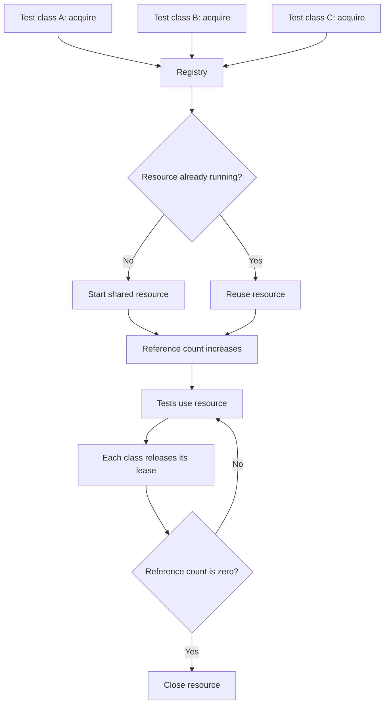

# Viết listener riêng để quản lý tài nguyên dùng chung

Trong Spring Framework Testing, có những tài nguyên cần được chuẩn bị trước khi một nhóm test chạy và chỉ được thu hồi khi nhóm đó kết thúc. Ví dụ gồm test server dùng chung, container dịch vụ giả lập, thư mục tạm, kết nối tới một hệ thống test hoặc một fixture đắt chi phí khởi tạo. Nếu mỗi test method tự tạo rồi tự đóng tài nguyên, suite có thể chạy chậm và dễ tạo ra trạng thái không nhất quán. Nếu không có cơ chế cleanup rõ ràng, tài nguyên có thể tồn tại sau test, giữ port, thread hoặc dữ liệu và làm ảnh hưởng các test tiếp theo.

Spring TestContext Framework cho phép mở rộng lifecycle kiểm thử bằng `TestExecutionListener`. Một listener riêng có thể khởi tạo hoặc lấy quyền sử dụng tài nguyên trước test class, lưu một lease vào `TestContext`, rồi giải phóng lease sau khi class kết thúc. Khi nhiều test class chạy đồng thời trong cùng JVM, một registry có khóa và bộ đếm tham chiếu có thể bảo đảm tài nguyên chỉ được khởi động một lần và chỉ đóng sau khi người dùng cuối cùng nhả lease.

## 1. Khi nào nên viết TestExecutionListener?

`TestExecutionListener` phù hợp khi thao tác cần thực hiện theo lifecycle của Spring TestContext, ví dụ:

- Khởi động một test server hoặc dịch vụ giả lập trước test class đầu tiên cần dùng.
- Cấp quyền sử dụng một container hoặc fixture dùng chung cho nhiều test class.
- Thu thập thông tin sau khi test chạy xong.
- Dọn dữ liệu hoặc giải phóng tài nguyên theo class hoặc theo method.
- Tích hợp một cơ chế kiểm thử dùng chung vào nhiều test class mà không lặp `@BeforeEach` và `@AfterEach`.

Không phải mọi setup/cleanup đều cần listener. Hãy chọn extension phù hợp với vòng đời thực tế:

| Nhu cầu | Cơ chế thường phù hợp |
| --- | --- |
| Setup/cleanup đơn giản cho một test method | JUnit `@BeforeEach` / `@AfterEach` |
| Setup/cleanup cho một test class, không cần Spring context | JUnit `@BeforeAll` / `@AfterAll` hoặc JUnit extension |
| Quản lý tài nguyên theo lifecycle của Spring TestContext | `TestExecutionListener` |
| Tài nguyên có cùng vòng đời với một `ApplicationContext` | Bean lifecycle, `DisposableBean`, `@Bean(destroyMethod=...)` hoặc `SmartLifecycle` |
| Phản ứng với sự kiện context đóng | `ApplicationListener<ContextClosedEvent>` hoặc `@EventListener` |
| Thay đổi bean definition trước khi context được refresh | `ApplicationContextInitializer` hoặc cơ chế cấu hình/AOT phù hợp |

`TestExecutionListener` không phải listener cho mọi sự kiện của `ApplicationContext`. Nó nhận các callback từ TestContext Framework, do đó phù hợp với lifecycle của test class hoặc test method. Nếu một tài nguyên thuộc quyền sở hữu của application context và phải được đóng cùng context, để Spring quản lý nó như một bean thường đơn giản và an toàn hơn.

## 2. Các callback của TestExecutionListener

`TestExecutionListener` thuộc package `org.springframework.test.context`. Listener nhận một `TestContext` trong mỗi callback. `TestContext` cung cấp thông tin về test class, test instance, test method, application context và một vùng attributes để lưu trạng thái trong quá trình lifecycle.

Các callback chính:

| Callback | Thời điểm | Công việc phù hợp |
| --- | --- | --- |
| `beforeTestClass` | Trước khi các test method trong class được thực thi | Acquire tài nguyên dùng chung cho cả class |
| `prepareTestInstance` | Sau khi test instance được tạo, trước khi dependency injection hoàn tất | Chuẩn bị trạng thái gắn với test instance |
| `beforeTestMethod` | Trước lifecycle setup của test method | Cấp tài nguyên hoặc fixture riêng cho method |
| `beforeTestExecution` | Ngay trước khi thân test method chạy, sau setup method | Bắt đầu đo thời gian hoặc bật instrumentation cho phần test thực thi |
| `afterTestExecution` | Ngay sau khi thân test method chạy, trước teardown method | Ghi nhận kết quả hoặc dừng instrumentation của phần test |
| `afterTestMethod` | Sau lifecycle teardown của test method | Giải phóng tài nguyên riêng của method |
| `afterTestClass` | Sau khi các test method trong class hoàn tất | Release tài nguyên được acquire ở `beforeTestClass` |

Các phương thức của `TestExecutionListener` có triển khai mặc định không làm gì, vì vậy listener có thể override đúng những callback cần thiết.

```java
public class ExampleTestExecutionListener implements TestExecutionListener {
    @Override
    public void beforeTestClass(TestContext testContext) throws Exception {
        // Chuẩn bị tài nguyên cấp class.
    }

    @Override
    public void afterTestClass(TestContext testContext) throws Exception {
        // Thu hồi tài nguyên cấp class.
    }
}
```

Nếu tài nguyên cần tồn tại trong toàn bộ class, cặp `beforeTestClass`/`afterTestClass` là lựa chọn tự nhiên. Nếu tài nguyên phải được tạo mới cho từng method, dùng `beforeTestMethod`/`afterTestMethod`. Nếu chỉ muốn đo phần thân test, dùng `beforeTestExecution`/`afterTestExecution`.

## 3. TestContext và nơi lưu trạng thái listener

`TestContext` có các thao tác lưu attributes như `setAttribute`, `getAttribute`, `hasAttribute` và `removeAttribute`. Đây là nơi phù hợp để lưu lease hoặc handle mà listener đã tạo, vì cùng một `TestContext` được truyền qua các callback liên quan.

Ví dụ lưu một lease:

```java
private static final String LEASE_ATTRIBUTE =
        SharedResourceTestExecutionListener.class.getName() + ".lease";

@Override
public void beforeTestClass(TestContext testContext) throws Exception {
    SharedResourceRegistry.Lease lease = SharedResourceRegistry.acquire();
    testContext.setAttribute(LEASE_ATTRIBUTE, lease);
}

@Override
public void afterTestClass(TestContext testContext) throws Exception {
    Object value = testContext.removeAttribute(LEASE_ATTRIBUTE);
    if (value instanceof SharedResourceRegistry.Lease lease) {
        lease.close();
    }
}
```

Lưu lease trong `TestContext` giúp listener biết chính xác resource handle nào thuộc test class hiện tại. Không cần dùng một biến instance của listener để giữ trạng thái vì cách Spring tạo và sử dụng listener không nên được xem là hợp đồng về một instance duy nhất cho toàn bộ suite.

Không nên lưu target request-scoped hoặc session-scoped bean vào attribute cấp class. Vòng đời của target ngắn hơn class; chỉ lưu handle của tài nguyên có vòng đời phù hợp và có thể giải phóng an toàn.

## 4. Thiết kế tài nguyên dùng chung bằng lease

Một registry dùng chung thường cần đáp ứng bốn yêu cầu:

1. Chỉ khởi động tài nguyên khi có test class đầu tiên yêu cầu.
2. Nhiều test class trong cùng JVM có thể dùng cùng một tài nguyên.
3. Một class kết thúc không được đóng tài nguyên trong khi class khác vẫn đang dùng.
4. Tài nguyên được đóng khi người dùng cuối cùng giải phóng lease.

Mẫu quản lý này thường được gọi là reference counting. Mỗi lần `acquire()` thành công, số lease tăng một; mỗi lần `close()` của lease được gọi lần đầu, số lease giảm một. Khi số lượng về 0, registry đóng tài nguyên.



Lease là quyền sử dụng một tài nguyên trong một khoảng thời gian. Nó cũng là bằng chứng ownership để cleanup có thể idempotent: gọi `close()` nhiều lần trên cùng lease chỉ được giảm bộ đếm một lần.

## 5. Ví dụ registry quản lý một test server dùng chung

Ví dụ dưới đây minh họa cấu trúc registry. `SharedTestServer.start()` đại diện cho phần khởi động server cụ thể của dự án; nó có thể tạo server nhúng, start container hoặc chuẩn bị một dịch vụ giả lập. Phần quản lý lease không phụ thuộc vào loại tài nguyên.

```java
final class SharedResourceRegistry {
    private static final Object monitor = new Object();

    private static SharedTestServer server;
    private static int referenceCount;

    private SharedResourceRegistry() {
    }

    static Lease acquire() throws Exception {
        synchronized (monitor) {
            if (server == null) {
                server = SharedTestServer.start();
            }

            referenceCount++;
            return new Lease(server);
        }
    }

    static URI baseUri() {
        synchronized (monitor) {
            if (server == null) {
                throw new IllegalStateException("Shared server is not running");
            }
            return server.baseUri();
        }
    }

    static int activeLeases() {
        synchronized (monitor) {
            return referenceCount;
        }
    }

    static final class Lease implements AutoCloseable {
        private final SharedTestServer leasedServer;
        private boolean closed;

        private Lease(SharedTestServer leasedServer) {
            this.leasedServer = leasedServer;
        }

        SharedTestServer server() {
            if (closed) {
                throw new IllegalStateException("Lease is already closed");
            }
            return leasedServer;
        }

        @Override
        public void close() throws Exception {
            synchronized (monitor) {
                if (closed) {
                    return;
                }
                closed = true;

                referenceCount--;
                if (referenceCount == 0) {
                    SharedTestServer toClose = server;
                    server = null;
                    toClose.close();
                }
            }
        }
    }
}
```

`SharedTestServer` là abstraction tài nguyên do dự án cung cấp:

```java
interface SharedTestServer extends AutoCloseable {
    URI baseUri();

    static SharedTestServer start() throws Exception {
        // Khởi động server hoặc container của test suite.
        // Trả về handle có baseUri() và close() thực hiện cleanup.
        throw new UnsupportedOperationException("Implement with the test resource");
    }
}
```

Phần `start()` ở đây là điểm tích hợp cần thay bằng implementation thực tế. Các điểm quan trọng trong registry là thao tác start, tăng/giảm reference count và đóng tài nguyên đều được bảo vệ bởi cùng một monitor. Nhờ đó, hai test class chạy song song không thể đồng thời start hai instance hoặc đóng resource khi một class khác vẫn giữ lease.

Registry đặt `server = null` trước khi gọi `close()`. Nếu cleanup ném exception, trạng thái registry vẫn cho biết resource không còn được cấp phát để sử dụng; lỗi đóng resource sẽ được báo qua callback cleanup. Tùy loại tài nguyên, có thể bổ sung logging hoặc retry cleanup, nhưng không nên âm thầm bỏ qua exception.

## 6. Viết TestExecutionListener acquire/release lease

Listener có nhiệm vụ nối lifecycle của TestContext với registry:

```java
import org.springframework.test.context.TestContext;
import org.springframework.test.context.TestExecutionListener;

public class SharedResourceTestExecutionListener
        implements TestExecutionListener {

    private static final String LEASE_ATTRIBUTE =
            SharedResourceTestExecutionListener.class.getName() + ".lease";

    @Override
    public void beforeTestClass(TestContext testContext) throws Exception {
        if (testContext.hasAttribute(LEASE_ATTRIBUTE)) {
            return;
        }

        SharedResourceRegistry.Lease lease = SharedResourceRegistry.acquire();
        testContext.setAttribute(LEASE_ATTRIBUTE, lease);
    }

    @Override
    public void afterTestClass(TestContext testContext) throws Exception {
        Object value = testContext.removeAttribute(LEASE_ATTRIBUTE);
        if (value instanceof SharedResourceRegistry.Lease lease) {
            lease.close();
        }
    }
}
```

`hasAttribute(...)` giúp tránh acquire hai lần nếu callback bị gọi lại do cấu hình hoặc wrapper tùy chỉnh. `removeAttribute(...)` xóa handle khỏi context trước khi đóng để tránh cleanup lặp lại. Lease tự bảo vệ bằng cờ `closed`, do đó việc release cũng idempotent ở cấp registry.

Nếu `acquire()` thất bại khi start tài nguyên, exception được ném ra và test class không tiếp tục với một resource chưa sẵn sàng. Factory `SharedTestServer.start()` phải tự dọn các thành phần đã khởi tạo một phần trước khi ném exception, vì registry chỉ tăng reference count sau khi start thành công.

## 7. Đăng ký listener bằng @TestExecutionListeners

Cách đăng ký tường minh cho một test class hoặc một nhóm class là `@TestExecutionListeners`:

```java
@SpringJUnitConfig(TestApplicationConfig.class)
@WebAppConfiguration
@TestExecutionListeners(
        listeners = SharedResourceTestExecutionListener.class,
        mergeMode = TestExecutionListeners.MergeMode.MERGE_WITH_DEFAULTS)
class ProductApiIntegrationTest {
    // Các test dùng shared resource.
}
```

`MERGE_WITH_DEFAULTS` rất quan trọng khi muốn thêm listener tùy chỉnh nhưng vẫn giữ các listener mặc định của Spring, như dependency injection, transaction management, dirties context và servlet test support. Nếu thay thế danh sách mặc định ngoài ý muốn, các tính năng Spring Test khác có thể ngừng hoạt động.

Có thể đặt annotation trên một base test class hoặc annotation tổng hợp để nhiều test class dùng chung cấu hình. Khi kế thừa, cần chú ý quy tắc kế thừa listener và cấu hình merge để không vô tình loại bỏ listener đã được đăng ký ở lớp cha.

## 8. Đăng ký listener qua SpringFactoriesLoader

Nếu listener cần áp dụng rộng rãi cho test class trong một module hoặc test support library, có thể đăng ký qua `META-INF/spring.factories`:

```properties
org.springframework.test.context.TestExecutionListener=\
com.example.test.SharedResourceTestExecutionListener
```

Spring TestContext Framework có thể autodetect các `TestExecutionListener` thông qua cơ chế `SpringFactoriesLoader`. Cách này khiến listener có mặt trên test classpath được áp dụng rộng hơn, vì vậy chỉ dùng khi resource thực sự là hạ tầng chung của toàn bộ test suite.

Không nên đăng ký listener toàn cục nếu chỉ một vài test class cần tài nguyên. Khi đó, `@TestExecutionListeners` rõ ràng hơn và tránh start container hoặc server không cần thiết cho các test không sử dụng.

## 9. Thứ tự thực thi listener

Khi nhiều listener cùng đăng ký, thứ tự có thể ảnh hưởng đến việc tài nguyên đã sẵn sàng trước khi listener khác chạy hay chưa. Listener có thể triển khai `Ordered` hoặc dùng `@Order` để xác định thứ tự.

Thông thường:

- Callback `before...` được gọi theo thứ tự tăng dần của order.
- Callback `after...` được gọi theo thứ tự ngược lại để teardown diễn ra theo kiểu stack.

Nếu listener của bạn phải start resource trước các listener khác, đặt order phù hợp để nó chạy sớm. Nếu cần giữ resource cho tới khi các listener khác hoàn tất teardown, thứ tự callback ngược có thể giúp listener cleanup muộn hơn.

Không nên gán order tùy tiện. Trước tiên hãy xác định dependency giữa listener: ví dụ listener thu thập log sau test có cần resource còn hoạt động không; listener transaction có cần chạy trước hoặc sau một cleanup nào đó không. Chỉ đặt order khi có quan hệ thực sự.

## 10. Chọn lifecycle cấp class hay cấp method

Listener có thể quản lý resource theo hai phạm vi phổ biến:

| Phạm vi | Acquire | Release | Ví dụ |
| --- | --- | --- | --- |
| Một test class | `beforeTestClass` | `afterTestClass` | Một container dùng cho mọi method trong class |
| Một test method | `beforeTestMethod` | `afterTestMethod` | Thư mục tạm hoặc fixture cần reset giữa các method |
| Chỉ thân test method | `beforeTestExecution` | `afterTestExecution` | Profiler hoặc trace chỉ đo thời gian test |
| Toàn ApplicationContext | Bean initialization | Bean destroy/context close | Embedded service thuộc context và được context sở hữu |

Nếu cần lease theo method, dùng attribute key khác hoặc cấu trúc lưu nhiều lease theo context. Không dùng cùng một key cho cả cấp class và method nếu có thể ghi đè lease của nhau.

Ví dụ resource theo method:

```java
private static final String METHOD_RESOURCE =
        SharedResourceTestExecutionListener.class.getName() + ".methodResource";

@Override
public void beforeTestMethod(TestContext testContext) throws Exception {
    testContext.setAttribute(METHOD_RESOURCE, MethodResource.open());
}

@Override
public void afterTestMethod(TestContext testContext) throws Exception {
    Object value = testContext.removeAttribute(METHOD_RESOURCE);
    if (value instanceof MethodResource resource) {
        resource.close();
    }
}
```

Với method-level resource, `afterTestMethod` là nơi phù hợp khi teardown cần diễn ra sau các callback teardown của Spring Test. Nếu chỉ cần đo phần thực thi test method và không muốn bao gồm `@BeforeEach`/`@AfterEach`, dùng `afterTestExecution` để kết thúc phần instrumentation.

## 11. Xử lý test class thất bại và cleanup an toàn

Cleanup phải chạy kể cả khi assertion thất bại hoặc test method ném exception. Listener nên giữ lease ngay khi acquire thành công và release trong callback teardown tương ứng. Không chỉ đóng resource ở cuối test method trong nhánh thành công.

Các nguyên tắc quan trọng:

- Acquire phải atomic: chỉ tăng reference count khi resource đã khởi động thành công.
- Release phải idempotent: cùng một lease không được giảm bộ đếm nhiều lần.
- Cleanup không được che exception gốc của test bằng cách bỏ qua lỗi hoặc ghi đè trạng thái.
- Nếu resource có nhiều bước khởi tạo, factory phải tự rollback các bước đã hoàn tất khi một bước sau thất bại.
- Đặt timeout cho shutdown để suite không treo vô hạn.
- Sau cleanup, xóa handle khỏi `TestContext` để tránh giữ object không còn dùng.

Nếu `afterTestClass` ném exception khi đóng resource, Spring Test sẽ báo lỗi teardown. Đây là thông tin quan trọng: resource chưa được thu hồi đúng cách. Không nên bắt rồi bỏ qua mọi exception chỉ để test suite hiển thị xanh.

## 12. Chạy test song song và an toàn luồng

Khi test class chạy song song trong cùng JVM, listener có thể được gọi đồng thời trên nhiều `TestContext`. Registry dùng chung phải thread-safe. `synchronized` trên một monitor là cách đơn giản cho việc start, tăng/giảm reference count và stop một resource đơn lẻ.

Nếu resource được truy cập đồng thời trong lúc test chạy, bản thân resource cũng phải hỗ trợ concurrency. Registry chỉ bảo vệ lifecycle; nó không tự làm cho HTTP server, database schema, thư mục hoặc dữ liệu test trở nên an toàn khi nhiều test cùng sửa.

Các lưu ý:

- Không dùng một biến static đơn giản mà không đồng bộ hóa khi test có thể chạy song song.
- Không đóng shared resource từ `afterTestMethod` nếu class khác vẫn đang dùng nó.
- Dùng reference count hoặc một owner ở cấp suite có lifecycle rõ ràng.
- Nếu test cần dữ liệu riêng, namespace dữ liệu theo test class/method hoặc cấp fixture riêng dù server được dùng chung.
- Dùng port động thay vì hard-code một port có thể bị chiếm.
- Tránh giữ lock trong thời gian dài ngoài các thao tác start/stop cần bảo vệ tính nhất quán.

Reference count trong ví dụ hoạt động trong một JVM. Nếu build tool chạy test bằng nhiều fork/process, mỗi process có static registry riêng. Khi đó, mỗi fork sẽ có thể khởi động một resource riêng. Muốn chia sẻ thật sự giữa nhiều process cần một dịch vụ ngoài có lifecycle độc lập hoặc một coordinator hỗ trợ liên tiến trình; không thể dùng static field để chia sẻ giữa JVM.

## 13. Tương tác với Spring TestContext cache và @DirtiesContext

Spring TestContext Framework có thể cache `ApplicationContext` để nhiều test class tái sử dụng context đã khởi tạo. `TestExecutionListener` theo class lifecycle và context lifecycle là hai phạm vi khác nhau:

- `afterTestClass` được gọi khi một test class kết thúc.
- Bean destroy hoặc `ContextClosedEvent` chỉ xảy ra khi application context thực sự bị đóng.
- Context có thể tiếp tục được cache sau khi một class kết thúc.

Do đó, nếu resource thuộc quyền sở hữu của context, không nên đóng nó ở `afterTestClass` chỉ vì một class đã xong; class khác có thể tiếp tục dùng cùng context. Hãy để bean lifecycle quản lý resource đó.

Ngược lại, nếu listener quản lý một tài nguyên dùng chung ngoài context qua lease, `afterTestClass` chỉ release lease của class hiện tại. Registry đóng resource khi lease cuối cùng được release.

`@DirtiesContext` đánh dấu context cần được loại khỏi cache và đóng theo lifecycle của Spring Test. Nếu resource gắn với context, nó nên được đóng khi context bị hủy. Nếu resource được chia sẻ độc lập giữa nhiều class, không được đóng nó chỉ vì một context bị dirty; lease registry cần phản ánh đúng ownership.

## 14. Khi nào nên dùng bean lifecycle thay cho listener?

Nếu tài nguyên được tạo để phục vụ bean trong một application context và không có ý nghĩa bên ngoài context, hãy quản lý nó bằng Spring container:

```java
@Bean(destroyMethod = "close")
SharedTestServer sharedTestServer() throws Exception {
    return SharedTestServer.start();
}
```

Spring gọi destroy method khi context đóng. Cách này tích hợp trực tiếp với context cache và `@DirtiesContext`, đồng thời tránh registry static tự quản lý reference count.

Có thể dùng `SmartLifecycle` khi resource cần thứ tự start/stop và có tham gia lifecycle của context. Dùng `ApplicationListener<ContextClosedEvent>` khi cần phản ứng với sự kiện context đóng nhưng không nhất thiết cần một bean có destroy method riêng.

Chọn `TestExecutionListener` khi ownership gắn với test class/method hoặc khi resource được chia sẻ vượt qua ranh giới application context. Đừng dùng listener chỉ vì muốn viết một hook cleanup; hook đơn giản có thể nằm ngay trong JUnit lifecycle hoặc bean lifecycle.

## 15. Lưu ý khi dùng với AOT

Spring TestContext Framework có hỗ trợ chuẩn bị application context cho AOT trong các phiên bản Spring Framework tương ứng. AOT tập trung vào việc phân tích và sinh mã/cấu hình cần thiết cho context; `TestExecutionListener` vẫn là một phần mở rộng của test lifecycle được gọi trong lúc test thực thi.

Khi viết listener để dùng trong môi trường có AOT:

- Đăng ký listener tường minh bằng annotation hoặc cơ chế factory được Spring Test hỗ trợ, và bảo đảm class có trên test runtime classpath.
- Giữ listener tập trung vào quản lý tài nguyên bên ngoài như server, container, file hoặc fixture.
- Không dựa vào việc quét classpath hoặc tạo bean definition động tại runtime nếu các bean đó phải có mặt trong context đã được AOT xử lý.
- Nếu listener cần thay đổi cấu trúc bean graph, hãy dùng cơ chế cấu hình/AOT contribution được hỗ trợ thay vì cố thêm bean sau khi context đã được chuẩn bị.
- Không giả định rằng việc đăng ký listener tự động làm cho mọi tài nguyên hoặc thư viện bên thứ ba tương thích native image; kiểm tra giới hạn của công cụ AOT/native đang dùng.
- Tách mã khởi động resource khỏi mã đăng ký listener để có thể cấu hình riêng cho JVM test, AOT test và môi trường CI.

Ví dụ, listener start một test server theo lifecycle của test class thường ít ảnh hưởng đến AOT bean graph hơn listener cố gắng đăng ký thêm controller hoặc converter sau khi context đã được tạo. Nếu cần thay đổi bean definitions, hãy dùng `ApplicationContextInitializer`, cấu hình test hoặc extension point AOT phù hợp với phiên bản Spring.

## 16. Chẩn đoán listener không được gọi hoặc resource không được thu hồi

| Hiện tượng | Nguyên nhân có thể có | Cách xử lý |
| --- | --- | --- |
| `beforeTestClass` không chạy | Listener chưa được đăng ký hoặc test không dùng Spring TestContext | Kiểm tra `@TestExecutionListeners`, `SpringExtension` và test runner |
| Listener tùy chỉnh làm mất dependency injection | Danh sách mặc định bị thay thế | Dùng `MergeMode.MERGE_WITH_DEFAULTS` |
| Resource start nhiều lần | Registry không đồng bộ hoặc listener acquire theo method ngoài ý muốn | Dùng lock và chọn đúng callback lifecycle |
| Resource bị đóng khi class khác còn chạy | Cleanup không có reference count hoặc ownership sai | Mỗi class giữ lease riêng; chỉ đóng khi lease cuối cùng release |
| Resource không bao giờ đóng | Thiếu release, callback teardown không được gọi hoặc lease bị giữ lại | Kiểm tra attribute, `afterTestClass` và log reference count |
| `afterTestClass` báo lỗi cleanup | Resource close ném exception hoặc shutdown timeout | Kiểm tra log resource và thiết kế close có timeout |
| Test chạy riêng pass nhưng suite fail | Shared state, context cache hoặc test song song ảnh hưởng nhau | Kiểm tra registry, session, static state và dữ liệu fixture |
| CI khởi động nhiều container | Test chạy nhiều fork/JVM | Chia sẻ theo process hoặc dùng resource coordinator bên ngoài |
| AOT test không thấy listener | Listener không nằm trên test runtime classpath hoặc đăng ký không được xử lý trong build | Kiểm tra dependency và cơ chế registration được hỗ trợ |

Khi chẩn đoán, log tên test class, callback, số lease, thời điểm start/stop và định danh resource. Không log secret, token hoặc connection string chứa credential. Những thông tin này đủ để xác định class nào acquire/release và tại sao tài nguyên vẫn còn sống.

## 17. Nguyên tắc thiết kế listener quản lý tài nguyên

1. Chọn đúng extension point: `TestExecutionListener` cho lifecycle TestContext, bean lifecycle cho tài nguyên thuộc context, JUnit callback cho setup đơn giản.
2. Chọn đúng phạm vi acquire/release: class, method, phần thực thi method hay toàn context.
3. Dùng `TestContext` attributes để lưu lease/handle thuộc test class hoặc method.
4. Dùng registry thread-safe nếu nhiều test class trong cùng JVM chia sẻ tài nguyên.
5. Dùng lease/reference count để class này không đóng tài nguyên mà class khác vẫn đang sử dụng.
6. Làm `close()` idempotent và bảo đảm acquire chỉ tăng bộ đếm sau khi start thành công.
7. Giữ cleanup trong callback teardown và báo lỗi nếu resource không đóng được.
8. Đăng ký listener bằng `MERGE_WITH_DEFAULTS` khi dùng `@TestExecutionListeners` để giữ listener mặc định của Spring.
9. Chỉ dùng factory autodetection khi listener thực sự cần áp dụng toàn cục; nếu không, đăng ký tường minh.
10. Kiểm tra thread safety, test song song, context cache, `@DirtiesContext` và giới hạn chia sẻ giữa nhiều JVM.
11. Trong môi trường AOT, giữ listener tập trung vào lifecycle tài nguyên và dùng extension point AOT phù hợp nếu cần thay đổi bean graph.

Một listener riêng hữu ích khi tài nguyên có vòng đời gắn với test class hoặc method và cần được nhiều test dùng chung. `TestExecutionListener` cung cấp callback lifecycle, `TestContext` giữ lease của từng class, còn registry quản lý việc start/stop an toàn. Khi ownership được mô tả rõ, cleanup idempotent và concurrency được kiểm soát, test suite có thể tái sử dụng tài nguyên đắt chi phí mà vẫn tránh rò rỉ thread, port, container hoặc dữ liệu sang các test khác.
