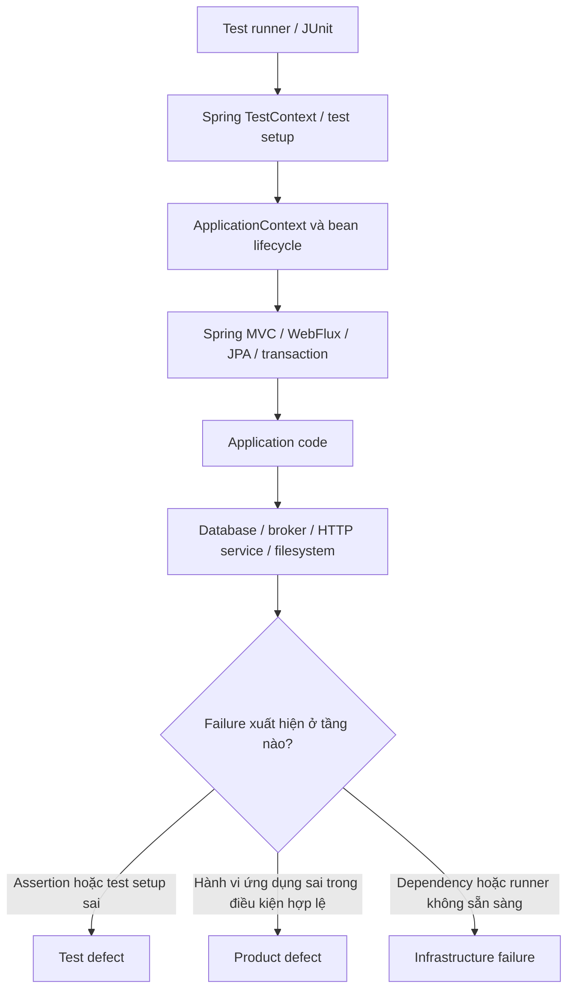
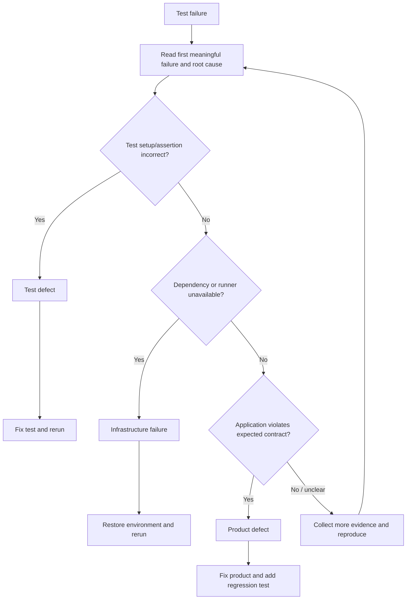

# Phân biệt lỗi sản phẩm, lỗi kiểm thử và lỗi hạ tầng

Khi một bài kiểm thử Spring thất bại trong máy phát triển hoặc trên CI, dòng báo đỏ chỉ cho biết một điều: lần chạy đó không đạt kết quả mong đợi. Nó chưa chứng minh ứng dụng có lỗi. Nguyên nhân có thể nằm trong hành vi sản phẩm, trong chính bài kiểm thử hoặc trong môi trường thực thi. Phân loại đúng nguyên nhân giúp sửa đúng nơi, tránh thay đổi code sản phẩm để chiều theo một test sai và tránh bỏ qua lỗi thật bằng cách gắn nhãn “CI không ổn định”.

Trong Spring Framework Testing, ba nhóm này thường xuất hiện dưới những dạng khác nhau: controller trả status hoặc body sai; test cấu hình sai application context hoặc dùng assertion không đúng; database, container, network hay runner không sẵn sàng. Một lỗi có thể liên quan đến nhiều nhóm, vì vậy cần thu thập bằng chứng trước khi kết luận.

## 1. Ba nhóm nguyên nhân chính

**Lỗi sản phẩm (product defect)** xảy ra khi ứng dụng không đáp ứng hành vi đã được yêu cầu hoặc hợp đồng đã công bố. Ví dụ: endpoint đáng lẽ trả 404 nhưng lại trả 500; transaction không rollback; validation không được áp dụng; một request làm rò trạng thái sang request khác.

**Lỗi kiểm thử (test defect)** xảy ra khi test mô tả sai hành vi, thiết lập sai điều kiện, kiểm tra sai đối tượng hoặc phụ thuộc vào giả định không đúng. Ví dụ: test mong `@PreUpdate` chạy ngay khi gọi setter mà chưa flush; test session scope tạo session mới cho từng request nhưng lại mong dữ liệu được giữ; mock trả về một kết quả không phù hợp với contract thật.

**Lỗi hạ tầng (infrastructure failure)** xảy ra khi môi trường chạy test không cung cấp điều kiện cần thiết. Ví dụ: CI không kết nối được database, Docker daemon không khởi động, cổng đã bị chiếm, DNS lỗi, hết disk, runner bị kill vì thiếu bộ nhớ hoặc một dịch vụ phụ thuộc tạm thời không sẵn sàng.

| Nhóm | Câu hỏi trọng tâm | Ví dụ trong Spring testing |
| --- | --- | --- |
| Lỗi sản phẩm | Ứng dụng có thực hiện sai contract khi chạy trong môi trường hợp lệ không? | Controller trả sai status; service cập nhật dữ liệu sai; exception handler ánh xạ lỗi sai |
| Lỗi kiểm thử | Test có tạo đúng tình huống và kiểm tra đúng hành vi không? | Thiếu `flush()`, sai `Accept`, mock không đúng, assertion quá chặt |
| Lỗi hạ tầng | Môi trường có đủ điều kiện để test thực thi không? | Database không reachable, container startup timeout, runner hết tài nguyên |

Đây là phân loại nguyên nhân, không phải phân loại theo loại exception. Cùng một `ConnectException` có thể do endpoint cấu hình sai trong ứng dụng (lỗi sản phẩm/cấu hình), do test trỏ nhầm host (lỗi test) hoặc do mạng CI bị gián đoạn (lỗi hạ tầng). Cần xác định request nào thất bại, đích nào được gọi và môi trường nào đang chạy.

## 2. Bắt đầu từ failure đầu tiên và bằng chứng gốc

Khi một test suite thất bại, không nên bắt đầu bằng cách sửa assertion hoặc chạy lại toàn bộ suite nhiều lần. Hãy xác định failure đầu tiên có tính nguyên nhân, đọc exception đầy đủ và ghi lại bối cảnh chạy.

Thông tin cần lấy gồm:

- Tên test class và test method, module và task CI đã chạy.
- Exception type, message, stack trace và nguyên nhân lồng nhau (`Caused by`).
- Request/response nếu lỗi xảy ra trong MockMvc hoặc HTTP client test.
- Application context có tải thành công không; bean nào được tạo cuối cùng trước khi lỗi xảy ra.
- Database, broker, container hoặc dịch vụ ngoài nào được test sử dụng.
- JDK, Spring Framework/Boot version, profile, timezone, locale và cấu hình CI.
- Test có thất bại ổn định khi chạy riêng không, hay chỉ thất bại khi chạy cùng suite hoặc chạy song song.

Đừng chỉ đọc dòng cuối của log. Ví dụ, `Failed to load ApplicationContext` thường là thông báo tổng quát; nguyên nhân cụ thể có thể nằm sâu hơn như thiếu bean, lỗi binding property, không kết nối được database hoặc exception trong constructor của bean.

## 3. Phân tích stack trace theo tầng

Stack trace cho biết lỗi phát sinh ở đâu trong đường đi của test. Với Spring, nên tìm tầng đầu tiên thuộc ứng dụng hoặc hạ tầng thay vì dừng ở lớp test runner.



Một số dấu hiệu thường gặp:

| Dấu hiệu trong log | Hướng điều tra đầu tiên |
| --- | --- |
| `AssertionFailedError`, expected/actual không khớp | Xác nhận contract, dữ liệu đầu vào và response thực tế |
| `Failed to load ApplicationContext` | Đọc `Caused by` sâu nhất; phân biệt bean/config lỗi với dependency không sẵn sàng |
| `NoSuchBeanDefinitionException` | Kiểm tra test slice, component scan, profile và cấu hình bean |
| `ScopeNotActiveException` | Kiểm tra request/session context và thời điểm truy cập scoped proxy |
| `HttpMessageNotReadableException` | Kiểm tra request body, `Content-Type`, DTO và converter |
| `DataIntegrityViolationException` | Kiểm tra dữ liệu test, schema, constraint và logic ghi dữ liệu |
| `ConnectException`, connection timeout | Xác định endpoint/database/container và khả năng truy cập từ runner |
| `BindException: Address already in use` | Kiểm tra cổng cố định, process còn sót hoặc test chạy song song |
| `OutOfMemoryError`, process exit bất thường | Kiểm tra heap, container limit, fork/test worker và tài nguyên runner |

Các dấu hiệu này chỉ là điểm bắt đầu. Ví dụ `DataIntegrityViolationException` có thể là lỗi sản phẩm khi ứng dụng cho phép dữ liệu không hợp lệ, hoặc lỗi test khi fixture cố ý tạo trùng khóa duy nhất.

## 4. Phân biệt lỗi sản phẩm trong Spring MVC

Với `MockMvc`, hãy xem request, handler được chọn, response status, headers và body. Nếu test thất bại vì nhận 404 thay vì 200, trước hết xác định request có khớp mapping hay không, controller có được nạp trong test context hay không và ứng dụng thực tế có đăng ký endpoint đó không.

Ví dụ test:

```java
mockMvc.perform(get("/api/products/42")
                .accept(MediaType.APPLICATION_JSON))
        .andExpect(status().isOk())
        .andExpect(jsonPath("$.id").value(42));
```

Nếu thực tế trả 500, dùng `.andDo(print())` để xem request/response và kiểm tra exception. Nếu controller được gọi nhưng service trả sai dữ liệu hoặc exception handler ánh xạ sai status, đó có thể là lỗi sản phẩm. Nếu handler không được gọi do test dùng sai URL hoặc `@WebMvcTest` không import cấu hình cần thiết, đó có thể là lỗi test.

Các ví dụ lỗi sản phẩm:

- `@PostMapping` lưu entity nhưng thiếu transaction boundary cần thiết, khiến dữ liệu không được ghi như contract yêu cầu.
- `@RestControllerAdvice` ánh xạ `ProductNotFoundException` thành 500 thay vì 404.
- Mapping `consumes` hoặc `produces` không đúng, khiến client hợp lệ nhận 415 hoặc 406.
- Controller dùng singleton để lưu trạng thái request, làm hai người dùng nhìn thấy dữ liệu của nhau.
- Một endpoint trả 200 với error body dù contract yêu cầu status lỗi.

Để xác nhận lỗi sản phẩm, cần tái hiện bằng test có setup hợp lệ và dữ liệu xác định. Nếu có thể, xác nhận thêm qua một test ở tầng phù hợp hơn hoặc qua môi trường tích hợp gần production.

## 5. Phân biệt lỗi do test slice hoặc cấu hình test

Spring cung cấp nhiều test slice, mỗi slice chỉ nạp một phần application context:

| Annotation | Phạm vi chính |
| --- | --- |
| `@WebMvcTest` | Controller và hạ tầng Spring MVC cần cho web slice |
| `@DataJpaTest` | Entity, repository và hạ tầng JPA |
| `@JsonTest` | Cấu hình JSON serialization/deserialization |
| `@RestClientTest` | Thành phần REST client và cấu hình liên quan |
| `@SpringBootTest` | Application context rộng hơn, theo cấu hình Boot |

Nếu controller cần một service nhưng `@WebMvcTest` không nạp service đó, `NoSuchBeanDefinitionException` có thể xuất hiện. Đây chưa chắc là lỗi sản phẩm; test slice có thể cần `@MockitoBean`/`@MockBean` tùy phiên bản, hoặc import một cấu hình test cụ thể.

Ví dụ:

```java
@WebMvcTest(ProductController.class)
class ProductControllerTest {
    @Autowired
    MockMvc mockMvc;

    @MockitoBean
    ProductService productService;
}
```

Nếu test cần xác nhận service thật, repository, transaction và database cùng hoạt động, `@WebMvcTest` có thể quá hẹp. Khi đó dùng integration test với `@SpringBootTest` hoặc cấu hình phù hợp hơn. Ngược lại, nếu chỉ kiểm tra controller mapping và response, nạp toàn bộ context có thể làm test phụ thuộc nhiều bean không liên quan.

Một lỗi cấu hình test khác là profile hoặc property khác với giả định. Ví dụ test dùng `@ActiveProfiles("test")` nhưng profile đó không có datasource property cần thiết. Hãy xác nhận cấu hình thực tế được nạp thay vì suy luận từ tên profile.

## 6. Phân biệt lỗi test với lỗi JPA và transaction

Trong test JPA, một số thao tác chỉ thay đổi persistence context và chưa được đồng bộ xuống database. Assertion trước `flush()` có thể chỉ quan sát object trong bộ nhớ.

Ví dụ, `@PreUpdate` thường được gọi khi provider chuẩn bị phát lệnh update trong flush. Test chỉ gọi setter rồi mong callback đã chạy có thể là lỗi test:

```java
entity.setName("Updated");
entityManager.flush();
entityManager.clear();

Entity reloaded = entityManager.find(Entity.class, entity.getId());
assertThat(reloaded.getName()).isEqualTo("Updated");
```

Nếu sau `flush()` và đọc lại mà dữ liệu vẫn sai, cần điều tra callback, mapping, dirty checking và transaction. Nếu test quên `flush()` hoặc không `clear()` rồi lại đọc cùng managed entity, assertion có thể chưa kiểm tra dữ liệu đã lưu.

Một số dấu hiệu phân loại:

- **Test defect:** mong callback chạy ở thời điểm không đúng; không flush; dùng sai transaction; test fixture vi phạm constraint có chủ đích.
- **Product defect:** callback không cập nhật trường như yêu cầu; transaction commit dữ liệu sai; cascade hoặc orphan removal không hoạt động theo mapping dự kiến.
- **Infrastructure failure:** database container chưa sẵn sàng, pool hết connection do runner hoặc test environment không cấp được datasource.

Với `@DataJpaTest`, transaction thường được rollback sau mỗi test. Không nên kết luận rollback là lỗi sản phẩm nếu test đang dựa vào giả định dữ liệu phải còn sau khi test kết thúc.

## 7. Phân biệt lỗi test bất đồng bộ với race condition sản phẩm

Test bất đồng bộ rất dễ bị viết theo thời gian ước lượng. Ví dụ:

```java
service.startAsyncJob();
Thread.sleep(500);
assertThat(repository.findAll()).hasSize(1);
```

Test này có thể pass trên máy nhanh và fail trên CI chậm. `sleep()` không đảm bảo tác vụ đã bắt đầu hoặc hoàn thành. Đây thường là lỗi thiết kế test.

Nên đồng bộ bằng `Future`, `CompletableFuture`, `CountDownLatch` hoặc cơ chế đồng bộ có timeout:

```java
CompletableFuture<JobResult> result = service.startAsyncJob();

assertThat(result.get(5, TimeUnit.SECONDS).status())
        .isEqualTo(JobStatus.COMPLETED);
```

Tuy nhiên, nếu test dùng đồng bộ đúng cách mà nhiều request vẫn làm hỏng dữ liệu, race condition có thể nằm trong sản phẩm. Cần phân biệt:

- Test defect: không chờ tác vụ; chia sẻ mutable fixture giữa test song song; timeout quá ngắn so với môi trường.
- Product defect: thiếu locking/transaction isolation cần thiết; cập nhật mất dữ liệu; task xử lý cùng event nhiều lần.
- Infrastructure failure: runner bị quá tải, thread scheduling bị trì hoãn bất thường, tài nguyên container bị giới hạn.

Khi test chỉ thất bại khi chạy song song, hãy thử chạy test riêng và chạy nhóm test liên quan. Nếu chỉ chạy song song mới lỗi, kiểm tra cả shared test state lẫn concurrency bug của ứng dụng. Không nên mặc định đó là flaky test và tắt parallel execution ngay lập tức.

## 8. Dấu hiệu của lỗi hạ tầng trong CI

Lỗi hạ tầng thường xuất hiện trước khi assertion nghiệp vụ được thực hiện hoặc ở ranh giới với dependency ngoài. Ví dụ:

- Testcontainers không kết nối được Docker daemon.
- Database container khởi động nhưng health check chưa thành công khi test bắt đầu.
- Port cố định đã bị process khác chiếm.
- Runner không phân giải được hostname của database hoặc dịch vụ giả lập.
- CI hết dung lượng disk khi tạo database volume hoặc lưu artifact.
- JVM bị kill bởi giới hạn memory của container, không nhất thiết có stack trace Java đầy đủ.
- Token, certificate hoặc secret test bị thiếu do cấu hình pipeline.

Các dấu hiệu như `Connection refused`, `UnknownHostException`, `Could not start container`, `No space left on device` hoặc exit code bị hệ điều hành kill thường gợi ý hạ tầng. Nhưng cần kiểm tra địa chỉ đích và cấu hình trước khi kết luận.

Ví dụ datasource test trỏ tới `localhost:5432`, trong khi CI database chạy ở service hostname `postgres:5432`. Nếu pipeline cung cấp hostname `postgres` mà test vẫn dùng localhost, đây là lỗi cấu hình test/CI. Nếu hostname đúng nhưng database service chưa healthy, đó là lỗi hạ tầng hoặc orchestration.

## 9. Testcontainers và database readiness

Khi dùng Testcontainers, không nên chỉ chờ container process tồn tại. Database cần sẵn sàng nhận kết nối. Testcontainers có wait strategy; có thể dùng health check, log message hoặc cổng service để xác định readiness.

Ví dụ:

```java
static PostgreSQLContainer<?> postgres = new PostgreSQLContainer<>("postgres:16")
        .withDatabaseName("app_test")
        .withUsername("test")
        .withPassword("test");

@DynamicPropertySource
static void databaseProperties(DynamicPropertyRegistry registry) {
    registry.add("spring.datasource.url", postgres::getJdbcUrl);
    registry.add("spring.datasource.username", postgres::getUsername);
    registry.add("spring.datasource.password", postgres::getPassword);
}
```

Nếu container không khởi động được, cần kiểm tra Docker availability, image pull, registry access, architecture và tài nguyên. Nếu container đã healthy nhưng application context không kết nối được, kiểm tra dynamic properties, network và datasource configuration.

Không nên xử lý lỗi startup bằng cách tăng mọi timeout lên rất lớn mà không xem log container. Timeout dài có thể che giấu lỗi cấu hình cố định và kéo dài pipeline. Tăng timeout chỉ hợp lý khi có bằng chứng môi trường CI cần thêm thời gian khởi động trong giới hạn đã định.

## 10. Nhận diện flaky test

Flaky test là test có cùng code và cùng commit nhưng kết quả thay đổi giữa các lần chạy do yếu tố không được kiểm soát. Flakiness có thể bắt nguồn từ test, sản phẩm hoặc hạ tầng.

| Mẫu thất bại | Nguyên nhân thường gặp |
| --- | --- |
| Chỉ fail khi chạy song song | Shared mutable state, port cố định, race condition |
| Chỉ fail vào một thời điểm trong ngày | Timezone, clock, ngày chuyển tháng/năm, dữ liệu phụ thuộc giờ |
| Thỉnh thoảng timeout | Không đồng bộ đúng, tác vụ chậm, runner quá tải hoặc dependency ngoài |
| Fail ngẫu nhiên do thứ tự test | Static state, singleton bean bị mutate, database data không được cô lập |
| Chỉ fail trên CI | Khác JDK, OS, locale, timezone, database dialect, memory hoặc network |
| Fail sau khi test trước chạy | Context/bean/session/executor hoặc dữ liệu database bị rò giữa test |

Không nên dùng retry để biến flaky test thành pass mà không điều tra. Retry có thể giúp thu thập tỷ lệ lỗi tạm thời cho test tích hợp phụ thuộc dịch vụ ngoài, nhưng không sửa được race condition hay test không xác định. Nếu pipeline có retry, cần ghi lại lần thất bại đầu tiên và phân biệt kết quả retry với kết quả ban đầu.

## 11. Quy trình triage theo từng bước

Một quy trình thực tế giúp phân loại failure mà không sửa code quá sớm:

1. **Khoanh vùng:** ghi lại test đầu tiên thất bại, module, commit, JDK, Spring version và môi trường.
2. **Đọc nguyên nhân gốc:** xem toàn bộ stack trace và các `Caused by`; xác định failure xảy ra trước hay sau khi request được xử lý.
3. **Kiểm tra điều kiện test:** URL, headers, body, profile, mock, transaction, fixture và timeout có đúng không.
4. **Kiểm tra dependency:** database, broker, container, HTTP service, DNS, port, credentials và filesystem có sẵn sàng không.
5. **Tái hiện có kiểm soát:** chạy test riêng, sau đó chạy nhóm liên quan; giữ cùng JDK, profile và cấu hình nếu có thể.
6. **Phân loại bằng chứng:** lỗi sản phẩm, lỗi test, lỗi hạ tầng hoặc chưa đủ dữ kiện.
7. **Sửa nguyên nhân:** chỉ thay đổi tầng được chứng minh có vấn đề; giữ log và artifact để xác nhận sau sửa.
8. **Xác nhận lại:** chạy test mục tiêu và tập test liên quan; với lỗi hạ tầng, xác nhận pipeline/dependency đã ổn định.



## 12. Dùng log và diagnostic output đúng cách

Khi test thất bại, output có cấu trúc thường hữu ích hơn việc thêm nhiều `println` rời rạc. Với MockMvc, `.andDo(print())` hiển thị request và response:

```java
mockMvc.perform(post("/api/products")
        .contentType(MediaType.APPLICATION_JSON)
        .content("""{"name":"Notebook","price":12.5}"""))
        .andDo(print())
        .andExpect(status().isCreated());
```

Với JPA, log SQL và bind parameter có thể giúp xác định câu lệnh có được phát ra hay không. Chỉ bật logging chi tiết trong phạm vi test cần chẩn đoán vì log SQL có thể chứa dữ liệu nhạy cảm hoặc làm output quá lớn.

Với context startup failure, giữ phần log từ lần tạo bean đầu tiên thất bại cùng `Caused by` sâu nhất. Với Testcontainers, lưu container logs. Với test bất đồng bộ, ghi nhận task ID, thread name prefix, thời gian bắt đầu/kết thúc và exception gốc.

Không đưa token, password, session cookie hoặc dữ liệu cá nhân vào artifact công khai của CI. Khi cần lưu request/response, hãy che giá trị nhạy cảm trước khi upload log.

## 13. Lưu artifact để phân tích trên CI

CI nên lưu các thông tin giúp tái hiện lỗi:

- JUnit XML hoặc test report HTML.
- Console log đầy đủ và stack trace.
- Log container/database khi dùng Testcontainers.
- Phiên bản JDK, Spring, build tool và thông tin runner.
- Cấu hình profile và tên biến môi trường cần thiết (không lưu secret value).
- Thread dump khi timeout hoặc deadlock.
- Báo cáo heap/GC hoặc exit metadata khi process bị kill do tài nguyên.

Artifact giúp phân biệt lỗi xảy ra trong test logic hay trước khi test bắt đầu. Ví dụ, nếu JUnit XML không có test case nào được thực thi và log dừng ở context startup, failure nằm ở khâu khởi tạo môi trường/test context. Nếu một test cụ thể chạy xong và assertion expected/actual không khớp, cần điều tra request và hành vi ứng dụng.

## 14. Khi nào cần chạy lại và chạy ở phạm vi nào?

Chạy lại là công cụ thu thập bằng chứng, không phải cách xóa dấu hiệu lỗi. Chọn phạm vi phù hợp:

| Hành động | Khi nên dùng | Điều cần quan sát |
| --- | --- | --- |
| Chạy riêng một test method | Kiểm tra lỗi có tái hiện độc lập không | Setup tối thiểu, dữ liệu và timing |
| Chạy toàn test class | Phát hiện trạng thái rò giữa method trong class | Thứ tự chạy, lifecycle và shared fixture |
| Chạy nhóm test/module | Phát hiện context cache, database hoặc shared singleton | Test trước đó có làm thay đổi trạng thái không |
| Chạy với parallel execution | Điều tra race condition hoặc tài nguyên dùng chung | Port, database data, executor, static state |
| Chạy trên CI cùng cấu hình | Xác nhận khác biệt môi trường | JDK, timezone, memory, network và container |
| Chạy trên database thật tương ứng | Điều tra khác biệt dialect/constraint/locking | SQL, isolation, type mapping và transaction |

Nếu một test fail một lần rồi pass khi chạy lại, chưa đủ cơ sở kết luận hạ tầng. Ghi nhận lần fail, tỷ lệ tái hiện và điều kiện chạy. Nếu lỗi có tính không xác định, tìm biến đầu vào hoặc trạng thái dùng chung chưa được kiểm soát.

## 15. Ví dụ phân loại một số failure cụ thể

| Failure | Có thể là lỗi sản phẩm khi... | Có thể là lỗi test khi... | Có thể là lỗi hạ tầng khi... |
| --- | --- | --- | --- |
| MockMvc nhận 404 | Mapping bị thiếu hoặc controller không được đăng ký trong ứng dụng | URL test sai hoặc slice không import controller | Context không tải được do môi trường dependency |
| Nhận 415 khi POST JSON | Endpoint khai báo `consumes` sai hoặc converter bị cấu hình thiếu | Test đặt sai `Content-Type` | Dependency converter không được resolve trong build environment |
| JPA không lưu dữ liệu | Transaction/mapping/flush behavior sai | Test không flush hoặc transaction bị rollback theo thiết kế | Database không sẵn sàng hoặc hết connection |
| Test async timeout | Task deadlock hoặc không hoàn thành theo contract | Test dùng sleep hoặc timeout không hợp lý | Runner quá tải hoặc tài nguyên thread bị giới hạn |
| Context startup failure | Bean production có constructor/configuration lỗi | Test thiếu mock bean hoặc profile/property | Database/broker/container không khởi động |
| Test chỉ fail trên CI | Khác biệt cấu hình làm lộ bug thực tế | Test phụ thuộc timezone, locale, thứ tự hoặc path local | Runner/network/registry/secret có sự cố |
| HTTP client test nhận connection refused | Ứng dụng gọi sai host/port | Test cấu hình base URL sai | Service đích hoặc container chưa chạy |

Một failure có thể có nguyên nhân kết hợp. Ví dụ ứng dụng có timeout quá ngắn (lỗi cấu hình sản phẩm) và runner CI quá tải (điều kiện hạ tầng), làm test timeout. Cần tách từng yếu tố bằng cách đo thời gian, kiểm tra cấu hình và tái hiện ở môi trường kiểm soát.

## 16. Báo cáo failure có thể hành động

Một báo cáo tốt mô tả điều quan sát được trước, sau đó đưa ra phân loại có mức độ chắc chắn:

```text
Test: ProductApiTest.createsProduct
Environment: CI Linux, JDK 21, Spring Boot <version>
Observed: POST /api/products returned 500; expected 201.
Root cause: ProductService threw DataIntegrityViolationException for a valid request.
Classification: Product defect (high confidence).
Evidence: Request payload, response body, root-cause stack trace, SQL constraint name.
Next action: Correct product persistence mapping/logic and add a regression assertion.
```

Nếu chưa đủ bằng chứng, ghi rõ điều chưa biết:

```text
Classification: Undetermined.
Observed: ApplicationContext failed while creating DataSource.
Known: CI could not connect to configured database host.
Unknown: Whether the host is wrong in test configuration or the database service was unavailable.
Next evidence: Inspect effective datasource URL and database service health/logs.
```

Tránh báo cáo kiểu “test flaky”, “CI lỗi” hoặc “Spring bug” nếu chưa có log và điều kiện tái hiện hỗ trợ kết luận đó.

## 17. Nguyên tắc giảm nhầm lẫn trong CI

1. Giữ test data độc lập và có cleanup rõ ràng; không phụ thuộc thứ tự test.
2. Dùng `Future`, latch hoặc cơ chế đồng bộ có timeout cho tác vụ bất đồng bộ; tránh sleep để đoán timing.
3. Dùng port động và endpoint được cung cấp bởi test environment thay vì hard-code cổng dễ xung đột.
4. Chờ database/container healthy trước khi khởi tạo application context.
5. Cố định hoặc khai báo rõ timezone, locale, clock và profile cho test cần chúng.
6. Chọn test slice đúng phạm vi; mock dependency ngoài khi test không cần xác nhận tích hợp đó.
7. Lưu JUnit report, stack trace, container log và thông tin runner khi pipeline thất bại.
8. Không dùng retry hoặc tăng timeout để che giấu lỗi chưa được phân loại.
9. Khi lỗi chỉ xuất hiện lúc chạy song song, kiểm tra cả shared test state và concurrency behavior của sản phẩm.
10. Chỉ đóng failure sau khi có bằng chứng xác nhận nguyên nhân và kết quả sau sửa.

Phân biệt lỗi sản phẩm, lỗi kiểm thử và lỗi hạ tầng là bước đầu của xử lý failure có trách nhiệm. Hãy lần theo failure tới nguyên nhân gốc, xác nhận test đã tạo đúng điều kiện, kiểm tra dependency của môi trường và so sánh hành vi thực tế với contract. Khi phân loại dựa trên bằng chứng thay vì tên exception hoặc một lần chạy lại thành công, nhóm phát triển có thể sửa đúng tầng và giữ CI đáng tin cậy.
