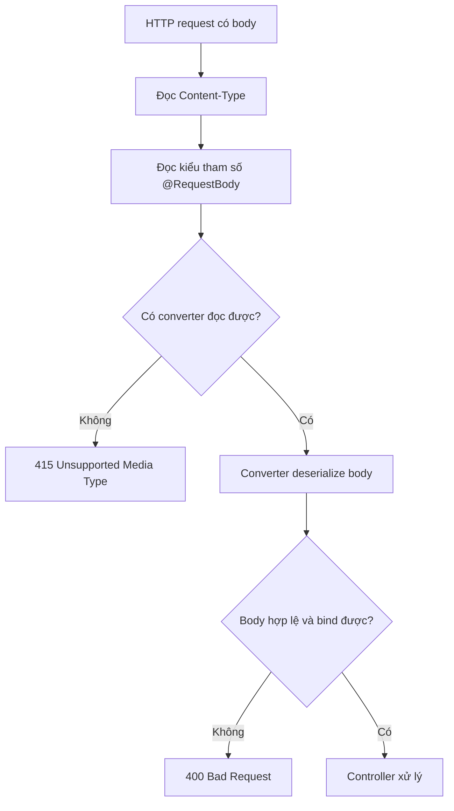
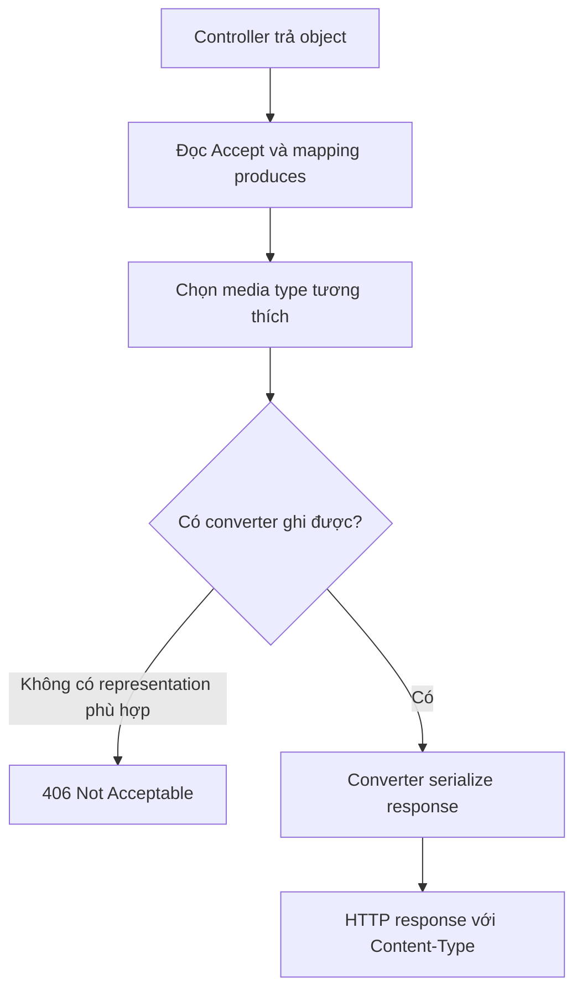

# 415, 406 và lỗi message converter

Trong Spring MVC, HTTP 415 Unsupported Media Type và 406 Not Acceptable thường xuất hiện khi request hoặc response không có định dạng mà ứng dụng có thể xử lý. Hai status này liên quan đến content negotiation và `HttpMessageConverter`, nhưng xảy ra ở hai hướng khác nhau: 415 chủ yếu liên quan đến dữ liệu client gửi lên; 406 liên quan đến representation server có thể trả về theo yêu cầu của client.

Khi chẩn đoán, cần xem đồng thời HTTP method, URI, `Content-Type`, `Accept`, mapping `consumes`/`produces`, kiểu Java cần đọc hoặc ghi và converter thực tế đã được đăng ký. Chỉ nhìn status code mà không kiểm tra các yếu tố này dễ dẫn đến sửa sai: ví dụ JSON sai cú pháp thường là 400, trong khi JSON được gửi với media type không được hỗ trợ thường là 415.

## 1. Ý nghĩa của 415 và 406

| Status | Tên | Câu hỏi cần trả lời | Hướng dữ liệu |
| --- | --- | --- | --- |
| 415 | Unsupported Media Type | Server có thể đọc request body theo `Content-Type` này không? | Request vào server |
| 406 | Not Acceptable | Server có thể tạo response theo một media type mà client chấp nhận không? | Response từ server |

**415** thường xảy ra khi:

- Request gửi `Content-Type` không nằm trong danh sách `consumes` của handler.
- Không có `HttpMessageConverter` nào đọc được media type và kiểu tham số cần nhận.
- Client gửi một loại body không được endpoint hỗ trợ, ví dụ gửi `text/plain` tới endpoint chỉ nhận JSON.

**406** thường xảy ra khi:

- `Accept` của client không tương thích với `produces` của handler.
- Không có representation nào vừa được client chấp nhận vừa có thể được ứng dụng tạo ra.
- Không có converter phù hợp để ghi kiểu dữ liệu trả về theo media type được chọn.

Hai lỗi này khác với lỗi nội dung body không hợp lệ. Nếu server đã chọn được converter JSON nhưng JSON sai cú pháp hoặc không thể bind vào DTO, kết quả thường là 400 Bad Request. Nếu server không thể ghi response vì lỗi trong quá trình serialization, lỗi có thể trở thành lỗi server, tùy tình huống và cách xử lý exception.

## 2. Vai trò của Content-Type và Accept

`Content-Type` mô tả định dạng của body đang được gửi trong HTTP message. Trong một request POST có JSON, client thường gửi:

```http
POST /api/products HTTP/1.1
Content-Type: application/json
Accept: application/json

{"name":"Notebook","price":12.50}
```

`Accept` liệt kê các media type client muốn nhận trong response. Client có thể chấp nhận một hoặc nhiều định dạng:

```http
Accept: application/json, application/xml;q=0.8
```

Trong ví dụ trên, JSON được ưu tiên hơn XML. Nếu endpoint chỉ trả JSON và có converter JSON, server có thể chọn JSON. Nếu client chỉ chấp nhận XML trong khi endpoint chỉ tạo JSON, server không có representation phù hợp và có thể trả 406.

Không nên nhầm hai header:

- Đặt `Accept: application/json` không làm request body tự trở thành JSON.
- Đặt `Content-Type: application/json` không buộc server trả JSON.
- Với GET không có body, thường chỉ cần `Accept` nếu muốn giới hạn định dạng response.
- Với POST/PUT/PATCH có body, cần đặt `Content-Type` theo định dạng body thực tế.

## 3. HttpMessageConverter làm gì?

Spring MVC sử dụng `HttpMessageConverter` để chuyển đổi dữ liệu giữa HTTP body và object Java. Converter có thể đọc request body thành object hoặc ghi object thành response body.

Các converter phổ biến:

| Converter | Chức năng thường gặp |
| --- | --- |
| `MappingJackson2HttpMessageConverter` | Đọc và ghi JSON bằng Jackson |
| `StringHttpMessageConverter` | Đọc và ghi `String` |
| `ByteArrayHttpMessageConverter` | Đọc và ghi `byte[]` |
| `ResourceHttpMessageConverter` | Đọc và ghi `Resource` |
| `FormHttpMessageConverter` | Đọc/ghi dữ liệu form URL-encoded và hỗ trợ multipart theo cấu hình |
| Converter XML | Đọc/ghi XML khi thư viện và converter tương ứng có mặt |

Khi đọc request body, Spring xét kiểu tham số, ví dụ `CreateProductRequest`, cùng media type của request. Converter cần hỗ trợ cả kiểu Java và media type đó. Về khái niệm, converter phải trả lời được `canRead(targetType, contentType)`.

Khi ghi response, Spring xét kiểu object trả về, media type mà client chấp nhận và media type mà handler công bố. Converter cần hỗ trợ ghi kiểu object đó theo media type đã chọn, tương tự `canWrite(returnType, selectedMediaType)`.





Chi tiết lựa chọn converter còn phụ thuộc Spring version, cấu hình MVC, converter tùy chỉnh, kiểu return và response đã được đặt content type trước đó hay chưa. Vì vậy, test cần chạy trong cấu hình gần với ứng dụng nếu mục tiêu là xác nhận converter thực tế.

## 4. Mapping consumes và produces

Spring MVC cho phép ràng buộc media type trực tiếp trên mapping:

- `consumes` mô tả loại request body handler chấp nhận; nó được đối chiếu với `Content-Type`.
- `produces` mô tả loại representation handler có thể tạo; nó được đối chiếu với `Accept` và converter ghi response.

Ví dụ endpoint chỉ nhận và trả JSON:

```java
@RestController
@RequestMapping("/api/products")
class ProductController {
    @PostMapping(
            consumes = MediaType.APPLICATION_JSON_VALUE,
            produces = MediaType.APPLICATION_JSON_VALUE)
    ResponseEntity<ProductView> create(
            @RequestBody CreateProductRequest request) {
        ProductView result = new ProductView(
                42L, request.name(), request.price());
        return ResponseEntity.status(HttpStatus.CREATED).body(result);
    }

    @GetMapping(
            value = "/{id}",
            produces = MediaType.APPLICATION_JSON_VALUE)
    ProductView find(@PathVariable long id) {
        return new ProductView(id, "Notebook", 12.50);
    }
}

record CreateProductRequest(String name, BigDecimal price) {
}

record ProductView(long id, String name, double price) {
}
```

Với POST, `Content-Type: application/json` phù hợp với `consumes`. Với GET, `Accept: application/json` phù hợp với `produces`. Nếu gửi `text/plain` tới POST hoặc yêu cầu XML từ GET trong khi handler chỉ công bố JSON, Spring không thể chọn handler/representation theo yêu cầu và sẽ trả lỗi media type phù hợp.

Có thể khai báo nhiều media type:

```java
@PostMapping(
        consumes = {
            MediaType.APPLICATION_JSON_VALUE,
            MediaType.APPLICATION_XML_VALUE
        },
        produces = {
            MediaType.APPLICATION_JSON_VALUE,
            MediaType.APPLICATION_XML_VALUE
        })
ProductView create(@RequestBody CreateProductRequest request) {
    // Xử lý request.
}
```

Khai báo `consumes` hoặc `produces` không tự cài đặt converter. Nếu muốn hỗ trợ XML, ứng dụng vẫn cần converter XML và dependency tương ứng. Nếu chỉ có JSON converter, mapping XML có thể được khai báo nhưng request/response XML vẫn không thể chuyển đổi thành công.

## 5. Chẩn đoán 415 Unsupported Media Type

Khi nhận 415, hãy bắt đầu từ request:

1. Request có body không? Nếu có, body thực tế là JSON, XML, form, multipart hay bytes?
2. `Content-Type` có phản ánh đúng body không?
3. Handler có `consumes` không và media type gửi lên có tương thích không?
4. Converter nào được đăng ký trong application context?
5. Converter có đọc được kiểu tham số `@RequestBody` không?

Ví dụ test gửi sai media type:

```java
@Test
void rejectsTextBodyWhenEndpointConsumesJson() throws Exception {
    mockMvc.perform(post("/api/products")
                    .contentType(MediaType.TEXT_PLAIN)
                    .content("Notebook"))
            .andExpect(status().isUnsupportedMediaType());
}
```

Endpoint chỉ nhận JSON, nên request `text/plain` không khớp `consumes`. Test này xác nhận contract của endpoint.

Test request hợp lệ:

```java
@Test
void acceptsJsonRequest() throws Exception {
    mockMvc.perform(post("/api/products")
                    .contentType(MediaType.APPLICATION_JSON)
                    .accept(MediaType.APPLICATION_JSON)
                    .content("""
                            {"name":"Notebook","price":12.50}
                            """))
            .andExpect(status().isCreated())
            .andExpect(content().contentTypeCompatibleWith(
                    MediaType.APPLICATION_JSON));
}
```

Nếu request body là JSON nhưng thiếu `Content-Type`, Spring có thể coi media type là mặc định hoặc không xác định theo cách phù hợp với converter/mapping. Không nên dựa vào suy đoán đó; client cần khai báo header đúng với body.

## 6. Phân biệt 415 với 400 khi đọc request body

Đây là phân biệt quan trọng nhất khi debug request JSON:

| Tình huống | Nguyên nhân | Status thường gặp |
| --- | --- | --- |
| Gửi `text/plain` tới endpoint chỉ nhận JSON | Media type không được hỗ trợ | 415 |
| Gửi JSON sai cú pháp với `Content-Type: application/json` | Converter JSON được chọn nhưng không parse được body | 400 |
| Gửi JSON hợp lệ nhưng giá trị không bind được vào kiểu Java | Lỗi chuyển đổi/binding body | 400 |
| JSON parse được nhưng vi phạm Bean Validation | Validation thất bại | Thường là 400, có thể được custom handler ánh xạ khác |
| Không có converter đọc kiểu tham số theo media type | Không thể đọc request representation | 415 |

Ví dụ JSON sai cú pháp:

```java
@Test
void returnsBadRequestForMalformedJson() throws Exception {
    mockMvc.perform(post("/api/products")
                    .contentType(MediaType.APPLICATION_JSON)
                    .content("{invalid-json"))
            .andExpect(status().isBadRequest());
}
```

Ví dụ JSON hợp lệ về cú pháp nhưng vi phạm validation:

```java
@Test
void returnsBadRequestForInvalidProductFields() throws Exception {
    mockMvc.perform(post("/api/products/validated")
                    .contentType(MediaType.APPLICATION_JSON)
                    .content("""
                            {"name":"","price":-1}
                            """))
            .andExpect(status().isBadRequest());
}
```

Hai test trên kiểm tra hai tầng khác nhau. Test malformed JSON kiểm tra khả năng đọc message; test validation kiểm tra ràng buộc trên object sau khi deserialize. Không nên gộp chúng thành một test chung vì khi thất bại sẽ khó xác định nguyên nhân.

## 7. Chẩn đoán 406 Not Acceptable

Khi nhận 406, hãy xem phía response:

1. Request gửi `Accept` nào? Có wildcard `*/*` hay chỉ chấp nhận một media type cụ thể?
2. Handler có khai báo `produces` không?
3. Object trả về có kiểu gì? `String`, DTO, `Resource`, collection hay kiểu tùy chỉnh?
4. Converter nào có thể ghi kiểu object đó?
5. Có cấu hình content negotiation hoặc default content type nào ảnh hưởng không?

Ví dụ handler chỉ trả JSON:

```java
@GetMapping(
        value = "/{id}",
        produces = MediaType.APPLICATION_JSON_VALUE)
ProductView find(@PathVariable long id) {
    return productService.find(id);
}
```

Test yêu cầu XML:

```java
@Test
void rejectsXmlWhenOnlyJsonIsProduced() throws Exception {
    mockMvc.perform(get("/api/products/42")
                    .accept(MediaType.APPLICATION_XML))
            .andExpect(status().isNotAcceptable());
}
```

Handler chỉ công bố JSON, trong khi client chỉ chấp nhận XML. Không có media type giao nhau nên Spring không thể chọn representation phù hợp.

Nếu client chấp nhận JSON:

```java
@Test
void returnsJsonWhenClientAcceptsJson() throws Exception {
    mockMvc.perform(get("/api/products/42")
                    .accept(MediaType.APPLICATION_JSON))
            .andExpect(status().isOk())
            .andExpect(content().contentTypeCompatibleWith(
                    MediaType.APPLICATION_JSON));
}
```

## 8. Phân biệt 406 do Accept với lỗi ghi response

Không phải mọi lỗi khi ghi response đều giống nhau. Cần phân biệt:

- **Không có media type tương thích với `Accept`:** Spring không tìm được representation mà client chấp nhận; thường là 406.
- **Handler `produces` không tương thích với `Accept`:** mapping có thể không được chọn; Spring thường trả 406.
- **Không có converter ghi được kiểu trả về:** tùy thời điểm và trạng thái response, Spring có thể báo không có acceptable representation hoặc ném `HttpMessageNotWritableException`; không nên mặc định mọi trường hợp đều là 406.
- **Converter đã chọn nhưng serialization gặp lỗi dữ liệu hoặc exception:** có thể là lỗi server, thường cần điều tra thành 500 hoặc lỗi đã được exception handler ánh xạ.

Ví dụ một controller trả về kiểu tùy chỉnh nhưng không có converter tương ứng:

```java
@GetMapping(value = "/report", produces = "application/x-report")
CustomReport report() {
    return reportService.create();
}
```

Việc khai báo `produces = "application/x-report"` không đủ để Spring biết cách ghi `CustomReport`. Ứng dụng cần đăng ký converter có khả năng ghi kiểu này theo media type đó. Nếu thiếu, response writing sẽ thất bại; cần xem exception cụ thể và cấu hình converter trước khi kết luận status mong đợi.

Nếu response đã được đặt `Content-Type` trước đó nhưng không có converter nào ghi được body tương ứng, exception có thể khác với trường hợp negotiation chưa chọn được media type. Đừng chỉ sửa `Accept` để che giấu một converter bị thiếu.

## 9. Accept wildcard và quality factor

Header `Accept` có thể chứa nhiều media type và quality factor `q`:

```http
Accept: application/xml;q=0.8, application/json;q=1.0
```

Giá trị `q` càng cao thì client càng ưu tiên media type đó. Nếu không ghi `q`, giá trị mặc định là `1.0`. Các wildcard thường gặp:

| Giá trị | Ý nghĩa |
| --- | --- |
| `*/*` | Chấp nhận mọi media type |
| `application/*` | Chấp nhận mọi subtype thuộc `application` |
| `application/json` | Chỉ chấp nhận JSON |
| `application/*+json` | Chấp nhận subtype có hậu tố `+json` nếu mapping/converter hỗ trợ |

Client có thể gửi:

```java
mockMvc.perform(get("/api/products/42")
        .header(HttpHeaders.ACCEPT,
                "application/xml;q=0.8, application/json;q=1.0"))
        .andExpect(status().isOk())
        .andExpect(content().contentTypeCompatibleWith(
                MediaType.APPLICATION_JSON));
```

Nếu client gửi `Accept: application/xml` nhưng endpoint chỉ trả JSON, server không được tự ý trả JSON như thể client đã chấp nhận. Kết quả thường là 406. Khi test nhiều media type, hãy assertion response `Content-Type` thực tế thay vì suy luận chỉ từ thứ tự trong header.

Nếu không có `Accept`, nhiều client/request được hiểu là chấp nhận mọi loại (`*/*`), nhưng hành vi mặc định còn chịu ảnh hưởng cấu hình content negotiation. Để test có tính xác định, nên đặt `Accept` rõ ràng khi response format là một phần của contract.

## 10. Converter không được đăng ký hoặc cấu hình sai

Trong Spring MVC, converter mặc định được đăng ký bởi MVC configuration. Nếu ứng dụng dùng `@EnableWebMvc`, tự cấu hình `WebMvcConfigurer` hoặc thay thế danh sách converter, có thể vô tình loại bỏ converter mặc định.

Ví dụ mở rộng danh sách converter:

```java
@Configuration
@EnableWebMvc
class ApiWebConfig implements WebMvcConfigurer {
    @Override
    public void extendMessageConverters(
            List<HttpMessageConverter<?>> converters) {
        // Thêm hoặc điều chỉnh converter, vẫn giữ converter mặc định.
    }
}
```

`extendMessageConverters(...)` thường phù hợp khi muốn bổ sung hoặc điều chỉnh danh sách mặc định. `configureMessageConverters(...)` có thể thay thế danh sách mặc định nếu không thêm lại các converter cần thiết. Vì vậy, một thay đổi cấu hình tưởng như chỉ thêm converter XML có thể vô tình làm mất JSON converter và gây 415/406 ở các endpoint khác.

Với Spring Boot, auto-configuration thường đăng ký converter dựa trên dependency có trong classpath. Nếu thiếu Jackson, ứng dụng có thể không có converter JSON như mong đợi. Nếu thêm thư viện XML nhưng không cấu hình converter hoặc mapping phù hợp, chỉ có dependency cũng chưa chắc đủ.

## 11. Kiểm tra converter trong test context

Khi lỗi chỉ xuất hiện trong test, hãy kiểm tra test có nạp đúng MVC configuration hay không. `@WebMvcTest` chỉ nạp web slice; một converter hoặc `WebMvcConfigurer` tùy chỉnh có thể không được phát hiện nếu nằm ngoài phạm vi slice.

Ví dụ import cấu hình bổ sung:

```java
@WebMvcTest(ProductController.class)
@Import(ApiWebConfig.class)
class ProductControllerTest {
    @Autowired
    MockMvc mockMvc;
}
```

Nếu test cần xác nhận toàn bộ cấu hình ứng dụng, có thể dùng `@SpringBootTest` kết hợp `@AutoConfigureMockMvc`. Cách này nạp context rộng hơn và kiểm tra được converter, controller advice và các cấu hình MVC của ứng dụng, nhưng chi phí khởi tạo cao hơn.

Nếu chỉ kiểm tra một controller với `standaloneSetup`, cần đăng ký converter tùy chỉnh bằng builder nếu test phụ thuộc vào converter đó. Một test standalone không tự động đại diện cho toàn bộ converter trong application context production.

## 12. Kiểm tra với MockMvc

`MockMvc` là công cụ thuận tiện để tái hiện request và xác nhận status 415/406 mà không cần server thật.

```java
@WebMvcTest(ProductController.class)
class ProductMediaTypeTest {
    @Autowired
    MockMvc mockMvc;

    @Test
    void returns415ForUnsupportedRequestContentType() throws Exception {
        mockMvc.perform(post("/api/products")
                        .contentType(MediaType.TEXT_PLAIN)
                        .content("Notebook"))
                .andExpect(status().isUnsupportedMediaType());
    }

    @Test
    void returns406ForUnacceptableResponseType() throws Exception {
        mockMvc.perform(get("/api/products/42")
                        .accept(MediaType.APPLICATION_XML))
                .andExpect(status().isNotAcceptable());
    }
}
```

Hai test cần endpoint có `consumes`/`produces` như ví dụ trước. Nếu controller có `@RestControllerAdvice`, handler đó có thể thay đổi error body hoặc status; test cần kiểm tra behavior thực tế mà ứng dụng công bố.

Để chẩn đoán sâu hơn, thêm `.andDo(print())`:

```java
mockMvc.perform(post("/api/products")
        .contentType(MediaType.TEXT_PLAIN)
        .content("Notebook"))
        .andDo(print())
        .andExpect(status().isUnsupportedMediaType());
```

Output hiển thị request headers, handler (nếu được chọn), response status, headers và body. Điều này giúp phân biệt mapping không khớp với lỗi trong controller.

## 13. Kiểm tra với WebTestClient khi dùng MockMvc adapter

Nếu test dùng WebTestClient fluent API cho ứng dụng Spring MVC, có thể kết nối qua `MockMvcWebTestClient`:

```java
WebTestClient client = MockMvcWebTestClient
        .bindToApplicationContext(webApplicationContext)
        .build();
```

Test 415:

```java
client.post()
        .uri("/api/products")
        .contentType(MediaType.TEXT_PLAIN)
        .bodyValue("Notebook")
        .exchange()
        .expectStatus().isUnsupportedMediaType();
```

Test 406:

```java
client.get()
        .uri("/api/products/42")
        .accept(MediaType.APPLICATION_XML)
        .exchange()
        .expectStatus().isNotAcceptable();
```

Với WebFlux, hệ thống chuyển đổi là codec (`HttpMessageReader`/`HttpMessageWriter`) thay vì Spring MVC `HttpMessageConverter`. Các nguyên tắc HTTP về `Content-Type`, `Accept`, 415 và 406 vẫn tương tự, nhưng exception type, cấu hình và đường đi xử lý có thể khác. Không nên dùng tên lớp MVC để giải thích stack trace WebFlux.

## 14. Kiểm tra error body khi có ControllerAdvice

Spring Boot hoặc ứng dụng có thể chuẩn hóa lỗi bằng `@RestControllerAdvice` và `ProblemDetail`. Khi đó, test không nên chỉ kiểm tra status; cần xác nhận error representation mà client sẽ nhận.

Ví dụ handler:

```java
@RestControllerAdvice
class ApiErrorHandler {
    @ExceptionHandler(HttpMediaTypeNotSupportedException.class)
    ResponseEntity<ProblemDetail> unsupportedMediaType(
            HttpMediaTypeNotSupportedException ex) {
        ProblemDetail problem = ProblemDetail.forStatusAndDetail(
                HttpStatus.UNSUPPORTED_MEDIA_TYPE,
                "The request media type is not supported.");
        problem.setTitle("Unsupported media type");
        problem.setProperty("code", "UNSUPPORTED_MEDIA_TYPE");
        return ResponseEntity.status(HttpStatus.UNSUPPORTED_MEDIA_TYPE)
                .body(problem);
    }
}
```

Test có thể xác nhận:

```java
mockMvc.perform(post("/api/products")
                .contentType(MediaType.TEXT_PLAIN)
                .content("Notebook")
                .accept(MediaType.APPLICATION_PROBLEM_JSON))
        .andExpect(status().isUnsupportedMediaType())
        .andExpect(content().contentTypeCompatibleWith(
                MediaType.APPLICATION_PROBLEM_JSON))
        .andExpect(jsonPath("$.title").value("Unsupported media type"))
        .andExpect(jsonPath("$.code").value("UNSUPPORTED_MEDIA_TYPE"));
```

Spring mặc định có các exception resolver xử lý nhiều lỗi framework. Nếu ứng dụng tự khai báo `@ExceptionHandler`, kết quả có thể khác mặc định. Nên thống nhất error schema cho toàn API và test nó như một phần của contract.

Không nên trả chi tiết implementation converter, stack trace hoặc tên class nội bộ ra response công khai. Những chi tiết đó thuộc log phía server; error body nên giải thích lỗi ở mức client có thể hành động.

## 15. Lỗi message converter thường gặp

| Hiện tượng | Nguyên nhân có thể có | Cách xử lý |
| --- | --- | --- |
| POST JSON trả 415 | Thiếu/sai `Content-Type`, `consumes` không khớp hoặc không có converter đọc DTO | Đặt `APPLICATION_JSON`, kiểm tra mapping và converter |
| POST JSON trả 400 | JSON sai cú pháp, field không bind được hoặc validation thất bại | Tách test malformed JSON, binding và validation |
| GET JSON trả 406 | `Accept` không tương thích `produces` hoặc không có converter ghi representation | Kiểm tra `Accept`, `produces` và converter write |
| XML không đọc được dù mapping có XML | Thiếu XML converter hoặc thư viện phụ trợ | Thêm và đăng ký converter phù hợp |
| JSON đột nhiên trả 406 sau thay đổi cấu hình | Converter mặc định bị loại khỏi danh sách | Kiểm tra `configureMessageConverters` và `extendMessageConverters` |
| Test slice trả 415 nhưng ứng dụng chạy thật không lỗi | Test context thiếu converter/configuration production | Import cấu hình hoặc dùng context integration phù hợp |
| Response body serialization ném exception | DTO không serialize được, getter/record mapping hoặc custom serializer lỗi | Đọc root cause và kiểm tra converter/DTO |
| `Accept: */*` hoạt động nhưng `Accept: application/xml` trả 406 | Endpoint chỉ hỗ trợ JSON | Xác nhận contract; bổ sung XML converter/mapping nếu thực sự cần |
| Header có charset làm assertion thất bại | So sánh Content-Type quá chặt | Dùng matcher tương thích nếu tham số charset không thuộc contract |

## 16. Quy trình chẩn đoán nhanh

Khi gặp 415 hoặc 406, thực hiện theo trình tự:

1. **Ghi lại request thực tế:** method, URI, body, `Content-Type` và `Accept`.
2. **Xác định handler:** mapping có `consumes`/`produces` nào; controller có được đăng ký trong test context không?
3. **Kiểm tra converter:** converter nào có mặt; converter có đọc/ghi kiểu Java và media type cần thiết không?
4. **Tách lỗi body:** nếu converter đọc được nhưng parse/bind thất bại, kiểm tra 400 và exception đọc message.
5. **Kiểm tra response negotiation:** xác định media type giao nhau giữa `Accept`, `produces` và khả năng ghi của converter.
6. **Đọc exception gốc:** `HttpMediaTypeNotSupportedException`, `HttpMediaTypeNotAcceptableException`, `HttpMessageNotReadableException` hoặc `HttpMessageNotWritableException` gợi ý những nhánh xử lý khác nhau.
7. **So sánh cấu hình test và ứng dụng:** test slice, profile, custom MVC config và dependency có thể làm danh sách converter khác nhau.
8. **Xác nhận contract:** viết assertion cho status, response Content-Type và error body cụ thể.

| Exception thường gặp trong Spring MVC | Ý nghĩa chẩn đoán thường gặp |
| --- | --- |
| `HttpMediaTypeNotSupportedException` | Request media type không được hỗ trợ; thường ánh xạ 415 |
| `HttpMediaTypeNotAcceptableException` | Không có response media type phù hợp; thường ánh xạ 406 |
| `HttpMessageNotReadableException` | Không đọc/deserialize được request body; thường ánh xạ 400 |
| `HttpMessageNotWritableException` | Không ghi được response body; thường là lỗi phía server, cần xem chi tiết |
| `MethodArgumentNotValidException` | Bean Validation trên tham số đã bind thất bại; thường ánh xạ 400 |

Tên exception là bằng chứng quan trọng nhưng không thay thế việc đọc cause chain và response thực tế. Custom exception resolver hoặc controller advice có thể thay đổi status và error body mặc định.

## 17. Nguyên tắc viết test cho 415, 406 và converter

1. Đặt `Content-Type` đúng với request body và `Accept` đúng với representation muốn nhận.
2. Khai báo `consumes` để thể hiện loại request body handler hỗ trợ và `produces` để thể hiện loại response handler cung cấp.
3. Kiểm tra 415 cho media type request không được hỗ trợ; kiểm tra 400 riêng cho JSON sai cú pháp hoặc validation thất bại.
4. Kiểm tra 406 khi client chỉ chấp nhận media type mà endpoint không thể trả.
5. Xác nhận converter có khả năng đọc/ghi cả kiểu Java lẫn media type, không chỉ kiểm tra dependency có mặt.
6. Khi dùng custom converter, kiểm tra nó được đăng ký trong application context mà test thực sự sử dụng.
7. Dùng test slice cho phạm vi nhỏ; dùng integration test khi cần xác nhận converter và cấu hình MVC đầy đủ.
8. Kiểm tra error body nếu API công bố schema lỗi, đặc biệt khi dùng `@RestControllerAdvice` hoặc `ProblemDetail`.
9. Phân biệt Spring MVC `HttpMessageConverter` với WebFlux codec khi đọc stack trace.
10. Không sửa `Accept` hoặc `Content-Type` để che giấu converter thiếu hoặc mapping sai; điều chỉnh theo HTTP contract đã xác định.

415 và 406 phản ánh hai phía khác nhau của quá trình trao đổi representation: server không đọc được định dạng request hoặc không thể tạo định dạng response mà client chấp nhận. Khi kết hợp việc kiểm tra header, mapping `consumes`/`produces`, converter và exception gốc, bài test sẽ giúp xác định rõ lỗi nằm ở request media type, nội dung body, response negotiation hay cấu hình message conversion.
