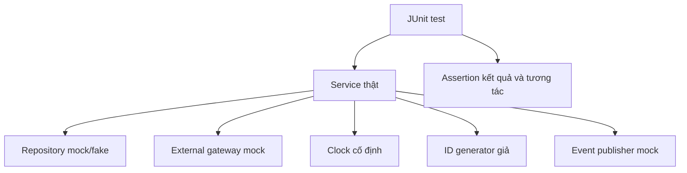

# Kiểm thử đơn vị dịch vụ bằng phụ thuộc được kiểm soát

## 1. Mục tiêu của service unit test

Service thường điều phối quy tắc nghiệp vụ và gọi nhiều thành phần khác: repository, gateway HTTP, message publisher, clock, bộ sinh ID hoặc một policy tính toán. Một service unit test kiểm tra hành vi của service trong khi thay các collaborator bên ngoài bằng mock, stub hoặc fake có kiểm soát.

Mục tiêu không phải là khởi động toàn bộ ứng dụng Spring. Test tạo một instance của service, truyền vào các dependency đã chuẩn bị, gọi method và xác nhận kết quả cùng side effect thuộc hợp đồng của service.



Service là đối tượng đang được kiểm thử. Các dependency được kiểm soát để test có thể chủ động tạo kết quả, lỗi và trạng thái mà service phải xử lý.

Một unit test tốt giúp trả lời:

- Với đầu vào hợp lệ, service trả kết quả gì và tạo trạng thái nào?
- Khi dependency trả dữ liệu rỗng, từ chối hoặc ném lỗi, service phản ứng ra sao?
- Những collaborator nào phải được gọi, với đối số nào?
- Khi nghiệp vụ thất bại, side effect nào phải không xảy ra?
- Kết quả có ổn định giữa các lần chạy và không phụ thuộc thời gian, mạng hay dữ liệu môi trường không?

## 2. Thiết kế service để có thể truyền dependency vào

Constructor injection làm rõ các dependency cần thiết để service hoạt động. Test có thể tự tạo service bằng cách truyền mock hoặc fake, không cần `ApplicationContext`.

```java
@Service
public class OrderService {

    private final ProductCatalog productCatalog;
    private final OrderRepository orderRepository;
    private final OrderIdGenerator idGenerator;
    private final Clock clock;
    private final ApplicationEventPublisher eventPublisher;

    public OrderService(
            ProductCatalog productCatalog,
            OrderRepository orderRepository,
            OrderIdGenerator idGenerator,
            Clock clock,
            ApplicationEventPublisher eventPublisher) {
        this.productCatalog = productCatalog;
        this.orderRepository = orderRepository;
        this.idGenerator = idGenerator;
        this.clock = clock;
        this.eventPublisher = eventPublisher;
    }

    public OrderReceipt placeOrder(PlaceOrderCommand command) {
        if (command.quantity() <= 0) {
            throw new InvalidOrderException("Quantity must be positive");
        }

        Product product = productCatalog.findSellableBySku(command.sku())
                .orElseThrow(() -> new ProductNotFoundException(command.sku()));

        BigDecimal total = product.unitPrice()
                .multiply(BigDecimal.valueOf(command.quantity()));

        Order order = new Order(
                idGenerator.nextId(),
                product.sku(),
                command.quantity(),
                total,
                clock.instant());

        Order saved = orderRepository.save(order);
        eventPublisher.publishEvent(new OrderPlacedEvent(saved.id(), saved.total()));

        return new OrderReceipt(saved.id(), saved.total(), saved.createdAt());
    }
}
```

Các dependency thể hiện rõ ranh giới:

- `ProductCatalog` cung cấp dữ liệu sản phẩm.
- `OrderRepository` lưu đơn hàng.
- `OrderIdGenerator` cấp ID.
- `Clock` cung cấp thời điểm hiện tại.
- `ApplicationEventPublisher` phát sự kiện Spring.

Việc truyền `Clock` và ID generator vào constructor có ích đặc biệt cho test. Nếu service gọi trực tiếp `Instant.now()` hoặc `UUID.randomUUID()` ở nhiều nơi, test phải chấp nhận dữ liệu thay đổi theo thời gian và ngẫu nhiên. Khi các nguồn biến động được biểu diễn thành dependency, test có thể cung cấp giá trị cố định.

Các kiểu dữ liệu trong ví dụ:

```java
public record PlaceOrderCommand(String sku, int quantity) {}

public record Product(String sku, BigDecimal unitPrice) {}

public record Order(
        UUID id,
        String sku,
        int quantity,
        BigDecimal total,
        Instant createdAt) {}

public record OrderReceipt(UUID orderId, BigDecimal total, Instant createdAt) {}

public record OrderPlacedEvent(UUID orderId, BigDecimal total) {}
```

Các interface phụ thuộc có thể được định nghĩa như sau:

```java
public interface ProductCatalog {
    Optional<Product> findSellableBySku(String sku);
}

public interface OrderRepository {
    Order save(Order order);
}

public interface OrderIdGenerator {
    UUID nextId();
}
```

Đây là ví dụ thiết kế để minh họa cách kiểm thử. Trong ứng dụng thật, domain model có thể là class có invariant, factory hoặc aggregate; điều quan trọng là service nhận dependency qua constructor và không tự khởi tạo hạ tầng bên trong method.

## 3. Tạo service test bằng JUnit và Mockito

JUnit Jupiter chạy test; Mockito tạo mock và điều khiển hành vi của dependency. Với JUnit 5, thêm Mockito extension:

```java
@ExtendWith(MockitoExtension.class)
class OrderServiceTest {

    @Mock
    private ProductCatalog productCatalog;

    @Mock
    private OrderRepository orderRepository;

    @Mock
    private OrderIdGenerator idGenerator;

    @Mock
    private ApplicationEventPublisher eventPublisher;

    private Clock clock;
    private OrderService orderService;

    @BeforeEach
    void setUp() {
        clock = Clock.fixed(
                Instant.parse("2025-04-10T09:30:00Z"),
                ZoneOffset.UTC);

        orderService = new OrderService(
                productCatalog,
                orderRepository,
                idGenerator,
                clock,
                eventPublisher);
    }
}
```

`@ExtendWith(MockitoExtension.class)` khởi tạo và quản lý mock cho từng test. `@Mock` tạo collaborator giả. Service được tạo trực tiếp trong `setUp()` để thể hiện rõ dependency nào được truyền vào.

Với cách này, test không cần `@SpringBootTest`, `@ContextConfiguration` hoặc `@Autowired`. Spring không cần tạo context vì mục tiêu là kiểm tra logic của một object Java độc lập.

Nếu dự án dùng Spring Boot, dependency test thường được cung cấp bởi starter test. Nếu chỉ dùng Mockito, cần dependency `mockito-junit-jupiter` cùng JUnit Jupiter. Phiên bản cụ thể phải phù hợp dependency management của dự án.

## 4. Stub dependency để tạo kịch bản xác định

Stub quy định giá trị mà mock trả về khi service gọi một method. Mockito dùng `when(...).thenReturn(...)` cho method có kết quả:

```java
when(productCatalog.findSellableBySku("BOOK-01"))
        .thenReturn(Optional.of(new Product(
                "BOOK-01", new BigDecimal("25.00"))));

when(idGenerator.nextId())
        .thenReturn(UUID.fromString("00000000-0000-0000-0000-000000000123"));

when(orderRepository.save(any(Order.class)))
        .thenAnswer(invocation -> invocation.getArgument(0));
```

Ở đây:

- Catalog trả về sản phẩm có giá cố định.
- ID generator trả về UUID đã biết.
- Repository trả lại đối tượng được lưu để service tiếp tục dùng.

Stub giúp test kiểm soát đầu vào của service và không phụ thuộc database, catalog từ xa hoặc nguồn ID ngẫu nhiên.

Không stub tất cả method một cách máy móc. Chỉ stub những lời gọi cần thiết để tạo kịch bản. Mockito extension mặc định kiểm tra các stub không được sử dụng trong strict mode; stub dư thừa thường là dấu hiệu test còn cấu hình thừa hoặc implementation đã thay đổi.

## 5. Kiểm tra kết quả và side effect thuộc hợp đồng

Test happy path nên xác nhận kết quả trả về, dữ liệu gửi đến repository và event được phát:

```java
@Test
void placesOrderAndPublishesEvent() {
    UUID orderId = UUID.fromString(
            "00000000-0000-0000-0000-000000000123");
    Instant createdAt = Instant.parse("2025-04-10T09:30:00Z");
    Product product = new Product("BOOK-01", new BigDecimal("25.00"));

    when(productCatalog.findSellableBySku("BOOK-01"))
            .thenReturn(Optional.of(product));
    when(idGenerator.nextId()).thenReturn(orderId);
    when(orderRepository.save(any(Order.class)))
            .thenAnswer(invocation -> invocation.getArgument(0));

    OrderReceipt receipt = orderService.placeOrder(
            new PlaceOrderCommand("BOOK-01", 2));

    assertThat(receipt.orderId()).isEqualTo(orderId);
    assertThat(receipt.total()).isEqualByComparingTo("50.00");
    assertThat(receipt.createdAt()).isEqualTo(createdAt);

    ArgumentCaptor<Order> orderCaptor = ArgumentCaptor.forClass(Order.class);
    verify(orderRepository).save(orderCaptor.capture());

    Order savedOrder = orderCaptor.getValue();
    assertThat(savedOrder.id()).isEqualTo(orderId);
    assertThat(savedOrder.sku()).isEqualTo("BOOK-01");
    assertThat(savedOrder.quantity()).isEqualTo(2);
    assertThat(savedOrder.total()).isEqualByComparingTo("50.00");
    assertThat(savedOrder.createdAt()).isEqualTo(createdAt);

    verify(eventPublisher).publishEvent(
            new OrderPlacedEvent(orderId, new BigDecimal("50.00")));
}
```

Test này kiểm tra kết quả trả về và nội dung dữ liệu mà service gửi tới các collaborator. `ArgumentCaptor` hữu ích khi cần xác nhận một object được tạo bên trong service.

Không cần verify mọi lời gọi nội bộ. Chỉ kiểm tra tương tác có ý nghĩa với hợp đồng, ví dụ repository phải nhận đúng dữ liệu hoặc event publisher phải phát sự kiện đúng. Nếu test verify cả getter, helper hoặc mọi lời gọi theo đúng thứ tự mà nghiệp vụ không yêu cầu, test dễ bị gãy khi refactor mà hành vi không đổi.

## 6. Kiểm tra nhánh validation trước khi gọi dependency

Với quantity không hợp lệ, service phải từ chối ngay. Test nên xác nhận exception và rằng các collaborator không bị gọi:

```java
@Test
void rejectsNonPositiveQuantityBeforeLookingUpProduct() {
    assertThatThrownBy(() -> orderService.placeOrder(
            new PlaceOrderCommand("BOOK-01", 0)))
            .isInstanceOf(InvalidOrderException.class)
            .hasMessage("Quantity must be positive");

    verifyNoInteractions(
            productCatalog,
            orderRepository,
            idGenerator,
            eventPublisher);
}
```

Assertion này kiểm tra cả điều kiện từ chối lẫn việc service không tạo side effect. Nếu chỉ xác nhận exception, code vẫn có thể gọi catalog hoặc tạo ID trước khi phát hiện quantity sai.

Với đầu vào dạng chuỗi, số tiền hoặc ngày, nên chọn dữ liệu đại diện cho từng equivalence class và boundary. Ví dụ quantity bằng 0, âm một và một giá trị hợp lệ; không cần tạo hàng trăm test giống nhau nếu chúng không kiểm tra thêm quy tắc.

## 7. Kiểm tra dependency trả kết quả không tìm thấy

Khi sản phẩm không tồn tại hoặc không còn bán, service phải báo lỗi và không lưu đơn hàng:

```java
@Test
void rejectsUnknownProductWithoutSavingOrder() {
    when(productCatalog.findSellableBySku("MISSING"))
            .thenReturn(Optional.empty());

    assertThatThrownBy(() -> orderService.placeOrder(
            new PlaceOrderCommand("MISSING", 1)))
            .isInstanceOf(ProductNotFoundException.class);

    verify(productCatalog).findSellableBySku("MISSING");
    verifyNoInteractions(orderRepository, idGenerator, eventPublisher);
}
```

Đây là test điều khiển dependency để service đi vào nhánh lỗi. Không cần tạo một catalog giả phức tạp nếu chỉ có một method cần điều khiển; mock phù hợp cho tương tác đơn giản này.

Nếu quy tắc nghiệp vụ cần phân biệt sản phẩm không tồn tại, ngừng bán và hết hàng, hãy biểu diễn từng trạng thái rõ ràng trong model hoặc kết quả catalog và test các kết quả tương ứng.

## 8. Kiểm tra lỗi từ collaborator và bảo đảm không phát event

Repository có thể ném exception khi lưu. Service cần truyền lỗi hoặc chuyển nó thành lỗi nghiệp vụ theo hợp đồng. Trong ví dụ hiện tại, lỗi được truyền ra và event không được phát:

```java
@Test
void doesNotPublishEventWhenPersistenceFails() {
    Product product = new Product("BOOK-01", new BigDecimal("25.00"));
    RuntimeException databaseFailure = new RuntimeException("Database unavailable");

    when(productCatalog.findSellableBySku("BOOK-01"))
            .thenReturn(Optional.of(product));
    when(idGenerator.nextId()).thenReturn(UUID.randomUUID());
    when(orderRepository.save(any(Order.class))).thenThrow(databaseFailure);

    assertThatThrownBy(() -> orderService.placeOrder(
            new PlaceOrderCommand("BOOK-01", 1)))
            .isSameAs(databaseFailure);

    verifyNoInteractions(eventPublisher);
}
```

Test xác nhận event chỉ được phát sau khi `save(...)` trả về thành công. Đây là quy tắc thứ tự thuộc behavior của service. Nếu code phát event trước khi lưu, test sẽ phát hiện.

Đây vẫn là unit test: nó xác nhận service gọi collaborator theo đúng trình tự trong một object. Nó không chứng minh transaction database đã commit trước khi event được xử lý. Nếu event phải chạy sau commit, cần một integration test với transaction thật và `@TransactionalEventListener`.

## 9. Dùng `Clock` để kiểm soát thời gian

Không nên để test phụ thuộc đồng hồ hệ thống. `Instant.now()` có thể khác nhau giữa hai lần gọi, chịu ảnh hưởng múi giờ hoặc làm assertion nhạy với tốc độ máy.

Truyền `Clock` vào service:

```java
Instant createdAt = clock.instant();
```

Trong test, dùng clock cố định:

```java
Clock fixedClock = Clock.fixed(
        Instant.parse("2025-04-10T09:30:00Z"),
        ZoneOffset.UTC);
```

Mọi lần gọi `fixedClock.instant()` trả cùng một thời điểm. Nếu nghiệp vụ cần kiểm tra thời gian thay đổi, có thể dùng `Clock.offset(...)` hoặc một implementation clock dành riêng cho test để tiến thời gian có chủ đích.

Với logic ngày tháng, chú ý `ZoneId`. `Instant` là thời điểm tuyệt đối; `LocalDate` phụ thuộc múi giờ khi chuyển từ instant. Test nên truyền zone rõ ràng:

```java
Clock fixedClock = Clock.fixed(
        Instant.parse("2025-04-10T23:30:00Z"),
        ZoneId.of("Asia/Ho_Chi_Minh"));
```

Khi test chính sách hết hạn theo ngày, hãy chọn thời điểm ngay trước, đúng tại và ngay sau ranh giới để xác nhận quy tắc inclusive/exclusive.

## 10. Kiểm soát ID, random và các nguồn không xác định khác

Ngoài thời gian, service có thể dùng UUID, số ngẫu nhiên, sequence, locale, timezone, environment variable hoặc cấu hình hệ thống. Những nguồn này cần được kiểm soát khi ảnh hưởng đến kết quả test.

Ví dụ thay vì gọi `UUID.randomUUID()` trực tiếp trong method, tạo abstraction nhỏ:

```java
public interface OrderIdGenerator {
    UUID nextId();
}
```

Production implementation có thể dùng UUID:

```java
@Component
class UuidOrderIdGenerator implements OrderIdGenerator {
    @Override
    public UUID nextId() {
        return UUID.randomUUID();
    }
}
```

Test stub ID cố định để assertion không cần wildcard:

```java
when(idGenerator.nextId()).thenReturn(
        UUID.fromString("00000000-0000-0000-0000-000000000123"));
```

Với số ngẫu nhiên, có thể inject `RandomGenerator` hoặc một interface domain riêng rồi dùng seed cố định. Với locale và timezone, truyền cấu hình rõ ràng thay vì dựa vào default của JVM. Với biến môi trường hoặc system property, cân nhắc đưa cấu hình qua object được inject để test không phải sửa global state.

Không cần biến mọi giá trị thành dependency. Chỉ tách nguồn không xác định khi nó ảnh hưởng tới logic cần kiểm thử hoặc tạo ra test không ổn định.

## 11. Chọn giữa mock, stub và fake

Các test double có mục đích khác nhau:

| Loại | Đặc điểm | Dùng khi |
|---|---|---|
| Stub | Trả kết quả đã định trước | Cần điều khiển dữ liệu đầu vào từ dependency |
| Mock | Ghi nhận tương tác để test xác nhận lời gọi | Hành vi quan trọng là collaborator được gọi hay không, với đối số nào |
| Fake | Implementation đơn giản nhưng chạy được, ví dụ repository lưu trong map | Cần trạng thái có thể đọc/ghi qua nhiều lời gọi |
| Spy | Bọc một object thật và có thể stub/verify một số method | Cần quan sát một phần object thật; dùng thận trọng |

Ví dụ fake repository trong bộ nhớ:

```java
class InMemoryOrderRepository implements OrderRepository {

    private final Map<UUID, Order> orders = new HashMap<>();

    @Override
    public Order save(Order order) {
        orders.put(order.id(), order);
        return order;
    }

    Optional<Order> findById(UUID id) {
        return Optional.ofNullable(orders.get(id));
    }
}
```

Fake hữu ích khi test cần kiểm tra nhiều thao tác trên trạng thái repository đơn giản. Nhưng fake này không kiểm tra SQL, transaction, constraint, mapping JPA hoặc hành vi database thật. Các thuộc tính đó cần integration test với database phù hợp.

Không nên dùng mock cho mọi dependency nếu một fake nhỏ làm test dễ hiểu hơn. Ngược lại, không cần viết fake phức tạp cho một collaborator chỉ có một lời gọi và một kết quả; stub trên mock có thể rõ ràng hơn.

## 12. Tránh mock domain object và chi tiết triển khai

Domain object thường là dữ liệu mà service đang xử lý. Nên tạo object thật để test quy tắc trên giá trị thực:

```java
Product product = new Product("BOOK-01", new BigDecimal("25.00"));
```

Mock `Product` để stub getter có thể khiến test phụ thuộc vào cách implementation đọc dữ liệu, đồng thời không kiểm tra constructor hoặc invariant của domain object.

Tương tự, không nên mock chính service đang kiểm thử hoặc mock một helper nội bộ chỉ để đạt coverage. Nếu method có quá nhiều dependency hoặc logic quá phức tạp, cân nhắc tách một collaborator có trách nhiệm rõ ràng rồi kiểm thử từng đơn vị.

Test nên quan sát đầu ra và side effect công khai. Hãy hạn chế assertion vào private method, thứ tự gọi các helper nội bộ hoặc cấu trúc object không phải hợp đồng. Khi refactor mà behavior không đổi, test tốt nên tiếp tục pass.

## 13. Dùng `@InjectMocks` hay tự tạo service?

Mockito có `@InjectMocks` để tạo object cần test và thử inject mock qua constructor, setter hoặc field:

```java
@ExtendWith(MockitoExtension.class)
class OrderServiceWithInjectMocksTest {

    @Mock ProductCatalog productCatalog;
    @Mock OrderRepository orderRepository;
    @Mock OrderIdGenerator idGenerator;
    @Mock ApplicationEventPublisher eventPublisher;

    @InjectMocks OrderService orderService;
}
```

Với constructor injection và dependency rõ ràng, cách này gọn. Tuy nhiên, Mockito chọn cách inject theo quy tắc của nó; nếu có nhiều constructor hoặc dependency cùng kiểu, việc inject có thể không rõ như mong muốn. `@InjectMocks` cũng không tạo bean Spring, không áp dụng `@Transactional`, `@Async`, AOP hoặc configuration của context.

Tự tạo service trong `@BeforeEach` thường minh bạch hơn khi cần truyền một dependency thật như `Clock.fixed(...)`, một fake hoặc một cấu hình đặc biệt. Cả hai cách đều hợp lệ; chọn cách làm rõ dependency của test.

## 14. Dùng `ArgumentCaptor` đúng lúc

`ArgumentCaptor` cho phép lấy đối số mà mock nhận được để kiểm tra nội dung:

```java
ArgumentCaptor<Order> captor = ArgumentCaptor.forClass(Order.class);

verify(orderRepository).save(captor.capture());

Order order = captor.getValue();
assertThat(order.quantity()).isEqualTo(2);
assertThat(order.total()).isEqualByComparingTo("50.00");
```

Captor hữu ích khi service tạo object phức tạp và test cần xác nhận các field được truyền đi. Với một giá trị đơn giản, matcher trực tiếp thường dễ đọc hơn:

```java
verify(paymentGateway).charge(eq("token-123"), eq(new BigDecimal("50.00")));
```

Không cần capture mọi đối số. Chỉ capture khi assertion trên nội dung giúp test biểu đạt rõ behavior.

## 15. Kiểm tra thứ tự tương tác khi thứ tự là một phần của nghiệp vụ

Thông thường, chỉ cần xác nhận các side effect cần thiết đã xảy ra. Nhưng đôi khi thứ tự là một phần của hợp đồng. Ví dụ service phải lưu đơn hàng thành công rồi mới phát event.

```java
InOrder order = inOrder(orderRepository, eventPublisher);

order.verify(orderRepository).save(any(Order.class));
order.verify(eventPublisher).publishEvent(any(OrderPlacedEvent.class));
```

`InOrder` xác nhận thứ tự giữa hai collaborator. Chỉ dùng khi thay đổi thứ tự có thể làm nghiệp vụ sai. Nếu thứ tự gọi hai metric hoặc hai helper nội bộ không ảnh hưởng behavior, verify thứ tự sẽ làm test mong manh.

Nếu event cần được phát sau khi transaction commit, verify thứ tự method ở unit test chưa đủ. Unit test chỉ xác nhận service gọi publisher sau `save()` trả về. Transaction commit và phase của listener phải được xác nhận ở integration test có transaction thật.

## 16. Kiểm tra exception mà không làm mất nguyên nhân

Khi dependency ném lỗi, service có thể truyền nguyên lỗi hoặc chuyển thành exception domain. Test cần xác nhận cả loại lỗi và nguyên nhân nếu đó là hợp đồng.

```java
@Test
void translatesCatalogFailure() {
    RuntimeException networkFailure = new RuntimeException("Catalog unavailable");

    when(productCatalog.findSellableBySku("BOOK-01"))
            .thenThrow(networkFailure);

    assertThatThrownBy(() -> orderService.placeOrder(
            new PlaceOrderCommand("BOOK-01", 1)))
            .isInstanceOf(ProductLookupException.class)
            .hasCause(networkFailure);

    verifyNoInteractions(orderRepository, eventPublisher);
}
```

Ví dụ này giả định service chuyển lỗi catalog thành `ProductLookupException`; nếu implementation chỉ truyền lỗi gốc, assertion phải khớp hợp đồng đó. Không nên bắt mọi `Exception` rồi chỉ kiểm tra rằng có exception, vì test có thể pass do một lỗi không liên quan.

Nếu service retry khi dependency thất bại tạm thời, kiểm tra số lần gọi và kết quả cuối:

```java
when(productCatalog.findSellableBySku("BOOK-01"))
        .thenThrow(new TransientCatalogException())
        .thenReturn(Optional.of(product));

OrderReceipt receipt = orderService.placeOrder(command);

assertThat(receipt.total()).isEqualByComparingTo("25.00");
verify(productCatalog, times(2)).findSellableBySku("BOOK-01");
```

Test retry cần kiểm soát backoff và scheduler. Nếu logic dùng delay thực, inject `Sleeper`, scheduler hoặc abstraction thời gian để test không phải chờ lâu. Với retry do Spring Retry hoặc resilience library quản lý, có thể cần một integration test để xác nhận annotation/AOP được áp dụng thật.

## 17. Khi nào cần `@SpringBootTest` thay vì unit test thuần?

Unit test tạo service trực tiếp không chạy Spring container. Vì vậy, nó không kiểm tra:

- Component scan có tìm thấy service hay không.
- Dependency injection trong ApplicationContext có đúng không.
- `@Transactional` có được proxy kích hoạt không.
- `@Async`, `@Cacheable`, method security hoặc retry annotation có hoạt động không.
- Bean configuration, qualifier, profile hoặc conditional configuration có đúng không.
- Repository query, ORM mapping hoặc transaction với database có đúng không.

Những hành vi đó thuộc ranh giới Spring integration. Có thể dùng `@SpringBootTest`, slice test hoặc test context hẹp tùy mục tiêu.

Ví dụ unit test gọi trực tiếp `orderService.placeOrder(...)` không kiểm tra transaction rollback. Nếu service được annotate `@Transactional`, việc tạo object bằng `new OrderService(...)` không tạo proxy transaction. Muốn xác nhận rollback khi repository ném lỗi, cần gọi bean qua Spring proxy trong integration test và kiểm tra database sau khi transaction kết thúc.

Tương tự, một unit test gọi method `@Async` trực tiếp trên object thường chạy đồng bộ vì không có Spring proxy. Muốn xác nhận executor thực sự chạy tác vụ trên thread khác, cần test context có bật async và cấu hình executor.

## 18. Kiểm soát dependency bên ngoài mà không làm test thành integration test

Service có thể phụ thuộc HTTP gateway, message publisher, filesystem hoặc clock. Unit test nên điều khiển các dependency đó tại ranh giới của service.

Ví dụ gateway:

```java
@Mock
private ShippingGateway shippingGateway;

when(shippingGateway.estimate(any(ShippingRequest.class)))
        .thenReturn(new ShippingQuote(new BigDecimal("8.00")));
```

Test xác nhận service sử dụng quote để tính tổng. Nó không gửi HTTP request thật và không xác nhận JSON serialization, authentication hoặc timeout của HTTP client. Những hành vi thuộc HTTP adapter cần test riêng bằng mock server hoặc contract test.

Ví dụ message publisher:

```java
verify(eventPublisher).publishEvent(
        argThat(event -> event instanceof OrderPlacedEvent placed
                && placed.orderId().equals(expectedOrderId)));
```

Unit test xác nhận service phát đúng event object. Nó không chứng minh broker đã nhận message hoặc consumer xử lý thành công. Nếu dùng Spring application event, integration test có thể kiểm tra listener; nếu dùng broker, cần test adapter hoặc integration test với broker phù hợp.

## 19. Những lỗi thường gặp trong service unit test

| Hiện tượng | Nguyên nhân thường gặp | Cách xử lý |
|---|---|---|
| Test cần khởi động cả Spring context dù chỉ kiểm tra logic service | Service tạo dependency bên trong hoặc test dùng `@SpringBootTest` không cần thiết | Dùng constructor injection và tạo service trực tiếp |
| Test lúc pass lúc fail do timestamp | Gọi `Instant.now()` hoặc dựa vào timezone mặc định | Inject `Clock` và dùng `Clock.fixed(...)` |
| ID thay đổi mỗi lần chạy | Service gọi UUID/random trực tiếp | Inject ID generator hoặc random source có seed |
| Test pass dù kết quả nghiệp vụ sai | Assertion chỉ `isNotNull()` hoặc kiểm tra status | Xác nhận giá trị, trạng thái và side effect cụ thể |
| Mock quá nhiều khiến test khó hiểu | Mock domain object hoặc mọi helper nội bộ | Dùng domain object thật, fake đơn giản và chỉ mock ranh giới |
| Test gãy sau refactor | Verify quá nhiều lời gọi hoặc thứ tự không thuộc hợp đồng | Kiểm tra kết quả và tương tác có ý nghĩa |
| Test không thấy rollback của `@Transactional` | Service được tạo bằng `new`, không có Spring proxy | Dùng integration test qua bean Spring và database |
| `@Async` chạy đồng bộ trong test | Gọi method trực tiếp trên object hoặc self-invocation | Kiểm tra qua bean proxy trong context có async enabled |
| Stub không được dùng | Test cấu hình thừa hoặc đường chạy đã thay đổi | Xóa stub không cần thiết; tránh `lenient()` trừ khi có lý do rõ |
| Test bỏ sót side effect khi lỗi | Chỉ assert exception | Xác nhận repository, publisher hoặc gateway không bị gọi sai |
| Retry test mất nhiều thời gian | Backoff dùng delay thực | Kiểm soát scheduler/clock hoặc test policy retry riêng |

## 20. Quy trình viết service unit test

1. Xác định một hành vi nghiệp vụ của service cần kiểm tra.
2. Liệt kê các dependency mà hành vi đó sử dụng.
3. Tách nguồn không xác định như thời gian, ID hoặc random nếu chúng ảnh hưởng kết quả.
4. Tạo service thật bằng constructor injection.
5. Stub dependency để tạo dữ liệu thành công, dữ liệu rỗng và lỗi cần thiết.
6. Gọi đúng một hành vi công khai của service.
7. Assert kết quả trả về và trạng thái domain.
8. Verify side effect có ý nghĩa; xác nhận side effect không xảy ra ở nhánh lỗi.
9. Giữ test độc lập, không chia sẻ mock state giữa các test.
10. Chuyển sang integration test khi cần kiểm tra Spring proxy, transaction, database, HTTP hoặc broker thật.

Một service unit test có giá trị khi nó cô lập được logic đang kiểm tra và làm rõ điều gì phải xảy ra trong từng kịch bản. Mock, stub và fake cung cấp dependency có thể điều khiển; `Clock` và ID generator loại bỏ biến động không cần thiết; assertion cụ thể xác nhận kết quả và side effect. Giữ ranh giới giữa unit test và integration test rõ ràng giúp bộ test nhanh, dễ đọc và đưa ra bằng chứng đúng với phạm vi mà nó thực sự chạy.
