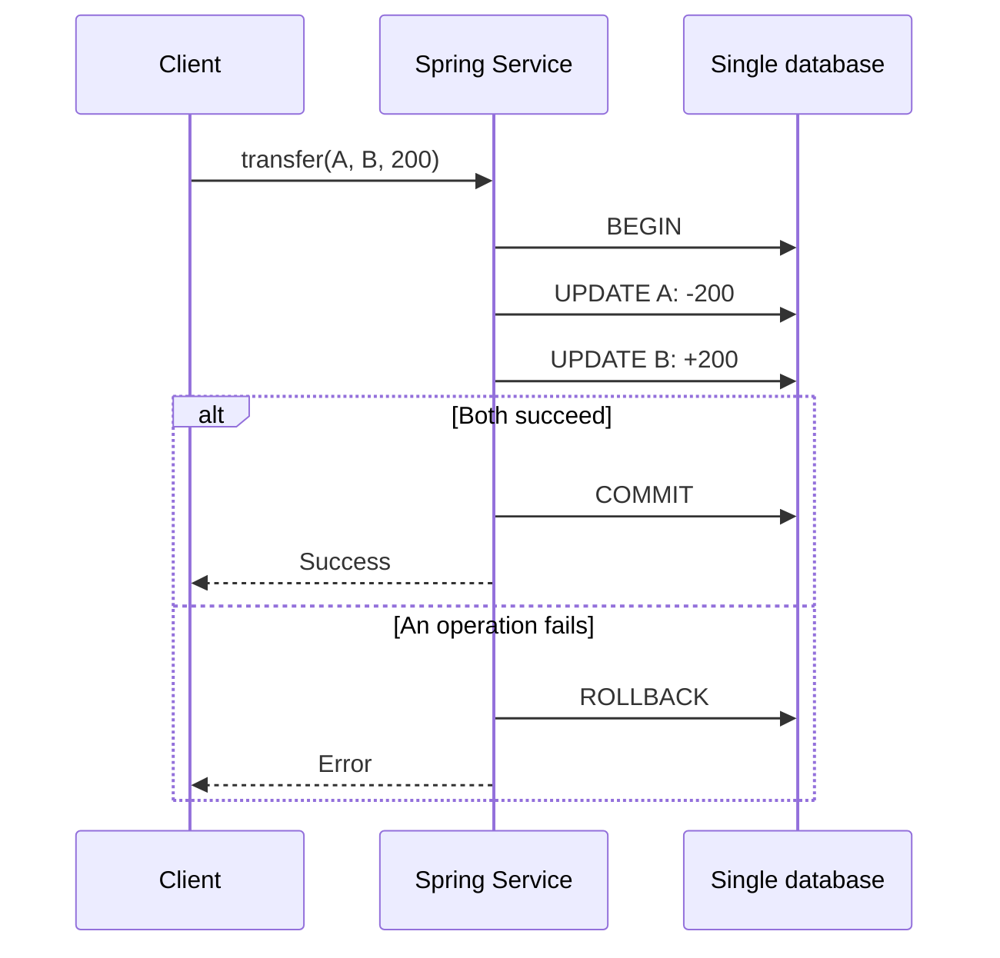
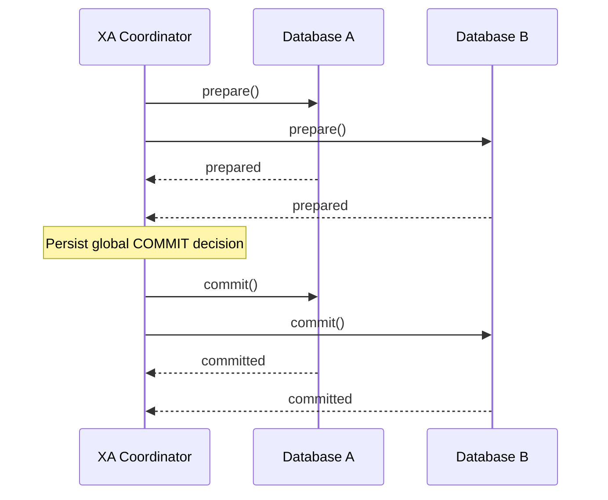
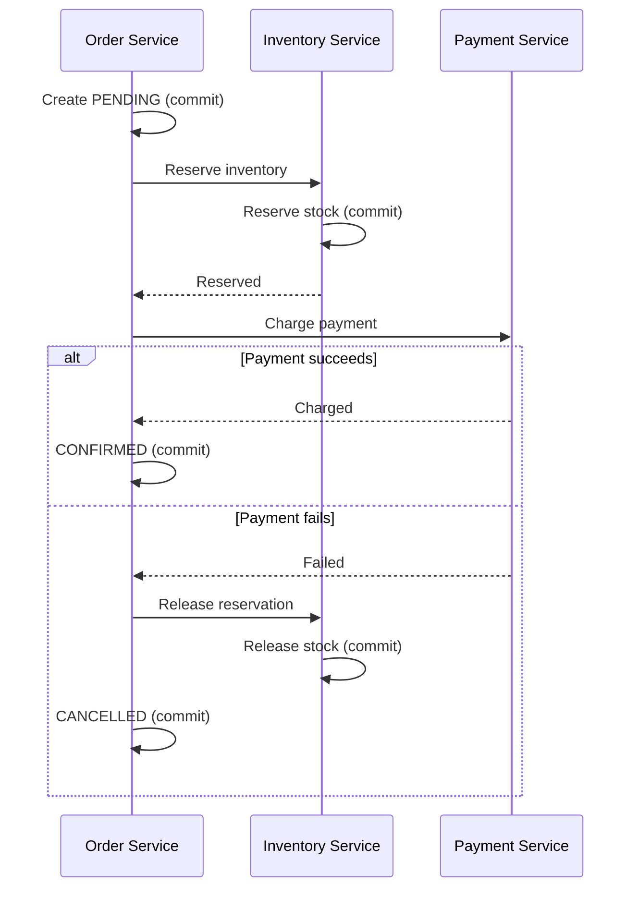

# Distinguishing Local Transactions from Distributed Transactions

## 1. The problem to solve

A business operation may write to multiple tables, multiple databases, or call multiple services. The key question is not **how many write statements there are**, but **who has the authority to decide whether all changes commit together or roll back together**.

Online ordering example:

- **Case A:** Subtract money from account A and add money to account B, with both records residing in the same relational database. A single database transaction can encompass both updates.
- **Case B:** Order Service writes the order to its own database, Inventory Service reserves stock in another database, and Payment Service processes the payment. No single local database transaction can control all three systems on its own.
- **Case C:** One Spring application uses two databases through two `DataSource`s. Even with only **one application**, needing both databases to commit/roll back together still creates a multi-resource coordination problem.

Lesson goals: identify transaction boundaries; distinguish local ACID transactions, distributed transactions coordinating commit via XA/2PC, and distributed business workflows using Saga; understand exactly what Spring `@Transactional` guarantees; and choose a solution based on consistency and recovery requirements.

## 2. Local transaction

A **local transaction** is a unit of work managed by a single transaction manager over **a single transactional resource** (typically one database through an appropriate connection). Operations participating in that transaction share the same commit or rollback outcome.

For a relational database, ACID properties are commonly understood as:

| Property | Meaning within transaction scope |
| --- | --- |
| **Atomicity** | Either all changes belonging to the transaction are committed, or they are rolled back. |
| **Consistency** | Data constraints are preserved; business rules must still be protected by the application and schema. |
| **Isolation** | Concurrent transactions observe each other according to the database's isolation level. |
| **Durability** | Committed data is persisted by the database according to the DBMS's durability mechanism. |

A local transaction is **not limited to a single table**: it can update `account`, `ledger`, and `audit_record` in the same database, provided all operations actually share the same transaction/connection. Conversely, simply running two operations in the same Java method does not mean they automatically share a transaction.

### Local transaction flow



**Guarantee boundary:** a database can roll back what is **uncommitted within that same transaction**. A database cannot roll back an email already sent, a payment charge already confirmed by a third party, or a write already committed in another database simply because the current method throws an exception.

## 3. How Spring manages local transactions

Spring provides the `PlatformTransactionManager` abstraction for imperative models and `ReactiveTransactionManager` for reactive models. In JDBC applications you may encounter `DataSourceTransactionManager` or `JdbcTransactionManager`; with JPA, `JpaTransactionManager` is typically used. They manage transactions for their respective resources; the transaction manager, `DataSource`, and data access mechanism must be configured properly.

When a call **passes through a Spring proxy**, `TransactionInterceptor` handles `@Transactional` roughly as follows:

1. Identify the transaction manager and propagation/isolation/rollback policy.
2. Create a new transaction or join an existing one.
3. Execute the method so operations accessing the right resource participate together.
4. Commit when the method returns normally, or decide rollback according to exception rules.

With default `@Transactional`: propagation is `REQUIRED`; the database determines the default isolation; `RuntimeException` and `Error` trigger rollback, whereas checked `Exception`s do not trigger rollback by default (`rollbackFor` can be configured). This is behavior **of the selected transaction manager**, not a global guarantee covering every call issued inside the method.

### Concrete example: money transfer on a single database

Create an illustrative table (SQL compatible with PostgreSQL and H2 for basic structure):

```sql
CREATE TABLE account (
    id BIGINT PRIMARY KEY,
    balance_cents BIGINT NOT NULL CHECK (balance_cents >= 0)
);

INSERT INTO account (id, balance_cents) VALUES (1, 1000);
INSERT INTO account (id, balance_cents) VALUES (2, 300);
```

A Spring service using `JdbcTemplate` on the same `DataSource`:

```java
package demo.tx;

import org.springframework.jdbc.core.JdbcTemplate;
import org.springframework.stereotype.Service;
import org.springframework.transaction.annotation.Transactional;

@Service
public class TransferService {
    private final JdbcTemplate jdbc;

    public TransferService(JdbcTemplate jdbc) {
        this.jdbc = jdbc;
    }

    @Transactional
    public void transfer(long fromId, long toId, long amountCents) {
        if (fromId == toId || amountCents <= 0) {
            throw new IllegalArgumentException("Invalid transfer");
        }

        int debited = jdbc.update(
            "UPDATE account SET balance_cents = balance_cents - ? " +
            "WHERE id = ? AND balance_cents >= ?",
            amountCents, fromId, amountCents
        );
        if (debited != 1) {
            throw new IllegalStateException("Source missing or insufficient balance");
        }

        int credited = jdbc.update(
            "UPDATE account SET balance_cents = balance_cents + ? WHERE id = ?",
            amountCents, toId
        );
        if (credited != 1) {
            throw new IllegalStateException("Destination account missing");
        }
    }
}
```

This is a **complete service class inside a Spring application** (Java 17+, with Spring JDBC, transaction infrastructure, and a configured `DataSource`), not a standalone Java SE program runnable with just `javac`. When the bean is called through its proxy and both SQL statements use the managed `DataSource`:

- Calling `transfer(1, 2, 200)` succeeds: balances change from `(1000, 300)` to `(800, 500)`.
- Calling `transfer(1, 999, 200)` when account 999 does not exist: the debit statement may execute first, but the exception at the credit step causes **the entire transaction to roll back**; account 1 still has 1000.
- The `balance_cents >= ?` condition prevents a single debit from exceeding the balance directly in SQL; concurrent access must still be tested according to the DBMS and business requirements.

Do not place HTTP calls or email sending between the two SQL statements and assume external side effects will also roll back.

## 4. What is a distributed transaction?

In the **strict transactional sense**, a distributed transaction requires a mechanism coordinating **multiple independent transactional resources** (such as two databases) so that the commit/rollback decision is coordinated across parties. Each resource has its own log, connections, and commit authority; merely putting `@Transactional` on a method does not turn them into a single resource.

In microservices architecture, people also use the phrase "distributed transaction" to refer to **a business workflow spanning multiple services**. Two very different mechanisms must be distinguished:

1. **Global/atomic transaction with XA + two-phase commit (2PC):** attempts to achieve a coordinated commit outcome across resources that support the protocol and an appropriate coordinator.
2. **Saga:** chains multiple **independently committed local transactions** into a business workflow; when necessary, executes **compensation** to restore business state. A Saga does **not** create a global ACID transaction and cannot automatically roll back steps that have already committed.

These two concepts must never be conflated when writing designs or describing consistency guarantees.

### Core comparison

| Criterion | Local transaction | Distributed XA/2PC | Saga for distributed business workflows |
| --- | --- | --- | --- |
| Boundary | One transactional resource | Multiple resources participating in a global transaction | Multiple local transactions across services |
| Who decides? | Database / local transaction manager | Transaction coordinator and XA participants | Workflow/orchestrator or event chain |
| Commit/rollback | Single unified commit/rollback inside the resource | Prepare then coordinated commit/rollback decision | Each step commits independently; failures use compensation |
| Consistency | ACID within the DB scope | Atomic commit per protocol when conditions hold; isolation varies per resource | Business consistency across intermediate states, typically eventual consistency |
| Once a step has committed | No other step in the same transaction has been decided separately | Coordinator drives the global decision; recovery needed on failure | Committed step is not automatically rolled back |
| Technical dependencies | Transaction manager + one resource | XA-capable resources, coordinator, recovery | Messages/commands, state, retries, idempotency, compensation |
| Cost/risk | Relatively simple; holds locks for transaction duration | Latency, locking, blocking/recovery, and high coupling | Complex state/compensation design; must handle intermediate outcomes |

**Note on the word "distributed":** three steps across three tables of **one database** are not a distributed transaction. Two different databases within the same process still constitute a multi-resource problem. A REST call to another service is an action outside the local transaction, even if both services use Spring.

## 5. Distributed via XA/2PC: coordinated commit

Two-phase commit has a **coordinator** and multiple **participants** supporting prepare/commit, typically via XA and a JTA-style transaction manager:

**Phase 1 – Prepare:** the coordinator asks each participant to prepare to commit; each party checks whether it can commit and durably records enough information to carry out the later decision. If any participant refuses or fails to prepare, the coordinator follows the rollback branch.

**Phase 2 – Decision:** if all participants are prepared, the coordinator records/decides commit and sends commit commands; otherwise, it sends rollback. When network failures occur or the coordinator stops, prepared participants may have to wait for recovery mechanisms. A real-world global transaction must also handle timeouts, heuristic outcomes, and recovery status observation.



In Spring, `JtaTransactionManager` is an adapter allowing Spring to use the JTA/global transaction infrastructure of the environment or a configured transaction coordinator. **Simply declaring a `JtaTransactionManager` bean is not enough**: resources must be XA-capable, properly enlisted, and backed by coordinator/recovery configuration. Two independent `DataSourceTransactionManager` beans do **not** combine into XA automatically either.

Use XA when coordinated commit is strictly required across a set of resources supporting the transaction protocol, lock/latency risks have been evaluated, and reliable recovery operations exist. In independent microservices, where HTTP/third-party APIs generally do not participate in XA, **you cannot simply "turn on 2PC" to cover the entire system**.

## 6. Saga: coordinating multiple local transactions

With database-per-service, a common choice is **Saga**. Each step processes data owned by a single service, commits a local transaction, and emits state/results for the next step. A Saga can use:

- **Orchestration:** a business coordinator issues commands, receives results, and chooses the next step or compensation.
- **Choreography:** services react to events and trigger subsequent steps according to business conventions.

Order example:

1. Order Service: creates a `PENDING` order (local commit).
2. Inventory Service: reserves item quantities (local commit), emits result.
3. Payment Service: charges payment (commits in its own system).
4. Order Service: transitions to `CONFIRMED` if all steps succeed.
5. If payment fails after inventory was reserved: runs **release reservation** (another local transaction), then transitions the order to `CANCELLED`.



**Compensation is not a physical rollback.** It is **a new transaction** intended to semantically reverse the business effect of a previous step (such as issuing a refund rather than deleting a recorded payment). Compensation can fail or arrive late, so it requires controlled retries, idempotency keys, state tracking, and sometimes manual intervention. Users or other systems may observe `PENDING`/`RESERVED` states while the Saga is running: this is a consequence of lacking global isolation like a local ACID transaction.

A Saga design must explicitly answer: how each step is retried; whether duplicate messages cause duplicate writes; whether a timeout is a definite failure or an unknown outcome; which actions can be compensated and which cannot be undone (such as a sent email); and when to transition to `FAILED_REQUIRES_ATTENTION` for reconciliation.

## 7. The "dual write" problem and transactional outbox

Suppose Order Service both **writes an order to its database** and **sends an `OrderCreated` event** to a broker:

- If the message is sent **before** DB commit, a consumer may process a non-existent order, and then the DB rolls back.
- If the DB commits **first** and then the message is sent, the application can crash in between: the order is saved, but the event is lost.
- Putting the publish call inside a `@Transactional` method using a local DB manager does **not** make broker publishing part of an atomic commit with the DB.

**Transactional outbox** closes this gap by writing business data **and an outbox record in the same local DB transaction**. A separate relay reads the outbox and sends messages afterward:

```text
Local transaction at Order Service:
    BEGIN
      INSERT orders (..., status = 'PENDING')
      INSERT outbox (event_id, aggregate_id, event_type, payload)
    COMMIT

Separate relay (polling or CDC):
    read committed outbox -> publish message -> record delivery progress

Consumer:
    check event_id / idempotency key -> apply once semantically
```

Illustrative schema pattern:

```sql
CREATE TABLE orders (
    id BIGINT PRIMARY KEY,
    status VARCHAR(30) NOT NULL
);

CREATE TABLE outbox (
    event_id UUID PRIMARY KEY,
    aggregate_id BIGINT NOT NULL,
    event_type VARCHAR(100) NOT NULL,
    payload TEXT NOT NULL,
    published_at TIMESTAMP NULL
);
```

**What is guaranteed:** if the local transaction rolls back, neither `orders` nor `outbox` is persisted; if it commits, there is a durable outbox record for the relay to process. **What is not automatically guaranteed:** "exactly-once" delivery to every consumer; the relay may send duplicates if it crashes after publishing but before marking the row as sent. Consumers must be **idempotent**, for example storing `(consumer_id, event_id)` in a table with a unique constraint inside the same transaction as business processing. If the domain requires event ordering, the relay must also design per-aggregate ordering.

Outbox **does not replace Saga**: outbox reliably delivers events between steps; Saga defines cross-service completion and compensation logic. Both patterns are commonly used together.

## 8. Why does `@Transactional` not automatically create a distributed transaction?

Consider this **conceptual code snippet**, not a standalone Java program:

```java
@Transactional
public void placeOrder(Command command) {
    orderRepository.save(new Order(command)); // Order Service's database
    paymentClient.charge(command.payment());  // HTTP to another system
    // The following exception rolls back the local DB, but does not auto-refund Payment
    throw new IllegalStateException("Local processing failed");
}
```

When the exception is thrown, Order Service's Spring transaction manager can roll back uncommitted local changes. Payment Service has its own transaction/commit. If the charge already succeeded, the money is **not** automatically refunded. If HTTP timed out, Order Service **does not know for sure** whether Payment charged or not: blind retries could charge twice. You need a payment idempotency key, status query/reconciliation, and a compensation workflow when actually required.

Other common misconceptions:

- `Propagation.REQUIRED` joins an internal call into an existing transaction **within a compatible transaction manager/context**; it does not propagate transactions over REST.
- `Propagation.REQUIRES_NEW` creates an **independent physical transaction**; the child transaction can commit while the outer transaction rolls back. It does **not** create XA or guarantee committing together.
- Having multiple `PlatformTransactionManager` beans in one application means different managers can be selected per method; there is **no** atomic commit between them without multi-resource coordination infrastructure.
- In default proxy mode, calling a `@Transactional` method from another method **in the same object** (self-invocation) bypasses the proxy and does not open a new transaction as expected.
- With imperative transactions, context is typically thread-bound; spawning a new thread or running async does not automatically inherit that transaction. Reactive transactions use Reactor context, but still do not automatically turn into global transactions across services.
- Catching an exception and returning normally can cause Spring to commit if the transaction was not marked rollback-only. Test real rollback, not merely that a method returns an error.

## 9. Which approach fits each scenario?

| Scenario | Usually appropriate choice | Rationale / checks needed |
| --- | --- | --- |
| Transferring funds between two accounts in the **same database** | Local `@Transactional` | One resource can commit/roll back both SQL statements; control isolation and race conditions. |
| Writing an order + outbox event in the **same database** | Local transaction + transactional outbox | Ensures order and event record exist together or roll back together; relay/consumer need retries and idempotency. |
| Two XA-compatible databases requiring synchronous all-or-nothing commit | Evaluate JTA/XA/2PC | Requires coordinator, enlistment, recovery, performance assessment, and support from every participant. |
| Order/Inventory/Payment are services owning separate DBs | Saga + outbox/idempotency | Each commits locally; use a state machine and compensation when later steps fail. |
| Charging through an external provider without XA support | Local transaction + workflow/Saga + idempotency/reconciliation | Provider API does not roll back with local DB; timeouts can leave an unknown outcome. |
| Reading multiple APIs only to render a dashboard | No global write transaction needed | Data may come from different points in time; choose snapshots/versioning per display needs. |

**Decision questions in order:** (1) Which resources actually mutate state? (2) Does a single local transaction manager control all operations? (3) If there are multiple resources, do they support XA and can the system accept 2PC's operational cost? (4) If not, which intermediate states does the business accept, and what does compensation look like? (5) How are retries, timeouts, duplicate messages, ordering, and reconciliation designed?

## 10. Tests and failure scenarios to practice

**Local transaction:** create two accounts as in the example. Run a successful 200 transfer and verify balances; then attempt transferring to a non-existent account and verify the source account **did not decrease**. Add a test with two concurrent debit requests on the same account to catch races/invariant violations.

**Local + HTTP is not global:** in a test environment, have a Payment stub record a successful charge and then simulate Order Service throwing an exception. Observe Order's database rolling back while the Payment stub still holds the charge; this proves the boundary of a local transaction.

**Outbox:** inject a failure between inserting the order and inserting the outbox row inside the same DB transaction: neither record is committed. Run successfully: both commit together. Crash the relay after publishing but before marking sent: receive the duplicate message and prove the consumer skips duplicate processing via `event_id`.

**Saga:** simulate stock reservation succeeding while payment fails: observe reservation release and order transitioning to `CANCELLED`; replay duplicate payment/callback events and verify state does not duplicate effects. If compensation also fails, work must be persisted for retry/reconciliation, never silently treated as rolled back.

**XA/2PC (only when the environment genuinely supports it):** test failures during the prepare phase, network failures after the commit decision, coordinator restarts, and verify recovery. Never simulate with two independent local `@Transactional` methods and conclude XA has been tested.

## 11. Takeaways and self-check

1. **Are two tables in the same database a distributed transaction?** No, if both participate in the same local transaction.
2. **If a microservice calls two other services inside a `@Transactional` method, do all three roll back together?** No. The annotation only manages resources controlled by that call's transaction manager; HTTP does not automatically join the transaction.
3. **Does a Saga guarantee global ACID?** No. Steps commit separately, and compensation is a new transaction, so intermediate states must be managed.
4. **When using an outbox, can a consumer receive a message twice?** Yes. Relays/brokers can redeliver; idempotency is a core requirement.
5. **When should XA be considered?** When multiple resources support XA, the business truly needs coordinated atomic commit, and the team can operate coordinator/recovery infrastructure.

> **Decisive distinction:** a local transaction relies on **one resource's** ability to commit/roll back uncommitted changes; XA/2PC coordinates the commit decision across **multiple protocol-capable resources**; Saga orchestrates **multiple committed local transactions**, using compensating actions and business state to reach a final outcome. Spring `@Transactional` is a tool for declaring transaction boundaries against a configured transaction manager; it does not cross database or service boundaries on its own.

## References

- [Spring Framework – Understanding the Transaction Abstraction](https://docs.spring.io/spring-framework/reference/data-access/transaction/strategies.html)
- [Spring Framework – Declarative Transaction Implementation](https://docs.spring.io/spring-framework/reference/data-access/transaction/declarative/tx-decl-explained.html)
- [Spring Framework – Transaction Propagation](https://docs.spring.io/spring-framework/reference/data-access/transaction/declarative/tx-propagation.html)
- [Spring Framework – Using @Transactional](https://docs.spring.io/spring-framework/reference/data-access/transaction/declarative/annotations.html)
- [Microservices Patterns – Saga](https://microservices.io/patterns/data/saga.html)
- [Microservices Patterns – Transactional Outbox](https://microservices.io/patterns/data/transactional-outbox.html)
- [Microservices Patterns – Idempotent Consumer](https://microservices.io/patterns/communication-style/idempotent-consumer.html)