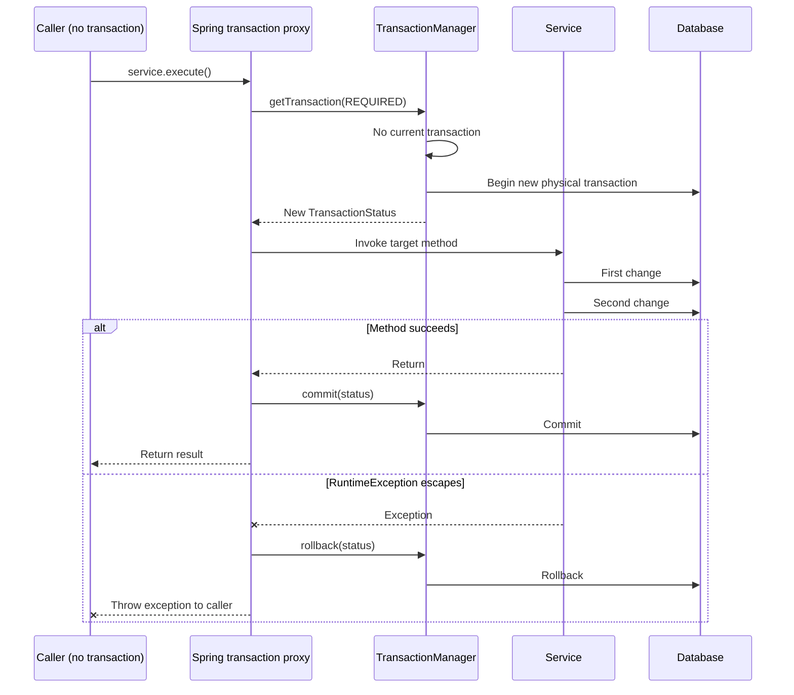

# Creating a Transaction When No Current Transaction Exists with Propagation.REQUIRED in Spring

## 1. Objective and Business Scenario

Suppose a record-creation feature must persist **two related records**: the first record for the sender and the second record for the receiver. If the first step succeeds but an error occurs in the second step, the application must not leave the database with only half of the business operation applied.

Spring solves the atomicity of operations within the same data source using a transaction boundary. On a Spring-managed service method, the common declaration is:

```java
@Transactional(propagation = Propagation.REQUIRED)
public void createEntries() {
    // Database access operations must succeed together.
}
```

This is an **illustrative structure**, not a standalone compilable program. A complete Spring Boot example in section 7 can be run to observe when a transaction is created, committed, and rolled back.

**Core focus of this lesson:** when a method with `REQUIRED` propagation is called **through a Spring transaction proxy** while **there is no current transaction matching the selected transaction manager**, Spring **creates a new transaction** to execute that method. When the call finishes, Spring decides whether to commit or roll back the transaction it just opened.

After this lesson, you will:

1. Understand the exact meaning of "required" and the condition of **no current transaction**.
2. Distinguish Spring's **logical transaction scope** from the database's **physical transaction**.
3. Trace the chain: caller → proxy → transaction manager → service → commit/rollback.
4. Use Java 17+, Spring Boot, JDBC, and H2 to demonstrate that a `REQUIRED` method creates a new transaction on its own when the caller has no transaction.
5. Understand exceptions, callbacks, how to check `isNewTransaction()`, and mistakes that prevent a transaction from being created as expected.
6. Distinguish the scope of this lesson from the case where `REQUIRED` **joins an existing transaction**.

## 2. Exact Definition of REQUIRED

In Spring, `Propagation.REQUIRED` means:

> **Support a current transaction; create a new one if none exists.**

Syntax:

```java
@Transactional(propagation = Propagation.REQUIRED)
public void doWork() {
    // ...
}
```

And it can be written more concisely as:

```java
@Transactional
public void doWork() {
    // ...
}
```

The two annotations above are **equivalent in terms of propagation**, because `REQUIRED` is the default value of `@Transactional`. If no explicit propagation is configured, Spring does not automatically choose `REQUIRES_NEW` or `SUPPORTS`.

| State upon entering the method | What does `REQUIRED` do? | Who decides the final commit? |
| --- | --- | --- |
| **No matching current transaction** | Creates a new transaction for the call | The newly created transaction boundary, when the method finishes |
| Matching current transaction already exists | Joins that transaction | The outer boundary that owns the transaction |
| Method does not go through the Spring transaction interceptor | The annotation is not applied to this call | No guarantee from the annotation; operations may use auto-commit or another transaction |

This lesson focuses on the **first row**. The second row is mentioned only to avoid the misconception that REQUIRED "always creates a new transaction".

### Quick comparison with a few other propagation behaviors

- `REQUIRED`: **use an existing one if present; create a new one if none exists**.
- `REQUIRES_NEW`: always requires a new transaction; if a current transaction exists, the old transaction is suspended when the infrastructure supports it.
- `SUPPORTS`: if a transaction exists, join it; if not, the method can execute without a physical transaction.
- `MANDATORY`: requires an existing transaction; if none exists, throws an exception instead of creating one.

You should not choose `REQUIRES_NEW` merely because you want to "ensure a transaction exists": in a situation where **no transaction exists**, `REQUIRED` already satisfies that requirement and also allows outer callers to establish larger business boundaries in the future.

## 3. What Does "No Current Transaction" Mean?

This condition is evaluated **at the moment the transaction interceptor handles the call** using the **selected transaction manager**, rather than merely based on the presence of the text `@Transactional` in source code.

Example:

```text
REST Controller or CommandLineRunner
    |
    | does not open a transaction
    v
Spring proxy of PaymentService
    |
    | @Transactional(REQUIRED)
    v
TransactionManager: no active transaction found
    |
    +--> create new transaction
    |
    v
PaymentService.createPayment()
    |
    +--> JDBC UPDATE
    +--> JDBC INSERT
    |
    v
Proxy/TransactionManager:
    +--> commit on normal completion
    +--> rollback on error matching rollback rule
```

**Conditions to reach the right conclusion:**

- The service must be a **Spring-managed bean**, and the call must go through an active transaction advice mechanism.
- The transaction manager must be selected and configured appropriately for the data source used by the repository or `JdbcTemplate`.
- There must be no matching transaction managed by that manager in the current execution context.
- For conventional imperative JDBC/JPA, the transaction context is bound to the **current thread**. A transaction on another thread does not automatically become the caller's current transaction.

If an application has multiple transaction managers, a transaction may exist on database A while no transaction exists on database B. A `REQUIRED` method using manager B can create a new transaction **on B**. Therefore, when saying "no transaction exists", it must implicitly mean "**no transaction exists for the relevant resource/manager**".

### Logical transaction and physical transaction

Spring distinguishes between:

- **Logical transaction scope**: the policy boundary created by `@Transactional` for the invocation.
- **Physical transaction**: the actual transaction coordinated by the transaction manager on the DB or corresponding resource.

When `REQUIRED` encounters no existing transaction, **a new logical scope becomes the owner of a new physical transaction**. This is the easiest case to understand: the commit/rollback of the outermost scope determines the DB outcome.

When a REQUIRED method calls another REQUIRED method using the same manager through a proxy, there can be **two logical scopes** sharing **the same physical transaction**; the inner method does not commit independently on its own. That case helps explain why "scope" and "physical transaction" do not always have a 1:1 ratio.

## 4. When Does Spring Create the Transaction?

With conventional proxy-based declarative transaction management, the process occurs **before the first statement inside the service method begins** with respect to the transaction boundary:

1. The caller obtains and invokes the service's **proxy**, typically via constructor injection.
2. `TransactionInterceptor` reads the policy from `TransactionAttributeSource`, detects `REQUIRED` propagation, and determines the transaction manager.
3. The interceptor asks the manager to create/join a transaction (for example, `PlatformTransactionManager.getTransaction(definition)`).
4. The manager checks the resource's context; because no matching transaction exists, it takes the **begin new transaction** branch.
5. The actual service code begins running within the established boundary.
6. When the service code returns or throws an exception, the interceptor uses rollback rules to handle the transaction and clean up the context.

For `DataSourceTransactionManager` with `JdbcTemplate`, starting typically involves acquiring a JDBC connection, configuring transaction state (such as disabling auto-commit when needed), binding the connection to the thread via Spring's resource management mechanism, and then restoring state/releasing resources upon completion.

Some infrastructures use **lazy connection acquisition** or delayed SQL flushing. Therefore, do not assume "opening a transaction" always corresponds to "a visible SQL BEGIN statement already sent in the log" across every driver/transaction manager. What matters is that **the transaction boundary and resource management are established before executing the protected logic**.

### Sequence diagram for the case with no existing transaction



The diagram only describes a transaction manager serving **the same database**; it does not implicitly guarantee rollback for email, files, or another database.

## 5. Commit/Rollback Outcomes When REQUIRED Creates a Transaction

Suppose the database initially has two accounts or an empty `event_log` table.

### When the method succeeds

```text
Caller has no transaction
  -> REQUIRED proxy creates transaction T1
  -> INSERT record A
  -> INSERT record B
  -> method finishes normally
  -> proxy commits T1
  -> both A and B persist durably
```

In this case, the method invoked through the proxy is the **owner of the new transaction**. Commit happens after the method returns and before the successful result reaches the caller, assuming no error occurs during the commit phase.

### When the method throws a runtime exception

```text
Caller has no transaction
  -> REQUIRED proxy creates transaction T2
  -> INSERT record C
  -> RuntimeException escapes from method
  -> proxy rolls back T2
  -> record C is not committed
  -> caller receives RuntimeException
```

All SQL statements participating in physical transaction T2 are rolled back. A mandatory requirement is that those write operations actually use the **resource managed by T2's transaction manager**. If another write path acquires a different connection with auto-commit or uses a different DB, this annotation cannot restore data there.

### Default rollback rules

By Spring's defaults:

| Method completion | Typical decision |
| --- | --- |
| Returns normally | Commit, if the transaction is still valid and not rollback-only |
| Throws `RuntimeException` | Rollback |
| Throws `Error` | Rollback |
| Throws a checked exception such as `IOException` | **Does not trigger rollback by default**, unless configured otherwise |
| Marked rollback-only | Cannot commit successfully even if the method returns normally |

Example of adding a rule:

```java
@Transactional(
    propagation = Propagation.REQUIRED,
    rollbackFor = IOException.class
)
public void importRecords() throws IOException {
    // If IOException escapes the method,
    // the physical transaction created by REQUIRED will roll back.
}
```

This is an **annotation illustration snippet**, without data access code. Some Spring versions have options to configure global default rollback rules, so you need to check the project's actual configuration. The main hands-on example uses `IllegalStateException` to verify the default rule unambiguously.

## 6. Transaction Attributes When Newly Created

When `REQUIRED` **creates a new transaction**, the declared attributes are applied to the new transaction within the bounds supported by the manager/DB.

Example:

```java
@Transactional(
    propagation = Propagation.REQUIRED,
    isolation = Isolation.READ_COMMITTED,
    timeout = 10,
    readOnly = false
)
public void updateInventory() {
    // ...
}
```

- `isolation = READ_COMMITTED` requests the READ COMMITTED isolation level if the transaction manager and database support it.
- `timeout = 10` requests a timeout of about 10 seconds according to the transaction manager's capabilities; you should understand how the timeout is enforced and how it affects statements.
- `readOnly = false` is the default for read/write operations.
- `readOnly = true` is usually an **optimization/directional hint** for the infrastructure, not a guarantee that writes are impossible on every DB.

If a method is **joining an existing transaction**, local attributes such as isolation/timeout/readOnly usually do not override the outer transaction under Spring's defaults. This point is important for understanding REQUIRED, though it **does not belong to the new-transaction branch** being studied here.

**Do not confuse isolation with atomicity:** even a READ COMMITTED transaction can still suffer race conditions if "read, check, then write" logic lacks appropriate locking or atomic SQL conditions. REQUIRED creates an atomic commit/rollback boundary; it does not automatically make the logic of two concurrent transactions serializable.

## 7. Runnable Example: Proving REQUIRED Creates a New Transaction

We create an application with **Spring Boot 3.x**, **Java 17+**, **Spring JDBC**, and **H2 in-memory**. The application invokes the service from a `CommandLineRunner` **without a transaction**, and then observes:

- Before the call: no current transaction.
- Inside the `@Transactional(REQUIRED)` method: a transaction is active and `TransactionStatus.isNewTransaction() == true`.
- On success: two records are committed.
- When throwing a runtime exception after writing one record: that record is rolled back, and the total row count remains unchanged.
- After the call: the caller's transaction context has ended.

### 7.1. Preparing the project

Create a project using Spring Initializr with Java 17, Maven, the **JDBC API** dependency (`spring-boot-starter-jdbc`), and **H2 Database**. Choose an appropriate Spring Boot 3.x version and keep the entire `pom.xml` generated by Initializr.

Required dependencies:

```xml
<dependencies>
    <dependency>
        <groupId>org.springframework.boot</groupId>
        <artifactId>spring-boot-starter-jdbc</artifactId>
    </dependency>
    <dependency>
        <groupId>com.h2database</groupId>
        <artifactId>h2</artifactId>
        <scope>runtime</scope>
    </dependency>
</dependencies>
```

This is a **dependencies snippet**, not the full `pom.xml`; the Initializr project also includes the parent, version, Maven plugin, and compatible Java configuration.

Directory structure:

```text
src/
  main/
    java/
      com/example/required/
        RequiredDemoApplication.java
        EntryService.java
    resources/
      schema.sql
```

### 7.2. Creating the data table

File `src/main/resources/schema.sql`:

```sql
CREATE TABLE event_log (
    id BIGINT PRIMARY KEY,
    message VARCHAR(100) NOT NULL
);
```

With embedded H2 and Spring Boot's default SQL initialization configuration, `schema.sql` runs when the application starts. If you configure database initialization differently yourself, you must verify that mechanism. This example assumes each run starts a fresh H2 in-memory session with no pre-existing duplicate IDs.

### 7.3. Service with REQUIRED propagation

File `src/main/java/com/example/required/EntryService.java`:

```java
package com.example.required;

import org.springframework.jdbc.core.JdbcTemplate;
import org.springframework.stereotype.Service;
import org.springframework.transaction.annotation.Propagation;
import org.springframework.transaction.annotation.Transactional;
import org.springframework.transaction.interceptor.TransactionAspectSupport;
import org.springframework.transaction.support.TransactionSynchronizationManager;

@Service
public class EntryService {

    private final JdbcTemplate jdbc;

    public EntryService(JdbcTemplate jdbc) {
        this.jdbc = jdbc;
    }

    @Transactional(propagation = Propagation.REQUIRED)
    public void writePair(long firstId, long secondId, boolean fail) {
        boolean active =
            TransactionSynchronizationManager.isActualTransactionActive();

        boolean isNew =
            TransactionAspectSupport.currentTransactionStatus()
                .isNewTransaction();

        System.out.printf(
            "inside: active=%s, new=%s%n",
            active, isNew);

        // Both INSERT statements must be in the same transaction.
        jdbc.update(
            "INSERT INTO event_log (id, message) VALUES (?, ?)",
            firstId, "first");

        if (fail) {
            // Intentional failure after the first INSERT,
            // but before the second INSERT.
            throw new IllegalStateException("simulated failure");
        }

        jdbc.update(
            "INSERT INTO event_log (id, message) VALUES (?, ?)",
            secondId, "second");
    }
}
```

Important details:

- `@Service` allows Spring to manage the bean.
- `writePair(...)` is a public method handled by the Spring transaction interceptor via a proxy.
- `Propagation.REQUIRED` means **create a new transaction if the caller has none**.
- `TransactionSynchronizationManager.isActualTransactionActive()` indicates the transaction state recorded by Spring on the current execution thread, which fits this imperative JDBC example.
- `TransactionAspectSupport.currentTransactionStatus()` retrieves the status bound to the transactional invocation currently being handled by the interceptor; in this case, `isNewTransaction()` is expected to be **true**.
- `JdbcTemplate` is created from the same `DataSource` managed by Spring Boot's auto-configured transaction manager, so both INSERT statements participate in the physical transaction.
- The `IllegalStateException` exception is a `RuntimeException`, which triggers rollback by default if it escapes outside the proxy.

**Do not use `currentTransactionStatus()` as an arbitrary check everywhere.** Calling it from a place without a matching transaction advice scope can throw an error. Use it for diagnostics **inside** a call already handled by the Spring transaction interceptor, as in this example.

### 7.4. Caller outside a transaction

File `src/main/java/com/example/required/RequiredDemoApplication.java`:

```java
package com.example.required;

import org.springframework.boot.CommandLineRunner;
import org.springframework.boot.SpringApplication;
import org.springframework.boot.autoconfigure.SpringBootApplication;
import org.springframework.context.annotation.Bean;
import org.springframework.jdbc.core.JdbcTemplate;
import org.springframework.transaction.annotation.EnableTransactionManagement;
import org.springframework.transaction.support.TransactionSynchronizationManager;

@SpringBootApplication
@EnableTransactionManagement
public class RequiredDemoApplication {

    public static void main(String[] args) {
        SpringApplication.run(RequiredDemoApplication.class, args);
    }

    @Bean
    CommandLineRunner demonstrate(EntryService service, JdbcTemplate jdbc) {
        return args -> {
            System.out.println(
                "before: active=" +
                TransactionSynchronizationManager
                    .isActualTransactionActive());

            service.writePair(1L, 2L, false);

            System.out.println(
                "after success: rows=" + countRows(jdbc));

            try {
                service.writePair(3L, 4L, true);
            } catch (IllegalStateException ex) {
                System.out.println("failure caught: " + ex.getMessage());
            }

            System.out.println(
                "after failure: rows=" + countRows(jdbc));

            System.out.println(
                "after: active=" +
                TransactionSynchronizationManager
                    .isActualTransactionActive());
        };
    }

    private static int countRows(JdbcTemplate jdbc) {
        Integer value = jdbc.queryForObject(
            "SELECT COUNT(*) FROM event_log",
            Integer.class);
        return value;
    }
}
```

Inside `CommandLineRunner`, there is no surrounding `@Transactional`. Because `EntryService` is injected by Spring and `writePair(...)` is a public method, the call goes through the proxy.

The `@EnableTransactionManagement` annotation is written explicitly to make it clear that declarative transaction infrastructure is enabled. In a Spring Boot application with standard transaction auto-configuration, transaction infrastructure is usually already set up; declaring it explicitly in this example serves an instructional purpose.

### 7.5. Run and observe the output

In the Maven project directory:

```bash
./mvnw spring-boot:run
```

On Windows PowerShell:

```powershell
.\mvnw.cmd spring-boot:run
```

Alongside Spring Boot and Maven logs, the lines printed by the program itself are:

```text
before: active=false
inside: active=true, new=true
after success: rows=2
inside: active=true, new=true
failure caught: simulated failure
after failure: rows=2
after: active=false
```

The output follows directly from the code under the initialization conditions described:

1. **`before: active=false`:** the caller is outside a transaction.
2. **First `inside: active=true, new=true`:** the proxy sees REQUIRED and no prior transaction, so the manager begins a new transaction. Both INSERTs succeed; Spring commits after the method returns.
3. **`after success: rows=2`:** both records 1 and 2 persist durably.
4. **Second `inside: active=true, new=true`:** the method is called again from a caller outside any transaction, so a **different new transaction** is created for the second call. It does not reuse the transaction already committed on the first call.
5. The second call INSERTs record 3 and then throws `IllegalStateException`. The proxy rolls back the second call's transaction; record 3 is gone, and record 4 was never INSERTed.
6. **`after failure: rows=2`:** only the two records committed from the first call remain.
7. **`after: active=false`:** the transaction context created by the REQUIRED call has been cleaned up, and the caller remains outside any transaction.

**Distinguishing the two checks:**

- `isActualTransactionActive() == true`: the current context has an actual transaction according to Spring. It does not by itself prove this transaction was **newly created in the current call**.
- `currentTransactionStatus().isNewTransaction() == true`: the transaction status of this call is considered by the manager to be the **owner of a new transaction**. Because the caller has no transaction and the propagation is REQUIRED, the example prints `new=true`.

### 7.6. Try changing things to understand cause and effect

**Experiment A — Remove `@Transactional` from the service.** With typical JDBC/H2 configuration and no outer transaction, each `jdbc.update` call may run in auto-commit mode. When `fail=true`, record 3 may persist after the error; in particular, `TransactionAspectSupport.currentTransactionStatus()` will no longer be a valid call as in the example. To test this, **first remove the line calling `currentTransactionStatus()`** so the program does not throw a diagnostic error before the INSERT. Then compare the DB state to see the role of the transaction boundary.

**Experiment B — Change REQUIRED to `SUPPORTS`.** When the caller has no transaction, `SUPPORTS` does not require starting a physical transaction. Do not rely on `currentTransactionStatus().isNewTransaction()` as an assertion of a new transaction; the outcome depends on how the infrastructure sets up synchronization scope. The exercise is to predict the difference in atomicity and then verify after adjusting the observation code.

**Experiment C — Keep REQUIRED and call the service twice successfully.** Each call from a caller outside a transaction creates a separate transaction. There is no single shared transaction spanning two independent calls just because it is the same method.

**Experiment D — Use `@Transactional` without parameters.** With the same context, the result must remain the same because the default propagation is REQUIRED.

These experiments use a test H2 environment. Do not intentionally trigger rollbacks on production data.

## 8. When REQUIRED Creates a New Transaction, Who Commits?

In the `CommandLineRunner → EntryService.writePair(...)` example:

- The caller has no transaction before the call.
- The method's proxy creates a new transaction.
- The method finishes; the Spring interceptor uses the transaction status to commit or roll back the transaction **that it owns**.
- The caller receives success only after the transaction handling path completes. If a commit error occurs, the caller can receive an exception even though the method body returned normally.

This differs from:

```text
OuterService.outer()  @Transactional(REQUIRED)
  |
  +-- InnerService.inner() @Transactional(REQUIRED)
       (called via another bean, same transaction manager)
```

In this scenario, `inner()` **joins** the physical transaction owned by `outer()`. Returning from `inner()` does not commit the physical transaction on its own; the final commit sits at `outer()`. If the inner scope marks the shared transaction rollback-only, outer may encounter `UnexpectedRollbackException` when it expects to commit.

Both cases use REQUIRED, but differ in the **transaction state at the time the interceptor handles the call**. That is why you must always answer the question "does the caller already have a transaction?" before predicting behavior.

## 9. Mistakes That Prevent REQUIRED from Creating a Transaction as Expected

### 9.1. Internal call using `this` (self-invocation)

```java
@Service
class DemoService {
    public void outer() {
        inner(); // Direct call inside the same object.
    }

    @Transactional(propagation = Propagation.REQUIRED)
    public void inner() {
        // Expects a transaction to be created here.
    }
}
```

This is an **illustrative snippet**, not a complete program.

In common proxy mode, the caller invokes `outer()` through the bean proxy; however, `outer()` calls `inner()` on the target object itself, so **the inner call does not go through the transaction interceptor**. The annotation on `inner()` does not create a new transaction on its own.

The usual solution is to place `@Transactional` on the **public entry point `outer()`** if the whole action is one use case, or extract `inner()` into a separate service bean and call it via a Spring-injected dependency.

### 9.2. Instantiating the service manually with `new`

```java
EntryService service = new EntryService(jdbc);
service.writePair(1L, 2L, false);
```

This illustrates Java behavior, not the proper way to invoke the service in section 7's example. An object created with `new` is not a Spring-provided proxy/bean, so transaction advice is not applied to the annotation. Do not confuse a class having `@Service` with every instance of that class being managed by Spring.

### 9.3. Selecting the wrong transaction manager or DataSource

In a multi-database application, a method might select:

```java
@Transactional(transactionManager = "ordersTxManager")
public void saveOrder() {
    // Intended to access ordersTxManager's DataSource.
}
```

If inside it uses a `JdbcTemplate` connected to a different database, the selected manager does not protect SQL statements on that database. REQUIRED may **actually create a transaction on source A** while SQL operations on source B still auto-commit.

You must verify the **transaction manager → DataSource/EntityManagerFactory → repository/JdbcTemplate** chain. This mistake is different from no transaction being created at all.

### 9.4. Catching and swallowing exceptions inside the service

```java
@Transactional
public void save() {
    jdbc.update("INSERT INTO event_log (id, message) VALUES (10, 'x')");
    try {
        throw new IllegalStateException("problem");
    } catch (IllegalStateException ex) {
        // Not rethrown; method returns as if successful.
    }
}
```

This snippet illustrates a service with `JdbcTemplate`. Because `IllegalStateException` **does not escape the method to the interceptor**, the interceptor may decide to commit. If an error originated from the DB, the transaction may already have been marked rollback-only or aborted by the DB; therefore you cannot assume "catch every error and return = guaranteed commit".

When the business operation must fail atomically, let the appropriate exception escape or design an explicit rollback-only marking mechanism.

### 9.5. Method visibility, `final`, and proxy type

With the default proxy implementation:

- Public, non-final methods on a Spring-managed service bean are the least surprising approach.
- Private methods cannot become proxy interception points.
- Class-based proxies cannot override `final` methods.
- With JDK interface-based proxies, calls must go through methods exposed on the interface; annotations and method resolution must be placed in the right location.

When learning REQUIRED, keep examples to public methods called from another bean rather than relying on edge cases specific to proxy types or framework versions.

### 9.6. Transaction on a different thread

In imperative JDBC/JPA, transactions are bound to the thread coordinated by Spring. If you call an `@Async` method or spawn `new Thread(...)`, the new thread does not automatically inherit the caller's JDBC transaction.

When a `@Transactional(REQUIRED)` method on a new thread is intercepted by a proxy, it usually **does not see the old thread's transaction** and may create a new transaction on the new thread. This must be understood as two independent transactions, not an automatic ability to "continue a transaction across threads".

Reactive transactions (R2DBC) use a different context mechanism. This lesson's example uses JDBC, so do not mechanically apply thread-local `TransactionSynchronizationManager` semantics here to every reactive pipeline.

## 10. REQUIRED Does Not Automatically Guarantee Every Business Invariant

Suppose two users try to book the last ticket at the same time. Each request enters a `@Transactional(REQUIRED)` method and the caller has no transaction, so Spring creates **two separate physical transactions**, which can run concurrently.

If the code does:

```text
T1 reads remaining=1
T2 reads remaining=1
T1 checks enough tickets
T2 checks enough tickets
T1 updates
T2 updates
```

the transactions can still make decisions based on stale data if SQL/locking design is inadequate. REQUIRED creates a commit/rollback boundary, but **does not serialize all transactions by default** and does not magically protect a "sell only one ticket" condition.

A safer approach for quantity rows is a conditional update in the DB:

```sql
UPDATE ticket_inventory
   SET remaining = remaining - 1
 WHERE id = 1 AND remaining >= 1;
```

Check the updated row count; if it is 0, throw an appropriate business exception so the transaction rolls back. For rules spanning multiple rows, you may need locks, optimistic locking, serializable isolation with retries, or an appropriate data model.

Do not equate "having a new transaction" with "having consistency for every concurrency problem". Correctness also requires validation, constraints, concurrency-control algorithms, and race-condition testing.

## 11. Distinguishing REQUIRED from Opening Transactions Manually

Developers sometimes write raw JDBC directly:

```java
Connection c = dataSource.getConnection();
try {
    c.setAutoCommit(false);
    // SQL...
    c.commit();
} catch (Exception ex) {
    c.rollback();
    throw ex;
} finally {
    c.close();
}
```

This is **sketch code**; handling checked exceptions, statement/resource cleanup, and full API compatibility is required to run. Its purpose is merely to illustrate manual connection management steps.

With Spring-managed JDBC, `@Transactional(REQUIRED)` lets the service express the business boundary while the **transaction manager and Spring JDBC** coordinate connection state:

```java
@Transactional
public void saveBoth() {
    jdbc.update("INSERT ...");
    jdbc.update("INSERT ...");
}
```

This is also an illustrative snippet, not standalone runnable SQL/Java. The advantage is consistent transaction management across multiple DAOs sharing the same data source, support for rollback rules, propagation, and explicit transaction manager selection.

You can also open transactions programmatically using Spring's `TransactionTemplate` in situations that need programmatic boundaries, though that is a different approach from annotations. The goal here is to understand **REQUIRED when no transaction exists** in the declarative approach.

## 12. Testing Behavior Instead of Merely Checking Annotations

Reading `@Transactional(REQUIRED)` in source code is not enough to conclude that a physical transaction actually ran. Tests should observe several indicators together:

| Check | What must be observed |
| --- | --- |
| Caller before the call has no transaction | `isActualTransactionActive() == false` |
| Entering service via proxy, REQUIRED | `isActualTransactionActive() == true` |
| Transactional scope status in service when no outer exists | `currentTransactionStatus().isNewTransaction() == true` |
| Both INSERTs succeed | Both persist after the method completes |
| Runtime exception thrown after the first INSERT | First INSERT from the failed call does not remain |
| Caller after method finishes | No remaining transaction created for this method |
| Calling the same method again from a caller outside a transaction | A new transaction for the new call |
| Case where method is wrapped by a transactional caller | Inner method joins the existing transaction, not owning its own commit |

### For realistic testing against production-like databases

H2 is suitable for learning concepts, but PostgreSQL/MySQL differ in isolation levels, locking, constraints, failed-transaction handling, and JDBC driver interaction. If production uses PostgreSQL, you should have integration tests against real PostgreSQL or Testcontainers PostgreSQL.

Avoid putting default `@Transactional` on the **test method itself** if the test's goal is "caller has no transaction". Many test frameworks open a transaction for the test and roll it back when the test finishes; that alters the initial context, can make `isNewTransaction()` in the service no longer `true`, and hides real commits.

When testing rollback, deliberately trigger an error **after a SQL statement has written** and then query the state **after the transactional method finishes**, as in section 7's example.

### Logs for cross-checking

You can enable appropriate log levels in `application.properties`:

```properties
logging.level.org.springframework.transaction.interceptor=TRACE
logging.level.org.springframework.jdbc.datasource.DataSourceTransactionManager=DEBUG
```

Actual log output depends on the Spring version and manager type. Look for traces of "creating new transaction", commit, or rollback. However, **the DB state after the call** is stronger evidence than matching a fixed log line.

## 13. Easily Misunderstood Scenarios

### Scenario 1 — "No transaction" yet the service calls a repository with @Transactional

When a service outside a transaction calls a repository method with default `REQUIRED` through a Spring proxy, the repository can create a transaction for **just that method**. If the service then calls multiple repository methods sequentially without `@Transactional` on the service itself, the operations can end up in **independent transactions**, risking partial writes.

Therefore, for a use case involving multiple changes that must succeed together, place `@Transactional(REQUIRED)` on the **service method coordinating the entire business operation**. Underlying repositories can join that transaction via REQUIRED and the same transaction manager.

### Scenario 2 — No transaction exists, but the manager cannot be configured

The annotation does not conjure up a transaction manager or DB on its own. If the application lacks a suitable manager, has multiple ambiguous managers, or uses an incompatible data source, the caller may encounter an exception before the method runs. Make sure a `PlatformTransactionManager` bean (or `ReactiveTransactionManager` in a reactive flow) is created and properly selected.

### Scenario 3 — Inside the service `active=true` is seen, but the method uses the wrong data source

`TransactionSynchronizationManager.isActualTransactionActive() == true` only tells you a transaction exists in the observed context. It **is not sufficient proof** that every `JdbcTemplate` statement in the method joined the right physical transaction. You need to verify the mapping between manager and data source, especially in multi-DB applications.

### Scenario 4 — Throwing a checked exception inside REQUIRED

Under traditional default rollback rules, a checked exception can allow a transaction created by REQUIRED to **commit** even though the method exited with an error. That decision is separate from whether "REQUIRED created a transaction". Configure `rollbackFor` when business logic requires rollback on checked exceptions.

### Scenario 5 — One call creates a new transaction, and the next call also creates a new one

When the caller has no transaction in both calls, each call through the proxy creates a separate transaction. Spring **does not cache physical transactions** for a method the way it caches annotation metadata. A transaction that has already committed or rolled back is not automatically reused for the next call.

### Scenario 6 — Swallowing exceptions outside versus inside

Catching an error **outside** the service after the proxy has handled the transaction (like `CommandLineRunner` in the example) does not prevent rollback. Catching and swallowing an error **inside** the method before the interceptor sees the exception, on the other hand, can make Spring think the method completed normally. Where `catch` is placed is an important part of transaction semantics.

## 14. Self-Check Exercises

**Exercise 1.** `Controller.create()` has no annotation. It calls a Spring service bean method with `@Transactional(REQUIRED)`. No transaction exists at the time of the call. What does Spring do?

**Answer:** The transaction interceptor creates a new transaction through the appropriate manager before executing the method. When the method finishes, the proxy commits or rolls back according to the outcome and rollback rules.

**Exercise 2.** `ServiceA.run()` has no transaction; it calls two separate repository methods, each with `@Transactional(REQUIRED)`. Can we be certain both methods run in **one shared transaction**?

**Answer:** No. If each method is intercepted independently by a proxy and there is no outer transaction, each method can create and complete its own separate transaction. Place the transaction boundary covering the entire use case on the coordinating service.

**Exercise 3.** Run the example in section 7, calling `writePair()` twice from `CommandLineRunner`. Is `isNewTransaction()` true on the second call?

**Answer:** Yes. Because the first transaction has already committed and the caller has no surrounding transaction, the second call with REQUIRED creates another new physical transaction.

**Exercise 4.** A REQUIRED method is running inside caller transaction T1, also on that same manager. Does it create T2?

**Answer:** No. REQUIRED joins T1. That is the other branch of REQUIRED's definition; to get a separate transaction, look at `REQUIRES_NEW`, though its impact on consistency must be weighed.

**Exercise 5.** The caller has no transaction, and REQUIRED opens transaction T1 on its own. The method writes one row and then throws `IllegalStateException` out of the method. What is the default outcome?

**Answer:** T1 rolls back, so the row just written is not committed, provided the SQL operation actually participated in T1.

**Exercise 6.** Why is `isActualTransactionActive() == true` not enough to prove a JDBC update is protected by rollback?

**Answer:** Because the transaction could belong to a manager for a different DataSource. You must verify that the JDBC connection/resource is actually bound to the selected transaction manager.

**Exercise 7.** Using `@Transactional(readOnly=true)` in a service called from a caller with no transaction: does the default REQUIRED still create a new transaction?

**Answer:** Yes, if the transaction interceptor and manager are properly set up; the default propagation is still REQUIRED. The `readOnly` flag affects the policy of the new transaction and how the infrastructure optimizes it, not turning propagation into SUPPORTS.

## 15. Checklist When Applying REQUIRED to a New Use Case

- [ ] The service method represents **a clear atomic business operation** (e.g., creating an order and reducing inventory).
- [ ] The bean is Spring-managed; the caller invokes it through a proxy, not via `new` or self-invocation.
- [ ] `@Transactional` uses REQUIRED propagation (explicitly or by default).
- [ ] You have determined whether the caller **has an outer transaction or not**, and how that affects who owns the commit.
- [ ] The transaction manager matches the DataSource/EntityManagerFactory used by the repository.
- [ ] Operations requiring atomicity run within the same physical transaction; resources outside the DB are handled separately.
- [ ] Exceptions are not swallowed, and rollback rules are appropriate, including checked exceptions if needed.
- [ ] Both the **success** path and the **failure after partial writes** path have been tested, observing DB state after the method finishes.
- [ ] Race conditions and data constraints have been considered rather than expecting REQUIRED to serialize automatically.
- [ ] Transaction status/logs are inspected only to assist diagnostics, not to replace integration tests.

## 16. Takeaways

**`Propagation.REQUIRED` = join if one exists, create a new one if none exists.** When the caller has no transaction and the call goes through a Spring proxy to an eligible service, the transaction manager starts a new transaction before the service logic and coordinates commit/rollback when the method finishes. Multiple SQL operations on the same managed resource can succeed or fail as a single unit.

Another method, another thread, or a subsequent call does not automatically share a finished transaction. REQUIRED also does not automatically protect resources outside the manager, does not fix self-invocation on its own, and does not replace concurrency control.

### Official References

- Spring Framework — Transaction Propagation, *Understanding PROPAGATION_REQUIRED*: https://docs.spring.io/spring-framework/reference/data-access/transaction/declarative/tx-propagation.html
- Spring Framework — Using `@Transactional`: https://docs.spring.io/spring-framework/reference/data-access/transaction/declarative/annotations.html
- Spring Framework — Transaction Management Strategies: https://docs.spring.io/spring-framework/reference/data-access/transaction/strategies.html
- Spring Javadoc — `Propagation.REQUIRED`: https://docs.spring.io/spring-framework/docs/current/javadoc-api/org/springframework/transaction/annotation/Propagation.html
- Spring Javadoc — `TransactionStatus.isNewTransaction()`: https://docs.spring.io/spring-framework/docs/current/javadoc-api/org/springframework/transaction/TransactionStatus.html
- Spring Boot — Database Initialization: https://docs.spring.io/spring-boot/how-to/data-initialization.html
