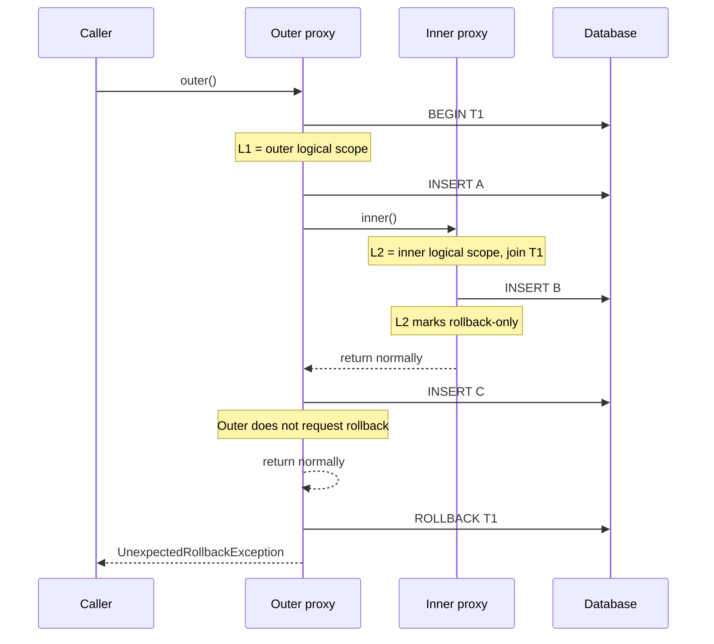

# Each Invocation Still Has Its Own Logical Scope — PROPAGATION_REQUIRED in Spring

## 1. Key Idea

When two Spring methods annotated with `@Transactional(propagation = Propagation.REQUIRED)` call each other, it is very easy to think that because they share a transaction there is "only one transaction scope". That view misses a core distinction in Spring:

> **Every time a transactional method is intercepted by Spring with `REQUIRED` propagation, it gets its own *logical* transaction scope. These logical scopes typically participate in *one physical transaction* when a current transaction already exists.**

This creates two simultaneous truths:

- **Multiple logical scopes:** the outer method has its own scope; the intercepted inner method has its own scope; each subsequent inner call has its own scope as well.
- **One shared physical transaction:** with `REQUIRED`, if outer has already opened a local transaction on the datasource, compatible inner `REQUIRED` calls usually use that exact physical transaction. Inner finishing **does not mean a database commit**; physical commit belongs to the boundary that owns the physical transaction, typically the outermost scope.

Therefore, each logical scope can make its own rollback-only decision, yet **has no authority to durably commit part of the data on its own while sharing the same physical transaction**. An inner scope marking rollback-only can force the entire physical transaction to roll back, even if the outer method returns normally.

This lesson explains the concept, timeline, commit/rollback rules, `UnexpectedRollbackException`, inner scope policies, AOP proxy requirements, a runnable Java 17+ example, and the tests you should write.

### 1.1. Practical example: one request, multiple services

Consider the call:

```text
Controller
  └── CheckoutService.checkout()        @Transactional(REQUIRED)
        ├── orderRepository.insert(...)
        ├── InventoryService.reserve()   @Transactional(REQUIRED)
        │     └── inventoryRepository.update(...)
        └── paymentRecordRepository.insert(...)
```

Assume `CheckoutService` and `InventoryService` are **two Spring beans** and the `reserve()` call goes through the second bean's proxy. If all DAOs use the matching datasource/transaction manager:

- `checkout()` has one **logical scope**.
- `reserve()` has another **logical scope**.
- Both scopes participate in **one physical database transaction** opened at the outer boundary.
- Success in `reserve()` does not mean the inventory update has committed; if `checkout()` rolls back, this update rolls back too.
- If inner marks rollback-only, outer cannot simply "catch the error and commit the rest".

Important note: **not every Java call produces a logical transaction scope**. Calling `this.reserve()` on the same object bypasses the Spring proxy in proxy mode, so the inner method's interceptor does not run and **no new AOP logical scope is formed** for that annotation.

## 2. Distinguishing Logical Transactions and Physical Transactions

### 2.1. What is a physical transaction?

A **physical transaction** is the real unit of work of the resource/provider—for example, a JDBC `Connection` with auto-commit disabled executing SQL until `COMMIT` or `ROLLBACK`. It determines what the database persists durably or undoes, subject to isolation, locks, constraints, timeouts, and driver/database capabilities.

With Spring JDBC using `DataSourceTransactionManager` or `JdbcTransactionManager`, the physical transaction is typically tied to a JDBC connection obtained from the managed datasource and bound to the thread by Spring for the duration of the appropriate scope.

In JPA, `JpaTransactionManager` coordinates the corresponding resource and persistence context. Do not confuse "one physical transaction" with "every system the code calls": an HTTP service, message broker, or another datasource **does not automatically** belong to that local JDBC/JPA transaction.

### 2.2. What is a logical transaction scope?

A **logical transaction scope** is the *decision boundary* opened by a transaction interceptor or programmatic transaction boundary for a single invocation. It carries policy: propagation, rollback rules, scope status, transaction name, read-only/isolation when applicable, etc.

For example, a call passing through an interceptor:

```java
@Transactional(propagation = Propagation.REQUIRED)
public void reserve() {
    // ...
}
```

Spring obtains the `TransactionDefinition`, calls `PlatformTransactionManager.getTransaction(...)`, and receives a `TransactionStatus` corresponding to the scope. If a physical transaction already exists, `TransactionStatus.isNewTransaction()` of the inner scope will be `false` in the typical `REQUIRED` case; nevertheless, the logical scope **still exists** and the interceptor still completes the scope when the method returns or throws an exception.

**A logical scope is not a new connection, not a default savepoint, not an independent transaction, and not equivalent to a COMMIT.**

### 2.3. Comparison table

| Aspect | Logical scope | Physical transaction |
| --- | --- | --- |
| Created by | One transactional interception/programmatic boundary | Transaction manager/resource when actually starting a new transaction |
| Count when outer calls two inner `REQUIRED` methods | Can have three scopes: outer, first inner, second inner | Usually only one, shared |
| Has its own policy? | Can declare `rollbackFor`, propagation, etc. | Only one effective set of characteristics (e.g., isolation) on the ongoing transaction |
| Has its own rollback-only? | Can mark a rollback decision at scope level | A rollback-only flag on a participant can force the entire physical transaction to roll back |
| Ending the scope commits the DB? | Not necessarily; a participant completes its own logic | The owner commits physically once if not rolled back |
| Do two scopes have independent isolation? | No when sharing a physical transaction | Isolation belongs to the physical transaction |
| `TransactionStatus.isNewTransaction()` | Can be `false` in an inner scope | `true` in the scope that created the physical transaction |

Short mental model: **multiple logical processing scopes can map onto one physical ACID unit of data**.

## 3. How Does REQUIRED Choose an Existing Transaction?

`Propagation.REQUIRED` is the default of `@Transactional`. Basically:

1. **No matching transaction:** Spring asks the manager to **create a new physical transaction**, then opens a logical scope for the call.
2. **Matching transaction already exists:** Spring creates a new logical scope yet **joins the current physical transaction**.
3. **Another subsequent intercepted call:** repeats the same rule; it does not collapse all intercepted methods into *one* single logical scope.
4. **Outermost scope ends:** since the physical transaction belongs to the outermost scope, the transaction manager performs the actual commit/rollback at that boundary.

```mermaid
sequenceDiagram
    participant C as Controller
    participant O as Outer proxy
    participant TM as TransactionManager
    participant OS as OuterService
    participant I as Inner proxy
    participant IS as InnerService
    participant DB as Database
    C->>O: checkout()
    O->>TM: getTransaction(REQUIRED)
    TM->>DB: BEGIN physical T1
    Note over O,TM: Logical scope L1; newTransaction=true
    O->>OS: checkout() body
    OS->>DB: INSERT order
    OS->>I: reserve()
    I->>TM: getTransaction(REQUIRED)
    Note over I,TM: Logical scope L2; join T1; newTransaction=false
    I->>IS: reserve() body
    IS->>DB: UPDATE stock
    IS-->>I: return
    I->>TM: complete L2 (commit request)
    Note over TM,DB: T1 not committed yet
    I-->>OS: return
    OS->>DB: INSERT payment record
    OS-->>O: return
    O->>TM: complete L1 (commit request)
    TM->>DB: COMMIT T1
    O-->>C: success
```

In the diagram, when the inner interceptor calls `commit(status)`, because `status.isNewTransaction() == false`, it typically only completes the **participating scope** without committing the DB immediately. Physical commit happens once at the transaction's owner.

The diagram assumes Spring transaction proxies actually intercept both methods, a suitable single manager and shared resource are used, and there are no errors or rollback-only flags.

### 3.1. What if inner is called when there is no outer transaction?

```text
Controller
  └── InventoryService.reserve() @Transactional(REQUIRED)
```

When there is no active transaction, `reserve()`'s scope is both a logical scope **and the owner of a new physical transaction**. In that case `TransactionStatus.isNewTransaction()` is typically `true`, and the transaction completes when `reserve()` returns.

If the controller calls `reserve()` twice separately without an outer transaction wrapping both, each call can create and commit **two different physical transactions**. Do not interpret `REQUIRED` as "sharing a single application-wide transaction".

## 4. Same Physical Transaction, Yet Each Call Still Has a Rollback Decision

This is the most important consequence. Spring documentation describes it as: each `REQUIRED` logical scope can determine rollback-only **individually at scope level**, yet because all scopes share one physical transaction, an inner rollback-only flag can render the entire physical transaction ineligible to commit.



A, B, and C are all **uncommitted** changes in T1; ultimately they all roll back together. What cannot happen here is "inner rolls back only B while outer commits A and C" while still using `REQUIRED` on a shared physical transaction without an explicitly designed savepoint/nested transaction.

### 4.1. Inner method throws RuntimeException and outer catches it

Example with **two different beans**:

```java
@Service
class InventoryService {
    @Transactional(propagation = Propagation.REQUIRED)
    public void reserve() {
        // update DB then fail
        throw new IllegalStateException("OUT_OF_STOCK");
    }
}

@Service
class CheckoutService {
    private final InventoryService inventory;

    CheckoutService(InventoryService inventory) {
        this.inventory = inventory;
    }

    @Transactional(propagation = Propagation.REQUIRED)
    public void checkout() {
        // insert order
        try {
            inventory.reserve();
        } catch (IllegalStateException ex) {
            // Catching the error does not clear rollback-only on physical T1.
        }
        // continue updating some data
    }
}
```

This is a snippet, lacking repositories or full imports. When `inventory.reserve()` goes through the other bean's proxy, the inner interceptor observes the unchecked exception and by default requests rollback for the **logical inner scope**; with `REQUIRED` joining T1, this typically results in **marking T1 rollback-only**. Outer catching it and finishing normally still cannot commit T1.

At outer commit, Spring normally throws `UnexpectedRollbackException` so the caller knows the transaction was rolled back rather than committed as outer expected. If outer **does not catch** and the original exception escapes past the outer interceptor, the caller typically sees the original business exception; not every rollback produces `UnexpectedRollbackException`.

### 4.2. Inner returns Result.failure(...) without throwing an exception

Another case:

```java
@Transactional(propagation = Propagation.REQUIRED)
public Result reserve() {
    // update database
    return Result.failure("OUT_OF_STOCK");
}
```

`Result.failure(...)` is a **normal return value**, not an exception. For custom result types, the interceptor by default **does not automatically interpret** this as a rollback request. If nobody marks rollback-only and there is no database/transaction error, the outer physical transaction **may commit**, even though the caller sees a failure result.

Conditional exception: Spring has special support for certain result types such as Vavr `Try.Failure` or certain exceptionally completed `Future`s in corresponding versions. Do not extrapolate that behavior to every custom DTO/Result/Either.

### 4.3. Inner calls setRollbackOnly itself

```java
import org.springframework.transaction.interceptor.TransactionAspectSupport;

@Transactional(propagation = Propagation.REQUIRED)
public void reserve() {
    // update database
    TransactionAspectSupport.currentTransactionStatus().setRollbackOnly();
}
```

This is a method fragment that must reside in a bean with suitable Spring transaction advice. While inner is **joining** T1, it records a rollback request in the logical inner scope. After the interceptor handles completion, physical transaction T1 can be marked rollback-only and outer cannot actually commit.

`setRollbackOnly()` is a mechanism to use **deliberately**: business code becomes coupled to the Spring transaction API, and the caller may see `UnexpectedRollbackException` if outer expects to commit. A plain Java helper outside transactional interception should not call `currentTransactionStatus()` assuming a status always exists.

### 4.4. How is it different when outer marks rollback-only itself?

If the **scope owning the transaction** (outermost) explicitly calls `setRollbackOnly()`, rollback is the outcome that the outer scope itself requested. Spring can perform the rollback upon completion without **throwing `UnexpectedRollbackException` solely because of that intentional rollback decision**. In terms of data, there is still no commit.

By contrast, an inner scope silently making the global transaction uncommittable while outer requests commit is the typical context for `UnexpectedRollbackException`.

## 5. Do Not Confuse the Three Approaches: REQUIRED, REQUIRES_NEW, NESTED

| Inner propagation | When outer already has a transaction | Inner's physical transaction | Can commit/roll back independently? |
| --- | --- | --- | --- |
| `REQUIRED` | Joins outer | **Same T1** | No: the entire transaction shares the final commit/rollback outcome. |
| `REQUIRES_NEW` | Suspends outer, opens a new transaction | **Independent T2** | Yes: T2 can commit while T1 later rolls back, unless other constraints prevent it. |
| `NESTED` | Uses a savepoint if supported by manager/resource | **Same T1**, with nested savepoint | Can roll back to the savepoint and let outer continue; does not physically commit independently before outer. |

The descriptions above apply only when the inner boundary is truly intercepted and the transaction manager supports the corresponding propagation.

### REQUIRED is not a "fake REQUIRES_NEW"

```java
@Transactional(propagation = Propagation.REQUIRED)
public void writeAudit() {
    // ...
}
```

Placing this method in another service **does not** create a separate physical transaction if outer T1 already exists. It creates another logical scope yet still shares T1. If audit records must commit even when outer rolls back, you must consider `REQUIRES_NEW` or an appropriate event/outbox design and understand the implications for connection pools and consistency.

### NESTED is also not a REQUIRED logical scope

`NESTED` with `DataSourceTransactionManager`/JDBC savepoints allows rolling back updates made after the savepoint without forcing the entire T1 to roll back; with JPA/JTA or unsupported drivers, behavior/support differs. Plain `REQUIRED` **does not automatically create a savepoint** on each inner call.

### REQUIRES_NEW has a cost

An inner `REQUIRES_NEW` may need a second connection while outer still holds T1's connection. Under many concurrent requests, a pool that is too small can cause waiting or connection exhaustion. Do not switch `REQUIRED` to `REQUIRES_NEW` just to avoid `UnexpectedRollbackException` if the business logic genuinely requires all-or-nothing.

## 6. Commit Timing: Two Logical Commits Do Not Mean Two COMMITs

With the proxy-mode interceptor:

- Before entering outer body: outer interceptor opens/receives `TransactionStatus L1`; if no transaction existed, L1 owns T1.
- Before entering inner body: inner interceptor opens `TransactionStatus L2`, **joining T1**.
- Inner returns: interceptor calls completion (potentially calling `commit(L2)`). Because `isNewTransaction() == false`, **no physical DB commit happens** here.
- Outer returns: interceptor completes L1. If not rollback-only and the resource is ready, the transaction manager performs **one COMMIT for T1**.
- If inner marked rollback-only: outer cannot truly commit; the transaction manager rolls back physical T1 and notifies accordingly.

This explains why a repository `save()` returning an entity with an ID or `flush()` executing SQL **does not guarantee the transaction has committed**. Data may have been flushed/visible within the same T1, yet will vanish when outer rolls back.

Note when checking with JDBC: within one physical transaction, SQL statements through the same Spring-managed datasource can execute on **the same transaction-bound connection**. With connections opened directly via `DriverManager.getConnection(...)` outside Spring or mismatched datasources, do not assume the same T1 just because the method carries `@Transactional`.

## 7. Java 17+ Runnable Demo: Multiple Logical Scopes, One Physical Transaction

This example intentionally demonstrates **two points with concrete output**:

1. Inside outer `REQUIRED`, inner `REQUIRED` has `TransactionStatus.isNewTransaction() == false`, even though each call has a `TransactionStatus` corresponding to a logical scope.
2. When the inner scope marks rollback-only, **all INSERTs in T1** (including outer before/after inner) roll back together and outer encounters `UnexpectedRollbackException`.

The code runs with **Java 17+**, **Spring Framework 6.2.19**, **H2 2.3.232**, and Maven; no Spring Boot required. This is a local transaction on **one datasource**.

### 7.1. Structure

```text
required-scope-demo/
├── pom.xml
└── src/main/java/demo/tx/RequiredScopesDemo.java
```

### 7.2. pom.xml

```xml
<project xmlns="http://maven.apache.org/POM/4.0.0"
         xmlns:xsi="http://www.w3.org/2001/XMLSchema-instance"
         xsi:schemaLocation="http://maven.apache.org/POM/4.0.0
                             https://maven.apache.org/xsd/maven-4.0.0.xsd">
    <modelVersion>4.0.0</modelVersion>
    <groupId>demo</groupId>
    <artifactId>required-scope-demo</artifactId>
    <version>1.0.0</version>

    <properties>
        <maven.compiler.release>17</maven.compiler.release>
        <project.build.sourceEncoding>UTF-8</project.build.sourceEncoding>
    </properties>

    <dependencies>
        <dependency>
            <groupId>org.springframework</groupId>
            <artifactId>spring-context</artifactId>
            <version>6.2.19</version>
        </dependency>
        <dependency>
            <groupId>org.springframework</groupId>
            <artifactId>spring-jdbc</artifactId>
            <version>6.2.19</version>
        </dependency>
        <dependency>
            <groupId>com.h2database</groupId>
            <artifactId>h2</artifactId>
            <version>2.3.232</version>
        </dependency>
    </dependencies>

    <build>
        <plugins>
            <plugin>
                <groupId>org.apache.maven.plugins</groupId>
                <artifactId>maven-compiler-plugin</artifactId>
                <version>3.13.0</version>
            </plugin>
            <plugin>
                <groupId>org.codehaus.mojo</groupId>
                <artifactId>exec-maven-plugin</artifactId>
                <version>3.5.1</version>
            </plugin>
        </plugins>
    </build>
</project>
```

### 7.3. src/main/java/demo/tx/RequiredScopesDemo.java

```java
package demo.tx;

import java.util.List;
import javax.sql.DataSource;

import org.springframework.context.annotation.AnnotationConfigApplicationContext;
import org.springframework.context.annotation.Bean;
import org.springframework.context.annotation.Configuration;
import org.springframework.jdbc.core.JdbcTemplate;
import org.springframework.jdbc.datasource.DataSourceTransactionManager;
import org.springframework.jdbc.datasource.DriverManagerDataSource;
import org.springframework.transaction.PlatformTransactionManager;
import org.springframework.transaction.UnexpectedRollbackException;
import org.springframework.transaction.annotation.EnableTransactionManagement;
import org.springframework.transaction.annotation.Propagation;
import org.springframework.transaction.annotation.Transactional;
import org.springframework.transaction.interceptor.TransactionAspectSupport;
import org.springframework.transaction.support.TransactionSynchronizationManager;

public final class RequiredScopesDemo {
    public static void main(String[] args) {
        try (var context = new AnnotationConfigApplicationContext(Config.class)) {
            var jdbc = context.getBean(JdbcTemplate.class);
            var outer = context.getBean(OuterService.class);

            jdbc.execute("CREATE TABLE log_entry (" +
                    "id INT PRIMARY KEY, label VARCHAR(80) NOT NULL)");

            outer.success();
            System.out.println("after success=" + labels(jdbc));

            try {
                outer.innerReject();
            } catch (UnexpectedRollbackException ex) {
                System.out.println("caught=" + ex.getClass().getSimpleName());
            }
            System.out.println("after reject=" + labels(jdbc));

            outer.outerReject();
            System.out.println("after explicit rollback=" + labels(jdbc));
        }
    }

    private static List<String> labels(JdbcTemplate jdbc) {
        return jdbc.queryForList(
                "SELECT label FROM log_entry ORDER BY id", String.class);
    }

    private static void trace(String who) {
        boolean active =
                TransactionSynchronizationManager.isActualTransactionActive();
        boolean newTx =
                TransactionAspectSupport.currentTransactionStatus()
                        .isNewTransaction();
        System.out.println(who + ": active=" + active + ", new=" + newTx);
    }

    @Configuration(proxyBeanMethods = false)
    @EnableTransactionManagement(proxyTargetClass = true)
    public static class Config {
        @Bean
        public DataSource dataSource() {
            return new DriverManagerDataSource(
                    "jdbc:h2:mem:required_scope;DB_CLOSE_DELAY=-1", "sa", "");
        }

        @Bean
        public PlatformTransactionManager transactionManager(DataSource ds) {
            return new DataSourceTransactionManager(ds);
        }

        @Bean
        public JdbcTemplate jdbcTemplate(DataSource ds) {
            return new JdbcTemplate(ds);
        }

        @Bean
        public InnerService innerService(JdbcTemplate jdbc) {
            return new InnerService(jdbc);
        }

        @Bean
        public OuterService outerService(JdbcTemplate jdbc, InnerService inner) {
            return new OuterService(jdbc, inner);
        }
    }

    public static class InnerService {
        private final JdbcTemplate jdbc;

        public InnerService(JdbcTemplate jdbc) {
            this.jdbc = jdbc;
        }

        @Transactional(propagation = Propagation.REQUIRED)
        public void append(int id, String tag, boolean requestRollback) {
            trace("inner " + tag);
            jdbc.update("INSERT INTO log_entry (id, label) VALUES (?, ?)",
                    id, "inner-" + tag);

            if (requestRollback) {
                TransactionAspectSupport.currentTransactionStatus()
                        .setRollbackOnly();
                System.out.println("inner requested rollback-only");
            }
        }
    }

    public static class OuterService {
        private final JdbcTemplate jdbc;
        private final InnerService inner;

        public OuterService(JdbcTemplate jdbc, InnerService inner) {
            this.jdbc = jdbc;
            this.inner = inner;
        }

        @Transactional(propagation = Propagation.REQUIRED)
        public void success() {
            trace("outer success");
            insert(1, "outer-start");
            inner.append(2, "success", false);
            insert(3, "outer-end");
        }

        @Transactional(propagation = Propagation.REQUIRED)
        public void innerReject() {
            trace("outer reject");
            insert(4, "outer-before-reject");
            inner.append(5, "reject", true);
            insert(6, "outer-after-reject");
            System.out.println("outer method finished");
        }

        @Transactional(propagation = Propagation.REQUIRED)
        public void outerReject() {
            trace("outer explicit");
            insert(7, "outer-explicit");
            inner.append(8, "explicit", false);
            TransactionAspectSupport.currentTransactionStatus()
                    .setRollbackOnly();
            System.out.println("outer requested rollback-only");
        }

        private void insert(int id, String label) {
            jdbc.update("INSERT INTO log_entry (id, label) VALUES (?, ?)",
                    id, label);
        }
    }
}
```

**Structure explanation:**

- `@EnableTransactionManagement(proxyTargetClass = true)` enables class-based transaction proxies.
- `OuterService` and `InnerService` are **two separate Spring beans**. `OuterService` receives the `InnerService` proxy injected by the container, so `inner.append(...)` calls from outer are **proxied calls**.
- Both use the same `JdbcTemplate` and `DataSourceTransactionManager`/`DataSource`; their SQL statements participate in the same physical transaction when inner `REQUIRED` joins outer.
- `trace()` is called only inside intercepted transactional methods, because `TransactionAspectSupport.currentTransactionStatus()` requires an appropriate context. `isNewTransaction()` shows whether the outer scope owns T1 or the inner scope merely joined it.
- `success()` proves the INSERTs can commit together.
- `innerReject()` proves rollback-only from inner affects all of physical T1.
- `outerReject()` proves outer intentionally rolling back can finish with a normal return while no data commits.

### 7.4. Run

In the `required-scope-demo` directory with JDK 17+ and Maven:

```bash
mvn -q compile exec:java -Dexec.mainClass=demo.tx.RequiredScopesDemo
```

**Lines printed by the program**, excluding separate Maven/Spring logs:

```text
outer success: active=true, new=true
inner success: active=true, new=false
after success=[outer-start, inner-success, outer-end]
outer reject: active=true, new=true
inner reject: active=true, new=false
inner requested rollback-only
outer method finished
caught=UnexpectedRollbackException
after reject=[outer-start, inner-success, outer-end]
outer explicit: active=true, new=true
inner explicit: active=true, new=false
outer requested rollback-only
after explicit rollback=[outer-start, inner-success, outer-end]
```

### 7.5. Result analysis

**Success case**

1. `outer.success()` is intercepted by the proxy when no transaction exists, so `new=true`: it owns T1.
2. `inner.append(...)` also has its own interceptor, yet `new=false`: it joins T1.
3. After inner returns, inner's INSERTs are not committed separately. When outer returns and T1 commits, the database has exactly the three rows `outer-start`, `inner-success`, `outer-end`.

**Inner rollback-only**

1. Outer opens T2 and INSERTs id=4.
2. Inner `REQUIRED` creates a new logical scope yet uses T2, INSERTs id=5, and calls `setRollbackOnly()`.
3. Inner finishes; the rollback-only flag makes T2 no longer eligible to commit cleanly. Outer still continues to INSERT id=6 and returns normally.
4. Outer interceptor attempts to commit T2; the transaction manager rolls back all of id 4/5/6 and throws `UnexpectedRollbackException`. The DB state **still has only the first three rows**.

**Outer rollback-only**

1. Outer opens T3, INSERTs id=7; inner joins T3 and INSERTs id=8.
2. Outer marks rollback-only itself and finishes normally. The manager rolls back T3; no `UnexpectedRollbackException` is raised from an unexpected inner mark.
3. The database still contains only the three rows committed from the first run.

**Avoid drawing the wrong inference:** `new=false` in inner does not mean the annotation is inactive; on the contrary, it is evidence that inner was intercepted and received a `TransactionStatus` participating in T1/T2/T3. If the inner method were called via `this.append()` bypassing the proxy, `trace()` would not see *a separate invocation status* for that method.

## 8. Programmatic Illustration with TransactionTemplate

Two logical scopes can be observed without proxies. A single `TransactionTemplate` with the same `PlatformTransactionManager` is invoked nested through callbacks with `REQUIRED` propagation:

```java
import org.springframework.transaction.PlatformTransactionManager;
import org.springframework.transaction.TransactionDefinition;
import org.springframework.transaction.support.TransactionTemplate;

public final class RequiredTemplateExample {
    public static void run(PlatformTransactionManager manager) {
        var tx = new TransactionTemplate(manager);
        tx.setPropagationBehavior(TransactionDefinition.PROPAGATION_REQUIRED);

        tx.executeWithoutResult(outer -> {
            System.out.println("outer new=" + outer.isNewTransaction());
            tx.executeWithoutResult(inner -> {
                System.out.println("inner new=" + inner.isNewTransaction());
            });
        });
    }
}
```

This is a complete Java class syntactically, yet it requires a Spring transaction runtime, manager, and properly configured datasource; the `run` method is called inside an application and has no standalone `main`. If there is no active transaction before `run`, and the manager is an appropriate local JDBC manager, the expected output is:

```text
outer new=true
inner new=false
```

It is **the two calls to `executeWithoutResult`** that create two logical scopes; inner does not open a new physical transaction. `TransactionTemplate` drives the PTM directly and is not subject to the self-invocation limitation of AOP proxies.

You can use this template snippet to verify the principle without asking whether Spring uses JDK proxies or CGLIB. However, do not mix templates and `@Transactional` in production without clearly understanding how sharing the same transaction manager/propagation causes them to join each other's transactions.

## 9. Is the Policy of Inner REQUIRED Completely Independent?

**No.** Each logical scope has its own declarations, yet the **current physical transaction** determines the actual isolation, timeout, and read-only characteristics once outer has created T1.

Example:

```java
@Service
class ReportService {
    private final ReaderService reader;

    ReportService(ReaderService reader) {
        this.reader = reader;
    }

    @Transactional(
        propagation = Propagation.REQUIRED,
        isolation = Isolation.READ_COMMITTED,
        readOnly = true,
        timeout = 30)
    public void generate() {
        reader.rebuildIndex();
    }
}

@Service
class ReaderService {
    @Transactional(
        propagation = Propagation.REQUIRED,
        isolation = Isolation.SERIALIZABLE,
        readOnly = false,
        timeout = 5)
    public void rebuildIndex() {
        // ...
    }
}
```

This is policy-illustration code and requires imports for `@Service`, `@Transactional`, `Propagation`, `Isolation`; it is not a complete program with DAOs.

When `generate()` has opened physical T1 and `rebuildIndex()` uses `REQUIRED` to **join** T1, under common default configuration Spring **does not create T2** and **does not switch isolation to SERIALIZABLE or reset timeout to 5 seconds** just because of the inner annotation. Outer physical T1 keeps its existing characteristics; inner's `readOnly` flag also does not turn it into a new read-write transaction.

Spring transaction managers default to lenient behavior regarding some policy differences in participating scopes. If you want to detect isolation/read-only conflicts when joining, on managers extending `AbstractPlatformTransactionManager` you can configure:

```java
@Bean
public PlatformTransactionManager transactionManager(DataSource dataSource) {
    var manager = new DataSourceTransactionManager(dataSource);
    manager.setValidateExistingTransaction(true);
    return manager;
}
```

This is a bean configuration fragment requiring Spring and datasource imports; it is not a standalone runnable file. Validation mode helps **reject mismatches** appropriately with an exception when inner tries to join a transaction with incompatible attributes; it **does not** turn `REQUIRED` into `REQUIRES_NEW`. Exact applicability also depends on the manager/resource.

### 9.1. Do not combine "per-scope" isolation/timeout

Because T1 is a single physical transaction, you cannot have "outer T1 with isolation READ_COMMITTED" and "inner on the same T1 with an independent physical isolation SERIALIZABLE" per nested scope on the same connection. To get a genuinely different physical transaction, you must consider another propagation or redesign business boundaries. Do not overuse new transactions just because an inner annotation specifies a different timeout: that is a significant change to consistency and locking.

### 9.2. Read-only is not a security permission

`@Transactional(readOnly=true)` can act as a hint to the driver/ORM or optimize flushing; it does not inherently guarantee write SQL is rejected on every database. When inner `REQUIRED` joins a read-only outer, do not treat `readOnly=false` on inner as a safe way to enable write privileges. You must check the resource, SQL, DB grants, and physical transaction policy.

## 10. The AOP Proxy Decides Whether a New Logical Scope Actually Exists

The statement "each invocation still has its own logical scope" carries an implicit condition: it must be an **invocation to which Spring's transaction infrastructure is applied**.

### 10.1. Two different beans and an intercepted call

```java
@Service
public class OuterService {
    private final InnerService inner;

    public OuterService(InnerService inner) {
        this.inner = inner;
    }

    @Transactional
    public void outer() {
        inner.inner(); // Through another bean's proxy.
    }
}

@Service
public class InnerService {
    @Transactional
    public void inner() {
        // Own logical scope, joins outer's physical transaction.
    }
}
```

These snippets assume appropriate imports and Spring context; each `@Transactional` gets its own scope when both calls go through the interceptor.

### 10.2. Self-invocation bypasses the proxy

```java
@Service
public class SingleService {
    @Transactional
    public void outer() {
        this.inner(); // Bypasses the transactional proxy.
    }

    @Transactional
    public void inner() {
        // May run inside outer's physical transaction,
        // but this annotation does not create a separate interceptor scope
        // for self-invocation in proxy mode.
    }
}
```

When `outer()` is intercepted by a proxy, `inner()` can access the active transaction opened by outer, yet **there is no separate transactional interception** for `inner()`. Inner's annotation does not apply new propagation/rollback rules/timeouts. If `inner()` is called directly from another bean **through a proxy**, it gets its own logical scope.

Besides self-invocation, `private`, `static`, `final` methods on class-based proxies, non-managed objects created with `new`, or calling through the wrong proxy type can also prevent a method from receiving transactional advice. Do not rely on an annotation in source code as the sole proof.

### 10.3. Thread boundaries

Imperative Spring transactions typically rely on resource binding and synchronizations attached to the **current thread**. `CompletableFuture.supplyAsync`, `@Async`, or manually spawned threads do not automatically inherit the caller's T1 transaction. Another thread opening `@Transactional(REQUIRED)` usually creates its own physical transaction because it does not see T1's context, rather than joining T1 across a thread boundary.

Distinguish this from the reactive model, where `ReactiveTransactionManager` uses Reactor context instead of the ThreadLocal mechanism of `PlatformTransactionManager`. This lesson focuses on imperative `REQUIRED`.

## 11. When Does UnexpectedRollbackException Appear — and When Not?

`UnexpectedRollbackException` signals that Spring had to roll back a transaction the caller expected to commit. This is a **transparency mechanism about the outcome**, not a random framework bug.

### 11.1. Typical scenarios

| Scenario | Typical outcome |
| --- | --- |
| Outer T1 + inner `REQUIRED` throws unchecked exception; outer does **not** catch | The original exception can escape to the caller; all of T1 rolls back. |
| Inner `REQUIRED` throws unchecked exception, outer catches and returns normally | Inner can mark T1 rollback-only; outer's commit is converted to rollback and normally throws `UnexpectedRollbackException`. |
| Inner `REQUIRED` calls `setRollbackOnly()` and returns normally, outer still tries to commit | T1 rolls back; outer normally receives `UnexpectedRollbackException`. |
| Outer owner calls `setRollbackOnly()` itself and returns normally | T1 rolls back as outer intended, not necessarily throwing `UnexpectedRollbackException`. |
| Inner `REQUIRED` completes normally, no rollback-only | Only completes the logical scope; outer retains the decision to physically commit/roll back. |
| Inner returns custom `Result.failure(...)`, no exception or rollback-only mark | Returning as data normally does not mark T1 for rollback on its own. |
| Inner `REQUIRES_NEW` rolls back, outer handles properly | Inner T2 can roll back independently; does not mean outer T1 must roll back. |
| Inner `NESTED` rolls back to a supported savepoint, outer continues | Can preserve work before the savepoint and commit outer T1, depending on manager/resource. |

You must account accurately for the method's **rollback rules**: `@Transactional` normally rolls back on unchecked exceptions/`Error`, and does not roll back by default on checked exceptions. With `rollbackFor` or `noRollbackFor`, the outcome changes. Database errors or a transaction resource already marked rollback-only can also prevent commit, even if Java code does not throw a business exception itself.

### 11.2. Why should you not "swallow" exceptions to force a commit?

Anti-pattern example:

```java
@Transactional
public void checkout() {
    try {
        inventoryService.reserve();  // REQUIRED, may set rollback-only.
    } catch (InsufficientStockException ex) {
        // "No problem, we will return success."
    }
    return;
}
```

This snippet assumes real exception and service types. **Catching an exception does not clear rollback-only**. Outer should not return success if the all-or-nothing requirement was broken. A better approach is to let the exception cross the outer boundary or translate it into a clear result *after* the transactional boundary has handled the exception. If the business logic intentionally needs partial commits, design separate boundaries, use separate transactions, or use controlled sagas/compensation—not trying to force a rollback-only T1 to commit.

### 11.3. When the exception is thrown can depend on configuration

Normally Spring reports unexpected rollback at the outermost commit. Some transaction managers have an option to detect rollback-only earlier, such as `setFailEarlyOnGlobalRollbackOnly(true)` on supported managers. Where the exception surfaces therefore depends on infrastructure/configuration; the **invariant to remember** is that a rollback-only physical transaction cannot commit as a successful transaction.

## 12. How to Observe and Debug in a Spring Application

### 12.1. Reading TransactionStatus of each invocation

Inside a method actually managed by `TransactionInterceptor`:

```java
import org.springframework.transaction.interceptor.TransactionAspectSupport;
import org.springframework.transaction.support.TransactionSynchronizationManager;

boolean active =
        TransactionSynchronizationManager.isActualTransactionActive();

boolean newPhysical =
        TransactionAspectSupport.currentTransactionStatus()
                .isNewTransaction();
```

This is a fragment for a Java method with an active Spring transaction context. Results:

- Outer with no prior T1: typically `active=true`, `newPhysical=true`.
- Inner `REQUIRED` joining T1: typically `active=true`, `newPhysical=false`.
- Inner `REQUIRES_NEW`: typically `active=true`, `newPhysical=true` if the manager creates an independent T2.

**Note:** `currentTransactionStatus()` only works when a transaction invocation context established by the Spring transaction aspect exists; using it outside can raise `NoTransactionException`. `isActualTransactionActive()` only indicates the thread is bound to an actual transaction; it **does not** distinguish whether the current method has its own logical scope or is just a helper called inside an outer transaction.

If code merely logs `active=true` inside a private helper, that does not prove the helper's annotation was intercepted.

### 12.2. Enabling appropriate transaction logs

You can configure loggers at DEBUG/TRACE level in test environments for `org.springframework.transaction` or more narrowly `org.springframework.jdbc.datasource.DataSourceTransactionManager`. Useful log entries typically include creating a new transaction, joining an existing transaction, marking rollback-only, and commit/rollback.

Yet **do not rely solely on logs**: verify DB changes after the transaction completes. Ensure logs do not expose sensitive query parameters, user data, tokens, or credentials.

### 12.3. Identifying the right manager and datasource

`REQUIRED` scopes only share a physical transaction when they operate on compatible transaction infrastructure. If outer uses `ordersTxManager` for datasource A and inner uses `reportingTxManager` for datasource B, you **cannot conclude** both share a single JDBC transaction just because both carry `@Transactional(REQUIRED)`.

When multiple managers exist, name beans/qualifiers and use `@Transactional(transactionManager = "ordersTxManager")` when needed. With JDBC, use `JdbcTemplate` or `DataSourceUtils` to participate in the transaction-bound connection; opening `DriverManager.getConnection(...)` independently does not automatically join T1.

The `REQUIRED` annotation does not create a "system-wide transaction".

## 13. Tests Needed for Logical Scopes

| Test | How to perform | What to verify |
| --- | --- | --- |
| Outer + inner `REQUIRED` succeed | Two Spring beans, same datasource, outer calls inner via proxy | One physical transaction commits; inner `isNewTransaction=false`; data from both persists together. |
| Inner rollback-only | Inner updates and marks rollback-only, outer still returns normally | DB rolls back both outer + inner; caller receives `UnexpectedRollbackException` on outer completion under typical config. |
| Inner unchecked exception caught by outer | Inner throws error, outer catches | Catching does not clear rollback-only; commit cannot succeed normally. |
| Outer intentionally rolls back | Outer marks rollback-only then returns | Data for the entire physical transaction is rolled back as intended. |
| Failure returned as DTO | Inner returns `Result.failure`, no throw/rollback-only | May commit if no other rollback condition exists; test must read the database. |
| Calling inner `REQUIRED` twice | Outer calls the same inner method twice via proxy | Two inner logical invocations; still share T1, not two physical commits. |
| Calling inner without outer | From a caller without a transaction | Each top-level invocation gets its own physical transaction. |
| Self-invocation | Outer calls `this.inner()` in the same bean | No new AOP logical scope for inner in proxy mode. |
| Inner policy differs from outer | Different isolation/read-only/timeout | Must not assume inner applies new physical policy when joining; mismatch validation can be enabled. |
| Inner `REQUIRES_NEW` | Call via proxy, sufficient pool connections | Independent T2; outer rollback does not automatically roll back an already-committed T2. |

**Spring Test note:** a test method annotated with `@Transactional` is typically rolled back by Spring Test when the test ends. A test that already has an outer transaction from the framework can cause every `REQUIRED` service to merely **join the test transaction**, making results fail to reflect real-world transaction boundaries. To test real service commit/rollback, write integration tests without an outer test transaction or explicitly use `TestTransaction` to finish and then read data from an independent scope.

### When tests report active=true in all three methods

That still does not prove there are three logical scopes. You must ensure each method has an intercepted invocation, then observe `TransactionStatus.isNewTransaction()`, transaction interceptor logs, and DB outcomes. Counting plain Java calls is no substitute for verifying the proxy path.

## 14. Common Mistakes and How to Fix Them

### Mistake 1 — "REQUIRED has only one logical scope"

**Fix:** each intercepted `REQUIRED` invocation creates a logical scope; outer and inner can have separate scopes while sharing one physical transaction. This is precisely the model described by Spring in the propagation documentation.

### Mistake 2 — "Inner returning means data has committed"

**Fix:** when inner joins outer, ending its scope is not a DB COMMIT. Data can still roll back if outer encounters an error or requests rollback.

### Mistake 3 — "Catching RuntimeException in outer restores the ability to commit"

**Fix:** the inner interceptor may have already marked the shared T1 rollback-only. Catching the exception only affects Java control flow; it does not reverse rollback-only. Outer may encounter `UnexpectedRollbackException` at commit.

### Mistake 4 — "Inner @Transactional(isolation=...) creates a separate isolation"

**Fix:** when joining T1, a new logical scope does not create a new physical isolation on its own. Outer's attributes govern; enable `validateExistingTransaction` when you need to catch mismatches.

### Mistake 5 — "Any two @Transactional annotations mean two physical transactions"

**Fix:** with `REQUIRED`, no. Only when no transaction exists or another appropriate propagation is used does Spring open a new physical transaction.

### Mistake 6 — "Self-invocation also creates a new logical scope"

**Fix:** proxy mode does not intercept `this.inner()`, so the inner annotation does not form a separate AOP transaction scope. Split into another bean or use `TransactionTemplate` when a boundary is needed.

### Mistake 7 — "active=true means the current method's annotation is taking effect"

**Fix:** the thread may already have T1 opened by a caller. Check proxy/interceptor status, `isNewTransaction`, and SQL outcomes.

### Mistake 8 — "All local transaction managers share T1"

**Fix:** two datasources or two transaction managers do not automatically share a physical transaction; verify the exact resource identity, transaction manager bean, and connection binding.

## 15. Self-Check Questions

**Question 1.** Both outer and inner are `@Transactional(REQUIRED)`, and inner is properly called through a proxy. How many logical scopes and physical transactions exist?

*Answer:* Two logical scopes (outer and inner) and typically one physical transaction if outer opened a matching transaction.

**Question 2.** Inner `REQUIRED` returns without an exception; has the data committed yet?

*Answer:* Not necessarily. If inner merely joined the outer physical transaction, the physical commit usually waits until the outer boundary completes.

**Question 3.** Inner calls `setRollbackOnly()`, and outer still attempts to commit. What is the consequence?

*Answer:* The physical transaction may be rolled back and outer receives `UnexpectedRollbackException` under typical configuration, because outer expected to commit yet the transaction was already marked rollback-only by inner.

**Question 4.** Inner throws an unchecked exception, and outer does not catch it. Must `UnexpectedRollbackException` occur?

*Answer:* No. The original exception can escape past the outer interceptor and trigger rollback. Unexpected rollback mainly arises when outer attempts to commit a physical transaction already marked rollback-only from within.

**Question 5.** Inner `REQUIRED` declares a different isolation than outer. Does Spring automatically switch physical isolation upon joining?

*Answer:* No. Under default configuration, inner typically inherits outer's characteristics; you can enable manager validation to reject incompatibilities.

**Question 6.** Why does a helper calling `TransactionSynchronizationManager.isActualTransactionActive()` return true yet fail to prove the helper was intercepted?

*Answer:* The helper may be running inside a transaction opened by another method on the same thread; an active transaction does not equate to having a new logical scope for the helper.

**Question 7.** What changes if inner is switched to `REQUIRES_NEW`?

*Answer:* Inner can open an independent T2 when intercepted, committing/rolling back separately; you must evaluate consistency, connection pools, and business requirements.

**Question 8.** When the same bean calls `this.inner()` itself, with both methods annotated `REQUIRED`, are there two logical scopes by default?

*Answer:* Not in Spring proxy mode. An internal call does not pass through the proxy for inner, so it does not create a new transactional invocation.

## 16. Summary

- **`PROPAGATION_REQUIRED` creates a logical transaction scope for each intercepted invocation**; not every invocation creates a new physical transaction.
- **Outer and inner `REQUIRED` typically share one physical transaction**, one matching connection/resource context, and one physical COMMIT/ROLLBACK outcome.
- **Inner completing does not mean data has committed**; an inner rollback-only can cause the entire physical transaction to roll back and outer to encounter `UnexpectedRollbackException` if it still expects to commit.
- **Having a separate logical scope does not mean separate physical isolation/timeout/read-only** when joining an existing transaction.
- **Proxy path, transaction manager, and resource identity** determine whether a scope is actually created and whether T1 is shared.
- **Test around transaction boundaries and DB state after completion**, not just by reading annotations, counting method calls, or checking `active=true`.

## References

- [Spring Framework — Transaction Propagation: Understanding PROPAGATION_REQUIRED](https://docs.spring.io/spring-framework/reference/data-access/transaction/declarative/tx-propagation.html)
- [Spring Framework — Using @Transactional](https://docs.spring.io/spring-framework/reference/data-access/transaction/declarative/annotations.html)
- [Spring Framework — Declarative Transaction Management](https://docs.spring.io/spring-framework/reference/data-access/transaction/declarative.html)
- [Spring Framework — Programmatic Transaction Management](https://docs.spring.io/spring-framework/reference/data-access/transaction/programmatic.html)
- [Spring API — PlatformTransactionManager](https://docs.spring.io/spring-framework/docs/6.2.19/javadoc-api/org/springframework/transaction/PlatformTransactionManager.html)
- [Spring API — TransactionStatus](https://docs.spring.io/spring-framework/docs/6.2.19/javadoc-api/org/springframework/transaction/TransactionStatus.html)
- [Spring API — AbstractPlatformTransactionManager](https://docs.spring.io/spring-framework/docs/6.2.19/javadoc-api/org/springframework/transaction/support/AbstractPlatformTransactionManager.html)
