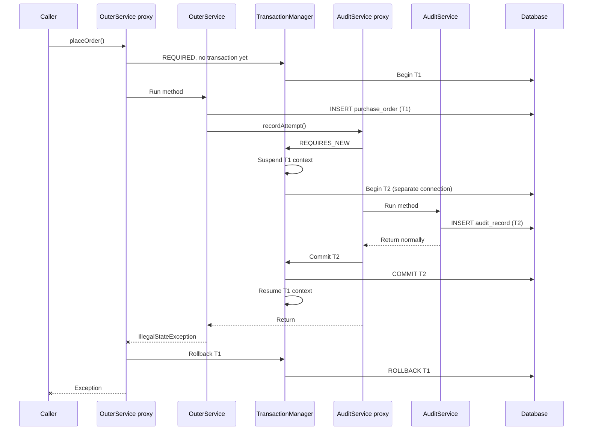

# REQUIRES_NEW: Data Committed Inside Can Persist Even When the Outer Transaction Rolls Back

## 1. A Surprising Outcome at First Glance

Suppose an order-placement workflow has two steps:

1. Record the order inside a transaction of an outer service method.
2. Call another service to write an **order-attempt audit log** in a separate transaction.

After the audit log is written successfully, the system detects an error and **rolls back the order transaction**. If the logging method uses `Propagation.REQUIRES_NEW` and this inner transaction **committed successfully**, the audit record **can still exist** in the database.

```text
OuterService.placeOrder()       @Transactional(REQUIRED)
    |
    |  T1: INSERT purchase_order (id = 1)    [uncommitted]
    |
    +--> AuditService.recordAttempt()         @Transactional(REQUIRES_NEW)
    |        |
    |        |  T1 suspended
    |        |  T2: INSERT audit_record (id = 100)
    |        |  COMMIT T2                         [audit data durable]
    |        |  T1 resumed
    |        v
    |
    |  throw IllegalStateException
    |
    v
ROLLBACK T1                                [undoes order changes]

Final result:
    purchase_order: 0 records
    audit_record:   1 record
```

This is not a rollback bug. It is the **intentional semantics of `REQUIRES_NEW`**: the inner transaction has an **independent** commit/rollback boundary from the outer transaction.

> **Key idea:** `REQUIRES_NEW` creates a separate *physical transaction*. Once that transaction commits successfully, the outer transaction rolling back **does not automatically undo the completed commit**. Conversely, if the inner transaction fails, rolls back, or never commits, you must not conclude that the inner data is guaranteed to exist.

This lesson belongs to Spring Framework transaction management and focuses directly on the question: **why inner committed data remains when outer rolls back, the conditions required for that to happen, and the consequences for business design**.

### After This Lesson, What Will You Be Able to Do?

- Explain the difference between logical transaction scope and physical transaction for `REQUIRED`, `REQUIRES_NEW`, and `NESTED`.
- Trace the sequence **suspend outer -> begin inner -> commit inner -> resume outer -> rollback outer**.
- Run a Java 17+ Spring Boot application with two service beans, JDBC/H2, and observe evidence of data surviving rollback.
- Recognize when *intentionally* keeping an independent record (attempt log) makes sense, and when doing so creates dangerous business state.
- Avoid pitfalls with proxies/self-invocation, pool connection exhaustion, lock contention, wrong managers, rollback rules, and test transactions.
- Choose outbox, after-commit events, or an alternative design when inner data **must not exist** if the outer operation fails.

## 2. What Does REQUIRES_NEW Actually Promise?

In Spring, the annotation:

```java
@Transactional(propagation = Propagation.REQUIRES_NEW)
public void recordAttempt(...) {
    // Write data in a separate transaction.
}
```

instructs the transaction interceptor to use an **independent new transaction** for an eligible intercepted method. Unlike `REQUIRED`, it **does not join the caller's existing physical transaction**.

If a transaction T1 is already active on resources controlled by the manager:

1. Spring **suspends** the resource/transaction synchronization context of T1.
2. The manager requests a **new physical transaction T2** for the inner method.
3. The inner method operates on resources/connections belonging to T2.
4. When the method finishes, Spring ends T2 according to its outcome and rollback rules. T2 can **commit** without waiting for T1.
5. Spring **resumes T1's context** so the outer method can continue.
6. T1 later commits or rolls back **according to T1's own outcome**. It does not retroactively cancel T2's commit.

This holds in the common Spring local transaction model with a suitable `PlatformTransactionManager`. When using multiple transaction managers, multiple datasources, or distributed transactions, you must analyze separately **which resources** are actually managed.

### Three Mental Models to Distinguish

| Inner method propagation | Relationship to outer transaction | If inner succeeds and outer later rolls back |
| --- | --- | --- |
| `REQUIRED` | Joins the **same physical transaction** | Changes from both scopes usually roll back together |
| `REQUIRES_NEW` | **Independent physical transaction**; outer transaction is suspended | Committed inner changes **can persist** |
| `NESTED` | Typically uses a **savepoint within the same physical transaction** in JDBC | A full outer rollback still undoes changes after the savepoint |

`NESTED` is not equivalent to `REQUIRES_NEW`. Savepoints allow partial rollback **within the same transaction**, but do not create an independent durable commit before outer commits.

If there is **no outer transaction**, `REQUIRES_NEW` still starts a new transaction; in that case there is no T1 to suspend, so there is no "inner commit surviving outer rollback" scenario to compare.

## 3. Two Transaction Boundaries Are Different from Two Write Statements

To avoid confusion, distinguish:

- **Logical transaction scope**: the policy boundary corresponding to a `@Transactional` call managed by Spring's transaction interceptor.
- **Physical transaction**: the database/connection/resource transaction that the transaction manager creates and completes.

With a `REQUIRED -> REQUIRED` chain under the same manager, there can be two logical scopes sharing **one physical transaction T1**. A rollback-only marker set inside can cause all of T1 to roll back.

With a `REQUIRED -> REQUIRES_NEW` chain:

```text
Outer logical scope                  Inner logical scope
@Transaction(REQUIRED)               @Transactional(REQUIRES_NEW)
         |                                       |
         v                                       v
Physical transaction T1             Physical transaction T2
         |                                       |
  INSERT order                             INSERT audit
         |                                       |
  Suspend T1                         COMMIT T2 independently
         |                                       |
  Resume T1                                  Finish
         |
  ROLLBACK T1
```

Here T1 and T2 exist within **the same top-down Java call**, yet **do not share a commit/rollback outcome**.

**Nested transactions on the call stack != nested physical transactions with a parent-child "parent rolls back, child automatically rolls back" rule.** `REQUIRES_NEW` is precisely the mechanism that breaks that coupling.

### Why Cannot Outer Roll Back What Was Already Committed?

Committing T2 is an independent transaction-completion operation for the DBMS. Once T2 commits successfully, its changes become committed data. T1 only controls **the changes participating in T1**. When T1 rolls back, the database has no reason or default mechanism to reach back in time and cancel T2's commit.

To undo data already committed by T2, the application must perform a **separate compensating action** (for instance another transaction that deletes or marks it canceled); that is **compensation**, not a rollback of T1.

## 4. Sequence of Suspend, Commit, and Resume

A proper sequence for two service beans and one JDBC transaction manager:



**Key milestones:**

- Calls must pass through the **Spring proxy of both services**, not one method in the same object calling `this.inner()`.
- **The inner method finishes before the outer method throws** in the example; thus Spring has the opportunity to commit T2.
- Writes inside T2 must use a datasource/manager actually bound to T2.
- When T1 rolls back, only uncommitted data or changes belonging to T1 are reverted.
- This is an *imperative JDBC* flow. In reactive transactions, the context mechanism differs, though the principle of an independent physical transaction remains the core of REQUIRES_NEW when supported.

### What Does "Suspend" Mean?

When suspending, Spring typically **detaches the current transaction context from the execution thread**, while resources such as T1's JDBC connection are kept aside to be reattached later. T1 does not vanish or commit. While inner runs, the infrastructure uses another transaction with its appropriate resources. Once T2 finishes, T1's context is reattached.

Hence the same thread can sequentially see T1 -> T2 -> T1, without T2 being "inside" T1 in the ACID sense.

## 5. When Does Inner Data Actually Persist?

A T2 record will persist after T1 rolls back if at least the following conditions hold:

1. The inner call goes through the transaction interceptor and the `REQUIRES_NEW` policy is actually applied.
2. The transaction manager successfully starts T2 and the write statement **participates in T2**, rather than running on the wrong connection/datasource.
3. The written data is valid and **T2 commits successfully**.
4. No other mechanism or transaction compensates, deletes, or overwrites that record afterward.
5. When querying to verify, you read database state **after the calls and transactions have completed**, not Java objects sitting in an unflushed persistence context.

The word "**can**" in the title is crucial: `REQUIRES_NEW` provides the **ability to commit independently**, not a guarantee that "calling inner always leaves data behind". Inner could:

- Throw a `RuntimeException`, causing Spring to roll back T2 by default.
- Fail on commit, time out, or have its SQL rejected by the database.
- Execute a read-only operation that writes nothing.
- Be invoked in a way that bypasses the proxy, failing to create T2 as expected.
- Write data that is later modified or deleted by another transaction.
- Fail to obtain a connection because the connection pool is exhausted.

Put accurately: **a committed T2 is sufficient for a T1 rollback not to undo T2's changes automatically**, while whether T2 actually committed must be proven from configuration and observed results.

## 6. Runnable Example: Outer Rolls Back, Inner Commit Survives

This hands-on example uses **Java 17+**, **Spring Boot**, **Spring JDBC**, and **in-memory H2**. Both outer and inner use the same H2 database and the same `JdbcTemplate`/transaction manager, yet because of `REQUIRES_NEW` each transaction uses a **different connection/physical transaction** at its respective point in time.

We intentionally use **two independent tables** so inner does not wait on locks from outer's uncommitted data:

- `purchase_order`: orders; written in T1.
- `audit_record`: order-**attempt** log; written in T2, **with no foreign key to purchase_order**.

Why omit the foreign key in the example: if inner T2 had to reference an order that T1 just INSERTed **uncommitted**, inner cannot assume it can see that order. A foreign key or query reading data locked by outer can block or fail. Using an independent audit table lets us observe the transaction effect directly without distraction from lock/constraint contention.

### 6.1. Initializing the Project

Create a Maven project from Spring Initializr:

- Java **17** or newer.
- A Spring Boot version compatible with the chosen Java version.
- Dependencies **Spring JDBC** (typically `spring-boot-starter-jdbc`) and **H2 Database**.
- Base package: `com.example.requiresnew`.

Keep the `pom.xml` generated by Spring Initializr, including parent/dependency management/plugins. The dependencies snippet below is for reference:

```xml
<dependencies>
    <dependency>
        <groupId>org.springframework.boot</groupId>
        <artifactId>spring-boot-starter-jdbc</artifactId>
    </dependency>
    <dependency>
        <groupId>com.h2database</groupId>
        <artifactId>h2</artifactId>
        <scope>runtime</scope>
    </dependency>
</dependencies>
```

Project structure:

```text
src/main/
├── java/com/example/requiresnew/
│   ├── RequiresNewApplication.java
│   ├── AuditService.java
│   └── OrderService.java
└── resources/
    ├── schema.sql
    └── application.properties
```

### 6.2. Database Schema

File `src/main/resources/schema.sql`:

```sql
CREATE TABLE purchase_order (
    id BIGINT PRIMARY KEY,
    description VARCHAR(100) NOT NULL
);

CREATE TABLE audit_record (
    id BIGINT PRIMARY KEY,
    order_id BIGINT NOT NULL,
    message VARCHAR(100) NOT NULL
);
```

Note that `audit_record.order_id` here is a **business reference ID**, not a foreign key. After the order rolls back, `audit_record.order_id = 1` remains stored to indicate "there was an attempt to place order 1", **not to assert that order 1 was successfully created**.

In a real application, if data rules require that **every audit must reference an existing order**, writing the inner audit independently before outer commits may **violate that invariant**. In that case change the design rather than dropping foreign keys just to make REQUIRES_NEW code "work".

File `src/main/resources/application.properties`:

```properties
spring.datasource.url=jdbc:h2:mem:requires_new_demo;DB_CLOSE_DELAY=-1
spring.datasource.driver-class-name=org.h2.Driver
spring.datasource.username=sa
spring.datasource.password=
spring.datasource.hikari.maximum-pool-size=4
```

Spring Boot with embedded H2 typically runs `schema.sql` automatically at startup. The pool configuration above provides enough connections for the single-threaded hands-on demo: outer holds one connection while inner needs **another connection**. In production, size the pool according to concurrent load rather than blindly copying `4`.

### 6.3. Inner Service: Committing the Log with REQUIRES_NEW

File `src/main/java/com/example/requiresnew/AuditService.java`:

```java
package com.example.requiresnew;

import org.springframework.jdbc.core.JdbcTemplate;
import org.springframework.stereotype.Service;
import org.springframework.transaction.annotation.Propagation;
import org.springframework.transaction.annotation.Transactional;
import org.springframework.transaction.interceptor.TransactionAspectSupport;
import org.springframework.transaction.support.TransactionSynchronizationManager;

@Service
public class AuditService {

    private final JdbcTemplate jdbc;

    public AuditService(JdbcTemplate jdbc) {
        this.jdbc = jdbc;
    }

    @Transactional(propagation = Propagation.REQUIRES_NEW)
    public void recordAttempt(long auditId, long orderId) {
        boolean active =
                TransactionSynchronizationManager
                        .isActualTransactionActive();
        boolean createdNew =
                TransactionAspectSupport.currentTransactionStatus()
                        .isNewTransaction();

        System.out.printf(
                "inner: active=%s, new=%s%n",
                active, createdNew);

        jdbc.update("""
            INSERT INTO audit_record (id, order_id, message)
            VALUES (?, ?, ?)
            """, auditId, orderId, "attempt-started");
    }
}
```

Because this service is a separate `@Service` bean, calls from `OrderService` to the injected bean go through `AuditService`'s proxy.

- `active=true` inside the method indicates a Spring-managed transaction is active on the thread.
- `new=true` indicates the inner scope is seen by the transaction manager as a **new transaction**.
- `recordAttempt(...)` exits normally, so after the method body returns and the transaction interceptor runs, T2 will **commit**, provided there is no rollback-only flag or commit failure.
- Inside the method body, the `INSERT` runs **without explicitly calling `commit()`**; the transaction interceptor performs the commit outside the method body. That is why the Java call to inner **returning through the proxy** is what signifies "T2 has completed".

### 6.4. Outer Service: Write Order, Call Inner, Then Fail

File `src/main/java/com/example/requiresnew/OrderService.java`:

```java
package com.example.requiresnew;

import org.springframework.jdbc.core.JdbcTemplate;
import org.springframework.stereotype.Service;
import org.springframework.transaction.annotation.Propagation;
import org.springframework.transaction.annotation.Transactional;
import org.springframework.transaction.interceptor.TransactionAspectSupport;
import org.springframework.transaction.support.TransactionSynchronizationManager;

@Service
public class OrderService {

    private final JdbcTemplate jdbc;
    private final AuditService auditService;

    public OrderService(JdbcTemplate jdbc, AuditService auditService) {
        this.jdbc = jdbc;
        this.auditService = auditService;
    }

    @Transactional(propagation = Propagation.REQUIRED)
    public void createOrderThenFail() {
        boolean active =
                TransactionSynchronizationManager
                        .isActualTransactionActive();
        boolean createdNew =
                TransactionAspectSupport.currentTransactionStatus()
                        .isNewTransaction();

        System.out.printf(
                "outer: active=%s, new=%s%n",
                active, createdNew);

        // Write in T1, uncommitted.
        jdbc.update("""
            INSERT INTO purchase_order (id, description)
            VALUES (?, ?)
            """, 1L, "demo-order");

        // Call through another bean: REQUIRES_NEW suspends T1,
        // creates T2, writes audit, and commits T2 before returning.
        auditService.recordAttempt(100L, 1L);

        System.out.println("outer: inner method returned");

        // Simulate a failure occurring AFTER inner has committed.
        throw new IllegalStateException("simulate outer failure");
    }
}
```

A subtle yet important point: at `auditService.recordAttempt(100L, 1L)`, the inner method is not merely "called"—it **passes through the proxy so T2 actually finishes** before the program executes the next line `System.out.println("outer: inner method returned")`.

`IllegalStateException` is a `RuntimeException`; under default rollback rules, it causes outer's interceptor to roll back T1. That does not issue a rollback to the already completed T2.

### 6.5. Running from Outside Both Transactions

File `src/main/java/com/example/requiresnew/RequiresNewApplication.java`:

```java
package com.example.requiresnew;

import org.springframework.boot.CommandLineRunner;
import org.springframework.boot.SpringApplication;
import org.springframework.boot.autoconfigure.SpringBootApplication;
import org.springframework.context.annotation.Bean;
import org.springframework.jdbc.core.JdbcTemplate;
import org.springframework.transaction.annotation.EnableTransactionManagement;

@SpringBootApplication
@EnableTransactionManagement
public class RequiresNewApplication {

    public static void main(String[] args) {
        SpringApplication.run(RequiresNewApplication.class, args);
    }

    @Bean
    CommandLineRunner demonstrate(
            OrderService orderService,
            JdbcTemplate jdbc) {
        return args -> {
            printCounts("before", jdbc);

            try {
                orderService.createOrderThenFail();
            } catch (IllegalStateException ex) {
                System.out.println("caught: " + ex.getMessage());
            }

            printCounts("after", jdbc);

            String message = jdbc.queryForObject(
                    "SELECT message FROM audit_record WHERE id = ?",
                    String.class, 100L);

            System.out.println("audit[100]: " + message);
        };
    }

    private static void printCounts(String label, JdbcTemplate jdbc) {
        Integer orders = jdbc.queryForObject(
                "SELECT COUNT(*) FROM purchase_order",
                Integer.class);
        Integer audits = jdbc.queryForObject(
                "SELECT COUNT(*) FROM audit_record",
                Integer.class);

        System.out.printf(
                "%s: orders=%d, audit=%d%n",
                label, orders, audits);
    }
}
```

Because `CommandLineRunner` does not open a transaction before calling `orderService`, outer REQUIRED creates a new T1. Inner REQUIRES_NEW creates a new T2, so both calls to `isNewTransaction()` print `true`. Those values alone **are not enough to prove two distinct physical transactions**; the DB query result after rollback is more direct proof.

`@EnableTransactionManagement` is shown explicitly to highlight the annotation-driven transaction infrastructure. In Spring Boot with standard JDBC auto-configuration, transaction infrastructure is usually already registered accordingly.

### 6.6. Run Command and Expected stdout

In the directory containing `pom.xml`, run:

```bash
./mvnw spring-boot:run
```

On Windows PowerShell:

```powershell
.\mvnw.cmd spring-boot:run
```

Ignoring Spring/Maven logs, the lines printed by the program itself are:

```text
before: orders=0, audit=0
outer: active=true, new=true
inner: active=true, new=true
outer: inner method returned
caught: simulate outer failure
after: orders=0, audit=1
audit[100]: attempt-started
```

### 6.7. Line-by-Line Analysis

1. **`before: orders=0, audit=0`** — H2 has just initialized two empty tables.
2. **`outer: active=true, new=true`** — outer is called through its proxy from a caller with no transaction, so REQUIRED creates T1.
3. Outer INSERTs `purchase_order(1)` in T1. The data is **uncommitted**.
4. **`inner: active=true, new=true`** — AuditService's proxy suspends T1 and creates T2. Both scopes are "new" relative to their own context, not the same transaction.
5. Inner INSERTs `audit_record(100, 1, "attempt-started")` in T2 and the method finishes. The proxy **commits T2** before returning from `recordAttempt(...)` to the caller.
6. **`outer: inner method returned`** — T1 has been resumed. T2 has already committed if no commit error occurred.
7. Outer throws `IllegalStateException`. Outer's interceptor **rolls back T1**, so `purchase_order(1)` does not exist.
8. `CommandLineRunner` catches the exception **outside the proxy** and queries the DB after T1 finishes.
9. **`after: orders=0, audit=1`** and **`audit[100]: attempt-started`** — proving that inner's commit **survived** despite outer's rollback.

If you run with the exact single-threaded sample setup, this output demonstrates `REQUIRES_NEW` behavior. With different databases, locks/timing/transaction managers, write equivalent tests in the real environment.

## 7. Why Were Two Independent Tables Chosen Intentionally?

A common testing mistake: outer T1 inserts an uncommitted order, and inner T2 tries to read that order or insert a record with a **foreign key referencing the newly written order**. Because inner does not use the same transaction T1, it may:

- Not see T1's uncommitted row under typical isolation levels.
- Wait on a lock held by T1.
- Receive a foreign key error or timeout, depending on database and execution schedule.
- Cause the two transactions to wait on each other: outer holds a resource and waits for inner; inner needs the resource held by outer.

Therefore, in this hands-on lesson, inner only writes an **independent attempt-log record**. The `order_id` column is purely descriptive data rather than enforcing a foreign key that falsely implies "the order already exists".

**Architecture lesson:** if a business invariant mandates "every audit record must reference a committed order", you cannot arbitrarily drop data constraints just to let REQUIRES_NEW commit first. Instead, create the audit after the order commits or use an appropriate outbox/event pattern.

### Transaction Independence Does Not Mean Independence of All Resources

T1 and T2 do not share commit/rollback; however, they can still contend on:

- The connection pool.
- Locks on the same table/row/index.
- Database capacity and threads.
- Unique constraints or business identifiers.
- Transaction timeouts, retries, and deadlock detection.

"Physical independence" here refers to **transaction boundaries**, not that two transactions cannot interact through database constraints.

## 8. Difference from REQUIRED and NESTED When Outer Rolls Back

Try changing inner's propagation in the example **without changing the business logic**:

| Inner configuration | When outer T1 is active | Outcome after outer rollback |
| --- | --- | --- |
| `REQUIRED` | Inner joins T1; no separate commit | Both `purchase_order` and `audit_record` roll back |
| `REQUIRES_NEW` | T1 suspended; T2 independent, can commit early | `purchase_order` rolls back, committed `audit_record` from T2 remains |
| `NESTED` | Uses a savepoint in T1 if manager/DB supports it | Outer T1 rollback still rolls back audit, even if inner scope ended normally |

Irreplaceable distinction:

- `REQUIRES_NEW` is for **independent commit/rollback**.
- `NESTED` is for **local rollback via savepoint** within a shared physical transaction, not for durable commit ahead of outer.

Therefore, do not switch to `REQUIRES_NEW` just to "roll back less" while ignoring data consistency semantics.

## 9. The Reverse Direction: Inner Rolls Back Yet Outer Can Commit

Independence works **in both directions**.

Suppose inner REQUIRES_NEW hits a runtime exception causing **T2 to roll back**. Then:

- If the exception **escapes outer** and outer has `@Transactional(REQUIRED)` with default rollback rules, outer also rolls back **because the exception propagated up**, not because T2 shared a transaction with T1.
- If outer **catches the exception after T2 rolled back**, business policy allows continuing, and there is no other rollback-only condition on T1, outer **can commit T1**.

Illustrative example (service snippet only, not a standalone file):

```java
@Service
class AuditService {
    @Transactional(propagation = Propagation.REQUIRES_NEW)
    public void recordAndFail() {
        // INSERT into audit in T2.
        throw new IllegalStateException("audit failed");
        // T2 rolls back when the exception escapes through the inner proxy.
    }
}

@Service
class OrderService {
    private final AuditService audit;

    OrderService(AuditService audit) {
        this.audit = audit;
    }

    @Transactional
    public void createDespiteAuditFailure() {
        // INSERT order in T1.
        try {
            audit.recordAndFail(); // T2 rolls back.
        } catch (IllegalStateException ex) {
            // Business policy accepts missing audit.
        }
        // T1 can commit when the method returns normally.
    }
}
```

The `INSERT` comments are descriptive placeholders requiring repository/JDBC implementation to run.

Difference from `REQUIRED -> REQUIRED`: an inner REQUIRED call can mark the **shared physical transaction** rollback-only; even if outer catches the exception, outer can still hit `UnexpectedRollbackException` at commit time. With `REQUIRES_NEW`, T2's rollback-only **does not automatically propagate to T1**, although an unhandled exception can still make T1 roll back.

### Outcome Matrix

Assume T1 writes an order, T2 writes an audit, and both use appropriate datasources with permission to commit independently.

| T2 (inner) | T1 (outer) | Expected result |
| --- | --- | --- |
| Commit | Commit | Both order and audit remain |
| **Commit** | **Rollback** | **Order gone, audit remains** |
| Rollback | Commit | Order remains, audit gone |
| Rollback | Rollback | Both gone |

The table above describes **two physical transactions that completed as indicated**. It does not guarantee a transaction will commit if DB errors, missing connections, timeouts, or rollback-only flags occur.

## 10. Side Effects That May Fit Business Requirements

A valid reason to separate an inner transaction is **recording an event/log that must be retained even when the main operation fails**. Examples:

- Recording the history of a declined payment attempt.
- Writing an audit entry that a request was received/processed up to a certain step.
- Recording critical diagnostics (without unnecessary secrets) to investigate a failed job.

In these cases, the record must describe **the event that actually happened**, without falsely asserting that the main operation succeeded.

**Event names should reflect reality:**

```text
ORDER_ATTEMPTED      [an order attempt occurred]
PAYMENT_REJECTED     [payment gateway returned rejection]
JOB_STARTED          [processing started]
```

Do not use `ORDER_CREATED` for an order whose outer transaction has not committed yet. If outer rolls back, a lingering audit labeled `ORDER_CREATED` will mislead downstream consumers.

**Independent commits are a design responsibility.** When accepting that inner data persists after an outer rollback, treat it as a **valid state explicitly modeled in the domain**, not an overlooked edge case.

## 11. When Should You NOT Use REQUIRES_NEW?

### 11.1. Two Steps Must Succeed Together or Fail Together

Example: a money transfer—debiting the sender and crediting the recipient must be in **one atomic transaction** if in the same DB system.

If "credit recipient" is placed in REQUIRES_NEW, the credit step can commit while the outer debit later rolls back. That can create money out of thin air — a **severe invariant violation**.

The proper approach is usually keeping both operations in the **same REQUIRED boundary** along with concurrency controls, constraints, and thorough tests.

### 11.2. Inner Data Only Makes Sense When Outer Succeeds

A common example: when an order is created successfully, the system must emit an `OrderCreated` event to send an email. If the event is written or sent inside an inner REQUIRES_NEW transaction before outer commits, the event can exist even though the order actually rolled back.

Better approaches usually include:

- **Transactional outbox**: store the outbox record **in the same physical transaction T1** as the order; if the order rolls back, the outbox rolls back too. Another worker dispatches the event after commit.
- **Transaction synchronization / `@TransactionalEventListener(phase = AFTER_COMMIT)`**: execute the follow-up work only **after the source transaction commits successfully**. If the handler needs an independent DB write after commit, it may need a new transaction for that DB operation; understand the phase and error handling clearly.
- If it is just a data change in the same DB: write in the **same T1**, without REQUIRES_NEW.

Outbox is commonly chosen when crash-safe message recovery/retries are needed; a plain event listener alone does not guarantee delivery across process crashes. **REQUIRES_NEW is not a replacement for outbox** when work is only allowed after the main business operation commits.

### 11.3. Foreign Key Constraints on Uncommitted Outer Data

If inner must reference an order just INSERTed in T1, inner cannot reliably read that order. Testing on a single thread does not make T2 see T1's uncommitted changes. Do not "fix" this by disabling FKs or lowering isolation without understanding the consequences.

### 11.4. Just Wanting an Inner Method to Have @Transactional "To Be Safe"

A `@Transactional(REQUIRED)` method called from an outer transaction is already protected by T1. Do not use `REQUIRES_NEW` unless there is a genuine requirement for **independent commit/rollback**.

## 12. Connection Pool: A Characteristic Risk of REQUIRES_NEW

Spring explicitly warns against using `REQUIRES_NEW` inside an existing transaction: **T1's connection stays held**, while T2 needs another connection from the pool.

Suppose `N` concurrent requests arrive:

```text
Request 1: holds conn-1 (T1) -> waits for connection for T2
Request 2: holds conn-2 (T1) -> waits for connection for T2
Request 3: holds conn-3 (T1) -> waits for connection for T2
...
Connection pool has only N connections.
```

If all N requests each hold one connection and wait for a new connection for inner, none can make progress to release its connection -> **pool starvation** and risk of deadlock or timeout.

Spring documentation recommends that when using REQUIRES_NEW, the pool size must be **larger than the number of concurrent threads** by at least one connection for the corresponding case; real systems with multiple nested levels, parallel SQL, and multiple datasources need more careful capacity planning. This is **not** a single formula guaranteeing every workload is deadlock-free.

In the example:

```properties
spring.datasource.hikari.maximum-pool-size=4
```

is enough for **one** outer transaction and one inner transaction concurrently. Production sizing must account for:

- Actual concurrency.
- Number of outer transactions that may simultaneously hold connections.
- Depth of nested REQUIRES_NEW layers.
- Connection hold durations, timeouts, and lock waits.
- Connection capacity permitted by the database.

If there is no clear requirement for independent commits, removing REQUIRES_NEW is usually better than continually increasing pool size.

## 13. Lock Contention and Deadlock: Independent Transactions Still Collide

Example outer T1:

```sql
UPDATE inventory SET quantity = quantity - 1 WHERE id = 1;
```

T1 can hold a lock on inventory row id=1 until it finishes.

If inner T2 also attempts to UPDATE that exact row:

```sql
UPDATE inventory SET last_checked = CURRENT_TIMESTAMP WHERE id = 1;
```

T2 can **wait on T1's lock**. Meanwhile, outer Java execution is paused **waiting for inner to return**; thus T1 cannot proceed to release the lock. The result can be a timeout or deadlock (depending on DB/driver/lock manager).

Choosing two independent tables in the hands-on demo avoids this scenario. In production, you should:

1. Avoid having inner depend on rows locked by outer whenever possible.
2. Keep transactions short and design consistent resource-access ordering.
3. Configure appropriate lock/statement timeouts; test under contention.
4. Consider outbox or post-commit processing if inner genuinely depends on outer's result.

**T2 not seeing T1's uncommitted data** under common isolation levels is another major consequence: T2 not only "can commit at a different time" but also has a **different view of data**. If inner reads the same DB, it may see the old state instead of outer's uncommitted updates.

## 14. Proxy and Transaction Manager Requirements: Having the Annotation Is Not Enough

### 14.1. Self-Invocation Renders REQUIRES_NEW Ineffective

```java
@Service
class PaymentService {

    @Transactional
    public void pay() {
        writeAudit();
        throw new IllegalStateException("failed");
    }

    @Transactional(propagation = Propagation.REQUIRES_NEW)
    public void writeAudit() {
        // Write audit.
    }
}
```

This is an illustrative snippet. In default Spring AOP proxy mode, calling `writeAudit()` from `pay()` on **the same object** does not go through the proxy. Consequently, there is no separate REQUIRES_NEW for that call; `writeAudit()`'s SQL may join outer transaction T1 and roll back with outer.

Fix by:

- Moving `writeAudit()` to a public method on **another bean** and calling it via injection, like `AuditService` in the example.
- Or restructuring transaction boundaries at public entry points according to the actual use case.

Do not rely on `new AuditService(...)`, because manually instantiated objects do not have Spring transaction proxies applied.

### 14.2. Wrong Manager or DataSource Selected

If outer and inner use multiple datasources, determine:

- Which manager applies to outer?
- Which manager applies to inner?
- Which resources does JDBC/JPA actually access?

A `DataSourceTransactionManager` only coordinates the resources it is configured to manage. If a REQUIRES_NEW method uses manager A while its SQL runs through datasource B outside A's transaction, REQUIRES_NEW **does not protect that SQL**.

Example explicitly selecting a manager:

```java
@Transactional(
    transactionManager = "auditTxManager",
    propagation = Propagation.REQUIRES_NEW
)
public void recordAttempt() {
    // Repository/JdbcTemplate must use resources managed by auditTxManager.
}
```

This is an illustrative configuration. It does not turn two databases into a single distributed transaction, nor does it change the independent-commit semantics of each transaction.

### 14.3. Exception Caught Inside Inner

```java
@Transactional(propagation = Propagation.REQUIRES_NEW)
public void saveAudit() {
    try {
        writeAudit();
        throw new IllegalStateException("problem");
    } catch (IllegalStateException ex) {
        // Swallow error: method can return normally.
    }
}
```

This is illustrative code with an undefined helper `writeAudit()`. When a Java exception is swallowed and the transaction is not rollback-only, the proxy sees the method succeed and can **commit T2**, even if the outer caller later rolls back T1. Design error paths and rollback rules carefully; do not treat catching as a detail with no data impact.

### 14.4. Checked Exceptions

Spring by default usually rolls back on `RuntimeException` and `Error`; checked exceptions such as `IOException` do not trigger rollback by default. If inner:

```java
@Transactional(
    propagation = Propagation.REQUIRES_NEW,
    rollbackFor = java.io.IOException.class
)
public void persistAudit() throws java.io.IOException {
    // Write to DB then possibly throw IOException.
}
```

this is an illustrative snippet showing that checked errors require rollback via `rollbackFor`. With customized default rollback policies in newer Spring versions, check your specific policy. Do not assume every escaping exception makes T2 roll back identically.

## 15. Outer Rollback Does Not Automatically Undo All Other Side Effects

Distinguish three kinds of effects:

| Effect type | Does outer T1 rollback automatically undo it? |
| --- | --- |
| DB writes participating in T1 via the same transaction manager | Yes, via DB rollback |
| DB writes in **already-committed** REQUIRES_NEW T2 | **No** |
| Emails/API calls/file writes already completed outside DB transactions | **No**, unless a separate compensating mechanism exists |

In cross-system workflows, do not assume "everything in the same Java method" shares the same atomicity. `@Transactional` coordinates resources managed by the transaction manager; it does not wrap HTTP or email in rollback mechanics.

When an effect must appear only if an order commits successfully, design it via **outbox/after-commit** rather than an inner transaction committing ahead of outer.

## 16. How to Test Using Data, Not Just Logs

### 16.1. Core Scenario

A solid test for this lesson's scenario:

1. Initialize two empty tables.
2. Call the outer public method from **outside any transaction** through the Spring bean proxy.
3. Outer INSERTs an order in T1.
4. Outer calls inner REQUIRES_NEW on **another bean**; inner INSERTs an audit and commits.
5. Outer throws a runtime exception; the transaction interceptor rolls back T1.
6. Catch the exception in the caller **after the proxy has finished rolling back**.
7. Query the DB in a separate call: order count = 0, audit count = 1.

When writing a JUnit/Spring Boot test, **do not put `@Transactional` on the test method** for this scenario, because Spring Test may wrap the whole test in an outer transaction and roll it back after the test. That makes observing commit/rollback timing confusing.

Beyond H2, systems running PostgreSQL/MySQL in production should have integration tests against the same database type (for instance Testcontainers), especially for locks, isolation, and constraints.

### 16.2. An Additional Test Matrix

| Case | Outer | Inner | Expectation |
| --- | --- | --- | --- |
| A | Succeeds | Succeeds | Both order and audit exist |
| B | **Rolls back** | **Commits** | **Only audit exists** |
| C | Commits after handling inner error | Rolls back | Only order exists |
| D | Rolls back | Rolls back | No new records exist |
| E | Rolls back | Self-invocation prevents inner REQUIRES_NEW from applying | Audit has no independent commit; may roll back with outer |
| F | Rolls back | T2 fails to acquire connection / commit fails | Cannot assume audit exists |
| G | Rolls back | Inner UPDATEs row locked by T1 | May wait/time out/deadlock; test per DB |

The best proof of independence is the **query result after both transactions finish**, not just `isNewTransaction() == true`. `new=true` is very helpful for debugging, yet it does not independently verify that inner's commit **succeeded**.

### 16.3. Helpful Logging

In `application.properties`, you can add:

```properties
logging.level.org.springframework.transaction.interceptor=TRACE
logging.level.org.springframework.jdbc.datasource.DataSourceTransactionManager=DEBUG
```

Depending on the Spring Boot version and transaction manager type (which may be `JdbcTransactionManager`), useful log categories may vary. When debugging, look for transaction creation, suspend, resume, commit, and rollback milestones. Do not rely on one exact fixed log string; cross-checking against DB data is the reliable verification method.

## 17. Misconceptions to Avoid

**Myth 1 — Outer rollback rolls back the entire Java call stack.** No. Outer only rolls back changes belonging to its own transaction; an already-committed REQUIRES_NEW T2 is outside that scope.

**Myth 2 — Inner REQUIRES_NEW creates a "savepoint" in outer.** No. With the same manager and standard JDBC, it creates a separate physical transaction, unlike `NESTED`.

**Myth 3 — As long as inner has `@Transactional(REQUIRES_NEW)`, data always remains.** No. Proxy interception, proper manager/resources, and a successful T2 commit are all required.

**Myth 4 — Same database means same transaction.** No. T1 and T2 can target the same H2/PostgreSQL database while using **two distinct connections/physical transactions**.

**Myth 5 — T2 can read every change outer just wrote.** No. T1 has not committed, so normal isolation prevents T2 from seeing those uncommitted changes; T2 may even block on locks.

**Myth 6 — If outer catches inner's error and continues, outer will surely roll back.** No. T2's rollback does not automatically spread to T1; outer can commit if it handles the exception and the outer transaction remains valid.

**Myth 7 — REQUIRES_NEW is better than REQUIRED everywhere.** No. Independent commits can break invariants, create phantom events, increase required connections, and raise lock-contention risks.

**Myth 8 — Using two datasources and two managers automatically yields an atomic distributed transaction.** No. Each local manager only manages its own resources; cross-DB consistency must be designed separately.

**Myth 9 — Audit data remaining means the order succeeded.** No. In the example, the audit only means **an order attempt occurred**. Domain events and status names must express actual reality.

**Myth 10 — A no-rollback rule on inner guarantees T2 commits.** No. The DB may have aborted, the transaction may be rollback-only, or the commit itself may fail. Rollback rules only affect the interceptor's decision when an exception escapes.

## 18. Self-Check Exercises

### Exercise 1 — Predict Record Counts

Outer `REQUIRED` INSERTs order id=10. Inner `REQUIRES_NEW` INSERTs audit id=20 and returns normally. Outer throws `IllegalStateException` out through the proxy. Starting from two empty tables, how many records exist after the call?

**Answer:** Order 0, audit 1, assuming T2 committed successfully and T1 rolled back. Inner committed independently; outer rollback does not affect T2.

### Exercise 2 — Replace REQUIRES_NEW with REQUIRED

Keeping the code identical, change inner's annotation to `@Transactional(REQUIRED)`. What changes?

**Answer:** Inner joins T1 with no independent T2. Outer rolling back T1 reverts both order and audit. With no outer transaction from the caller, outer REQUIRED created a single T1.

### Exercise 3 — Use NESTED Instead of REQUIRES_NEW

If the JDBC transaction manager supports savepoints and inner uses `NESTED`, inner completes normally and then outer rolls back—will the audit exist?

**Answer:** No. `NESTED` uses a savepoint within the same physical transaction T1 and does not commit durably before outer commits.

### Exercise 4 — Inner Rolls Back, Outer Catches Error

Inner `REQUIRES_NEW` INSERTs and throws a RuntimeException; the exception passes through the inner proxy, rolling back T2. Outer catches the exception, continues, and returns normally. Must T1 roll back?

**Answer:** It is not forced to roll back just because T2 rolled back. T1 can commit, provided it was not marked rollback-only for another reason and no new error occurs.

### Exercise 5 — Locking Problem

Outer holds a lock on row `inventory(id=1)`. Inner REQUIRES_NEW also UPDATEs this row. Why can it wait indefinitely until timeout even though both methods run on the same thread?

**Answer:** T2 uses an independent transaction/connection and needs the lock held by T1. Outer T1 is paused waiting for inner, so it cannot advance to release the lock; the database may detect a deadlock or time out.

### Exercise 6 — Event-Publishing Problem

An order has not committed yet, but inner REQUIRES_NEW already wrote an `OrderCreated` event into a separate outbox table. Outer rolls back. Could a consumer dispatch the event?

**Answer:** Yes. Because the event committed independently, a consumer could observe an event for a nonexistent order. If you only want publishing after the order commits, store the outbox **in the same T1** as the order or design an appropriate after-commit event mechanism.

### Exercise 7 — Self-Invocation

A class has `outer()` calling `this.inner()`, where `inner()` is annotated `REQUIRES_NEW`. Why did the audit roll back together with outer?

**Answer:** In proxy mode, calling `this.inner()` bypasses the transaction proxy, so the REQUIRES_NEW policy is not applied at the inner boundary. Move it to another bean or adjust entry-point design.

### Exercise 8 — Meaning of "Can"

Outer rolls back; inner has `REQUIRES_NEW`, yet inner hits a unique constraint error and the transaction does not commit. Can we assert the audit remains?

**Answer:** No. Only a **successfully committed T2** supports the conclusion that outer rollback does not automatically undo T2's data.

## 19. Checklist for Applying in Real Projects

- [ ] Business requirements **genuinely need inner data to persist after outer fails**.
- [ ] Record/event names accurately express "attempted", "failed", or "committed" without misleading consumers.
- [ ] Inner is a public method of a Spring bean invoked through a proxy, not self-invocation.
- [ ] `@Transactional(propagation = REQUIRES_NEW)` is placed at the proper entry point and the manager is properly configured.
- [ ] SQL/repositories enlist in the right datasource/physical transaction T2.
- [ ] Inner does not depend on uncommitted rows or locks held by T1.
- [ ] The connection pool has enough capacity for both outer and inner under real concurrent load.
- [ ] Rollback rules, checked exceptions, and commit/timeout failures are tested.
- [ ] There is a test for outer rollback after inner commit that queries the database after the proxy completes.
- [ ] If inner data **must not** persist when outer rolls back, choose the same REQUIRED transaction, transactional outbox, or an appropriate after-commit workflow.
- [ ] Idempotency, retries, and compensation analysis are in place when multiple independent transactions can produce intermediate states.

## 20. Conclusion

**`Propagation.REQUIRES_NEW` creates an independent physical transaction for the inner method.** If an outer T1 is active, Spring suspends T1, executes T2, commits or rolls back T2, and then resumes T1.

Therefore, **a committed T2 can leave durable data behind even if T1 subsequently rolls back**. That is correct behavior under transaction propagation, not a sign that Spring failed to roll back properly. Use this mechanism only when the "inner succeeds, outer fails" state is truly acceptable to the business. Otherwise, keep changes in the same transaction or move the action to a post-commit workflow.

### Official Documentation

- Spring Framework — *Transaction Propagation* (especially `Understanding PROPAGATION_REQUIRES_NEW`): https://docs.spring.io/spring-framework/reference/data-access/transaction/declarative/tx-propagation.html
- Spring Framework — *Using @Transactional*: https://docs.spring.io/spring-framework/reference/data-access/transaction/declarative/annotations.html
- Spring Framework — *Understanding the Spring Framework's Declarative Transaction Implementation*: https://docs.spring.io/spring-framework/reference/data-access/transaction/declarative/tx-decl-explained.html
- Spring API — `Propagation.REQUIRES_NEW`: https://docs.spring.io/spring-framework/docs/current/javadoc-api/org/springframework/transaction/annotation/Propagation.html
- Spring Boot — *Database Initialization*: https://docs.spring.io/spring-boot/how-to/data-initialization.html
