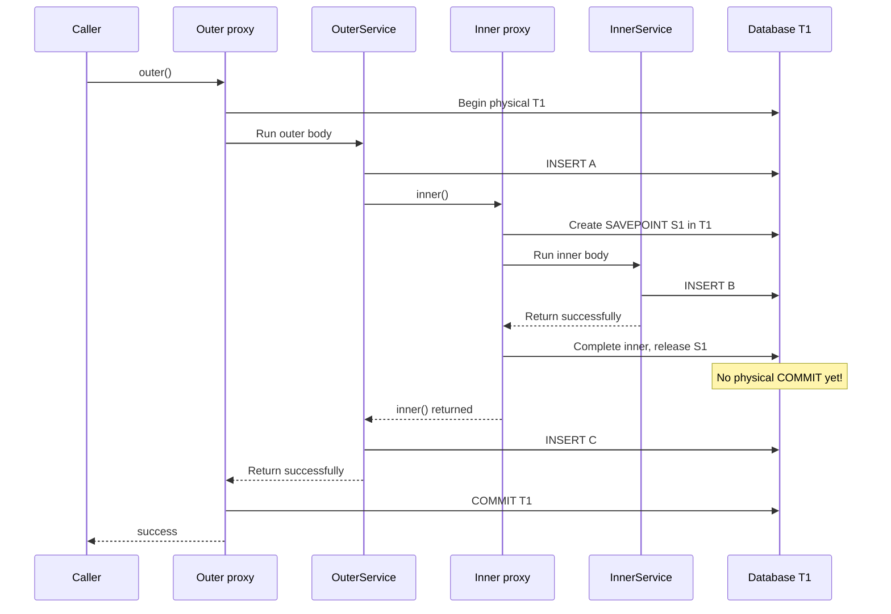

# Nested Scope Commit Is Not an Independent Commit — NESTED and Savepoints in Spring

## 1. Core Conclusion

In Spring transaction management, `PROPAGATION_NESTED` allows a child invocation to have **its own logical transaction scope** and a **savepoint** inside an **existing physical transaction**. When the child invocation succeeds, Spring can complete the nested scope and release the savepoint. However:

> **Committing a nested `NESTED` scope is not an independent database COMMIT. If the outer transaction rolls back later, all changes from the nested scope — even though it returned successfully — still roll back with it.**

This is the exact meaning of "Nested scope commit is not an independent commit."

- **Inner succeeds, outer commits:** changes from both outer and inner commit together at the end.
- **Inner fails, rolls back to savepoint; outer still commits:** changes after the savepoint inside inner are undone, while outer can continue and commit valid operations.
- **Inner succeeds, outer rolls back:** changes from **both outer and inner** are undone; a successful inner cannot "resist" an outer rollback.
- **Inner `NESTED` is called with no outer transaction:** there is no physical transaction in which to create a savepoint; `NESTED` typically starts a new physical transaction, and in that case this scope is the owner of commit/rollback.

This article applies primarily to **imperative Spring Framework 6.x + JDBC**, via `DataSourceTransactionManager` or `JdbcTransactionManager` and a driver/database supporting JDBC savepoints. Do not assume identical behavior for JPA, JTA, reactive transactions, or multiple datasources.

## 2. Savepoint, Logical Scope, and Physical Transaction

### 2.1. A Physical Transaction Is the Database's Real Transaction

A physical JDBC transaction is bound to the connection/resource managed by the transaction manager. Conceptually:

```sql
BEGIN;
INSERT INTO orders (id) VALUES (101);
-- other operations
COMMIT;
```

The final `COMMIT` makes all successful changes of this transaction durable according to database rules. `ROLLBACK` of the transaction discards uncommitted changes.

In Spring JDBC, the transaction manager typically manipulates `Connection.setAutoCommit(false)` and completes via `Connection.commit()` or `Connection.rollback()`. The system does not necessarily emit a literal `BEGIN` SQL statement on every driver; the SQL snippet above is only a conceptual diagram.

### 2.2. A Savepoint Is a Marker for Partial Undo

A savepoint marks a position between statements of the **same physical transaction**.

```sql
BEGIN;
INSERT INTO log_entry(id, label) VALUES (1, 'outer-before');

SAVEPOINT nested_point;
INSERT INTO log_entry(id, label) VALUES (2, 'inner');
ROLLBACK TO SAVEPOINT nested_point;

INSERT INTO log_entry(id, label) VALUES (3, 'outer-after');
COMMIT;
```

Logical outcome: rows 1 and 3 can be committed; row 2 is undone back to the savepoint. A savepoint does **not** create a separate physical transaction; there is no dedicated connection or independent `COMMIT` for row 2.

Another snippet:

```sql
BEGIN;
INSERT INTO log_entry(id, label) VALUES (4, 'outer');

SAVEPOINT nested_point;
INSERT INTO log_entry(id, label) VALUES (5, 'inner');
RELEASE SAVEPOINT nested_point;

ROLLBACK;
```

Both row 4 **and row 5 disappear**. `RELEASE SAVEPOINT` only drops the savepoint marker; it is **not** equivalent to `COMMIT`. Syntax and `RELEASE SAVEPOINT` capabilities vary across databases; the transactional meaning illustrated is what matters.

### 2.3. Two Logical Scopes Sharing One Physical Transaction

Suppose Spring intercepts calls as follows:

```text
CheckoutService.checkout()         @Transactional(REQUIRED)
  ├── INSERT outer
  ├── AuditService.writeAttempt()  @Transactional(NESTED)
  │     └── INSERT inner
  └── subsequent outer INSERT
```

If the two services are two Spring beans sharing the same datasource/transaction manager and inner is invoked **through a proxy**:

- `checkout()` creates logical scope **L1** and, when no prior transaction exists, opens physical transaction **T1**.
- `writeAttempt()` creates logical scope **L2**, without opening T2; Spring establishes savepoint **S1** inside T1.
- Inner succeeds: L2 completes, and S1 is released when JDBC/manager capabilities allow. **T1 remains open**.
- Outer ultimately decides whether to COMMIT or ROLLBACK T1.

You must distinguish three actions: **Java method returning**, **completing a logical transaction scope**, and **committing the physical transaction**. They can happen at different times.

## 3. Timeline: Inner "Commits" First, Outer Makes the Final Decision



In the case above, rows A/B/C are committed **together** in T1. If outer instead throws an exception causing a rollback rather than returning normally, row B is still rolled back even though inner previously "committed its scope."

### 3.1. Why Does Spring Still Use the Word Commit When Completing Inner?

Spring's unified API is `PlatformTransactionManager.commit(TransactionStatus)`. The interceptor can call `commit(status)` for the logical inner scope. However, a `TransactionStatus` created for a participating nested transaction **has a savepoint** and **does not own a new physical transaction**. Upon normal completion, the transaction manager can handle this by **releasing the savepoint**, without calling physical `Connection.commit()`.

That is why reading a log like "Initiating transaction commit" or seeing the inner interceptor finish is **not enough** to conclude data is durable. You must know whether the status owns a physical transaction or merely holds a savepoint.

### 3.2. What If Inner Rolls Back?

```mermaid
sequenceDiagram
    participant OP as OuterService
    participant IP as Inner proxy
    participant DB as Database T1
    OP->>DB: INSERT outer-A
    OP->>IP: inner()
    IP->>DB: SAVEPOINT S1
    IP->>DB: INSERT inner-B
    IP-->>IP: RuntimeException or rollback-only
    IP->>DB: ROLLBACK TO SAVEPOINT S1
    IP-->>OP: Rethrow exception / return per policy
    Note over OP: Outer handles situation appropriately
    OP->>DB: INSERT outer-C
    OP->>DB: COMMIT T1
    Note over DB: A and C exist; B does not exist
```

Rolling back to S1 is permitted to **keep T1 going**, provided the database/transaction remains valid. This differs from `REQUIRED`: a `REQUIRED` inner does not inherently have a savepoint for partial rollback; rollback-only on a participating inner can render all of T1 uncommittable.

### 3.3. An Important Exception: Errors That Break the Physical Transaction

A savepoint is not "insurance" against every error. If the database marks the entire transaction aborted, the connection breaks, the transaction timeout expires, or another error renders the transaction unable to continue, outer **cannot simply roll back to a savepoint and guarantee a commit**. Behavior depends on the DB, driver, and error type.

For example, PostgreSQL requires rolling back to an appropriate savepoint after certain SQL errors to restore a state where subsequent statements can run; if an error is severe or the transaction was marked globally rollback-only by another mechanism, a savepoint does not automatically restore committability. Always test on the corresponding production database.

## 4. How Is PROPAGATION_NESTED Implemented by Spring?

`Propagation.NESTED` belongs to Spring:

```java
import org.springframework.transaction.annotation.Propagation;
import org.springframework.transaction.annotation.Transactional;
```

Declaration:

```java
@Transactional(propagation = Propagation.NESTED)
public void performOptionalStep() {
    // JDBC statements using the matching datasource/manager.
}
```

If an existing transaction T1 is present and the manager supports nested savepoints, Spring creates **a nested logical scope with a savepoint**. If no T1 exists, it creates a new physical transaction as a top-level boundary.

Practical conditions:

1. The bean has transactional advice and the method is invoked through a proxy or equivalent mechanism.
2. Outer T1 and inner scope use the same **transaction manager/physical datasource**.
3. The manager allows nested transactions.
4. The JDBC driver/database supports savepoints for the active transaction type.
5. DML executes through the resource/connection participating in T1.

`DataSourceTransactionManager` supports JDBC savepoints and `nestedTransactionAllowed` typically defaults to **true**. `JdbcTransactionManager` is a compatible subclass extension (adding exception translation). Yet not every `PlatformTransactionManager` supports nested transactions the same way.

If the transaction manager does not support nested propagation/savepoints, Spring may throw `NestedTransactionNotSupportedException` or a related resource exception. Do not write code assuming "NESTED always works" solely from the annotation.

### 4.1. Distinguishing Spring Nested from True Physical DB Nested Transactions

SQL engines do not necessarily support true nested physical transactions. `NESTED` in Spring JDBC is typically **simulated using savepoints on the same physical transaction**, not "BEGIN T2, COMMIT T2" while T1 remains open.

A savepoint is a **partial undo** tool, not a durable partial commit mechanism.

### 4.2. Difference When There Is No Outer Transaction

If a caller directly invokes a `@Transactional(NESTED)` method from outside when no transaction exists, there is no marker inside T1 to create. Spring opens a new physical transaction for this method, and it **can commit immediately when the method returns normally**, because at that point the method itself owns the physical transaction.

Therefore, the statement "inner NESTED does not commit independently" must always be understood in the **context of an outer physical transaction in which inner is participating**. Without an outer T1, a top-level `NESTED` call can commit because it is the outermost physical transaction itself, not because a savepoint committed.

## 5. Model Illustrating Four Execution Paths

Suppose T1 contains these statements:

```text
BEGIN T1
  INSERT outer-before
  SAVEPOINT S1
    INSERT inner
  END INNER
  INSERT outer-after
END OUTER
```

| Scenario | Inner outcome | Outer outcome | DB state after T1 |
| --- | --- | --- | --- |
| A: all steps succeed | Release S1, no physical commit yet | Commit T1 | outer-before, inner, outer-after |
| B: inner fails, outer handles and continues | Rollback to S1 | Commit T1 | outer-before, outer-after |
| C: inner succeeds, outer fails | Release S1 | Rollback T1 | No rows from T1 |
| D: inner fails, outer also fails | Rollback to S1 | Rollback T1 | No rows from T1 |

In scenario B, outer must **handle the exception right after the inner proxy has rolled back to the savepoint**. If outer catches the exception inside the very same method without an intercepted nested scope, no savepoint is automatically created by Spring to roll back to.

### 5.1. When Inner Returns Normally Yet Business Outcome Is a Failure

```java
@Transactional(propagation = Propagation.NESTED)
public Decision reserve() {
    jdbc.update("UPDATE inventory SET quantity=quantity-1 WHERE id=1");
    return Decision.rejected();
}
```

This snippet assumes existing `JdbcTemplate` and `Decision`. With a normal custom `Decision`, Spring **does not automatically know** that a `rejected` value means rollback. Inner is treated as completing normally; the savepoint may be released, and if outer commits afterward, inner's SQL is committed too.

If the API intentionally returns a failure as data while still needing inner rolled back, inner must **mark rollback-only on the right scope** or use an explicit transaction API:

```java
@Transactional(propagation = Propagation.NESTED)
public Decision reserve() {
    jdbc.update("UPDATE inventory SET quantity=quantity-1 WHERE id=1");
    TransactionAspectSupport.currentTransactionStatus()
            .setRollbackOnly();
    return Decision.rejected();
}
```

This snippet needs the `TransactionAspectSupport` import and an actual call through the transactional interceptor. When the status belongs to a **nested scope with a savepoint**, the manager can roll back the child scope to the savepoint upon completion. Do not confuse it with marking global rollback-only directly on the resource, because a global rollback-only mark can prevent all of T1 from committing.

Test this path with the exact manager, driver, and transaction context; if inner is just a `this.reserve()` call bypassing the proxy, there is no automatic savepoint scope.

## 6. Runnable Java 17 Example: Nested Success, Inner Rollback, Outer Rollback

This example runs with Java 17+, Maven, **Spring Framework 6.2.19**, and **H2 2.3.232**. It uses `DataSourceTransactionManager` and `JdbcTemplate` on the same datasource.

Four scenarios run sequentially:

1. Outer + nested both succeed; outer commits both.
2. Nested throws an unchecked exception; Spring rolls back to the savepoint; outer catches the exception **outside the inner interceptor**, continues, and commits the remainder.
3. Nested succeeds, yet outer throws an unchecked exception; outer rolls back, including the nested part that had succeeded.
4. Calling the nested method as a standalone entry point when **no outer transaction exists**; it starts a new physical transaction and commits upon completion.

### 6.1. Project Structure

```text
nested-savepoint-demo/
├── pom.xml
└── src/main/java/demo/tx/NestedSavepointDemo.java
```

### 6.2. pom.xml

```xml
<project xmlns="http://maven.apache.org/POM/4.0.0"
         xmlns:xsi="http://www.w3.org/2001/XMLSchema-instance"
         xsi:schemaLocation="http://maven.apache.org/POM/4.0.0
                             https://maven.apache.org/xsd/maven-4.0.0.xsd">
    <modelVersion>4.0.0</modelVersion>
    <groupId>demo</groupId>
    <artifactId>nested-savepoint-demo</artifactId>
    <version>1.0.0</version>
    <properties>
        <maven.compiler.release>17</maven.compiler.release>
        <project.build.sourceEncoding>UTF-8</project.build.sourceEncoding>
    </properties>
    <dependencies>
        <dependency>
            <groupId>org.springframework</groupId>
            <artifactId>spring-context</artifactId>
            <version>6.2.19</version>
        </dependency>
        <dependency>
            <groupId>org.springframework</groupId>
            <artifactId>spring-jdbc</artifactId>
            <version>6.2.19</version>
        </dependency>
        <dependency>
            <groupId>com.h2database</groupId>
            <artifactId>h2</artifactId>
            <version>2.3.232</version>
        </dependency>
    </dependencies>
    <build>
        <plugins>
            <plugin>
                <groupId>org.apache.maven.plugins</groupId>
                <artifactId>maven-compiler-plugin</artifactId>
                <version>3.13.0</version>
            </plugin>
            <plugin>
                <groupId>org.codehaus.mojo</groupId>
                <artifactId>exec-maven-plugin</artifactId>
                <version>3.5.1</version>
            </plugin>
        </plugins>
    </build>
</project>
```

### 6.3. src/main/java/demo/tx/NestedSavepointDemo.java

```java
package demo.tx;

import java.util.List;
import javax.sql.DataSource;

import org.springframework.context.annotation.AnnotationConfigApplicationContext;
import org.springframework.context.annotation.Bean;
import org.springframework.context.annotation.Configuration;
import org.springframework.jdbc.core.JdbcTemplate;
import org.springframework.jdbc.datasource.DataSourceTransactionManager;
import org.springframework.jdbc.datasource.DriverManagerDataSource;
import org.springframework.transaction.PlatformTransactionManager;
import org.springframework.transaction.annotation.EnableTransactionManagement;
import org.springframework.transaction.annotation.Propagation;
import org.springframework.transaction.annotation.Transactional;
import org.springframework.transaction.interceptor.TransactionAspectSupport;
import org.springframework.transaction.support.TransactionSynchronizationManager;

public final class NestedSavepointDemo {
    public static void main(String[] args) {
        try (var ctx = new AnnotationConfigApplicationContext(Config.class)) {
            JdbcTemplate jdbc = ctx.getBean(JdbcTemplate.class);
            OuterService outer = ctx.getBean(OuterService.class);
            InnerService inner = ctx.getBean(InnerService.class);

            jdbc.execute("CREATE TABLE log_entry (" +
                    "id INT PRIMARY KEY, label VARCHAR(60) NOT NULL)");

            outer.success();
            System.out.println("after success=" + labels(jdbc));

            outer.recoverInnerFailure();
            System.out.println("after recover=" + labels(jdbc));

            try {
                outer.outerFailureAfterInnerSuccess();
            } catch (IllegalStateException ex) {
                System.out.println("caught outer=" + ex.getMessage());
            }
            System.out.println("after outer rollback=" + labels(jdbc));

            inner.append(9, "top-level-nested", false);
            System.out.println("after top-level=" + labels(jdbc));
        }
    }

    private static List<String> labels(JdbcTemplate jdbc) {
        return jdbc.queryForList(
                "SELECT label FROM log_entry ORDER BY id", String.class);
    }

    private static void trace(String label) {
        var status = TransactionAspectSupport.currentTransactionStatus();
        boolean active =
                TransactionSynchronizationManager.isActualTransactionActive();
        System.out.println(label + ": active=" + active
                + ", new=" + status.isNewTransaction()
                + ", savepoint=" + status.hasSavepoint());
    }

    @Configuration(proxyBeanMethods = false)
    @EnableTransactionManagement(proxyTargetClass = true)
    public static class Config {
        @Bean
        public DataSource dataSource() {
            return new DriverManagerDataSource(
                    "jdbc:h2:mem:nested_demo;DB_CLOSE_DELAY=-1", "sa", "");
        }

        @Bean
        public PlatformTransactionManager transactionManager(DataSource dataSource) {
            return new DataSourceTransactionManager(dataSource);
        }

        @Bean
        public JdbcTemplate jdbcTemplate(DataSource dataSource) {
            return new JdbcTemplate(dataSource);
        }

        @Bean
        public InnerService innerService(JdbcTemplate jdbc) {
            return new InnerService(jdbc);
        }

        @Bean
        public OuterService outerService(JdbcTemplate jdbc, InnerService inner) {
            return new OuterService(jdbc, inner);
        }
    }

    public static class InnerService {
        private final JdbcTemplate jdbc;

        public InnerService(JdbcTemplate jdbc) {
            this.jdbc = jdbc;
        }

        @Transactional(propagation = Propagation.NESTED)
        public void append(int id, String label, boolean fail) {
            trace("inner " + label);
            jdbc.update("INSERT INTO log_entry (id, label) VALUES (?, ?)",
                    id, label);
            if (fail) {
                throw new IllegalStateException("INNER_REJECTED");
            }
        }
    }

    public static class OuterService {
        private final JdbcTemplate jdbc;
        private final InnerService inner;

        public OuterService(JdbcTemplate jdbc, InnerService inner) {
            this.jdbc = jdbc;
            this.inner = inner;
        }

        @Transactional
        public void success() {
            trace("outer success");
            put(1, "outer-start");
            inner.append(2, "nested-accepted", false);
            put(3, "outer-end");
        }

        @Transactional
        public void recoverInnerFailure() {
            trace("outer recover");
            put(4, "outer-before");
            try {
                inner.append(5, "nested-discarded", true);
            } catch (IllegalStateException ex) {
                System.out.println("caught inner=" + ex.getMessage());
            }
            put(6, "outer-after");
        }

        @Transactional
        public void outerFailureAfterInnerSuccess() {
            trace("outer cancel");
            put(7, "outer-will-rollback");
            inner.append(8, "nested-will-rollback", false);
            throw new IllegalStateException("OUTER_CANCELLED");
        }

        private void put(int id, String label) {
            jdbc.update("INSERT INTO log_entry (id, label) VALUES (?, ?)",
                    id, label);
        }
    }
}
```

### 6.4. Run Command

Install JDK 17+ and Maven; inside the `nested-savepoint-demo` directory:

```bash
mvn -q compile exec:java -Dexec.mainClass=demo.tx.NestedSavepointDemo
```

**Lines printed by the program** (excluding Maven or Spring's own logs):

```text
outer success: active=true, new=true, savepoint=false
inner nested-accepted: active=true, new=false, savepoint=true
after success=[outer-start, nested-accepted, outer-end]
outer recover: active=true, new=true, savepoint=false
inner nested-discarded: active=true, new=false, savepoint=true
caught inner=INNER_REJECTED
after recover=[outer-start, nested-accepted, outer-end, outer-before, outer-after]
outer cancel: active=true, new=true, savepoint=false
inner nested-will-rollback: active=true, new=false, savepoint=true
caught outer=OUTER_CANCELLED
after outer rollback=[outer-start, nested-accepted, outer-end, outer-before, outer-after]
inner top-level-nested: active=true, new=true, savepoint=false
after top-level=[outer-start, nested-accepted, outer-end, outer-before, outer-after, top-level-nested]
```

### 6.5. Explaining Each Section

**A. Inner success does not commit separately**

In `success()`, outer opens T1: `new=true, savepoint=false`. Inner `append()` receives status `new=false, savepoint=true`: it uses a savepoint inside T1 without creating physical T2. When inner returns, the savepoint finishes yet data is not durable. Outer returns and COMMITs T1: all three rows `outer-start`, `nested-accepted`, and `outer-end` appear together.

**B. Inner rolls back to savepoint, outer still commits**

In `recoverInnerFailure()`, outer starts T2 and inserts `outer-before`. Inner creates S2, inserts `nested-discarded`, then throws an unchecked exception. Inner's transaction interceptor rolls back to S2 **before** the exception reaches outer's catch. Outer catches the exception to intentionally take the continuation path, inserts `outer-after`, and COMMITs T2. The result has the two outer rows, **without `nested-discarded`**.

This is not guaranteed for every DB error and every manager; it holds in the example with H2/JDBC savepoint support.

**C. Inner succeeds, yet outer rolls back**

In `outerFailureAfterInnerSuccess()`, outer opens T3 and inserts `outer-will-rollback`. Inner creates S3, inserts `nested-will-rollback`, and finishes normally. Then outer throws `OUTER_CANCELLED`. Outer's transaction interceptor rolls back **all of T3**, leaving neither row 7 nor row 8 in the table. This is direct proof that **inner success / inner commit scope is not an independent commit**.

**D. NESTED as an entry point with no outer transaction**

Finally, `inner.append(9, ...)` is called from main via proxy when no T1/T2/T3 remains. Because there is no physical transaction to join, `NESTED` opens a new transaction; status is `new=true, savepoint=false`. When the method succeeds, this transaction commits and row `top-level-nested` appears. This case **does not contradict** the rule that a participating nested scope does not commit independently.

### 6.6. Why Is This Example Sufficient to Verify?

- The two classes `OuterService` and `InnerService` are managed by the Spring container; neither is instantiated directly with `new` from main bypassing transactions.
- The outer → inner call goes through an injected bean, so the Spring proxy can intercept the inner method.
- Both use the same `JdbcTemplate`, datasource, and `DataSourceTransactionManager`.
- `TransactionAspectSupport.currentTransactionStatus()` provides the current invocation's status. `hasSavepoint()` is checked to **distinguish a nested scope from a new transaction**.
- The H2 database is read **after each outer method finishes**: the output reflects actual commits/rollbacks, not just inferences from annotations.

The sample above is a standalone runnable project per the stated dependencies, though results still depend on the actual build/runtime; if testing on another database, check driver savepoint support and transaction manager behavior.

## 7. When Inner NESTED Completes Before Outer Commits

### 7.1. Child Method Returning Does Not Mean Durable

```java
@Transactional
public void outer() {
    nestedService.inner();
    // inner has returned, physical COMMIT has not happened yet.
    throw new IllegalStateException("CANCEL");
}
```

This is a snippet assuming `nestedService.inner()` is intercepted and uses `NESTED` with JDBC savepoints. Outer throws an unchecked exception: T1 rolls back, including changes made by inner.

Do not rely on the following signals as proof of commit:

- The inner method returns an entity with an id.
- The inner method throws no exception.
- `JdbcTemplate.update` returns an updated row count greater than 0.
- A JPA entity was `flush`ed or a query inside the same T1 sees the row.
- Logs print "nested commit" or "releasing savepoint."
- A SELECT on the **same transaction-bound connection** sees the data.

To verify durability, check **after the outer physical transaction has ended successfully**, ideally reading from an independent transaction/connection with appropriate isolation.

### 7.2. Releasing a Savepoint Does Not Mean Locks Are Released

Locks acquired during T1 typically follow **physical transaction** and database engine rules. `RELEASE SAVEPOINT` may drop the management marker, but **it does not mean** locks, database sessions, or outer resources are released as after a T1 COMMIT. Some DBs have specific rules when rolling back to a savepoint; do not generalize lock lifetimes across all databases.

This is where it differs from `REQUIRES_NEW`: an independent physical transaction T2 can finish and release its own resources before T1 completes.

### 7.3. Transaction Synchronization / afterCommit Is Not a Savepoint Commit

Mechanisms like `TransactionSynchronization.afterCommit()`, post-transaction hooks, and listeners only run after an actual commit if configured for that lifecycle. **Do not treat releasing a nested scope's savepoint as a physical commit event** to emit durable side effects.

When you need to publish an event after the parent transaction truly commits, design transaction synchronization/outbox around the physical boundary; verify callback behavior per Spring version and registration method. Spring 6.2 includes savepoint callback APIs in `TransactionSynchronization` for advanced cases, yet a savepoint callback is **not** a signal that data has committed.

## 8. Comparing NESTED, REQUIRED, and REQUIRES_NEW

| Property | `REQUIRED` joining outer | `NESTED` joining outer | `REQUIRES_NEW` inside outer |
| --- | --- | --- | --- |
| Physical transaction | Shared T1 | **Shared T1** | **Independent T2** |
| Logical scope | Own scope for intercepted method | Own scope and savepoint | Own scope with new transaction |
| Dedicated rollback point | Does not automatically create savepoint | Has S1 on T1 if supported | Has separate T2 |
| Inner returns normally | Does not commit T1 | **Does not commit T1**, may release S1 | Can commit **T2** immediately |
| Inner rolls back | Can mark all of T1 rollback-only | Can roll back to S1 and continue T1 | Rolls back T2; T1 is not marked rollback-only solely by this |
| Outer rolls back after inner success | All inner changes lost | **All inner changes lost** | Already-committed T2 can still persist |
| Separate physical isolation/timeout | No when joining | No when joining T1 | Can have its own policy on T2 |
| Resource | Usually same transaction-bound connection | Same connection, using JDBC savepoint | May require a second connection |
| Support | Broad with appropriate transaction manager | Depends on savepoint/manager | Depends on manager/resource and pool |

Read this table under the exact condition: outer already has physical T1 and the call to inner is intercepted by Spring transaction infrastructure.

### 8.1. When Should You Choose NESTED?

Choose `NESTED` when the application wants to **undo an optional step** while preserving one overall physical transaction, for example writing a batch where one item can fail while the rest remain valid under business invariants.

However, "continuing after partial failure" must be intentionally designed. If the business requires **all operations to succeed or fail together**, rolling back one part and committing outer can violate requirements. `REQUIRED` or a simpler transaction boundary may be appropriate.

### 8.2. When You Truly Need an Independent Commit

If an audit record must commit even when outer rolls back, a savepoint **does not satisfy** the requirement. Consider a public method on another bean with:

```java
@Transactional(propagation = Propagation.REQUIRES_NEW)
public void saveAudit() {
    // Writes in an independent physical transaction if intercepted.
}
```

`REQUIRES_NEW` can suspend T1, open T2, and commit T2 before outer T1 continues. That carries consequences for ordering, consistency, connection pool usage, deadlocks, and independent rollback; it is not just changing one word in an annotation.

If you need to publish messages alongside database state, consider a transactional outbox/saga rather than expecting a JDBC savepoint to commit a message broker.

## 9. Limitations Regarding JDBC, JPA, JTA, and Databases

### 9.1. JDBC: Savepoint Is the Best-Fitting Mechanism

`DataSourceTransactionManager` and `JdbcTransactionManager` are typically the right choice for JDBC savepoint use cases on **one datasource**. The driver must report savepoint support and transactions must be genuinely managed (not independent auto-commit connections opened manually by code).

At low-level JDBC:

```java
Connection con = DataSourceUtils.getConnection(dataSource);
Savepoint point = con.setSavepoint("optional");
try {
    // JDBC operations using the same connection
    con.releaseSavepoint(point);
} catch (SQLException ex) {
    con.rollback(point);
    throw ex;
}
```

**This is an illustrative fragment, not a pattern to copy into a `@Transactional` service.** It needs imports for `Connection`, `Savepoint`, `SQLException`, `DataSourceUtils`, a datasource, and proper lifecycle management; manipulating savepoints/connections directly can conflict with the transaction manager if done carelessly. In Spring, prefer `@Transactional(NESTED)` or `TransactionTemplate` when the manager supports it.

### 9.2. JPA Is Not Like JDBC Savepoints

`JpaTransactionManager` does not provide an out-of-the-box `PROPAGATION_NESTED` equivalent to JDBC savepoints for entity changes. Even when configured to allow JDBC savepoints, they apply mainly to the underlying JDBC connection; **the JPA first-level cache/persistence context does not automatically revert to its old state** after a rollback to a JDBC savepoint. In-memory entities can diverge from the DB.

Do not use NESTED on a JPA service and assume every entity change already `persist`ed, `flush`ed, or dirty-checked will be managed cleanly like a nested JDBC transaction. Verify the specific manager, mixed JDBC/JPA conditions, caching, and integration tests on the real provider/database. If partial failure is needed across JPA aggregates, redesigning boundaries and invariants is often required instead of relying on savepoints.

### 9.3. JTA/Distributed Transactions Do Not Imply Savepoints

`JtaTransactionManager` coordinates transactions via the corresponding JTA/XA mechanism and does not implicitly allow SQL savepoints and child rollbacks like `DataSourceTransactionManager`. NESTED may not be supported; check the exact manager, datasource/driver, and documentation. Do not assume an annotation turns a multi-resource transaction into a standard JDBC savepoint system.

### 9.4. Resources Outside the Database Are Still Not Undone

If a nested method already sent an email, called a payment gateway, or published a message, rolling back to a savepoint **does not recall** effects in external systems. Even a full outer rollback does not automatically undo side effects not managed by the transaction manager.

To keep the system consistent across distributed effects, you need idempotency, a transactional outbox, retries, or domain-appropriate compensation.

### 9.5. Timeout, Isolation, and readOnly Belong to the Physical Transaction

Inner `NESTED` has its own logical metadata yet still runs on T1. Do not expect to change T1's physical isolation/timeout merely via `@Transactional(isolation = ...)` on the nested method:

```java
@Transactional(isolation = Isolation.READ_COMMITTED, timeout = 30)
public void outer() {
    nested.inner();
}

@Transactional(
        propagation = Propagation.NESTED,
        isolation = Isolation.SERIALIZABLE,
        timeout = 5)
public void inner() {
    // A separate physical T2 is not created solely due to a different policy.
}
```

These are two illustrative methods on two beans, requiring imports and wiring. Which policies are validated/enforced when joining depends on the manager; some transaction managers support `validateExistingTransaction`. A savepoint does not create a new independent isolation/timeout set on the same JDBC connection.

## 10. Programming Mistakes That Create the Illusion of NESTED

### 10.1. Self-Invocation Bypasses the Spring Proxy

```java
@Service
public class CheckoutService {
    @Transactional
    public void checkout() {
        this.optionalStep(); // Bypasses proxy.
    }

    @Transactional(propagation = Propagation.NESTED)
    public void optionalStep() {
        // NESTED metadata is not automatically advised on this call.
    }
}
```

In Spring proxy mode, `this.optionalStep()` calls directly on the target object. It may still run inside physical T1 opened by `checkout()`, yet **no nested scope/savepoint is automatically created by the inner annotation**. If inner throws an unchecked exception and outer catches it inside the same method, you cannot assume inner's SQL was rolled back to a savepoint.

The fix is moving inner to another injected bean and calling via proxy, or using `TransactionTemplate` with NESTED propagation.

### 10.2. Private/Final/Static Methods Do Not Fit Class Proxy Boundaries

Private methods cannot be overridden/advised by class-based proxies; final methods cannot be overridden either; static calls do not go through a proxy instance. JDK interface proxies can intercept public interface methods even if the target implementation is final in matching setups, yet you should **not** rely on that quirk to construct ambiguous nested boundaries.

The predictable approach: public non-final methods on a Spring-managed service, invoked from another bean via proxy. If classes are forced final (e.g., Kotlin), check proxy generation and the corresponding all-open plugin.

### 10.3. Same Annotation, Wrong Transaction Manager

Suppose outer uses `ordersTxManager` for datasource A; inner uses `reportingTxManager` for datasource B. Two managers do not merge into one physical T1 simply because their propagation annotations match. A nested savepoint must belong to the **same actual resource**.

With multiple managers, annotate explicitly:

```java
@Transactional(transactionManager = "ordersTxManager",
               propagation = Propagation.NESTED)
public void optionalDbStep() {
    // Must use the datasource belonging to ordersTxManager.
}
```

### 10.4. Thinking a Caught Exception Rolled Back the Savepoint

If an exception is **caught inside the inner method** before exiting the interceptor, and the method returns normally, Spring usually treats the nested scope as successful. The savepoint may be released even though side effects occurred. To roll back, let the exception exit the inner boundary, call `currentTransactionStatus().setRollbackOnly()` on the right scope, or use programmatic transaction status.

### 10.5. Using SQL DDL and Expecting Savepoints to Act Like DML

Some databases perform an implicit commit before/after DDL or restrict DDL rollback. Therefore, partial rollback designs should rely on DML and be verified on the real engine. A savepoint cannot undo data already committed due to database behavior.

## 11. Programmatic NESTED with TransactionTemplate

`TransactionTemplate` can establish a clear nested scope without relying on Spring AOP interception on an inner method.

```java
import org.springframework.transaction.PlatformTransactionManager;
import org.springframework.transaction.TransactionDefinition;
import org.springframework.transaction.support.TransactionTemplate;

public final class NestedTemplateExample {
    public static void run(PlatformTransactionManager manager) {
        TransactionTemplate outer = new TransactionTemplate(manager);
        outer.setPropagationBehavior(
                TransactionDefinition.PROPAGATION_REQUIRED);

        TransactionTemplate nested = new TransactionTemplate(manager);
        nested.setPropagationBehavior(
                TransactionDefinition.PROPAGATION_NESTED);

        outer.executeWithoutResult(outerStatus -> {
            System.out.println("outer new="
                    + outerStatus.isNewTransaction());

            nested.executeWithoutResult(innerStatus -> {
                System.out.println("inner new="
                        + innerStatus.isNewTransaction()
                        + ", savepoint=" + innerStatus.hasSavepoint());
            });
        });
    }
}
```

This is a syntactically complete Java class without its own `main` or manager bean; call `run(manager)` inside a Spring context configured with the right JDBC transaction manager and datasource. With a local JDBC manager and no prior transaction, expected output is:

```text
outer new=true
inner new=false, savepoint=true
```

When the inner callback returns, `TransactionTemplate` completes the nested scope and can release the savepoint. At the end of the outer callback, if there are no errors or rollback-only flags, the outer `TransactionTemplate` commits the physical transaction. If the inner callback sets `innerStatus.setRollbackOnly()`, the transaction manager can roll back to the savepoint while outer continues, depending on resource state.

This approach is useful when helpers are private or dynamic programmatic boundaries are needed. However, do not mix `TransactionTemplate` with declarative transactions arbitrarily: they can join each other if sharing manager/propagation, so you must understand ownership and rollback semantics.

## 12. Essential Test Suite to Distinguish "Inner Success" from "Durable Commit"

### Test 1 — Inner Succeeds, Outer Commits

- Arrange: create a test table and two Spring beans sharing a manager/datasource.
- Act: outer INSERT A → inner NESTED INSERT B → outer INSERT C → return normally.
- Assert: after outer commits, A/B/C all exist.
- Observe status: inner typically has `isNewTransaction=false` and `hasSavepoint=true`.

### Test 2 — Inner Rolls Back to Savepoint, Outer Commits

- Act: outer INSERT A → inner NESTED INSERT B then throw RuntimeException → outer catches exception after inner proxy handles it → outer INSERT C.
- Assert: A/C exist, B does not exist.
- If B still exists, check for self-invocation, wrong manager, or exception caught inside inner.

### Test 3 — Inner Succeeds, Outer Rolls Back

- Act: outer INSERT A → inner NESTED INSERT B succeeds → outer throws RuntimeException.
- Assert: **neither A nor B exists** after outer rollback.
- This is the single most important test to refute the assumption that "nested commit is an independent commit."

### Test 4 — Inner Returns Failure Value Normally

- Act: inner writes to DB and returns `Result.failure(...)` without throwing an exception or marking rollback-only.
- Assert: if outer commits, inner's changes can still persist.
- Then test a `setRollbackOnly()` variant at that same nested invocation to compare.

### Test 5 — NESTED as Top-Level Entry

- Act: call inner NESTED via proxy from a caller with no transaction.
- Assert: `isNewTransaction=true`, typically `hasSavepoint=false`; inner owns a physical transaction and commits on success.

### Test 6 — Unsupported Manager/Driver

- Configure a manager or datasource that does not support savepoints.
- Assert: the application must not silently claim partial rollback succeeded; handle `NestedTransactionNotSupportedException`/specific error.
- Do not "fix" it by blindly switching to `REQUIRES_NEW`: business semantics differ completely.

### Test 7 — Concurrency and Side Effects

- Use a real database to check locks, unique constraints, timeouts, and savepoint rollback behavior.
- If inner calls HTTP/email/broker, explicitly verify side effects are not undone by a savepoint.
- If code uses ORM/JPA, check persistence-context state after savepoint rollback, not just SQL state.

**Spring Test note:** a test method itself annotated with `@Transactional` normally runs inside a transaction opened by the test framework and rolled back at test end. When used that way, a `NESTED` service may join the **test transaction** rather than opening a production-like transaction at the service entry point. To test real physical commits, use tests without an outer test transaction or explicitly drive `TestTransaction` and read data after the boundary.

## 13. Design Decision Matrix

| Business Requirement | Potentially Suitable Choice | Why |
| --- | --- | --- |
| All changes must be all-or-nothing | One shared `REQUIRED` boundary | Simpler, rolls back everything on error. |
| An optional step may roll back alone while outer still commits | `NESTED` with JDBC savepoint | Partial rollback within the same T1. |
| Inner must commit and persist even if outer rolls back | `REQUIRES_NEW` or separate-transaction design | Has separate physical T2; NESTED cannot satisfy this. |
| Business requires an audit written after successful commit | Transaction synchronization/outbox | Ties action to physical commit instead of savepoint release. |
| Complex ORM/JPA entity state needs partial rollback | Revisit boundaries / independent transactions / workflow | JDBC savepoints do not automatically roll back persistence context. |
| Batch processes many items, skip failing item | Consider per-item savepoint with JDBC, or split transactions | Must ensure DB/driver support and watch size/locks. |
| Inner has HTTP/payment side effect | Idempotency, compensation, outbox/saga | JDBC savepoint does not undo external systems. |

Choose propagation based on the **degree of independence of commit results**, not merely on the desire to "catch an exception and keep going."

## 14. Self-Check Questions

**Question 1.** Outer T1 calls inner `NESTED`; inner INSERTs and returns normally. Is inner's SQL durable yet?

*Answer:* Not yet. Inner may release the savepoint, while T1's physical COMMIT is still decided by the outer owner.

**Question 2.** Inner NESTED succeeds, then outer throws an unchecked exception. Is inner's data rolled back?

*Answer:* Yes, provided the data resides in uncommitted T1. Outer rolls back physical T1 including inner's changes, even though inner completed its logical scope.

**Question 3.** Inner NESTED throws an unchecked exception and outer catches it after the interceptor rolls back to the savepoint. Can outer commit?

*Answer:* It can if T1 remains valid, has no global rollback-only mark, and business rules allow keeping outer's part. Savepoint rollback only undoes the corresponding segment.

**Question 4.** A `@Transactional(NESTED)` call arrives with no outer transaction: inside which transaction will a savepoint be created?

*Answer:* There is no outer to join; Spring typically opens a new physical transaction. The status is normally a new transaction, not a nested savepoint participating scope.

**Question 5.** If you want inner to commit independently before outer, should you use NESTED?

*Answer:* No. When outer exists, NESTED still uses the same T1. Consider `REQUIRES_NEW` or a separate transaction boundary/architecture.

**Question 6.** What does `hasSavepoint=true` in inner indicate?

*Answer:* The current `TransactionStatus` is associated with a savepoint, typically a nested participating scope in JDBC. It does **not** indicate there is a physical T2 or a separate commit.

**Question 7.** If you catch the exception **inside** inner and return normally, does it automatically roll back to the savepoint?

*Answer:* Not under default rules; the interceptor sees the method complete normally. You must let the exception exit the inner scope or mark valid rollback-only if rollback is desired.

**Question 8.** If inner uses JPA EntityManager and the manager does not support NESTED, can you assume savepoints work just like JDBC?

*Answer:* No. You must verify manager support and persistence context behavior; JDBC savepoints do not automatically sync rollbacks with managed entity state.

**Question 9.** Two methods in the same bean call each other via `this.inner()`, and the inner annotation is NESTED. Is a savepoint automatically created by a proxy?

*Answer:* No in proxy mode; self-invocation bypasses the inner's interceptor. You must call through another Spring bean proxy or use `TransactionTemplate`.

## 15. Summary

1. **NESTED participating in outer = one physical transaction and multiple logical scopes/savepoints.**
2. **Inner scope commit / savepoint release ≠ physical database COMMIT.** When outer rolls back, inner changes still roll back.
3. **Inner rollback-to-savepoint** can undo just the child step and let outer continue, provided the database/transaction remains valid.
4. **Top-level NESTED without outer** can open and commit a new physical transaction, because it is the owner itself.
5. **Only `REQUIRES_NEW` creates a separate physical transaction** when outer exists; it has different costs and semantics from NESTED.
6. **Applies only with real interception and resource support.** For JDBC, same manager/datasource and a savepoint-capable driver are prerequisites; JPA/JTA and external side effects require separate evaluation.
7. **Test using database state after outer finishes**, especially the case of nested success followed by outer rollback. That is the clearest proof that a nested commit is not independent.

## Official References

- [Spring Framework — Transaction Propagation, PROPAGATION_NESTED](https://docs.spring.io/spring-framework/reference/data-access/transaction/declarative/tx-propagation.html)
- [Spring Framework 6.2 — Declarative Transaction Management](https://docs.spring.io/spring-framework/reference/6.2/data-access/transaction/declarative.html)
- [Spring Framework API — DataSourceTransactionManager](https://docs.spring.io/spring-framework/docs/6.2.19/javadoc-api/org/springframework/jdbc/datasource/DataSourceTransactionManager.html)
- [Spring Framework API — JdbcTransactionManager](https://docs.spring.io/spring-framework/docs/6.2.19/javadoc-api/org/springframework/jdbc/support/JdbcTransactionManager.html)
- [Spring Framework API — TransactionStatus](https://docs.spring.io/spring-framework/docs/6.2.19/javadoc-api/org/springframework/transaction/TransactionStatus.html)
- [Spring Framework API — TransactionSynchronization](https://docs.spring.io/spring-framework/docs/6.2.19/javadoc-api/org/springframework/transaction/support/TransactionSynchronization.html)
- [Spring Framework — Programmatic Transaction Management](https://docs.spring.io/spring-framework/reference/data-access/transaction/programmatic.html)
- [JDBC API — Connection.setSavepoint](https://docs.oracle.com/en/java/javase/17/docs/api/java.sql/java/sql/Connection.html#setSavepoint())
