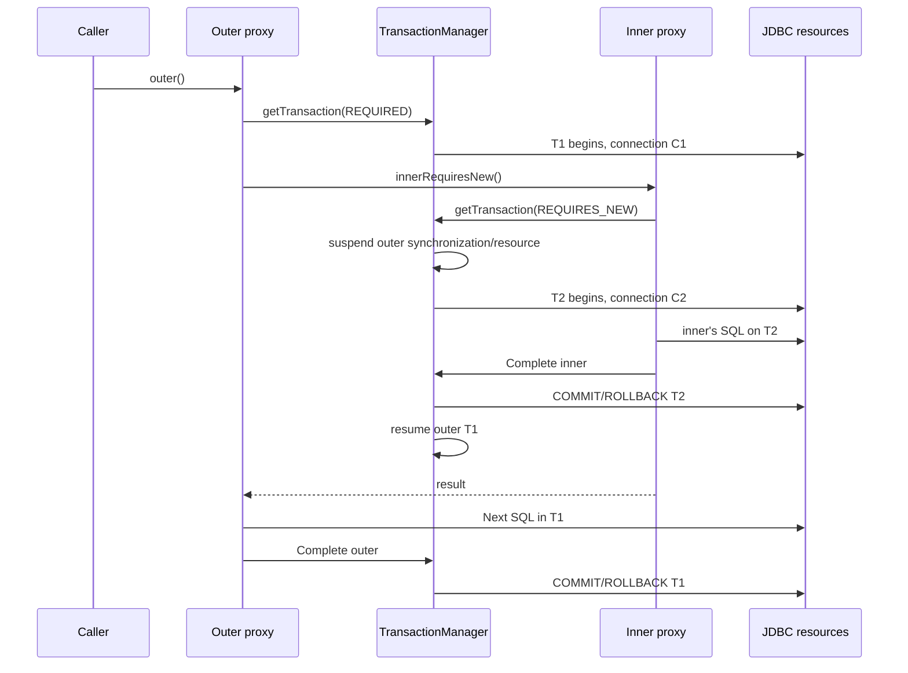

# Suspension Limits by Manager Strategy in Spring Transaction Management

## 1. The core problem

In Spring, `REQUIRES_NEW` and `NOT_SUPPORTED` propagations are often explained with the phrase "Spring suspends the existing transaction". That statement is **accurate regarding propagation intent**, but insufficient to predict runtime behavior: **suspend/resume capability depends on the `PlatformTransactionManager` type, the managed resources, the underlying transaction infrastructure, and whether the call passes through the transaction interceptor**.

Two completely different requirements:

- `REQUIRES_NEW`: suspends the outer transaction (if one exists), starts **a new physical transaction** for the inner scope, then completes inner and restores outer.
- `NOT_SUPPORTED`: suspends the outer transaction (if one exists), runs inner **without an actual transaction managed by that manager**, then restores outer.

Adding the annotation **does not guarantee** that every transaction manager can suspend a physical transaction, nor does it guarantee that all external resources (HTTP, message brokers, multiple datasources, other threads) are simultaneously "paused".

According to the official Javadoc of `Propagation.REQUIRES_NEW` and `Propagation.NOT_SUPPORTED`, **actual transaction suspension does not work out of the box on every transaction manager**. The most notable case is `JtaTransactionManager`: to truly suspend/resume a JTA transaction, Spring must have access to the corresponding `jakarta.transaction.TransactionManager`; having only `UserTransaction` is not enough.

This lesson clearly distinguishes "temporarily unbinding a resource from a thread" from "suspending a JTA transaction", covering the propagation matrix, common transaction managers, configuration mistakes, connection pool limits, and a runnable Java 17/Spring JDBC example.

### Short summary

1. **Propagation is a semantic request; the transaction manager decides how to execute it.**
2. **Local JDBC transactions are usually "suspended" by unbinding the connection holder** from the thread; the outer transaction remains open on the old connection and keeps its associated resources/locks. This is not necessarily a DB `SUSPEND` command.
3. **Actual JTA suspension requires a JTA `TransactionManager`**, not just `UserTransaction`, and is subject to the transaction provider/application server's capabilities.
4. **`NOT_SUPPORTED` does not mean "cannot write/cannot commit".** A JDBC statement executed on an auto-commit connection outside the outer transaction can commit immediately, even if outer rolls back later.
5. **`REQUIRES_NEW` does not join the outer physical transaction.** Inner has an independent transaction, yet may need an extra connection and cause pool exhaustion if misconfigured.
6. **Without an outer transaction, there is nothing to suspend.** The same annotation can run normally without ever taking the suspension path.

## 2. What does "suspend" mean: three layers to distinguish

### 2.1. Transactional invocation in Spring

In proxy mode, `@Transactional` is processed when the call passes through the Spring transaction interceptor:

```java
@Transactional(propagation = Propagation.REQUIRES_NEW)
public void writeAudit() {
    // Method must be called through a Spring proxy for advice to run.
}
```

This is an illustrative snippet; it requires real imports, bean, manager, and DAO. In a valid invocation, Spring broadly performs:

- Reads `TransactionDefinition`/`TransactionAttribute`.
- Selects the transaction manager.
- Checks whether the manager detects a current transaction.
- If propagation requires it, suspends the old context.
- Starts a new transaction or enters a non-transactional scope.
- Runs the body and handles exceptions/rollback rules.
- Completes the inner scope, then **resumes** the old transaction during cleanup if suspension succeeded.

If the method is called via `this.writeAudit()` from the same instance in Spring proxy mode, the inner interceptor typically **does not run**; no new transaction is created and no suspension happens for the inner annotation.

### 2.2. Suspending Spring's resource binding

With imperative transaction managers, `TransactionSynchronizationManager` binds resources and transaction synchronization to **the current thread**. For example, a JDBC manager binds a `ConnectionHolder` keyed by `DataSource`; a JPA manager can bind an `EntityManagerHolder`.

When a local manager supports suspension, it can:

1. Suspend active synchronization.
2. **Unbind** the outer transaction's resource holder from the thread.
3. Store the suspended resources in a holder to resume later.
4. Create/set up the inner context.
5. Finish inner and clean up inner's resources.
6. **Rebind** the outer resource holder, restoring synchronization and transaction metadata.

During this interval, **the outer JDBC transaction is not committed or rolled back just because it was unbound**. Outer's connection can remain open with uncommitted changes and held locks. It is simply temporarily not the connection that `JdbcTemplate`/`DataSourceUtils` on that thread finds through normal binding.

### 2.3. Suspending an actual JTA transaction

In Jakarta Transactions:

- `jakarta.transaction.UserTransaction` provides operations such as `begin`, `commit`, `rollback`, status, and timeout.
- `jakarta.transaction.TransactionManager` additionally provides `suspend()`/`resume(...)` to dissociate/reassociate the JTA transaction with the current thread via the transaction provider.

Because `UserTransaction` **does not** provide `suspend()/resume()`, a `JtaTransactionManager` that only has access to `UserTransaction` can handle basic propagations yet **cannot guarantee `REQUIRES_NEW`/`NOT_SUPPORTED` will suspend an actual JTA transaction**.

Spring can auto-detect a suitable `TransactionManager` via the environment/JNDI or be configured explicitly. Behavior depends on the application server/transaction provider; neither conclude "JTA never supports suspend" nor conclude "merely having JtaTransactionManager guarantees full support".

### 2.4. These layers are not equivalent

| Level | Meaning | Example | Does NOT imply |
| --- | --- | --- | --- |
| Logical transactional scope | Spring switches the transactional context of a method invocation | `@Transactional(REQUIRES_NEW)` through proxy | Does not guarantee a new physical transaction if the manager throws an error. |
| Spring thread-bound resource/synchronization | Unbinds/rebinds outer context on the current thread | `DataSourceTransactionManager.doSuspend/doResume` | Does not issue a universal "pause transaction" command to the database. |
| JTA transaction association | Transaction provider suspends/resumes the JTA transaction from the current thread | `jakarta.transaction.TransactionManager.suspend()/resume()` | Does not move a transaction to another thread or replace the XA coordinator. |
| Database physical transaction | Open connection/transaction holding locks and uncommitted work | Outer JDBC connection still waiting | Unbinding does not release locks or commit outer. |

Any conclusion about durability, locks, pools, or rollbacks must be based on the **physical resource** and specific manager, not merely on the propagation name.

## 3. Which propagations actually require suspension?

The following table assumes **a compatible outer physical transaction is currently active**, and the inner call is handled by a Spring interceptor:

| Inner propagation | Behavior when outer transaction already exists | Must suspend outer? | New physical transaction? |
| --- | --- | --- | --- |
| `REQUIRED` | Joins outer | No | No |
| `SUPPORTS` | Joins outer | No | No |
| `MANDATORY` | Requires and joins outer | No | No |
| `REQUIRES_NEW` | Suspends outer, creates independent inner transaction | **Yes** | **Yes, if manager can execute it** |
| `NOT_SUPPORTED` | Suspends outer, runs inner outside any actual transaction | **Yes** | **No** |
| `NEVER` | Refuses to run when a transaction exists | No; typically throws exception | No |
| `NESTED` | Uses savepoint within same physical transaction if supported | **No** in standard JDBC savepoint model | No |

**Condition to emphasize:** only `REQUIRES_NEW` and `NOT_SUPPORTED` require suspending an existing transaction in normal usage. `NESTED` does not use suspension to create an independent transaction: with JDBC it uses a **savepoint on the outer physical transaction**. `NEVER` does not "auto-suspend to run outside a transaction"; it throws an error when a transaction is active.

When **no outer transaction exists yet**:

- `REQUIRES_NEW` creates a new transaction with nothing to suspend.
- `NOT_SUPPORTED` runs non-transactionally, also with nothing to suspend.
- `REQUIRED` and `NESTED` typically create a new transaction.
- `SUPPORTS` runs without an actual transaction, though it may have a transaction synchronization scope depending on manager and configuration.
- `MANDATORY` throws an error due to missing transaction.
- `NEVER` runs without a transaction.

Consequently, a test that only calls `REQUIRES_NEW` in the "no outer transaction" state **does not prove the manager supports suspension**. You must test **from inside an active outer transaction**.

## 4. REQUIRES_NEW: suspend then start an independent physical transaction

### 4.1. Typical timeline



In a **local JDBC transaction** using Spring's `DataSourceTransactionManager`, outer connection C1 can be removed from current-thread resource binding yet **remains held** while inner uses C2. When inner T2 commits, T1 is still uncommitted and can roll back afterward.

`REQUIRES_NEW` allows:

- Inner to have its own isolation, timeout, and read-only settings for T2.
- Inner to commit/roll back **independently** of outer T1.
- Inner failures to be caught and handled by outer without automatically making outer T1 rollback-only **just because** T2 rolled back. However, outer can still roll back due to exceptions and outer's own business policy.
- Inner's T2 locks/connection to be completed and released when T2 ends, depending on the resource/connection pool.

### 4.2. Independence does not mean zero data interaction

T1 and T2 may still access **the same database** and remain subject to isolation/locks/constraints. If T1 holds a lock on a row that T2 tries to modify, T2 can be blocked by **the very resource outer is holding**. Suspending the outer transaction does not make the database release T1's locks.

Anti-pattern example:

```text
T1: UPDATE account SET balance = balance - 10 WHERE id=7
T1: calls inner REQUIRES_NEW
T2: UPDATE account SET balance = balance - 5 WHERE id=7
T2: waits for T1's lock
T1: waiting for T2 to finish in order to resume
```

This can cause lock waits/timeouts/deadlocks at the application level. "Outer has been suspended" does **not** mean outer resources are automatically unlocked or rolled back.

### 4.3. Connection pool as a practical constraint

When outer T1 holds C1 and inner T2 needs C2, a single request can simultaneously occupy **two JDBC connections** from the same datasource. If many threads hold outer connections and simultaneously wait for inner connections, the pool can be exhausted.

Spring documentation recommends avoiding `REQUIRES_NEW` unless the pool is sized appropriately; for a pattern with one inner level where every thread has an outer transaction, the pool should **exceed the number of concurrent threads by at least one connection** to avoid total blocking, with larger headroom needed for real load, deeper nesting, and other connections.

This constraint does not apply identically to `NOT_SUPPORTED` in every workload, yet non-transactional JDBC may still need a connection while outer holds one. `NOT_SUPPORTED` does not grant a "free" connection either.

## 5. NOT_SUPPORTED: not joining outer does not mean no commits

### 5.1. Execution path of NOT_SUPPORTED

When T1 already exists:

1. The Spring transaction manager **suspends** the outer context per the manager's capability.
2. Inner runs with `isActualTransactionActive() == false` for that manager's transaction.
3. JDBC code may borrow **another connection** not participating in T1.
4. If that connection is in auto-commit mode (as in the H2 example below), each statement can commit immediately.
5. When inner finishes, the manager cleans up the scope and **resumes** T1 so outer can continue.

```mermaid
sequenceDiagram
    participant O as Outer
    participant M as Manager
    participant N as NOT_SUPPORTED method
    participant DB as Database
    O->>DB: BEGIN T1, UPDATE A
    O->>M: call NOT_SUPPORTED
    M->>M: suspend T1 binding
    M->>N: execute nontransactionally
    N->>DB: INSERT B on another connection
    Note over DB: B may auto-commit immediately
    M->>M: resume T1
    O->>DB: ROLLBACK T1
    Note over DB: A is lost; B may still exist
```

**Note:** "nontransactional" here means *there is no physical transaction opened/joined by the inner `@Transactional` scope*; it does not mean SQL completely avoids database transaction mechanisms. JDBC auto-commit still has its own per-statement transaction commits.

### 5.2. NOT_SUPPORTED is not read-only

This code snippet:

```java
@Transactional(propagation = Propagation.NOT_SUPPORTED)
public void writeDiagnostic() {
    diagnosticRepository.save("OUTER_FAILED");
}
```

is a fragment, not a standalone class. When called through a proxy, it **is not rolled back by outer JDBC T1** if it successfully wrote on an auto-committing resource/connection outside T1. Thus `NOT_SUPPORTED` is not a tool for "skipping a transaction while still rolling back together".

If you need an independent audit with an explicit transaction, `REQUIRES_NEW` expresses intent better because T2 is managed for commit/rollback as a unit; however, it carries connection costs and resource constraints. If you need atomicity with outer, keep the write in `REQUIRED` or design a different consistency boundary.

### 5.3. Do not equate NOT_SUPPORTED with NEVER

- `NOT_SUPPORTED`: when T1 exists, **attempts to suspend T1** and then run non-transactionally.
- `NEVER`: when T1 exists, **refuses to run** by throwing an exception, without suspending T1 to continue.

Merely changing the enum from `NOT_SUPPORTED` to `NEVER` can turn previously working logic into a runtime exception. They serve two different business contracts.

## 6. Which transaction managers actually support suspension?

There is no absolute rule that "every `PlatformTransactionManager` supports every propagation". You must inspect the specific implementation and run appropriate integration tests.

### 6.1. Underlying mechanism: AbstractPlatformTransactionManager

Spring's `AbstractPlatformTransactionManager` coordinates suspend/resume steps and transaction synchronization. Extension hooks for concrete managers include:

```java
protected Object doSuspend(Object transaction);

protected void doResume(
        Object transaction, Object suspendedResources);
```

These are **conceptual** signatures of extension hooks, not code to call manually in services. In the base class, default implementations of the related hooks can throw `TransactionSuspensionNotSupportedException` if a subclass has not provided proper suspend/resume support.

Therefore:

- `@Transactional(propagation = REQUIRES_NEW)` expresses **a requirement**.
- The manager's `getTransaction(...)` must execute suspension **successfully** before the new inner transaction can run with those semantics.
- If the manager/resource does not support it, the error must be surfaced rather than silently degrading to `REQUIRED` or ignoring transactions to "keep running".

The manager also handles suspending/restoring `TransactionSynchronization`, resource bindings, and thread metadata; application code should not manually manipulate those holders unless genuinely customizing transaction infrastructure.

### 6.2. DataSourceTransactionManager — local JDBC transactions

`DataSourceTransactionManager` is the easiest case to understand:

- Manages JDBC transactions on **a single `DataSource`**.
- Uses thread-bound resource binding for `ConnectionHolder`.
- Implements `doSuspend/doResume` hooks to **unbind/rebind the outer transaction's connection holder**.
- `REQUIRES_NEW` can open an inner JDBC transaction on another connection.
- `NOT_SUPPORTED` can let inner run without participating in the outer JDBC transaction.
- The outer connection/transaction **is not automatically committed, rolled back, or unlocked** just because it was temporarily unbound.
- DB access code must use compatible paths such as `JdbcTemplate` or `DataSourceUtils`; managing connections manually outside Spring may fail to participate in the boundary properly.

When a manager only manages datasource A, it **has no authority to automatically suspend datasource B, another JPA context, or HTTP calls** outside the resources it knows about.

### 6.3. JdbcTransactionManager

`JdbcTransactionManager` extends `DataSourceTransactionManager` and adds the ability to translate certain transaction commit/rollback exceptions into appropriate Spring `DataAccessException`s. Regarding suspension, it relies on its parent's JDBC resource strategy and does not turn local JDBC transactions into global JTA transactions.

If a project uses standard Spring JDBC, both `DataSourceTransactionManager` and `JdbcTransactionManager` are generally suitable for local resource suspension, provided driver/pool/DAOs are verified against the right `DataSource`.

### 6.4. JpaTransactionManager — suspends JPA resources, not global XA

`JpaTransactionManager` manages an `EntityManagerFactory` and resource-local JPA transactions; when suspend/resume runs, Spring can temporarily unbind/rebind the `EntityManagerHolder` and related JDBC connection holder from the current thread.

Assumptions to avoid:

- Suspending an `EntityManagerHolder` is **not** a global JTA `TransactionManager.suspend()`.
- JPA entity state/first-level cache, flushing, lazy loading, and multiple EntityManagers must be evaluated per provider and transaction lifecycle.
- `REQUIRES_NEW` in the JPA layer can use a separate transaction/EntityManager; inner is not guaranteed to see outer's uncommitted data due to isolation.
- If inner accesses another resource not managed by the same manager, there is no automatic "system-wide suspension".
- `NESTED`/JDBC savepoints are not equivalent to a JPA persistence context partially rolling itself back.

Hence, `JpaTransactionManager` can handle resource binding for **local JPA contexts**, but should not be labeled "suspends all resources" or treated as a substitute for `JtaTransactionManager` in distributed transactions.

### 6.5. JtaTransactionManager — needs a Jakarta TransactionManager for real suspension

`JtaTransactionManager` integrates Jakarta EE's transaction API. With a standard `UserTransaction`, Spring can begin/commit/roll back, but `UserTransaction` **has no suspend/resume API**.

To perform actual JTA suspension for `REQUIRES_NEW` or `NOT_SUPPORTED` when a JTA transaction is active, `JtaTransactionManager` needs access to a suitable `jakarta.transaction.TransactionManager`. This handle can be:

- Auto-detected by Spring in supported environments.
- Looked up via JNDI or application-server-specific integration.
- Configured directly via `setTransactionManager(...)` or `setTransactionManagerName(...)`, depending on setup.

If this handle is unavailable or the provider does not support the required operation, runtime may fail to suspend as expected; inspect infrastructure errors and test against the real container/provider.

**Do not claim "with JTA you must always set it manually".** Many application servers allow Spring to auto-discover `TransactionManager`. Conversely, **do not claim "having UserTransaction alone is enough to suspend"**.

### 6.6. Custom or other manager types

A custom implementation of `PlatformTransactionManager` might not override `doSuspend/doResume`. JMS, provider-specific transaction managers, reactive managers, or specialized adapters have their own resource/synchronization semantics.

The proper procedure is:

1. Identify the actual transaction manager class in use.
2. Read the Javadoc/source for that version's implementation.
3. Test `REQUIRES_NEW`/`NOT_SUPPORTED` support **with an outer transaction actually active**.
4. Observe resource suspend/resume, active flags, and DB behavior after outer commits/rolls back.
5. Do not guess solely from a bean named `transactionManager` or from annotations.

`ReactiveTransactionManager` uses **Reactor context** instead of imperative ThreadLocal. The `DataSourceTransactionManager`/JTA examples in this article do not fully describe reactive resource suspension; consult the specific reactive manager.

### 6.7. Manager strategy matrix

| Manager/resource | Suspension strategy to understand | Typical conditions/limitations |
| --- | --- | --- |
| `DataSourceTransactionManager` | Unbinds/rebinds `ConnectionHolder` of local JDBC T1; inner can use a new connection | Same datasource, code using Spring-managed connections, adequate pool |
| `JdbcTransactionManager` | Follows `DataSourceTransactionManager`, plus exception translation | Similar limits to local JDBC |
| `JpaTransactionManager` | Unbinds/rebinds JPA `EntityManagerHolder` and related resource | JPA context/provider, resource-local semantics, not global XA |
| `JtaTransactionManager` | Delegates to JTA `TransactionManager.suspend()/resume()` to suspend actual JTA transaction | May require server-specific handle/provider; `UserTransaction` alone is insufficient |
| Custom/other manager | Depends on `doSuspend/doResume` or equivalent API | May throw `TransactionSuspensionNotSupportedException` |
| Reactive manager | Context/resource model differs from imperative | Do not extrapolate from JDBC ThreadLocal |

This table does not promise a manager/driver combination will succeed under **all** conditions (connection failures, pool exhaustion, nested calls, wrong manager, synchronization state, container policy).

## 7. "Suspend" does not turn off a transaction holding locks

### 7.1. Outer remains open while inner runs

In local JDBC:

```text
Request thread
   Outer T1: Connection C1, uncommitted, may be holding locks
       │
       ├── Spring unbinds C1 from thread
       │      Inner T2: Connection C2, separate transaction
       │      Inner T2: COMMIT / ROLLBACK
       │
       └── Spring rebinds C1 to thread
   Outer T1: continues with remaining data and locks
   Outer T1: COMMIT / ROLLBACK
```

T1 still exists while inner executes. Suspension does not guarantee releasing T1's locks or letting C2 see C1's uncommitted changes.

If inner T2 accesses a row locked by T1, it can suffer timeouts/deadlocks. If inner reads T1's uncommitted data, results depend on isolation/database, though under typical `READ_COMMITTED` inner **does not automatically see** outer's uncommitted data.

### 7.2. When inner fails, is outer resumed?

When the manager suspends successfully and controls the invocation, the transaction infrastructure has cleanup mechanisms to resume the suspended context after inner finishes, even if inner throws an exception. However, **restoration must not be assumed guaranteed across every infrastructure failure**: resume failures, connection/provider failures, or an already rollback-only transaction can leave outer unusable.

Successfully resuming **does not mean outer's rollback-only flag is cleared**. If T1 was already unable to commit due to an independent error, inner finishing does not "reset" that condition.

### 7.3. Suspension does not transfer a transaction to a new thread

In imperative Spring, transaction resources are typically bound to a thread. `@Async`, `CompletableFuture.supplyAsync`, or manually spawned threads do not inherit T1 being suspended/resumed on the original thread. "Suspend" is not a way to pass a transaction from a request thread to a worker thread.

If a transaction is needed in an async task, place the transaction boundary on the task running on its own thread or use appropriate orchestration. For reactive flows, consider Reactor context separately.

## 8. Java 17+ example: REQUIRES_NEW and NOT_SUPPORTED when outer rolls back

This example can be run with Java 17+, Maven, Spring Framework 6.2.x, and H2. It is designed to observe **suspension and real data outcomes**, not merely print transaction logs.

Two separate Spring beans:

- `OuterService` has public `@Transactional(REQUIRED)` methods.
- `InnerService` has `@Transactional(NOT_SUPPORTED)` and `@Transactional(REQUIRES_NEW)`.
- Both use the same `DataSourceTransactionManager`/`DataSource` through `JdbcTemplate`.
- `InnerService` is injected into `OuterService` from the Spring context, so inner calls go **through the proxy**, avoiding self-invocation.

Scenario A: outer INSERTs id=1; inner `NOT_SUPPORTED` INSERTs id=2 (auto-commit); inner `REQUIRES_NEW` INSERTs id=3 (T2 commits); outer throws an unchecked exception and rolls back T1. DB still retains id=2,3.

Scenario B: outer INSERTs id=4; inner `REQUIRES_NEW` INSERTs id=5 then throws an exception so T2 rolls back; outer catches the exception and continues to INSERT id=6 and commits T1. Result contains id=4,6 but not id=5.

### 8.1. Directory layout

```text
suspension-demo/
├── pom.xml
└── src/main/java/demo/tx/SuspensionDemo.java
```

### 8.2. pom.xml

```xml
<project xmlns="http://maven.apache.org/POM/4.0.0"
         xmlns:xsi="http://www.w3.org/2001/XMLSchema-instance"
         xsi:schemaLocation="http://maven.apache.org/POM/4.0.0
                             https://maven.apache.org/xsd/maven-4.0.0.xsd">
    <modelVersion>4.0.0</modelVersion>
    <groupId>demo</groupId>
    <artifactId>suspension-demo</artifactId>
    <version>1.0.0</version>

    <properties>
        <maven.compiler.release>17</maven.compiler.release>
        <project.build.sourceEncoding>UTF-8</project.build.sourceEncoding>
    </properties>

    <dependencies>
        <dependency>
            <groupId>org.springframework</groupId>
            <artifactId>spring-context</artifactId>
            <version>6.2.19</version>
        </dependency>
        <dependency>
            <groupId>org.springframework</groupId>
            <artifactId>spring-jdbc</artifactId>
            <version>6.2.19</version>
        </dependency>
        <dependency>
            <groupId>com.h2database</groupId>
            <artifactId>h2</artifactId>
            <version>2.3.232</version>
        </dependency>
    </dependencies>

    <build>
        <plugins>
            <plugin>
                <groupId>org.apache.maven.plugins</groupId>
                <artifactId>maven-compiler-plugin</artifactId>
                <version>3.13.0</version>
            </plugin>
            <plugin>
                <groupId>org.codehaus.mojo</groupId>
                <artifactId>exec-maven-plugin</artifactId>
                <version>3.5.1</version>
            </plugin>
        </plugins>
    </build>
</project>
```

### 8.3. src/main/java/demo/tx/SuspensionDemo.java

```java
package demo.tx;

import java.util.List;
import javax.sql.DataSource;

import org.springframework.context.annotation.AnnotationConfigApplicationContext;
import org.springframework.context.annotation.Bean;
import org.springframework.context.annotation.Configuration;
import org.springframework.jdbc.core.JdbcTemplate;
import org.springframework.jdbc.datasource.DataSourceTransactionManager;
import org.springframework.jdbc.datasource.DriverManagerDataSource;
import org.springframework.transaction.PlatformTransactionManager;
import org.springframework.transaction.annotation.EnableTransactionManagement;
import org.springframework.transaction.annotation.Propagation;
import org.springframework.transaction.annotation.Transactional;
import org.springframework.transaction.support.TransactionSynchronizationManager;

public final class SuspensionDemo {
    public static void main(String[] args) {
        try (var ctx = new AnnotationConfigApplicationContext(Config.class)) {
            JdbcTemplate jdbc = ctx.getBean(JdbcTemplate.class);
            OuterService outer = ctx.getBean(OuterService.class);

            jdbc.execute("CREATE TABLE events (" +
                    "id INT PRIMARY KEY, label VARCHAR(80) NOT NULL)");

            try {
                outer.rollBackOuter();
            } catch (IllegalStateException ex) {
                System.out.println("caught outer=" + ex.getMessage());
            }
            System.out.println("after outer rollback=" + labels(jdbc));

            outer.recoverAfterInnerRollback();
            System.out.println("after inner rollback=" + labels(jdbc));
        }
    }

    private static List<String> labels(JdbcTemplate jdbc) {
        return jdbc.queryForList(
                "SELECT label FROM events ORDER BY id", String.class);
    }

    private static void trace(String label, DataSource dataSource) {
        boolean active =
                TransactionSynchronizationManager.isActualTransactionActive();
        boolean bound =
                TransactionSynchronizationManager.hasResource(dataSource);
        System.out.println(label + ": active=" + active
                + ", bound=" + bound);
    }

    @Configuration(proxyBeanMethods = false)
    @EnableTransactionManagement(proxyTargetClass = true)
    public static class Config {
        @Bean
        public DataSource dataSource() {
            return new DriverManagerDataSource(
                    "jdbc:h2:mem:suspension;DB_CLOSE_DELAY=-1", "sa", "");
        }

        @Bean
        public PlatformTransactionManager transactionManager(DataSource ds) {
            return new DataSourceTransactionManager(ds);
        }

        @Bean
        public JdbcTemplate jdbcTemplate(DataSource ds) {
            return new JdbcTemplate(ds);
        }

        @Bean
        public InnerService innerService(JdbcTemplate jdbc, DataSource ds) {
            return new InnerService(jdbc, ds);
        }

        @Bean
        public OuterService outerService(
                JdbcTemplate jdbc, DataSource ds, InnerService inner) {
            return new OuterService(jdbc, ds, inner);
        }
    }

    public static class InnerService {
        private final JdbcTemplate jdbc;
        private final DataSource dataSource;

        public InnerService(JdbcTemplate jdbc, DataSource dataSource) {
            this.jdbc = jdbc;
            this.dataSource = dataSource;
        }

        @Transactional(propagation = Propagation.NOT_SUPPORTED)
        public void nonTransactionalInsert() {
            trace("notSupported", dataSource);
            jdbc.update("INSERT INTO events (id, label) VALUES (?, ?)",
                    2, "non-transactional");
        }

        @Transactional(propagation = Propagation.REQUIRES_NEW)
        public void independentInsert() {
            trace("requiresNew", dataSource);
            jdbc.update("INSERT INTO events (id, label) VALUES (?, ?)",
                    3, "independent");
        }

        @Transactional(propagation = Propagation.REQUIRES_NEW)
        public void failingIndependentInsert() {
            trace("requiresNewFail", dataSource);
            jdbc.update("INSERT INTO events (id, label) VALUES (?, ?)",
                    5, "rolled-back-inner");
            throw new IllegalStateException("INNER_ABORT");
        }
    }

    public static class OuterService {
        private final JdbcTemplate jdbc;
        private final DataSource dataSource;
        private final InnerService inner;

        public OuterService(
                JdbcTemplate jdbc, DataSource dataSource, InnerService inner) {
            this.jdbc = jdbc;
            this.dataSource = dataSource;
            this.inner = inner;
        }

        @Transactional(propagation = Propagation.REQUIRED)
        public void rollBackOuter() {
            trace("outer-start", dataSource);
            jdbc.update("INSERT INTO events (id, label) VALUES (?, ?)",
                    1, "outer-rolled-back");

            inner.nonTransactionalInsert();
            inner.independentInsert();

            trace("outer-resumed", dataSource);
            throw new IllegalStateException("OUTER_ABORT");
        }

        @Transactional(propagation = Propagation.REQUIRED)
        public void recoverAfterInnerRollback() {
            trace("outer2-start", dataSource);
            jdbc.update("INSERT INTO events (id, label) VALUES (?, ?)",
                    4, "outer-before");

            try {
                inner.failingIndependentInsert();
            } catch (IllegalStateException ex) {
                System.out.println("caught inner=" + ex.getMessage());
            }

            trace("outer2-resumed", dataSource);
            jdbc.update("INSERT INTO events (id, label) VALUES (?, ?)",
                    6, "outer-after");
        }
    }
}
```

### 8.4. Running the program

In the `suspension-demo` directory, with Maven and JDK 17+:

```bash
mvn -q compile exec:java -Dexec.mainClass=demo.tx.SuspensionDemo
```

**Lines printed by the program itself** (excluding separate Maven/Spring logs):

```text
outer-start: active=true, bound=true
notSupported: active=false, bound=false
requiresNew: active=true, bound=true
outer-resumed: active=true, bound=true
caught outer=OUTER_ABORT
after outer rollback=[non-transactional, independent]
outer2-start: active=true, bound=true
requiresNewFail: active=true, bound=true
caught inner=INNER_ABORT
outer2-resumed: active=true, bound=true
after inner rollback=[non-transactional, independent, outer-before, outer-after]
```

### 8.5. Explaining the output

**Scenario A**

1. `outer-start active=true, bound=true`: outer `REQUIRED` was intercepted, started T1, and bound the JDBC resource.
2. `notSupported active=false, bound=false`: inner `NOT_SUPPORTED` was intercepted; outer binding was suspended. This line is printed **before inner acquires a JDBC connection**. When `JdbcTemplate.update` runs, `DriverManagerDataSource` supplies an auto-commit connection outside T1; insert id=2 commits per statement.
3. `requiresNew active=true, bound=true`: inner `REQUIRES_NEW` has a new transaction T2 with its own resource binding; insert id=3 commits when inner finishes.
4. `outer-resumed active=true, bound=true`: Spring restored outer context T1 after the inner scopes.
5. Outer throws `OUTER_ABORT`: default rollback rules apply; T1 rolls back id=1.
6. The database still retains id=2 and id=3 committed **outside T1**, proving suspension does not mean outer can roll back all side effects.

**Scenario B**

1. Outer T3 inserts id=4.
2. Inner `REQUIRES_NEW` starts T4, inserts id=5, then throws `INNER_ABORT`. The interceptor rolls back T4.
3. Outer catches the error **after the inner interceptor handled it**; T3 was resumed and can continue.
4. Outer inserts id=6, finishes normally, and commits T3. Result has ids 4,6; id 5 is absent.

This is the behavior of **local JDBC/H2 with the exact configuration in the code**. With JTA or custom managers, do not infer suspension support solely from this example's output.

### 8.6. What is not proven by `active`/`bound` alone?

`TransactionSynchronizationManager.isActualTransactionActive()` reports actual transaction state on the current thread; `hasResource(dataSource)` only tells whether a resource binding exists for that key. These two booleans do **not** by themselves prove:

- That an outer JTA transaction was actually suspended by the provider.
- That all other datasources/EntityManagers/JMS resources were suspended.
- That the connection pool has sufficient capacity under real load.
- That there is no lock wait between outer and inner.
- That an out-of-scope statement became durable solely because `active=false`.

That is why the example also **re-queries the database after the outer boundary completes**, and production tests should do the same.

## 9. When the transaction manager does not support suspension

### 9.1. What can happen?

A manager that does not implement suspension, or a JTA provider missing the transaction-manager handle, may be unable to satisfy `REQUIRES_NEW`/`NOT_SUPPORTED` when outer is active. Spring can throw a transaction infrastructure error (typically `TransactionSuspensionNotSupportedException` or a manager/provider-specific exception) instead of running inner with wrong semantics.

Do not:

- Catch every suspension exception and run the business logic directly under T1 while still labeling it "REQUIRES_NEW".
- Silently downgrade to `REQUIRED` just to avoid errors.
- Replace `REQUIRES_NEW` with `NOT_SUPPORTED` and assume identical atomicity and rollback behavior.
- Call a repository outside the Spring-managed datasource to "bypass" the manager without understanding auto-commit/isolation.
- Believe that succeeding without errors when called outside a transaction proves the feature works when T1 exists.

### 9.2. Proper JTA configuration per environment

Example **conceptual configuration code** when an application server provides a real `jakarta.transaction.TransactionManager`:

```java
import jakarta.transaction.TransactionManager;
import org.springframework.transaction.jta.JtaTransactionManager;

public final class JtaSetupExample {
    public static JtaTransactionManager create(TransactionManager jtaManager) {
        var springManager = new JtaTransactionManager();
        springManager.setTransactionManager(jtaManager);
        return springManager;
    }
}
```

This is a **class illustrating how to pass an existing handle**, not a runnable program since it requires the Jakarta Transaction API and a real provider. On many containers, Spring auto-detects `TransactionManager` via JNDI/integration so the configuration above is unnecessary.

Do not instantiate `TransactionManager` arbitrarily in business code or force-cast `UserTransaction` if the provider does not implement that interface. Use the handle provided by the container/coordinator, and verify `suspend()/resume()` with integration tests.

### 9.3. Verify suspension itself, not just starting a transaction

A valid test suite includes:

1. Call `REQUIRES_NEW` **without outer T1** → confirm the manager opens/commits T2 successfully.
2. Call that exact method **while outer T1 is active** → confirm T1 is suspended, T2 is genuinely independent, and outer is restored.
3. Roll back outer T1 after inner T2 commits → inner data remains, outer is rolled back.
4. Call `NOT_SUPPORTED` from inside T1 → confirm the method is not inside actual T1, then outer continues with the proper context.
5. Trigger an inner exception → inspect cleanup and outer resume; verify no thread-bound resource leaks.
6. Test on the real transaction provider/application server (especially JTA), not just unit-test mock transaction managers.

If the first test passes while the second fails, that aligns with a manager that **can create transactions yet does not support suspension**.

## 10. Two different managers do not automatically create a global suspension

A service can explicitly declare its manager:

```java
@Transactional(transactionManager = "ordersTxManager")
public void processOrder() {
    reportingService.writeReport();
}

@Transactional(
        transactionManager = "reportingTxManager",
        propagation = Propagation.REQUIRES_NEW)
public void writeReport() {
    // Must consider which datasource/transaction manager is in use.
}
```

These are **two method snippets in two beans** requiring real imports and wiring. `ordersTxManager` and `reportingTxManager` may manage two different datasources.

What to understand:

- Each transaction manager determines transaction presence **for the resources it manages**.
- Spring transaction synchronization can be bound to the current thread, yet **there is no general rule** that local manager B physically suspends every resource belonging to manager A.
- Two local managers do not merge into an XA/distributed transaction just because a nested method uses `REQUIRES_NEW`.
- If you need atomicity across multiple resources, evaluate JTA/XA or an outbox/saga architecture rather than treating propagation as magic.

When multiple managers appear in a call chain, inspect resource IDs, JTA/XA enlistment, actual commits/rollbacks, and transaction synchronization. Be especially careful when creating **two distinct transaction manager beans** for the same physical datasource: it can cause confusing resource binding and ownership.

## 11. Other runtime limitations

### 11.1. No suspension without passing through a proxy

```java
@Service
public class ExampleService {
    @Transactional
    public void outer() {
        this.inner();
    }

    @Transactional(propagation = Propagation.NOT_SUPPORTED)
    public void inner() {
        // NOT_SUPPORTED does not automatically run advice on self-invocation.
    }
}
```

This is a snippet; it requires Spring imports. In proxy mode, `this.inner()` is a direct call so it **does not suspend outer**. Inner logic continues running in outer's transaction if it uses the same transaction-bound resource.

Likewise, `private`/`static` methods, or `final` methods with class-based proxies, are not suitable transactional entry points. Place boundaries on **public non-final service methods of another bean** or use `TransactionTemplate`.

### 11.2. TransactionTemplate requires the same manager strategy

With a supporting manager, you can call programmatically:

```java
import org.springframework.transaction.PlatformTransactionManager;
import org.springframework.transaction.TransactionDefinition;
import org.springframework.transaction.support.TransactionTemplate;

public final class TemplateSuspensionExample {
    public static void run(PlatformTransactionManager manager) {
        TransactionTemplate outer = new TransactionTemplate(manager);

        TransactionTemplate independent = new TransactionTemplate(manager);
        independent.setPropagationBehavior(
                TransactionDefinition.PROPAGATION_REQUIRES_NEW);

        outer.executeWithoutResult(outerStatus -> {
            independent.executeWithoutResult(innerStatus -> {
                System.out.println("outer new="
                        + outerStatus.isNewTransaction());
                System.out.println("inner new="
                        + innerStatus.isNewTransaction());
            });
        });
    }
}
```

The class above has valid Java syntax but requires a runtime manager/resource and a caller invoking `run`. When there is no T1 before `run` and the manager is a local JDBC manager supporting suspend, expected output is:

```text
outer new=true
inner new=true
```

`TransactionTemplate` also delegates to `PlatformTransactionManager`: **it does not bypass the manager's limitations**. Programmatic style avoids AOP proxy self-invocation restrictions, yet if the manager does not support suspension, the template cannot "invent" that capability.

### 11.3. Read-only, isolation, and timeout

`REQUIRES_NEW` can have its own physical transaction T2, so T2's isolation/timeout/readOnly attributes can be applied independently when supported by the manager/resource.

`NOT_SUPPORTED` **does not open a new transaction** per this propagation policy; putting isolation/timeout on a `NOT_SUPPORTED` method does not guarantee a new physical transaction exists to apply them. ReadOnly is not a security mechanism or an absolute write ban.

When outer already has T1, `REQUIRED` simply joins T1; a new isolation attribute on inner does not automatically change physical isolation. `NESTED` uses a savepoint inside T1 and likewise creates no independent physical isolation profile.

### 11.4. Suspension does not guarantee side effects are undone

Sending email, calling a payment gateway, or publishing a broker message inside `NOT_SUPPORTED`/`REQUIRES_NEW` does not become a side effect that T1 can roll back. If you need consistency between the database and external systems, consider **transactional outbox**, idempotency, retries, compensation, or transaction coordination mechanisms that actually support that resource.

### 11.5. A rollback-only transaction cannot be "rescued" by suspension

Suppose outer T1 has already been marked rollback-only. Inner `REQUIRES_NEW` can commit T2 independently, yet when T1 resumes, the rollback-only flag on T1 remains. Outer's commit may fail/roll back and can throw `UnexpectedRollbackException` when the caller expects a commit.

Suspend/resume is **association/context management**, not clearing rollback-only or reviving a broken transaction.

## 12. Diagnostics: distinguishing manager errors, proxy errors, and resource errors

| Symptom | Likely cause | How to check |
| --- | --- | --- |
| `REQUIRES_NEW` works standalone, fails when called from outer | Manager does not support suspend or missing JTA `TransactionManager` | Test with active outer T1, inspect `doSuspend`/provider stack trace |
| `NOT_SUPPORTED` still sees an active transaction | Self-invocation bypassing proxy, or checking a resource not managed by the expected manager | Extract bean, check proxy and exact manager |
| Inner `REQUIRES_NEW` does not see rows just INSERTed by outer | T2 is independent; isolation blocks reading uncommitted data | Do not rely on uncommitted T1 data as a hard precondition for T2 |
| Inner waits and times out even though outer was "suspended" | T1 still holds locks on the row inner needs | Check lock waits, SQL ordering, avoid both scopes touching the same row |
| Pool exhausted under concurrent load | Outer holds C1, inner needs C2 | Measure active/idle/pending connections and pool sizing |
| Outer rolls back yet `NOT_SUPPORTED` data remains | Non-transactional JDBC statement auto-committed outside T1 | This may be the intended semantics; check business requirements |
| Outer rolls back yet `REQUIRES_NEW` audit remains | T2 committed independently | Matches propagation; evaluate consistency/business contract |
| Exception when suspending JTA | No `jakarta.transaction.TransactionManager` or provider lacks support | Check lookup/integration and transaction coordinator |
| Outer loses resource binding after inner | Cleanup/resume bug or manual thread-local manipulation | Enable Spring transaction logs; inspect nested boundaries and custom synchronizations |
| `@Async` inner does not join outer | Different thread does not inherit imperative transaction context | Design transaction boundary on the async execution boundary |
| Every test shows `active=true` | Test method itself is annotated `@Transactional` | Test without an outer test transaction or use `TestTransaction` |

### 12.1. Diagnosing with Spring logs

In test environments, you can enable narrow DEBUG/TRACE logging:

```properties
logging.level.org.springframework.transaction=TRACE
logging.level.org.springframework.jdbc.datasource.DataSourceTransactionManager=DEBUG
```

This is an example **Spring Boot properties configuration**, not usable verbatim in the plain Spring `AnnotationConfigApplicationContext` demo without a logging configuration. Watch messages for creating transactions, suspending/resuming context, acquiring/cleaning up connections, and committing/rolling back; combine with connection pool metrics and DB logs.

Do not treat a single "suspending current transaction" log line as proof that **all** resources/JTA providers were suspended; always verify runtime behavior and the actual manager.

### 12.2. Do not measure suspension by the active flag alone

Inside a `NOT_SUPPORTED` scope, `TransactionSynchronizationManager.isActualTransactionActive()` may be false, yet that does **not** always mean `isSynchronizationActive()` is also false. Depending on `AbstractPlatformTransactionManager`'s transaction synchronization policy, an "empty" synchronization scope may exist even without a physical transaction.

Therefore, inspect in combination: actual transaction flag, datasource resource binding, transaction status, manager implementation, SQL/database outcome, and connection pool state. Do not use `isSynchronizationActive()` as a standalone test for "whether a physical transaction exists".

### 12.3. Observing which transaction manager is actually running

When Spring Boot uses auto-configuration, do not guess which manager `@Transactional` uses. Check bean types, `@Primary`/qualifiers, `@Transactional(transactionManager = "...")`, and which datasource the repository uses.

In multi-datasource codebases, explicitly selecting the manager on service methods may be required instead of relying on a default bean name. A manager can work flawlessly with datasource A while failing to manage connections opened by another library on datasource B.

## 13. Manager testing checklist by propagation

### 13.1. Basic cases with Spring JDBC

1. Enable transaction management and declare a local `DataSourceTransactionManager`.
2. Call outer `@Transactional(REQUIRED)` to create T1 and write an uncommitted row.
3. Call `NOT_SUPPORTED` via a bean proxy; inside inner, verify no actual T1 and attempt an independent INSERT.
4. Call `REQUIRES_NEW` via a bean proxy; verify inner T2 has its own actual transaction.
5. Return to outer and verify T1's resource binding was resumed.
6. Outer throws an unchecked exception; check that only T1's rows rolled back while rows committed outside T1 remain.
7. Test inner T2 rolling back independently while outer catches and commits to confirm independence.
8. Test concurrent load with a constrained connection pool to detect deadlocks/resource exhaustion.

### 13.2. Specific cases with JTA

1. Verify `JtaTransactionManager` has a real `jakarta.transaction.TransactionManager` available, not only `UserTransaction`.
2. Run `REQUIRES_NEW`/`NOT_SUPPORTED` **while an outer global transaction is active**; capture provider exceptions if support is missing.
3. Check thread association before, during, and after suspension.
4. Verify enlistment and commit/rollback of XA-capable resources managed by the coordinator.
5. Confirm auto-detection/JNDI works in the actual production-like application server/environment.
6. Test resume/rollback-only failures, timeouts, crashes, and cleanup.

### 13.3. Testing the right boundary

In Spring Test, if a test method itself carries `@Transactional`, the test framework can open an outer transaction and roll it back after the test. That can hide whether the service actually committed, or make propagation/manager behavior differ from production.

To test real T1/T2 behavior, write integration tests without a test-level outer transaction, or manage it explicitly with `TestTransaction` and read the database **after the physical transaction completes** from an appropriate context.

Write tests as **behavioral checks**, not merely asserting that a method throws no exception. Specifically, `REQUIRES_NEW` succeeding when no outer transaction exists **does not prove suspension support**.

## 14. Design rules for choosing propagation by intent

### 14.1. When all operations must commit or roll back together

Use **one `REQUIRED` physical transaction boundary** with participating methods sharing it. No suspension is needed. If the business operation is all-or-nothing, inserting `NOT_SUPPORTED` in the middle can create committed data that cannot roll back with outer.

### 14.2. When one step must be independent of outer

Choose `REQUIRES_NEW` when you need a transaction T2 with its own commit/rollback and the manager/resource supports it. Check connection pools, lock contention, ordering dependencies, and business consistency. Do not use T2 if inner logic must read outer T1's uncommitted changes.

### 14.3. When a step genuinely must avoid the active transaction

`NOT_SUPPORTED` expresses the intent to run outside an actual transaction; however, understand that it **does not prevent data writes** and can auto-commit. On JTA, verify whether real transaction-suspension capability is present.

### 14.4. When partial rollback is needed within the same physical transaction

Consider `NESTED` with JDBC savepoints if the manager/driver supports it, instead of `REQUIRES_NEW`. `NESTED` is not an independent commit and does not require suspending outer in the savepoint model. Do not equate it with JPA persistence-context rollback.

### 14.5. When a feature depends on unverified manager/provider support

If suspension is not supported, **do not silently downgrade propagation**. Pick a design that satisfies the semantics, such as splitting processing into separate transaction boundaries, a workflow/outbox, or properly configuring a JTA coordinator — and test the integration accordingly.

## 15. Self-check questions

**Question 1.** `REQUIRES_NEW` is called when there is no outer transaction and succeeds. Does that prove the manager supports suspension?

*Answer:* No. There was no T1 to suspend. You must call it from inside an active outer transaction to verify.

**Question 2.** Why can Spring JDBC "suspend" without the database having a `SUSPEND TRANSACTION` statement?

*Answer:* A local JDBC manager can unbind outer's `ConnectionHolder` from the current thread, keep the outer transaction open on C1, let inner use another connection, and then rebind C1. It does not force the database to pause physical T1 via a generic DB command.

**Question 3.** `JtaTransactionManager` is only given `UserTransaction`. Is `REQUIRES_NEW` guaranteed to work when T1 is active?

*Answer:* No. Actual JTA suspension requires a `jakarta.transaction.TransactionManager` supporting `suspend()/resume()`; Spring may auto-detect it or require explicit configuration depending on the container.

**Question 4.** Outer T1 updates one row, inner `NOT_SUPPORTED` writes another row using an auto-commit connection, and then outer rolls back. Can the inner row still remain?

*Answer:* Yes. Inner did not join T1; a statement auto-committed on another connection cannot be undone by an outer rollback.

**Question 5.** Does suspending outer release T1's locks?

*Answer:* Not as a default consequence. T1 remains open; locks typically remain until COMMIT/ROLLBACK or per DB rules.

**Question 6.** Does `NESTED` use suspension similarly to `REQUIRES_NEW`?

*Answer:* No in the typical JDBC savepoint strategy: NESTED creates a savepoint within T1, still shares the same physical transaction, and does not commit independently.

**Question 7.** Why can a pool whose size equals the exact number of threads holding outer transactions deadlock when all of them call `REQUIRES_NEW`?

*Answer:* Each thread holds C1 for T1 and waits for an extra C2; no free connections remain for inner to proceed, causing the entire group to wait. Size the pool with headroom, reduce nested transactions, or change the design.

**Question 8.** If `this.innerRequiresNew()` is called inside the same bean, why does `REQUIRES_NEW` not execute per the annotation?

*Answer:* In Spring proxy mode, self-invocation bypasses the proxy; there is no new transactional interception, so no suspension or physical T2 occurs from the inner annotation.

**Question 9.** Can `TransactionTemplate` still use `REQUIRES_NEW` even if the manager does not support suspension?

*Answer:* No. The template calls the same `PlatformTransactionManager` and faces the same resource/suspension limits; it only avoids proxy interception dependency.

**Question 10.** Inner T2 commits, while outer T1 was already marked rollback-only. Is T1 "healed" upon resume?

*Answer:* No. Resuming does not clear rollback-only. T2 commits independently while T1 still must roll back per its state.

## 16. Practical summary

- **The semantics of `REQUIRES_NEW` and `NOT_SUPPORTED` require suspension when an outer transaction exists**, yet execution capability depends on the transaction manager.
- **Local JDBC managers** can unbind/rebind the thread-bound connection holder while physical outer T1 remains open, still holding locks/connection and uncommitted.
- **JTA requires `jakarta.transaction.TransactionManager`** for actual suspend/resume; `UserTransaction` is insufficient. Spring may auto-detect the handle from the application server, or it must be configured appropriately.
- **`REQUIRES_NEW` creates an independent T2**, which can commit even if T1 rolls back, but consumes extra resources and risks lock contention/pool starvation.
- **`NOT_SUPPORTED` runs outside T1**, which does not mean read-only or no commits. Inner's auto-committed statements can become durable immediately.
- **`NESTED` uses savepoints** on T1, not independent suspension/physical commits. `NEVER` refuses to run when outer exists rather than suspending.
- **Test with an active outer transaction, proper proxy, right manager, and real DB state after commit/rollback**. A passing top-level test does not prove the manager supports suspension.

## Official references

- [Spring Framework API — Propagation (REQUIRES_NEW, NOT_SUPPORTED, and suspension warning)](https://docs.spring.io/spring-framework/docs/6.2.19/javadoc-api/org/springframework/transaction/annotation/Propagation.html)
- [Spring Framework — Transaction Propagation](https://docs.spring.io/spring-framework/reference/6.2/data-access/transaction/declarative/tx-propagation.html)
- [Spring Framework API — AbstractPlatformTransactionManager](https://docs.spring.io/spring-framework/docs/6.2.x/javadoc-api/org/springframework/transaction/support/AbstractPlatformTransactionManager.html)
- [Spring Framework API — DataSourceTransactionManager](https://docs.spring.io/spring-framework/docs/6.2.x/javadoc-api/org/springframework/jdbc/datasource/DataSourceTransactionManager.html)
- [Spring Framework API — JdbcTransactionManager](https://docs.spring.io/spring-framework/docs/6.2.x/javadoc-api/org/springframework/jdbc/support/JdbcTransactionManager.html)
- [Spring Framework API — JpaTransactionManager](https://docs.spring.io/spring-framework/docs/6.2.x/javadoc-api/org/springframework/orm/jpa/JpaTransactionManager.html)
- [Spring Framework API — JtaTransactionManager](https://docs.spring.io/spring-framework/docs/6.2.x/javadoc-api/org/springframework/transaction/jta/JtaTransactionManager.html)
- [Spring Framework — Application server-specific transaction integration](https://docs.spring.io/spring-framework/reference/6.2/data-access/transaction/application-server-integration.html)
- [Spring Framework — Programmatic Transaction Management](https://docs.spring.io/spring-framework/reference/data-access/transaction/programmatic.html)
- [Spring Framework API — TransactionSynchronizationManager](https://docs.spring.io/spring-framework/docs/6.2.x/javadoc-api/org/springframework/transaction/support/TransactionSynchronizationManager.html)
