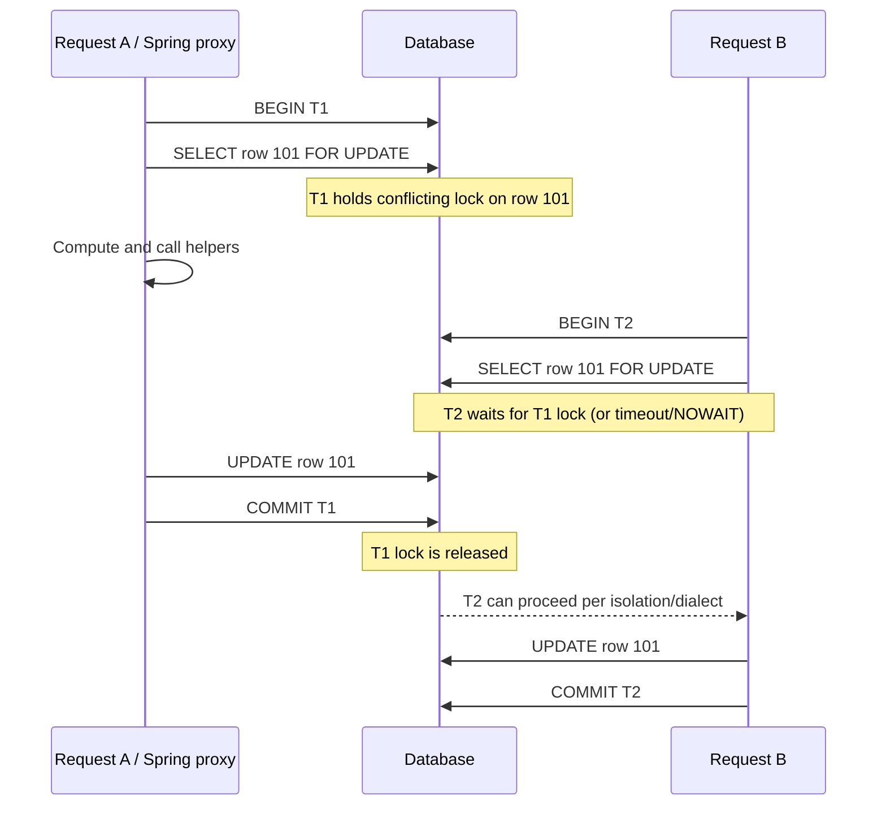
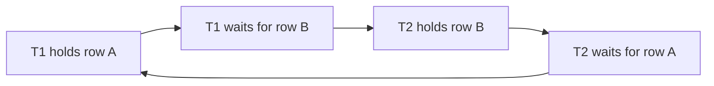

# Pessimistic Locking and Lock Hold Duration in Transactions — Spring Transaction Management

## 1. The problem to understand

**Pessimistic locking** is a way for a transaction to ask the database to lock data before or during processing, in order to prevent other transactions from performing *conflicting* operations until the lock is released.

In Spring applications, a common reasoning error is:

> "The repository method ran `SELECT ... FOR UPDATE` and already returned, so the lock has been released."

**Incorrect while the transaction is still open.** With typical transactional row locks, **the lock is held until the physical transaction ends via COMMIT/ROLLBACK**, or until a specific point defined by the database, **not** automatically released when the `ResultSet` closes, the repository method returns, a helper finishes, or an inner `@Transactional(REQUIRED)` returns.

This matters because `@Transactional` in Spring creates *transaction boundaries*: an outer service method can continue executing many steps after the lock-acquiring SQL query. During all that time, the transaction may still hold the row lock; other requests must wait, time out, or hit a deadlock.

This lesson focuses on **pessimistic locking, lock hold duration, transaction boundaries, and concurrency impact** in Spring Framework (imperative Spring JDBC/JPA). Exact syntax and lock release timing **depend on the database, lock mode, isolation, and savepoint semantics**; examples will specify which parts are based on H2 or PostgreSQL.

### Learning objectives

After this lesson, you can:

1. Explain the difference between a **logical method scope**, a **physical transaction**, and a **database row lock**.
2. Determine when `SELECT ... FOR UPDATE` or JPA `PESSIMISTIC_WRITE` actually holds a lock.
3. Predict what happens when transaction T2 tries to modify the same row locked by T1.
4. Avoid holding locks across HTTP calls, user waits, sleeps, or long computations.
5. Distinguish `REQUIRED`, `REQUIRES_NEW`, `NESTED`, and commit/rollback timing with respect to locks.
6. Configure and handle timeouts/`NOWAIT`/`SKIP LOCKED`, recognize deadlocks, and retry safely.
7. Write a real integration test with at least **two concurrent connections/transactions**.

## 2. What is pessimistic locking — and what is it not?

### 2.1. Contention example on an inventory row

Suppose we have a table:

```sql
CREATE TABLE inventory (
    product_id BIGINT PRIMARY KEY,
    quantity INT NOT NULL
);

INSERT INTO inventory (product_id, quantity) VALUES (101, 5);
```

Two transactions both want to deduct four units:

- T1 reads quantity = 5.
- T2 also reads quantity = 5.
- If both use an uncontrolled "read → compute → update" model, there is a risk of overselling or lost updates depending on the SQL, isolation, and execution schedule.
- If T1 executes `SELECT ... FOR UPDATE` before deciding and T2 also tries to lock the **same row**, T2 typically has to wait for T1 to finish, receive an immediate error (NOWAIT), or skip the row (SKIP LOCKED), depending on dialect/options.

Typical SQL pattern:

```sql
BEGIN;

SELECT quantity
FROM inventory
WHERE product_id = 101
FOR UPDATE;

-- Check quantity within the same transaction, then update if sufficient.
UPDATE inventory
SET quantity = quantity - 4
WHERE product_id = 101;

COMMIT;
```

This is a **common PostgreSQL/SQL pattern**, not a promise that every DB supports the exact same syntax. In Spring applications, `BEGIN/COMMIT` are usually managed by the transaction manager and should not be embedded manually in repository SQL when `@Transactional` is used.

### 2.2. Pessimistic vs. optimistic locking

| Criterion | Pessimistic locking | Optimistic locking |
| --- | --- | --- |
| Idea | Requests lock before/during update; other transactions may have to wait | Allows concurrent processing, detects conflicts via version/update condition |
| Tools | `SELECT FOR UPDATE`; JPA `PESSIMISTIC_WRITE` | `@Version` column and version check; conditional update |
| When is conflict handled? | When requesting lock, waiting or rejected | When update/flush/commit detects version mismatch |
| Cost | Lock waits, reduced throughput, deadlocks/timeouts | Retries on conflict, but does not hold exclusive lock from read time |
| Suitable for | High-contention data, invariants needing serialization while processing | Low-to-moderate contention, read-heavy, retryable processing |
| Not guaranteed | Does not create a global transaction or replace unique constraints | Does not prevent all business races outside entity/version |

You do not necessarily need pessimistic locking for every table. For inventory, an **atomic conditional UPDATE** is often cleaner and holds the lock briefly:

```sql
UPDATE inventory
SET quantity = quantity - :amount
WHERE product_id = :productId
  AND quantity >= :amount;
```

If the updated row count is `1`, the reservation succeeded; `0` means insufficient stock or missing row (distinguish them if business logic requires). The database automatically synchronizes the UPDATE statement's changes; a row lock still exists during the statement/transaction, but a long `SELECT FOR UPDATE` step can be avoided.

## 3. Distinguishing the moments: acquiring, using, and releasing a lock

Inside physical transaction T1:



**Lock hold duration** begins when the database actually grants the lock and typically ends when **physical T1 commits/rolls back**. Between those two points, the fact that Java code rather than SQL is executing **does not** cause the database to release the lock automatically.

If transaction T2 uses `NOWAIT`, it may **not wait**, receiving a lock error immediately instead. If T2 uses `SKIP LOCKED`, it can skip locked rows and proceed to other rows; these semantics are especially important for work queues.

### 3.1. A method returns, yet the transaction has not ended

```java
@Service
public class CheckoutService {
    private final InventoryRepository inventory;
    private final PricingClient pricing;

    public CheckoutService(
            InventoryRepository inventory, PricingClient pricing) {
        this.inventory = inventory;
        this.pricing = pricing;
    }

    @Transactional
    public void checkout(long productId) {
        inventory.lockForUpdate(productId);
        pricing.fetchPrice(productId);  // Remote call may be slow.
        inventory.decrease(productId);
    }
}
```

This is an illustrative snippet, assuming two dependencies. After `inventory.lockForUpdate(...)` **returns**, Spring is still executing `CheckoutService.checkout(...)`. If `checkout` owns the physical transaction and the DB granted the lock, the lock may remain held **throughout the network call**.

Slow remote requests, timeouts, retries, or downstream outages can cause T1 to hold the lock much longer than necessary. This is a source of "every other request is stuck waiting" that is hard to spot if you only look at SQL query execution time.

### 3.2. Where the real commit happens is where the transaction ends

If `checkout()` is called through a Spring proxy when there is no outer transaction:

1. The transaction interceptor begins T1.
2. The method runs `SELECT FOR UPDATE`, acquiring lock L1.
3. The method executes the remaining steps.
4. The method returns/throws out to the interceptor.
5. The interceptor + transaction manager **commit or roll back T1**.
6. The database releases T1's row locks according to engine semantics.

If `checkout()` is joining another **outer transaction** (`REQUIRED` propagation), step 5 at `checkout`'s scope **does not necessarily perform a physical commit**. The lock may persist until the **outermost T1** ends.

A log line saying "repository completed in 8 ms" does not mean the lock was held for 8 ms; it may be held for seconds if the outer transaction stays open.

## 4. How does SQL SELECT ... FOR UPDATE work?

### 4.1. PostgreSQL: locks selected rows

In PostgreSQL, `SELECT ... FOR UPDATE` acquires a row-level lock on the rows selected for locking by the query. It prevents other transactions from making conflicting lock/write requests on those rows until the transaction completes, or according to specific savepoint rollback rules.

```sql
BEGIN;

SELECT id, balance
FROM wallet
WHERE id = 1
FOR UPDATE;

UPDATE wallet
SET balance = balance - 10
WHERE id = 1;

COMMIT;
```

A transaction T2 requesting `UPDATE wallet SET ... WHERE id=1` or `SELECT ... FOR UPDATE` on the same row typically waits for T1. A **plain SELECT without a locking clause** can still read a committed version under PostgreSQL MVCC; do not interpret `FOR UPDATE` as "nobody can read the row at all."

PostgreSQL also has row lock modes: `FOR NO KEY UPDATE`, `FOR SHARE`, `FOR KEY SHARE`. They have different conflict matrices. For correctness, you must rely on the actual mode generated by the SQL/ORM, not just names like "lock read" or "lock write."

### 4.2. H2 and other databases

H2 2.x supports `SELECT ... FOR UPDATE` with `NOWAIT`, `WAIT`, and `SKIP LOCKED` options; it has a per-session `SET LOCK_TIMEOUT <milliseconds>` setting. H2 docs state that normal locks are released by `COMMIT/ROLLBACK`, and savepoint operations have specific behavior.

MySQL/InnoDB also supports locking reads, but **details about gap/next-key locks, indexes, and isolation** are critical: a range query without a suitable index can hold locks over a scope wider than one row. PostgreSQL has its own MVCC and lock conflict mechanisms. Do not embed the assumption "FOR UPDATE always locks strictly one row" into portable code.

**DDL and transaction boundaries:** some databases perform an implicit commit when executing DDL. Do not put examples like `ALTER TABLE`/`CREATE INDEX` inside a critical section and reason about lock lifetimes as if they were ordinary DML across every engine.

### 4.3. NOWAIT and SKIP LOCKED

```sql
-- PostgreSQL/H2 dialect when supported:
SELECT id, status
FROM job
WHERE status = 'READY'
ORDER BY id
FOR UPDATE NOWAIT;
```

If the lock cannot be acquired immediately, the query may raise an error. It **does not** automatically retry under `@Transactional`. The exception must be handled at the transaction boundary; depending on the database, a failed statement may require rolling back the transaction before retrying.

```sql
-- Queue pattern, exact syntax needs adjustment per dialect:
SELECT id
FROM job
WHERE status = 'READY'
ORDER BY id
FOR UPDATE SKIP LOCKED
LIMIT 10;
```

`SKIP LOCKED` skips rows that are currently locked, which is often useful when multiple workers claim jobs. It is **unsuitable** for operations requiring a consistent read of all rows: skipping rows can make the result set temporarily incomplete. Do not view it as a way to "fix" all lock contention in payment/transfer workflows.

## 5. Lock hold duration depends on @Transactional and propagation

| Structure | When is a lock acquired? | When is it typically released? |
| --- | --- | --- |
| Top-level `@Transactional(REQUIRED)` | When SQL/JPA provider acquires the lock in physical T1 | When T1 commits/rolls back at the end of the intercepted method |
| Inner `@Transactional(REQUIRED)` joining outer T1 | When inner acquires the lock on the same T1 | **When outer T1 actually finishes**, not when inner returns |
| Inner `@Transactional(REQUIRES_NEW)` | When independent T2 acquires the lock | When **T2** ends; outer T1 still exists |
| Inner `@Transactional(NESTED)` with JDBC savepoint | When T1 acquires the lock; savepoint exists inside | Release rules at T1 commit/rollback or savepoint rollback **depend on DB**, no separate T2 commit |
| `@Transactional(NOT_SUPPORTED)` | If SQL runs outside Spring's transaction, DB may still take short statement/auto-commit locks | Usually at statement end if auto-commit, but cannot be assumed universal |
| No `@Transactional` and JDBC auto-commit | DB acquires lock for the statement | Usually after each statement/auto-commit |
| An outer transaction in test framework | Service may merely join the test transaction | Lock may last until the **test transaction** completes |

**Key point:** the transaction scope of the *current method* does not necessarily own the physical transaction. Locks can be held far longer than the method that acquired them.

### 5.1. REQUIRED: inner return does not release outer's lock

```java
@Service
public class StockReader {
    private final JdbcTemplate jdbc;

    public StockReader(JdbcTemplate jdbc) {
        this.jdbc = jdbc;
    }

    @Transactional(propagation = Propagation.REQUIRED)
    public int lockedQuantity(long productId) {
        return jdbc.queryForObject(
                "SELECT quantity FROM inventory WHERE product_id=? FOR UPDATE",
                Integer.class, productId);
    }
}

@Service
public class PurchaseService {
    private final StockReader stock;

    public PurchaseService(StockReader stock) {
        this.stock = stock;
    }

    @Transactional
    public void purchase(long productId) {
        int quantity = stock.lockedQuantity(productId);
        // Even though lockedQuantity returned, outer T1 is still open.
        validateBusinessRules(quantity);
        // T1 only commits/rolls back when the outer scope finishes.
    }
}
```

This snippet omits the `validateBusinessRules` implementation, imports, and complete schema. Conditions: both services are Spring beans, share the same manager/datasource, inner `REQUIRED` is called through a proxy, the query actually acquires a lock, and physical T1 remains active.

### 5.2. REQUIRES_NEW: independent transaction, yet can block on outer

Suppose outer T1 holds a lock on `wallet(id=1)`, and then calls inner `REQUIRES_NEW` to update the **same row**. Spring suspends T1's resource binding and opens T2 with a new connection. T1 **does not release its lock** when suspended; T2 may wait for T1's lock while T1 is waiting for the T2 method to return.

```text
T1 holds lock(row 1)
  └── T1 calls inner REQUIRES_NEW and waits
         └── T2 tries to lock(row 1) -> waits on T1
               └── T1 cannot commit because it is waiting on T2
```

This is a self-inflicted lock wait/timeout/deadlock situation. `REQUIRES_NEW` is not a safe tool to "release an outer lock." It may also require a **second connection**, so the connection pool must be sized accordingly.

### 5.3. NESTED and savepoint: do not lump all DBs into one rule

`NESTED` with JDBC usually creates a **savepoint within the same physical T1**, rather than opening T2. When inner succeeds, releasing a savepoint **is not COMMIT T1**, so locks may persist until the physical transaction ends.

For rolling back to a savepoint, lock release behavior differs:

- **PostgreSQL** documents that locks acquired **after a savepoint** can be released when rolling back to the savepoint, consistent with subtransaction semantics.
- **H2** documents that `SAVEPOINT` and `ROLLBACK TO SAVEPOINT` **do not affect locks**; do not apply PostgreSQL's rule verbatim to H2.
- Other DBs/drivers require consulting their own documentation, especially regarding next-key/gap locks, lock escalation, and isolation.

More importantly: a successfully released savepoint **does not create an independent commit**; if outer rolls back T1, the uncommitted inner data is still rolled back with T1.

### 5.4. NOT_SUPPORTED and auto-commit

`NOT_SUPPORTED` suspends the outer transaction scope when supported by the manager, and runs inner **without an actual transaction from that manager**. SQL executed over an auto-commit connection can still acquire locks and commit immediately after each statement; those side effects will not be automatically rolled back by outer.

With JDBC, do not use `NOT_SUPPORTED` merely to "unlock early" if all-or-nothing atomicity with outer is still required. It changes the consistency contract: nontransactional/auto-committed updates can survive after outer fails.

### 5.5. Self-invocation and proxies

`@Transactional` only takes effect through the interceptor in Spring proxy mode. Calling `this.inner()` from the same bean **bypasses the proxy**, so the inner method's propagation/timeout/rollback metadata does not create an independent boundary. If outer already has a transaction, SQL in inner can still participate in that transaction.

With class-based proxies, private/final/static methods also have their own interception limitations. If a transaction boundary is not activated, "when locks are released" must be determined from the actual connection/manager, **not** from annotations seen in source code.

## 6. JPA/Hibernate: PESSIMISTIC_READ, PESSIMISTIC_WRITE, and FORCE_INCREMENT

Jakarta Persistence provides `jakarta.persistence.LockModeType`:

| Lock mode | Intended meaning | Notes |
| --- | --- | --- |
| `PESSIMISTIC_READ` | Requests a read lock to protect data from modification/deletion while the transaction reads | Provider may escalate to a stronger lock depending on DB; not identical to a plain `SELECT` |
| `PESSIMISTIC_WRITE` | Requests a pessimistic lock for updates, preventing conflicting writers | Provider generates dialect-appropriate SQL; does not mean all ordinary SELECTs are blocked under MVCC |
| `PESSIMISTIC_FORCE_INCREMENT` | Write lock and increments version of a versioned entity | Requires compatible entity/version/provider; not portable on unversioned entities |
| `OPTIMISTIC` / `OPTIMISTIC_FORCE_INCREMENT` | Version/validation mechanism instead of a pessimistic lock at read time | Does not have the same row-lock hold duration semantics |
| `NONE` | Requests no additional locking mode | DB UPDATE/DDL statements may still acquire locks |

### 6.1. EntityManager.find with PESSIMISTIC_WRITE

```java
@Transactional
public void reserve(long productId, int amount) {
    Inventory item = entityManager.find(
            Inventory.class,
            productId,
            LockModeType.PESSIMISTIC_WRITE);

    if (item.getQuantity() < amount) {
        throw new IllegalStateException("INSUFFICIENT_STOCK");
    }
    item.setQuantity(item.getQuantity() - amount);
}
```

This is a **method snippet**, needing an `Inventory` entity, injected `EntityManager`, imports, and a provider/database. The JPA provider may issue a locking SELECT and defer the SQL UPDATE until flush/commit; **the lock acquired by the locking SELECT can continue to be held** in the physical transaction until it ends. Do not treat `entityManager.flush()` as COMMIT.

### 6.2. Spring Data JPA @Lock

```java
public interface InventoryRepository extends JpaRepository<Inventory, Long> {
    @Lock(LockModeType.PESSIMISTIC_WRITE)
    @Query("select i from Inventory i where i.id = :id")
    Optional<Inventory> findByIdForUpdate(@Param("id") Long id);
}
```

This snippet requires Spring Data JPA dependencies, the entity, and imports `JpaRepository`, `Lock`, `Query`, `Param`, `Optional`, `LockModeType`. The service layer **should** have `@Transactional` spanning the locking read + business check + update:

```java
@Transactional
public void reserve(long id, int amount) {
    Inventory item = inventoryRepository.findByIdForUpdate(id)
            .orElseThrow(() -> new IllegalArgumentException("Not found"));
    if (item.getQuantity() < amount) {
        throw new IllegalStateException("Insufficient stock");
    }
    item.setQuantity(item.getQuantity() - amount);
}
```

This is still a snippet, not a standalone program. Placing the transaction boundary only around the repository call and returning the entity outside for slow processing can cause the lock to be **already released before updating**, or the entity to become detached, depending on transaction/EntityManager management. Pessimistic locking achieves its purpose only when the **locking read, invariant check, and update** stay within a valid transaction.

### 6.3. Pessimistic lock is not the same as blocking all reads

Under MVCC in PostgreSQL, a plain `SELECT` can usually read a snapshot/committed version even while T1 holds a `FOR UPDATE` lock. What gets blocked are **conflicting locks/writes**. Jakarta Persistence describes the semantics of `PESSIMISTIC_READ`/`WRITE`, while exact SQL depends on provider and dialect. Do not state "`PESSIMISTIC_WRITE` makes the row unreadable to everyone" as a portable rule.

### 6.4. LockTimeoutException and PessimisticLockException

According to Jakarta Persistence:

- `LockTimeoutException` typically describes a **statement-level** lock failure, where the transaction is not necessarily marked for rollback by the provider.
- `PessimisticLockException` describes a locking failure that causes a **transaction-level rollback**; the provider must ensure the transaction is marked for rollback appropriately.

Even so, a `@Transactional` method with default Spring rollback rules can still roll back the entire transaction if a runtime exception **escapes through the interceptor**, even if the provider only aborted a statement. Therefore, you must separate **provider exception semantics** from **Spring interceptor rollback policy**, and never assume "catching `LockTimeoutException` guarantees I can commit."

## 7. Timeouts: lock wait, transaction timeout, statement timeout

Three timeouts that are frequently confused:

| Timeout | Meaning | Example |
| --- | --- | --- |
| **Lock wait timeout** | Time waiting for a conflicting lock before failing | H2 `SET LOCK_TIMEOUT 250`; PostgreSQL `lock_timeout`; MySQL/InnoDB `innodb_lock_wait_timeout` |
| **Statement/query timeout** | Maximum execution time for an SQL statement, depending on driver/framework | JDBC `Statement.setQueryTimeout`, Spring `JdbcTemplate` timeout |
| **Transaction timeout** | Limit for the transaction/scope per transaction manager | `@Transactional(timeout = 5)` |

Do not substitute one value for another and assume identical behavior. `@Transactional(timeout=5)` **is not a portable way** to tell the DB to wait for a row lock for at most 5 seconds. The manager may apply the timeout to JDBC statements, but details depend on the resource/driver/provider.

### 7.1. H2 per-session lock timeout

```sql
SET LOCK_TIMEOUT 250;

SELECT balance
FROM wallet
WHERE id=1
FOR UPDATE;
```

In H2, the duration is in **milliseconds** and applies to the current **connection/session**; H2 docs state that `SET LOCK_TIMEOUT` does not commit the transaction and rollback does not automatically revert that setting. Connection pools reuse sessions: if you change a setting on a connection without resetting it, subsequent requests may be affected. That is why the demo uses `DriverManagerDataSource` to create a fresh connection per invocation; production should handle session initialization/reset properly.

### 7.2. PostgreSQL lock timeout

```sql
BEGIN;
SET LOCAL lock_timeout = '250ms';
SELECT balance FROM wallet WHERE id=1 FOR UPDATE;
COMMIT;
```

This is PostgreSQL illustrative SQL; `SET LOCAL` applies within the transaction and does not persist on the session after commit. Do not set `lock_timeout` overly low such that legitimate workloads frequently fail. After a query timeout in PostgreSQL, the transaction may enter an aborted state and require rolling back (or rolling back to a valid savepoint) before executing further SQL.

### 7.3. JPA lock timeout hint

```java
Map<String, Object> hints = Map.of(
        "jakarta.persistence.lock.timeout", 250);

Inventory item = entityManager.find(
        Inventory.class, productId,
        LockModeType.PESSIMISTIC_WRITE, hints);
```

This is a fragment needing `EntityManager`, `Inventory`, `Map`, and provider configuration. The hint value is typically in **milliseconds** in Jakarta Persistence, but **not every provider/database enforces it identically**. When `NOWAIT` is needed, many providers/dialects use hint `0` or specific locking SQL; integration-test it rather than treating the hint as a guaranteed SLA.

## 8. Runnable demo: two transactions contending for one row in Spring JDBC/H2

Goal: prove that a **locking SELECT has already returned** while the lock still remains inside the physical transaction, preventing a second transaction from acquiring the lock until the first transaction ends.

The demo uses:

- **Java 17+**, Maven.
- **Spring Framework 6.2.19**, `spring-context`, `spring-jdbc`.
- **H2 2.3.232**, in-memory database.
- `DataSourceTransactionManager`.
- Two Spring beans: `HolderService` holds the lock and waits for a signal; `ContenderService` requests the same row lock.
- **Two threads and two JDBC connections**; `CountDownLatch` ensures T1 has acquired the lock before T2 tries.
- H2 `SET LOCK_TIMEOUT 250` and H2 error code `50200` (lock timeout). The demo does not guess which `DataAccessException` subclass the translator picks.

### 8.1. Structure

```text
pessimistic-lock-demo/
├── pom.xml
└── src/main/java/demo/tx/PessimisticLockDemo.java
```

### 8.2. pom.xml

```xml
<project xmlns="http://maven.apache.org/POM/4.0.0"
         xmlns:xsi="http://www.w3.org/2001/XMLSchema-instance"
         xsi:schemaLocation="http://maven.apache.org/POM/4.0.0
                             https://maven.apache.org/xsd/maven-4.0.0.xsd">
    <modelVersion>4.0.0</modelVersion>
    <groupId>demo</groupId>
    <artifactId>pessimistic-lock-demo</artifactId>
    <version>1.0.0</version>
    <properties>
        <maven.compiler.release>17</maven.compiler.release>
        <project.build.sourceEncoding>UTF-8</project.build.sourceEncoding>
    </properties>
    <dependencies>
        <dependency>
            <groupId>org.springframework</groupId>
            <artifactId>spring-context</artifactId>
            <version>6.2.19</version>
        </dependency>
        <dependency>
            <groupId>org.springframework</groupId>
            <artifactId>spring-jdbc</artifactId>
            <version>6.2.19</version>
        </dependency>
        <dependency>
            <groupId>com.h2database</groupId>
            <artifactId>h2</artifactId>
            <version>2.3.232</version>
        </dependency>
    </dependencies>
    <build>
        <plugins>
            <plugin>
                <groupId>org.apache.maven.plugins</groupId>
                <artifactId>maven-compiler-plugin</artifactId>
                <version>3.13.0</version>
            </plugin>
            <plugin>
                <groupId>org.codehaus.mojo</groupId>
                <artifactId>exec-maven-plugin</artifactId>
                <version>3.5.1</version>
            </plugin>
        </plugins>
    </build>
</project>
```

### 8.3. src/main/java/demo/tx/PessimisticLockDemo.java

```java
package demo.tx;

import java.sql.SQLException;
import java.util.concurrent.CountDownLatch;
import java.util.concurrent.ExecutorService;
import java.util.concurrent.Executors;
import java.util.concurrent.ExecutionException;
import java.util.concurrent.Future;
import java.util.concurrent.TimeUnit;
import javax.sql.DataSource;

import org.springframework.context.annotation.AnnotationConfigApplicationContext;
import org.springframework.context.annotation.Bean;
import org.springframework.context.annotation.Configuration;
import org.springframework.dao.DataAccessException;
import org.springframework.jdbc.core.JdbcTemplate;
import org.springframework.jdbc.datasource.DataSourceTransactionManager;
import org.springframework.jdbc.datasource.DriverManagerDataSource;
import org.springframework.transaction.PlatformTransactionManager;
import org.springframework.transaction.annotation.EnableTransactionManagement;
import org.springframework.transaction.annotation.Transactional;

public final class PessimisticLockDemo {
    public static void main(String[] args) throws Exception {
        try (var context =
                     new AnnotationConfigApplicationContext(Config.class)) {
            JdbcTemplate jdbc = context.getBean(JdbcTemplate.class);
            HolderService holder = context.getBean(HolderService.class);
            ContenderService contender = context.getBean(ContenderService.class);

            jdbc.execute("CREATE TABLE wallet (" +
                    "id INT PRIMARY KEY, balance INT NOT NULL)");
            jdbc.update("INSERT INTO wallet (id, balance) VALUES (1, 100)");

            CountDownLatch locked = new CountDownLatch(1);
            CountDownLatch release = new CountDownLatch(1);
            ExecutorService executor = Executors.newSingleThreadExecutor();

            try {
                Future<?> holding = executor.submit(
                        () -> holder.holdRow(locked, release));

                if (!locked.await(5, TimeUnit.SECONDS)) {
                    throw new IllegalStateException(
                            "Holder did not acquire the lock in time");
                }

                // Holder is still inside @Transactional even though SELECT already returned.
                try {
                    contender.debit(5);
                    throw new AssertionError(
                            "Expected lock timeout while holder owns row");
                } catch (DataAccessException ex) {
                    SQLException sql = findSqlException(ex);
                    if (sql == null || sql.getErrorCode() != 50200) {
                        throw ex;
                    }
                    System.out.println("contender while held=LOCK_TIMEOUT");
                }

                // Only now is holder allowed to proceed and finish T1.
                release.countDown();
                holding.get(5, TimeUnit.SECONDS);
                System.out.println("after holder commit balance="
                        + balance(jdbc));

                // T1 has COMMITTED: T2 can now acquire the row lock and update.
                contender.debit(5);
                System.out.println("after contender commit balance="
                        + balance(jdbc));
            } finally {
                release.countDown();
                executor.shutdownNow();
            }
        }
    }

    private static int balance(JdbcTemplate jdbc) {
        Integer n = jdbc.queryForObject(
                "SELECT balance FROM wallet WHERE id=1", Integer.class);
        return n;
    }

    private static SQLException findSqlException(Throwable t) {
        while (t != null) {
            if (t instanceof SQLException sql) {
                return sql;
            }
            t = t.getCause();
        }
        return null;
    }

    @Configuration(proxyBeanMethods = false)
    @EnableTransactionManagement(proxyTargetClass = true)
    public static class Config {
        @Bean
        public DataSource dataSource() {
            return new DriverManagerDataSource(
                    "jdbc:h2:mem:pessimistic_lock_demo;DB_CLOSE_DELAY=-1",
                    "sa", "");
        }

        @Bean
        public PlatformTransactionManager transactionManager(DataSource ds) {
            return new DataSourceTransactionManager(ds);
        }

        @Bean
        public JdbcTemplate jdbcTemplate(DataSource ds) {
            return new JdbcTemplate(ds);
        }

        @Bean
        public HolderService holderService(JdbcTemplate jdbc) {
            return new HolderService(jdbc);
        }

        @Bean
        public ContenderService contenderService(JdbcTemplate jdbc) {
            return new ContenderService(jdbc);
        }
    }

    public static class HolderService {
        private final JdbcTemplate jdbc;

        public HolderService(JdbcTemplate jdbc) {
            this.jdbc = jdbc;
        }

        @Transactional
        public void holdRow(CountDownLatch locked, CountDownLatch release) {
            int current = jdbc.queryForObject(
                    "SELECT balance FROM wallet WHERE id=1 FOR UPDATE",
                    Integer.class);
            System.out.println("holder locked balance=" + current);

            locked.countDown();
            try {
                if (!release.await(10, TimeUnit.SECONDS)) {
                    throw new IllegalStateException("Release signal timed out");
                }
            } catch (InterruptedException ex) {
                Thread.currentThread().interrupt();
                throw new IllegalStateException("Interrupted", ex);
            }

            jdbc.update(
                    "UPDATE wallet SET balance=balance-10 WHERE id=1");
            System.out.println("holder staged debit=10");
        }
    }

    public static class ContenderService {
        private final JdbcTemplate jdbc;

        public ContenderService(JdbcTemplate jdbc) {
            this.jdbc = jdbc;
        }

        @Transactional
        public void debit(int amount) {
            // H2-specific: per-session lock timeout in milliseconds.
            jdbc.execute("SET LOCK_TIMEOUT 250");

            int seen = jdbc.queryForObject(
                    "SELECT balance FROM wallet WHERE id=1 FOR UPDATE",
                    Integer.class);

            jdbc.update(
                    "UPDATE wallet SET balance=balance-? WHERE id=1",
                    amount);
            System.out.println("contender acquired balance=" + seen);
        }
    }
}
```

**Why does this code verify lock scope?**

- `HolderService.holdRow` is called through a Spring proxy, starting T1 on a worker thread.
- `SELECT ... FOR UPDATE` returns `100`; **at this point the method has not returned and T1 has not committed**.
- `locked.countDown()` signals main that the row lock has been acquired. Holder waits for `release` **inside** the transactional method, so T1 stays open.
- Main calls `ContenderService.debit` through a Spring proxy on another thread: it opens T2 with a **different connection**, sets H2 lock timeout to 250 ms, and tries `SELECT ... FOR UPDATE` on the exact same row.
- Because holder has not received `release`, T2 cannot acquire the lock; H2 returns SQLException code `50200`. The code only prints the lock-timeout status **if it matches the H2 code**; it does not swallow arbitrary SQL errors.
- Main releases the latch, holder updates -10, the method returns, and the interceptor commits T1; `Future.get` ensures completion.
- Main calls contender again; now T1's lock has been released, so T2 acquires the row, deducts 5, and commits successfully.
- Final data decreases from `100 → 90 → 85`, with no lost update.

### 8.4. Run command

Place both files in the proper locations, with JDK 17+ and Maven:

```bash
mvn -q compile exec:java -Dexec.mainClass=demo.tx.PessimisticLockDemo
```

**Lines printed by the program**, excluding Maven/Spring logs:

```text
holder locked balance=100
contender while held=LOCK_TIMEOUT
holder staged debit=10
after holder commit balance=90
contender acquired balance=90
after contender commit balance=85
```

**Determinism limits:** latches control the order of acquiring/attempting the lock, yet every concurrent integration test depends on scheduling and the host machine; the 5-second/10-second limits in the demo prevent infinite hangs and are not production configuration recommendations. An overly slow machine or driver error can make the demo fail-fast, which is better than a "false pass." The example was reviewed for syntax and logic, but should still be run in the project environment to confirm dependencies/runtime.

### 8.5. Why must there be two connections?

If both operations participate in **one physical transaction/connection**, they do not represent two competing transactions. To verify lock waits, there must be **two real physical transactions**, usually two connections.

`DriverManagerDataSource` creates a new connection on demand and suits a simple demo, **not recommended as a production pool**. In real applications, use a pool like HikariCP and verify pool sizing. If a pool has only one connection, the contender may wait to **borrow a connection** instead of waiting for a **row lock**; you must distinguish those two kinds of contention in metrics.

### 8.6. When the holder rolls back, is the lock released?

Under the demo's JDBC/H2 model, if the holder throws an unchecked exception out of the intercepted method after acquiring the lock instead of returning, the transaction manager rolls back physical T1. The database releases transaction locks upon rollback; another contender can request the lock after the rollback completes.

**Important point:** calling `catch` inside the method does not itself roll back. If the exception is swallowed and the method continues, T1 may still hold the lock until an actual commit/rollback. Every exit path needs Spring-managed transaction cleanup.

## 9. Sound design: keep the critical section as short as possible

### 9.1. Anti-pattern: calling a remote service while holding a lock

```java
@Transactional
public void checkout(long itemId) {
    Inventory row = inventoryRepository.lock(itemId);
    paymentGateway.authorize();  // HTTP call can be slow/fail.
    row.decrease(1);
}
```

This is a snippet without full types/imports. If the lock is acquired before the network call, the row may be held for seconds while other requests queue behind it.

A **usually safer design pattern** separates work that can be done beforehand from the locked section:

```text
Validate request, calculate price, normalize input  [outside DB lock]
        |
        v
Open transaction T1
  - Lock only the rows needing update
  - Re-read latest data
  - Check invariants
  - Update fewest rows possible
Commit/rollback T1
        |
        v
Emit notification / next step per workflow
```

You cannot mechanically move a payment call outside a transaction and automatically preserve payment semantics: you may need a **reservation/intent + idempotency + state machine + outbox/saga** model. What should be optimized is not "never make a network call inside a transaction" as an absolute rule, but **ensuring consistency while not holding row locks for too long**.

### 9.2. Re-check after acquiring the lock

If you validated before entering the transaction, **re-check invariants that depend on shared state** after acquiring the lock:

```java
@Transactional
public ReservationResult reserve(long productId, int quantity) {
    Inventory current = inventoryRepository.findByIdForUpdate(productId)
            .orElseThrow();
    if (current.getAvailable() < quantity) {
        return ReservationResult.rejected();
    }
    current.decreaseAvailable(quantity);
    return ReservationResult.accepted();
}
```

This is a snippet in an application with domain types/repositories. Every inventory decision must be based on state the transaction can protect, not a stale snapshot read before locking.

Returning `Result.rejected()` normally does not automatically roll back other writes in the transaction; if there were prior side effects needing rollback, policy must be explicit. Validation failing **before writing** can return normally since there is nothing to undo.

### 9.3. Choose indexes, predicates, and lock scope

The query:

```sql
SELECT * FROM wallet WHERE id = 1 FOR UPDATE;
```

clearly uses the primary key, targeting one row. A range-scan query without an appropriate index can:

- Touch more rows than necessary.
- Hold different row locks depending on the engine and execution plan.
- Cause gap/next-key locking in InnoDB under suitable isolation.
- Increase lock hold time due to slow scans/queries.

Inspect `EXPLAIN`/query plans, indexes, and lock diagnostics on the **real database**, rather than assuming "WHERE targets one row" when indexes or predicates do not guarantee it.

### 9.4. Do not use sleep to "fix" a race

A `Thread.sleep(100)` inside a transaction holding a lock **only lengthens the lock duration**. Sleep can help reproduce contention in a demo, but never fixes a race condition. Proper concurrency tests should use latches/barriers and verify the final DB state.

## 10. Deadlocks and lock ordering

A transaction timing out while waiting for a lock is not necessarily a deadlock. A deadlock occurs when there is a **wait cycle**:



Databases can detect deadlocks and abort one transaction. Sound strategies:

1. **Consistent lock ordering**: always lock smaller `accountId` before larger `accountId`, or always lock parent before child.
2. **Short critical sections**: avoid holding locks across remote calls.
3. **Accurate indexes and queries**: avoid unintended lock scope.
4. **Reasonable timeouts**: fail-fast when needed, without setting arbitrarily low thresholds.
5. **Retry the entire transaction** when the exception is transient, with backoff/jitter, bounded attempts, and idempotency.
6. **Observe metrics**: lock wait, deadlock count, transaction age, pool wait, slow queries.

### 10.1. Retry at the right scope

If transaction T1 has already been aborted by the DB or marked rollback-only, do not catch a lock exception and keep using **the same T1** to retry. A more reliable approach is usually to **let the transaction fail and create a new transaction for the next retry attempt**.

Service pseudocode example **outside** the transactional method:

```java
public void retryReserve(long productId) {
    for (int attempt = 1; attempt <= 3; attempt++) {
        try {
            transactionalWorker.reserve(productId); // New proxy boundary.
            return;
        } catch (TransientDataAccessException ex) {
            if (attempt == 3) {
                throw ex;
            }
            backoff(attempt);
        }
    }
}
```

This is a snippet: it needs an injected `transactionalWorker`, imports, and a `backoff` implementation. Do not automatically retry every `DataAccessException`; duplicate keys from business rules, SQL syntax errors, or invalid parameters are usually **not** transient errors. For payments, order creation, and broker events, idempotency is mandatory so retries do not duplicate effects.

### 10.2. Spring exception translation does not replace checking SQLState

Spring JDBC typically translates `SQLException` into `DataAccessException` subclasses, such as `TransientDataAccessException`, `CannotAcquireLockException`, `PessimisticLockingFailureException`, or an appropriate timeout exception. **Which class is chosen depends on the driver, dialect/error-code translator, and Spring version**.

Do not hardcode a catch for only one subclass and claim it works identically across PostgreSQL/MySQL/H2. For a strict integration test, you can also check the error code/SQLState published by the database; production applications should have a specific error-handling abstraction/policy.

## 11. Locks, isolation, rollback-only, and transactional listeners

### 11.1. Isolation does not remove the need to understand locks

`Isolation.READ_COMMITTED`, `REPEATABLE_READ`, and `SERIALIZABLE` change which read phenomena and concurrency strategies the database allows. However:

- `SELECT FOR UPDATE` remains a locking-read request on databases that support it.
- Plain SELECTs may not wait on row locks under MVCC.
- Updates still acquire appropriate locks to protect writes.
- Predicate/range locks, gap locks, and deadlocks can differ across isolation levels.

Do not use `@Transactional(isolation=SERIALIZABLE)` as a promise that every race condition is solved without needing retries on serialization conflicts.

### 11.2. Rollback-only and lock hold duration

If an inner `REQUIRED` marks shared T1 rollback-only, physical T1 may still continue existing until the outer interceptor handles completion. Acquired locks may remain held until the actual rollback time, even though an inner method already knows the transaction will fail.

`UnexpectedRollbackException` can appear when outer tries to commit a transaction marked rollback-only. Therefore, lock hold time does not necessarily stop at the Java line calling `setRollbackOnly()`.

### 11.3. Flush is not commit

In JPA:

```java
entityManager.flush();
```

can send SQL to the DB earlier, even surfacing lock/constraint errors at flush time, yet **is not a physical commit**. Locks held by the transaction still follow the DB transaction lifecycle. With batch JPA writes, an early flush can cause locks to be acquired **earlier**, extending lock hold duration if the transaction still has much work left.

### 11.4. TransactionSynchronization and afterCommit

If you need to send notifications after data has committed, use an appropriate transaction synchronization/hook/outbox. `afterCommit` pertains to **successful physical commit** per the context manager; returning from inner `REQUIRED` or releasing a `NESTED` savepoint must not be interpreted as a durable after-commit event.

For external systems, outbox + retry/idempotency is usually clearer than sending messages while holding database row locks.

## 12. Distinguishing "blocked by lock" from "blocked by connection"

Two waiting requests can stem from different causes:

| Symptom | Bottleneck | How to verify |
| --- | --- | --- |
| T2 already has a JDBC connection, but `SELECT FOR UPDATE` waits | Database row/table lock | DB lock wait views, blocking transaction id, SQLState |
| T2 has not obtained a connection from the pool | Connection pool exhaustion | Hikari active/idle/pending, connection acquisition timeout |
| T2 waits on a remote call while T1 holds a lock | Business critical section too long | Tracing transaction span and downstream latency |
| T2 becomes a deadlock victim | Lock cycle between transactions | DB deadlock reports, SQL transaction order |
| T2 query timeouts rather than lock timeouts | Statement execution too slow | Query plan, EXPLAIN, driver query timeout |
| T2 returns old data even though T1 updated without committing | MVCC isolation/snapshot | Isolation level and transaction snapshot semantics |

In particular, `REQUIRES_NEW` can encounter **both** issues: it needs a new connection while outer holds the old connection, and the new connection may also be blocked by outer on the same row.

## 13. Common mistakes

### Mistake 1: "The repository method returned, so the lock is released"

**Fix:** physical locks are released per the transaction/database lifecycle; inner `REQUIRED` returning does not commit outer. Check the outermost physical transaction.

### Mistake 2: "@Transactional automatically locks all read data"

**Fix:** `@Transactional` creates transaction boundaries; it **does not turn every ordinary SELECT into SELECT FOR UPDATE**. Locks are acquired based on SQL, isolation, ORM mode, and actual operations.

### Mistake 3: "PESSIMISTIC_WRITE blocks all SELECTs"

**Fix:** under PostgreSQL MVCC, ordinary SELECTs can read committed versions; what blocks are usually conflicting write/locking operations. Providers/dialects may differ.

### Mistake 4: "readOnly=true means never holding locks"

**Fix:** read-only can be an optimization/hint or DB policy; a read-only transaction does not turn locking semantics into a universal no-op. On some databases, locking clauses in a read-only transaction may be rejected; check the specific engine.

### Mistake 5: "NESTED release savepoint releases all row locks"

**Fix:** releasing a savepoint is not a commit. How rollback-to-savepoint affects locks **depends on the database**; H2 and PostgreSQL have different documented behavior.

### Mistake 6: "REQUIRES_NEW solves deadlocks caused by outer locks"

**Fix:** suspended T1 **still holds its locks**, while T2 may wait on T1 for the same row and T1 waits for T2 to return. You must change ordering/boundaries/resources, not just propagation.

### Mistake 7: "Setting @Transactional(timeout=2) gives a 2-second lock timeout on all DBs"

**Fix:** transaction timeout, statement timeout, and lock wait timeout are not identically portable. Driver/manager/dialect-specific configuration and integration tests are required.

### Mistake 8: "A sequential test reproduces contention"

**Fix:** there must be two parallel transactions/connections and lock timing synchronized with latches/barriers; if using one connection, the result does not reflect blocking between T1 and T2.

### Mistake 9: "If a transaction errors and I catch the exception, the lock disappears immediately"

**Fix:** you must determine whether the physical transaction has actually rolled back/committed and whether connection cleanup ran. Catching an exception inside a method does not necessarily end T1; rollback-only does not trigger physical rollback at the instant it is set either.

### Mistake 10: "FOR UPDATE solves every multi-table invariant"

**Fix:** lock the right rows needed, define an ordering for multiple locks, use database constraints, atomic updates, or serializable/retry when appropriate. Invariants can depend on rows that **do not exist yet** or a predicate range; locking only one existing row is not enough.

## 14. Integration tests you should have

| Case | Setup | What to assert |
| --- | --- | --- |
| Lock still held after repository return | T1 transaction locks row then pauses at latch; T2 tries to lock | T2 blocks/times out while T1 has not committed |
| Release on COMMIT | T1 acquires lock then commits | T2 acquires lock and updates successfully after T1 |
| Release on ROLLBACK | T1 acquires lock then throws unchecked exception out of proxy | T2 acquires lock after T1 actually rolls back |
| Inner REQUIRED returns | Outer T1 calls inner REQUIRED locking row, inner returns; T2 contends | Lock can still last until outer T1 completion |
| Inner REQUIRES_NEW | Outer does not lock same row, inner has its own T2 | T2's lock can release when T2 finishes; does not wait for T1 if T2 is truly independent |
| Outer locks same row then calls REQUIRES_NEW | T1 locks row A, T2 tries to lock A | Can lock-wait/timeout even though T1 is suspended |
| NESTED savepoint rollback | Use supporting database and manager | Verify lock release behavior per **specific DB** docs |
| NOWAIT | T1 locks row; T2 uses NOWAIT | T2 gets immediate error per dialect without waiting long |
| SKIP LOCKED queue | T1 locks job 1; T2 dequeues job | T2 can skip job 1 and claim another job |
| Concurrent conditional update | Multiple workers deduct stock from one row | No negative stock, total updates accurate |
| Deadlock | T1 locks A then B, T2 locks B then A | DB reports deadlock victim, retry at proper transaction boundary |
| Small pool | Outer holds connection, inner needs another | Distinguish pool acquisition wait from row lock wait |

**Spring Test warning:** `@Transactional` on a JUnit test method itself usually opens a transaction wrapping the test and rolls it back at the end. That can cause the service to join the outer test transaction, hold locks longer, or make commit behavior unlike production. For concurrency tests, do not share an `EntityManager`/JDBC connection from the test thread into worker threads. Make two real Spring-managed service invocations without an accidental outer test transaction wrapping the whole test, then inspect the database after commit/rollback.

### Useful observability tools

- PostgreSQL: `pg_stat_activity`, `pg_locks`, `pg_blocking_pids(pid)`, slow query/lock wait logging.
- MySQL/InnoDB: `performance_schema.data_locks`, `data_lock_waits`, InnoDB status/deadlock logs (version-dependent).
- H2: `INFORMATION_SCHEMA.LOCKS` depending on version/schema; lock timeout errors and synchronized tests.
- Connection pool: active, idle, pending, acquisition timeout.
- Tracing: elapsed time from calling locking SQL to outer transaction completion.

Observe both **transaction lifetime** and **actual lock hold time**. A fast query can sit inside a transaction lasting several seconds.

## 15. Decision table for application

| Need | Usually suitable option | Caveat |
| --- | --- | --- |
| Update quantity if sufficient | Atomic conditional `UPDATE ... WHERE quantity >= ?` | Check affected rows and invariant |
| Read row then modify with multi-step dependency | `SELECT FOR UPDATE` in a short `@Transactional` service | Holds lock until physical commit/rollback |
| Few conflicts, read-heavy | Optimistic locking with `@Version` | Retry version mismatch and maintain idempotency |
| Multiple workers claiming jobs | `FOR UPDATE SKIP LOCKED` per dialect | Result is not a full snapshot; avoid starvation |
| Want immediate return if row is busy | `NOWAIT`/appropriately short lock timeout | Handle transient failure; do not retry infinitely |
| Want audit to commit even if outer rolls back | `REQUIRES_NEW` with separate boundary, or outbox/workflow | Can cause pool starvation/lock conflicts |
| Want to roll back one step in same physical transaction | `NESTED` and savepoint when JDBC supports it | Savepoint lock behavior depends on DB |
| Transaction has slow HTTP payment | Reservation/state machine/idempotency, split critical section | Must not sacrifice consistency just to reduce lock time |

## 16. Self-check questions

**1.** Outer `@Transactional` calls repository `SELECT ... FOR UPDATE`; repository returns, outer processes for 3 more seconds. Can the lock still be held?

*Answer:* Yes. Transactional locks are typically held until the **physical transaction** commits/rolls back; returning from the repository method does not release them.

**2.** T1 holds `FOR UPDATE` on row A; T2 runs an ordinary `SELECT` on row A in PostgreSQL. Is T2 always blocked?

*Answer:* No. Under MVCC, SELECT can usually read a committed version; conflicting write/locking operations are what undergo blocking rules.

**3.** Inner `@Transactional(REQUIRED)` acquires a lock and returns, while outer is still open. Is the lock released?

*Answer:* Usually not yet. Inner joins the shared physical T1; there is no physical commit upon inner completion.

**4.** Outer locks a row and calls inner `REQUIRES_NEW` locking the same row. Will inner definitely run immediately?

*Answer:* No. Outer T1 still holds the lock even though suspended; T2 may wait/time out.

**5.** Can `@Transactional(timeout = 1)` be used as an exact 1-second lock-wait timeout on every DB?

*Answer:* No. Transaction timeout differs from lock wait timeout; behavior depends on the manager/driver/database.

**6.** Upon a lock wait timeout, can you keep using the errored transaction to retry indefinitely?

*Answer:* You should not. Some DBs have already aborted the transaction; typically you must roll back and open a new transaction to retry safely.

**7.** Why is `SKIP LOCKED` more suitable for work queues than comprehensive inventory reports?

*Answer:* It intentionally skips locked rows, producing a temporarily incomplete result set — useful for distributing jobs, but wrong for queries that must inspect every row.

**8.** How does `PESSIMISTIC_FORCE_INCREMENT` differ from `PESSIMISTIC_WRITE`?

*Answer:* It also requires incrementing the version of a versioned entity per JPA semantics; it is not portable on unversioned entities.

**9.** Does `ROLLBACK TO SAVEPOINT` always release all locks acquired after the savepoint on every DB?

*Answer:* No. PostgreSQL and H2 have different rules stated in their docs; you must rely on the actual database.

**10.** Has a test using only one JDBC connection with two `@Transactional` methods proven lock contention?

*Answer:* Not yet. Contention between transactions requires at least two real physical transactions/connections and synchronized concurrency.

**11.** Is JPA `flush()` a physical commit that releases locks?

*Answer:* No. Flush sends SQL to the database while the transaction remains open; locks continue per the DB lifecycle.

**12.** How do you reduce lock time while preserving invariants?

*Answer:* Precompute/validate whatever does not depend on shared state outside; inside the transaction, lock only the necessary rows, re-check invariants, update, and commit/roll back quickly; use atomic conditional SQL when suitable.

## 17. Summary

- **Pessimistic locking is a database-granted lock**, not a Java mutex automatically released when a method returns.
- **Row lock hold duration usually tracks the physical transaction**: from when the lock is granted until COMMIT/ROLLBACK; inner `REQUIRED` returning does not commit outer.
- **Do not equate every SELECT with a blocking read**: PostgreSQL MVCC lets ordinary SELECTs read committed snapshots; blocking depends on lock mode and operation type.
- **REQUIRES_NEW creates another physical transaction, yet outer can still hold locks**; it does not automatically resolve lock contention and may require a second connection.
- **NESTED/savepoints are not independent commits**; rollback-to-savepoint has DB-dependent lock semantics (PostgreSQL differs from H2).
- **Keep critical sections short**: avoid remote calls or long sleeps while holding locks; use indexes/conditional updates and sound transaction boundaries.
- **NOWAIT/SKIP LOCKED/lock wait timeouts** are contention-handling tools, not substitutes for consistency requirements.
- **Test with two connections, latches, and post-transaction DB state**, while monitoring lock waits, deadlocks, transaction age, and pool waits.

## Official References

- [Spring Framework 6.2 — Transaction Management](https://docs.spring.io/spring-framework/reference/6.2/data-access/transaction.html)
- [Spring Framework — Transaction Propagation](https://docs.spring.io/spring-framework/reference/data-access/transaction/declarative/tx-propagation.html)
- [Spring Framework — @Transactional settings](https://docs.spring.io/spring-framework/reference/data-access/transaction/declarative/annotations.html)
- [Spring Framework API — DataSourceTransactionManager](https://docs.spring.io/spring-framework/docs/6.2.x/javadoc-api/org/springframework/jdbc/datasource/DataSourceTransactionManager.html)
- [Spring Data JPA — Locking](https://docs.spring.io/spring-data/jpa/reference/jpa/locking.html)
- [Jakarta Persistence 3.2 — LockModeType](https://jakarta.ee/specifications/persistence/3.2/apidocs/jakarta.persistence/jakarta/persistence/lockmodetype)
- [Jakarta EE Tutorial — Controlling Concurrent Access with Locking](https://jakarta.ee/learn/docs/jakartaee-tutorial/current/persist/persistence-locking/persistence-locking.html)
- [PostgreSQL — Explicit Locking](https://www.postgresql.org/docs/current/explicit-locking.html)
- [PostgreSQL — SELECT locking clauses](https://www.postgresql.org/docs/current/sql-select.html)
- [PostgreSQL — SAVEPOINT semantics](https://www.postgresql.org/docs/current/sql-savepoint.html)
- [H2 — Features (locking and savepoint behavior)](https://h2database.github.io/html/features.html)
- [H2 — SQL Commands (SELECT FOR UPDATE, SET LOCK_TIMEOUT)](https://h2database.github.io/html/commands.html)
- [H2 API — ErrorCode.LOCK_TIMEOUT_1 = 50200](https://h2database.github.io/javadoc/org/h2/api/ErrorCode.html)
