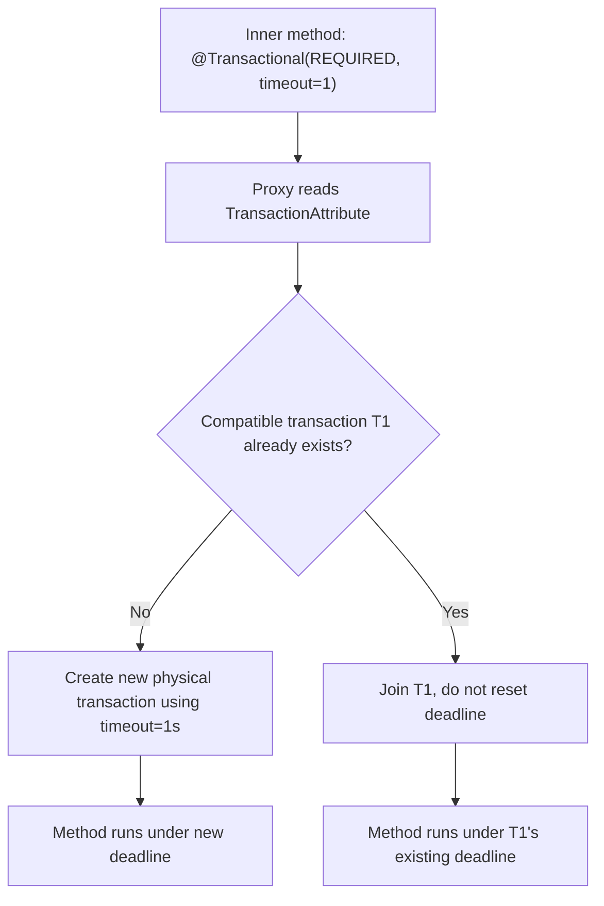

# Timeout Units and When the Attribute Takes Effect in Spring Transaction Management

## 1. The Core Answer

In Spring, when declaring:

```java
@Transactional(timeout = 5)
public void processOrder() {
    // Operations belonging to the method's transaction.
}
```

**`timeout = 5` means 5 seconds, not 5 milliseconds or 5 minutes.** This is the **transaction** timeout policy that Spring asks the transaction manager to apply **when starting a new physical transaction**. That deadline is not "restarted" for each SQL statement, each inner method, or each data read.

Specifically:

- If a `REQUIRED` method is called through the Spring proxy and **no compatible active transaction exists yet**, the manager starts a new transaction and applies the timeout.
- If a `REQUIRED` method **joins an existing transaction**, `timeout` declared on the inner method **does not change the outer transaction's deadline** under default behavior.
- If a method uses `REQUIRES_NEW`, Spring suspends the current transaction and starts a new one with its **own deadline**, provided the transaction manager supports that execution model.
- A deadline **is not a timer that automatically aborts arbitrary Java code**. Detection and enforcement of timeouts depend on the transaction manager, persistence technology, JDBC statements, database, and what operations run after expiration.

This is a Knowledge lesson on the **Read-only and timeout** topic in **Spring Framework transaction management**, focusing on **units**, **when timeout takes effect**, and **how to verify it with data**.

### Learning Objectives

After this lesson, you will be able to:

1. Choose the right `timeout` and `timeoutString` values without confusing seconds with milliseconds.
2. Explain `TransactionDefinition.TIMEOUT_DEFAULT = -1`.
3. Describe when the proxy reads the annotation, when the manager starts the transaction, and how remaining time is calculated.
4. Distinguish **transaction** timeout, **single JDBC Statement** timeout, **connection** timeout, and **HTTP client** timeout.
5. Predict the behavior of `REQUIRED` joining an existing transaction versus `REQUIRES_NEW` opening an independent transaction.
6. Run Java 17+ with Spring Boot/JDBC/H2 to observe normal commits, expired transactions, and an inner `REQUIRED` timeout not shortening the outer transaction's deadline.
7. Identify pitfalls such as self-invocation, wrong transaction manager, sleeping and expecting Java to be interrupted automatically, or catching a timeout error and trying to commit.

## 2. Timeout Unit: Seconds

The two attributes on the annotation are defined by Spring as follows:

```java
@Transactional(timeout = 10)
public void byNumber() {
    // 10 seconds.
}

@Transactional(timeoutString = "10")
public void byString() {
    // Also 10 seconds.
}
```

This is **illustrative code showing two methods**, which must be placed in an appropriate Spring-managed class. `timeout` accepts an `int`, while `timeoutString` accepts a `String` representing the **number of seconds** after resolution.

| Declaration | Meaning |
| --- | --- |
| `@Transactional(timeout = 3)` | Requests a transaction timeout of **3 seconds** |
| `@Transactional(timeout = 60)` | Requests a timeout of **60 seconds = 1 minute** |
| `@Transactional(timeout = 300)` | Requests a timeout of **300 seconds = 5 minutes** |
| `@Transactional(timeout = 30000)` | **30,000 seconds**, not 30 seconds |
| `@Transactional(timeoutString = "15")` | Requests **15 seconds** from a string |
| `@Transactional(timeoutString = "\${app.tx.timeout-seconds}")` | Reads configuration and resolves to **seconds** |
| `@Transactional` without timeout | Uses the **default timeout** of the transaction manager/infrastructure |

**The unit does not change** when switching from `timeout` to `timeoutString`: it is still **seconds**. `timeoutString = "PT5S"` is not a guaranteed Duration syntax for this attribute; use a numeric string of seconds, such as `"5"` or a placeholder whose value is `5`.

### 2.1. Do Not Confuse with `Duration` or Milliseconds

Many Java APIs use `Duration.ofMillis(500)`, `Thread.sleep(500)`, or HTTP settings like `connectTimeout(Duration.ofSeconds(5))`. They **do not determine the unit of the Spring transaction annotation**.

```java
@Transactional(timeout = 2)
public void operation() {
    // 2 SECONDS, not 2 milliseconds.
}
```

If you want a 2-minute timeout, write `timeout = 120`. Do not write `timeout = 120_000` out of millisecond-configuration habit.

### 2.2. Default -1 Does Not Mean "Guaranteed Infinite"

`TransactionDefinition.TIMEOUT_DEFAULT` has the value **-1**. This is a **sentinel** telling Spring to use the default timeout of the underlying transaction manager or transaction system:

```java
int value = TransactionDefinition.TIMEOUT_DEFAULT; // -1
```

The snippet requires importing `org.springframework.transaction.TransactionDefinition`.

- A transaction manager may have its own default timeout.
- A JTA system may have a server-defined timeout policy.
- A manager/infrastructure that does not support timeouts may have no corresponding transaction-level limit.
- The database can still impose `statement_timeout`, `lock_timeout`, or its own policies **independently of Spring's -1 value**.

Therefore, `timeout = -1` is not a command "forcing the transaction to live forever". It merely selects the default policy. In the Spring Framework, dedicated settings such as `AbstractPlatformTransactionManager.setDefaultTimeout(int)` set the default **in seconds** for the corresponding manager.

**Regarding `timeout = 0`:** do not use it as shorthand for "no timeout". Across infrastructures, 0 may be interpreted as an immediate deadline or handled differently, and Spring has value validation rules. If the goal is to use the default, **omit the attribute** or use `TIMEOUT_DEFAULT` per the API. For business deadlines, choose an explicit positive number of seconds.

### 2.3. `timeoutString` and External Configuration

Example `application.properties`:

```properties
app.tx.process-seconds=8
```

And service method:

```java
@Transactional(timeoutString = "\${app.tx.process-seconds}")
public void process() {
    // Timeout read from property, effective value = 8 seconds.
}
```

These two snippets are syntax examples; Spring Framework 5.3+ supports `timeoutString`. The resolved value must parse into a **valid number of seconds**, not arbitrary formats like `"8s"` or `"8000ms"`.

Use `timeoutString` when you want timeout configurable across environments, and use `timeout` when the number is a stable part of the method's contract. Do not specify both attributes with conflicting values on the same annotation; pick **one clear configuration source**.

## 3. At What Point Does Timeout Take Effect?

Two moments are easily confused:

1. **When Spring reads `@Transactional`:** finding the annotation and building `TransactionAttribute` may happen at startup or on first method interception. This is **metadata lookup**, not when the timeout clock starts ticking.
2. **When the transaction manager actually starts a new transaction:** this is when the timeout policy is used to set the deadline/limit for the corresponding physical transaction, depending on the manager.

When using proxy-based declarative transactions:

```text
Application starts
    |
    | Spring finds @Transactional and may cache metadata.
    | No request transaction has started yet.
    v
Caller invokes service through Spring proxy
    |
    v
TransactionInterceptor reads TransactionAttribute
    |
    | propagation = REQUIRED
    | timeout = 5 seconds
    v
TransactionManager.getTransaction(definition)
    |
    +-- No compatible running transaction:
    |       creates NEW T1
    |       sets timeout/deadline for T1
    |       runs method
    |
    +-- Compatible transaction T0 already exists:
            joins T0
            does not automatically reset T0's deadline to 5s
            runs method
```

### 3.1. Method Call Creating a New Transaction

With:

```java
@Service
class ReportService {

    @Transactional(timeout = 5)
    public void createReport() {
        // ...
    }
}
```

If a controller **without a transaction** calls the bean through the proxy, the default `REQUIRED` requests creating a new transaction T1. The 5-second timeout is used by the manager when T1 begins.

Conceptual sequence:

```text
t0: Caller enters transaction interceptor
t1: Manager begins T1 and sets ~5-second timeout
t2: Method body starts running
t3: First JDBC Statement runs
t4: Next JDBC Statement runs
t5: Method returns, manager commits/rolls back
```

**It is not** a general rule that "5 seconds" only starts at `t3`, nor is each Statement granted a fresh 5-second allotment. Some datasources use **lazy connection acquisition**, yet the transaction policy/deadline is still coordinated by the manager at the corresponding boundary.

### 3.2. Remaining Time When Calling Subsequent Methods

Consider:

```text
T1 begins, timeout=5s, deadline around t=5s
  |
  | ~1.0s Java processing
  | ~0.5s DB query
  | ~1.0s helper call
  v
Next statement executes when T1 has ~2.5s remaining
```

The new statement **does not get its deadline extended to t=7.5s**. If Spring JDBC applies `Statement.setQueryTimeout(...)` based on T1's remaining time, the SQL query timeout can be **shorter than the initial timeout**.

This is the **whole-transaction time budget** principle, not "5 seconds per SQL statement".

### 3.3. Time Spent Outside the DB Still Consumes the Deadline

Inside a transaction T1, the following can consume time:

- Java CPU processing.
- `Thread.sleep(...)`.
- Waiting on HTTP APIs, file I/O, or network.
- Waiting on DB locks or queries.
- Calling other services in the same transaction.

**There is no guarantee Spring will interrupt `Thread.sleep` right when the deadline arrives.** With local JDBC transactions, timeout is typically detected when a subsequent resource operation checks the deadline or when the JDBC driver/database applies statement timeout. A long-running CPU loop in Java that touches no resource can run past the deadline before any error is detected.

This matters in tests: make the timeout actually **get checked** by using `JdbcTemplate` or a transaction-aware operation after the deadline has passed, rather than putting `Thread.sleep(2000)` in a method and expecting the JVM to throw at the second second.

## 4. JDBC Mechanism: Transaction Deadline and Query Timeout

With `DataSourceTransactionManager` or `JdbcTransactionManager`, Spring typically holds JDBC resources/transaction metadata in the appropriate context. When the transaction has a timeout, Spring can store the deadline in the `DataSource`'s `ConnectionHolder`.

When `JdbcTemplate` creates a JDBC `Statement`, it uses Spring JDBC support to apply the active timeout. Per `DataSourceUtils.applyTimeout(...)`:

- If the connection holder has a transaction deadline, **the remaining transaction time** is passed to `Statement.setQueryTimeout(int seconds)`.
- If there is **no** transaction timeout, a timeout configured separately on `JdbcTemplate` may be used.
- If already expired, checking remaining time can throw `TransactionTimedOutException`; or the JDBC query can be cancelled by the driver/database with an `SQLException`, translated by Spring into an appropriate `DataAccessException`.

### Remaining Time Example

Suppose T1 timeout = **6 seconds**.

| Point in Time | T1 Elapsed Approx. | T1 Remaining Time | Expectation at Next Statement |
| --- | ---: | ---: | --- |
| After begin | 0 seconds | 6 seconds | Can receive query timeout ~6 seconds |
| Before query 2 | 2 seconds | 4 seconds | Can receive query timeout ~4 seconds |
| Before query 3 | 5 seconds | 1 second | Can receive query timeout ~1 second |
| After deadline | over 6 seconds | 0 or negative | Timeout can be detected; no fresh 6 seconds granted |

Numbers in the table **illustrate the timeline**, not measured driver output: Spring uses the clock and rounds within the seconds API bounds, with scheduling jitter, so you cannot claim `getQueryTimeout()` must print exact 6, 4, 1 on every machine.

### 4.1. Manual Timeout-Aware JDBC Pattern

When manually creating a `Statement` on a Spring-managed connection, you can use:

```java
Connection con = DataSourceUtils.getConnection(dataSource);
try {
    try (Statement stmt = con.createStatement()) {
        DataSourceUtils.applyTransactionTimeout(stmt, dataSource);
        try (ResultSet rs = stmt.executeQuery("SELECT 1")) {
            // Read data.
        }
    }
} finally {
    DataSourceUtils.releaseConnection(con, dataSource);
}
```

This is an **illustrative snippet**, requiring imports for JDBC `Connection`, `Statement`, `ResultSet`, `DataSource`, and `DataSourceUtils`, plus a context managing `dataSource`. In typical applications, prefer `JdbcTemplate` because it **automatically** handles Spring-aware connections and proper query timeouts; manual code is unnecessary.

**Do not** arbitrarily call `dataSource.getConnection()` and assume that connection automatically joined T1. With `DataSourceTransactionManager`, transaction-aware retrieval via Spring JDBC is essential. If using an ORM, deadline interaction also depends on the transaction manager/JPA provider.

### 4.2. Is `JdbcTemplate`'s Own Timeout a Transaction Timeout?

No. Example:

```java
JdbcTemplate jdbc = new JdbcTemplate(dataSource);
jdbc.setQueryTimeout(2);
```

This snippet illustrates a JDBC object. Setting `queryTimeout = 2` configures a limit **for statements executed by `JdbcTemplate`**, not a deadline for the entire transactional method. When the current transaction has a deadline, Spring may use the **remaining transaction time** instead of `JdbcTemplate`'s own timeout.

When you want to limit a single query even outside a transaction, use the appropriate statement/query timeout API. When you want to limit **a new transaction**, use `@Transactional(timeout = ...)` with a supporting transaction manager. The two serve different purposes.

### 4.3. Does Spring Always Roll Back at the Exact Timeout Second?

No. Distinguish:

- **Deadline/timeout policy**: Spring/the transaction manager defined a time limit.
- **Enforcement**: the query/driver/database/transaction infrastructure detects expiration and cancels or throws an exception.
- **Rollback**: the transaction manager undoes changes in the transaction when a rollback condition is actually triggered, or when the resource/coordinator rejects commit.

A method running `Thread.sleep(10_000)` in a 1-second timeout transaction **does not mean** the JVM will interrupt the sleep right at the first second. Under the local JDBC model, the next JDBC operation after the sleep can be rejected because the deadline has passed. If a runtime error escapes the interceptor, the transaction normally rolls back.

If the framework or driver throws a different exception or the resource does not support timeout, behavior must be verified against the real stack. Therefore, **never promise every method exceeding timeout is guaranteed to stop or roll back to the exact millisecond**.

## 5. When Timeout **Is** and **Is Not** Applied

Per Spring Javadoc, `@Transactional.timeout` and `timeoutString` are designed for **a new transaction** — typically via `REQUIRED` or `REQUIRES_NEW`.

| Call Context | Creates New Physical Transaction? | Does Timeout on That Method Establish a New Deadline? |
| --- | --- | --- |
| `REQUIRED`, caller has no transaction | Yes | **Yes**, if manager supports it |
| `REQUIRED`, caller already has T1 on same manager | No, joins T1 | **Does not reset** T1's timeout |
| `REQUIRES_NEW`, caller has no transaction | Yes | **Yes** |
| `REQUIRES_NEW`, caller already has T1 | Yes, T1 is suspended | **Yes**, separate deadline for T2 |
| `SUPPORTS`, no transaction | Does not require physical transaction | Does not create a new transaction deadline |
| `NOT_SUPPORTED`, caller has T1 | Suspends T1, runs non-transactionally | Does not create a new transaction deadline |
| `MANDATORY`, T1 exists | Joins T1 | Does not automatically reset T1's deadline |
| `NESTED`, T1 exists and uses savepoint | Usually no new physical transaction | Should not expect an independent deadline for the savepoint |

**Note on `NESTED`:** when no transaction exists, `NESTED` can behave like `REQUIRED` to create a new transaction depending on the manager. When already inside T1 using a JDBC savepoint, it is **not** `REQUIRES_NEW` and has no new physical transaction to apply an independent deadline.

### 5.1. Why Doesn't an Inner `REQUIRED` "Ask for More Time"?

Example:

```java
@Service
class InnerService {
    @Transactional(
        propagation = Propagation.REQUIRED,
        timeout = 30
    )
    public void inner() {
        // Joins existing transaction if caller has T1.
    }
}

@Service
class OuterService {
    private final InnerService inner;

    @Transactional(timeout = 5)
    public void outer() {
        inner.inner();  // Same transaction manager.
    }
}
```

This is a structural illustrative snippet, not standalone compilable files. If `outer` is intercepted and created T1 with a 5-second timeout, `inner()` uses `REQUIRED` to **join T1**. The 30 seconds on `inner` **does not extend** T1 to 30 seconds.

The reverse direction is also important:

```text
Outer: REQUIRED timeout=30s => creates T1
  |
  +-- Inner: REQUIRED timeout=2s => joins T1
       (does not automatically shorten T1's deadline to 2s)
```

T1 is managed under the deadline established by the outer. **The inner annotation does not automatically create a separate clock** when merely joining T1. On the other hand, an independent query timeout or database rule configured inside the inner **can** be shorter; that is a different resource configuration, not T1's transaction timeout being replaced.

### 5.2. `REQUIRES_NEW`: Separate Clock, Does Not Automatically Add Time

```java
@Transactional(timeout = 20)
public void outer() {
    independentService.inner();
}

@Transactional(
    propagation = Propagation.REQUIRES_NEW,
    timeout = 3
)
public void inner() {
    // Gets new transaction T2 and its own ~3s deadline.
}
```

This is an illustrative snippet across **two different Spring beans**, called through a proxy and using the same manager supporting transaction suspension. Inner gets **T2** with a 3-second timeout. Outer has **T1** with a 20-second timeout.

Conceptual schedule:

```text
t=0s:  outer starts T1, timeout 20s
t=2s:  inner starts T2, timeout 3s, suspends T1
t=4s:  inner commits T2
t=4s:  resumes T1, T1 has ~16s remaining
t=...: outer finishes T1
```

**T1 is not gifted an extra 2 seconds** for being suspended. With local JDBC's wall-clock deadline mechanism, time continues elapsing while outer waits for inner. Do not expect resuming to reset outer's timeout.

If T2 exceeds its timeout, it can roll back, yet **T1 does not automatically roll back just because T2 expired** if outer handles the exception and has no other rollback-only cause. If a runtime exception escapes through outer as well, outer can roll back per **outer's own** rules.

### 5.3. Class and Method Annotations: Which Timeout Is Selected?

```java
@Transactional(timeout = 30, readOnly = true)
public class ReportService {

    public void list() {
        // Follows class-level policy.
    }

    @Transactional(timeout = 5)
    public void recompute() {
        // Method policy overrides the entire class policy.
    }
}
```

This is an illustrative snippet. When both method and class have the annotation, the **method** metadata is chosen for that method; individual fields are not merged:

- `list()`: 30-second timeout, `readOnly=true` from the class if the method is eligible for interception.
- `recompute()`: 5-second timeout, `readOnly` defaults to `false` — it does not automatically "inherit `readOnly=true`" from the class annotation.

That is the **transaction attribute selection rule**. After selecting the policy, its timeout still affects the deadline only when a new transaction actually opens.

## 6. Read-Only and Timeout: Two Attributes with Different Purposes

Example:

```java
@Transactional(readOnly = true, timeout = 4)
public Report loadReport() {
    // ...
}
```

This is an illustrative signature, requiring definition of type `Report`. Two attributes:

- `readOnly = true`: describes an intent toward reading, typically a **hint** for the transaction manager/driver/ORM to optimize. Not a "security" method to prohibit all writes.
- `timeout = 4`: asks the manager to limit **the duration of a new transaction**, in **seconds**.

There is no relationship such as "when readOnly=true, timeout is measured in a different unit". Both belong to transaction metadata, yet each is applied according to the semantics of the specific manager and resource.

With `REQUIRED` joining an existing transaction, the outer transaction's attributes usually govern the physical transaction. Some managers offer `validateExistingTransaction` to reject certain incompatible policies (such as isolation or read-only mismatches), yet you should not expect an inner method to dynamically alter the outer's deadline.

A slow read-only query can still time out. Conversely, reading quickly does not mean the transaction has committed; the deadline and commit/rollback steps still follow transaction boundaries.

## 7. Runnable Java 17+ Example: Seconds, Deadlines, and `REQUIRED` Joining an Outer Transaction

This lab uses **Spring Boot 3.x**, **Java 17+**, **Spring JDBC**, and **in-memory H2** to demonstrate three scenarios:

1. A new transaction with a sufficiently long timeout → commits.
2. A new transaction with a short timeout; the method waits past the deadline and then **executes another JDBC operation** → Spring detects timeout and rolls back.
3. A `REQUIRED` outer with a 15-second timeout calls a `REQUIRED` inner with a 1-second timeout; the inner waits over 1 second and writes to the DB successfully → **the inner timeout does not alter T1's deadline**.

To avoid depending on H2 query speed, the expiration scenario uses `Thread.sleep(...)` to **deliberately consume time** and then calls `JdbcTemplate`, where Spring JDBC checks remaining timeout. **Sleep is not a timeout mechanism**; the resource access after expiration is the observation point.

### 7.1. Creating the Project

Generate a Maven project using Spring Initializr:

- Spring Boot **3.x** compatible with JDK 17.
- Java **17** or newer.
- Dependencies **Spring JDBC** (`spring-boot-starter-jdbc`) and **H2 Database**.
- Root package `com.example.txtimeout`.

Keep the complete `pom.xml` generated by Spring Initializr. Required dependencies:

```xml
<dependencies>
    <dependency>
        <groupId>org.springframework.boot</groupId>
        <artifactId>spring-boot-starter-jdbc</artifactId>
    </dependency>
    <dependency>
        <groupId>com.h2database</groupId>
        <artifactId>h2</artifactId>
        <scope>runtime</scope>
    </dependency>
</dependencies>
```

This is only the **dependencies section**, not the entire `pom.xml`.

File layout:

```text
src/main/
  java/com/example/txtimeout/
    TimeoutApplication.java
    TimedWorkService.java
    OuterService.java
    JoiningService.java
  resources/
    schema.sql
    application.properties
```

### 7.2. Schema and Configuration

File `src/main/resources/schema.sql`:

```sql
CREATE TABLE tx_event (
    id BIGINT PRIMARY KEY,
    label VARCHAR(40) NOT NULL
);
```

File `src/main/resources/application.properties`:

```properties
spring.main.web-application-type=none
spring.datasource.url=jdbc:h2:mem:tx_timeout_demo;DB_CLOSE_DELAY=-1
spring.datasource.driver-class-name=org.h2.Driver
spring.datasource.username=sa
spring.datasource.password=
spring.datasource.hikari.maximum-pool-size=4
app.tx.configured-seconds=6
```

With embedded H2 and Spring Boot's default SQL initialization, `schema.sql` runs when the application starts. The database exists in-memory for the lifetime of the JVM. If you enable another initialization mechanism or run multiple times in the same process with leftover data, reset the schema before comparing outputs.

`app.tx.configured-seconds=6` will be used to illustrate `timeoutString`, clearly showing a property resolved as **six seconds**.

### 7.3. Service with New Transactions and Expired Deadline

File `src/main/java/com/example/txtimeout/TimedWorkService.java`:

```java
package com.example.txtimeout;

import org.springframework.jdbc.core.JdbcTemplate;
import org.springframework.stereotype.Service;
import org.springframework.transaction.annotation.Transactional;
import org.springframework.transaction.support.TransactionSynchronizationManager;

@Service
public class TimedWorkService {

    private final JdbcTemplate jdbc;

    public TimedWorkService(JdbcTemplate jdbc) {
        this.jdbc = jdbc;
    }

    @Transactional(timeout = 5)
    public void fastCommit() {
        System.out.println(
            "fast: active=" +
            TransactionSynchronizationManager
                .isActualTransactionActive());

        jdbc.update(
            "INSERT INTO tx_event(id, label) VALUES (?, ?)",
            1L, "fast");
    }

    @Transactional(timeout = 1)
    public void expiresBeforeNextStatement() {
        System.out.println(
            "expiring: active=" +
            TransactionSynchronizationManager
                .isActualTransactionActive());

        // Writes into the active transaction, not yet committed.
        jdbc.update(
            "INSERT INTO tx_event(id, label) VALUES (?, ?)",
            2L, "should-rollback");

        // Thread.sleep only consumes wall-clock time.
        // It is not automatically interrupted by @Transactional at the 1st second.
        pause(1800L);

        // Spring JDBC checks remaining transaction time
        // when preparing this Statement; the deadline has expired.
        jdbc.queryForObject(
            "SELECT COUNT(*) FROM tx_event",
            Integer.class);
    }

    @Transactional(timeoutString = "\${app.tx.configured-seconds}")
    public void configuredCommit() {
        jdbc.update(
            "INSERT INTO tx_event(id, label) VALUES (?, ?)",
            5L, "configured");
    }

    static void pause(long millis) {
        try {
            Thread.sleep(millis);
        } catch (InterruptedException ex) {
            Thread.currentThread().interrupt();
            throw new IllegalStateException("Interrupted", ex);
        }
    }
}
```

**Why must `expiresBeforeNextStatement()` call JDBC after sleeping?**

Because Spring's transaction timeout is not necessarily enforced by a timer thread "scheduled to throw an exception". With local JDBC, Spring can detect that the deadline has passed when `JdbcTemplate` prepares a Statement based on the `ConnectionHolder`'s timeout. Therefore:

- Before `pause(...)`, INSERT id=2 ran inside the new transaction but **had not committed yet**.
- `pause(1800)` is longer than the **1-second** timeout.
- When preparing the next SQL statement, the deadline has passed. In this Spring JDBC/H2 configuration, the timeout error is detected and `TransactionTimedOutException` escapes the method.
- The transaction interceptor rolls back, so id=2 is gone.
- The other method with `timeoutString` illustrates that the placeholder resolves to **6 seconds**, not six milliseconds.

Specific exception behavior may differ if a resource/driver reports timeout early via another mechanism. On a query path after the deadline has passed in Spring JDBC, you typically get `TransactionTimedOutException`; on a long-running SQL statement, you may get a `DataAccessException` from the driver/database cancelling the statement. Prioritize checking the **post-call DB state**.

### 7.4. Inner `REQUIRED` with a Short Timeout Joining a Long Outer Transaction

File `src/main/java/com/example/txtimeout/JoiningService.java`:

```java
package com.example.txtimeout;

import org.springframework.jdbc.core.JdbcTemplate;
import org.springframework.stereotype.Service;
import org.springframework.transaction.annotation.Propagation;
import org.springframework.transaction.annotation.Transactional;
import org.springframework.transaction.interceptor.TransactionAspectSupport;

@Service
public class JoiningService {

    private final JdbcTemplate jdbc;

    public JoiningService(JdbcTemplate jdbc) {
        this.jdbc = jdbc;
    }

    @Transactional(
        propagation = Propagation.REQUIRED,
        timeout = 1
    )
    public void joinOuter() {
        boolean newTransaction =
            TransactionAspectSupport.currentTransactionStatus()
                .isNewTransaction();

        System.out.println("inner REQUIRED: new=" + newTransaction);

        // Deliberately longer than the timeout declared on inner.
        TimedWorkService.pause(1500L);

        // The SQL statement can still succeed because physical T1
        // is using the 15-second deadline set by outer at begin.
        jdbc.update(
            "INSERT INTO tx_event(id, label) VALUES (?, ?)",
            4L, "inner-joined");
    }
}
```

In the Spring JDBC/H2 model, when `joinOuter()` is called from **another Spring bean** through the proxy and outer transaction T1 already exists on the same manager, `REQUIRED` joins T1; hence `isNewTransaction() == false`.

`timeout = 1` on the inner is still present in annotation metadata, yet **does not create a new physical deadline** when the method merely joins T1. Sleeping 1.5 seconds does not cause T1 to time out due to "the inner's 1-second deadline".

File `src/main/java/com/example/txtimeout/OuterService.java`:

```java
package com.example.txtimeout;

import org.springframework.jdbc.core.JdbcTemplate;
import org.springframework.stereotype.Service;
import org.springframework.transaction.annotation.Transactional;
import org.springframework.transaction.interceptor.TransactionAspectSupport;

@Service
public class OuterService {

    private final JdbcTemplate jdbc;
    private final JoiningService joiningService;

    public OuterService(
            JdbcTemplate jdbc,
            JoiningService joiningService) {
        this.jdbc = jdbc;
        this.joiningService = joiningService;
    }

    @Transactional(timeout = 15)
    public void outerWithJoinedInner() {
        System.out.println(
            "outer: new=" +
            TransactionAspectSupport.currentTransactionStatus()
                .isNewTransaction());

        jdbc.update(
            "INSERT INTO tx_event(id, label) VALUES (?, ?)",
            3L, "outer");

        // Calls another bean, so inner's @Transactional
        // is actually read and applied by the interceptor.
        joiningService.joinOuter();
    }
}
```

**Why must this be split into two services?** If `outerWithJoinedInner()` called `this.joinOuter()` in the same class, proxy mode would not intercept the inner method. Then you would not prove that Spring saw the inner `REQUIRED` policy and still did not create a new transaction. Splitting beans allows observing exact propagation semantics.

### 7.5. Caller and stdout

File `src/main/java/com/example/txtimeout/TimeoutApplication.java`:

```java
package com.example.txtimeout;

import org.springframework.boot.CommandLineRunner;
import org.springframework.boot.SpringApplication;
import org.springframework.boot.autoconfigure.SpringBootApplication;
import org.springframework.context.annotation.Bean;
import org.springframework.jdbc.core.JdbcTemplate;
import org.springframework.transaction.TransactionTimedOutException;
import org.springframework.transaction.annotation.EnableTransactionManagement;

@SpringBootApplication
@EnableTransactionManagement
public class TimeoutApplication {

    public static void main(String[] args) {
        SpringApplication.run(TimeoutApplication.class, args);
    }

    @Bean
    CommandLineRunner demonstrate(
            TimedWorkService work,
            OuterService outer,
            JdbcTemplate jdbc) {

        return args -> {
            System.out.println("initial rows=" + count(jdbc));

            work.fastCommit();
            System.out.println("after fast rows=" + count(jdbc));

            try {
                work.expiresBeforeNextStatement();
            } catch (TransactionTimedOutException ex) {
                System.out.println("deadline caught");
            }
            System.out.println("after expired rows=" + count(jdbc));

            outer.outerWithJoinedInner();
            System.out.println("after outer rows=" + count(jdbc));

            work.configuredCommit();
            System.out.println("after configured rows=" + count(jdbc));
        };
    }

    private static int count(JdbcTemplate jdbc) {
        Integer value = jdbc.queryForObject(
            "SELECT COUNT(*) FROM tx_event",
            Integer.class);
        return value;
    }
}
```

Run the Maven project from the directory containing `pom.xml`:

```bash
./mvnw spring-boot:run
```

On Windows PowerShell:

```powershell
.\mvnw.cmd spring-boot:run
```

With Spring Boot 3.x, H2, and the datasource/test schema above, the lines printed **by the program itself** (ignoring startup logs) are:

```text
initial rows=0
fast: active=true
after fast rows=1
expiring: active=true
deadline caught
after expired rows=1
outer: new=true
inner REQUIRED: new=false
after outer rows=3
after configured rows=4
```

### 7.6. Step-by-Step Result Explanation

| Call | Timeout Policy | Creates New Physical Transaction? | Result |
| --- | --- | --- | --- |
| `work.fastCommit()` | 5 seconds | Yes, because caller has no transaction | INSERT id=1 commits, count=1 |
| `work.expiresBeforeNextStatement()` | 1 second | Yes | After ~1.8s sleep, JDBC access detects timeout, rolls back id=2; count stays 1 |
| `outer.outerWithJoinedInner()` | 15 seconds | Yes | INSERT id=3 and calls inner inside same T1 |
| `joiningService.joinOuter()` | Declares `timeout=1` yet `REQUIRED` joins T1 | **No**, `new=false` | Sleeps ~1.5s then INSERT id=4 still succeeds under T1's 15s deadline |
| `work.configuredCommit()` | Placeholder resolves to 6 seconds | Yes | INSERT id=5 commits, count=4 |

**Why are there three rows after outer?** Id=1 (fast), id=3 (outer), and id=4 (inner joined) exist. Id=2 rolled back due to timeout. After `configuredCommit`, id=5 is added, bringing the total to four.

**Why did inner still succeed after 1.5 seconds despite `timeout=1`?** Because it is a **`REQUIRED` scope joining transaction T1 already opened with `timeout=15`**. It does not get its own 1-second physical deadline. If outer's timeout were only 1 second, the outcome could reverse because T1's deadline would already have expired when inner ran JDBC.

**Why is the exception caught in `CommandLineRunner`, not inside the service?** It needs to **escape through the transaction interceptor** so Spring rolls back the new transaction. If the service catches the exception and continues, the outcome may differ or commit may still be blocked because the transaction/resource has already expired. Do not catch and swallow timeout errors and treat the transaction as healthy.

### 7.7. Conditions Affecting Reproducibility

- `Thread.sleep(1800)` delays for nearly 1.8 seconds when uninterrupted, exceeding the 1-second timeout. However, overloaded environments, different driver configs, or different transaction managers may produce different exceptions; note the actual stack if observations differ.
- `schema.sql` must initialize against an empty H2 database; do not run a second runner concurrently using the same IDs.
- Services must be Spring-created and called through **proxies**; do not call `new TimedWorkService(...)`.
- `JdbcTemplate` and the manager must use the **same DataSource**. If multiple managers exist, choose the right bean and resource.
- This exercise does not test "a clock automatically interrupting the thread"; it tests **the deadline being checked before the next JDBC Statement**.
- A transaction timeout does not prove external email/API/file I/O can roll back.

## 8. Why Doesn't an Inner Service's Timeout Apply When Joining an Outer Transaction?

There are two conceptual layers:

**Metadata layer:** `TransactionAttributeSource` reads and knows the inner has `@Transactional(timeout=1, propagation=REQUIRED)`.

**Transaction manager layer:** when the inner is intercepted by the proxy, the manager sees an **existing physical transaction T1**. With `REQUIRED`, the inner **joins T1**. Thus it does not re-enter the path for starting a new physical transaction to set `timeout=1`.



**Point to remember:** the presence of an annotation does not mean all of its attributes will be re-applied to an already existing transaction. Isolation and timeout belong to characteristics selected when the physical transaction is created.

If you want a shorter independent deadline for a unit of work, consider `REQUIRES_NEW` **only when** business logic accepts independent commit/rollback. Do not replace `REQUIRED` with `REQUIRES_NEW` solely to "tighten timing" while ignoring consistency and pooling risks.

If you only want to limit a specific SQL statement, you can set an appropriate **query timeout** or database statement timeout without creating a new physical transaction. Consider the consequence if that SQL fails mid-outer-transaction, especially rollback-only state.

## 9. Comparing Different Types of Timeouts

Never use the word "timeout" without specifying **what object is being bounded**.

| Type | Common Unit | Where Measurement Starts | What Does It Limit? |
| --- | --- | --- | --- |
| `@Transactional(timeout=5)` | **Seconds** | When the manager starts a new transaction | Managed transaction time budget; enforcement depends on infrastructure |
| `JdbcTemplate.setQueryTimeout(5)` | **Seconds** | Per JDBC `Statement` | Wait/execution allowance for a Statement, driver-dependent |
| JDBC `Statement.setQueryTimeout(5)` | **Seconds** | Per driver Statement/query invocation | One statement |
| HikariCP `connectionTimeout` | **Milliseconds** with standard HikariCP properties | When requesting to borrow a connection from pool | Waiting for an available connection, not transaction duration |
| PostgreSQL `statement_timeout` | Unit per SQL configuration | Per SQL statement | Statement runtime at the DB |
| PostgreSQL `lock_timeout` | Unit per SQL configuration | When waiting on a lock | Lock wait time, not the whole transaction |
| HTTP client read/response timeout | Usually `Duration`/milliseconds, library-dependent | Per request/operation | Waiting for network/response |
| Database socket timeout | Depends on JDBC driver | Per socket I/O | Waiting on DB network |

Some timeouts are declared with properties having explicit suffixes like `-ms` or `Duration` values; you cannot take their units and apply them to `@Transactional(timeout=...)`.

### When Multiple Timeouts Coexist

Suppose transaction T1 has 10 seconds, a query has its own 2-second timeout, the database has a 4-second `statement_timeout`, and an HTTP client has 1 second. You cannot declare "Spring will always abort all activity right after 1 second". These mechanisms **control different objects** and can raise exceptions at different points.

With Spring JDBC, the transaction deadline can override `JdbcTemplate`'s own `queryTimeout` when applied to a Statement via `DataSourceUtils`. On the DBMS side there are also server-side timeouts; the driver and DB can cancel a statement on a shorter limit without automatically providing the same rollback semantics as a Spring transaction timeout.

**Best practice:** set timeouts based on specific targets (pool, statement, transaction, remote API), monitor metrics, and test failure paths; do not use one attribute to replace every timeout in the system.

## 10. Semantics When Timeout Exceptions Occur

### 10.1. `TransactionTimedOutException`

Spring has the exception:

```java
org.springframework.transaction.TransactionTimedOutException
```

In local transaction strategies, Spring can throw this exception when it detects the deadline has passed. It is a runtime exception, so under default rollback rules, when it escapes from a method managed by the transaction interceptor, a new transaction normally **rolls back**.

Two caveats apply:

1. A query that times out in the JDBC driver may throw `SQLException`, translated by `JdbcTemplate` into a different `DataAccessException`. **Not every timeout uses the same exception class**.
2. Transaction managers/databases can handle timeouts differently. Do not use a single `catch (TransactionTimedOutException)` block to claim you have handled all query timeouts, lock timeouts, pool timeouts, and network timeouts.

### 10.2. Do Not Continue Writing After the Transaction Expires

Anti-pattern example:

```java
@Transactional(timeout = 1)
public void process() {
    try {
        slowJdbcOperation();
    } catch (RuntimeException ex) {
        // Ignores error and continues another INSERT in the same transaction.
    }
}
```

This is an illustrative snippet with an undefined helper. Swallowing a timeout error can leave the transaction expired, rollback-only, or aborted by the database. A subsequent operation may keep failing; committing may throw or roll back.

The right approach:

- Let an appropriate exception **escape through the interceptor** so the transaction rolls back.
- If retries are needed, execute the **entire use case in a new transaction**, with attempt limits, backoff, and idempotency.
- If failure details must be recorded, design logging/auditing independent of the main business transaction, understanding rollback and consistency.
- Record the true timeout category so you optimize the right layer (slow SQL, locks, pool, remote API, or transaction duration).

### 10.3. Which Exceptions Cause Rollback?

Spring's default rollback rules normally roll back on `RuntimeException` and `Error`, and do not automatically roll back checked exceptions. You can set `rollbackFor` per business requirements. However, a transaction/database timeout may have already rendered the transaction ineligible to commit; **`noRollbackFor` is not magic that forces the DB to commit an expired/aborted transaction**.

## 11. Verifying Policy via Metadata and Runtime

### 11.1. Metadata Shows the Requested Policy

You can read a method's attributes without **opening a transaction**:

```java
AnnotationTransactionAttributeSource source =
    new AnnotationTransactionAttributeSource(true);

Method method = TimedWorkService.class
    .getMethod("fastCommit");

TransactionAttribute attr =
    source.getTransactionAttribute(
        method, TimedWorkService.class);

if (attr != null) {
    System.out.println(attr.getTimeout()); // 5
}
```

This is an illustrative snippet using classes from section 7, requiring imports for `java.lang.reflect.Method`, `AnnotationTransactionAttributeSource`, and `TransactionAttribute`. The metadata result `5` proves Spring read the **5-second** annotation, yet **does not prove the manager started a new transaction** or that a transaction timed out.

### 11.2. Runtime Shows Whether the Transaction Is New or Joined

Inside a method that actually went through the proxy:

```java
boolean newPhysicalTransaction =
    TransactionAspectSupport.currentTransactionStatus()
        .isNewTransaction();
```

Typical values:

- `true`: this scope owns the new transaction in a `REQUIRED` case with no outer.
- `false`: an inner `REQUIRED` joined an existing transaction.

Do not use `isNewTransaction()` to measure remaining seconds: it only describes status, **it does not return the deadline**. Spring JDBC has holder APIs to inspect remaining time, but those are infrastructure/resource-specific APIs and should not be used as a business contract.

### 11.3. Integration Tests Must Inspect the Database

The lab in section 7 does not just catch exceptions; it also queries after the methods finish:

- Fast method: id=1 exists.
- Expired method: id=2 **does not exist** due to rollback.
- Outer + inner `REQUIRED`: id=3 and id=4 both commit under T1's deadline.
- `timeoutString` property method: id=5 commits.

If a test only prints `"timeout caught"` without reading the DB, you have not proven data was properly undone.

### 11.4. When Using Spring Test

A test method annotated with `@Transactional` can have Spring Test open an outer transaction before calling the service. Then a `REQUIRED` service method **joins the test's transaction**; the service's timeout is not applied as a new deadline. If the test rolls back at the end, you also do not observe a real service commit.

To test the timeout of a **new transaction**:

- Call the service from a test/caller **with no outer transaction**.
- Or control the test transaction explicitly with appropriate test utilities.
- Query the DB **after the service transaction ends**, rather than relying on a session cache containing unflushed data as evidence.

## 12. Common Mistakes When Configuring Timeouts

**Mistake 1 — Confusing units.** `timeout=5000` is mistaken for 5 seconds. In reality it is **5,000 seconds**, over 83 minutes. For 5 seconds, write `timeout=5`.

**Mistake 2 — Treating `timeoutString="5s"` or ISO durations as standard.** Spring's annotation expects a timeout value **in seconds** as a numeric string, typically `"5"` or a placeholder. Do not assume application config duration syntaxes are supported here.

**Mistake 3 — Putting timeout on an inner `REQUIRED` and thinking it resets the outer deadline.** The inner merely joins T1; physical timeout belongs to T1 when opened. Wanting a separate duration requires a different design, though switching to `REQUIRES_NEW` carries consistency trade-offs.

**Mistake 4 — Assuming sleep is automatically interrupted.** Spring transaction timeout is not a timer guaranteeing Java thread interruption at the exact moment. Tests must perform a resource operation or inspect actual commit/rollback.

**Mistake 5 — Assuming every JDBC statement gets a fresh full timeout.** With Spring JDBC, remaining transaction deadline is typically applied to statements; each statement does not extend the transaction.

**Mistake 6 — Calling via self-invocation.** An annotated method called via `this.method()` in the same bean normally bypasses transaction advice, so the timeout policy is not applied there.

**Mistake 7 — Wrong manager/datasource.** A manager with a deadline on datasource A does not automatically apply its timeout to SQL executed on datasource B outside that transaction.

**Mistake 8 — Using transaction timeout to replace pool/HTTP timeouts.** `@Transactional(timeout)` does not guarantee aborting a Hikari connection wait or a remote request. Each resource needs its own appropriate timeout.

**Mistake 9 — Relying on timeout to fix slow queries.** Timeouts only bound failures; you need EXPLAIN, indexes, short transactions, locking, pagination, batching, and concurrency handling.

**Mistake 10 — Catching and swallowing timeout then continuing to commit.** The transaction may no longer be valid. Roll back and retry safely in a new transaction, or return an explicit error.

**Mistake 11 — Expecting `readOnly=true` means timeout is unnecessary.** Read-only queries can still hold connections/locks or take a long time; timeout and read-only are independent attributes.

**Mistake 12 — Setting timeout too short for work requiring several slow steps.** A long transaction can exceed its limit due to SQL, lock waits, or I/O. Move I/O outside transactions where appropriate, measure p95/p99, and choose deadlines based on real SLOs.

## 13. Prediction Exercises

### Question 1 — Units

What requested time limit does `@Transactional(timeout = 90)` specify?

**Answer:** **90 seconds = 1 minute 30 seconds**, not 90 milliseconds.

### Question 2 — Default

Does `TransactionDefinition.TIMEOUT_DEFAULT = -1` necessarily mean the transaction never expires?

**Answer:** No. It requests **using the default** of the transaction manager/infrastructure, which may have its own timeout or no corresponding transaction-level limit.

### Question 3 — Inner `REQUIRED` Increasing Timeout

Outer opens a new T1 with a 5-second timeout. Inner `REQUIRED` is called via another bean with `timeout=60`. Is T1's deadline increased to 60 seconds?

**Answer:** **No.** Inner joins the existing transaction T1; T1's timeout was chosen when outer opened the physical transaction.

### Question 4 — Inner `REQUIRED` Decreasing Timeout

Outer opens a new T1 with a 20-second timeout. Inner `REQUIRED` `timeout=1` sleeps 1.5 seconds then runs a JDBC query. Must the query fail due to inner's `timeout=1`?

**Answer:** **No**, because there is no new physical transaction for inner; T1's deadline remains the outer's, assuming enough time remains and the query/resource has no other timeout.

### Question 5 — `REQUIRES_NEW`

Outer T1 has a 20-second timeout; after 4 seconds it calls inner `REQUIRES_NEW timeout=3`, and inner finishes after 2 seconds. When outer resumes, does T1 get a fresh 20 seconds?

**Answer:** **No.** T2 has its own deadline; ~6 seconds have elapsed since T1 opened, leaving ~14 seconds under a wall-clock deadline mechanism.

### Question 6 — Sleep and Timeout

A method has `@Transactional(timeout=1)`, calls `Thread.sleep(3000)`, and returns without touching any resource. Is the JVM guaranteed to throw `TransactionTimedOutException` right at the 1st second?

**Answer:** **No.** Local transaction timeout is not a precise Java thread-interrupt mechanism. Enforcement and expiration checks depend on the manager/resource; do not rely on sleep-only tests to prove timeout enforcement.

### Question 7 — `JdbcTemplate` Timeout

Transaction timeout is 10 seconds; after several operations 8 seconds have passed, and `JdbcTemplate` prepares a new query with its own `queryTimeout=30`. Is the query guaranteed 30 independent seconds?

**Answer:** **No.** When Spring JDBC picks up the transaction deadline via the connection holder, it can apply **remaining transaction time** (~2 seconds) to the JDBC Statement instead of `queryTimeout=30`.

### Question 8 — `timeoutString`

`app.tx.wait-seconds=12` and `@Transactional(timeoutString="\${app.tx.wait-seconds}")`. What is the new policy's time limit?

**Answer:** 12 **seconds**, if the property resolves validly and the transaction manager initializes a new transaction.

### Question 9 — Accessing the Wrong Datasource

A service uses the `orders` manager with a 3-second timeout, yet an internal `JdbcTemplate` accesses an `audit` datasource not managed by that manager. Can you assert the audit SQL is subject to the 3-second deadline?

**Answer:** **No**. Transaction timeout does not automatically span every datasource; the resource/connection must actually participate in the selected manager/transaction.

### Question 10 — Read-Only

Does `@Transactional(readOnly=true, timeout=4)` mean the DB always prohibits writes and aborts the method at exactly 4 seconds?

**Answer:** **No** on both counts. `readOnly` is typically a hint/constraint depending on manager/DB, while `timeout` is a policy in seconds for a new transaction whose enforcement depends on resources.

## 14. Production Adoption Checklist

- [ ] Timeout values are written **in seconds** with clear units in property names (e.g., `timeout-seconds`).
- [ ] `TIMEOUT_DEFAULT=-1` is not confused with a guaranteed "unlimited".
- [ ] Checked whether the method **opens a new transaction** or merely joins an outer transaction.
- [ ] For `REQUIRES_NEW`, evaluated independent transactions/connections, suspending outer, consistency, and pooling.
- [ ] For `REQUIRED`, understood that inner timeout does not alter outer's physical deadline.
- [ ] Calls pass through the Spring transaction interceptor; no self-invocation or `new Service()`.
- [ ] Manager manages the exact `DataSource`/`EntityManagerFactory`/`ConnectionFactory` used by DAOs.
- [ ] Configured separate query timeout, pool timeout, lock timeout, and network timeout where needed.
- [ ] Tested timeouts using resource operations that check deadlines, not merely waiting with `Thread.sleep`.
- [ ] Verified data after real commit/rollback; did not assert only exception types.
- [ ] Added proper retry/idempotency for timeout/serialization/lock errors; never continue writing in an expired transaction.
- [ ] With `readOnly=true`, understood it is typically a hint to the transaction subsystem and does not replace DB permissions or constraints.
- [ ] Measured actual latency, lock contention, connection pooling, and transaction duration before choosing thresholds.
- [ ] Comments/documentation clearly distinguish seconds, milliseconds, query timeout, and transaction deadline.

## 15. Summary

**`@Transactional(timeout = N)` uses seconds.** `timeoutString` also represents seconds, commonly used with configuration placeholders. When omitted, `TIMEOUT_DEFAULT = -1` means taking the underlying transaction manager/system default.

More important than the number is **when it is applied**: timeout is evaluated by the manager **when a new physical transaction begins**. A `REQUIRED` method joining an existing transaction **neither increases nor decreases the outer transaction's deadline** merely via its own timeout annotation. `REQUIRES_NEW` creates a new transaction with its own deadline, carrying consistency and resource consequences.

With Spring JDBC, remaining transaction time can be applied to the **JDBC Statement**. Thus, a 5-second transaction timeout is not an extra 5 seconds per SQL statement. At the same time, it is **not a real-time kill switch for arbitrary Java code**. To verify, observe the exact transaction boundary, exceptions, and **post-rollback data state**.

### Official Documentation

- Spring Framework — `@Transactional` Javadoc (`timeout`, `timeoutString`, `readOnly`): https://docs.spring.io/spring-framework/docs/current/javadoc-api/org/springframework/transaction/annotation/Transactional.html
- Spring Framework — Declarative Transaction Annotations: https://docs.spring.io/spring-framework/reference/data-access/transaction/declarative/annotations.html
- Spring Framework — Transaction Propagation: https://docs.spring.io/spring-framework/reference/data-access/transaction/declarative/tx-propagation.html
- Spring Framework — `TransactionDefinition` Javadoc (`TIMEOUT_DEFAULT`): https://docs.spring.io/spring-framework/docs/current/javadoc-api/org/springframework/transaction/TransactionDefinition.html
- Spring Framework — `DataSourceTransactionManager` Javadoc: https://docs.spring.io/spring-framework/docs/current/javadoc-api/org/springframework/jdbc/datasource/DataSourceTransactionManager.html
- Spring Framework — `DataSourceUtils.applyTransactionTimeout` Javadoc: https://docs.spring.io/spring-framework/docs/current/javadoc-api/org/springframework/jdbc/datasource/DataSourceUtils.html
- Spring Framework — `TransactionTimedOutException` Javadoc: https://docs.spring.io/spring-framework/docs/current/javadoc-api/org/springframework/transaction/TransactionTimedOutException.html
- Spring Framework — `JdbcTemplate.setQueryTimeout` Javadoc: https://docs.spring.io/spring-framework/docs/current/javadoc-api/org/springframework/jdbc/core/JdbcTemplate.html
