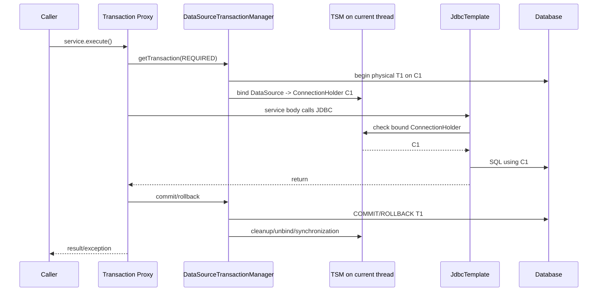

# TransactionSynchronizationManager and Thread-Bound Resources in Spring

## 1. The Big Picture

`TransactionSynchronizationManager` (TSM) is an **infrastructure** component of the Spring Framework used to manage **resources bound to the current thread** and **transaction synchronization callbacks** in the imperative transaction management model (*imperative transaction management*).

A `@Transactional` service can call multiple DAOs that use the same `DataSource`. The Spring transaction manager opens a physical JDBC transaction and **binds a `ConnectionHolder` keyed by the `DataSource` onto the thread**, allowing SQL statements from `JdbcTemplate` to use the connection participating in the transaction. That is why a service can execute multiple SQL statements within a single unit of work without having to pass `java.sql.Connection` through every method.

**Key principle:**

> A thread-bound resource is the **resource usage context**, not the physical transaction itself, not a guarantee of a successful commit, and not a transaction automatically shared across different threads.

Two important checks:

- `TransactionSynchronizationManager.isActualTransactionActive()`: is the current thread marked as having an **actual transaction** attached?
- `TransactionSynchronizationManager.isSynchronizationActive()`: does the current thread have a **synchronization scope** in which callbacks can be registered?

They are **not equivalent**. For example, a `SUPPORTS` or `NOT_SUPPORTED` scope can activate synchronization depending on the transaction manager's policy without starting a physical transaction.

This is a standalone article covering Spring Framework 6.x, Java 17+, `PlatformTransactionManager`, Spring JDBC, and JPA. At the end, there is a Maven/Spring JDBC/H2 example that observes how resources are bound, suspended, and resumed, as well as the fact that a new thread does not automatically inherit the transaction.

## 2. ThreadLocal Mechanism and the Resource Map

### 2.1. Resources Bound to a Thread

Java `ThreadLocal` stores values on a per-thread basis. Inside the imperative TSM, Spring stores:

- **Resource map:** the key is the resource factory, and the value is the resource holder.
- **Synchronization collection:** the registered `TransactionSynchronization` instances.
- **Transaction characteristics:** name, read-only flag, isolation level, and actual-transaction-active flag.

Model example:

```text
Thread A (handling request #1)
  TSM:
    DataSource ordersDb -> ConnectionHolder(connection C1)
    actualTransactionActive = true
    synchronizationActive = true

  CheckoutService.checkout()
    -> OrderDao.insert()      uses C1
    -> InventoryDao.reserve() uses C1
    -> PaymentLogDao.insert() uses C1

Thread B (handling request #2)
  TSM:
    DataSource ordersDb -> ConnectionHolder(connection C2)
    actualTransactionActive = true
    synchronizationActive = true
```

Thread B has its own resource map. `C1` and `C2` do not automatically become a shared transaction, even though both threads use the same `DataSource` bean.

With `DataSourceTransactionManager`, the key is typically the `DataSource` itself, and the value is `ConnectionHolder`. With resource-local JPA, `JpaTransactionManager` can bind an `EntityManagerHolder` keyed by `EntityManagerFactory`, along with related resources.

### 2.2. Only One Active Resource Binding per Key

TSM supports **one resource per key at a time** on the current thread. `bindResource(key, value)` can throw `IllegalStateException` if the key is already bound. When it needs to suspend an outer transaction and open `REQUIRES_NEW`, the transaction manager **temporarily unbinds the outer holder** before binding the inner holder; it does not store two values simultaneously under the same key in the active map.

`getResourceMap()` can be useful for debugging, but it is primarily meant for infrastructure. Do not dump the entire map into production logs: it can contain connection holders and internal resource information.

### 2.3. Resource Binding Is Not a Global Transaction

If DAO A uses `ordersDataSource` and DAO B uses `reportingDataSource`, there may be **two different resource keys**, but that does not guarantee the two connections belong to the same XA/distributed transaction. Each `PlatformTransactionManager` manages the resources appropriate to it. JTA/XA or an appropriate consistency architecture is required if the business logic demands atomicity across multiple resources.

HTTP requests, emails, queues, or payment gateways do not automatically join a local JDBC transaction just because they run inside a `@Transactional` method.

## 3. APIs to Distinguish

Use the imperative class:

```java
import org.springframework.transaction.support.TransactionSynchronizationManager;
```

| API | Purpose | Must Not Be Inferred |
| --- | --- | --- |
| `isActualTransactionActive()` | Is there an actual transaction context on the current thread? | All datasources in the app share the same transaction |
| `isSynchronizationActive()` | Is there a synchronization scope to register callbacks? | A physical JDBC transaction definitely exists |
| `hasResource(Object key)` | Does the current thread have a resource bound to the key? | The resource will commit/rollback together with the business logic |
| `getResource(Object key)` | Read the resource holder or `null` | The value is always a `Connection` directly |
| `getResourceMap()` | View bindings on the thread, mainly for debugging | Permission to modify/move bindings to another thread |
| `getCurrentTransactionName()` | Exposed transaction name or `null` | Unique database transaction ID |
| `getCurrentTransactionIsolationLevel()` | Isolation level exposed by Spring or `null` | Exact query of every DB connection's setting |
| `isCurrentTransactionReadOnly()` | Read-only metadata/hint | The database definitely forbids all write operations |
| `getSynchronizations()` | Snapshot of registered synchronizations | You can mutate the list directly and the manager will pick up changes |
| `registerSynchronization(sync)` | Register a transaction lifecycle callback | Can be called when synchronization is not yet active |
| `bindResource`, `unbindResource` | Low-level binding for resource integration | API to be used in business services |
| `initSynchronization`, `clearSynchronization`, `clear` | Manage synchronization/characteristics state | Can replace `commit/rollback` or resource cleanup |

### 3.1. Two Easily Confused Booleans

```java
boolean actual =
    TransactionSynchronizationManager.isActualTransactionActive();
boolean sync =
    TransactionSynchronizationManager.isSynchronizationActive();
boolean dsBound =
    TransactionSynchronizationManager.hasResource(dataSource);
```

This is a Java snippet that requires a `dataSource` variable. When `DataSourceTransactionManager` has just created T1 for `@Transactional(REQUIRED)`, typically `actual=true`, `sync=true`, and `dsBound=true`.

However, with `PROPAGATION_SUPPORTS` when **no transaction exists yet**, `AbstractPlatformTransactionManager` may still create a synchronization scope if the policy is `SYNCHRONIZATION_ALWAYS`. In that case, `sync=true` while `actual=false`.

Similarly, with `NOT_SUPPORTED` inside T1, Spring can suspend T1 and still create a synchronization-only scope for the inner call. You should not assert `isSynchronizationActive()==false` for every `NOT_SUPPORTED` case.

### 3.2. Having a Resource Without an Actual Transaction

For example, with **Open EntityManager in View**, an `EntityManager` can be bound for the request even outside an actual transaction. With `SUPPORTS`, a JDBC resource can be bound **lazily** when data access occurs in a synchronization-only scope. Therefore, `hasResource(key)=true` does not prove that a physical transaction is active.

If you need to know whether a method truly has a transaction, inspect `isActualTransactionActive`, the manager, the resource key, the proxy path, the JDBC/JPA provider, and the timing of physical commit/rollback together. Do not look at just a single flag.

## 4. Processing Flow When @Transactional Is Intercepted

Spring's `TransactionInterceptor` reads the transaction attribute, uses `PlatformTransactionManager` to open or join a transaction, invokes the business method, and decides on completion.



The diagram illustrates `DataSourceTransactionManager` on a local datasource. With JTA/JPA or custom managers, resource details differ; the database does not necessarily receive a literal `BEGIN` SQL statement.

**Do not confuse** the end of an inner method with a physical commit. If an inner `@Transactional(REQUIRED)` joins an outer T1, the inner method has its own logical scope, but physical connection C1 still belongs to T1 and only commits/rolls back when the owner completes.

### 4.1. Role of DataSourceUtils

`JdbcTemplate` acquires connections through Spring's mechanism, typically via `DataSourceUtils`. Properly integrated low-level JDBC code looks like this:

```java
import java.sql.Connection;
import javax.sql.DataSource;
import org.springframework.jdbc.datasource.DataSourceUtils;

Connection connection = DataSourceUtils.getConnection(dataSource);
try {
    // Use JDBC Statement/PreparedStatement on this connection.
} finally {
    DataSourceUtils.releaseConnection(connection, dataSource);
}
```

This is a snippet: the variables and JDBC work must be declared in the application. `getConnection` can return the transaction-bound C1. `releaseConnection` understands when a connection belongs to a transaction and **does not close the bound resource prematurely**, while an unbound connection is closed/returned using the appropriate mechanism.

If code directly calls `dataSource.getConnection()` on an ordinary datasource without going through Spring-aware access, it can receive a new C2, **not belonging to T1**, and auto-commit outside the transaction. `TransactionAwareDataSourceProxy` can be used for legacy APIs that require `DataSource.getConnection()`-style access; for new code, prefer `JdbcTemplate` or Spring-managed repositories.

### 4.2. Do Not Pass Connection Throughout Business Code

Services should depend on repositories/DAOs rather than `Connection`. Reusing C1 coordinated by TSM and the manager is an infrastructure detail. Do not store C1 in a singleton field, do not send it to an async worker, and do not treat `Connection` as an object safe for concurrent use by multiple threads.

## 5. How Propagation Changes Resource Binding

| Inner propagation, when outer T1 is active | Physical resource | Common observation |
| --- | --- | --- |
| `REQUIRED` | Joins C1/T1 | `isNewTransaction=false`, same transaction-bound connection |
| `SUPPORTS` | Joins T1 | T1 remains active; does not create T2 on its own |
| `MANDATORY` | Joins T1; fails if outer is missing | Does not create a new physical transaction |
| `REQUIRES_NEW` | Suspends C1, binds C2/T2, completes then resumes C1 | Has an independent physical transaction |
| `NOT_SUPPORTED` | Suspends T1, runs without actual T1 | `isActualTransactionActive=false` inside inner |
| `NESTED` with JDBC savepoint | C1/T1, adds a savepoint | `hasSavepoint=true` when supported |
| `NEVER` | Rejects if T1 exists | Does not silently suspend T1 |
| `REQUIRED` on a new thread without T1 context | Can create physical T2 on that thread itself | Does not automatically join the caller's T1 |

These conclusions are conditional: **the call goes through a Spring proxy**, the manager supports the propagation mode, the same managed resource is used, and there is no different custom transaction synchronization configuration.

### 5.1. REQUIRED: Two Intercepted Calls, One Physical Transaction

```java
@Service
class PaymentService {
    private final LedgerService ledger;

    PaymentService(LedgerService ledger) {
        this.ledger = ledger;
    }

    @Transactional
    public void pay() {
        ledger.writeEntry();
    }
}

@Service
class LedgerService {
    @Transactional(propagation = Propagation.REQUIRED)
    public void writeEntry() {
        // Join the existing physical transaction.
    }
}
```

These are snippets without repositories/imports. If `pay` starts T1 and `writeEntry` is intercepted via the injected bean proxy, outer and inner have separate logical scopes but typically share C1. An inner rollback-only can cause **the entire T1 to roll back**, even if the outer method catches the exception and returns normally.

### 5.2. REQUIRES_NEW: Suspend and Resume

When inner is `REQUIRES_NEW`:

1. Spring temporarily suspends the synchronization/resource binding of outer T1.
2. `DataSourceTransactionManager` can unbind `ConnectionHolder(C1)` from the thread.
3. Inner starts T2 on C2 and binds holder C2 under the same `DataSource` key.
4. Inner commits/rolls back T2 and cleans up C2.
5. The manager restores outer C1 and its synchronizations, and outer resumes T1.

```text
Before inner: DataSource -> ConnectionHolder(C1, T1)

During inner: [C1 is held by the manager in suspended resources]
              DataSource -> ConnectionHolder(C2, T2)

After inner:  DataSource -> ConnectionHolder(C1, T1) [resumed]
```

**There are never two values simultaneously bound to the same resource key at one time.** T1 stays open while T2 runs; the outer connection may still hold locks, and T2 may need a second connection. When the pool is small, `REQUIRES_NEW` can cause connection exhaustion or lock waits if both T1 and T2 try to update the same row.

### 5.3. NOT_SUPPORTED: No Actual Transaction, Yet Sync May Still Exist

```java
@Transactional(propagation = Propagation.NOT_SUPPORTED)
public void outsideTransaction() {
    boolean actual =
        TransactionSynchronizationManager.isActualTransactionActive();
    // Usually false when outer T1 is suspended.
}
```

This is a snippet. If JDBC data access happens using an auto-commit connection outside T1, the SQL may commit independently. `NOT_SUPPORTED` is not a read-only security policy and does not guarantee that operations will roll back when the outer transaction rolls back.

In the default setup, `isSynchronizationActive()` may be `true` even though `actual=false`. If the method checks `hasResource(ds)` **before** acquiring a connection, it is usually false; after JDBC access it may differ if synchronization manages resources lazily.

### 5.4. NESTED: Savepoint on the Same Resource

With `DataSourceTransactionManager` and JDBC savepoint support, an inner `NESTED` uses the same physical connection C1 and has `TransactionStatus.hasSavepoint()==true`. A successful inner call can release the savepoint **without committing T1**. An inner rollback to the savepoint allows the outer transaction to continue; lock behavior depends on the database.

You cannot conclude `NESTED` merely from "same connection" because `REQUIRED` also uses the same connection; you must observe the status/savepoint and the proper intercepted boundary.

### 5.5. Self-Invocation Does Not Create an Inner Scope

```java
@Service
class SingleService {
    @Transactional
    public void outer() {
        this.inner(); // Does not go through the Spring proxy in proxy mode.
    }

    @Transactional(propagation = Propagation.REQUIRES_NEW)
    public void inner() {
        // Does not automatically suspend T1 via self-invocation.
    }
}
```

If outer is intercepted and opens T1, the inner code can still observe `isActualTransactionActive=true` because it runs on the same thread, but the inner annotation may not take effect. To establish a new boundary, move `inner` to another injected bean and call it through the proxy, or use `TransactionTemplate`.

## 6. @Async, CompletableFuture, and Reactive Do Not Share ThreadLocal

### 6.1. A New Thread Does Not Inherit C1

```java
@Transactional
public void process() {
    jdbc.update("UPDATE wallet SET balance=balance+1 WHERE id=1");

    CompletableFuture.runAsync(() -> {
        boolean actual =
            TransactionSynchronizationManager.isActualTransactionActive();
        // Worker thread does not automatically inherit the caller's T1.
    });
}
```

This is a snippet, requiring fields/imports. The imperative `PlatformTransactionManager` uses a `ThreadLocal` on the current thread. `@Async`, `new Thread(...)`, `CompletableFuture.supplyAsync`, and other executors do not automatically copy transaction-bound JDBC resources.

If the worker calls a Spring-proxied `@Transactional` method, it can start a **new transaction on the worker's thread** rather than joining T1 just because outer has not committed yet. Do not manually copy `getResourceMap()` or `ConnectionHolder` to the worker: the connection may not be safe for concurrent access and outer may clean up while the worker is still using it.

### 6.2. Reactive Is a Different Model

Imperative class:

```java
org.springframework.transaction.support.TransactionSynchronizationManager
```

Reactive class:

```java
org.springframework.transaction.reactive.TransactionSynchronizationManager
```

The reactive manager uses the **Reactor subscriber context**, not the imperative `ThreadLocal`. With R2DBC, use `R2dbcTransactionManager` or `TransactionalOperator` within the reactive pipeline. Do not use the static `isActualTransactionActive()` of the imperative class as a test for all reactive transactions.

### 6.3. Request/Security Context Is Not Transaction Context

MDC correlation IDs, Spring Security context, or request attributes can be propagated via their own mechanisms. That does **not** mean a JDBC transaction is safely transferred to another thread. Even though Java 21 virtual threads can help concurrency, each virtual thread still has its own context/binding in the imperative model.

## 7. TransactionSynchronization: Hooks on Commit/Rollback

### 7.1. Registering Callbacks at the Right Time

When `isSynchronizationActive()` is true, integration code can register:

```java
TransactionSynchronizationManager.registerSynchronization(
    new TransactionSynchronization() {
        @Override
        public void afterCommit() {
            System.out.println("Committed");
        }

        @Override
        public void afterCompletion(int status) {
            System.out.println("Completed with " + status);
        }
    }
);
```

This is a snippet requiring imports and a real synchronization scope. `registerSynchronization` can throw `IllegalStateException` when synchronization is not active.

### 7.2. Important Callbacks

| Callback | Meaning | Caveats |
| --- | --- | --- |
| `beforeCommit(readOnly)` | Preparation before an intended commit | May still roll back later |
| `beforeCompletion()` | Cleanup before completion | Does not guarantee commit |
| `afterCommit()` | Called when physical commit succeeds | Resources may still be bound prior to cleanup |
| `afterCompletion(status)` | Completion with committed/rolled-back/unknown status | Suitable for cleanup or outcome tracking |
| `suspend()`, `resume()` | When outer synchronization is suspended/resumed | Useful for resource integration |
| `savepoint(...)`, `savepointRollback(...)` | Savepoint-related callbacks in Spring 6.2 | Not an independent physical commit |

Common status constants: `TransactionSynchronization.STATUS_COMMITTED`, `STATUS_ROLLED_BACK`, `STATUS_UNKNOWN`. `getSynchronizations()` returns a snapshot of the synchronization list; do not modify the snapshot directly.

### 7.3. The afterCommit Trap

After the `afterCommit` callback, the database transaction has already committed, but Spring may **not yet have completely cleaned up resource holders and thread-bound metadata**. New SQL executed inside the callback may still access the original transaction-bound resources, **with no second physical commit following it**.

If the callback needs to write to the database in a **new** transaction, call **another bean through its proxy** with `@Transactional(propagation = Propagation.REQUIRES_NEW)`, or use an outbox for durable workflows. Do not call a `REQUIRED` helper and assume it will commit independently.

### 7.4. Do Not Clean Up the Thread Using clear() from a Service

`TransactionSynchronizationManager.clear()` and `clearSynchronization()` only manipulate parts of TSM state via the API; **they do not replace commit/rollback and do not replace proper resource lifecycle cleanup**. In business code, calling `unbindResource(...)` or `clear()` manually can break suspend/resume, cause leaks, or prevent the framework from finding the T1 holder. Let the transaction manager perform cleanup.

## 8. Java 17 Runnable Demo: Same Connection, New Transaction, and Another Thread

This demo uses Spring Framework **6.2.19**, H2 **2.3.232**, Java 17, and Maven; Spring Boot is not required. `DataSourceTransactionManager` uses `DriverManagerDataSource`, making it convenient to observe two distinct physical JDBC connections.

The cases covered:

1. Outside a transaction: no actual transaction/resource binding.
2. Outer `REQUIRED` starts T1 and binds JDBC holder C1.
3. Inner `REQUIRED` is intercepted by the proxy and receives **the same C1**.
4. Inner `NESTED` receives C1, along with a savepoint.
5. Inner `REQUIRES_NEW` receives C2 distinct from C1 and commits an audit record separately.
6. Inner `NOT_SUPPORTED` no longer has actual T1 in scope.
7. A new thread does not automatically inherit T1.
8. Outer resumes C1, commits, and invokes synchronization callbacks.

### 8.1. Structure

```text
tx-thread-demo/
├── pom.xml
└── src/main/java/demo/tx/TransactionThreadDemo.java
```

### 8.2. pom.xml

```xml
<project xmlns="http://maven.apache.org/POM/4.0.0"
         xmlns:xsi="http://www.w3.org/2001/XMLSchema-instance"
         xsi:schemaLocation="http://maven.apache.org/POM/4.0.0
                             https://maven.apache.org/xsd/maven-4.0.0.xsd">
    <modelVersion>4.0.0</modelVersion>
    <groupId>demo</groupId>
    <artifactId>tx-thread-demo</artifactId>
    <version>1.0.0</version>
    <properties>
        <maven.compiler.release>17</maven.compiler.release>
        <project.build.sourceEncoding>UTF-8</project.build.sourceEncoding>
    </properties>
    <dependencies>
        <dependency>
            <groupId>org.springframework</groupId>
            <artifactId>spring-context</artifactId>
            <version>6.2.19</version>
        </dependency>
        <dependency>
            <groupId>org.springframework</groupId>
            <artifactId>spring-jdbc</artifactId>
            <version>6.2.19</version>
        </dependency>
        <dependency>
            <groupId>com.h2database</groupId>
            <artifactId>h2</artifactId>
            <version>2.3.232</version>
        </dependency>
    </dependencies>
    <build>
        <plugins>
            <plugin>
                <groupId>org.apache.maven.plugins</groupId>
                <artifactId>maven-compiler-plugin</artifactId>
                <version>3.13.0</version>
            </plugin>
            <plugin>
                <groupId>org.codehaus.mojo</groupId>
                <artifactId>exec-maven-plugin</artifactId>
                <version>3.5.1</version>
            </plugin>
        </plugins>
    </build>
</project>
```

### 8.3. src/main/java/demo/tx/TransactionThreadDemo.java

```java
package demo.tx;

import java.sql.Connection;
import javax.sql.DataSource;

import org.springframework.context.annotation.AnnotationConfigApplicationContext;
import org.springframework.context.annotation.Bean;
import org.springframework.context.annotation.Configuration;
import org.springframework.jdbc.core.JdbcTemplate;
import org.springframework.jdbc.datasource.DataSourceTransactionManager;
import org.springframework.jdbc.datasource.DataSourceUtils;
import org.springframework.jdbc.datasource.DriverManagerDataSource;
import org.springframework.transaction.PlatformTransactionManager;
import org.springframework.transaction.annotation.EnableTransactionManagement;
import org.springframework.transaction.annotation.Propagation;
import org.springframework.transaction.annotation.Transactional;
import org.springframework.transaction.interceptor.TransactionAspectSupport;
import org.springframework.transaction.support.TransactionSynchronization;
import org.springframework.transaction.support.TransactionSynchronizationManager;

public final class TransactionThreadDemo {

    public static void main(String[] args) {
        try (var ctx = new AnnotationConfigApplicationContext(Config.class)) {
            DataSource ds = ctx.getBean(DataSource.class);
            JdbcTemplate jdbc = ctx.getBean(JdbcTemplate.class);
            OuterService service = ctx.getBean(OuterService.class);

            jdbc.execute("CREATE TABLE wallet (" +
                    "id INT PRIMARY KEY, amount INT NOT NULL)");
            jdbc.execute("CREATE TABLE audit_event (" +
                    "id INT PRIMARY KEY, message VARCHAR(30))");
            jdbc.update("INSERT INTO wallet (id, amount) VALUES (1, 100)");

            show("outside-before", ds);
            service.run();
            show("outside-after", ds);

            Integer amount = jdbc.queryForObject(
                    "SELECT amount FROM wallet WHERE id=1", Integer.class);
            Integer auditCount = jdbc.queryForObject(
                    "SELECT COUNT(*) FROM audit_event", Integer.class);
            System.out.println("amount=" + amount
                    + ", auditRows=" + auditCount);
        }
    }

    private static void show(String name, DataSource ds) {
        System.out.println(name
                + ": active="
                + TransactionSynchronizationManager.isActualTransactionActive()
                + ", bound="
                + TransactionSynchronizationManager.hasResource(ds));
    }

    @Configuration(proxyBeanMethods = false)
    @EnableTransactionManagement(proxyTargetClass = true)
    public static class Config {
        @Bean
        public DataSource dataSource() {
            return new DriverManagerDataSource(
                    "jdbc:h2:mem:tx_thread_demo;DB_CLOSE_DELAY=-1", "sa", "");
        }

        @Bean
        public PlatformTransactionManager transactionManager(DataSource ds) {
            return new DataSourceTransactionManager(ds);
        }

        @Bean
        public JdbcTemplate jdbcTemplate(DataSource ds) {
            return new JdbcTemplate(ds);
        }

        @Bean
        public InnerService innerService(JdbcTemplate jdbc, DataSource ds) {
            return new InnerService(jdbc, ds);
        }

        @Bean
        public OuterService outerService(
                JdbcTemplate jdbc, DataSource ds, InnerService inner) {
            return new OuterService(jdbc, ds, inner);
        }
    }

    public static class InnerService {
        private final JdbcTemplate jdbc;
        private final DataSource ds;

        public InnerService(JdbcTemplate jdbc, DataSource ds) {
            this.jdbc = jdbc;
            this.ds = ds;
        }

        @Transactional(propagation = Propagation.REQUIRED)
        public void required(Connection outerConnection) {
            show("inner REQUIRED", ds);
            Connection current = DataSourceUtils.getConnection(ds);
            try {
                System.out.println("REQUIRED sameConnection="
                        + (current == outerConnection));
            } finally {
                DataSourceUtils.releaseConnection(current, ds);
            }
        }

        @Transactional(propagation = Propagation.NESTED)
        public void nested(Connection outerConnection) {
            show("inner NESTED", ds);
            Connection current = DataSourceUtils.getConnection(ds);
            try {
                boolean savepoint =
                        TransactionAspectSupport.currentTransactionStatus()
                                .hasSavepoint();
                System.out.println("NESTED sameConnection="
                        + (current == outerConnection)
                        + ", savepoint=" + savepoint);
            } finally {
                DataSourceUtils.releaseConnection(current, ds);
            }
        }

        @Transactional(propagation = Propagation.REQUIRES_NEW)
        public void requiresNew(Connection outerConnection) {
            show("inner REQUIRES_NEW", ds);
            Connection current = DataSourceUtils.getConnection(ds);
            try {
                System.out.println("REQUIRES_NEW sameConnection="
                        + (current == outerConnection));
                jdbc.update(
                        "INSERT INTO audit_event (id, message) VALUES (1, 'T2')");
            } finally {
                DataSourceUtils.releaseConnection(current, ds);
            }
        }

        @Transactional(propagation = Propagation.NOT_SUPPORTED)
        public void withoutTransaction() {
            show("inner NOT_SUPPORTED", ds);
        }
    }

    public static class OuterService {
        private final JdbcTemplate jdbc;
        private final DataSource ds;
        private final InnerService inner;

        public OuterService(JdbcTemplate jdbc, DataSource ds,
                            InnerService inner) {
            this.jdbc = jdbc;
            this.ds = ds;
            this.inner = inner;
        }

        @Transactional
        public void run() {
            show("outer", ds);
            Connection original = DataSourceUtils.getConnection(ds);
            try {
                jdbc.update(
                        "UPDATE wallet SET amount=amount+10 WHERE id=1");

                TransactionSynchronizationManager.registerSynchronization(
                    new TransactionSynchronization() {
                        @Override
                        public void afterCommit() {
                            System.out.println("outer afterCommit");
                        }

                        @Override
                        public void afterCompletion(int status) {
                            String result = status == STATUS_COMMITTED
                                    ? "COMMITTED" : "OTHER";
                            System.out.println(
                                    "outer afterCompletion=" + result);
                        }
                    });

                inner.required(original);
                inner.nested(original);
                inner.requiresNew(original);
                inner.withoutTransaction();

                Thread observer = new Thread(
                        () -> show("worker-thread", ds), "observer-thread");
                observer.start();
                try {
                    observer.join();
                } catch (InterruptedException ex) {
                    Thread.currentThread().interrupt();
                    throw new IllegalStateException("Interrupted", ex);
                }

                Connection resumed = DataSourceUtils.getConnection(ds);
                try {
                    System.out.println("outer restored sameConnection="
                            + (resumed == original));
                } finally {
                    DataSourceUtils.releaseConnection(resumed, ds);
                }
            } finally {
                DataSourceUtils.releaseConnection(original, ds);
            }
        }
    }
}
```

### 8.4. Running the Demo

Inside the `tx-thread-demo` directory:

```bash
mvn -q compile exec:java -Dexec.mainClass=demo.tx.TransactionThreadDemo
```

**Lines printed by the program itself**, excluding Maven/Spring's own logs:

```text
outside-before: active=false, bound=false
outer: active=true, bound=true
inner REQUIRED: active=true, bound=true
REQUIRED sameConnection=true
inner NESTED: active=true, bound=true
NESTED sameConnection=true, savepoint=true
inner REQUIRES_NEW: active=true, bound=true
REQUIRES_NEW sameConnection=false
inner NOT_SUPPORTED: active=false, bound=false
worker-thread: active=false, bound=false
outer restored sameConnection=true
outer afterCommit
outer afterCompletion=COMMITTED
outside-after: active=false, bound=false
amount=110, auditRows=1
```

### 8.5. Interpreting the Output

- **Outside:** main thread has no T1; the preceding schema creation and seed steps have completed.
- **Outer:** the transaction interceptor starts T1 and binds JDBC `ConnectionHolder(C1)`.
- **REQUIRED:** inner logical scope joins T1; `DataSourceUtils` returns the same bound C1 object.
- **NESTED:** Spring JDBC and H2 use a savepoint inside T1, so it is still C1; `hasSavepoint=true`.
- **REQUIRES_NEW:** outer C1 is suspended; inner T2 uses a different C2, and audit row id=1 commits when the method finishes.
- **NOT_SUPPORTED:** actual transaction is false inside inner. `show()` runs before any JDBC access, so it does not see outer C1 bound.
- **Worker-thread:** a new Java thread does not inherit the caller's `ThreadLocal` context T1.
- **Outer restored:** after the inner scopes, the manager resumes C1; `DataSourceUtils` returns the exact handle C1 again.
- **afterCommit/afterCompletion:** outer callbacks run when T1 actually commits, not when inner `REQUIRED` returns.
- **Outside-after:** resources and transaction metadata are cleaned up after the proxied call.
- **Database:** wallet increases 100 → 110 in T1; `audit_event` has 1 record written by T2.

Comparing `Connection` with `==` in a pure `DriverManagerDataSource` example is only for illustrating resource reuse. On a real pool/proxy, additional assertions for **independent commit/rollback and resource lifecycle** are needed rather than relying solely on Java object identity. The demo logic has been reviewed; it should be run in the actual target runtime/driver to verify the output.

## 9. Common Mistakes

### 9.1. Manually Calling bindResource or Clearing the Transaction Context

`TransactionSynchronizationManager` is designed for infrastructure. Calling `bindResource` manually in a service can conflict with an existing holder, cause connection leaks, and corrupt ownership. Calling `clear()` is not a way to commit/rollback and does not replace the manager's resource cleanup. Let the Spring manager coordinate this.

### 9.2. Checking Only hasResource to Claim a Transaction Is Active

A resource can be bound due to OSIV or a synchronization-only scope. You also need the actual transaction flag, datasource identity, and DB state verification after completion.

### 9.3. @Async Sharing the Caller's Transaction

That is false in Spring's imperative `ThreadLocal` model. An async worker must have its own transaction boundary if needed, or use a workflow/outbox to guarantee ordering and consistency.

### 9.4. Assuming REQUIRES_NEW Still Uses C1

No—when outer T1 is active and the manager supports suspension, inner T2 is an independent physical transaction. T1 holds onto its connection/locks and can cause pool or row-lock contention.

### 9.5. Writing to the Database Directly Inside afterCommit with REQUIRED

This is unsafe because resources may not have been cleaned up yet and there is no subsequent physical commit for the original context. If a new write is needed, use a `REQUIRES_NEW` proxy call or a workflow/outbox.

### 9.6. Equating DataSourceTransactionManager and ReactiveTransactionManager

Imperative uses `ThreadLocal`; reactive uses the Reactor context. Do not copy static TSM inspection code to R2DBC and trust it to reflect reactive transactions.

### 9.7. Multiple Transaction Managers While Logging Only active=true

The flag does not prove that every resource belongs to the same physical transaction. With multiple datasources or `EntityManagerFactory` beans, use the right manager qualifier, key, and DB evidence.

## 10. Recommended Test Cases

| Test | How to Verify | Expected Result |
| --- | --- | --- |
| Outside transaction | Call TSM introspection from the caller thread | Usually `active=false` and no bound datasource |
| Outer JDBC REQUIRED | Proxy opens T1, uses `JdbcTemplate` | Resource bound, actual transaction true |
| Inner JDBC REQUIRED | Different bean, called via proxy, same datasource | Same transaction-bound connection C1, no separate commit |
| Inner REQUIRES_NEW | Outer T1 active, inner T2 commits | Independent C2; C1 resumed; T2 can persist even if T1 rolls back |
| Inner NESTED | JDBC manager supporting savepoints | Uses C1, status `hasSavepoint=true` |
| Inner NOT_SUPPORTED | Called via proxy while T1 is active | Actual transaction false; do not mechanically assert `sync=false` |
| New thread | Outer active, new `Thread` reads TSM | Does not automatically inherit T1 transaction holder |
| Commit callback | Outer registers synchronization and commits | `afterCommit` and `afterCompletion(COMMITTED)` |
| Rollback callback | Outer throws an unchecked exception | No `afterCommit`; `afterCompletion(ROLLED_BACK)` |
| Self-invocation | `this.innerRequiresNew()` | No inner transaction proxy boundary in proxy mode |
| JPA OSIV | Request has not opened a transaction, with OSIV enabled | `EntityManager` bound can be true, actual transaction false |
| Cleanup + thread reuse | Run multiple requests on a pooled thread | No stale holder remains after completion |

With Spring Test, `@Transactional` on a test method typically creates an **outer test transaction** and rolls back at the end of the test. That can cause a `REQUIRED` service to merely join the test transaction; tests for separate commits should omit the outer test transaction or deliberately use `TestTransaction`. Final observations must confirm database state after transaction completion, not just flags.

## 11. Self-Check Questions

**Q1.** Does `isSynchronizationActive()==true` guarantee a JDBC transaction exists?

*Answer:* No; it may be a synchronization-only scope, such as `SUPPORTS`/`NOT_SUPPORTED`.

**Q2.** How do two DAOs using the same datasource in a Spring transaction obtain the same connection?

*Answer:* `DataSourceTransactionManager` binds a `ConnectionHolder` keyed by the datasource onto the current thread; `DataSourceUtils`/`JdbcTemplate` access that binding.

**Q3.** Does an inner `REQUIRES_NEW` have to change the datasource key to create T2?

*Answer:* No. Spring can suspend the holder C1 bound to the existing key, bind holder C2 for T2 under the same key, and then resume C1.

**Q4.** Why does `hasResource(entityManagerFactory)=true` not prove SQL is inside a transaction?

*Answer:* JPA OSIV can bind an `EntityManager` for the request even outside an actual transaction.

**Q5.** Should you modify the `setActualTransactionActive(false)` flag to commit?

*Answer:* No. TSM flags are infrastructure metadata and do not perform physical commit/rollback. Use the appropriate transaction manager and boundary.

**Q6.** Does a new thread automatically see the caller's `ThreadLocal` JDBC transaction?

*Answer:* No. The new worker needs its own Spring-managed transaction when required.

**Q7.** Does `afterCommit` running mean all resources have already been unbound?

*Answer:* Not necessarily; resources may still be accessible before cleanup. If a new write is required, use `REQUIRES_NEW` or an outbox.

**Q8.** Is `NESTED` using the same connection proof that it created a savepoint?

*Answer:* Not sufficient; `REQUIRED` also uses the same connection. Check `TransactionStatus.hasSavepoint()` and manager/driver support.

**Q9.** Should you copy `TSM.getResourceMap()` to an executor thread to achieve transaction propagation?

*Answer:* No. Doing so violates resource lifecycle and thread-safety assumptions.

**Q10.** Does `getCurrentTransactionIsolationLevel()==null` mean the database has no isolation?

*Answer:* No; Spring may simply not expose an explicit isolation setting, while the DB still has a default isolation level.

## 12. Summary

- TSM manages **transaction resource bindings and synchronizations per current thread** in imperative Spring.
- For JDBC, the binding is typically **DataSource → ConnectionHolder**; Spring-managed DAOs use `DataSourceUtils` to participate in the right physical transaction.
- **Actual transaction**, **synchronization scope**, and **bound resource** are three related states, but they are not synonymous.
- **REQUIRED** typically reuses C1/T1; **REQUIRES_NEW** suspends C1 and uses C2/T2; **NESTED** uses a savepoint on C1; **NOT_SUPPORTED** runs without the outer actual transaction.
- **New threads/@Async do not automatically inherit** imperative transactions; reactive transactions use the **Reactor context** rather than the same TSM `ThreadLocal`.
- `TransactionSynchronization` callbacks support the commit/rollback lifecycle, but **afterCommit is not a new transaction**.
- Do not manually bind/unbind/clear resources in business code; let `PlatformTransactionManager` handle begin, commit, rollback, suspend/resume, and cleanup.
- Tests must verify **both resource behavior and DB data after completion**.

## References

- [Spring Framework API — TransactionSynchronizationManager (imperative)](https://docs.spring.io/spring-framework/docs/6.2.x/javadoc-api/org/springframework/transaction/support/TransactionSynchronizationManager.html)
- [Spring Framework API — TransactionSynchronization](https://docs.spring.io/spring-framework/docs/6.2.x/javadoc-api/org/springframework/transaction/support/TransactionSynchronization.html)
- [Spring Framework API — DataSourceUtils](https://docs.spring.io/spring-framework/docs/6.2.x/javadoc-api/org/springframework/jdbc/datasource/DataSourceUtils.html)
- [Spring Framework API — DataSourceTransactionManager](https://docs.spring.io/spring-framework/docs/6.2.x/javadoc-api/org/springframework/jdbc/datasource/DataSourceTransactionManager.html)
- [Spring Framework — Synchronizing Resources with Transactions](https://docs.spring.io/spring-framework/reference/data-access/transaction/tx-resource-synchronization.html)
- [Spring Framework — Transaction Propagation](https://docs.spring.io/spring-framework/reference/data-access/transaction/declarative/tx-propagation.html)
- [Spring Framework — Declarative Transaction Implementation](https://docs.spring.io/spring-framework/reference/data-access/transaction/declarative/tx-decl-explained.html)
- [Spring Framework API — Reactive TransactionSynchronizationManager](https://docs.spring.io/spring-framework/docs/6.2.x/javadoc-api/org/springframework/transaction/reactive/TransactionSynchronizationManager.html)
