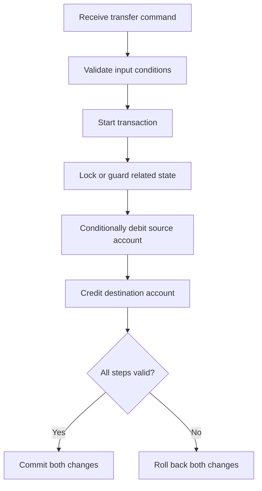

# Data Constraints and Business Invariants in Spring Transactions

## 1. Lesson objectives

After this lesson, learners will be able to:

- Distinguish **data constraints**, **business invariants**, input validation, and transactional consistency.
- Choose the right place to enforce each rule: API, domain/service, database, and concurrency control mechanisms.
- Use `@Transactional` to group multiple changes into one unit of success or failure, while understanding why `@Transactional` **does not automatically guarantee** every invariant.
- Design and test a money-transfer operation so it never creates negative balances, loses money, or double-credits under concurrent or retried requests.

The focus is on **rules that must always hold before and after a business transaction completes**, along with techniques to keep those rules true under failures and concurrent access.

## 2. Concepts and boundaries

A **data constraint** is a condition enforced on stored data, typically checked by the database: `NOT NULL`, `UNIQUE`, `PRIMARY KEY`, `FOREIGN KEY`, `CHECK`, data types, lengths, etc. For example: `balance_minor >= 0` or a transfer request ID must be unique.

A **business invariant** is an assertion that must always hold at valid observation points of the system. It can span **multiple rows, multiple tables, or state transitions**. For example: after a transfer between two accounts in the same currency, their total balance remains unchanged; a refunded order cannot be charged again as a new order.

**Input validation** verifies that a command has valid shape and values: positive amount, distinct source and destination accounts, non-empty request ID. It enables failing fast, yet a validation that passed when receiving an HTTP request does not prove the data is still valid at DB write time.

**Transactional consistency** means that when a transaction is confirmed (committed), the data satisfies the designed constraints and invariants. `@Transactional` coordinates commit/rollback boundaries; business code, DB constraints, and concurrency synchronization determine which invariants are truly protected.

| Rule | Primary line of defense | Why |
| --- | --- | --- |
| Every account has a unique ID | `PRIMARY KEY` | DB rejects duplicate-key records |
| Non-negative balance | `CHECK (balance_minor >= 0)`, plus conditional updates | Protects even if another write path bypasses service checks |
| Transfer amount greater than 0 | Service validation and `CHECK` on the request table | Early feedback and stored-data protection |
| Cannot transfer to oneself | Domain check, optionally `CHECK (from_id <> to_id)` | This is a rule of the transfer command |
| Debit and credit happen together once per transfer | One DB transaction enclosing both statements | Must never leave a "debited but not credited" state |
| Do not overspend balance when two commands run concurrently | Locking, conditional updates, or version checks | Pre-write reads may already be stale |
| One request ID executes only once | `UNIQUE`/`PRIMARY KEY` on idempotency key and transaction covering the result | HTTP retries must not create a second transfer |

No single layer replaces all others: the service expresses business meaning; the DB is the shared consistency defense across all write paths; transactions and concurrency control ensure checks stay valid while state changes.

## 3. Running example: transferring funds between two accounts

Suppose two accounts share the same currency, storing amounts in the **smallest unit** (e.g., whole VND or cents) using integer `BIGINT` instead of `double`:

- A has 150,000; B has 40,000.
- Successfully transferring 60,000 from A to B → A = 90,000; B = 100,000.
- The total before and after is 190,000.
- Transferring a negative amount, transferring to oneself, or exceeding the balance must be rejected; when rejected, **neither account's balance changes**.

These conditions can be written as preconditions and postconditions:

- **Preconditions:** `amount > 0`, `source != target`, both accounts exist and balance is sufficient.
- **Postconditions on success:** `sourceAfter = sourceBefore - amount`, `targetAfter = targetBefore + amount`, and `sourceAfter + targetAfter = sourceBefore + targetBefore`.
- **Postconditions on failure:** durable state after rollback matches the state before the transaction.
- **Concurrency condition:** if two requests both attempt to spend from the same account, decisions must not be made from two reads of the same stale balance.

Note: "unchanged total" here applies to **internal transfer operations**. Deposits, withdrawals, fees, or accounting adjustments are separate business operations with their own invariants and ledger entries. Never assume every balance change preserves the sum.

### A transaction as an atomic boundary



If two `UPDATE` statements run in auto-commit mode, the debit can commit while the credit fails. If both run in **the same DB transaction**, an error requiring rollback reverts the changes made within that transaction back to the state before it started.

## 4. Turning constraints into database DDL

PostgreSQL example:

```sql
CREATE TABLE account (
    id BIGINT PRIMARY KEY,
    balance_minor BIGINT NOT NULL,
    CONSTRAINT ck_account_balance_nonnegative
        CHECK (balance_minor >= 0)
);

INSERT INTO account (id, balance_minor)
VALUES (1, 150000), (2, 40000);
```

Here:

- `PRIMARY KEY` forbids duplicate IDs and null IDs.
- `NOT NULL` forbids null balances. `CHECK (balance_minor >= 0)` alone does not replace `NOT NULL` because a `CHECK` expression evaluating to unknown/null is not necessarily treated as a violation.
- `CHECK` blocks direct SQL statements from creating negative balances, even statements bypassing Java code.
- `BIGINT` has a finite range; adding past the maximum is rejected by the DB. The application must still choose sensible business limits and handle errors.

If the domain supports accounts in multiple currencies, you must add a currency column and forbid cross-currency transfers or define explicit conversion rules. If a financial application has audit requirements, store ledger entries and transaction references rather than keeping only a balance column.

**Limits of `CHECK`:** PostgreSQL cannot use a simple `CHECK` constraint to enforce the sum across **multiple rows** or reservation counts across a set of records. A rule such as "sum A+B remains constant across an operation" must be protected by transactional write flows, ledger/data design, or appropriate DB mechanisms (triggers, procedures, locks, and write privileges). A row-level `CHECK` cannot prove atomicity across two `UPDATE` statements.

## 5. Spring example: safe transfer within a single DB

Prerequisites for running this example: a Spring Boot application on Java 17+, with `spring-boot-starter-jdbc`, PostgreSQL driver, `DataSource`, and an appropriate transaction manager; table `account` is created as above. This is a **service class for use inside a Spring application**, not a standalone Java file run with `java TransferService.java`.

```java
package example.transaction;

import org.springframework.jdbc.core.JdbcTemplate;
import org.springframework.stereotype.Service;
import org.springframework.transaction.annotation.Transactional;

@Service
public class TransferService {
    private final JdbcTemplate jdbc;

    public TransferService(JdbcTemplate jdbc) {
        this.jdbc = jdbc;
    }

    @Transactional
    public void transfer(long fromId, long toId, long amountMinor) {
        if (amountMinor <= 0) {
            throw new IllegalArgumentException("Amount must be positive");
        }
        if (fromId == toId) {
            throw new IllegalArgumentException("Accounts must differ");
        }

        // Always lock in ID order to reduce deadlock risk
        // when concurrent transfers run in opposite directions.
        long firstId = Math.min(fromId, toId);
        long secondId = Math.max(fromId, toId);
        lockAccount(firstId);
        lockAccount(secondId);

        // Check balance and debit in the SAME UPDATE statement.
        int debited = jdbc.update("""
            UPDATE account
               SET balance_minor = balance_minor - ?
             WHERE id = ? AND balance_minor >= ?
            """, amountMinor, fromId, amountMinor);
        if (debited != 1) {
            throw new IllegalStateException(
                "Source account has insufficient balance");
        }

        int credited = jdbc.update("""
            UPDATE account
               SET balance_minor = balance_minor + ?
             WHERE id = ?
            """, amountMinor, toId);
        if (credited != 1) {
            throw new IllegalStateException(
                "Target account does not exist");
        }
    }

    private void lockAccount(long id) {
        // When no row exists, queryForObject throws a
        // DataAccessException (runtime), rolling back the transaction.
        jdbc.queryForObject(
            "SELECT id FROM account WHERE id = ? FOR UPDATE",
            Long.class,
            id
        );
    }
}
```

**Mechanism explanation:**

1. `@Service` makes the class Spring-managed; calls from outside the bean go through the transaction proxy when transaction management is enabled. Spring Boot typically auto-configures transaction infrastructure when the right dependencies are present.
2. `@Transactional` opens or joins a transaction (default `Propagation.REQUIRED`). `JdbcTemplate` statements using the same `DataSource` and transaction manager commit/roll back together.
3. PostgreSQL `SELECT ... FOR UPDATE` holds row locks until the transaction ends; both accounts are locked in ascending ID order to avoid the classic A→B vs. B→A deadlock pattern.
4. `UPDATE ... WHERE balance_minor >= ?` turns "check sufficient funds + debit" into **one conditional operation inside the DB**. If it does not update exactly one row, the service throws an exception. Even with prior locking, the condition in `UPDATE` remains a useful safeguard.
5. The credit statement runs only after debit succeeds. If crediting fails, a DB error or runtime exception escaping the method causes Spring to roll back the earlier debit. If both succeed, Spring commits both together.

**Scope limitations of this example:** this transfer operation has **no duplicate-request guard (idempotency key)** and spans only **one database**. If a call succeeds and the client retries the same command, it will transfer a second time. Section 8 addresses that scenario. Furthermore, all other balance-updating paths must obey the same rules; if arbitrary SQL is allowed to alter balances, the system-wide sum invariant cannot be guaranteed.

### Why not just `SELECT` the balance and then `UPDATE`?

Code like the following has a race condition:

```text
T1 reads balance A = 100
T2 reads balance A = 100
T1 checks 100 >= 80 => true
T2 checks 100 >= 70 => true
T1 writes its result
T2 writes its result
```

If each thread relies on stale data, the system can **overspend the balance**, overwrite updates (lost update), or return incorrect results. `@Transactional` alone **does not guarantee** two checks are strictly serialized when two different transactions run concurrently. The solution depends on the problem: conditional updates, row locks, optimistic locking, or higher isolation levels paired with retries.

### Simulating two competing commands

A has 150,000; T1 wants to transfer 100,000, and T2 wants to transfer 80,000. With the service above:

- Whichever transaction locks A first updates A and commits (assuming a valid destination account).
- The second transaction waits for the lock, then sees A's reduced balance; `UPDATE ... balance_minor >= amount` prevents further spending if funds are insufficient.
- Valid outcome: **at most one request succeeds**, while the other fails and leaves data unchanged. The total balance after the successful transaction is preserved.

You cannot predict which transaction wins. That is schedule nondeterminism; correctness must hold across all valid schedules.

## 6. Choosing how to protect invariants under concurrency

| Technique | Use when | Caveats |
| --- | --- | --- |
| Atomic `UPDATE ... WHERE ...` | Condition and mutation are on the same row, such as debiting when funds suffice | Check affected row count; do not split into a prior `SELECT` and update from stale values |
| Pessimistic lock `SELECT ... FOR UPDATE` | You need to read and decide on state that will be modified, typically across a few known rows | Keep locks short; lock in consistent order; waits and deadlocks can occur |
| Optimistic lock `@Version`/`version` column | Conflicts are infrequent, and the entire command can be rejected and retried | Updates must be conditioned on version; conflicts must roll back and retry safely |
| `SERIALIZABLE` isolation | Multi-row invariants prone to write skew/phantoms | Must handle serialization errors and retry the **entire transaction**; overhead may be higher |
| `UNIQUE`, `FOREIGN KEY`, `CHECK` | Durable validity of stored data | Always enable in the DB, but they do not replace transaction boundaries and multi-row business rules |

Another example is a **5-seat limit**: two transactions both run `SELECT COUNT(*)` and see 4, then each inserts a seat; the result is 6 without concurrency protection. `READ COMMITTED` and `@Transactional` alone do not make a count query mutually exclusive. A common solution is an `event_capacity` row with `reserved_count` and an atomic update `UPDATE ... SET reserved_count = reserved_count + 1 WHERE reserved_count < capacity`, locking the resource row owning the limit, or using serializable isolation with retries. Placing constraints on **a single quantity owning the invariant** is usually easier to verify than unconstrained checks across multiple tables.

With JPA/Hibernate, `@Version` detects two transactions updating the same entity; it does not automatically protect an aggregate condition if transactions modify different rows. Never confuse "the entity has a version" with "all business rules are protected."

## 7. Rollback and Spring limits you need to understand

Key defaults of `@Transactional` in Spring:

- `propagation = REQUIRED`: joins an existing transaction or creates a new one if none exists.
- `isolation = DEFAULT`: uses the default isolation level of the transaction source/DB; does not automatically escalate to `SERIALIZABLE`.
- Defaults to rolling back when a `RuntimeException` or `Error` exits the transactional call. Checked exceptions do not automatically trigger rollback by default; configure `rollbackFor` or an appropriate global rule per Spring version.

Example when using a checked exception for business rejection:

```java
@Transactional(rollbackFor = TransferRejectedException.class)
public void transferWithCheckedFailure() throws TransferRejectedException {
    // Modify data via repository/JdbcTemplate...
    throw new TransferRejectedException("Cannot finish transfer");
}
```

This snippet illustrates rollback rules; `TransferRejectedException` is an application-defined checked exception. Using `IllegalArgumentException`/`IllegalStateException` as in the main example involves runtime exceptions, which already fall under the default rollback rule.

Common design mistakes:

1. **Catching and swallowing exceptions** inside a transactional method. For example, after debiting, a pure Java check throws a `RuntimeException` but code catches it and returns "success"; Spring sees normal completion and may commit. Let appropriate exceptions propagate, or explicitly mark rollback when justified.
2. **Self-invocation:** `this.innerMethod()` bypasses the default transaction proxy. If only `innerMethod` has `@Transactional`, this internal call does not create a transaction boundary. Put `@Transactional` on a public entry point called by another bean or reorganize services.
3. **Performing writes outside one transaction manager/data source:** a transaction on DB A does not automatically roll back changes on DB B or HTTP service C.
4. **Making network calls while holding DB locks:** long locks, timeouts, deadlocks, and hard-to-handle network failures. Typically commit state along with an outbox record, then send notifications after commit.
5. **Believing `readOnly = true` blocks all writes:** this is primarily an infrastructure hint/optimization and not a security invariant or reliable data constraint.
6. **Changing isolation without designing retries:** deadlocks, lock timeouts, and serialization failures can happen. Only retry the entire transaction when the operation is safely repeatable; avoid repeating external side effects.

An invariant must hold at **commit/valid observation points**; inside an open transaction, intermediate states may temporarily exist (for instance, A debited before B credited) hidden from other transactions depending on isolation. Even so, some DB `CHECK`/`UNIQUE` constraints are evaluated immediately per statement, so you cannot arbitrarily create intermediate states that violate DB constraints hoping to fix them at the end of the transaction.

## 8. Invariants under client retries: never execute twice

HTTP timeouts can occur **after the server has committed yet before the client receives the response**. The client does not know whether the transaction succeeded and resends the same request. `@Transactional` only guarantees atomic execution once; it **does not recognize** that the second call duplicates the first.

You can attach a unique client-generated `request_id` to each business command and store it with the outcome in **the same DB transaction**:

```sql
CREATE TABLE transfer_request (
    request_id VARCHAR(100) PRIMARY KEY,
    from_id BIGINT NOT NULL REFERENCES account(id),
    to_id BIGINT NOT NULL REFERENCES account(id),
    amount_minor BIGINT NOT NULL CHECK (amount_minor > 0),
    CONSTRAINT ck_transfer_accounts_differ CHECK (from_id <> to_id)
);
```

Idempotent workflow at the service layer:

1. Perform basic validation; start the transaction.
2. Attempt to insert `transfer_request` for `request_id`. In PostgreSQL you can use `INSERT ... ON CONFLICT (request_id) DO NOTHING` and check the inserted row count.
3. If 1 row was inserted: execute debit/credit **in the same transaction** and commit. If debit/credit fails, the request record rolls back too, allowing a genuine retry.
4. If 0 rows were inserted: look up the committed record and **compare `from_id`, `to_id`, and `amount_minor`**; if it is the same command, return the "already processed" result; if the payload differs under the same key, return a conflict error. Do not transfer again.
5. Handle two concurrent requests with the same key according to DB unique constraint and isolation behavior. In PostgreSQL `READ COMMITTED`, the `INSERT` may wait for an in-flight transaction to finish; configure bounded timeouts/retries.

This is a **design extension**, not yet included in `TransferService` in section 5. If progress state, result, and error codes must be persisted, the request/ledger table design must clearly distinguish "in progress", "completed", and crash recovery. Never mark "completed" before the transfer succeeds.

## 9. Testing invariants: assert DB state, not just exceptions

Integration tests should run against real PostgreSQL or Testcontainers PostgreSQL if production uses PostgreSQL. Use two independent connections/transactions to test concurrency; a single-threaded test with mocked repositories does not prove locking and isolation work properly.

| Scenario | Initial state | Required outcome |
| --- | --- | --- |
| Valid transfer | A=150,000, B=40,000; transfer 60,000 | A=90,000, B=100,000; total unchanged |
| Insufficient funds | A=50,000; request 60,000 | Error reported; A and B unchanged |
| Zero/negative amount, identical accounts | Any | Error reported; nothing written |
| Destination account missing | A valid, invalid target ID | Rollback; no changes remain on A |
| Error crediting after debit | A sufficient, but updating B causes DB error, e.g. `BIGINT` overflow | Both `UPDATE`s rolled back |
| Two commands spending from same account | A=150,000; two concurrent threads spend 100,000 and 80,000 | At most one succeeds; A non-negative; total preserved |
| Resending same `request_id` | One command already completed | Does not transfer again **once** section 8's mechanism is implemented |
| Same key, different payload | Duplicate ID, different amount/target | Rejected; no new transfer created |

Example post-check queries for **the two accounts affected exclusively by the transfer under test**:

```sql
SELECT id, balance_minor
FROM account
WHERE id IN (1, 2)
ORDER BY id;

SELECT SUM(balance_minor) AS total_minor
FROM account
WHERE id IN (1, 2);
```

If the initial total was 190,000, after one successful internal transfer the total must still be 190,000. To detect money loss across many accounts or entries, scope checks accurately to the operation or use a system-wide ledger reconciliation; a sum query alone does not prove individual accounts are bug-free.

**Organizing tests:** call the service through a real Spring bean (so the `@Transactional` proxy runs), then read back state after the call completes and the transaction has committed/rolled back. Avoid putting `@Transactional` directly on a test that verifies commit, because the enclosing test transaction may roll back after the test, hiding real commit behavior. For concurrency tests, synchronize start times with a barrier/latch, set reasonable timeouts, and repeat across relevant schedules; assert final state rather than assuming which thread wins.

## 10. Workflow for designing a new transactional operation

When building reservations, payments, inventory deductions, or order state transitions, answer in order:

1. **What are the invariants?** Write them as testable assertions: "remaining stock is non-negative", "a payment key is unique", "debits and credits balance", "cannot refund more than paid".
2. **Who owns the authoritative data?** One row, one aggregate, multiple tables, or multiple systems? For each invariant, identify the source of truth and permitted write paths.
3. **Which constraints does the DB enforce directly?** Add `NOT NULL`, `UNIQUE`, `FK`, and `CHECK` as appropriate; do not place false expectations on multi-row `CHECK`s.
4. **Where is the atomic boundary?** Enclose all changes that must travel together in one transaction on the right data source. For effects outside the DB, examine outbox/saga and compensation rules.
5. **What will two concurrent requests do?** Find races between read checks and writes. Use atomic conditional updates, locking, versioning, or isolation with matching retries.
6. **Are failures and retries safe?** Identify rollback-triggering exceptions, timeouts, idempotency keys, and how to detect already-processed requests.
7. **Which tests prove it?** Test the happy path, failure after partial writes, concurrency, and DB state after commit/rollback.

### Self-check exercises

**Scenario A:** Two users book the last seat at the same time; both see `available = 1`. Is adding `@Transactional` to both service methods enough?

**Hint:** not enough if each method reads and then writes based on a stale snapshot; use `UPDATE seat_inventory SET available = available - 1 WHERE id = ? AND available > 0`, check the updated row count, or lock the row controlling that seat.

**Scenario B:** A transactional method debited funds, caught an `IllegalStateException` thrown by a subsequent verification step, and returned `"OK"`. Can the debited balance commit?

**Hint:** yes, because the exception never reached the transaction interceptor. You must explicitly ensure an error outcome and roll back, rather than swallowing the exception and treating it as success.

**Scenario C:** Given `CHECK(balance_minor >= 0)`, can balance checks be completely removed from business logic?

**Hint:** the DB still blocks negative balances, yet the service needs to return clear business error messages, check updated row counts, keep related updates in the same transaction, and manage retries/contention. A per-row constraint does not protect multi-row invariants.

## 11. Takeaways

- **Constraints** protect stored data; **business invariants** express what always holds at commit points; **transactions** group steps into an atomic result; **concurrency control** prevents decisions based on stale state.
- `@Transactional` is a tool for managing transaction boundaries, **not proof** that all invariants hold.
- Start from invariants, pick the data owner and atomic write statements, and then choose suitable propagation/isolation.
- A sound design remains correct under **concurrent transactions**, **failures after the first write**, and **retried requests**.

### Official references

- Spring Framework — Using `@Transactional`: https://docs.spring.io/spring-framework/reference/data-access/transaction/declarative/annotations.html
- PostgreSQL — Constraints: https://www.postgresql.org/docs/current/ddl-constraints.html
- PostgreSQL — Explicit Locking: https://www.postgresql.org/docs/current/explicit-locking.html
