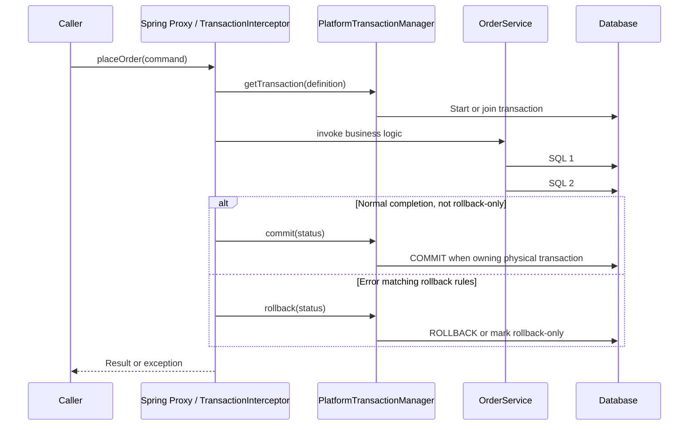

# PlatformTransactionManager for Imperative Code

## 1. Position of PlatformTransactionManager in the Spring Transaction Model

In a Spring application written in an **imperative** style, a service call typically performs sequential operations, for example: read balance → debit funds → credit funds → save history. For these operations to participate in the same transaction, the application needs to know **when to start, which resource to use, when to commit or rollback, and how to clean up resources**.

Spring separates two responsibilities:

- **Business code** describes the work to be done: calling repositories, `JdbcTemplate`, `EntityManager`…
- **Transaction infrastructure** handles the transaction lifecycle and boundaries. The core abstraction is the `org.springframework.transaction.PlatformTransactionManager` interface (abbreviated as PTM).

`PlatformTransactionManager` is the **SPI (service provider interface)** for Spring components to control transactions; it is not a connection, does not emit SQL on its own, and does not choose a database on behalf of the application. In declarative programming, `@Transactional` is interpreted by Spring AOP/`TransactionInterceptor`, which calls PTM. In programmatic style, `TransactionTemplate` or your own Java code calls PTM.

**Distinguish right from the start:**

- `PlatformTransactionManager`: synchronous interface for *imperative transactions* (typically bound to the running thread's resource/context).
- `ReactiveTransactionManager`: a different interface for reactive transactions, using a reactive context; it is not a subtype of `PlatformTransactionManager`, and reactive `@Transactional` cannot be treated like a ThreadLocal-based transaction.
- `TransactionManager`: the common marker interface that the transaction managers above extend.

The scope of this article is **PlatformTransactionManager in imperative code**, covering its contract, configuration, lifecycle, programmatic/declarative usage, propagation, rollback, and common pitfalls.

## 2. The Three-Method Contract of PlatformTransactionManager

Abbreviated form from the Spring API:

```java
package org.springframework.transaction;

public interface PlatformTransactionManager extends TransactionManager {
    TransactionStatus getTransaction(TransactionDefinition definition)
            throws TransactionException;

    void commit(TransactionStatus status) throws TransactionException;

    void rollback(TransactionStatus status) throws TransactionException;
}
```

This is an **interface excerpt for explanation**, not a file that the application needs to create.

| Method | Responsibility | Key point to understand |
| --- | --- | --- |
| `getTransaction(definition)` | Starts a new physical transaction, joins an existing transaction, or applies the corresponding propagation behavior | Not every call creates a new connection/transaction. |
| `commit(status)` | Completes the transaction scope according to its current status | If already marked rollback-only, the manager may perform a rollback instead of commit; the caller may encounter `UnexpectedRollbackException`. |
| `rollback(status)` | Requests rollback of the appropriate scope | For a scope participating in an outer transaction, Spring may only mark the entire transaction rollback-only rather than rolling back physically immediately. |

`TransactionException` is an unchecked exception. Once a `TransactionStatus` is completed, it must not be reused to call `commit` or `rollback` a second time.

### 2.1. TransactionDefinition — Request When Opening a Transaction Scope

`TransactionDefinition` describes the desired **policy**:

- **Propagation**: when encountering an existing transaction, join it, suspend it, open a new one, or run without a transaction?
- **Isolation**: the isolation level supported by the database management system for a new transaction.
- **Timeout**: transaction deadline, in seconds according to the manager/resource capability; not a command that forcibly aborts every running task.
- **Read-only**: a hint to the transaction manager/database/ORM to optimize read access; does not by default forbid all write SQL.
- **Name**: logical name for observation/logging; does not affect transaction identity in the database.

`DefaultTransactionDefinition` is an implementation that can be instantiated and configured directly in Java. With `@Transactional`, Spring converts annotation metadata into the appropriate transaction attribute/definition.

### 2.2. TransactionStatus — State of Participation

`getTransaction()` returns a `TransactionStatus` for the caller to control/observe the scope:

- `isNewTransaction()`: did this scope create a new physical transaction?
- `hasSavepoint()`: is there a savepoint attached to the scope?
- `setRollbackOnly()`: marks the scope as needing rollback.
- `isRollbackOnly()`: reads the rollback-only state reflected by the status.
- `isCompleted()`: has the status completed?
- `flush()`: requests flushing synchronizations/resources that support it; **flush is not commit**.

Two concepts to distinguish: a **logical transaction scope** is the management scope created by each transactional call; a **physical transaction** is the actual transaction in JDBC/database or the transaction provider. Multiple `REQUIRED` logical scopes can share **a single physical transaction**.

## 3. Choosing an Implementation Matching the Resource

A `PlatformTransactionManager` bean must be configured so that it controls the exact resource the code uses.

| Implementation | Typically used when | Boundary notes |
| --- | --- | --- |
| `DataSourceTransactionManager` | JDBC on a single `DataSource` | Controls JDBC `Connection` from the datasource; repositories/`JdbcTemplate` must obtain connections via Spring's mechanism to participate. |
| `JdbcTransactionManager` | JDBC on a `DataSource` | A variant of `DataSourceTransactionManager` with exception translation at commit/rollback more consistent with `JdbcTemplate`; usually a good choice for pure JDBC. |
| `JpaTransactionManager` | JPA `EntityManagerFactory` | Coordinates JPA entity manager transactions; can support JDBC access via the same datasource under proper integration conditions. |
| `JtaTransactionManager` | JTA/global transaction infrastructure | Relies on a configured JTA provider/coordinator; having a JTA-type PTM **is not enough** if participants do not support the required distributed transaction. |

For example, a `JdbcTransactionManager(dataSourceA)` cannot automatically rollback changes already committed through `dataSourceB` or an HTTP API. Two local managers on two `DataSource`s do not automatically create an atomic global transaction either.

**With JDBC:** `JdbcTemplate` uses Spring's connection-acquisition mechanism (via `DataSourceUtils`), so calls using the same `DataSource` can join an existing transaction. If you call `DriverManager.getConnection(...)` directly to open an independent connection, it does not automatically join the transaction that PTM is coordinating.

**With JPA:** applications typically use a Spring-managed `EntityManager`, e.g., via `@PersistenceContext` or Spring Data JPA repositories. You must choose the `JpaTransactionManager` corresponding to the `EntityManagerFactory`, avoiding the assumption that every connection is automatically managed by a JPA transaction.

**Multiple transaction managers:** specify the manager explicitly when needed, e.g., `@Transactional(transactionManager = "ordersTxManager")` or inject using a qualifier. `@Primary` can help select a default bean, but it does not solve atomic commit across multiple datasources.

## 4. How Does a Transactional Call Actually Execute?

Suppose `OrderService.placeOrder()` is invoked from another Spring bean through a proxy, and underneath it uses `JdbcTemplate` with the right datasource:



Four conclusions emerge from this diagram:

1. `@Transactional` is **metadata**; when running in proxy mode, the call must **pass through the Spring proxy** for the interceptor to apply the annotation's attributes.
2. PTM decides whether to join/start a transaction based on `TransactionDefinition` and the resources already bound to the execution context.
3. In imperative transactions, Spring typically stores synchronization state and resource bindings per **thread** via `TransactionSynchronizationManager`. Offloading work to a new thread, `@Async`, or out-of-band callbacks does not automatically inherit this transaction.
4. Scope completion must be accompanied by proper transaction completion and **cleanup**: unbinding resources, returning connections to the pool, and restoring any suspended context. Do not hold `Connection`/`EntityManager` yourself as global state.

**Note:** if a `REQUIRED` scope merely joins a pre-existing physical transaction, its `commit(status)` call usually completes only the **logical scope**; the real physical commit belongs to the outermost transaction.

## 5. Runnable Example: JdbcTransactionManager + TransactionTemplate + Direct SPI

The example below uses **Java 17+**, **Spring JDBC 6.2.x**, and an in-memory H2 database to show three states: successful commit, rollback due to an exception, and rollback via `setRollbackOnly()`. The final part calls the `PlatformTransactionManager` contract directly. This is a standalone Java application with dependencies managed by Maven, requiring no Spring Boot startup.

Structure:

```text
imperative-tx-demo/
├── pom.xml
└── src/main/java/demo/tx/ImperativeTxDemo.java
```

**`pom.xml`:**

```xml
<project xmlns="http://maven.apache.org/POM/4.0.0"
         xmlns:xsi="http://www.w3.org/2001/XMLSchema-instance"
         xsi:schemaLocation="http://maven.apache.org/POM/4.0.0
                             https://maven.apache.org/xsd/maven-4.0.0.xsd">
    <modelVersion>4.0.0</modelVersion>
    <groupId>demo</groupId>
    <artifactId>imperative-tx-demo</artifactId>
    <version>1.0.0</version>

    <properties>
        <maven.compiler.release>17</maven.compiler.release>
        <project.build.sourceEncoding>UTF-8</project.build.sourceEncoding>
    </properties>

    <dependencies>
        <dependency>
            <groupId>org.springframework</groupId>
            <artifactId>spring-jdbc</artifactId>
            <version>6.2.19</version>
        </dependency>
        <dependency>
            <groupId>com.h2database</groupId>
            <artifactId>h2</artifactId>
            <version>2.3.232</version>
        </dependency>
    </dependencies>

    <build>
        <plugins>
            <plugin>
                <groupId>org.apache.maven.plugins</groupId>
                <artifactId>maven-compiler-plugin</artifactId>
                <version>3.13.0</version>
            </plugin>
            <plugin>
                <groupId>org.codehaus.mojo</groupId>
                <artifactId>exec-maven-plugin</artifactId>
                <version>3.5.1</version>
            </plugin>
        </plugins>
    </build>
</project>
```

**`src/main/java/demo/tx/ImperativeTxDemo.java`:**

```java
package demo.tx;

import org.springframework.jdbc.core.JdbcTemplate;
import org.springframework.jdbc.datasource.DriverManagerDataSource;
import org.springframework.jdbc.support.JdbcTransactionManager;
import org.springframework.transaction.PlatformTransactionManager;
import org.springframework.transaction.TransactionStatus;
import org.springframework.transaction.support.DefaultTransactionDefinition;
import org.springframework.transaction.support.TransactionTemplate;

public final class ImperativeTxDemo {
    public static void main(String[] args) {
        var dataSource = new DriverManagerDataSource(
                "jdbc:h2:mem:txdemo;DB_CLOSE_DELAY=-1", "sa", "");
        var jdbc = new JdbcTemplate(dataSource);

        jdbc.execute("CREATE TABLE balance (" +
                "id INT PRIMARY KEY, amount INT NOT NULL)");
        jdbc.update("INSERT INTO balance (id, amount) VALUES (1, 100), (2, 40)");

        PlatformTransactionManager manager =
                new JdbcTransactionManager(dataSource);
        var template = new TransactionTemplate(manager);

        // Transaction 1: two UPDATEs commit together.
        template.executeWithoutResult(status -> {
            jdbc.update("UPDATE balance SET amount = amount - 20 WHERE id = 1");
            jdbc.update("UPDATE balance SET amount = amount + 20 WHERE id = 2");
        });
        print("after commit", jdbc);

        // Transaction 2: error after the first UPDATE triggers rollback.
        try {
            template.executeWithoutResult(status -> {
                jdbc.update("UPDATE balance SET amount = amount - 10 WHERE id = 1");
                throw new IllegalStateException("simulated failure");
            });
        } catch (IllegalStateException ex) {
            System.out.println("caught: " + ex.getMessage());
        }
        print("after rollback", jdbc);

        // Transaction 3: proactively cancel transaction without throwing an exception.
        template.executeWithoutResult(status -> {
            jdbc.update("UPDATE balance SET amount = amount - 5 WHERE id = 1");
            status.setRollbackOnly();
        });
        print("after rollback-only", jdbc);

        // Transaction 4: use the three SPI methods directly.
        var definition = new DefaultTransactionDefinition();
        definition.setName("manual-adjustment");
        TransactionStatus status = manager.getTransaction(definition);
        try {
            jdbc.update("UPDATE balance SET amount = amount + 7 WHERE id = 1");
        } catch (RuntimeException | Error ex) {
            manager.rollback(status);
            throw ex;
        }
        manager.commit(status);
        print("after direct SPI commit", jdbc);
    }

    private static void print(String stage, JdbcTemplate jdbc) {
        Integer a = jdbc.queryForObject(
                "SELECT amount FROM balance WHERE id = 1", Integer.class);
        Integer b = jdbc.queryForObject(
                "SELECT amount FROM balance WHERE id = 2", Integer.class);
        System.out.println(stage + ": A=" + a + ", B=" + b);
    }
}
```

Run in the `imperative-tx-demo` directory with JDK 17+ and Maven installed:

```bash
mvn -q compile exec:java -Dexec.mainClass=demo.tx.ImperativeTxDemo
```

Lines printed by the program (excluding Maven/environment logs):

```text
after commit: A=80, B=60
caught: simulated failure
after rollback: A=80, B=60
after rollback-only: A=80, B=60
after direct SPI commit: A=87, B=60
```

**Why the results are correct:**

- Transaction 1: both UPDATE statements obtain the Spring-managed connection, so balances move from `(100, 40)` to `(80, 60)`.
- Transaction 2: after subtracting 10, an unchecked exception occurs; `TransactionTemplate` invokes rollback through the manager, so balances remain `(80, 60)`.
- Transaction 3: the callback calls `status.setRollbackOnly()`, so subtracting 5 does not commit even though the callback completes normally.
- Transaction 4: the application obtains `TransactionStatus` itself, runs the UPDATE, and calls `commit(status)`; account 1 increases to 87.

**Example limitations:** `DriverManagerDataSource` is simple and opens connections on demand for demonstration; production applications typically use a connection pool. The example does not simulate concurrent requests, timeouts, locking, or multiple databases. In the direct SPI snippet, `commit()` is placed **after** the `try/catch` handling business errors to avoid attempting a second rollback if commit itself throws an exception; in production, add logging, monitoring, and a policy for handling commit outcomes on infrastructure errors.

## 6. TransactionTemplate as a Convenient Programmatic Wrapper

Calling `getTransaction → commit/rollback` directly shows the contract most clearly, but in business code you should usually use `TransactionTemplate` when explicit transaction programming is needed. `TransactionTemplate` uses PTM underneath and automatically manages try/catch/rollback/cleanup for the callback.

Example inside a Spring bean that already has `JdbcTemplate` and the right PTM:

```java
import org.springframework.jdbc.core.JdbcTemplate;
import org.springframework.transaction.PlatformTransactionManager;
import org.springframework.transaction.TransactionDefinition;
import org.springframework.transaction.support.TransactionTemplate;

public class BatchWriter {
    private final JdbcTemplate jdbc;
    private final TransactionTemplate tx;

    public BatchWriter(JdbcTemplate jdbc, PlatformTransactionManager manager) {
        this.jdbc = jdbc;
        this.tx = new TransactionTemplate(manager);
        this.tx.setPropagationBehavior(TransactionDefinition.PROPAGATION_REQUIRED);
        this.tx.setTimeout(10);
    }

    public void create(String code) {
        tx.executeWithoutResult(status -> {
            int inserted = jdbc.update(
                    "INSERT INTO job (code) VALUES (?)", code);
            if (inserted != 1) {
                status.setRollbackOnly();
            }
        });
    }
}
```

This is a **class snippet used inside an application with a `job` table and configured beans**, not a standalone program. The main point is selecting policy on `TransactionTemplate`, while inside the callback you only care about business operations. A `TransactionTemplate` with fixed configuration can be reused across calls; if flows need different policies, create separately configured templates and avoid mutating propagation/timeout on a single instance used concurrently by multiple threads.

Use `TransactionTemplate` when a transaction only needs to wrap **a short section inside a method**, or when rollback decisions depend on return state. `@Transactional` is usually clearer when an entire public service method needs the same transaction boundary.

## 7. @Transactional Uses PlatformTransactionManager Underneath

For declarative transactions, `@Transactional` is typically placed at the **service boundary**:

```java
package demo.tx;

import org.springframework.jdbc.core.JdbcTemplate;
import org.springframework.stereotype.Service;
import org.springframework.transaction.annotation.Transactional;

@Service
public class AccountService {
    private final JdbcTemplate jdbc;

    public AccountService(JdbcTemplate jdbc) {
        this.jdbc = jdbc;
    }

    @Transactional
    public void transfer(long fromId, long toId, long amount) {
        if (fromId == toId || amount <= 0) {
            throw new IllegalArgumentException("Invalid transfer");
        }

        int debited = jdbc.update(
                "UPDATE account SET balance = balance - ? " +
                "WHERE id = ? AND balance >= ?",
                amount, fromId, amount);
        if (debited != 1) {
            throw new IllegalStateException("Insufficient balance");
        }

        int credited = jdbc.update(
                "UPDATE account SET balance = balance + ? WHERE id = ?",
                amount, toId);
        if (credited != 1) {
            throw new IllegalStateException("Missing receiver");
        }
    }
}
```

This snippet compiles when Spring JDBC/Context/TX are present and runs properly when the application has the `account` table, a `DataSource`, a transaction manager, and Spring proxies enabled. When the service is called through the proxy, the annotation tells the interceptor to call `getTransaction`, `commit`, or `rollback`; **the AccountService class does not need to write those three calls**.

With manual Spring Framework configuration, you can provide the manager bean and enable annotation-driven transaction management:

```java
package demo.tx;

import javax.sql.DataSource;
import org.springframework.context.annotation.Bean;
import org.springframework.context.annotation.Configuration;
import org.springframework.jdbc.support.JdbcTransactionManager;
import org.springframework.transaction.PlatformTransactionManager;
import org.springframework.transaction.annotation.EnableTransactionManagement;

@Configuration
@EnableTransactionManagement
public class TransactionConfig {
    @Bean
    public PlatformTransactionManager transactionManager(DataSource dataSource) {
        return new JdbcTransactionManager(dataSource);
    }
}
```

This is **supplementary configuration for a Spring application that has a `DataSource` bean**. With Spring Boot already auto-configuring the right transaction manager, you typically do not need to add an equivalent bean manually; avoid accidentally creating two managers.

### Which Usage Style to Choose?

| Usage style | Who calls PTM? | When is it appropriate? |
| --- | --- | --- |
| `@Transactional` | Spring transaction interceptor | Transaction boundary matches the service method; business code needs to stay clean. |
| `TransactionTemplate` | Template calls PTM | Only a small block needs a transaction, or rollback is handled per callback. |
| Calling PTM directly | Application code | Writing special infrastructure/adapters requiring fine-grained lifecycle control; must handle cleanup and errors yourself. |

All three styles above can share the same PTM and use the same physical transaction depending on propagation; they are **not** three different kinds of transactions.

## 8. Propagation: Does getTransaction Open a New Transaction?

This determines the meaning of `getTransaction(definition)` when a transaction is already on the call stack.

| Propagation | Existing transaction | No existing transaction |
| --- | --- | --- |
| `REQUIRED` (default) | Join the existing transaction | Start a new transaction |
| `REQUIRES_NEW` | Suspend the old transaction, create an independent physical transaction | Start a new transaction |
| `NESTED` | Create a nested scope via savepoint if manager/resource supports it | Typically behaves like a new transaction |
| `SUPPORTS` | Join | Run without an actual transaction |
| `NOT_SUPPORTED` | Suspend the existing transaction, run non-transactionally | Run non-transactionally |
| `MANDATORY` | Join | Throw an error because a transaction is required |
| `NEVER` | Throw an error because no transaction is allowed | Run non-transactionally |

Three levels that often cause confusion:

### REQUIRED: Shared Physical Transaction Across Multiple Logical Scopes

If `outer()` and `inner()` (two methods properly intercepted via proxies) are both `REQUIRED`, they share one physical transaction. If `inner` marks rollback-only, `outer` **cannot force a successful commit** by catching the exception and continuing. When `outer` tries to commit, Spring may throw `UnexpectedRollbackException` to report that a rollback actually occurred.

Example of **illustrative code across two separate Spring beans**:

```java
@Service
class InnerService {
    @Transactional
    public void execute() {
        throw new IllegalStateException("business failure");
    }
}

@Service
class OuterService {
    private final InnerService inner;

    OuterService(InnerService inner) {
        this.inner = inner;
    }

    @Transactional
    public void execute() {
        try {
            inner.execute(); // Same physical transaction (REQUIRED).
        } catch (IllegalStateException ex) {
            // Catching the exception does NOT clear rollback-only.
        }
        // When the outer interceptor calls commit, an
        // UnexpectedRollbackException may appear instead of a successful commit.
    }
}
```

This snippet requires `@Service` and `@Transactional` imports and must live inside a Spring application; it is intentionally abbreviated to illustrate the flow. If `inner` and `outer` are in the same object and call `this.innerMethod()`, the proxy may not intercept the inner method, causing behavior different from the example above.

### REQUIRES_NEW: An Independent Physical Transaction

The outer transaction may already be open, but an inner `REQUIRES_NEW` needs its own resource. Inner can **commit successfully even if outer later rolls back**. This is why you should not assume “since it was called inside an outer `@Transactional`, everything will eventually rollback together.” `REQUIRES_NEW` may need an extra connection while the outer connection is still held; insufficient pool sizing can cause connection starvation or even deadlocks as requests wait on each other.

### NESTED: Savepoint Within One Physical Transaction

With a JDBC manager that supports savepoints, `NESTED` can roll back changes made after the savepoint and let `outer` continue to commit. This is **not** an independent physical transaction. Do not assume every JPA/JTA manager supports nested transactions in the same way: check the specific implementation and database driver.

### Inner Isolation/Timeout/readOnly

When a `REQUIRED` scope **joins** an existing transaction, isolation/timeout/readOnly attributes declared on inner **do not automatically override** the outer physical transaction's policy. Spring can check for incompatibilities when existing-transaction validation is enabled. If you want a separate policy, design a compatible new transaction instead of merely adding a different annotation.

## 9. Commit/Rollback Policies and Exceptions

With `@Transactional` under common default settings:

- Method completes normally → Spring requests commit, **unless** the transaction is already rollback-only.
- `RuntimeException` or `Error` escaping the intercepted method → rollback.
- Checked `Exception` escaping the method **does not by default** trigger rollback; configure `rollbackFor` if business logic requires rollback.

Example:

```java
import java.io.IOException;
import org.springframework.transaction.annotation.Transactional;

@Transactional(rollbackFor = IOException.class)
public void importBatch() throws IOException {
    // DB update steps using a resource managed by the manager.
    // If an IOException escapes the method, Spring rolls back.
}
```

This is only a **method fragment illustrating rollback rules**, not a standalone class. `rollbackFor` can accept one or more exception classes; `noRollbackFor` creates the opposite exception rule. With Spring JDBC, many SQL errors are translated by `JdbcTemplate` into `DataAccessException` (unchecked), so they trigger rollback by default.

**Situations that often surprise developers:**

1. **Catching an exception and returning normally:** the interceptor may treat the method as successful and commit, if nothing has marked rollback-only yet. If you must catch it, consider rethrowing or intentionally marking rollback-only.
2. **Inner `REQUIRED` already marked rollback-only:** outer catching the exception can still encounter `UnexpectedRollbackException` on completion; do not return “success” as if the database committed.
3. **Checked exceptions:** add `rollbackFor` when truly needed. Do not assume every exception rolls back by default.
4. **Exception after commit:** already-committed changes cannot be rolled back by the same transaction. Business compensation is required if the outcome must be reversed.
5. **Commit failure:** an exception from `commit` does not guarantee the database did not commit; for network errors or ambiguous outcomes, observe and reconcile according to the characteristics of the driver, database, and transaction manager.

Keep transactions relatively short: do not open a transaction and wait for user input, call slow network APIs, or perform long CPU work unnecessarily. Long transactions hold locks/connections, increasing contention and timeouts.

## 10. Isolation, Timeout, and readOnly: Promising the Right Scope

| Attribute | How to configure | What to verify |
| --- | --- | --- |
| Isolation | `@Transactional(isolation = Isolation.READ_COMMITTED)` or `TransactionDefinition` | Level actually supported by the DB/driver; phantom/non-repeatable read differences; usually applies only to a new transaction. |
| Timeout | `@Transactional(timeout = 5)` or `TransactionTemplate.setTimeout(5)` | Manager/database enforcement mechanism; does not guarantee immediately interrupting all I/O or HTTP calls. |
| Read-only | `@Transactional(readOnly = true)` | May affect flushing, optimizer, or connection flags; **not** by default a security boundary preventing writes. |
| Name | `DefaultTransactionDefinition.setName("...")` | Used for logging/observability, not a physical transaction name. |

Database isolation must still fit the problem: `READ_COMMITTED` does not automatically eliminate every race condition; when updating balances, reserving inventory, or preventing duplicate writes, design locks/atomic SQL/unique constraints/optimistic versioning and test concurrently. Using PTM **does not replace** business consistency controls.

Configuring an independent new transaction, for example:

```java
var tx = new TransactionTemplate(manager);
tx.setPropagationBehavior(TransactionDefinition.PROPAGATION_REQUIRES_NEW);
tx.setIsolationLevel(TransactionDefinition.ISOLATION_READ_COMMITTED);
tx.setTimeout(5);
tx.setReadOnly(false);
tx.executeWithoutResult(status -> doDatabaseWork());
```

This snippet **illustrates the API inside a method that already has `manager` and `doDatabaseWork()`**, not a self-running program. With `REQUIRES_NEW`, remember to account for connection pool load and side effects after inner commits.

## 11. Thread-Bound Resources and What PTM Does Not Guarantee

On the imperative path, the transaction context and many resources are bound to the thread. `TransactionSynchronizationManager` maintains synchronization support, bound resources, transaction state… so DAOs/`JdbcTemplate`/ORM can obtain the right connection/entity manager.

**Guaranteed within the appropriate scope:** multiple SQL statements on the **same datasource** and same transaction scope can commit or rollback together.

**Not automatically guaranteed:**

- A method making an HTTP call to a Payment Service: the Payment side has its own transaction; a local PTM does not rollback the remote payment command.
- Writing to two datasources with two local managers: manager A does not decide manager B's commit. Atomic global commit requires a genuine JTA/XA mechanism if the resources support it; microservice problems often require workflows/compensation.
- Sending a message to a broker after a DB insert: a local annotation does not make DB write and message publish atomic; use transactional outbox when reliable event delivery is needed.
- `CompletableFuture.supplyAsync`, `@Async`, spawning threads manually: does not automatically propagate a thread-bound JDBC transaction to another thread.
- Calling a private/final method or self-invocation `this.someTransactionalMethod()`: in proxy mode, the interceptor does not run for calls that bypass the proxy; do not rely on the inner method's annotation.
- Accessing the database via a manually opened connection outside Spring's management: may not join the open physical transaction.

If you need reactive work with Reactor/WebFlux/R2DBC, look into `ReactiveTransactionManager` and `TransactionalOperator`. Do not try to force asynchronous/reactive processing into a ThreadLocal-based PTM.

## 12. Choosing Transaction Boundaries in Application Architecture

A practical rule is to place the transaction **around a consistent unit of update** and let service orchestration handle steps outside the transaction.

| Need | Suggested implementation | Reason |
| --- | --- | --- |
| Update 3 tables in the same database | Service `@Transactional` + right PTM | One transaction protects multiple SQL statements. |
| Long method, only one section needs commit/rollback | `TransactionTemplate` around the update section | Short and clearly visible transaction. |
| Need a separate policy in one step | Design a separate `TransactionTemplate` or proxied method with appropriate propagation | Boundary and policy are explicitly defined. |
| JPA repositories | `JpaTransactionManager` matching `EntityManagerFactory` | Manages persistence context/flush for the right ORM infrastructure. |
| JDBC using a datasource and plain SQL | `JdbcTransactionManager` or `DataSourceTransactionManager` | Manages physical JDBC transactions and connection binding. |
| Two resources needing atomic commit and both support XA | Evaluate JTA coordinator, participants, recovery | A local PTM alone is insufficient for global commit. |
| Calling multiple microservices / publishing events | Local PTM + saga/outbox/idempotency per business logic | Side effects across boundaries do not rollback automatically. |

When multiple managers are needed, give beans clear names and ensure every `@Transactional`/`TransactionTemplate` references the right manager; test directly against the datasource rather than just looking at annotations.

## 13. How to Test and Diagnose Errors

### 13.1. Testing Commit/Rollback Outcomes

With a real test database (or H2 if behavior is modeled accurately), set up initial data and inspect **data after the transaction ends**:

1. Happy path: write to two tables successfully; both records appear.
2. Throw an unchecked exception after the first write step: verify neither change **was** committed.
3. Checked exception: verify the difference between absent and present `rollbackFor`.
4. Outer `REQUIRED` catches an exception from inner `REQUIRED`: verify rollback-only and `UnexpectedRollbackException` when outer tries to commit.
5. `REQUIRES_NEW`: inner commits, outer rolls back → inner's data still exists (unless prevented by other constraints).
6. Self-invocation: call through proxy vs internal call and observe the difference in transaction behavior; fix by separating service beans or redesigning boundaries.

In Spring Test, test methods annotated with `@Transactional` are rolled back by default when the test finishes. This can **hide** the difference between a real commit and a rollback if you only read data inside the same test transaction. To verify physical commits, use an appropriate test strategy (e.g., a test without an outer transaction, or `TestTransaction` to end it explicitly) and read from another context/connection.

### 13.2. Diagnostic Checklist

| Symptom | Possibilities to check | How to verify |
| --- | --- | --- |
| `@Transactional` has no effect | Method called via `this`, bean not managed by Spring, proxy did not intercept | Log interceptor, check call path/bean/proxy. |
| A repository commits unexpectedly | Wrong datasource/manager used, manually opened JDBC connection | Check manager bean, datasource identity, and connection acquisition. |
| Outer method throws `UnexpectedRollbackException` | Inner scope marked the shared physical transaction rollback-only | Read the root exception in inner, propagation, rollback rules. |
| `REQUIRES_NEW` blocks waiting for a connection | Pool too small for outer + inner transactions coexisting | Check active/pending connections and thread dump. |
| `NESTED` does not run | Driver/manager does not support savepoints/nested | Check implementation, `nestedAllowed` config, JDBC savepoint support. |
| Data still written despite `readOnly=true` | Read-only is treated as a hint | Check DB/ORM, write permission rules, and write code. |
| Tests always see rollback | Test method is transactional and rolls back by default | Separate real-commit tests or control test transaction lifecycle. |

You can enable environment-appropriate logging, such as DEBUG logging for `org.springframework.transaction` or narrower like `org.springframework.jdbc.datasource` to observe the lifecycle, while keeping sensitive information out of logs. Do not rely solely on a “Creating new transaction” log line: **the database state after commit/rollback** is the ultimate proof.

## 14. Common Mistakes and How to Fix Them

**Mistake 1 — assuming `@Transactional` creates a transaction on every call.** In proxy mode, the annotation requires an intercepted invocation. *Fix:* place the boundary on a service bean called from outside through the Spring proxy; verify transaction management configuration.

**Mistake 2 — thinking every `getTransaction` starts a new transaction.** `REQUIRED` often only joins an existing physical transaction. *Fix:* inspect `TransactionDefinition` and `TransactionStatus.isNewTransaction()`, distinguishing logical vs physical scope.

**Mistake 3 — catching an exception “heals” the transaction.** Rollback-only on a shared transaction is not cleared automatically. *Fix:* manage exceptions and boundaries clearly; use a new transaction only when business logic genuinely requires an independent commit.

**Mistake 4 — choosing `REQUIRES_NEW` to be “safer”.** It can commit early independently, increase connections needed, and break all-or-nothing expectations. *Fix:* use it only when there is a legitimate requirement for separate commit, and analyze concurrency cost.

**Mistake 5 — treating flush as commit or readOnly as a security layer.** Flush sends changes to the database within the transaction and can still roll back; readOnly is primarily a hint. *Fix:* verify data after the transaction and protect writes using DB permissions/business constraints.

**Mistake 6 — assuming one PTM manages the entire system.** A local PTM only manages participants it can control. *Fix:* map datasources, ORMs, brokers, HTTP APIs, and data ownership boundaries before designing transactions.

## 15. Self-Check Questions

1. **How many core methods does PlatformTransactionManager have?** Three: `getTransaction`, `commit`, and `rollback`.
2. **Does `getTransaction()` always create a new physical transaction?** No. It depends on propagation and any existing transaction.
3. **Does `@Transactional` belong to PTM or do commits on its own?** The annotation describes policy; the interceptor uses PTM to control the transaction.
4. **How does TransactionTemplate differ from calling the manager directly?** It encapsulates lifecycle handling for callbacks and avoids manual commit/rollback boilerplate.
5. **Why does `REQUIRED` produce `UnexpectedRollbackException`?** An inner scope can set rollback-only on the shared physical transaction, preventing outer from actually committing.
6. **Does `REQUIRES_NEW` guarantee inner rolls back when outer rolls back?** No. Inner has its own physical transaction and commits independently.
7. **Does Spring automatically propagate imperative transactions to `@Async`?** No. The transaction context is typically thread-bound and does not automatically cross async boundaries.
8. **Does making an HTTP call inside `@Transactional` turn the remote service into a local participant?** No.
9. **Can you implement a JDBC DAO using `JdbcTemplate` and a transaction manager on the same datasource?** Yes; that is how Spring brings the same connection into the transaction scope.
10. **Do checked exceptions always roll back?** No, rollback rules must be considered, such as `rollbackFor` when needed.

**Conclusion:** `PlatformTransactionManager` is Spring's imperative transaction control contract: **acquire/initialize a scope per TransactionDefinition, track it via TransactionStatus, and commit or rollback the right resource**. Declarative (`@Transactional`) and programmatic (`TransactionTemplate`) styles both build on this contract. Understanding resource boundaries, propagation, rollback-only, and proxy/thread contexts prevents seemingly “inexplicable” commit/rollback bugs.

## References

- [Spring Framework — Understanding the Transaction Abstraction](https://docs.spring.io/spring-framework/reference/data-access/transaction/strategies.html)
- [Spring Framework — Programmatic Transaction Management](https://docs.spring.io/spring-framework/reference/data-access/transaction/programmatic.html)
- [Spring Framework — @Transactional](https://docs.spring.io/spring-framework/reference/data-access/transaction/declarative/annotations.html)
- [Spring Framework — Transaction Propagation](https://docs.spring.io/spring-framework/reference/data-access/transaction/declarative/tx-propagation.html)
- [Spring API — PlatformTransactionManager](https://docs.spring.io/spring-framework/docs/current/javadoc-api/org/springframework/transaction/PlatformTransactionManager.html)
- [Spring API — TransactionStatus](https://docs.spring.io/spring-framework/docs/current/javadoc-api/org/springframework/transaction/TransactionStatus.html)