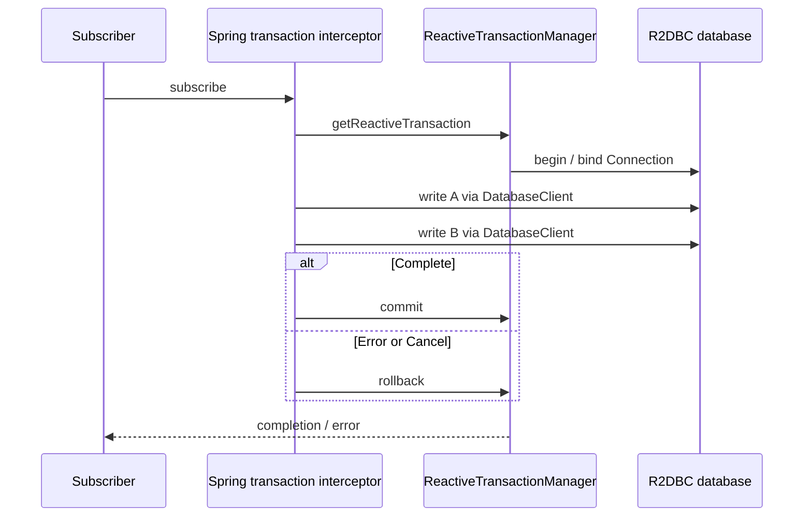

# ReactiveTransactionManager for Reactive Chains in Spring Framework

## 1. Why Are Transactions in Reactive Different from Traditional Transactions?

A transaction groups data operations into a single unit that commits or rolls back together. For example: transferring 200 points from wallet A to wallet B consists of deducting points from A and adding points to B. If wallet B does not exist, the update to A must also be rolled back.

With imperative JDBC/JPA applications, Spring typically uses `PlatformTransactionManager` and holds transaction resources in a `ThreadLocal`: synchronous calls executing on the same thread can look up the current transaction. Reactive Streams, however, have different characteristics:

- `Mono` and `Flux` are normally **cold Publishers**: assembling the chain does not mean running the SQL statements; operations execute only upon subscription.
- A single subscription can switch across multiple schedulers/threads, so `ThreadLocal` is not a stable key to identify the transaction across the entire chain.
- Work completion is signaled via `onComplete`, `onError`, or `cancel`; you cannot simply look at the moment a Java method returns a `Mono`.

Spring solves this with **`ReactiveTransactionManager` + the Reactor subscriber `Context`**. All participating data operations must execute within the same reactive chain and use a client/connection that recognizes the transaction context.

```text
Caller calls service.transfer(...) --> Mono<Void> is returned
                                           |
                                     subscribe()
                                           |
                                 Open/join transaction
                                           |
                   UPDATE source --> UPDATE target
                                           |
             onComplete: COMMIT | onError: ROLLBACK
                             cancel: ROLLBACK
```

If nobody subscribes, the data-writing publisher usually **does not run**. If two subscriptions are made to the same cold publisher, the business operation may execute **twice**, each time in its own transaction.

## 2. Components and APIs to Know

| Component | Purpose | Characteristics |
| --- | --- | --- |
| `ReactiveTransactionManager` | Reactive transaction management SPI | API returns `Mono`, supports begin/commit/rollback |
| `ReactiveTransaction` | Status of the in-progress transaction | Can be marked `setRollbackOnly()` |
| `R2dbcTransactionManager` | Transaction manager for an R2DBC `ConnectionFactory` | Connection is bound to the subscription's Reactor context |
| `ReactiveMongoTransactionManager` | Manager for reactive MongoDB transactions | Only usable when the MongoDB deployment supports transactions |
| `TransactionalOperator` | Wraps a `Publisher` segment in a transaction | Useful when you want programmatic scope control |
| `@Transactional` | Declares a boundary on a public service method | Must be applied by Spring's transaction proxy/interceptor |
| `DatabaseClient`, `R2dbcEntityTemplate` | Spring's reactive SQL access | Obtains the connection currently participating in the transaction |

Core contract of `org.springframework.transaction.ReactiveTransactionManager` (omitting secondary declarations):

```java
public interface ReactiveTransactionManager extends TransactionManager {
    Mono<ReactiveTransaction> getReactiveTransaction(TransactionDefinition definition);
    Mono<Void> commit(ReactiveTransaction transaction);
    Mono<Void> rollback(ReactiveTransaction transaction);
}
```

`getReactiveTransaction()` opens or joins a transaction based on `TransactionDefinition` and the context at subscription time. `commit()`/`rollback()` are also publishers that must be subscribed to and sequenced. Normally, application code **does not call these three methods directly**; letting `@Transactional` or `TransactionalOperator` coordinate avoids forgetting to clean up resources when code fails or is canceled.

### Comparing Imperative and Reactive Models

| Aspect | Imperative | Reactive |
| --- | --- | --- |
| Transaction manager | `PlatformTransactionManager` | `ReactiveTransactionManager` |
| Where transaction context is held | `ThreadLocal` | Subscriber's Reactor `Context` |
| Common SQL client | `JdbcTemplate` / JPA | R2DBC `DatabaseClient` |
| Computation model | Synchronous calls | `Publisher` and subscription |
| Programmatic API | `TransactionTemplate` | `TransactionalOperator` |
| Completion point | Synchronous call returns | Publisher emits complete/error/cancel |

**Do not confuse `ReactiveTransactionManager` with "running on multiple threads"**: reactive code may use one or multiple threads, but the transaction follows the **subscription context**, not the thread ID.

## 3. Transaction Lifecycle in a Subscription

When an external object calls a Spring bean method annotated with `@Transactional` that returns `Mono`/`Flux`:

1. The Spring AOP proxy intercepts the call, resolving the `@Transactional` configuration and corresponding transaction manager.
2. A transaction-wrapped publisher is returned. There is no reason to believe SQL has run yet if it has not been subscribed to.
3. Upon subscription, the transaction interceptor asks the manager to create/join a transaction and attaches state/resources to the **Reactor subscriber `Context`**.
4. `DatabaseClient` and transaction-aware clients retrieve the right R2DBC connection from the context.
5. Business `Mono`/`Flux` operators execute operations in the composed order.
6. When the chain completes normally, the manager commits; when an error or cancel signal arrives, the manager handles rollback (according to semantics and signal timing).
7. The connection and transaction resources are cleaned up; the caller receives completion or error.



A Reactor `Context` is an immutable key/value map propagated along with the subscriber. It is not the same thing as `ThreadLocal`, HTTP request data, logging MDC, or a field in a singleton service.

`publishOn` or `subscribeOn` within **the same Reactor pipeline** usually preserve the Reactor context even when switching schedulers. What typically loses the transaction is splitting off a **new subscription**, escaping into a framework that does not preserve context, or using a connection opened outside Spring's transaction-aware mechanism.

## 4. Hands-On Java 17+ Example: Spring Boot + R2DBC

We use in-memory H2 via R2DBC so we can observe commits and rollbacks without installing a DB server. The code targets Spring Boot 3.3.x (Java 17+) with Gradle. Create a Spring Boot project with Spring Initializr including the Gradle wrapper; place the files at the paths shown below. The example does not use JDBC/JPA for SQL statements.

### 4.1. `build.gradle`

```groovy
plugins {
    id 'java'
    id 'org.springframework.boot' version '3.3.5'
    id 'io.spring.dependency-management' version '1.1.6'
}

group = 'example'
version = '1.0.0'

java {
    toolchain {
        languageVersion = JavaLanguageVersion.of(17)
    }
}

repositories {
    mavenCentral()
}

dependencies {
    implementation 'org.springframework.boot:spring-boot-starter-data-r2dbc'
    runtimeOnly 'io.r2dbc:r2dbc-h2'
}

tasks.named('test') {
    useJUnitPlatform()
}
```

`spring-boot-starter-data-r2dbc` provides Spring Data R2DBC integration, `DatabaseClient`, and the required reactive libraries. When moving to PostgreSQL/MySQL, choose the matching **R2DBC driver** and check the driver/DBMS transaction support level.

### 4.2. `src/main/resources/application.yml`

```yaml
spring:
  main:
    web-application-type: none
  r2dbc:
    url: "r2dbc:h2:mem:///reactive_tx_demo?options=DB_CLOSE_DELAY=-1"
  sql:
    init:
      mode: always
```

This is a CLI application, so no WebFlux server is needed. `mode: always` makes Spring Boot run the schema script at startup. `DB_CLOSE_DELAY=-1` prevents the in-memory H2 database from disappearing when no connections are open between demo steps.

### 4.3. `src/main/resources/schema.sql`

```sql
CREATE TABLE wallet (
    id BIGINT PRIMARY KEY,
    balance BIGINT NOT NULL CHECK (balance >= 0)
);

INSERT INTO wallet (id, balance) VALUES (1, 1000);
INSERT INTO wallet (id, balance) VALUES (2, 500);
```

Each transfer transaction executes two `UPDATE` statements. We need to check the updated row count, because `UPDATE` produces no SQL error when `WHERE` matches zero rows.

### 4.4. `src/main/java/example/reactivetx/WalletService.java`

```java
package example.reactivetx;

import org.springframework.r2dbc.core.DatabaseClient;
import org.springframework.stereotype.Service;
import org.springframework.transaction.annotation.Transactional;
import reactor.core.publisher.Mono;

@Service
public class WalletService {
    private final DatabaseClient db;

    public WalletService(DatabaseClient db) {
        this.db = db;
    }

    @Transactional(transactionManager = "reactiveTxManager")
    public Mono<Void> transfer(long sourceId, long targetId, long amount) {
        return Mono.defer(() -> {
            if (amount <= 0 || sourceId == targetId) {
                return Mono.error(
                    new IllegalArgumentException("Invalid transfer")
                );
            }

            return debit(sourceId, amount)
                .flatMap(rows -> {
                    if (rows != 1) {
                        return Mono.<Integer>error(
                            new IllegalStateException("Source missing or insufficient funds")
                        );
                    }
                    return credit(targetId, amount);
                })
                .flatMap(rows -> {
                    if (rows != 1) {
                        return Mono.<Integer>error(
                            new IllegalStateException("Destination missing")
                        );
                    }
                    return Mono.just(rows);
                })
                .then();
        });
    }

    private Mono<Integer> debit(long id, long amount) {
        return db.sql("""
                UPDATE wallet
                SET balance = balance - :amount
                WHERE id = :id AND balance >= :amount
                """)
            .bind("amount", amount)
            .bind("id", id)
            .fetch()
            .rowsUpdated();
    }

    private Mono<Integer> credit(long id, long amount) {
        return db.sql("""
                UPDATE wallet
                SET balance = balance + :amount
                WHERE id = :id
                """)
            .bind("amount", amount)
            .bind("id", id)
            .fetch()
            .rowsUpdated();
    }
}
```

Step-by-step explanation:

- `transfer()` returns **`Mono<Void>`** rather than opening a transaction and returning a synchronous result. Spring starts the reactive transaction when the publisher is subscribed through the proxy.
- `Mono.defer` ensures validation and pipeline assembly occur at subscription time, preventing an operation from "running ahead".
- The source `UPDATE` combines deducting points and the `balance >= :amount` condition in **a single SQL statement**, avoiding a gap between read, check, and write.
- The first `.flatMap` calls `credit` only when `debit` updates exactly one row; the second `.flatMap` errors if the target wallet does not exist.
- When `Destination missing` is emitted via `onError`, the interceptor rolls back the entire transaction, including the source `UPDATE` that already executed.
- `debit` and `credit` are `private` helpers that **do not need annotations**; they are composed into `transfer`'s Publisher and execute inside the transaction context created by `transfer`.
- Checking `rowsUpdated()` is valid with Spring Framework 6.x `DatabaseClient` (here `Mono<Integer>`). When using a different API version, check the actual return type.

### 4.5. `src/main/java/example/reactivetx/ReactiveTxApplication.java`

```java
package example.reactivetx;

import io.r2dbc.spi.ConnectionFactory;
import org.springframework.boot.ApplicationRunner;
import org.springframework.boot.SpringApplication;
import org.springframework.boot.autoconfigure.SpringBootApplication;
import org.springframework.context.annotation.Bean;
import org.springframework.r2dbc.connection.R2dbcTransactionManager;
import org.springframework.r2dbc.core.DatabaseClient;
import org.springframework.transaction.ReactiveTransactionManager;

@SpringBootApplication
public class ReactiveTxApplication {
    public static void main(String[] args) {
        SpringApplication.run(ReactiveTxApplication.class, args);
    }

    @Bean
    ReactiveTransactionManager reactiveTxManager(ConnectionFactory factory) {
        return new R2dbcTransactionManager(factory);
    }

    @Bean
    ApplicationRunner demo(WalletService service, DatabaseClient db) {
        return args -> {
            service.transfer(1, 2, 200).block();
            System.out.println("After commit: " + balances(db));

            try {
                service.transfer(1, 999, 50).block();
            } catch (IllegalStateException e) {
                System.out.println("Expected error: " + e.getMessage());
            }
            System.out.println("After rollback: " + balances(db));
        };
    }

    private static String balances(DatabaseClient db) {
        return db.sql("SELECT id, balance FROM wallet ORDER BY id")
            .map((row, metadata) ->
                row.get("id", Long.class) + "=" +
                row.get("balance", Long.class))
            .all()
            .collectList()
            .map(values -> String.join(", ", values))
            .block();
    }
}
```

The `reactiveTxManager` bean uses `R2dbcTransactionManager` on the same `ConnectionFactory` used by `DatabaseClient`. In simple setups, Spring Boot can also provide a reactive transaction manager automatically; the bean is defined explicitly here to make the wiring principle clear.

Run in the project directory via the Gradle wrapper:

```bash
./gradlew bootRun
```

PowerShell on Windows uses `.\gradlew.bat bootRun`. Aside from Spring/Gradle logs, the three lines **printed by the application** are:

```text
After commit: 1=800, 2=700
Expected error: Destination missing
After rollback: 1=800, 2=700
```

The first transfer deducts 200 from wallet 1, adds 200 to wallet 2, and commits. The second temporarily deducts 50 from wallet 1 but fails to find wallet 999; the publisher emits an error and the transaction rolls back, leaving both balances unchanged. Each new run with in-memory H2 re-initializes from `schema.sql`.

**Why is `.block()` in `ApplicationRunner`?** It serves as the bridge from the synchronous CLI entrypoint to a subscriber so the demo can wait for results and print stdout. **Do not call `block()` inside a reactive service or on the WebFlux event loop**; WebFlux controllers should return `Mono`/`Flux` for the framework to subscribe.

## 5. How Does `@Transactional` Work with `Mono` and `Flux`?

### 5.1. Conditions for the Annotation to Actually Take Effect

Spring's transaction interceptor determines how to manage the call based on the method's return type and the selected manager. With a standard `ReactiveTransactionManager`, the method must return a **reactive `Publisher`**, such as `Mono<Void>`, `Mono<Receipt>`, or `Flux<Item>`. Methods returning `void`, `String`, or synchronous POJOs do not create a proper reactive transaction through this mechanism.

In proxy mode, the interceptor only intercepts calls **going through the Spring proxy**. Therefore:

- The service bean must be managed by Spring; manual `new WalletService(...)` does not have a proxy.
- Calling `this.transfer(...)` from another method **on the same instance** bypasses the proxy and can skip `@Transactional`.
- Do not start work in `@PostConstruct` expecting the proxy to already be active.
- You must select the right transaction manager, especially when an application has both `DataSourceTransactionManager`/JPA and R2DBC.

The sample in section 4 calls `service.transfer(...)` from a Spring-injected `ApplicationRunner` through the proxy, so the annotation on `transfer` takes effect.

### 5.2. Spring Tracks the **Returned Publisher**, Not Every Spawned Task

**Wrong: creating a detached subscription inside a transactional method.**

```java
@Transactional(transactionManager = "reactiveTxManager")
public Mono<Void> broken(DatabaseClient db) {
    db.sql("UPDATE wallet SET balance = balance + 1 WHERE id = 1")
      .fetch().rowsUpdated()
      .subscribe(); // Separate subscription, does not wait for completion.
    return Mono.empty();
}
```

The transaction wrapped by the interceptor can commit immediately as `Mono.empty()` completes, while the UPDATE in the new subscription runs outside its context. `@Transactional` does not "gather up" subscriptions created elsewhere.

**Right: returning a single composed chain.**

```java
@Transactional(transactionManager = "reactiveTxManager")
public Mono<Void> composed(DatabaseClient db) {
    return db.sql("UPDATE wallet SET balance = balance + 1 WHERE id = 1")
        .fetch()
        .rowsUpdated()
        .then();
}
```

The above are two standalone illustrative methods meant for a Spring bean that already has `DatabaseClient`; do not place them inside `transfer`, and do not call `subscribe()` at the service layer.

### 5.3. Propagation and Rollback Rules

Reactive `@Transactional` still uses Spring's key attributes:

| Attribute | Meaning | Notes |
| --- | --- | --- |
| `propagation = REQUIRED` | Join an existing transaction in the same context or open a new one | Default value |
| `REQUIRES_NEW` | Request an independent transaction | Suspension/resource capability and connection count depend on manager |
| `NESTED` | Nest using savepoints if supported | Not available by default on all drivers/managers |
| `isolation` | Suggest SQL isolation level for a new transaction | Actual behavior depends on DBMS |
| `readOnly` | Optimization hint/setting | Not an absolute guarantee preventing writes |
| `timeout` | Transaction deadline | Coordinates with SQL/driver timing and cancellation |
| `rollbackFor` | Additional rollback rules | Defaults typically rollback `RuntimeException`/`Error` |

With an already-open transaction, an annotation on an inner `REQUIRED` method does not by default change the outer transaction's isolation level. You must understand the specific manager, connection, and database. Choose isolation levels, constraints, locks, and optimistic versions according to invariants; `@Transactional` does not automatically eliminate lost updates or write skew.

## 6. `TransactionalOperator`: Programmatic Pipeline Management

`org.springframework.transaction.reactive.TransactionalOperator` is the programmatic API for reactive code; its role parallels `TransactionTemplate` but operates on Publishers. Use it when the boundary should be expressed inside the chain and may be narrower than the entire method.

```java
import org.springframework.r2dbc.core.DatabaseClient;
import org.springframework.stereotype.Service;
import org.springframework.transaction.ReactiveTransactionManager;
import org.springframework.transaction.reactive.TransactionalOperator;
import reactor.core.publisher.Mono;

@Service
public class BonusService {
    private final DatabaseClient db;
    private final TransactionalOperator tx;

    public BonusService(DatabaseClient db, ReactiveTransactionManager manager) {
        this.db = db;
        this.tx = TransactionalOperator.create(manager);
    }

    public Mono<Void> addBonus(long walletId, long amount) {
        return Mono.defer(() -> {
            if (amount <= 0) {
                return Mono.error(new IllegalArgumentException("Invalid amount"));
            }
            return db.sql("""
                    UPDATE wallet SET balance = balance + :amount
                    WHERE id = :walletId
                    """)
                .bind("amount", amount)
                .bind("walletId", walletId)
                .fetch()
                .rowsUpdated()
                .flatMap(rows -> rows == 1
                    ? Mono.<Void>empty()
                    : Mono.<Void>error(
                        new IllegalStateException("Wallet not found")))
                .as(tx::transactional);
        });
    }
}
```

`publisher.as(tx::transactional)` and `tx.transactional(publisher)` both state that this publisher segment must run inside a transaction. There is no need to add `@Transactional` on `addBonus` when it is already wrapped with the operator.

`TransactionalOperator` also has `execute(TransactionCallback<T>)`, giving the callback a `ReactiveTransaction` on which it can call `status.setRollbackOnly()` when rolling back for a business rule without throwing an error. Configure custom propagation/isolation/timeout via `DefaultTransactionDefinition`:

```java
DefaultTransactionDefinition definition = new DefaultTransactionDefinition();
definition.setPropagationBehavior(TransactionDefinition.PROPAGATION_REQUIRED);
definition.setIsolationLevel(TransactionDefinition.ISOLATION_READ_COMMITTED);
definition.setTimeout(20);

TransactionalOperator tx = TransactionalOperator.create(manager, definition);
```

This configuration snippet uses an existing `manager` variable and corresponding Spring imports inside an existing service/configuration, not a standalone file. There is no need to manually manage the lifecycle with `getReactiveTransaction()`/`commit()`/`rollback()` when the operator already wraps the whole unit of work.

### Choosing Where to Wrap with the Operator

Place the boundary around the exact business unit:

```text
[reads/checks needing transaction -> write A -> write B]
              .as(tx::transactional)
                      |
               commit completes
                      |
                build response
```

If there are external emails or HTTP calls, they do not become rollbackable just by sitting inside the wrapped publisher. An R2DBC transaction coordinates **a database connection**; it has no authority to undo a sent email or an HTTP request already processed by a third party. For important events, consider writing a **transactional outbox** record inside the DB transaction, then publishing messages from a separate worker with idempotent handling on consumers.

## 7. `complete`, `error`, `cancel` Signals and Accidental Commits

| Situation | Typical transaction behavior |
| --- | --- |
| Transactional publisher emits `onComplete` | Requests COMMIT; commit can still fail |
| Transactional publisher emits `onError` | Requests ROLLBACK per rollback semantics |
| Subscriber sends `cancel` before completion | Spring reactive transaction rolls back on cancellation (since Spring 5.3) |
| Nobody subscribes | Cold Publisher has not run and transaction has not executed |
| Subscribing a second time to a cold Publisher | Can open another transaction and repeat all write statements |

### 7.1. Swallowing Errors Before the Boundary Can Cause a Commit

Business bug: `onErrorResume` turns an error into completion **inside** the transaction region.

```java
Mono<Void> dangerous = db.sql(
        "UPDATE wallet SET balance = balance - 10 WHERE id = 1")
    .fetch().rowsUpdated().then()
    .then(Mono.<Void>error(new IllegalStateException("Step 2 failed")))
    .onErrorResume(ex -> Mono.empty()) // Error becomes complete
    .as(tx::transactional);           // Transaction may COMMIT
```

In the snippet above, `db` is `DatabaseClient` and `tx` is a configured `TransactionalOperator`. If an error is supposed to cause a rollback, **let it pass through the operator**. If you need to turn the error into a response/fallback, place the handler after the boundary:

```java
Mono<Void> safer = db.sql(
        "UPDATE wallet SET balance = balance - 10 WHERE id = 1")
    .fetch().rowsUpdated().then()
    .then(Mono.<Void>error(new IllegalStateException("Step 2 failed")))
    .as(tx::transactional)
    .onErrorResume(ex -> Mono.empty()); // Handle only after rollback
```

Both are illustrative snippets explaining signals, not part of section 4's demo. Even if the error is handled after rollback, the API must still accurately reflect the failed business operation; never silently report that the transaction succeeded.

### 7.2. Cancellation Is Not a Partial Commit

Operators like `take(1)`, `next()`, and `timeout(...)` can cancel the upstream subscription. With a transactional `Flux` containing multiple operations, reading the first element **does not prove** the operations committed. Spring treats cancellation as a rollback path; in many cases you must consume the transactional Publisher completely for completion to occur.

Thought experiment: a `Flux` updates 10 rows and emits a result after each row. If downstream `take(1)` cancels right after the first element, the transaction may roll back everything written so far. Design the Publisher to return results after the transaction completes, or place operators at the appropriate boundary.

### 7.3. Retries Must Wrap the Entire Transaction

If a deadlock/serialization failure or retryable transient error occurs, you typically need:

```text
transaction 1 -> onError -> rollback
                      |
             retry outside scope
                      |
transaction 2 -> rerun entire unit -> commit / rollback
```

Avoid retrying a single statement inside an already-broken transaction, and never retry infinitely. Error filters, retry counts, backoff, and idempotency must be explicitly designed. For payment/transfer requests, APIs need a unique request-id so work is not repeated when a client does not know whether a prior commit succeeded.

## 8. Mistakes with Context, Connections, and Execution Threads

### 8.1. `publishOn` Does Not Equal Losing the Transaction

In a valid Reactor pipeline, `publishOn`/`subscribeOn` normally preserve the subscriber context even as work switches schedulers. Trying to store a connection in a custom `ThreadLocal` can fail across thread hops. Do not test transaction participation by comparing thread IDs of two statements.

### 8.2. Opening a Separate Connection Breaks the Transaction

`R2dbcTransactionManager` coordinates a `ConnectionFactory`, binding the transactional connection in the subscriber context. `DatabaseClient`/`R2dbcEntityTemplate` use Spring's compatible connection-acquisition mechanism. If low-level code calls `connectionFactory.create()` arbitrarily, it may receive a **different connection** outside the transaction.

When low-level APIs are needed, inspect `ConnectionFactoryUtils.getConnection(connectionFactory)` and its release rules; never store a connection in a singleton field or share that resource across two subscriptions.

### 8.3. JDBC/JPA Inside a `Mono` Is Still JDBC/JPA

```java
Mono<Integer> call = Mono.fromCallable(
    () -> jdbcTemplate.update(
        "UPDATE wallet SET balance = balance + 1 WHERE id = 1")
);
```

The code above merely defers a **blocking JDBC** call; it does not turn JDBC into R2DBC and does not make JDBC join an `R2dbcTransactionManager` transaction. Moving to `Schedulers.boundedElastic()` does not change transaction ownership either. If business logic requires two different databases, you must design consistency, saga/compensation, or a genuinely supported coordinated transaction.

### 8.4. Detached Tasks, Hot Publishers, and Concurrency

- Calling `.subscribe()` manually inside a service creates a detached chain and makes transactions hard to control.
- `CompletableFuture`, callbacks outside Reactor, and separate tasks do not automatically preserve transaction context.
- `share()`/`cache()`/hot Publishers change how multiple subscribers consume or reuse results; do not use them to "cache" write operations without designing replay semantics.
- `flatMap` with multiple concurrent SQL statements on **a single R2DBC connection** can cause contention/violate driver limits. When multiple writes must happen in one transaction, use `then` or `concatMap` when sequential execution is needed.
- Holding a transaction open while waiting on network, locks, timers, or users can exhaust the connection pool and increase contention.

## 9. Testing Reactive Transactions

Tests must prove **the state after commit/rollback**, not stop at verifying that the publisher emits the right `Mono` type.

| Scenario | Initial fixture | Expected outcome |
| --- | --- | --- |
| Transfer 200 from 1 to 2 | 1=1000, 2=500 | Completes; 1=800 and 2=700 |
| Target 999 does not exist | 1=1000, 2=500 | `onError`; after rollback still 1=1000, 2=500 |
| Source has insufficient points | 1=1000, 2=500 | `onError`; no changes |
| Canceled before transaction completes | Independent fixture | Uncommitted writes are rolled back |
| Subscribe twice to cold pipeline | Independent fixture | May execute business logic twice; requires idempotency if needed |
| Two competing requests on the same wallet | Independent fixture | No minimum-balance violation; results match isolation and atomic SQL |

You can use Reactor Test and Spring Boot Test. Add:

```groovy
testImplementation 'org.springframework.boot:spring-boot-starter-test'
testImplementation 'io.projectreactor:reactor-test'
```

Illustrative assertion in a test class injected with `WalletService` and reset fixtures:

```java
StepVerifier.create(walletService.transfer(1L, 999L, 200L))
    .expectErrorMatches(error ->
        error instanceof IllegalStateException
            && "Destination missing".equals(error.getMessage()))
    .verify();
```

After `verify()`, use `DatabaseClient` in a separate read subscription/transaction to verify that the source wallet is still 1,000. This is an **assertion snippet**; it requires JUnit/Reactor Test imports and fixture setup in a real test class. Test-level `@Transactional` in Spring Test normally rolls back when the test ends; avoid letting a test transaction hide whether the service actually commits or rolls back. Cancellation tests must ensure rollback/cleanup completes before verifying.

## 10. Real-World Error Table and Troubleshooting

| Symptom | Cause to check | How to handle |
| --- | --- | --- |
| Method returns `Mono` but DB does not change | No subscription | Return the Publisher to WebFlux or subscribe at the appropriate entrypoint |
| First UPDATE committed even though later step failed | Detached subscription, wrong manager, swallowed error | Compose into one Publisher, let errors cross the boundary |
| Annotation does not create a transaction | `this.method()`, `new Service()`, proxy not invoked | Check bean wiring and calls through the Spring proxy |
| Exception in service yet no rollback | `onErrorResume` before boundary or rollback rules | Move error handling outside boundary and check rollback configuration |
| No transaction-bound connection | Different client/factory or direct `create()` | Use resource-aware Spring R2DBC |
| Error with multiple concurrent SQL statements | Contention on a single connection | Serialize with `then`/`concatMap` where appropriate |
| `Flux.take(1)` causes data to vanish | Cancellation rollback | Consume fully or design results after commit |
| Business logic runs twice on its own | Multiple subscribers, `retry`, or `repeat` | Control subscriptions and idempotency |
| Mixing JDBC in reactive tx fails to rollback | JDBC uses a separate manager/connection | Separate boundaries and apply a consistency strategy |
| DB overloaded by many transactions | Long transactions, small pool, high lock contention | Shorten transactions; measure latency, locks, connections, and retries |

## 11. Self-Check Knowledge Questions

1. Has `Mono<Void> mono = service.transfer(...);` run the SQL yet? **Usually not, because nobody has subscribed yet.**
2. Why doesn't Spring use `ThreadLocal` to manage reactive transactions? **Because the chain can switch threads; the subscriber `Context` stays attached to the pipeline.**
3. When should `TransactionalOperator` be used? **When you want to wrap a transaction around a specific Publisher or callback.**
4. Can `@Transactional` on a method returning `void` be coordinated by `ReactiveTransactionManager` like `Mono<Void>`? **Not through Spring's reactive execution path; it must return a reactive type.**
5. Why is calling `.subscribe()` separately inside a service dangerous? **It creates an independent subscription that the caller/interceptor does not await and that may not share the transaction context.**
6. What can `onErrorResume` turning an error into `Mono.empty()` before the operator do? **The operator sees completion and may wrongly commit.**
7. Is `take(1)` on a transactional `Flux` a partial commit? **No; cancel normally triggers rollback.**
8. Can `R2dbcTransactionManager` roll back an HTTP call or an email already sent? **No, because they do not participate in the R2DBC connection transaction.**
9. Can two SQL statements running on different threads still share the same reactive transaction? **Yes, if they share the same subscription context and use a resource-aware client.**

## 12. Application Checklist

1. Clearly identify resources/DBMS supporting reactive transactions and **the business unit that must commit together**.
2. Declare the right manager (`R2dbcTransactionManager` for R2DBC) and specify the right manager when multiple exist.
3. Place `@Transactional` on a service bean invoked via proxy, on methods returning `Mono`/`Flux`, or use `TransactionalOperator` where needed.
4. Keep all SQL statements in **a single composed Publisher**, with no detached `subscribe()`/`block()` inside reactive services.
5. Use `DatabaseClient`/Spring-integrated clients and verify connections join the right context.
6. Handle `onError`, `cancel`, retries, timeouts, and multiple subscriptions intentionally; do not swallow errors before the boundary.
7. Use DB constraints, affected-row checks, and appropriate locking/isolation; do not expect the annotation to fix business logic on its own.
8. Test actual post-commit/rollback state; add concurrency and cancellation scenarios.
9. Separate non-DB side effects or use transactional outbox/idempotency when sending messages and calling external services.

## Official References

- Spring Framework — Transaction Abstraction: https://docs.spring.io/spring-framework/reference/6.2/data-access/transaction/strategies.html
- Spring Framework — Declarative Transaction Implementation: https://docs.spring.io/spring-framework/reference/6.2/data-access/transaction/declarative/tx-decl-explained.html
- Spring Framework — Using `@Transactional`: https://docs.spring.io/spring-framework/reference/6.2/data-access/transaction/declarative/annotations.html
- Spring Framework — Programmatic Transaction Management (`TransactionalOperator`, cancellation): https://docs.spring.io/spring-framework/reference/6.2/data-access/transaction/programmatic.html
- Spring Framework — Data Access with R2DBC: https://docs.spring.io/spring-framework/reference/6.2/data-access/r2dbc.html