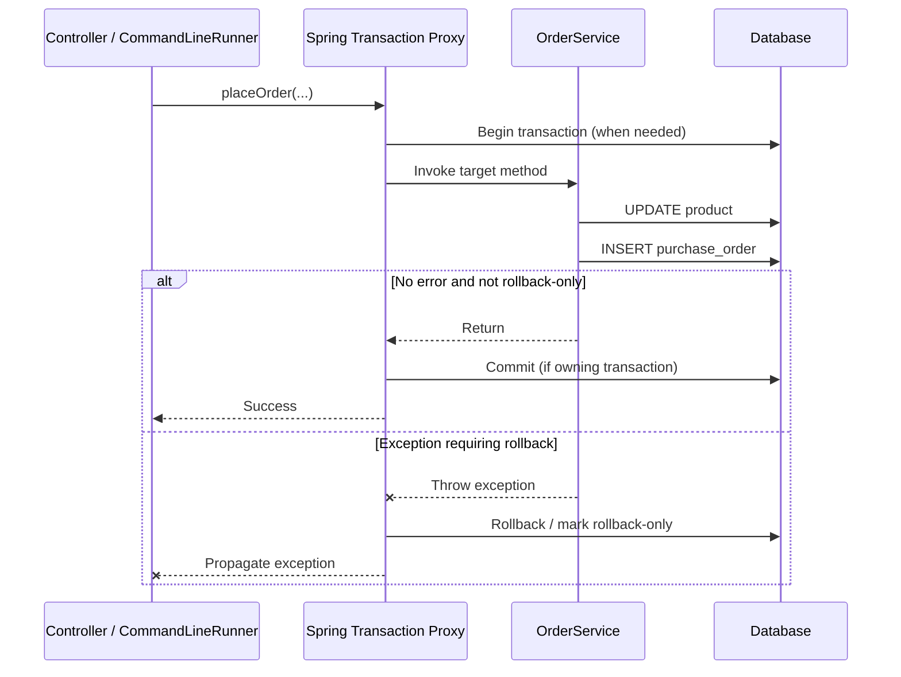

# Placing @Transactional on Service Methods in Spring

## 1. Goal: One Business Operation, One Transaction

A business request often consists of **multiple read/write operations**. For example, when placing an order, the application must decrease the remaining product inventory **and** create an order record. If deducting stock succeeds while creating the order fails, the data is corrupted: inventory was deducted without a corresponding order.

In Spring, the common starting approach is to mark the **public method of the service class** coordinating the entire business operation with `@Transactional`:

```java
@Service
public class OrderService {
    @Transactional
    public void placeOrder(...) {
        // Validate request
        // Deduct inventory
        // Save order
        // Throw error when unable to complete
    }
}
```

This is **structural pseudocode**, not an independently compiling Java class. A complete runnable example is in section 4.

After this lesson, you will know:

- Why transaction boundaries usually belong on the **service method implementing a use case**, rather than splitting into separate transactions in a controller or per repository call.
- When `@Transactional` starts, commits, and rolls back; how data is protected when a step fails.
- How to build a runnable Java 17+ Spring Boot program to **observe rollback yourself**.
- The conditions for Spring to actually apply the annotation: Spring-managed bean, call passing through proxy, matching transaction manager, and an exception that triggers rollback.
- Issues that `@Transactional` **does not solve by itself**: concurrency races between transactions, external system calls, duplicate submissions, and multiple data sources.

## 2. Choosing the Right Boundary: One Use Case End-to-End

Look at a typical processing flow:

```text
HTTP Controller
    |
    | calls placeOrder(...)
    v
OrderService                  <-- @Transactional starts here
    |
    +--> validate request
    +--> update stock
    +--> create order record
    +--> return result          <-- commit if completed normally
         or throw error         <-- rollback if error matches rollback rules
```

**The Controller** translates HTTP requests/responses and performs basic syntactic validation. **The Service** understands what a complete business operation must change. **The Repository/DAO** performs data access. Thus, a service method can call multiple repositories while staying within **the same transaction boundary**.

For example, if the controller sequentially called:

```java
stockRepository.decreaseStock(productId, quantity);
orderRepository.save(order);
```

then the two operations could use two independent transactions, depending on repository and caller configuration. The first write could commit before the second fails. Placing the transaction on the service wrapping **both** ensures success/failure is decided together.

**Practical rule:** start by asking "Which business action must complete as an indivisible whole?" and place `@Transactional` on the **public Spring-invoked entry point** that performs that action. A service may have multiple methods; each method can represent a different use case.

Not every method in a service needs a write transaction. Pure Java computation methods do not need to open a transaction. For read-only queries, consider `@Transactional(readOnly = true)` if beneficial for consistency, lazy loading, or infrastructure optimizations.

## 3. How Placing @Transactional on a Service Works

In Spring's commonly used transaction management mode, calls are intercepted by a **Spring AOP proxy**. You can visualize it as:

1. Another bean calls `orderService.placeOrder(...)`.
2. Spring's proxy locates the matching transaction manager. With the default `Propagation.REQUIRED`, it **joins an existing transaction** or **starts a new transaction**.
3. The method executes DB access operations through infrastructure participating in the same transaction.
4. If the method completes normally and the transaction is not marked rollback-only, the transaction manager **commits**; for a pre-existing transaction, final commit ownership belongs to the outer boundary.
5. If the method throws an error matching rollback rules, Spring **marks rollback-only or rolls back the transaction** depending on transaction ownership. If the outermost call owns the transaction, changes in that transaction are undone.



With a relational database, this mechanism uses the **database's** transaction, not Java remembering copies of every object to restore. Therefore, operations must participate in the **right transaction manager and connection**. File edits, HTTP API calls, or sent emails do not automatically vanish when the DB rolls back.

One important detail: `@Transactional` **does not wait until the end of the method to execute SQL**. SQL can run immediately during the method, yet the changes performed are not yet committed according to the transaction boundary. With Spring Data JPA/Hibernate, some SQL may also be deferred until flush/commit.

## 4. Runnable Example: Deducting Stock and Creating an Order in One Transaction

Below is a small application using **Spring Boot, Java 17+, Spring JDBC, and in-memory H2**. Its goal is to observe the difference between success and failure after part of the data has already been updated.

### 4.1. Setting Up the Project

Create a Maven project with Spring Initializr, choosing a stable Spring Boot version compatible with Java 17+, with:

- Java: **17** or newer;
- Dependencies: **JDBC API/Spring JDBC** (typically `spring-boot-starter-jdbc`) and **H2 Database**;
- Example root package: `com.example.transactiondemo`.

Use the `pom.xml` generated by Spring Initializr to manage compatible versions; in a typical Maven setup, the dependencies section contains:

```xml
<dependencies>
    <dependency>
        <groupId>org.springframework.boot</groupId>
        <artifactId>spring-boot-starter-jdbc</artifactId>
    </dependency>
    <dependency>
        <groupId>com.h2database</groupId>
        <artifactId>h2</artifactId>
        <scope>runtime</scope>
    </dependency>
</dependencies>
```

This is the **dependencies element** to compare against your generated project; it is not the entire `pom.xml` file. The generated project also includes parent/plugins and other Maven fields. H2 lets you run quickly without installing PostgreSQL or MySQL. When an application uses a suitable JDBC `DataSource`, Spring Boot normally auto-configures a transaction manager for it.

File structure:

```text
src/
  main/
    java/com/example/transactiondemo/
      TransactionDemoApplication.java
      OrderService.java
    resources/
      schema.sql
```

### 4.2. Creating Tables with schema.sql

File `src/main/resources/schema.sql`:

```sql
CREATE TABLE product (
    id BIGINT PRIMARY KEY,
    stock INT NOT NULL CHECK (stock >= 0)
);

CREATE TABLE purchase_order (
    id BIGINT PRIMARY KEY,
    product_id BIGINT NOT NULL,
    quantity INT NOT NULL CHECK (quantity > 0),
    CONSTRAINT fk_purchase_order_product
        FOREIGN KEY (product_id) REFERENCES product(id)
);
```

The `product` table holds remaining stock; `purchase_order` holds placed orders. `CHECK` constraints help the DB reject negative quantities; `PRIMARY KEY` prevents duplicate order IDs.

When using embedded H2 with Spring Boot's default SQL initialization settings, `schema.sql` runs on application startup. If you changed SQL initialization settings or use an external database, configure accordingly; for example, `spring.sql.init.mode=always` enables script initialization for non-embedded databases.

### 4.3. Placing @Transactional on the Public Method of OrderService

File `src/main/java/com/example/transactiondemo/OrderService.java`:

```java
package com.example.transactiondemo;

import org.springframework.jdbc.core.JdbcTemplate;
import org.springframework.stereotype.Service;
import org.springframework.transaction.annotation.Transactional;

@Service
public class OrderService {
    private final JdbcTemplate jdbc;

    public OrderService(JdbcTemplate jdbc) {
        this.jdbc = jdbc;
    }

    @Transactional
    public void placeOrder(long orderId, long productId, int quantity) {
        if (quantity <= 0) {
            throw new IllegalArgumentException("Quantity must be positive");
        }

        // Step 1: deduct stock only when sufficient inventory remains.
        int changed = jdbc.update("""
            UPDATE product
               SET stock = stock - ?
             WHERE id = ? AND stock >= ?
            """, quantity, productId, quantity);

        if (changed != 1) {
            throw new IllegalStateException(
                "Product not found or insufficient stock");
        }

        // Step 2: create order. If this fails, the stock deduction also rolls back.
        jdbc.update("""
            INSERT INTO purchase_order (id, product_id, quantity)
            VALUES (?, ?, ?)
            """, orderId, productId, quantity);
    }
}
```

Note the layout:

- `@Service` creates a Spring-managed bean. `OrderService` is injected into the caller; do not instantiate it with `new OrderService(...)` outside the container.
- `@Transactional` sits directly on the **public method `placeOrder`**: both stock update and order insertion share one transaction.
- `JdbcTemplate` uses the `DataSource` managed by the transaction manager. The SQL statements run within the same JDBC transaction if the call goes through the service proxy.
- `UPDATE ... WHERE stock >= ?` checks sufficient stock **directly in the SQL statement**. If no row matches, `changed` is 0 and the method throws an error.
- If `INSERT` fails due to duplicate `purchase_order.id`, the driver/JDBC raises an error, and `JdbcTemplate` translates it into `DataAccessException` (a `RuntimeException`); by default Spring rolls back the transaction.
- DB constraints and business checks are still necessary: `@Transactional` governs atomicity, not replacing validation or concurrency locking.

### 4.4. Calling the Service via Spring Bean and Observing Results

File `src/main/java/com/example/transactiondemo/TransactionDemoApplication.java`:

```java
package com.example.transactiondemo;

import org.springframework.boot.CommandLineRunner;
import org.springframework.boot.SpringApplication;
import org.springframework.boot.autoconfigure.SpringBootApplication;
import org.springframework.context.annotation.Bean;
import org.springframework.dao.DataAccessException;
import org.springframework.jdbc.core.JdbcTemplate;

@SpringBootApplication
public class TransactionDemoApplication {

    public static void main(String[] args) {
        SpringApplication.run(TransactionDemoApplication.class, args);
    }

    @Bean
    CommandLineRunner demonstrate(JdbcTemplate jdbc, OrderService orders) {
        return args -> {
            jdbc.update(
                "INSERT INTO product (id, stock) VALUES (?, ?)", 1L, 10);

            // First order: stock 10 -> 7; insert 1 order.
            orders.placeOrder(101L, 1L, 3);
            System.out.printf("After success: stock=%d, orders=%d%n",
                stock(jdbc), countOrders(jdbc));

            // Try creating an order with ID=101 again.
            // The stock deduction step ran, but INSERT violates PRIMARY KEY.
            try {
                orders.placeOrder(101L, 1L, 2);
            } catch (DataAccessException ex) {
                System.out.println("Duplicate order rejected");
            }

            System.out.printf("After failure: stock=%d, orders=%d%n",
                stock(jdbc), countOrders(jdbc));
        };
    }

    private static int stock(JdbcTemplate jdbc) {
        Integer value = jdbc.queryForObject(
            "SELECT stock FROM product WHERE id = ?",
            Integer.class, 1L);
        return value;
    }

    private static int countOrders(JdbcTemplate jdbc) {
        Integer value = jdbc.queryForObject(
            "SELECT COUNT(*) FROM purchase_order",
            Integer.class);
        return value;
    }
}
```

Run in the Maven project directory:

```bash
./mvnw spring-boot:run
```

On Windows PowerShell, use:

```powershell
.\mvnw.cmd spring-boot:run
```

The **lines printed by the program** (aside from Spring/Maven startup logs) are:

```text
After success: stock=7, orders=1
Duplicate order rejected
After failure: stock=7, orders=1
```

Step-by-step interpretation:

1. Initially: the product has `stock=10`, with no orders yet.
2. Calling `placeOrder(101, 1, 3)` succeeds: `UPDATE` lowers stock to 7 and `INSERT` adds order 101; Spring commits both.
3. Calling `placeOrder(101, 1, 2)`: the `UPDATE` **ran inside the transaction** and temporarily reduced stock; then `INSERT` failed because primary key 101 already existed.
4. The runtime error escapes through the proxy; the transaction manager rolls back, so stock **remains 7** and order count **remains 1** after catching the exception in `CommandLineRunner`.

Notice the `catch` location: the example catches the exception **outside the transactional method**. The proxy already saw the exception and performed the rollback before `CommandLineRunner` caught it. This is completely different from the service catching an exception inside the transaction and silently returning success.

**Thought experiment:** if `@Transactional` were removed and each JDBC statement auto-committed independently, creating the second order could drop stock from 7 to 5 and then fail on `INSERT`; the DB would still have one order yet have deducted 2 extra units. This is precisely the bug a service-level transaction boundary is designed to prevent.

## 5. Where Can @Transactional Be Placed and Where Should It Be Placed?

In Spring, `@Transactional` can be placed on **classes or methods** supported by transaction management infrastructure. However, "where the annotation is written" and "whether calls pass through a proxy" are two separate questions.

| Location | When reasonable | Key takeaway |
| --- | --- | --- |
| **Public method in `@Service`** | A business operation coordinating multiple repositories/DAOs | Usually the clearest choice; sets the exact use-case boundary |
| `@Service` class | Most eligible methods share one transaction policy | Easy to accidentally open transactions for methods that do not need them; method-level can override |
| Repository/DAO | A single save/read operation needs a transaction | Does not automatically combine multiple repositories into one outer business transaction |
| Controller | Technically possible, but not the default boundary to pick for business logic | Easily stretches transactions across HTTP handling, mapping, and unnecessary I/O |
| `private` method or internal `this.method()` call | **Do not use to trigger default proxy transactions** | Internal calls bypass the proxy so the annotation may have no effect |

Reading code from a business perspective:

```java
@RestController
class OrderController {
    private final OrderService orders;

    OrderController(OrderService orders) {
        this.orders = orders;
    }

    @PostMapping("/orders")
    void create(@RequestBody CreateOrderRequest request) {
        orders.placeOrder(
            request.orderId(),
            request.productId(),
            request.quantity());
    }
}
```

This is only a **snippet illustrating the controller -> service relationship**; `CreateOrderRequest` would need to be declared in a Web application. The runnable example in section 4 uses `CommandLineRunner` to avoid needing the web starter. In the controller, calling an injected Spring bean `OrderService` is what ensures the call goes through the proxy.

When using Spring Data JPA, many repository methods have their own transactional configuration. A `@Transactional` service call causes repositories invoked through the same matching transaction manager to **join the existing transaction**, rather than committing each operation before the use case finishes.

## 6. Important Default Values

For `org.springframework.transaction.annotation.Transactional`, common defaults to know are:

| Attribute | Default | Practical Impact |
| --- | --- | --- |
| `propagation` | `REQUIRED` | Joins an existing transaction; creates a new one if none exists |
| `isolation` | `DEFAULT` | Follows the DB/transaction manager's default isolation level |
| `readOnly` | `false` | Transaction can be used for read/write; `true` is mainly an optimization hint |
| `timeout` | System default value | Sets no custom timeout limit unless configured |
| `rollbackFor`/`noRollbackFor` | Not customized | Follows default rollback rules: `RuntimeException`/`Error` trigger rollback; checked exceptions do not roll back by default |

### 6.1. Need Rollback on a Checked Exception?

Java divides exceptions into checked (e.g., `IOException`) and unchecked (most `RuntimeException`s). Under Spring's **default rules**, if a method writes to the DB and then throws a checked exception, Spring can **commit** if no other rollback rule applies. To roll back for that type, declare it explicitly:

```java
@Transactional(rollbackFor = java.io.IOException.class)
public void importOrders() throws java.io.IOException {
    // Write to DB via repository/JdbcTemplate...
    // If IOException is thrown outward, the transaction will roll back.
}
```

This is a **configuration illustration**, not a standalone runnable program. In real projects, place the method on a Spring bean and let the checked exception actually escape through the proxy. For business errors, you can also define a custom `RuntimeException` to use default rules, though the exception type should reflect the true meaning of the failure.

### 6.2. What About Read-Only?

```java
@Transactional(readOnly = true)
public OrderView findOrder(long id) {
    // Query and map data.
    return ...;
}
```

This snippet illustrates the signature, requiring `OrderView` and the query implementation in an application. `readOnly = true` can help the ORM/driver optimize or express intent, yet it is **not a reliable write-permission enforcement layer across all DBs**. True write prevention must rely on DB permissions and proper transaction design.

### 6.3. When One Service Already Has a Transaction and Calls Another Service

```java
@Service
class CheckoutService {
    private final InventoryService inventory;
    private final OrderRepository orders;

    @Transactional
    public void checkout(...) {
        inventory.reserve(...);
        orders.save(...);
    }
}
```

This is **structural code** with undefined dependency types. If `InventoryService.reserve` also has default `REQUIRED` `@Transactional`, it normally joins `checkout`'s transaction rather than committing independently. An exception at one step can roll back the whole use case.

With `REQUIRES_NEW`, Spring suspends the current transaction and opens a separate transaction if the transaction manager supports it; committing the new transaction **is not automatically reversed** when the outer transaction rolls back. Do not change propagation just "to be safe," as it can produce partially committed data contrary to business requirements.

## 7. Common Traps: Annotation Present Yet No Transaction as Expected

### 7.1. Self-Invocation: Calling a Same-Class Method via `this`

```java
@Service
public class ReportService {
    public void generateReport() {
        saveReport(); // Direct call within the same object.
    }

    @Transactional
    public void saveReport() {
        // Write to DB.
    }
}
```

If another bean calls `generateReport()`, the Spring proxy only intercepts the **generateReport** call; calling `saveReport()` from inside the same object **does not go through the proxy** in standard proxy-based mode. Thus, the standalone annotation on `saveReport()` does not start a transaction as many expect.

Two straightforward fixes:

- If the whole business operation is `generateReport`, put `@Transactional` on the **public `generateReport()` method**. `saveReport()` can then be an unannotated helper.
- If `saveReport()` is an independent use case, move it to a separate Spring service bean and invoke it via an injected dependency so the call goes through the proxy.

Do not treat `@Transactional` as a function call to "open a transaction" that activates simply because the JVM entered the method.

### 7.2. Instantiating a Service with `new` and Calling It

```java
OrderService orders = new OrderService(jdbc);
orders.placeOrder(101L, 1L, 3);
```

This creates a plain Java object directly, **not a Spring-provided bean/proxy**. Annotations on methods do not automatically operate on manually constructed objects. At entry points, use Spring constructor injection or look up the bean via the container as designed.

### 7.3. `private`/`final` Methods and Proxy Configuration

In proxy mode, `private` methods cannot serve as proxy transaction interception points. With subclass-based proxies, `final` methods also cannot be overridden for interception. For introductory usage, choosing **public, non-final methods** on a Spring-managed service bean brings the fewest surprises. Spring has proxy-type and version-specific nuances for non-public methods; do not rely on them when building basic business boundaries.

### 7.4. Catching and Swallowing Exceptions Inside a Transactional Method

```java
@Transactional
public void placeOrderSilently(...) {
    updateStock(...);
    try {
        writeOrder(...);
        throw new IllegalStateException("Validation failed");
    } catch (IllegalStateException ex) {
        // Wrong if caller is still told it succeeded:
        // the runtime exception does not escape outside the proxy.
    }
}
```

This is **Java pseudocode using undefined helper names** to highlight the bug. For pure Java errors caught and swallowed as shown, the method may return normally and Spring may commit the SQL statements already executed. If a DB error occurred, the DB/transaction manager may sometimes have already marked the transaction rollback-only; you should not rely on swallowing that exception either. Let appropriate business errors escape or explicitly design failure outcomes and proper rollback.

Another variant: a transactional method catches a checked exception and returns an error code; rollback rules are not triggered if the exception does not escape through the proxy.

### 7.5. Method Has `@Transactional` Yet Wrong Transaction Manager

For example, using two different `DataSource`s. A `DataSourceTransactionManager` or `JpaTransactionManager` only manages the resource it is configured for. If a service updates two independent DBs, `@Transactional` by default **does not create an atomic distributed transaction** across both. Specify the matching transaction manager, or address cross-system consistency with an appropriate design (outbox, saga, transaction coordination if truly needed).

### 7.6. Keeping Transactions Open Too Long

Do not hold DB transactions and row locks open across outbound HTTP calls, email sending, waiting for user input, or lengthy file processing. Not only can the DB not roll back those external actions, they also increase lock contention/timeouts. For events that must be published after commit, consider saving an **outbox** record in the same transaction and dispatching asynchronously.

### 7.7. `@Async` and Other Threads

With standard JDBC/JPA transactions, the transaction context is bound to the executing thread; dispatching work via `@Async` or spawning a new thread **does not automatically carry over the caller's transaction**. An asynchronous method needs its own transaction boundary if it writes to the DB. Reactive transactions rely on Reactive Streams context mechanisms; that is a different model and does not directly apply the `JdbcTemplate` example here.

## 8. Placing It on the Service Is Necessary, Yet Not Enough to Prevent Race Conditions

Returning to the ordering business case: if you only write:

```text
Read stock = 5
If stock >= quantity then...
UPDATE stock = read value - quantity
```

two concurrent transactions can both see `stock = 5` and decide based on stale data. Having `@Transactional` on both methods **does not automatically make two business operations execute sequentially like a queue**: the database's default isolation level and execution schedule still matter.

In the written example, the SQL statement protects at write time:

```sql
UPDATE product
   SET stock = stock - 3
 WHERE id = 1 AND stock >= 3;
```

If stock already dropped to 2, the statement updates zero rows. The service checks the modified row count and throws an error to roll back the entire use case. For multi-row or more complex invariants, you may need pessimistic locking, optimistic locking via version, different data structures, or higher isolation with proper retries. `@Transactional` creates the **boundary**, while data rules and concurrency control determine **correctness** inside that boundary.

Similarly, if a client retries the same request after a timeout, `@Transactional` does not automatically know it is the same order. Duplicate-prevention problems usually require an **idempotency key** and a `UNIQUE` constraint or equivalent mechanism, stored in the same DB transaction as the outcome. The example using duplicate `orderId=101` will be rejected, yet repeated HTTP requests generating new IDs can still create multiple orders unless the application enforces idempotency rules.

## 9. How to Verify `@Transactional` Is Working Properly

Do not see the annotation in code and conclude it works. Verify **persistent results after the method finishes** and how the service is invoked.

| Case | Result Expected in DB |
| --- | --- |
| Valid order placement | Stock decreases and new order appears in the same commit |
| Order INSERT fails after stock UPDATE | Stock is restored, no new order exists |
| Negative or zero quantity | Rejected before any write operation |
| Quantity exceeds stock | No order created; stock unchanged |
| Two requests buying the last remaining units | Stock never goes negative and successful order count matches units actually deducted |
| Direct call via `new` or self-invocation | Test reveals annotation is not applied; fix the entry point instead of trusting method names |
| Checked exception failure | Check whether commit/rollback outcome matches configured `rollbackFor` |
| Call outside transaction, then re-query | Results read **after actual commit/rollback**, not just persistence context state |

For integration tests, use the real Spring-managed `OrderService` and an appropriate database. H2 suffices for learning transaction fundamentals; if production uses PostgreSQL/MySQL, add integration tests against that same database type because constraints, isolation, locking, and SQL errors may differ.

A testing pitfall: `@Transactional` directly on a test in some Spring test frameworks runs the test inside an outer transaction and rolls back afterward. That can mask the service's actual commit timing. When verifying commit/rollback behavior **after a service call**, design the test so the service's transaction actually finishes before querying the final state.

You can enable transaction logging when you need to observe proxy and transaction manager activity:

```properties
logging.level.org.springframework.transaction=DEBUG
```

Logs aid diagnosis, yet the decisive proof remains the DB state after an operation succeeds or fails.

## 10. Checklist When Writing a New Service Method

1. **Identify the use case:** Which changes must succeed or fail together? If part commits while another fails, what is the consequence?
2. **Choose the entry-point method:** Usually a public method of a `@Service` called by a controller, scheduler, or another consumer bean.
3. **Place `@Transactional` on the right method:** Do not put it solely on private helpers or methods called internally via `this`.
4. **Ensure all DB operations use the right transaction manager:** JDBC, JPA, or repositories must use the resource managed by that transaction.
5. **Design failure handling:** Throw an appropriate exception when the business operation cannot finish; add `rollbackFor` for checked exceptions if needed; do not swallow errors and return success.
6. **Protect data rules and concurrency:** Use `NOT NULL`, `UNIQUE`, `FOREIGN KEY`, `CHECK`, conditional SQL, locking, or versioning as required.
7. **Keep transactions concise:** Minimize network calls/external waits while the DB transaction remains open.
8. **Test rollback with a failure occurring after the first write:** After the failure, re-read all related data and prove no partial changes remain.

### Practice Questions

**Question 1.** Why might placing `@Transactional` separately on `decreaseStock()` and `saveOrder()` not be enough?

Because if they are called sequentially outside an enclosing service transaction, each method may complete its own separate transaction. You need a boundary around the **entire `placeOrder()`**.

**Question 2.** `placeOrder()` has `@Transactional`, yet a developer calls it via `new OrderService(jdbc)`. What happens?

The manually constructed object does not go through Spring's transaction proxy; the annotation is not intercepted. You must retrieve the Spring-managed service bean.

**Question 3.** After a successful `UPDATE`, the service throws `IllegalStateException` and the exception escapes the proxy. Under standard transaction settings, does the DB keep that update?

No, provided the update participated in the transaction that just rolled back. `IllegalStateException` is a `RuntimeException`, so it triggers default rollback.

**Question 4.** Do all checked exceptions roll back by default?

No. Under default rollback rules, checked exceptions do not trigger rollback automatically. You can use `rollbackFor` or a global rollback rule if the infrastructure supports it.

**Question 5.** Two users click "Book the last ticket" at the same time. Is adding `@Transactional` alone enough to guarantee safety?

No. You must use atomic conditional writes/locking/appropriate isolation to protect the ticket count, then test with two concurrent transactions.

## 11. Knowledge Summary

- Place `@Transactional` on the **public service method representing a complete business operation**, so related DB operations share one commit/rollback boundary.
- The annotation is enforced by Spring via a **proxy/interceptor mechanism** in standard setups; self-invocation and `new` object creation can render it ineffective.
- By default, `REQUIRED` joins an existing transaction and unchecked exceptions normally trigger rollback. Checked exceptions require appropriate rollback rules to cancel the transaction.
- `@Transactional` does not replace validation, DB constraints, concurrency control, or external-system consistency handling.
- The way to prove you have a working transaction is to **cause an error after a write operation**, wait for the service call to finish, and verify the DB holds no half-completed state.

### Official Documentation for Further Reading

- Spring Framework — Declarative Transaction Management: https://docs.spring.io/spring-framework/reference/data-access/transaction/declarative.html
- Spring Framework — Using `@Transactional`: https://docs.spring.io/spring-framework/reference/data-access/transaction/declarative/annotations.html
- Spring Framework — Understanding the Spring Framework's Declarative Transaction Implementation: https://docs.spring.io/spring-framework/reference/data-access/transaction/declarative/tx-decl-explained.html
- Spring Boot — SQL Database Initialization: https://docs.spring.io/spring-boot/how-to/data-initialization.html
