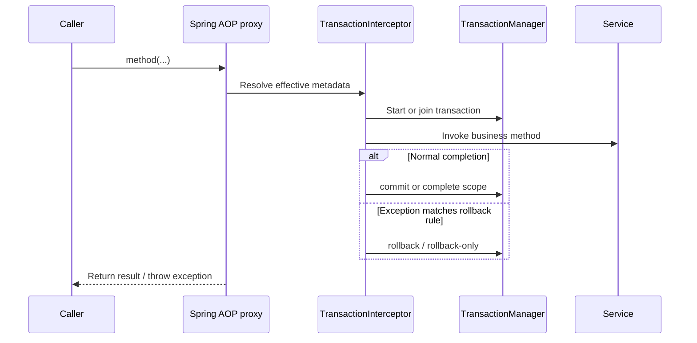

# Declaring @Transactional on Methods, Classes, and Inheritance Rules

## 1. Three Questions to Keep Separate

In Spring Framework, `@Transactional` can be declared on a **method**, **class**, **superclass**, or **interface**. However, an annotation appearing in source code does not mean a transaction has actually been opened.

You need to separate three steps:

1. **Where is the metadata?** Does the class have `@Transactional(readOnly = true)` while the method has its own annotation? What do the superclass or interface declare?
2. **Which policy does Spring choose?** From which metadata are attributes such as `propagation`, `readOnly`, `rollbackFor`, `timeout`, and the transaction manager determined?
3. **Is the call intercepted?** In standard proxy mode, only calls passing through the Spring AOP proxy receive transactional advice; `this.method()` does not trigger a new interception.

Example:

```java
@Transactional(readOnly = true)
public class ProductService {
    public void find() { /* read data */ }

    @Transactional
    public void update() { /* update data */ }
}
```

When called **through the proxy** with a proper transaction manager:

- `find()` has no separate annotation, so it inherits the class default: `readOnly = true`.
- `update()` has its own `@Transactional`. Method annotations take **precedence** over class annotations and carry their own default attribute set, namely `readOnly = false`.
- If `update()` is called internally via `this.update()` from another method on the same object, that method metadata does not create a new transactional advice.

The Java snippet above illustrates annotation placement, not a standalone program with a database and transaction manager. This article uses Spring Framework **6.x** behavior while pointing out limits by proxy type and version.

## 2. @Transactional Is Both Java and Spring Metadata

The Spring annotation lives at:

```java
import org.springframework.transaction.annotation.Transactional;
```

In its declaration, `@Transactional` has targets `TYPE` and `METHOD`, retention `RUNTIME`, and the Java meta-annotation `@Inherited`.

**Important point:** Java's `@Inherited` applies only to annotations on a **class** along the superclass chain. It **does not** automatically copy method annotations onto overriding methods, and it **does not** make interface annotations inherited by Java like superclass annotations.

Spring has its own **rules for resolving transaction metadata** across methods, target classes, and hierarchies. Therefore, the result of `getAnnotation()` in Java Reflection is not enough to infer whether Spring's interceptor will receive an annotation from a superclass/interface.

### 2.1. What Is Needed for a Transaction to Run?

- The object must be Spring-managed or proxied by an equivalent mechanism, not an arbitrary object created with `new`.
- Transaction management must be enabled, such as `@EnableTransactionManagement`, or Spring Boot must have auto-configured the infrastructure.
- There must be a `PlatformTransactionManager` (for imperative code) controlling the right datasource/persistence context.
- In **proxy mode**, the call must enter through the proxy. The annotation does not directly call `begin`, `commit`, or `rollback`.
- Any exception thrown must match rollback rules, and data changes must actually execute inside the transaction managed by that manager.



Do not equate "method has an annotation" with "method opens a physical transaction itself": `REQUIRED` may join an existing transaction; `REQUIRES_NEW` only creates a new transaction when appropriate advice runs.

## 3. Declaring Directly on a Method

Placing `@Transactional` on a **public service method** makes business boundaries clearest. Example:

```java
package example.orders;

import org.springframework.stereotype.Service;
import org.springframework.transaction.annotation.Propagation;
import org.springframework.transaction.annotation.Transactional;

@Service
public class OrderService {
    @Transactional(readOnly = true)
    public long countOrders() {
        return countFromRepository();
    }

    @Transactional
    public void createOrder(long orderId) {
        saveToRepository(orderId);
    }

    @Transactional(propagation = Propagation.REQUIRES_NEW)
    public void recordAudit(long orderId) {
        saveAudit(orderId);
    }

    // Simulated helpers; a real application would use a repository/DAO.
    private long countFromRepository() {
        throw new UnsupportedOperationException("Demo helper");
    }
    private void saveToRepository(long id) {
        throw new UnsupportedOperationException("Demo helper");
    }
    private void saveAudit(long id) {
        throw new UnsupportedOperationException("Demo helper");
    }
}
```

This is an example of placement and policy; the helpers are unimplemented, so this is **not a complete business service**.

- `countOrders()` selects a read-only transaction; `readOnly` is a **hint**, not a security lock forcing every SQL write to fail.
- `createOrder()` uses `REQUIRED`, `Isolation.DEFAULT`, `readOnly=false`; unchecked exceptions trigger rollback by default.
- `recordAudit()` requests `REQUIRES_NEW` **when intercepted**. If `createOrder()` calls `this.recordAudit(...)`, the Spring proxy does not create a new transaction for the internal call.

Important annotation attributes:

| Attribute | Example | Meaning |
| --- | --- | --- |
| `propagation` | `REQUIRED`, `REQUIRES_NEW`, `NESTED` | How the method joins or creates a transaction. |
| `isolation` | `Isolation.READ_COMMITTED` | Isolation level when a new transaction is created, depending on manager/database. |
| `readOnly` | `true` | Read optimization hint; does not guarantee writes are blocked. |
| `timeout` | `10` | Transaction timeout according to infrastructure capability, not necessarily an HTTP timeout. |
| `rollbackFor` | `IOException.class` | Specifies additional checked exceptions that trigger rollback. |
| `noRollbackFor` | `NotFoundException.class` | Specifies exceptions that do not trigger rollback; does not clear an already-set rollback-only state. |
| `transactionManager` | `"ordersTxManager"` | Selects a specific transaction manager when multiple managers exist. |

Method annotations are a good choice when different methods have different policies or when a method needs a clear transaction boundary independent of other methods.

## 4. Class-Level Declaration: Default for Eligible Methods

If most methods share the same policy, place `@Transactional` on the concrete class:

```java
import org.springframework.stereotype.Service;
import org.springframework.transaction.annotation.Transactional;

@Service
@Transactional(readOnly = true)
public class CatalogService {
    public void listProducts() {
        // Default readOnly=true from class.
    }

    public void countProducts() {
        // Also uses default from class.
    }

    @Transactional(readOnly = false)
    public void renameProduct(long id, String name) {
        // Method has its own policy for writing data.
    }
}
```

A class-level annotation is **a default**; it does not mean every method regardless of how it is called receives advice. `private`, `static`, `final` restrictions, internal calls, Spring version, and proxy type still determine which methods are intercepted. Details are in Section 7.

In service applications, common patterns are:

- Class-level `@Transactional(readOnly = true)` for query methods.
- Method-level `@Transactional(readOnly = false)` on methods that modify data.
- Or class-level `@Transactional` defaulting to write, with method-level `@Transactional(readOnly = true)` for specific read methods.

Which pattern to choose depends on the class's responsibility; most importantly, **method-specific policies must be expressed with a method annotation** and tested through the proxy.

## 5. Precedence: Method Metadata Wins Over Class Metadata

According to Spring documentation, **the more specific (most derived) location takes precedence** when evaluating transaction settings. On the same concrete class, an annotation on a method takes precedence over an annotation on the class.

```java
import org.springframework.transaction.annotation.Propagation;
import org.springframework.transaction.annotation.Transactional;

@Transactional(readOnly = true, timeout = 30)
public class BillingService {
    public void listInvoices() {
        // Inherits readOnly=true, timeout=30.
    }

    @Transactional
    public void charge() {
        // readOnly=false, default timeout of the transaction system.
    }

    @Transactional(
        readOnly = false,
        timeout = 5,
        propagation = Propagation.REQUIRES_NEW)
    public void settle() {
        // Method has its own full policy.
    }
}
```

This snippet illustrates annotations only; there is no actual SQL.

| Method | Effective metadata when intercepted | Source |
| --- | --- | --- |
| `listInvoices()` | `readOnly=true`, `timeout=30`, default `REQUIRED` | Class annotation. |
| `charge()` | `readOnly=false`, default timeout, `REQUIRED` | Argument-free method annotation. |
| `settle()` | `readOnly=false`, `timeout=5`, `REQUIRES_NEW` | Specific method annotation. |

### 5.1. No Per-Attribute Merging Between Two @Transactional Annotations

Spring **does not** work like CSS rules where a method overrides one attribute while other attributes are automatically inherited from the class. When a method annotation is selected, it provides **the entire set of transaction attributes**, including defaults for attributes not explicitly set.

Therefore, writing:

```java
@Transactional(readOnly = true, timeout = 30)
class ReportService {
    @Transactional(propagation = Propagation.REQUIRES_NEW)
    public void regenerate() {
        // readOnly=false, default timeout, REQUIRES_NEW.
    }
}
```

does not mean `regenerate()` keeps `readOnly=true` and `timeout=30`. If you want to keep those two attributes, declare them again on the method or use a properly designed composed annotation.

This also applies to `rollbackFor` and `transactionManager` selection: do not treat a method annotation as automatically appending to the entire class-level policy. When multiple managers exist, verify the exact manager the method uses.

### 5.2. Eligible Methods Still Depend on Any Existing Transaction

Metadata like `isolation` and `timeout` take direct effect when a new physical transaction is created; a `REQUIRED` scope joining an outer transaction **does not automatically alter the isolation/timeout** of the already-open physical transaction. Nor does a method annotation differing from the class annotation automatically split into a separate transaction: you need matching propagation and a call through the proxy.

## 6. Inheritance Between Superclass and Subclass

Here you must distinguish **two different directions of inheritance**.

### 6.1. Superclass Has Class-Level @Transactional

```java
import org.springframework.transaction.annotation.Transactional;

@Transactional(readOnly = true)
public class BaseReader {
    public void queryBase() {
        // Method declared in BaseReader.
    }
}

public class CustomerReader extends BaseReader {
    public void queryCustomer() {
        // New method declared in subclass.
    }
}
```

`@Transactional` on the superclass can provide a **class-level default** for subclasses. Due to `@Inherited`, type-level annotations are looked up across superclasses in Java; Spring also has a lookup mechanism across classes/methods. When `queryCustomer()` is eligible for proxy interception, it can inherit the default policy on the parent type if no more specific annotation is present.

If the subclass declares a different class-level annotation, the more specific annotation on the subclass can replace that default. Do not infer that the subclass inherits all attributes from the superclass and only swaps one field; treat the effective annotation as a complete metadata set.

### 6.2. Only the Subclass Has @Transactional: Methods Inherited from the Parent Are Not Automatically Covered

This is an important exception explicitly noted in Spring documentation: **a subclass's class-level annotation does not apply upward to methods declared in ancestor classes**. Inherited methods need to be **locally redeclared** in the subclass if they should inherit the subclass's default.

```java
import org.springframework.transaction.annotation.Transactional;

public class BaseReportService {
    public void exportReport() {
        // Method declared in ancestor without annotation.
    }
}

@Transactional(readOnly = true)
public class MonthlyReportService extends BaseReportService {
    public void countReports() {
        // Method declared in subclass: inherits default readOnly=true.
    }

    @Override
    public void exportReport() {
        // Redeclare/override in subclass to inherit subclass-level default.
        super.exportReport();
    }
}
```

How to read this:

- `countReports()` is declared on `MonthlyReportService`, so that class's class-level annotation can apply.
- If you **omit `@Override exportReport()`**, the method's actual implementation remains declared in `BaseReportService`; you must not assume the subclass annotation sets the policy for inherited ancestor methods.
- When overridden as shown above, an **external call via the bean proxy** can be intercepted using the subclass-level metadata.
- `super.exportReport()` is an internal call from the overriding method; it does not pass through the proxy a second time.

These are illustrative classes with no DAO. When a project has deep inheritance hierarchies, placing the annotation directly on the **concrete overriding method** is also a clear choice, especially for sensitive policies.

### 6.3. Annotation on a Superclass Method Overridden in a Subclass

```java
import java.io.IOException;
import org.springframework.transaction.annotation.Transactional;

public class BaseImportService {
    @Transactional(rollbackFor = IOException.class)
    public void importData() throws IOException {
        // ...
    }
}

public class CustomerImportService extends BaseImportService {
    @Override
    public void importData() throws IOException {
        // ...
    }
}
```

**Java does not automatically copy method annotations onto overriding methods.** Calling Java Reflection on `CustomerImportService.importData()` does not automatically pick up `BaseImportService.importData()`'s method annotation via `@Inherited`. However, **Spring has its own mechanism to look up transaction metadata in the method/type hierarchy**, so you cannot rely solely on Java Reflection to claim Spring's interceptor ignores all ancestor annotations.

The clearest way to write code is to explicitly annotate the **concrete overriding method** when the policy has business significance:

```java
@Override
@Transactional(rollbackFor = IOException.class)
public void importData() throws IOException {
    // ...
}
```

This is a method fragment to place inside the subclass and needs the appropriate imports. If you change the policy in the overriding method, specify all important attributes; the new method annotation will take precedence under the more-specific rule.

## 7. Interfaces, Proxies, and Visibility Rules

### 7.1. Can Annotations Be Placed on Interfaces?

Yes:

```java
import org.springframework.transaction.annotation.Transactional;

public interface PaymentOperations {
    @Transactional
    void capture(long paymentId);
}
```

And the implementation:

```java
import org.springframework.stereotype.Service;

@Service
public class PaymentService implements PaymentOperations {
    @Override
    public void capture(long paymentId) {
        // Use appropriate repository/database.
    }
}
```

These are two simple sample files with no database. Since Spring Framework **5.0**, annotations on interfaces/interface methods are supported in **proxy mode** for both interface-based and class-based proxies. However, Java does not inherit interface annotations via `@Inherited`, and **AspectJ weaving mode does not pick up interface-declared transaction annotations the way proxy mode does**. Therefore Spring recommends annotating **concrete classes/methods**, especially if the project might switch AOP mechanisms.

Clearer version:

```java
@Service
public class PaymentService implements PaymentOperations {
    @Override
    @Transactional
    public void capture(long paymentId) {
        // Policy is visible directly on the implementation.
    }
}
```

This is a snippet updating `PaymentService`, needing the `@Transactional` import added. If multiple interfaces declare different policies for a method, decide the policy directly on the implementation; avoid relying on hard-to-observe metadata lookup order.

### 7.2. Comparing JDK Proxies and Class-Based Proxies

| Method/situation | JDK interface proxy | Class-based proxy, Spring 6.x |
| --- | --- | --- |
| `public` on proxied interface | Can be advised when metadata is valid | Can be advised when method can be overridden |
| `public` only on concrete class | Cannot be called via the corresponding interface proxy | Can be advised |
| `protected` or package-visible | Not exposed as a method on the JDK interface proxy | Can be advised by default since Spring 6.0 if eligible |
| `private` | Not advised | Cannot be overridden, not advised in proxy mode |
| `static` | Not an instance call through proxy | Not an instance call through proxy |
| `final` implementation method | Public calls **via interface** can still be advised by JDK proxy | Class-based proxy cannot override final methods to advise them |
| `this.method()` | Bypasses proxy | Bypasses proxy |
| Bean manually created with `new` | No Spring proxy | No Spring proxy |

**Version details:** in Spring 6.0+, `protected` or package-visible methods can receive transaction advice in **class-based proxies** by default configuration; Spring 5.3 and older defaults primarily supported public methods. You can configure `AnnotationTransactionAttributeSource(true)` to restrict to public methods only when consistent behavior is needed. With JDK proxies, transactional methods must be **public** and present on the proxied interface.

**Simplest practice:** place `@Transactional` on **public methods of concrete Spring services** and call the service from another bean. If your project uses Kotlin, note that classes/methods are `final` by default; you may need the all-open/kotlin-spring plugin for class proxies.

### 7.3. Self-Invocation: Metadata Is Correct, Yet Advice Does Not Run

```java
@Service
public class OrderFacade {
    public void placeOrder() {
        this.saveOrder();
    }

    @Transactional
    public void saveOrder() {
        // ...
    }
}
```

The snippet above needs `@Service` and `@Transactional` imports. In Spring's standard **proxy mode**, calling `placeOrder()` from outside **does not route `this.saveOrder()` through the proxy**. Consequently, the annotation on `saveOrder()` does not start a transaction for self-invocation.

If `OrderFacade` has a class-level annotation and `placeOrder()` has already opened a transaction, `saveOrder()` still runs in the outer method's transaction; it is just that `saveOrder()`'s own metadata **is not applied via a new interception**. This is an important difference between "already inside a transaction" and "method annotation was activated".

Clear ways to handle this: call another service through a bean proxy, move the boundary to the public entry method, or use `TransactionTemplate` when wrapping a specific block of work. `AdviceMode.ASPECTJ` can handle self-invocation via weaving, but requires `spring-aspects` infrastructure and compile-time/load-time weaving; this is not the default configuration.

Do not rely on transaction proxies inside constructors or `@PostConstruct`: the bean is not yet in a fully proxied state for internal calls during initialization.

## 8. Runnable Example with Java 17 and Spring 6.2

The following example runs with Maven without Spring Boot. It creates a Spring context, `DataSourceTransactionManager`, and in-memory H2. There is no update SQL because the goal is to **observe effective metadata** on class/method and the self-invocation difference.

Structure:

```text
tx-placement-demo/
├── pom.xml
└── src/main/java/demo/tx/TransactionalPlacementDemo.java
```

**`pom.xml`:**

```xml
<project xmlns="http://maven.apache.org/POM/4.0.0"
         xmlns:xsi="http://www.w3.org/2001/XMLSchema-instance"
         xsi:schemaLocation="http://maven.apache.org/POM/4.0.0
                             https://maven.apache.org/xsd/maven-4.0.0.xsd">
    <modelVersion>4.0.0</modelVersion>
    <groupId>demo</groupId>
    <artifactId>tx-placement-demo</artifactId>
    <version>1.0.0</version>
    <properties>
        <maven.compiler.release>17</maven.compiler.release>
        <project.build.sourceEncoding>UTF-8</project.build.sourceEncoding>
    </properties>
    <dependencies>
        <dependency>
            <groupId>org.springframework</groupId>
            <artifactId>spring-context</artifactId>
            <version>6.2.19</version>
        </dependency>
        <dependency>
            <groupId>org.springframework</groupId>
            <artifactId>spring-jdbc</artifactId>
            <version>6.2.19</version>
        </dependency>
        <dependency>
            <groupId>com.h2database</groupId>
            <artifactId>h2</artifactId>
            <version>2.3.232</version>
        </dependency>
    </dependencies>
    <build>
        <plugins>
            <plugin>
                <groupId>org.apache.maven.plugins</groupId>
                <artifactId>maven-compiler-plugin</artifactId>
                <version>3.13.0</version>
            </plugin>
            <plugin>
                <groupId>org.codehaus.mojo</groupId>
                <artifactId>exec-maven-plugin</artifactId>
                <version>3.5.1</version>
            </plugin>
        </plugins>
    </build>
</project>
```

**`src/main/java/demo/tx/TransactionalPlacementDemo.java`:**

```java
package demo.tx;

import javax.sql.DataSource;
import org.springframework.context.annotation.AnnotationConfigApplicationContext;
import org.springframework.context.annotation.Bean;
import org.springframework.context.annotation.Configuration;
import org.springframework.jdbc.datasource.DataSourceTransactionManager;
import org.springframework.jdbc.datasource.DriverManagerDataSource;
import org.springframework.transaction.PlatformTransactionManager;
import org.springframework.transaction.annotation.EnableTransactionManagement;
import org.springframework.transaction.annotation.Transactional;
import org.springframework.transaction.support.TransactionSynchronizationManager;

public final class TransactionalPlacementDemo {
    public static void main(String[] args) {
        try (var context = new AnnotationConfigApplicationContext(Config.class)) {
            CatalogService service = context.getBean(CatalogService.class);
            service.find();
            service.save();
            service.selfCall();
        }
    }

    private static void trace(String method) {
        System.out.printf("%s | active=%s | readOnly=%s%n",
                method,
                TransactionSynchronizationManager.isActualTransactionActive(),
                TransactionSynchronizationManager.isCurrentTransactionReadOnly());
    }

    @Configuration
    @EnableTransactionManagement(proxyTargetClass = true)
    public static class Config {
        @Bean
        public DataSource dataSource() {
            return new DriverManagerDataSource(
                    "jdbc:h2:mem:placement;DB_CLOSE_DELAY=-1", "sa", "");
        }

        @Bean
        public PlatformTransactionManager transactionManager(DataSource dataSource) {
            return new DataSourceTransactionManager(dataSource);
        }

        @Bean
        public CatalogService catalogService() {
            return new CatalogService();
        }
    }

    @Transactional(readOnly = true)
    public static class CatalogService {
        public void find() {
            trace("find");
        }

        @Transactional
        public void save() {
            trace("save");
        }

        public void selfCall() {
            trace("selfCall");
            this.save();
        }
    }
}
```

Run with Java 17+ and Maven in the `tx-placement-demo` directory:

```bash
mvn -q compile exec:java -Dexec.mainClass=demo.tx.TransactionalPlacementDemo
```

**Lines printed by the program**, excluding Maven's own logs:

```text
find | active=true | readOnly=true
save | active=true | readOnly=false
selfCall | active=true | readOnly=true
save | active=true | readOnly=true
```

Explanation:

1. `service.find()` goes through the proxy. The method has no separate annotation, so it inherits the class default `readOnly=true`.
2. `service.save()` goes through the proxy. The `@Transactional` annotation on the method takes precedence and has the default `readOnly=false`.
3. `service.selfCall()` goes through the proxy. It receives the class-level `readOnly=true` and opens/enters a transaction under that policy.
4. `this.save()` inside `selfCall()` bypasses the proxy. `save()`'s `trace()` observes the transaction already opened by `selfCall()`, so `readOnly` remains `true` instead of applying the method policy.

`TransactionSynchronizationManager.isActualTransactionActive()` indicates **whether a transaction is currently active**, not whether the current method itself created a new physical transaction. The example has no SQL write statements, so it is **not** intended to demonstrate `readOnly` write-blocking or rollback.

Try changing the annotation on `save()` to `@Transactional(propagation = Propagation.REQUIRES_NEW)` (adding the `Propagation` import): calling `service.save()` through the proxy will apply that policy, while `this.save()` still will not create an independent `REQUIRES_NEW` transaction.

## 9. Method Overriding, Overloading, Interfaces, and Composed Annotations

### 9.1. Overloads Are Two Different Methods

```java
public class StockService {
    @Transactional
    public void reserve(long productId) { /* ... */ }

    public void reserve(long productId, int quantity) { /* ... */ }
}
```

An annotation on `reserve(long)` **does not** automatically apply to `reserve(long, int)`: they are two different signatures. If the second overload also needs a transaction, annotate it separately or put a class-level default.

### 9.2. Overrides in Subclasses Should Expose Important Policies

If a parent method has `@Transactional(rollbackFor = IOException.class)`, an overriding method in a concrete subclass **does not automatically get that annotation via Java's `@Inherited`**. Spring has its own lookup algorithm, but to eliminate design ambiguity, declare it directly on the overriding method or test metadata through the Spring context.

If the override has a new `@Transactional`, attributes not declared on the new annotation revert to defaults; **do not** treat this as adding onto rollback rules/timeout/readOnly from the ancestor.

### 9.3. Composed Annotations When Repeating the Same Policy

You can create a reusable business annotation:

```java
package example.tx;

import java.lang.annotation.ElementType;
import java.lang.annotation.Retention;
import java.lang.annotation.RetentionPolicy;
import java.lang.annotation.Target;
import org.springframework.transaction.annotation.Transactional;

@Target({ElementType.TYPE, ElementType.METHOD})
@Retention(RetentionPolicy.RUNTIME)
@Transactional(readOnly = true)
public @interface ReadTransaction {}
```

Usage:

```java
@ReadTransaction
public class QueryService {
    public void search() {
        // ...
    }
}
```

These are two illustrative files and require importing `ReadTransaction` from the right package. Spring supports meta-annotations; however, custom annotations still must be designed with appropriate target/retention, consider `@Inherited` if class-level Java inheritance is needed, and still depend on proxy/interception. Do not stack multiple composed annotations with conflicting attributes on the same element expecting Spring to merge them automatically.

## 10. Checklist for Choosing Annotation Placement and Testing

| Context | Clear declaration | Risks to check |
| --- | --- | --- |
| A service method needs commit/rollback | `@Transactional` directly on the public method | Bean/proxy and exception rollback rules. |
| Many methods share a read policy | `@Transactional(readOnly=true)` on the concrete class | Write methods must have an overriding annotation. |
| Method needs a different policy from class | Method annotation specifying all important attributes | No attribute merging with the class annotation. |
| Superclass is annotated | Verify superclass/subclass defaults | Overrides or more specific policy in subclass. |
| Only subclass is annotated, method inherited from parent | Redeclare/override method in subclass or annotate concrete method | Do not assume subclass annotation applies upward to ancestor methods. |
| Interface has `@Transactional` | Works in proxy mode; prefer annotating the implementation | AspectJ weaving does not inherit interface annotations. |
| Protected/package-visible method | Use Spring 6+ class-based proxy if appropriate | Does not work like JDK proxy and does not bypass self-invocation. |
| Final/private/static method | Design a public service boundary that can be advised | Class-based proxy cannot advise final/private; static does not go through proxy. |
| Method called from the same object | Extract to another bean or use `TransactionTemplate` | `this.method()` does not open new advice. |

When writing tests, **obtain the bean from the Spring context**, call through the proxy from a caller without an existing transaction, and then verify state and data **after the transaction ends**. Tests with `@Transactional` on the test method in Spring Test may roll back by default, distorting conclusions about the service's real commit behavior. For code that updates data, include these test cases:

1. External call to annotated method: write succeeds → data commits.
2. Throw `RuntimeException` between multiple JDBC operations on the same resource → data rolls back.
3. Checked exception: compare default behavior and `rollbackFor`.
4. Class `readOnly=true` with a separate method annotation: verify the effective policy rather than guessing from method names.
5. Call a method via `bean.method()` and via `this.method()`: demonstrate the interception difference.
6. Non-redeclared inherited method vs. overridden version in subclass: verify exact behavior under your proxy configuration.
7. If switching between JDK proxies and class-based proxies, re-run interface annotation/visibility tests.

**Do not just look at "Creating new transaction" logs:** when the caller already has a transaction, a method can run inside the same transaction even though its internal annotation was not applied. Measure the policy and business outcome at the appropriate boundary.

## 11. Takeaways

- **Method level wins over class level** when a method has its own annotation; attributes not declared on the method **are not inherited field-by-field** from the class annotation.
- **A superclass class-level annotation** can act as a default for subclasses. **An annotation only on a subclass** does not automatically apply upward to inherited methods declared in an ancestor; when needed, redeclare/override in the subclass.
- Java's `@Inherited` **does not** cause method annotations or interface annotations to be inherited by Java automatically. Spring has its own metadata lookup mechanism and supports interface annotations in proxy mode, but AspectJ weaving has different limits.
- **Proxies and call paths determine whether advice runs.** Public concrete service methods called through a Spring proxy are the most predictable choice. Self-invocation, constructors/init, and private/static/final methods with class proxies have specific limitations.
- **Verify with integration tests:** observe transaction context, real commit/rollback, and override/hierarchy cases; do not conclude solely from annotation placement in source code.

## References

- [Spring Framework 6.2 — Using @Transactional](https://docs.spring.io/spring/reference/6.2/data-access/transaction/declarative/annotations.html)
- [Spring Framework 6.2 API — @Transactional](https://docs.spring.io/spring-framework/docs/6.2.x/javadoc-api/org/springframework/transaction/annotation/Transactional.html)
- [Spring Framework — Understanding Declarative Transaction Implementation](https://docs.spring.io/spring-framework/reference/data-access/transaction/declarative/tx-decl-explained.html)
- [Spring Framework — Proxying Mechanisms](https://docs.spring.io/spring-framework/reference/core/aop/proxying.html)
- [Java 17 API — java.lang.annotation.Inherited](https://docs.oracle.com/en/java/javase/17/docs/api/java.base/java/lang/annotation/Inherited.html)
