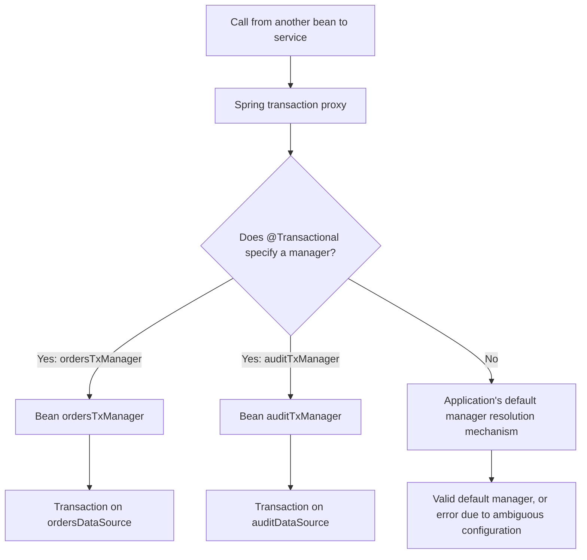

# Selecting TransactionManager with @Transactional(transactionManager = ...) or @Transactional(value = ...)

## 1. Scenario and Learning Objectives

In a Spring application using only **one database and one transaction manager**, the plain `@Transactional` annotation is usually enough for a service method to participate in a transaction. However, when an application has **multiple data sources, multiple transaction managers, or uses both JDBC/JPA and R2DBC**, Spring needs to know **which manager** should handle starting, committing, and rolling back a specific call.

For example, an order management system has:

- An **orders** database storing orders and order amounts.
- An **audit** database storing operation logs.
- Two independent transaction manager beans: `ordersTxManager` and `auditTxManager`.

In this case, the service author needs to specify the target explicitly:

```java
@Transactional(transactionManager = "ordersTxManager")
public void createOrder(...) { ... }

@Transactional(value = "auditTxManager")
public void writeAudit(...) { ... }
```

The two snippets above select **different managers**, yet `transactionManager` and `value` are **two names for the exact same attribute** in `@Transactional`. The difference lies in the bean name passed in, not the attribute name.

Lesson objectives:

1. Understand what a `TransactionManager` does and why choosing the right manager bound to the data source is mandatory.
2. Master the exact meaning and equivalent syntax of `transactionManager`, `value`, and the shorthand `@Transactional("...")`.
3. Build and run a Java 17+ example with **two H2 databases, two JdbcTemplates, and two PlatformTransactionManagers**.
4. Know how to use a **bean name or qualifier** to select a transaction manager, and handle cases without a clear default manager.
5. Recognize bugs from choosing the wrong manager, expecting rollback across multiple databases, self-invocation, and confusing `@Qualifier` on repository injection with the transaction manager.

> Scope: this lesson focuses on **selecting a transaction manager via `@Transactional` attributes**. Isolation, propagation, and business logic details are explained only as much as needed to avoid misinterpreting manager selection outcomes.

## 2. What Is a Transaction Manager?

When `@Transactional` takes effect, Spring's transaction mechanism uses a bean implementing the `TransactionManager` contract corresponding to the execution model to coordinate transaction actions.

In **imperative** applications (standard JDBC, JPA), the concrete bean typically implements `PlatformTransactionManager`, such as:

- `DataSourceTransactionManager` or `JdbcTransactionManager` for JDBC operations using a `DataSource`;
- `JpaTransactionManager` for an `EntityManagerFactory` using JPA/Hibernate.

For **reactive** stacks (e.g., Spring Data R2DBC), a `ReactiveTransactionManager` is needed for operations participating in the **Reactor Context**. Do not choose a thread-bound JDBC manager expecting it to manage R2DBC transactions inside a reactive pipeline.

In the JDBC case, the manager is responsible for opening/joining transactions, binding the connection resource to the appropriate thread, and coordinating commit/rollback. `JdbcTemplate` must access **the same DataSource** managed by that manager so its SQL statements participate in that transaction.

### Manager Selection Diagram



**Core consequence:** selecting a manager determines **which resource is protected by that manager**. It does not turn all database connections in the JVM into a single atomic transaction.

## 3. Three Equivalent Ways to Write the Same Manager

Look at the three declarations below:

```java
@Transactional(transactionManager = "ordersTxManager")
public void methodA() { /* ... */ }

@Transactional(value = "ordersTxManager")
public void methodB() { /* ... */ }

@Transactional("ordersTxManager")
public void methodC() { /* ... */ }
```

This is **syntax illustration code**, not a complete class. All three specify the same transaction manager identified by `ordersTxManager`.

| Syntax | Meaning | When to use |
| --- | --- | --- |
| `@Transactional(transactionManager = "ordersTxManager")` | Explicitly writes the manager-selection attribute name | Most readable when the service uses multiple annotation options |
| `@Transactional(value = "ordersTxManager")` | Uses the `value` attribute name | Functionally identical for selecting the manager |
| `@Transactional("ordersTxManager")` | Shorthand when only `value` needs to be passed | Concise, suitable when the selection is already clear |

In Java annotations, an unnamed argument is assigned to `value`. Spring defines `value()` and `transactionManager()` as **bidirectional aliases** via `@AliasFor`. Therefore:

- It is not the case that `value` denotes a "transaction name" while `transactionManager` denotes a "manager bean". **Both select the transaction manager**.
- Do not set the two aliases to **conflicting values** in the same annotation, such as `@Transactional(value = "ordersTxManager", transactionManager = "auditTxManager")`. That is an invalid configuration, not a way to manage two DBs simultaneously.
- The string you pass is normally a **bean name** or a **qualifier value** of a `TransactionManager` bean.

In many projects, it is best to standardize on one style; `transactionManager = "..."` makes intent clear to newcomers, while `@Transactional("...")` is convenient when repeated often.

## 4. Bean Names and Qualifiers: How Does Spring Locate the Manager?

Suppose the configuration has a bean:

```java
@Bean("ordersTxManager")
PlatformTransactionManager ordersTxManager(DataSource dataSource) {
    return new DataSourceTransactionManager(dataSource);
}
```

This is an abbreviated snippet; in a multi-DataSource configuration, the `dataSource` parameter must be selected properly with `@Qualifier` or bean name, as shown in the full example in Section 5.

The name `ordersTxManager` is the identifier that can be used in:

```java
@Transactional(transactionManager = "ordersTxManager")
```

Spring also allows matching by a **qualifier** on the manager bean. For example:

```java
@Bean("primaryOrderManager")
@Qualifier("orders")
PlatformTransactionManager primaryOrderManager(
        @Qualifier("ordersDataSource") DataSource ds) {
    return new DataSourceTransactionManager(ds);
}
```

With such a bean, a method can select:

```java
@Transactional("orders")
public void writeOrder() { /* ... */ }
```

Here `"orders"` is a qualifier on the **transaction manager bean**; it does not have to be the bean name. Putting `@Qualifier("ordersJdbc")` on a `JdbcTemplate` constructor parameter is a **separate dependency injection** mechanism and does not automatically select the transaction manager for that method. Both selections must **align properly**.

**Version note:** Spring Framework 6.2+ also supports considering qualifiers declared at the **type level of the service bean** for transaction definitions that do not specify their own manager. This is an advanced version-dependent option; in introductory lessons and multi-DB systems, declaring the manager explicitly on key methods remains easier to verify.

## 5. Runnable Example: Two Independent Databases, Two Explicit Managers

This hands-on exercise uses Java 17+, Spring Boot, Spring JDBC, and H2. To practice **selecting the right manager**, each database has distinct bean names:

| Database | DataSource Bean | JdbcTemplate Bean | Manager Bean |
| --- | --- | --- | --- |
| Orders | `ordersDataSource` | `ordersJdbc` | `ordersTxManager` |
| Audit | `auditDataSource` | `auditJdbc` | `auditTxManager` |

When `createOrder(...)` is called, the service uses `ordersTxManager`. When `writeAudit(...)` is called, it uses `auditTxManager`. Each manager coordinates **a separate database**.

### 5.1. Create the Project

Create a Java 17+ project with Spring Initializr, choosing an appropriate Spring Boot version, Maven, and **Spring JDBC** and **H2 Database** dependencies. Keep the generated `pom.xml` to manage compatible versions. The two required dependencies are:

```xml
<dependencies>
    <dependency>
        <groupId>org.springframework.boot</groupId>
        <artifactId>spring-boot-starter-jdbc</artifactId>
    </dependency>
    <dependency>
        <groupId>com.h2database</groupId>
        <artifactId>h2</artifactId>
        <scope>runtime</scope>
    </dependency>
</dependencies>
```

This is only the **dependencies section**, not the entire `pom.xml`. The example does not need the web starter because it uses `CommandLineRunner`.

Create the files under package `com.example.multitx`:

```text
src/main/java/com/example/multitx/
├── MultiTxApplication.java
├── DatabaseConfig.java
└── OrderAuditService.java
```

### 5.2. Define Two DataSources and Two Managers

File `DatabaseConfig.java`:

```java
package com.example.multitx;

import javax.sql.DataSource;

import org.springframework.beans.factory.annotation.Qualifier;
import org.springframework.context.annotation.Bean;
import org.springframework.context.annotation.Configuration;
import org.springframework.jdbc.core.JdbcTemplate;
import org.springframework.jdbc.datasource.DataSourceTransactionManager;
import org.springframework.jdbc.datasource.DriverManagerDataSource;
import org.springframework.transaction.PlatformTransactionManager;

@Configuration
public class DatabaseConfig {

    @Bean("ordersDataSource")
    DataSource ordersDataSource() {
        DriverManagerDataSource ds = new DriverManagerDataSource();
        ds.setDriverClassName("org.h2.Driver");
        ds.setUrl("jdbc:h2:mem:ordersdb;DB_CLOSE_DELAY=-1");
        ds.setUsername("sa");
        ds.setPassword("");
        return ds;
    }

    @Bean("auditDataSource")
    DataSource auditDataSource() {
        DriverManagerDataSource ds = new DriverManagerDataSource();
        ds.setDriverClassName("org.h2.Driver");
        ds.setUrl("jdbc:h2:mem:auditdb;DB_CLOSE_DELAY=-1");
        ds.setUsername("sa");
        ds.setPassword("");
        return ds;
    }

    @Bean("ordersJdbc")
    JdbcTemplate ordersJdbc(
            @Qualifier("ordersDataSource") DataSource ds) {
        return new JdbcTemplate(ds);
    }

    @Bean("auditJdbc")
    JdbcTemplate auditJdbc(
            @Qualifier("auditDataSource") DataSource ds) {
        return new JdbcTemplate(ds);
    }

    @Bean("ordersTxManager")
    PlatformTransactionManager ordersTxManager(
            @Qualifier("ordersDataSource") DataSource ds) {
        return new DataSourceTransactionManager(ds);
    }

    @Bean("auditTxManager")
    PlatformTransactionManager auditTxManager(
            @Qualifier("auditDataSource") DataSource ds) {
        return new DataSourceTransactionManager(ds);
    }
}
```

**Why is this configuration important?**

- The two H2 URLs have different database names (`ordersdb`, `auditdb`), so data in the two DBs is **independent**. `DB_CLOSE_DELAY=-1` keeps the in-memory database alive after the last connection closes within the JVM lifecycle.
- Both `JdbcTemplate`s are created from the exact matching `DataSource` via `@Qualifier` on parameters.
- `ordersTxManager` and `auditTxManager` are both `PlatformTransactionManager`s but manage **two different DataSources**.
- This is an illustrative configuration for learning. `DriverManagerDataSource` does not pool connections; production apps normally use a pool like HikariCP and manage secrets securely.
- Because there are two `DataSource`s/managers, do not rely on Spring Boot auto-configuring a single `JdbcTemplate` or a single transaction manager; the key beans are explicitly defined.

### 5.3. Write the Service Using Both Aliases

File `OrderAuditService.java`:

```java
package com.example.multitx;

import org.springframework.beans.factory.annotation.Qualifier;
import org.springframework.jdbc.core.JdbcTemplate;
import org.springframework.stereotype.Service;
import org.springframework.transaction.annotation.Transactional;

@Service
public class OrderAuditService {
    private final JdbcTemplate ordersJdbc;
    private final JdbcTemplate auditJdbc;

    public OrderAuditService(
            @Qualifier("ordersJdbc") JdbcTemplate ordersJdbc,
            @Qualifier("auditJdbc") JdbcTemplate auditJdbc) {
        this.ordersJdbc = ordersJdbc;
        this.auditJdbc = auditJdbc;
    }

    @Transactional(transactionManager = "ordersTxManager")
    public void createOrder(long orderId,
                            long amount,
                            boolean forceFailure) {
        if (amount <= 0) {
            throw new IllegalArgumentException(
                "Amount must be positive");
        }

        ordersJdbc.update(
            "INSERT INTO purchase_order (id, amount) VALUES (?, ?)",
            orderId, amount);

        if (forceFailure) {
            throw new IllegalStateException("Simulated order failure");
        }
    }

    @Transactional(value = "auditTxManager")
    public void writeAudit(long eventId, String description) {
        auditJdbc.update(
            "INSERT INTO audit_log (id, description) VALUES (?, ?)",
            eventId, description);
    }
}
```

In `createOrder(...)`:

- The string `ordersTxManager` selects the orders database manager.
- `ordersJdbc` uses `ordersDataSource`, matching the data source managed by that manager.
- If `forceFailure = true`, `IllegalStateException` escapes the method. With default rollback on `RuntimeException`, Spring rolls back the row just inserted into orders.

In `writeAudit(...)`:

- `value = "auditTxManager"` is an alias for `transactionManager = "auditTxManager"`.
- `auditJdbc` uses the matching `auditDataSource`.
- You could replace the whole annotation with `@Transactional("auditTxManager")` without changing the meaning.

**Important:** the manager is specified for **the method intercepted by the proxy**. A transaction manager is not chosen because the method is named `writeAudit`, nor because the class holds an `auditJdbc` field; it is chosen according to transaction metadata and bean configuration.

### 5.4. Call the Service Through Spring and Observe Rollback

File `MultiTxApplication.java`:

```java
package com.example.multitx;

import org.springframework.boot.CommandLineRunner;
import org.springframework.boot.SpringApplication;
import org.springframework.boot.autoconfigure.SpringBootApplication;
import org.springframework.beans.factory.annotation.Qualifier;
import org.springframework.context.annotation.Bean;
import org.springframework.transaction.annotation.EnableTransactionManagement;
import org.springframework.jdbc.core.JdbcTemplate;

@SpringBootApplication
@EnableTransactionManagement
public class MultiTxApplication {

    public static void main(String[] args) {
        SpringApplication.run(MultiTxApplication.class, args);
    }

    @Bean
    CommandLineRunner demo(
            @Qualifier("ordersJdbc") JdbcTemplate ordersJdbc,
            @Qualifier("auditJdbc") JdbcTemplate auditJdbc,
            OrderAuditService service) {

        return args -> {
            ordersJdbc.execute("""
                CREATE TABLE purchase_order (
                    id BIGINT PRIMARY KEY,
                    amount BIGINT NOT NULL
                )
                """);

            auditJdbc.execute("""
                CREATE TABLE audit_log (
                    id BIGINT PRIMARY KEY,
                    description VARCHAR(100) NOT NULL
                )
                """);

            service.createOrder(101L, 500L, false);

            try {
                service.createOrder(102L, 700L, true);
            } catch (IllegalStateException ex) {
                System.out.println("Order transaction rolled back");
            }

            service.writeAudit(201L, "order created");

            Integer orders = ordersJdbc.queryForObject(
                "SELECT COUNT(*) FROM purchase_order",
                Integer.class);
            Integer audits = auditJdbc.queryForObject(
                "SELECT COUNT(*) FROM audit_log",
                Integer.class);

            System.out.println("orders rows=" + orders);
            System.out.println("audit rows=" + audits);
        };
    }
}
```

Run from the root directory of the Maven project:

```bash
./mvnw spring-boot:run
```

On Windows PowerShell:

```powershell
.\mvnw.cmd spring-boot:run
```

Ignoring normal Spring Boot and Maven startup logs, the lines printed by the program are:

```text
Order transaction rolled back
orders rows=1
audit rows=1
```

**Result explanation:**

1. `createOrder(101, 500, false)` inserts into **ordersdb** and commits, because it uses `ordersTxManager`.
2. `createOrder(102, 700, true)` inserts and then throws `IllegalStateException` before finishing; the proxy uses `ordersTxManager` to roll back. Record 102 is gone.
3. `writeAudit(201, "order created")` inserts into **auditdb** inside a transaction managed by `auditTxManager` and commits.
4. Final row counts: orders 1, audit 1. The outcome shows each method used its corresponding manager.

If the order of SQL statements changes, loggers might print different messages, but the three `System.out.println` lines above remain the same under the example's configuration and seed data. `JdbcTemplate` automatically participates in Spring transactions through Spring's connection management, as long as it uses the right DataSource.

## 6. When Is Specifying transactionManager Unnecessary?

When an application has **a single transaction manager** and transaction management is properly configured, many services can simply write:

```java
@Service
class CustomerService {
    @Transactional
    public void updateCustomer() {
        // Accesses a matching DataSource.
    }
}
```

This is a structural illustration, not a standalone runnable class. When there is one matching manager and a clear default configuration, Spring can automatically pick the manager without a separate qualifier on every method.

However, if there are two or more `TransactionManager` beans:

- Do not treat parameterless `@Transactional` as **proof** that Spring will pick the right database based on the repository used inside the method.
- Depending on transaction infrastructure configuration, you may encounter **an error unable to resolve a unique manager**, or a default manager may be chosen that is **different from the one you intended**.
- Specify by bean name/qualifier on the annotation so the intent is explicit at the point of use: `@Transactional(transactionManager = "ordersTxManager")`.
- When many methods truly use one default manager, you can configure an explicit default policy—for example via `TransactionManagementConfigurer`—instead of silently relying on ambiguous resolution.

**Rule:** selecting a transaction manager is a data-consistency decision. When multiple managers exist, an explicit name is often an important part of the business contract.

### Example Default via TransactionManagementConfigurer

This is an optional configuration; **do not add it to the hands-on project above** since its methods already specify managers explicitly:

```java
@Configuration
@EnableTransactionManagement
class DefaultTxConfiguration
        implements TransactionManagementConfigurer {

    private final PlatformTransactionManager ordersTxManager;

    DefaultTxConfiguration(
            @Qualifier("ordersTxManager")
            PlatformTransactionManager ordersTxManager) {
        this.ordersTxManager = ordersTxManager;
    }

    @Override
    public TransactionManager annotationDrivenTransactionManager() {
        return ordersTxManager;
    }
}
```

Imports for this snippet are `org.springframework.transaction.TransactionManager`, `org.springframework.transaction.PlatformTransactionManager`, `org.springframework.transaction.annotation.TransactionManagementConfigurer`, `org.springframework.transaction.annotation.EnableTransactionManagement`, `org.springframework.context.annotation.Configuration`, and `org.springframework.beans.factory.annotation.Qualifier`. With this configuration, methods without a qualifier can use `ordersTxManager` as the default manager for annotation-driven transaction management. Methods explicitly specifying `auditTxManager` still request that manager.

Use only one place to define the default manager and verify the actual behavior. Do not stack multiple default-selection mechanisms and rely on guesswork.

## 7. Put Manager on Class or Method?

Spring allows placing `@Transactional` at the **class level** so eligible methods inherit the transaction attributes. A method with its own annotation can override the class-level configuration:

```java
@Service
@Transactional(transactionManager = "ordersTxManager")
public class BusinessService {

    public void saveOrder() {
        // Inherits ordersTxManager.
    }

    @Transactional(transactionManager = "auditTxManager")
    public void saveAudit() {
        // Uses auditTxManager at the method level.
    }
}
```

This is an **illustrative snippet**, without internal repositories defined. If most methods use orders and only a few use audit, class-level configuration can be concise. However, when multiple databases have distinct responsibilities, **splitting services by data source or use case** and stating the manager clearly on methods is usually easier to read and test.

Do not forget **self-invocation**:

```java
@Service
class ExampleService {
    public void outside() {
        inside(); // Internal call on same object: bypasses proxy.
    }

    @Transactional("auditTxManager")
    public void inside() {
        // Intended to use audit manager.
    }
}
```

In **standard Spring AOP proxy mode**, calling `inside()` from `outside()` on the same object does not pass through the transaction interceptor. The `@Transactional("auditTxManager")` annotation on `inside()` **is not applied separately to this internal call**. If `outside()` already has a transaction, operations may continue inside that transaction according to the accessed resource; there is no automatic switching to the audit manager for an internal call.

Typical fixes are putting the transaction on the **public entry point called through a Spring bean proxy**, or extracting the behavior needing a different transaction manager into a separate service bean and calling it through that bean. Spring also has an AspectJ weaving mode with different interception rules, though it is not needed to learn basic manager selection.

## 8. Why Does Selecting the Wrong Manager Cause Dangerous Bugs?

Suppose a method has:

```java
@Transactional(transactionManager = "ordersTxManager")
public void mistakenlyWriteAudit() {
    auditJdbc.update(
        "INSERT INTO audit_log (id, description) VALUES (?, ?)",
        202L, "outside the intended audit transaction");
    throw new IllegalStateException("Simulated failure");
}
```

This is **warning code placed inside a bean** that has `auditJdbc` injected as in the example. `ordersTxManager` manages `ordersDataSource`, while the SQL inside runs against `auditDataSource`.

In the example's two-independent-DataSource JDBC configuration, the `INSERT` on audit can execute **outside an audit transaction** and auto-commit; the subsequent exception only triggers rollback on the transaction managed by `ordersTxManager`. The result can be that **the audit record still exists even though the method threw an error**.

This is a noteworthy bug: Spring does not automatically "inspect" the `auditJdbc` field to swap the manager. Having a transaction annotation—and even checking that a transaction is active—**does not prove** that SQL executed against the data source you just used is protected.

You must verify three elements together:

1. **Selected manager:** `@Transactional(transactionManager = "auditTxManager")`.
2. **Data source managed by that manager:** `auditDataSource`.
3. **Actual JDBC/JPA data source used:** `auditJdbc` must be built from `auditDataSource`.

If any of the three is mismatched, rollback may not produce the expected result.

## 9. Two Managers Do Not Equal a Distributed Transaction

An application may have both services:

```java
@Service
class AuditService {
    @Transactional("auditTxManager")
    public void record(...) {
        // Write to auditdb and commit.
    }
}

@Service
class OrderService {
    private final AuditService audit;

    @Transactional("ordersTxManager")
    public void submit(...) {
        // Write to ordersdb inside orders transaction.
        audit.record(...); // Call through another bean, uses audit transaction.
        throw new IllegalStateException("Fail after audit");
    }
}
```

This is **flow-description code**, with argument types and repositories omitted; it is not a standalone runnable Java file.

If `audit.record(...)` finishes and commits via `auditTxManager`, and then `submit(...)` throws a runtime exception causing `ordersTxManager` to roll back, **the already-committed audit transaction is not rolled back along with it**. Specifying two managers on two methods does not create a distributed transaction, nor does it link the two transactions into one atomic outcome.

With multiple data sources, answer the consistency requirement:

- If you only need **each database to have its own transaction**, configuring two managers is sufficient, while accepting and handling eventual or temporarily unsynchronized state.
- If you need "after writing orders DB, an audit event is guaranteed to be processed later," consider a **transactional outbox** in the same orders DB plus a reliable consumer forwarding events to audit.
- If true cross-resource atomicity is required, evaluate suitable distributed mechanisms (such as JTA/XA when supported by infrastructure) and their operational cost. **Never** use two local managers and call it a single shared ACID transaction.

This is a **multi-resource architecture** boundary, distinct from writing the `transactionManager` or `value` alias correctly.

## 10. Distinguishing Imperative and Reactive Managers

Manager selection must also match the **execution model**:

| Execution flow | Typical manager | Context |
| --- | --- | --- |
| JDBC / JdbcTemplate | `DataSourceTransactionManager` or `JdbcTransactionManager` | Connection-bound transaction, typically thread-bound |
| JPA / Hibernate | `JpaTransactionManager` | EntityManager and corresponding JPA data source |
| R2DBC / Reactor | `R2dbcTransactionManager` | Reactive transaction in Reactor Context |

Example when both JDBC and reactive transaction managers exist:

```java
@Transactional(transactionManager = "jdbcTxManager")
public void saveImperative() {
    // Uses JDBC, returns void.
}

@Transactional(transactionManager = "r2dbcTxManager")
public Mono<Void> saveReactive() {
    // Returns reactive R2DBC pipeline.
    return ...;
}
```

This is a **signature illustration**, not a complete program; the `Mono` type requires Reactor and a pipeline implementation. In Spring, the transaction interceptor distinguishes imperative and reactive paths based on method/return types and manager type. Do not simply change the manager name expecting `JdbcTemplate` to join a reactive transaction; nor spawn a new thread expecting old JDBC transaction resources to propagate automatically.

## 11. Verifying Manager Selection: By Data Outcomes

A reliable way to test is to **throw an error after writing**, then observe persisted data in the exact target database.

### Key Test Scenarios

| Scenario | Expected outcome |
| --- | --- |
| Call method selecting `ordersTxManager` and write to ordersdb successfully | Orders data commits |
| Call method selecting `ordersTxManager`, write to ordersdb, then throw runtime exception | Orders write rolls back |
| Call method selecting `auditTxManager` and write to auditdb successfully | Audit data commits |
| Call method selecting `auditTxManager`, write to auditdb, then throw runtime exception | Audit write rolls back |
| Write to auditdb while declaring `ordersTxManager` | Test catches that audit may not roll back as intended |
| Call annotated method via self-invocation | Test catches that the call was not proxy-intercepted as expected |
| Omit manager when multiple managers exist | Configuration gives a clear outcome or fails loudly; must not silently hit wrong DB |

If using Spring Boot, you can enable logging to observe the transaction interceptor and managers:

```properties
logging.level.org.springframework.transaction.interceptor=TRACE
logging.level.org.springframework.jdbc.datasource.DataSourceTransactionManager=DEBUG
```

Exact log messages depend on version. Look for signs of **transactional method invocation** and transaction begin/commit/rollback per manager, though final conclusions must still rest on DB reads **after the transaction ends**.

You can check:

```java
boolean active =
    TransactionSynchronizationManager.isActualTransactionActive();
```

In a Spring-managed JDBC transaction, this value helps diagnose whether an active transaction exists on the thread. However, it **does not tell you which manager's DataSource an arbitrary `JdbcTemplate` is using**. Therefore, do not treat `active == true` as sufficient proof of correct manager selection.

### Extended Practice Plan

After running the main example:

1. Change `createOrder(...)`'s annotation from `transactionManager = "ordersTxManager"` to `value = "ordersTxManager"`. The result must be identical.
2. Next change it to `@Transactional("ordersTxManager")`. The result remains identical.
3. On `writeAudit(...)`, try writing `@Transactional(transactionManager = "auditTxManager")` instead of `value = "auditTxManager"`; the result does not change.
4. In a separate experiment, intentionally choose the wrong manager for the audit write method and throw a runtime exception. Compare outcomes to see the risk of writing outside a managed transaction; clear/recreate the H2 database when repeating exercises to avoid ID collisions.
5. Try calling an annotated method from inside the same class to observe the proxy boundary, then move the call through another Spring bean.

Do not run wrong-manager experiments against production data. The goal is to prove behavior with data, not rely on comments in code.

## 12. Common Mistakes and Fixes

**Mistake 1 — Thinking the two attributes have different roles.** Writing `@Transactional(value = "ordersTxManager")` and assuming `value` is a transaction display name in logs. In reality, `value` is an alias for `transactionManager`. Fix by using one consistently.

**Mistake 2 — Misspelling the bean name.** Writing `@Transactional("orderTxManager")` when the real bean is `ordersTxManager`. Spring will fail to resolve the requested manager by qualifier; calls may fail during proxy handling. Fix with the exact bean name/qualifier and test at runtime.

**Mistake 3 — Selecting the right manager but injecting the wrong JdbcTemplate.** Method declares `ordersTxManager` but invokes `auditJdbc`. Fix by aligning all three bean mappings: manager → DataSource → DAO/JdbcTemplate.

**Mistake 4 — Relying ambiguously on @Primary or defaults.** The application has multiple transaction managers without a clear selection contract; a bean configuration change can silently shift a method to another manager. Fix with explicit qualifiers or an intentional default configuration with clear tests.

**Mistake 5 — Thinking every @Transactional in a call chain always creates a new transaction.** With default `Propagation.REQUIRED`, a proxied call with the same manager typically **joins the active transaction** rather than committing separately. With two different managers, they manage independent resources and do not automatically merge into one transaction.

**Mistake 6 — Thinking rollback of manager A will roll back DB B.** Two independent local managers do not guarantee cross-DB atomicity. Fix the design to match consistency needs: single DB, outbox, saga, or an appropriate distributed mechanism.

**Mistake 7 — Calling directly via `new` or self-invocation.** The proxy is bypassed, and annotations do not work as expected. Fix with Spring bean injection and public entry points routed through proxies.

**Mistake 8 — Swallowing exceptions inside a transactional method.** If a runtime error is caught and the method returns normally, the manager may commit the remaining changes. Default rules roll back when a `RuntimeException` or `Error` **escapes** the transactional boundary, unless the transaction was marked rollback-only by another mechanism.

## 13. Reasoning Exercises

**Exercise 1.** Configuration has two manager beans `salesTxManager` and `reportTxManager`. You want `generateSales()` to run with `salesTxManager`. Which three syntaxes are equivalent?

**Answer:**

```java
@Transactional(transactionManager = "salesTxManager")
@Transactional(value = "salesTxManager")
@Transactional("salesTxManager")
```

These are **three alternative forms for one method**, not three annotations stacked on the same method simultaneously.

**Exercise 2.** There is a bean `@Bean("realManager") @Qualifier("billing") PlatformTransactionManager ...`. Can you write `@Transactional("billing")`?

**Answer:** Yes, when the qualifier is declared on the manager bean and recognized by Spring; the string in `@Transactional` can match either the bean name or a qualifier of the manager.

**Exercise 3.** Does putting `@Qualifier("ordersJdbc")` on a service constructor automatically select `ordersTxManager`?

**Answer:** No. Constructor qualifiers select dependency injection beans; transaction annotations/transaction infrastructure determine the manager. You must verify both mappings.

**Exercise 4.** A method writing to orders DB and audit DB is annotated with `@Transactional(transactionManager = "ordersTxManager")`. If the method throws an exception, are both DBs guaranteed to roll back?

**Answer:** No. `ordersTxManager` only manages the orders resource it is configured for; auditdb may commit independently. A multi-resource consistency design is needed if the business requires it.

**Exercise 5.** A service calls `this.writeAudit()`, and `writeAudit()` has `@Transactional(value = "auditTxManager")`. Is the annotation guaranteed to apply?

**Answer:** No, in default proxy mode internal calls bypass the proxy. You must call through a Spring bean proxy or reorganize the transactional boundary.

## 14. Checklist for Real Projects

- [ ] Inventoried **all transaction manager beans** and each bean's name/qualifier.
- [ ] Configured each manager with **the right DataSource/EntityManagerFactory/ConnectionFactory**.
- [ ] Every transactional method has an **explicit** manager selection if the application has multiple managers.
- [ ] For methods without a qualifier, the default manager mechanism is defined and verified.
- [ ] `JdbcTemplate`, JPA repositories, or R2DBC repositories use the exact resource of the selected manager.
- [ ] Transactional calls actually go through Spring proxies; no reliance on self-invocation.
- [ ] Tested both commit and rollback via post-method database state, especially per DataSource.
- [ ] If a use case mutates multiple databases, made an explicit cross-system consistency decision; do not mistake two local managers for one distributed transaction.

### Final Takeaway

**`transactionManager` and `value` in `@Transactional` are two aliases for the exact same selection.** Writing `@Transactional(transactionManager = "ordersTxManager")`, `@Transactional(value = "ordersTxManager")`, or `@Transactional("ordersTxManager")` targets the exact same manager.

What truly determines correctness is **which resource that manager manages**, **which resource the DAO/repository uses**, and **whether the call passes through Spring's transaction interceptor**. Always verify your selection via actual commit/rollback behavior.

### Official References

- Spring Framework — Using `@Transactional`, section *Multiple Transaction Managers with @Transactional*: https://docs.spring.io/spring-framework/reference/data-access/transaction/declarative/annotations.html
- Spring Framework — `@Transactional` Javadoc (`value` and `transactionManager` use `@AliasFor`): https://docs.spring.io/spring-framework/docs/current/javadoc-api/org/springframework/transaction/annotation/Transactional.html
- Spring Framework — Declarative Transaction Management: https://docs.spring.io/spring-framework/reference/data-access/transaction/declarative/tx-decl-explained.html
- Spring Framework — `TransactionManagementConfigurer`: https://docs.spring.io/spring-framework/docs/current/javadoc-api/org/springframework/transaction/annotation/TransactionManagementConfigurer.html
