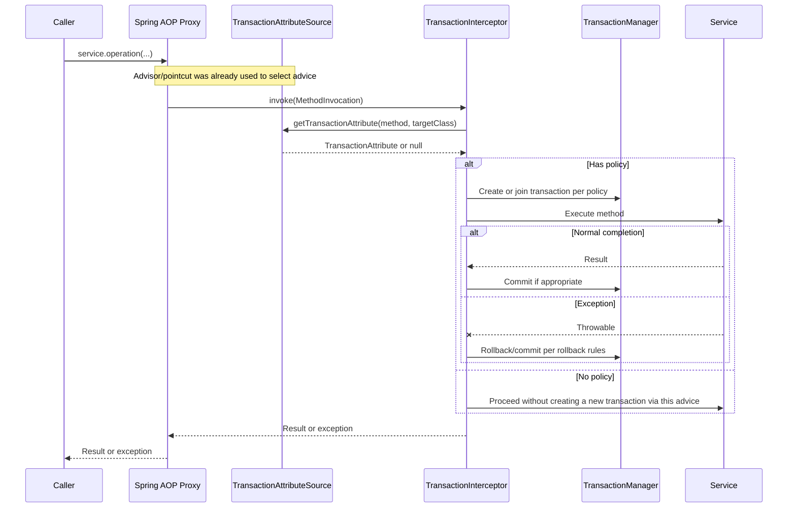

# TransactionAttributeSource and Transaction Policy Resolution in Spring

## 1. The Problem: How Does Spring Know a Method Needs a Transaction?

When a developer writes:

```java
@Service
@Transactional(readOnly = true)
public class InvoiceService {

    public Invoice find(long id) {
        // Read data.
        return null;
    }

    @Transactional(readOnly = false, rollbackFor = IOException.class)
    public void issue(long id) throws IOException {
        // Create invoice and update data.
    }
}
```

the two annotations are merely **metadata** in Java source code. The JVM does not automatically start a transaction upon seeing `@Transactional`. Spring must answer these questions:

1. Does the invoked method have a transaction policy?
2. If annotations appear on both the class and the method, which policy applies?
3. If the call originates from an interface but the implementation holds the annotation, where should lookup happen?
4. What objects represent the options `readOnly`, `propagation`, `isolation`, `timeout`, `rollbackFor`, and `transactionManager`?
5. Which component takes the lookup result to decide when to open, commit, or roll back a transaction?

**`TransactionAttributeSource`** is a key link in the solution: a contract for querying the transaction policy for **a method on a target class**. It reads and supplies the policy; **it does not open transactions itself**.

In this lesson, you will verify how Spring resolves a policy, understand the path from `@Transactional` to the transaction interceptor, master precedence and caching rules, and diagnose common bugs when an annotation is present yet the call does not run inside a transaction.

> Scope: **proxy-based declarative transaction management** typically used with Spring Framework 6.x, Spring Boot 3.x, and newer versions sharing the same core contract. Certain details regarding visibility, class/interface handling, and internal optimizations may vary by version/configuration; each version-dependent point is noted below.

## 2. Distinguishing Four Easily Confused Components

| Component | Primary Role | Not Responsible For |
| --- | --- | --- |
| `@Transactional` | Declares transaction intent and attributes | Does not intercept Java calls by itself |
| `TransactionAttributeSource` | Reads policy for a method/target class and returns `TransactionAttribute` or `null` | Does not open connections, commit, or roll back |
| `TransactionInterceptor` / `TransactionAspectSupport` | Applies advice around the call, retrieves policy, selects manager, and coordinates execution | Does not turn annotations into durable DB changes by itself |
| `PlatformTransactionManager` / `ReactiveTransactionManager` | Actually starts/joins/commits/rolls back transactions on managed resources | Does not decide which methods have `@Transactional` |

Distinguish two further concepts:

- **Transaction definition:** options controlling transaction creation/joining: propagation, isolation, timeout, read-only, and an implementation-dependent name/label.
- **Transaction attribute:** in addition to the definition, includes **exception rollback rules**. The `TransactionAttribute` interface extends `TransactionDefinition` and adds `rollbackOn(Throwable)`.

Sanity check: even if the metadata resolver confirms a method is transactional, the call still needs to **pass through the proper transaction infrastructure**. Directly calling an object instantiated with `new`, or calling internally via `this.method()` in default proxy mode, does not make the annotation take effect.

## 3. The TransactionAttributeSource Contract

The interface in package `org.springframework.transaction.interceptor` has the core method:

```java
@Nullable
TransactionAttribute getTransactionAttribute(
        Method method, @Nullable Class<?> targetClass);
```

This is a **simplified API signature** to illustrate the meaning; `@Nullable` depends on the annotation package used by your Spring version.

Meaning of each parameter:

- `method`: the `java.lang.reflect.Method` describing the invoked method. With a JDK dynamic proxy, this method **may be declared on an interface**.
- `targetClass`: the actual class behind the proxy, for example `InvoiceServiceImpl.class`. It helps the resolver look up annotations on the **implementation method** instead of looking only at the interface.
- Return value: a `TransactionAttribute` when a matching policy exists, or **`null`** if no transaction policy is found for the queried method/class pair.

Illustrative example:

```java
Method method = InvoiceService.class.getMethod("issue", long.class);
TransactionAttribute attr =
        source.getTransactionAttribute(method, InvoiceService.class);

if (attr != null) {
    System.out.println(attr.isReadOnly());
}
```

This is an **API usage illustration**; it requires an `InvoiceService` class and a properly declared `source` variable. Section 7 contains a complete runnable program.

**Important:** `getTransactionAttribute(...)` does not mean "a transaction is currently active" and does not return a `TransactionStatus`. It only returns the **configuration to apply** if transaction advice actually handles the call.

Some Spring versions also provide a helper method `hasTransactionAttribute(method, targetClass)` to answer whether a policy exists. The AOP infrastructure can use this method when selecting methods that need advice.

## 4. AnnotationTransactionAttributeSource: Reading Annotations into a Policy

In applications using `@Transactional`, a central implementation is:

```text
TransactionAttributeSource                    (interface)
    ^
    |
AbstractFallbackTransactionAttributeSource   (fallback lookup + cache)
    ^
    |
AnnotationTransactionAttributeSource         (reads and parses annotations)
```

**`AnnotationTransactionAttributeSource`** can recognize `org.springframework.transaction.annotation.Transactional` and other configured annotation formats. Depending on present dependencies, Spring also supports other transaction annotation standards. Here we focus on Spring's `@Transactional`.

This class uses **transaction annotation parsers**. For Spring's `@Transactional`, `SpringTransactionAnnotationParser` interprets the metadata and produces a `TransactionAttribute`, typically `RuleBasedTransactionAttribute`.

Conceptual flow:

```text
@Transactional(
    propagation = Propagation.REQUIRES_NEW,
    readOnly = true,
    timeout = 15,
    rollbackFor = IOException.class
)
         |
         v
AnnotationTransactionAttributeSource
         |
         v
SpringTransactionAnnotationParser
         |
         v
RuleBasedTransactionAttribute
  - propagation = REQUIRES_NEW
  - readOnly = true
  - timeout = 15
  - rollback rules include IOException
```

That step **translates metadata into structured configuration**; it does not start a transaction yet.

### Which attributes are captured in the policy?

| Annotation | Data in transaction attribute |
| --- | --- |
| `propagation = REQUIRED` | `getPropagationBehavior()` represents REQUIRED |
| `isolation = READ_COMMITTED` | `getIsolationLevel()` represents READ_COMMITTED |
| `readOnly = true` | `isReadOnly() == true` |
| `timeout = 15` / `timeoutString = "15"` | Timeout set when creating a new transaction, optionally via string resolution |
| `rollbackFor = IOException.class` | Rule where `rollbackOn(new IOException(...))` returns `true` |
| `noRollbackFor = SomeException.class` | Rollback rule with an exception configured not to roll back |
| `transactionManager = "billingTxManager"` or `value = "billingTxManager"` | Manager qualifier/name stored in the policy for the interceptor to select |
| `label = {"billing"}` | Descriptive labels/options that a supporting manager can interpret |

Several points must not be misunderstood:

- `@Transactional(readOnly = true)` provides a **read-only transaction hint**; it does not guarantee the DB will reject every UPDATE statement in every configuration.
- `propagation`, `isolation`, and `timeout` are **described policies**. When actually joining an existing transaction, some attributes meant for new transactions may not alter the outer transaction.
- Spring's default rollback rule typically **rolls back on `RuntimeException` and `Error`**, and not on checked exceptions unless configured otherwise.
- `value` on `@Transactional` is an alias for `transactionManager`; it is **not** an arbitrary identifier string for the transaction name.

## 5. Does Spring Look Up Annotations on the Method or the Class First?

Consider:

```java
@Transactional(readOnly = true, timeout = 20)
public class CustomerService {

    public Customer find(long id) {
        // Policy from class.
        return null;
    }

    @Transactional(propagation = Propagation.REQUIRES_NEW)
    public void update(long id) {
        // Policy from method.
    }
}
```

This is **illustrative code**; `Customer` and the repository are not implemented.

**Result:**

- `find(...)` has no method-level annotation, so it inherits the **entire class policy**: `readOnly = true`, `timeout = 20`, and default propagation REQUIRED.
- `update(...)` has its own annotation, so it uses the **method policy**: propagation REQUIRES_NEW, while `readOnly` reverts to its default `false` and `timeout` reverts to the default since neither is declared on the method.

A common misconception is thinking a method annotation only "overrides each declared field" and **inherits the remaining fields from the class**. In this policy resolution scheme, **the method attribute overrides the entire class attribute**; there is no field-by-field merge between two independent `@Transactional` annotations.

### Core fallback order

When a proxy invokes an interface method, Spring may need to locate the corresponding implementation method. `AbstractFallbackTransactionAttributeSource` implements the general lookup order:

1. **The specific method on the target class** (most specific target method).
2. **The class declaring that specific method** (target class / declaring class).
3. **The original method** of the invocation, such as the method from the interface.
4. **The class/interface declaring the original method**.

At each step, if a matching policy is found, the resolver returns immediately and stops searching lower-priority locations. Falling back to the original method/class is only needed when the specific method differs from the original method. Spring applies appropriate checks for method visibility and user-level methods.

Example:

```java
public interface PaymentGateway {
    @Transactional(readOnly = true)
    void view();
}

public class PaymentGatewayImpl implements PaymentGateway {
    @Override
    public void view() {
        // No annotation on the implementation.
    }
}
```

This is a **structural example**, not a single Java file since it has two `public` top-level types. When looking up the interface method with `PaymentGatewayImpl.class` as the target class, the resolver checks the implementation first, then can fall back to the annotation on the interface method.

Although Spring proxies support interface metadata in many modern configurations, Spring documentation recommends **placing `@Transactional` directly on the concrete class/method** to avoid differences among proxy modes, interface inheritance, and AspectJ weaving.

### Precedence summary

| Annotation location | Higher-priority annotation present? | Selected policy |
| --- | --- | --- |
| Concrete method | No | Concrete method policy |
| Concrete class | Not declared on concrete method | Class policy |
| Interface method | Not declared on concrete method/class, fallback applies | Interface method policy |
| Interface type | Absent in higher-priority locations, fallback applies | Interface type policy |
| Not found | — | `null`: no transaction attribute for the method |

With class inheritance, generic bridge methods, or meta-annotations, annotation lookup also depends on Spring's merged annotation mechanism and the actual declaring class. Do not use the table above to infer that **every superclass method automatically picks up every subclass annotation**. Verify real cases with `getTransactionAttribute(...)` or proxy tests.

## 6. Role of AbstractFallbackTransactionAttributeSource and Caching

Using Java reflection to locate annotations for a method, inspect the target type, and parse options would be costly if repeated on every call. The base class `AbstractFallbackTransactionAttributeSource` maintains a **cache of resolved transaction attributes**.

In Spring versions with this implementation:

- The cache key is tied to **method and target class** (a form of `MethodClassKey`) to distinguish different implementations and overloaded methods.
- When a policy exists, the cache stores the resolved `TransactionAttribute`.
- When a full lookup concludes there is **no** policy, the implementation may store a sentinel representing "no attribute" so it does not search again next time.
- Early candidate checks such as `hasTransactionAttribute` may **not cache null results** depending on the call path/version. Do not turn this optimization detail into a business contract.

**The cache here is a metadata cache**, not a cache of active transactions; it holds no connections and stores no commit/rollback state. It does not mean every call to the method shares a single transaction.

### Why are both `method` and `targetClass` needed in the key?

Suppose two classes `FastInvoiceService` and `SafeInvoiceService` both implement an `InvoiceOperations` interface, each with a different `@Transactional`. If caching used only the interface method, the resolver could return the wrong policy between the two implementations. Including the **target class** ensures resolution matches the actual object.

### When is the policy resolved?

Do not oversimplify this as "every HTTP request parses annotations via reflection".

- During AOP setup, the advisor/pointcut can ask whether a method **has a transaction attribute** to decide if the bean/method needs advice.
- When a call passes through `TransactionInterceptor`, the interceptor needs the policy to apply. Subsequent lookups typically hit the resolver's cache.
- Across infrastructure layers, the exact timing of proxy creation and method lookup depends on configuration and how Spring builds beans. They may occur at startup or upon actual invocation.

What is certain is that **the policy must be resolved for the method/class** before the transaction interceptor applies its rules; the system can reuse the result to avoid repeated parsing.

## 7. Runnable Java 17+ Example: Inspecting TransactionAttributeSource Directly

The goal of this exercise is to prove that **method annotations override class annotations** without field-by-field merging, and that a method without an annotation (and not in an annotated class) returns `null`.

This is a **pure metadata-reading** example; it does not open a database and does not actually commit/roll back. That is intentional because the topic here is `TransactionAttributeSource`.

### 7.1. Create the project

Create a Maven Spring Boot project using Spring Initializr with **Java 17+** and a compatible Spring Boot version. Keep the `pom.xml` generated by Initializr; ensure it has `spring-boot-starter` and add Spring Transaction:

```xml
<dependencies>
    <dependency>
        <groupId>org.springframework.boot</groupId>
        <artifactId>spring-boot-starter</artifactId>
    </dependency>

    <dependency>
        <groupId>org.springframework</groupId>
        <artifactId>spring-tx</artifactId>
    </dependency>
</dependencies>
```

This is a **dependencies snippet**, not the full `pom.xml`. Spring Boot manages compatible versions if you use the dependency management configuration from the Initializr project. No JDBC, H2, or HTTP server is needed for this metadata experiment.

File structure:

```text
src/main/java/com/example/txpolicy/
    TxPolicyApplication.java
    PolicyExample.java
    PlainExample.java
```

### 7.2. Create classes with default policy and method override

File `PolicyExample.java`:

```java
package com.example.txpolicy;

import java.io.IOException;

import org.springframework.transaction.annotation.Propagation;
import org.springframework.transaction.annotation.Transactional;

@Transactional(readOnly = true, timeout = 15)
public class PolicyExample {

    public void find() {
        // No method annotation: inherits class policy.
    }

    @Transactional(
        propagation = Propagation.REQUIRES_NEW,
        rollbackFor = IOException.class
    )
    public void save() {
        // Dedicated annotation overrides the entire class policy.
    }
}
```

Observations before running:

- `find()` is expected to read from class-level `@Transactional(readOnly = true, timeout = 15)`. Undeclared attributes use defaults, such as REQUIRED.
- `save()` is expected to receive REQUIRES_NEW and roll back on `IOException`; because this annotation **does not declare `readOnly` or `timeout`**, the result is default `readOnly` `false` and default timeout, **not 15**.
- There is no real business logic, no proxy, and no database. The method body does not affect annotation resolution.

File `PlainExample.java`:

```java
package com.example.txpolicy;

public class PlainExample {
    public void ping() {
        // No @Transactional on class or method.
    }
}
```

### 7.3. Create the program to print resolved policies

File `TxPolicyApplication.java`:

```java
package com.example.txpolicy;

import java.io.IOException;
import java.lang.reflect.Method;

import org.springframework.boot.CommandLineRunner;
import org.springframework.boot.SpringApplication;
import org.springframework.boot.autoconfigure.SpringBootApplication;
import org.springframework.context.annotation.Bean;
import org.springframework.transaction.TransactionDefinition;
import org.springframework.transaction.annotation.AnnotationTransactionAttributeSource;
import org.springframework.transaction.interceptor.TransactionAttribute;

@SpringBootApplication
public class TxPolicyApplication {

    public static void main(String[] args) {
        SpringApplication.run(TxPolicyApplication.class, args);
    }

    @Bean
    CommandLineRunner inspectAttributes() {
        return args -> {
            // Public-method policy, suitable for the current example.
            var source = new AnnotationTransactionAttributeSource(true);

            printPolicy(source, PolicyExample.class, "find");
            printPolicy(source, PolicyExample.class, "save");
            printPolicy(source, PlainExample.class, "ping");
        };
    }

    private static void printPolicy(
            AnnotationTransactionAttributeSource source,
            Class<?> targetClass,
            String methodName) throws NoSuchMethodException {

        Method method = targetClass.getMethod(methodName);
        TransactionAttribute attr =
                source.getTransactionAttribute(method, targetClass);

        if (attr == null) {
            System.out.println(methodName + ": none");
            return;
        }

        String timeout = attr.getTimeout() == TransactionDefinition.TIMEOUT_DEFAULT
                ? "default"
                : Integer.toString(attr.getTimeout());

        String propagation = switch (attr.getPropagationBehavior()) {
            case TransactionDefinition.PROPAGATION_REQUIRED -> "REQUIRED";
            case TransactionDefinition.PROPAGATION_REQUIRES_NEW -> "REQUIRES_NEW";
            default -> Integer.toString(attr.getPropagationBehavior());
        };

        System.out.printf(
                "%s: readOnly=%s; propagation=%s; timeout=%s; "
                        + "rollback(IOException)=%s%n",
                methodName,
                attr.isReadOnly(),
                propagation,
                timeout,
                attr.rollbackOn(new IOException("checked")));
    }
}
```

These are **three complete Java files** in the same package; they use a Java 17 switch expression and need no extra helper code.

Run the Maven project in the directory containing `pom.xml`:

```bash
./mvnw spring-boot:run
```

On Windows PowerShell:

```powershell
.\mvnw.cmd spring-boot:run
```

Besides Spring/Maven logs, the **stdout produced by `printPolicy`** will be:

```text
find: readOnly=true; propagation=REQUIRED; timeout=15; rollback(IOException)=false
save: readOnly=false; propagation=REQUIRES_NEW; timeout=default; rollback(IOException)=true
ping: none
```

### 7.4. Exact line-by-line explanation

**`find`:** the method has no annotation, so the resolver picks up the policy on `PolicyExample`. `readOnly=true`, `timeout=15`, default propagation REQUIRED. `IOException` is a checked exception not configured for rollback, so `rollbackOn(IOException)` returns false.

**`save`:** the method annotation is chosen instead of the class policy. `readOnly=false` and `timeout=default` because the two class values are not inherited. `rollbackFor=IOException.class` is converted by the parser into a rollback rule, so the result is true.

**`ping`:** neither method nor class has `@Transactional`, so the resolver returns `null`; the program prints `none`.

### 7.5. Why didn't the example print active transaction counts?

Because the focus is **policy resolution**, the example simply instantiates `AnnotationTransactionAttributeSource` and queries it via reflection. No transaction manager is declared and no method is called through a transaction proxy.

Even though `save()`'s metadata says `REQUIRES_NEW`, no new transaction is created in the example above. To test actual transactions, you need to configure a data source/transaction manager and invoke a bean intercepted by a Spring proxy, then inspect commit/rollback in the DB.

**Mini-exercise:** modify `PolicyExample.save()` to add `readOnly = true, timeout = 5` to the method annotation, and run again. The `save` output line should change to `readOnly=true` and `timeout=5`. This proves for yourself that method metadata determines **its entire own policy**.

## 8. From TransactionAttributeSource to the Transaction Proxy

When declarative transaction support is enabled (for example, `@EnableTransactionManagement` in PROXY mode or the corresponding configuration applied by Spring Boot), Spring builds AOP infrastructure with these typical components:

- **Transaction attribute source:** such as `AnnotationTransactionAttributeSource`.
- **Advisor/pointcut:** such as `BeanFactoryTransactionAttributeSourceAdvisor` using `TransactionAttributeSourcePointcut` to identify matching methods.
- **Advice/interceptor:** `TransactionInterceptor`, which executes transactional calls around the target method.

Overall flow:



This diagram expresses **responsibilities**, not a fixed callback order for every manager strategy. In Spring's standard execution path, `TransactionInterceptor.invoke(...)` determines the target class and delegates to `TransactionAspectSupport.invokeWithinTransaction(...)` to retrieve attributes, choose the manager, execute the invocation, and complete the transaction.

### The advisor queries the policy to select methods

In Spring, `TransactionAttributeSourcePointcut` can use a result equivalent to:

```java
boolean matches(Method method, Class<?> targetClass) {
    return transactionAttributeSource.hasTransactionAttribute(
            method, targetClass);
}
```

This is a **condensed description** of the idea, not a verbatim copy of the internal implementation. Because the advisor needs to know whether a method has metadata, attribute lookup may occur **before the method is called for the first time**.

Key distinctions:

- **Pointcut:** which methods is the transactional advice interested in?
- **Attribute source:** for this method, what policy applies?
- **Interceptor:** how does it use that policy to handle the call?
- **Transaction manager:** on which resource does it operate the transaction?

### What happens if the policy returns null?

`null` means the resolver **found no transaction metadata** for that method/target class pair. The transaction interceptor **does not open a transaction just for this method**.

However, that **does not mean** "absolutely no transaction exists". An unannotated method can still be called **inside another method's transaction**, and its JDBC/JPA work can join the outer transaction. Distinguish between **not creating a transaction at this boundary** and **the entire flow having no transaction**.

## 9. Factors Affecting Policy Resolution

### 9.1. Method visibility and proxy type

In Spring Framework 6.x:

- **Public methods** are the most predictable path to learn and implement.
- With **class-based proxies**, since Spring 6.0, `protected` or package-visible methods can be treated as transactional by default when validly interceptable.
- With **JDK interface-based proxies**, the method must be `public` and exposed through the proxied interface.
- **Private methods** cannot be entry points intercepted by Spring proxies. `final` methods cannot be overridden by subclass proxies either; with JDK proxies, the interface contract must be satisfied for the call to be intercepted.

When you want the resolver to recognize only **public methods** in a self-check example, use:

```java
new AnnotationTransactionAttributeSource(true)
```

The `true` argument sets `publicMethodsOnly`. It only affects **which policies the resolver recognizes**; it does not alter Java semantics or make self-invocation go through a proxy.

### 9.2. Annotations placed on interfaces

Spring can read annotations from interfaces in certain cases via fallback and merged annotations. However, interface annotations are not inherited in Java the way class annotations are, and **AspectJ weaving** applies differently. To avoid cases dependent on proxy strategy, declare transactions on the **concrete service method/class**.

### 9.3. Self-invocation: metadata exists yet no advice runs

```java
@Service
class CheckoutService {

    public void checkout() {
        saveOrder(); // called on 'this' itself
    }

    @Transactional
    public void saveOrder() {
        // DB operations.
    }
}
```

This is an illustrative snippet. If another bean only calls `checkout()`, the Spring proxy intercepts the call to `checkout()` (if another matching advice exists), but the call to `saveOrder()` from the target object itself **does not normally go through the transaction proxy**. `TransactionAttributeSource` can still return a policy if you query `saveOrder()` directly; that does not give the internal call a new transaction.

If the entire checkout must be atomic, place `@Transactional` on the **public `checkout()` method** invoked through the proxy. If `saveOrder()` represents an independent use case, move it to a separate bean and invoke it via dependency injection.

### 9.4. Annotation present, yet the transaction manager does not match

A policy can be parsed accurately while the call still fails if the transaction interceptor **cannot resolve a manager** or selects a manager governing the wrong resource. For example, `@Transactional(transactionManager = "ordersTxManager")` requires finding a manager bean with the matching qualifier/name. `TransactionAttributeSource` stores the policy identifier; the transaction infrastructure/manager is responsible for using it.

### 9.5. Composed annotations and aliases

Spring supports building domain-specific annotations based on `@Transactional`:

```java
package com.example.txpolicy;

import java.lang.annotation.ElementType;
import java.lang.annotation.Retention;
import java.lang.annotation.RetentionPolicy;
import java.lang.annotation.Target;

import org.springframework.transaction.annotation.Transactional;

@Target({ElementType.TYPE, ElementType.METHOD})
@Retention(RetentionPolicy.RUNTIME)
@Transactional(readOnly = true)
public @interface ReadOnlyTx {
}
```

This is a **standalone Java file defining an annotation**; create it in an appropriate project. A method annotated with `@ReadOnlyTx` can be recognized by `AnnotationTransactionAttributeSource` through **meta-annotation** support. If designing a custom annotation with attributes that need to override attributes of `@Transactional`, use `@AliasFor` properly. Do not assume custom annotations automatically carry transaction semantics without proper meta-annotation or parser configuration.

## 10. Simulating Policy Lookup Cases

The table below shows how to reason before running tests. Assume annotations are on concrete methods/classes under default proxy configuration and calls are eligible for interception.

| Declaration | Policy outcome | Explanation |
| --- | --- | --- |
| `@Transactional` on class; none on method | Receives class attribute | Class acts as default for eligible methods |
| `@Transactional(readOnly=true)` on class; `@Transactional` on method | Receives method attribute, `readOnly=false` | Method overrides the entire class policy |
| `@Transactional(rollbackFor=IOException.class)` on method | Rolls back when IOException escapes the call | Parser builds a rule-based attribute |
| `@Transactional(transactionManager="reportTx")` on method | Attribute carries qualifier `reportTx` | Manager is selected in the interceptor step |
| Neither method nor class has matching metadata | `null` | No policy at this method's boundary |
| Method has `@Transactional` but called via `this.method()` | Metadata still exists, advice does not run for internal call | Resolver and proxy interception are separate concerns |
| Private method has annotation | May still be recognized if queried directly by a non-public-restricted resolver, but proxy does not intercept private methods | Do not treat metadata as proof of an actual transaction |

### Exception rule precedence

When the parser receives `rollbackFor` and `noRollbackFor`, it constructs a rule set for `rollbackOn(Throwable)`. If multiple rules match, Spring prefers the **most specific rule in the exception class hierarchy**; ties depend on rule declaration order and the specific parser and should be verified rather than guessed.

Example:

```java
@Transactional(
    rollbackFor = Exception.class,
    noRollbackFor = IllegalArgumentException.class
)
public void save() {
    throw new IllegalArgumentException("Bad request");
}
```

This is illustrative method code. `IllegalArgumentException` is more specific than `Exception`, so the expected policy is **not to roll back for that exception itself** (assuming no other rollback-only cause). The experiment must be run through a proxy with a suitable manager to observe the actual commit/rollback outcome.

## 11. Observing and Debugging in Real Applications

### 11.1. Testing TransactionAttributeSource directly

For a known method, you can write a metadata test:

```java
AnnotationTransactionAttributeSource source =
        new AnnotationTransactionAttributeSource(true);
Method m = PolicyExample.class.getMethod("find");
TransactionAttribute tx =
        source.getTransactionAttribute(m, PolicyExample.class);

assert tx != null;
assert tx.isReadOnly();
```

This is a **short illustrative snippet**, needing imports and Java assertions enabled if using `assert`. In project tests, use JUnit assertions so they always evaluate regardless of whether the JVM runs with `-ea`. Crucially, this **verifies the policy**, not that a transaction was opened.

### 11.2. Verifying runtime behavior via interceptor and DB

An integration test should:

1. Obtain the service from the **Spring ApplicationContext** so the proxied bean is used if the infrastructure creates proxies.
2. Call the method from another bean or from a test outside the target, avoiding self-invocation.
3. Execute two SQL statements in one transaction; intentionally throw a runtime exception after the first SQL statement.
4. Re-read the DB **after the method and transaction complete**.
5. Confirm both SQL statements commit on success or leave no partial changes on rollback.

If you only want to test annotation precedence, the metadata example in section 7 is enough. If you want to prove transactional behavior, you must have **an integration test with a real manager and DB**.

### 11.3. Useful logs

In `application.properties`, depending on configuration and version, you can raise log levels to observe the interceptor and transaction support:

```properties
logging.level.org.springframework.transaction.interceptor=TRACE
logging.level.org.springframework.transaction.support=DEBUG
logging.level.org.springframework.jdbc.datasource=DEBUG
```

Logs can show which methods are considered transactional, which transaction manager is used, and when a transaction commits/rolls back. Specific log messages depend on the version, so do not rely on a fixed log string. To verify, always combine **metadata tests** and **DB state after the call**.

### 11.4. Diagnostic questions in order

When a method has `@Transactional` but rollback does not behave as expected, check:

1. **Bean:** is the service actually a Spring-managed bean?
2. **Proxy:** does the caller invoke through the Spring proxy, or via `new`/`this`?
3. **Metadata:** what does `TransactionAttributeSource.getTransactionAttribute(method,targetClass)` return? Which method or class annotation is winning?
4. **Manager:** does the attribute select an appropriate transaction manager; is the DB access connection managed by that manager?
5. **Exception:** which rollback rule does the exception match, and does it actually escape through the transaction interceptor?
6. **Outer transaction:** does `REQUIRED` join an existing transaction, and can an outer transaction decide the final commit?
7. **Observation timing:** did you read state after actual commit/rollback rather than looking at an unflushed Java object?
8. **Resource boundaries:** are HTTP calls, email sending, file writes, or a second DB outside the resources managed by the transaction manager?

Simply "grepping `@Transactional` on the method" only answers the **first part** of the problem.

## 12. Common Misconceptions

**Misconception 1 — TransactionAttributeSource is the transaction manager.** No. The source answers "which policy does the method need?"; the manager performs operations on transaction resources.

**Misconception 2 — Every method call re-parses annotations.** No. The metadata resolver caches results, and the advisor infrastructure may also query policies when building proxies. Exact timing depends on configuration, but do not assume reflection happens on every request.

**Misconception 3 — Method and class annotations merge field by field.** No. A specific method policy overrides the **entire** class policy. If the method only declares `propagation=REQUIRES_NEW`, other undeclared fields revert to the method annotation's own defaults.

**Misconception 4 — Having metadata means being inside a transaction.** No. Metadata can be read independently of proxy calls. Private visibility, self-invocation, unenabled proxies, or missing managers can all prevent expected semantics.

**Misconception 5 — Looking up by an interface method never finds the implementation's annotation.** False. The resolver takes `targetClass` to find the specific method first, then falls back. That is why the `targetClass` parameter is crucial.

**Misconception 6 — `readOnly=true` makes every DB write fail for sure.** False. It is a hint/optimization depending on the transaction manager/DB, not a substitute for write permissions and DB constraints.

**Misconception 7 — `@Transactional` on a subclass automatically applies to every inherited method.** Not always true. A class annotation on a subclass does not automatically propagate back up to an ancestor class; inherited methods may need to be redeclared or have annotations placed in the right location.

**Misconception 8 — `null` from the source means no outer transaction exists.** False. A method may have no policy of its own yet still run inside a transaction started at an outer entry point.

**Misconception 9 — Changing the manager on a method combines multiple databases into one transaction.** No. The source can specify a qualifier, but a local manager only manages its corresponding resource; cross-resource atomicity is a separate design problem.

## 13. Self-Check Exercises

**Exercise 1 — Precedence between class and method**

Given:

```java
@Transactional(readOnly = true, timeout = 40)
class InventoryService {

    public void list() {}

    @Transactional(propagation = Propagation.REQUIRES_NEW)
    public void adjust() {}
}
```

Question: Does `adjust()` have `readOnly=true` and timeout 40?

**Answer:** No. The method-level `@Transactional` creates its own policy, where `readOnly=false` and timeout is default. Only `list()` takes the class policy.

**Exercise 2 — Interface method**

A JDK proxy receives an interface `Method`, while the annotation sits on the public implementation method. What additional information does the resolver need to find the right annotation?

**Answer:** The implementation's `targetClass`. The resolver uses it to find the most-specific method and then perform precedence/fallback lookup.

**Exercise 3 — Metadata vs. invocation**

Calling `getTransactionAttribute(...)` directly returns `REQUIRES_NEW`, and then `this.save()` is called within the same service. Is a new transaction guaranteed to open?

**Answer:** No. The resolver read the metadata, but self-invocation in proxy mode does not normally pass through the interceptor to enforce that policy.

**Exercise 4 — What is the cache for?**

If the metadata source caches by `MethodClassKey`, do two calls to the same method share one transaction?

**Answer:** No. The cache only reuses the **transaction attribute**, while the transaction manager creates/joins transactions per invocation and runtime context.

**Exercise 5 — What does null mean?**

`getTransactionAttribute(m, Target.class)` returns null. Can this method run while another transaction is active?

**Answer:** Yes. It has no **own transaction policy at that entry point**, but it can run as a sub-step inside a transaction started by an outer caller.

## 14. Summary Diagram

```text
Java Source:
    @Transactional on method/class
                 |
                 v
    AnnotationTransactionAttributeSource
    + Annotation parser
                 |
    (method/class fallback, cache)
                 |
                 v
    TransactionAttribute:
    propagation / isolation / readOnly / timeout
    manager qualifier / rollbackOn(Throwable)
                 |
                 v
    Advisor + TransactionInterceptor
    (only for calls through an eligible proxy)
                 |
                 v
    TransactionManager
    (transaction on the right resource)
                 |
                 v
    Service executes -> commit / rollback per outcome
```

**Core takeaway:** `TransactionAttributeSource` is where Spring **turns metadata into a resolved policy for a specific method**. Proper resolution tells the interceptor what to do; proper interception and an appropriate manager turn that policy into real commit/rollback behavior.

### Official documentation and source code for reference

- Spring Framework — Using `@Transactional`: https://docs.spring.io/spring-framework/reference/data-access/transaction/declarative/annotations.html
- Spring Framework — Understanding Declarative Transaction Implementation: https://docs.spring.io/spring-framework/reference/data-access/transaction/declarative/tx-decl-explained.html
- Spring API — `TransactionAttributeSource`: https://docs.spring.io/spring-framework/docs/current/javadoc-api/org/springframework/transaction/interceptor/TransactionAttributeSource.html
- Spring API — `AnnotationTransactionAttributeSource`: https://docs.spring.io/spring-framework/docs/current/javadoc-api/org/springframework/transaction/annotation/AnnotationTransactionAttributeSource.html
- Spring source — `AbstractFallbackTransactionAttributeSource`: https://github.com/spring-projects/spring-framework/blob/main/spring-tx/src/main/java/org/springframework/transaction/interceptor/AbstractFallbackTransactionAttributeSource.java
- Spring source — `TransactionInterceptor`: https://github.com/spring-projects/spring-framework/blob/main/spring-tx/src/main/java/org/springframework/transaction/interceptor/TransactionInterceptor.java
