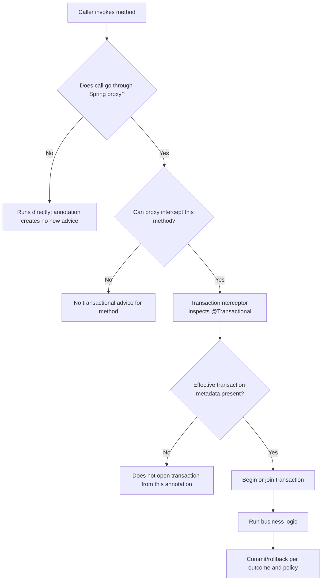
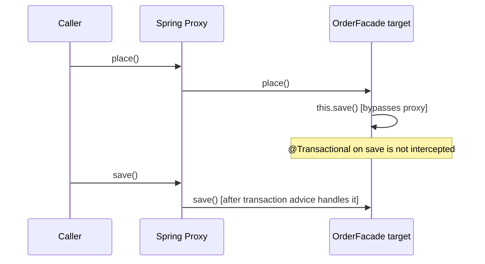

# Limitations of private, final, and static Methods in Spring's Proxy Mechanism

## 1. Central Question: Why Does `@Transactional` Exist Yet No Transaction Runs?

In Spring Framework, placing `@Transactional` on a method only **declares transaction metadata**. Under the common configuration—**proxy mode**—Spring also needs the method call to **pass through a proxy** so the transaction interceptor can open, join, commit, or roll back a transaction.

The three Java keywords `private`, `final`, and `static` directly affect a proxy's ability to intercept calls:

- `private` cannot be overridden by a subclass and is not a method exposed through a proxy interface; an annotation on a private method does not produce transactional interception in Spring proxy AOP.
- `final` prevents subclass overriding. Consequently, a **class-based proxy (CGLIB)** cannot advise a final method. However, a **JDK dynamic proxy** can still intercept a call through a public interface method and delegate to a final implementation method.
- `static` belongs to the class; calls compile into static invocations and do not go through an instance proxy. Putting `@Transactional` on a static method does not make a Spring proxy open a transaction.

The easiest mistake to make: a `private`/`final`/`static` method **can run inside a transaction already opened by its caller**, yet that **does not prove the annotation on that method itself was activated**.

This lesson focuses on **Spring AOP proxy mode** (Spring Framework 6.x, Java 17+), distinguishing interface proxies from class-based proxies, clarifying error-prone cases, and providing a self-runnable Java example to observe the transaction context.

## 2. How Does the Proxy Mechanism Create These Limitations?

Spring AOP typically uses one of two proxy types:

1. **JDK dynamic proxy**: creates an object implementing one or more interfaces of the target. Calls through the interface proxy are intercepted before the real target method is invoked.
2. **Class-based proxy (CGLIB)**: generates a **subclass** of the target class at runtime, overriding overridable methods to weave in advice.

For declarative transactions, the advisor/interceptor reads `@Transactional` metadata, uses the appropriate transaction manager, and controls the transaction around the intercepted call.



From the diagram above, **both conditions must hold**: the call must pass through the proxy *and* the proxy must be capable of advising that method.

When unmet, the annotation may still exist in the class file and remain readable via Java Reflection, yet transactional advice is not executed for the call. This is why some happy-path tests "appear to work" while actual rollback never happens.

### Do not confuse "a transaction exists" with "the annotation here ran"

Consider an outer public method that already has `@Transactional`:

```java
@Transactional
public void process() {
    validatePrivately();
}

@Transactional(propagation = Propagation.REQUIRES_NEW)
private void validatePrivately() {
    // ...
}
```

This is a method fragment; imports and the enclosing class are omitted. When `process()` is called through a proxy, `validatePrivately()` runs **inside `process()`'s transaction**. However, `@Transactional(REQUIRES_NEW)` on the private method **is not intercepted** to open an independent transaction. Calling `TransactionSynchronizationManager.isActualTransactionActive()` inside the private method can return `true` — that check **does not confirm** `REQUIRES_NEW` took effect.

## 3. Exact Matrix by Method Kind and Proxy Type

| Method / scenario | JDK dynamic proxy | Class-based proxy (CGLIB) |
| --- | --- | --- |
| `public` declared on an interface exposed by the proxy | Can be intercepted if transaction metadata is valid | Can be intercepted if the target method is overridable |
| `public` existing only on the concrete class, not on proxied interface | Not callable through the corresponding JDK interface proxy | Can be intercepted |
| `protected` | Not a public interface method | Spring 6.0+ can treat as transactional by default if overridable and called via class proxy |
| Package-visible (no modifier) | Not a public interface method | Spring 6.0+ can treat as transactional if accessible/overridable |
| `private` | Cannot be an API method advised via interface proxy | Cannot be overridden, hence not advised |
| `final` instance method | **Can** intercept calls via public interface method, even if target implementation is final | Cannot be overridden, hence not advised |
| `static` method | Not an instance dispatch via proxy | Not an instance dispatch via proxy |
| `final class` | Can use JDK proxy if class implements a suitable interface | Cannot subclass a final class |
| `this.otherMethod()` within the same target object | Does not pass through proxy again | Does not pass through proxy again |

**Version boundary:** Spring 6.0 and later extended default handling of `protected`/package-visible methods for class-based proxies. Older versions and configurations usually restrict transactional proxies to public methods. You can configure `AnnotationTransactionAttributeSource(true)` to inspect only public methods if the project wants a uniform policy. With JDK interface proxies, transactional methods must be public and present on the proxied interface.

Another edge case: a package-visible method declared in a superclass from a **different package** may not be appropriately visible/overridable to the proxy subclass, so it cannot be advised like a normal accessible method. Therefore, avoid relying on less common modifiers for critical transaction boundaries.

## 4. Why Are private Methods Not Intercepted?

In Java, `private` restricts a method to the declaring class. Subclasses cannot override private methods, and an interface proxy cannot expose a private implementation method as a public interface method.

```java
import org.springframework.stereotype.Service;
import org.springframework.transaction.annotation.Transactional;

@Service
public class PaymentService {
    public void submitPayment() {
        writePayment();
    }

    @Transactional
    private void writePayment() {
        // INSERT/UPDATE here does not get a transaction opened
        // by this private annotation in proxy mode.
    }
}
```

Illustrative code only, no DAO included. If `paymentService.submitPayment()` is called externally and `submitPayment()` is **non-transactional**, the call into `writePayment()` receives no transaction advice from the private method itself. SQL statements may auto-commit depending on the datasource, connection, repository, and other transaction boundaries; never conclude the group of operations has a local ACID transaction.

### 4.1. What if the caller is already transactional?

```java
@Transactional
public void submitPayment() {
    writePayment();
}

@Transactional(propagation = Propagation.REQUIRES_NEW)
private void writePayment() {
    // Still an internal private call.
}
```

When public `submitPayment()` is called through the proxy, a transaction is opened at the public boundary. The private method can use that same connection/transaction via Spring-managed DAOs, yet `REQUIRES_NEW` on the private method **does not create a new transaction**. If the public method rolls back, uncommitted local changes in the private method may also roll back because they belong to the **outer transaction**.

This is the distinction between:

- **Joining an existing transaction** already opened by the caller/transaction manager.
- **Creating a new transaction scope** from the private method's own annotation.

### 4.2. The usual recommended fix

Place `@Transactional` on the public service boundary:

```java
@Service
public class PaymentService {
    @Transactional
    public void submitPayment() {
        validateRequest();
        writePayment();
    }

    private void validateRequest() {
        // Internal helper; no annotation needed.
    }

    private void writePayment() {
        // DAO uses the transaction manager's matching datasource.
    }
}
```

This is a design snippet; add Spring imports and repositories for a real application. The transaction wraps the public unit of work; private helpers execute inside the existing transaction without needing interception of their own.

When only one part of a method needs a transaction or needs separate propagation, use `TransactionTemplate`:

```java
private void writePaymentWithinNewTransaction() {
    transactionTemplate.executeWithoutResult(status -> {
        paymentRepository.save(...);
    });
}
```

The snippet above is Java pseudo-code inside a service that already has `TransactionTemplate` and a repository; `...` is not a complete Java expression. Key point: `TransactionTemplate` calls `PlatformTransactionManager` directly and **needs no AOP proxy** to open a transaction. To get an independent transaction, configure `PROPAGATION_REQUIRES_NEW` properly on the template; using default `REQUIRED` allows the template to join an outer transaction.

## 5. Final Methods: Cannot Be Overridden in Class-Based Proxies

With a class-based proxy, Spring creates a subclass to insert logic before/after a method. Java forbids subclasses from overriding a method declared `final`. Hence:

```java
import org.springframework.stereotype.Service;
import org.springframework.transaction.annotation.Transactional;

@Service
public class InvoiceService {
    @Transactional
    public final void issueInvoice() {
        // With CGLIB/class-based proxy, calls to a final method
        // are not intercepted by transaction advice.
    }
}
```

Even if the class can be proxied because it has other eligible methods, `issueInvoice()` remains a final method that **cannot be advised via overriding**. If the class only has final methods or under other configs, Spring may fail to create a useful transactional proxy for them. What must be verified is *whether calls to the final method actually run inside the intended transaction*, not just whether Spring created a bean proxy.

### 5.1. Final method vs. final class

`final method` forbids overriding **one method**; `final class` forbids subclassing **the entire class**. If a final class needs a CGLIB proxy, subclass generation fails. A Java `record` is also a final class, so it is not a suitable candidate for class-based proxying. Final DTOs/records are still great as data objects; this restriction concerns using them as **AOP targets**.

Example constrained by class proxies:

```java
@Service
public final class NotificationService {
    @Transactional
    public void saveNotification() {
        // Final class: CGLIB cannot subclass it to intercept.
    }
}
```

This is a snippet, not a runnable demo program. With `proxyTargetClass=true`, a final class containing methods needing advice can cause a proxy-creation error at startup; do not simply assume the annotation is silently ignored. If the class lacks a suitable interface proxy, redesign the class or remove the subclass requirement.

### 5.2. Important exception: JDK proxies can intercept final implementation methods

A JDK dynamic proxy **does not extend the target class**. The proxy implements the interface and intercepts `interface.method()` calls first, before delegating to the target. Therefore, a final implementation method **does not prevent** a JDK proxy interceptor.

```java
public interface LedgerOperations {
    void appendEntry();
}

public final class LedgerService implements LedgerOperations {
    @Override
    @Transactional
    public final void appendEntry() {
        // Can be transactional when the caller invokes through
        // the JDK interface proxy of LedgerOperations.
    }
}
```

This snippet has two types and omits `@Transactional` imports; it is a conceptual example. With `@EnableTransactionManagement(proxyTargetClass=false)` and compatible AOP config, a bean returned via the `LedgerOperations` interface can be intercepted by a JDK proxy even though `LedgerService` is final and `appendEntry()` is also final.

All of these must hold: Spring finds the metadata, the method is public on the proxied interface, the caller uses the bean proxy, and the right transaction manager exists. **You cannot cast the JDK proxy to `LedgerService`**, because the proxy is not a subclass of the target. Conversely, if configuration forces class proxies, a final class cannot be proxied.

This is why concluding "no final method can ever be `@Transactional`" is **too broad**. The accurate statement is: *`final` blocks advice via class-based subclass proxies; interface-based JDK proxies can advise public interface calls to final methods*.

### 5.3. Do not use final methods as service transaction boundaries with class proxies

A class-based proxy may retain a final method without being able to override it. The proxy-creation mechanism can lead to confusing situations if a final method accesses instance fields on a proxy instantiated with constructor optimizations; thus you should not rely on implicit behavior when calling final methods on CGLIB-proxied beans.

Prefer public, **non-final service methods** for transaction boundaries managed by class-based proxies. If a class must stay final, consider interface + JDK proxy and integration tests proving a real transaction runs.

## 6. Static Methods: Not Instance Calls Through a Proxy

Java `static` belongs to the class. A call like `Utility.method()` resolves as a static invocation, not via dynamic dispatch on a Spring bean instance:

```java
public class PaymentUtilities {
    @Transactional
    public static void reconcile() {
        // Spring AOP proxy does not intercept this static call.
    }
}
```

Even though Java permits placing `@Transactional` on a static method, that annotation **does not make static calls open transactions** in Spring proxy mode.

Common misunderstandings:

- `@Transactional` on a static method cannot be "enabled" by `@EnableTransactionManagement` because proxies do not intercept `invokestatic`.
- Calling a static method via `bean.reconcile()` syntax (allowed by Java but discouraged) is still a static invocation after compilation, not virtual dispatch through a proxy.
- A static helper can execute a database operation **inside a previously opened transaction** on the same thread with the right resource; it has no transactional advice of its own.
- A `static final` method is even less a target for an instance proxy; the `final` modifier does not change the static call nature.

### 6.1. Alternatives: bean instance method or `TransactionTemplate`

Replace a static transaction entry point with a Spring-managed service:

```java
@Service
public class ReconciliationService {
    private final PaymentRepository repository;

    public ReconciliationService(PaymentRepository repository) {
        this.repository = repository;
    }

    @Transactional
    public void reconcile() {
        repository.reconcilePending();
    }
}
```

This is a snippet inside an application with `PaymentRepository`, not a self-running file. Callers must inject the bean and invoke `reconciliationService.reconcile()` through the proxy.

If a static utility must exist, do not rely on a static annotation. Organize the transaction at a service boundary **before calling the utility**, or use a component that receives `PlatformTransactionManager` and `TransactionTemplate` explicitly per application design. Avoid storing transaction managers in static global state, which obscures dependencies, lifecycle, and testability.

## 7. Self-Invocation Regardless of Modifiers

Even with **public non-final** methods, proxy mode does not intercept `this.method()` calls within the same object:

```java
@Service
public class OrderFacade {
    public void place() {
        this.save();  // Does not go through the proxy.
    }

    @Transactional(propagation = Propagation.REQUIRES_NEW)
    public void save() {
        // If place() is non-transactional,
        // save()'s @Transactional does not activate here.
    }
}
```

This is a conceptual example. If `place()` is also intercepted and has a transaction, `save()` can use that transaction, yet `save()`'s `REQUIRES_NEW` is still not applied. Conversely, calling `save()` from **another bean** through the proxy can trigger a new transaction per metadata.

Diagram:



**The fix** is usually moving the transactional method to another bean or placing the boundary on an entry method already called through the proxy. If you must guarantee a transaction inside a method even for a private helper, `TransactionTemplate` is the explicit mechanism. Avoid proxy self-injection or `AopContext.currentProxy()` as default choices since they introduce coupling and extra configuration.

## 8. Complete Java 17+ Example: Demonstrating private, final, static, and JDK-final

This example can be run with **Java 17+**, Maven, Spring Framework **6.2.19**, and H2. It uses `TransactionSynchronizationManager.isActualTransactionActive()` to check the transaction context while methods run.

Two independent Spring contexts are created:

1. **CGLIB context:** forces `proxyTargetClass=true`; public method with `@Transactional` is intercepted, while private/final/static methods do not open separate transactional advice.
2. **JDK context:** keeps `proxyTargetClass=false` with a final class bean implementing an interface; calling the public interface method backed by a final implementation is still intercepted.

The example uses methods that only print status without writing data to highlight **interception**. To verify real rollback, add SQL and query the database after the transaction ends.

### 8.1. Project structure

```text
proxy-limit-demo/
├── pom.xml
└── src/main/java/demo/tx/ProxyLimitDemo.java
```

### 8.2. `pom.xml`

```xml
<project xmlns="http://maven.apache.org/POM/4.0.0"
         xmlns:xsi="http://www.w3.org/2001/XMLSchema-instance"
         xsi:schemaLocation="http://maven.apache.org/POM/4.0.0
                             https://maven.apache.org/xsd/maven-4.0.0.xsd">
    <modelVersion>4.0.0</modelVersion>
    <groupId>demo</groupId>
    <artifactId>proxy-limit-demo</artifactId>
    <version>1.0.0</version>
    <properties>
        <maven.compiler.release>17</maven.compiler.release>
        <project.build.sourceEncoding>UTF-8</project.build.sourceEncoding>
    </properties>
    <dependencies>
        <dependency>
            <groupId>org.springframework</groupId>
            <artifactId>spring-context</artifactId>
            <version>6.2.19</version>
        </dependency>
        <dependency>
            <groupId>org.springframework</groupId>
            <artifactId>spring-jdbc</artifactId>
            <version>6.2.19</version>
        </dependency>
        <dependency>
            <groupId>com.h2database</groupId>
            <artifactId>h2</artifactId>
            <version>2.3.232</version>
        </dependency>
    </dependencies>
    <build>
        <plugins>
            <plugin>
                <groupId>org.apache.maven.plugins</groupId>
                <artifactId>maven-compiler-plugin</artifactId>
                <version>3.13.0</version>
            </plugin>
            <plugin>
                <groupId>org.codehaus.mojo</groupId>
                <artifactId>exec-maven-plugin</artifactId>
                <version>3.5.1</version>
            </plugin>
        </plugins>
    </build>
</project>
```

### 8.3. `src/main/java/demo/tx/ProxyLimitDemo.java`

```java
package demo.tx;

import javax.sql.DataSource;

import org.springframework.context.annotation.AnnotationConfigApplicationContext;
import org.springframework.context.annotation.Bean;
import org.springframework.context.annotation.Configuration;
import org.springframework.jdbc.datasource.DataSourceTransactionManager;
import org.springframework.jdbc.datasource.DriverManagerDataSource;
import org.springframework.transaction.PlatformTransactionManager;
import org.springframework.transaction.annotation.EnableTransactionManagement;
import org.springframework.transaction.annotation.Transactional;
import org.springframework.transaction.support.TransactionSynchronizationManager;

public final class ProxyLimitDemo {
    public static void main(String[] args) {
        try (var context =
                     new AnnotationConfigApplicationContext(ClassProxyConfig.class)) {
            ClassActions service = context.getBean(ClassActions.class);

            service.publicWork();
            service.entry();
            service.finalWork();
            ClassActions.staticWork();
        }

        try (var context =
                     new AnnotationConfigApplicationContext(JdkProxyConfig.class)) {
            Operation api = context.getBean(Operation.class);
            api.callFinal();
        }
    }

    private static void trace(String method) {
        boolean active =
                TransactionSynchronizationManager.isActualTransactionActive();
        System.out.println(method + " active=" + active);
    }

    @Configuration
    @EnableTransactionManagement(proxyTargetClass = true)
    public static class ClassProxyConfig {
        @Bean
        public DataSource dataSource() {
            return new DriverManagerDataSource(
                    "jdbc:h2:mem:classproxy;DB_CLOSE_DELAY=-1", "sa", "");
        }

        @Bean
        public PlatformTransactionManager transactionManager(DataSource ds) {
            return new DataSourceTransactionManager(ds);
        }

        @Bean
        public ClassActions classActions() {
            return new ClassActions();
        }
    }

    public static class ClassActions {
        @Transactional
        public void publicWork() {
            trace("publicWork");
        }

        public void entry() {
            trace("entry");
            this.privateWork();
            this.finalWork();
            ClassActions.staticWork();
            this.publicWork();
        }

        @Transactional
        private void privateWork() {
            trace("privateWork");
        }

        @Transactional
        public final void finalWork() {
            // Avoid accessing instance fields: CGLIB final methods
            // are not overridden/delegated by the proxy like advised methods.
            trace("finalWork");
        }

        @Transactional
        public static void staticWork() {
            trace("staticWork");
        }
    }

    public interface Operation {
        void callFinal();
    }

    public static final class FinalImplementation implements Operation {
        @Override
        @Transactional
        public final void callFinal() {
            trace("JDK final target");
        }
    }

    @Configuration
    @EnableTransactionManagement(proxyTargetClass = false)
    public static class JdkProxyConfig {
        @Bean
        public DataSource dataSource() {
            return new DriverManagerDataSource(
                    "jdbc:h2:mem:jdkproxy;DB_CLOSE_DELAY=-1", "sa", "");
        }

        @Bean
        public PlatformTransactionManager transactionManager(DataSource ds) {
            return new DataSourceTransactionManager(ds);
        }

        @Bean
        public Operation operation() {
            return new FinalImplementation();
        }
    }
}
```

### 8.4. Run command and expected output

In the `proxy-limit-demo` directory with Maven and JDK 17+:

```bash
mvn -q compile exec:java -Dexec.mainClass=demo.tx.ProxyLimitDemo
```

Lines printed by the program, excluding Maven or Spring logs:

```text
publicWork active=true
entry active=false
privateWork active=false
finalWork active=false
staticWork active=false
publicWork active=false
finalWork active=false
staticWork active=false
JDK final target active=true
```

**Reading the results:**

- `service.publicWork()` is called through the class-based proxy: `@Transactional` takes effect, `active=true`.
- `service.entry()` has no transaction annotation: `active=false`.
- `this.privateWork()`, `this.finalWork()`, and `ClassActions.staticWork()` inside `entry()` have no interception opening a transaction: `active=false`.
- `this.publicWork()` also prints `active=false` due to **self-invocation**, even though the method is public and annotated.
- Calling `service.finalWork()` externally on the class-based proxy is still not advised because the method is final.
- Calling `ClassActions.staticWork()` externally is also not advised because it is static.
- `api.callFinal()` through the JDK interface proxy has `active=true`, even though both the concrete target class and the implementation method are final.

**Subtle point:** the program checks whether *a transaction is active at the moment the method runs*. If a method is called inside a transaction opened by another method, the check can return `true` even though the current method's own annotation did not fire. That is why the demo deliberately calls the restricted methods with no outer transaction.

**Limitation:** this example verifies via runtime context; it creates no tables and measures no committed/rolled-back data. To evaluate true atomicity, write two rows in a database transaction, throw an unchecked exception between SQL statements, and read the data from outside the transaction after it ends.

## 9. What If private/final/static Sits Inside an Outer `@Transactional`?

A common wrong answer is "every private/final/static method runs outside a transaction". More accurately:

**The annotation on the method itself receives no proxy advice** in the restricted cases; however, code inside it **can join an existing transaction** if the accessed resources are Spring-managed and share the transaction context/thread.

```java
@Service
public class PaymentWorkflow {
    @Transactional
    public void run() {
        validatePrivately();
        writeFinal();
        AuditHelper.mark();
    }

    @Transactional(propagation = Propagation.REQUIRES_NEW)
    private void validatePrivately() { /* ... */ }

    @Transactional(propagation = Propagation.REQUIRES_NEW)
    public final void writeFinal() { /* ... */ }

    public static final class AuditHelper {
        @Transactional
        public static void mark() { /* ... */ }
    }
}
```

This snippet is illustrative, requiring `@Service`, `@Transactional`, `Propagation`, and a Spring-managed bean/proxy. When `run()` is called through a proxy capable of advising it, the helpers can run with the outer transaction active, yet **there are no three `REQUIRES_NEW` transactions as the annotations suggest**. The static helper gets no separate transaction either. If `run()` is non-transactional, none of those annotations starts a transaction on its own.

The transaction manager, the propagation of the **intercepted entry boundary**, how DAOs acquire connections, and thread context determine whether database operations are actually wrapped in an active transaction. There is no reason to put `@Transactional` on a private helper merely to indicate it is "called from a public transaction".

## 10. Proper Alternatives Based on Business Requirements

### 10.1. One transaction covering the entire operation

Place the transaction on the public service method invoked through the bean proxy:

```java
@Service
public class CheckoutService {
    private final OrderRepository orders;

    public CheckoutService(OrderRepository orders) {
        this.orders = orders;
    }

    @Transactional
    public void checkout(long orderId) {
        validate(orderId);
        persist(orderId);
    }

    private void validate(long orderId) { /* checks */ }

    private void persist(long orderId) {
        orders.markCheckedOut(orderId);
    }
}
```

This is a snippet inside an application with `OrderRepository`. `validate` and `persist` can stay private because they **do not need separate transactional advice**; they run in the same transaction opened at `checkout` if using the matching datasource/manager.

### 10.2. Needing an independent transaction for an internal step

Move that step to **another bean**, as a public non-final method, called through its proxy:

```java
@Service
public class AuditService {
    private final AuditRepository audits;

    public AuditService(AuditRepository audits) {
        this.audits = audits;
    }

    @Transactional(propagation = Propagation.REQUIRES_NEW)
    public void record(long orderId) {
        audits.insert(orderId);
    }
}

@Service
public class CheckoutService {
    private final AuditService audit;

    public CheckoutService(AuditService audit) {
        this.audit = audit;
    }

    @Transactional
    public void checkout(long orderId) {
        audit.record(orderId); // Goes through AuditService's proxy.
        // Other local updates.
    }
}
```

This is a two-class snippet requiring imports and repository beans. Because `REQUIRES_NEW` is an independent transaction, the audit record can commit even if checkout's outer transaction later rolls back. It can hold an extra JDBC connection, increasing pool pressure; do **not** use it as a workaround for "annotation not working" when business rules genuinely require all operations to roll back together.

### 10.3. Needing a programmatic transaction inside a helper

`TransactionTemplate` uses the transaction manager directly, without relying on an interceptor on any particular method modifier:

```java
import org.springframework.transaction.PlatformTransactionManager;
import org.springframework.transaction.TransactionDefinition;
import org.springframework.transaction.support.TransactionTemplate;

public class TransactionalTask {
    private final TransactionTemplate requiresNew;

    public TransactionalTask(PlatformTransactionManager manager) {
        this.requiresNew = new TransactionTemplate(manager);
        this.requiresNew.setPropagationBehavior(
                TransactionDefinition.PROPAGATION_REQUIRES_NEW);
    }

    public void perform() {
        executePrivately();
    }

    private void executePrivately() {
        requiresNew.executeWithoutResult(status -> {
            // DAO writes using resources managed by this manager.
        });
    }
}
```

This is a valid Java class inside an application with Spring transaction dependencies; to manipulate data, add appropriate DAOs and manager beans. The private method is where the **template is called**, while the template itself manages opening/committing/rolling back via `PlatformTransactionManager`. In a Spring application that already has `@Transactional` on an outer method, evaluate semantics carefully when configuring `REQUIRES_NEW` on the template rather than leaving default `REQUIRED` if an independent transaction is truly required.

### 10.4. If a class must remain `final`

A **final implementation class with an interface** can use a JDK interface proxy to intercept public interface methods; inject the interface and ensure the actual proxy mode is JDK. Check `AopUtils.isJdkDynamicProxy(bean)` in integration tests if confirmation is needed. If the project forces `proxyTargetClass=true`, a final class cannot produce a subclass proxy — redesign the class, adjust proxy configuration, or move the transaction boundary to an advisable bean.

**Kotlin:** classes/methods are final by default. For class-based proxies, you can use the `kotlin-spring`/all-open plugin for Spring stereotypes or design interfaces; still verify proxy types and external calls. This is not a reason to make all Kotlin methods public without considering encapsulation.

## 11. Does AspectJ Weaving Remove These Limitations?

Spring offers `@EnableTransactionManagement(mode = AdviceMode.ASPECTJ)` with Spring's AspectJ transaction aspect and compile-time/load-time weaving. Rather than only intercepting calls going **through a proxy**, weaving modifies bytecode to apply advice at matching join points; hence it can handle self-invocation and methods unoverridable by class proxies within the supported pointcut/weaving scope.

However:

- Do not treat switching to AspectJ mode as a harmless configuration tweak; you need `spring-aspects`, weaving setup, and real runtime environment testing.
- Annotation metadata on interfaces has Java inheritance limitations with AspectJ; Spring recommends annotating **concrete classes/methods**.
- For **static methods**, do not assume enabling AspectJ transaction mode alone will produce the desired outcome in every case. Verify pointcuts, weaving, transaction managers, and actual call paths; service instance boundaries remain clearer.
- AspectJ mode does not turn HTTP APIs, message brokers, or two independent local resource managers into a global ACID transaction.

Most Spring services should prefer public, non-final **instance methods** and simple proxy mode; adopt AspectJ only when there is a real need for interception beyond proxy boundaries and you accept the configuration, build, and operational cost.

## 12. Real-World Testing and Troubleshooting

To verify transactions in a project, run **integration tests through the Spring context**, never instantiating objects directly with `new`. Key checks:

1. **Confirm proxy type**: `AopUtils.isAopProxy(bean)`, `isJdkDynamicProxy`, `isCglibProxy`. Do not guess from whether the class has an interface because Boot/AOP config may force a proxy type.
2. **Invoke without an outer transaction**: test the public annotated method, then private/final/static entry points. Always calling from a transactional test method can make `isActualTransactionActive()` return true everywhere and create false positives.
3. **Verify rollback via database state**: let a method update two rows in the same datasource and throw `RuntimeException`. Read data after the transaction ends; both changes must roll back together when the method is truly advised.
4. **Distinguish self-invocation**: call `bean.publicTransactional()` and `this.publicTransactional()` from another method and observe the clear difference.
5. **Check final class startup**: with class proxies, a final class requiring transaction advice typically fails proxy creation. With JDK interface proxies, verify the bean can be injected via interface and advice runs.
6. **Distinguish propagation**: test `REQUIRES_NEW` on a separate service bean invoked via proxy vs. `REQUIRES_NEW` on a private/final method under a class proxy to see that only the former applies the new policy.

### Quick diagnostic table

| Symptom | Possible Cause | Resolution |
| --- | --- | --- |
| Private method annotated yet no transaction opens | No interceptor for private methods | Put transaction on a public service method or use `TransactionTemplate` |
| Final method does not roll back when class uses CGLIB | Cannot override final method | Remove `final` at boundary or use a suitable JDK interface proxy |
| Final class fails proxy initialization | CGLIB cannot subclass final class | Extract a proxiable service or configure interface proxying |
| Static method annotated yet SQL auto-commits | `invokestatic` does not pass through an instance proxy | Move business logic to an instance service boundary |
| Public method called via `this.` gets no new transaction | Self-invocation bypasses proxy | Call via another bean or use programmatic transactions |
| Restricted method still reports `active=true` | Caller already opened an earlier transaction | Test from an entry point with no outer transaction and check actual propagation |
| Proxy exists yet transaction does not wrap DAO | Wrong manager/datasource, or manually managed connection | Check resource identity and SQL after commit/rollback |
| Checked exception does not trigger rollback | Default rollback rule differs from expectation | Check `rollbackFor` and whether the exception escapes the interceptor |

**Beware Spring Test:** a test method annotated with `@Transactional` may roll back by default after the test, masking the difference between an actually working service transaction and a transaction from the test framework. To confirm commits, write tests without an outer test transaction or control `TestTransaction`, then inspect data from an independent scope.

### Checklist before concluding an annotation is effective

- The bean is Spring-managed and transaction advice is enabled.
- The call originates outside the bean and passes through the **right proxy**.
- The method does not fall into a category restricted by the proxy type: private/static, or final under class-based proxies.
- For JDK proxies, the method is public and present on the proxied interface.
- The transaction manager governs the right datasource and resources.
- Rollback rules match the actual exception; the exception is not swallowed if business logic requires rollback.
- Evidence is the transaction boundary and post-transaction database state, not just annotations, logs, or an isolated `active=true`.

## 13. Key Takeaways

1. **`private`:** Spring proxy AOP cannot advise private methods; they can run inside an outer transaction yet will not open a new transaction from their own annotation.
2. **`final`:** CGLIB/class-based proxies cannot override to advise final methods or subclass final classes. **JDK interface proxies are a conditional exception:** public interface methods can still be advised even if the target implementation/class is final.
3. **`static`:** static invocations do not go through an instance proxy; placing `@Transactional` on a static method does not open a transaction.
4. **Self-invocation:** even public non-final methods bypass new advice when invoked via `this.method()` in proxy mode.
5. **Stable design:** place transactions on public non-final instance methods of Spring services called through proxies; use another bean or `TransactionTemplate` when a separate transaction is needed; test rollback against real data.

## Official References

- [Spring Framework 6.2 — Proxying Mechanisms](https://docs.spring.io/spring-framework/reference/6.2/core/aop/proxying.html)
- [Spring Framework 6.2 — Using @Transactional](https://docs.spring.io/spring-framework/reference/6.2/data-access/transaction/declarative/annotations.html)
- [Spring Framework — Declarative Transaction Management](https://docs.spring.io/spring-framework/reference/data-access/transaction/declarative.html)
- [Spring Framework — Transaction Propagation](https://docs.spring.io/spring-framework/reference/data-access/transaction/declarative/tx-propagation.html)
- [Spring Framework — Programmatic Transaction Management](https://docs.spring.io/spring-framework/reference/data-access/transaction/programmatic.html)
- [Java Language Specification — Method Modifiers](https://docs.oracle.com/javase/specs/jls/se17/html/jls-8.html#jls-8.4.3)
