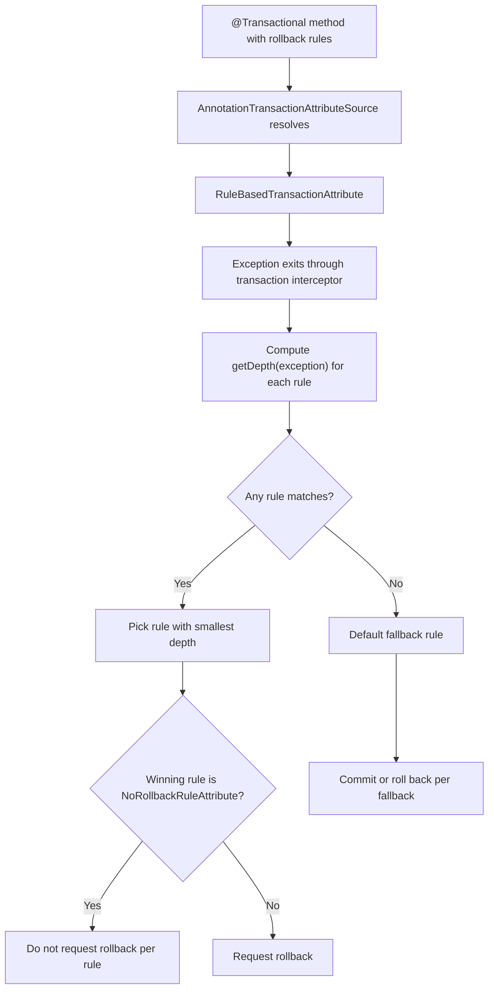

# Strongest Matching Rule When Multiple Rollback Declarations Match in Spring

## 1. The Problem: When an Exception Matches Multiple Rules, Which One Does Spring Pick?

When annotating a service method with `@Transactional`, a developer can declare both rules that **force rollback** and rules that **suppress rollback**. For example:

```java
@Transactional(
    rollbackFor = Exception.class,
    noRollbackFor = BusinessException.class
)
public void process() throws BusinessException {
    // Database and business operations.
}
```

This is a syntax illustration; `BusinessException` is an application-defined business exception class.

If `BusinessException extends Exception` is thrown, **both declarations match**:

- `rollbackFor = Exception.class` applies to `Exception` and all of its subclasses.
- `noRollbackFor = BusinessException.class` applies to `BusinessException` and all of its subclasses.

Spring resolves the conflict under the principle that the **strongest matching rule wins**, meaning the rule **closest to the actual exception class in the inheritance chain** is selected. For `BusinessException`, `noRollbackFor = BusinessException.class` is a direct match and beats the broad `Exception.class` rule. Result: Spring **does not actively roll back because of this exception**; in a new transaction, it can even commit the changes made so far.

This lesson explains that exact matching mechanism, how depths are compared, the danger of using exception names as strings, what happens on a depth tie, and how to prove the decision with a runnable Spring Boot program.

**Learning objectives:**

1. Distinguish `rollbackFor`, `noRollbackFor`, `rollbackForClassName`, and `noRollbackForClassName`.
2. Compute match depth and deduce which rule wins for an exception hierarchy.
3. Understand how `RuleBasedTransactionAttribute`, `RollbackRuleAttribute`, and `NoRollbackRuleAttribute` process the decision.
4. Avoid unpredictable conflicts among multiple patterns, especially overly broad `"Exception"` patterns.
5. Verify **real commit/rollback outcomes** when checked, unchecked, or business exceptions exit a service.
6. Distinguish **rollback decision rules** from other factors such as an already rollback-only transaction, DB errors, non-proxied calls, and pre-existing transactions.

## 2. Starting Point: The Default Rollback Rule

Under traditional Spring declarative transaction behavior:

- `RuntimeException` and its subclasses trigger **rollback** by default.
- `Error` and its subclasses also trigger **rollback** by default.
- Checked exceptions (e.g., `IOException`, custom `Exception`s not extending `RuntimeException`) **do not trigger rollback by default**.
- Normal method completion usually leads to commit if the call owns the transaction and it has not been marked rollback-only.

Example:

```java
@Transactional
public void save() throws IOException {
    jdbc.update("INSERT INTO demo_event(id) VALUES (?)", 1);
    throw new IOException("External operation failed");
}
```

This is an illustrative snippet in a Spring service with an injected `JdbcTemplate`. Under standard default rollback configuration, `IOException` **does not automatically request rollback**; if there are no other errors and the method opened the transaction, the insert may still be committed even though the caller receives the exception.

Conversely, replacing `IOException` with `IllegalStateException` makes the unchecked exception trigger default rollback.

To make a checked exception roll back as well, you can use:

```java
@Transactional(rollbackFor = IOException.class)
public void save() throws IOException {
    // DB operations that must be reverted when IOException exits.
}
```

**Version note:** starting in **Spring Framework 6.2**, `@EnableTransactionManagement(rollbackOn = RollbackOn.ALL_EXCEPTIONS)` allows changing the **global default** to roll back checked exceptions as well. If an application enables this mode or uses transaction infrastructure with a customized default rule, the statement “checked exceptions commit by default” no longer applies to those methods. Even then, the most specific explicit rule on a method still takes precedence over a broad default.

The lab below uses the traditional default policy and explicit rule declarations, so the outcome does not rely on memorizing “checked/unchecked” heuristics for every exception.

## 3. Four @Transactional Attributes for Declaring Rules

| Attribute | Example syntax | Action if winning rule |
| --- | --- | --- |
| `rollbackFor` | `rollbackFor = IOException.class` | Choose rollback |
| `noRollbackFor` | `noRollbackFor = BusinessException.class` | Do not request rollback due to this exception |
| `rollbackForClassName` | `rollbackForClassName = "com.example.IOExceptionLike"` | Choose rollback if **class name pattern** matches |
| `noRollbackForClassName` | `noRollbackForClassName = "BusinessWarningException"` | Do not request rollback if pattern matches |

The two attributes ending in `ClassName` use **string patterns**. The other two use **`Class<? extends Throwable>`**, which are generally safer and clearer because they are checked at compile time.

Multiple types can be declared:

```java
@Transactional(
    rollbackFor = {IOException.class, SQLException.class},
    noRollbackFor = {MinorBusinessException.class},
    rollbackForClassName = {"com.example.ExternalCheckedException"},
    noRollbackForClassName = {"com.example.LegacyNonFatalException"}
)
public void process() throws IOException, SQLException, MinorBusinessException {
    // ...
}
```

This is a syntax example; `MinorBusinessException`, `ExternalCheckedException`, and `LegacyNonFatalException` must have proper definitions in a real application. **Spring does not pick left-to-right across the attributes** like a user-written `if/else` chain; it converts the declarations into a rule set and evaluates match strength.

`rollbackFor`/`noRollbackFor` support `Throwable` and its subclasses, not just checked exceptions. That does not mean you should put `Throwable.class` on every method; overly broad conditions can mask business mistakes or complicate retry/cleanup logic.

## 4. Internal Model: RuleBasedTransactionAttribute

When Spring reads `@Transactional` via `AnnotationTransactionAttributeSource` and its parser, it represents the policy as a `TransactionAttribute`, typically a `RuleBasedTransactionAttribute`.

Involved classes:

- `RuleBasedTransactionAttribute`: holds the list of rollback rules and evaluates `rollbackOn(Throwable)`.
- `RollbackRuleAttribute`: a **rollback** rule when an exception matches a type or pattern.
- `NoRollbackRuleAttribute`: a subclass of `RollbackRuleAttribute` representing the **no-rollback** case.
- `DefaultTransactionAttribute`: provides fallback behavior when no custom rule matches (in the traditional default: rollback on `RuntimeException` and `Error`).

Processing flow:



Rule selection does not care whether an exception is checked or unchecked in the first step. Checked/unchecked becomes relevant when **no explicit rule wins**, forcing Spring to rely on the traditional fallback or customized default.

## 5. Match Depth: Smaller Number Means Stronger

Consider an exception inheritance tree:

```text
java.lang.Throwable
└── java.lang.Exception
    └── com.example.BusinessException
        ├── RecoverableBusinessException
        └── CriticalBusinessException
```

For an actual exception `new CriticalBusinessException(...)`:

| Rule | Match depth | Explanation |
| --- | ---: | --- |
| `rollbackFor = CriticalBusinessException.class` | **0** | Exact match on the thrown exception class |
| `noRollbackFor = BusinessException.class` | **1** | Matches direct superclass |
| `rollbackFor = Exception.class` | **2** | Matches grandparent class |
| `rollbackFor = Throwable.class` | **3** | Matches one level higher |
| `noRollbackFor = IOException.class` | **-1** | No matching inheritance relationship |

Meaning of `RollbackRuleAttribute.getDepth(Throwable)` values:

- `-1`: rule **does not match**.
- `0`: rule matches the actual thrown exception class directly.
- Positive integer: rule matches a superclass, and the number is the count of inheritance edges from the exception class to the matched superclass.

**The winning rule is the rule with the smallest depth among depths >= 0.**

Therefore, if the three matching rules in the table are all declared together, `rollbackFor = CriticalBusinessException.class` wins with depth 0. Spring will choose **rollback**, even though `BusinessException.class` is a no-rollback rule that also matches at depth 1.

### Concise Example to Remember

```java
@Transactional(
    rollbackFor = {
        Exception.class,
        CriticalBusinessException.class
    },
    noRollbackFor = BusinessException.class
)
public void execute() throws BusinessException {
    throw new CriticalBusinessException("Critical");
}
```

This is an illustrative method, with exception classes defined in the lab section. The exact reasoning sequence is:

1. Exiting exception: `CriticalBusinessException`.
2. `Exception.class`: matches at depth 2, requests rollback.
3. `CriticalBusinessException.class`: matches at depth 0, requests rollback.
4. `BusinessException.class`: matches at depth 1, no rollback.
5. Smallest depth is **0** → chooses `CriticalBusinessException.class` → **rollback**.

With the same annotation, if the actual exception is changed to `RecoverableBusinessException`:

- `Exception.class` matches at depth 2.
- `BusinessException.class` matches at depth 1.
- `CriticalBusinessException.class` does not match.
- The winning rule is **noRollbackFor = BusinessException.class** → Spring does not roll back due to this exception.

This is why a “one general rule plus a few specific exceptions” strategy is usually easy to express with a clean inheritance hierarchy.

## 6. Winner Selection Algorithm and the Meaning of Ties

In principle, the logic in `RuleBasedTransactionAttribute.rollbackOn(Throwable)` is equivalent to:

```text
winner = none
bestDepth = infinity

for each rule in list:
    depth = rule.getDepth(thrownException)

    if depth >= 0 and depth < bestDepth:
        bestDepth = depth
        winner = rule

if winner is none:
    return default rollback

if winner is NoRollbackRuleAttribute:
    return false

return true
```

The crucial detail is the **`depth < bestDepth`** comparison rather than `<=` in the referenced Spring implementation. This explains why, when two rules have the **same depth**, whichever rule appears **earlier** in the internal list retains the winner slot.

However, **do not design business logic around the ordering of two conflicting rules at equal depth**, especially when they come from multiple annotation attributes and involve patterns. The API documentation emphasizes “strongest matching rule”; equal-depth ordering is an implementation detail of how the rule list is assembled, hard to read, and brittle during configuration refactors.

### Equal-Depth Tie Example: Avoid This

```java
@Transactional(
    rollbackFor = PaymentException.class,
    noRollbackFor = PaymentException.class
)
public void pay() throws PaymentException {
    // ...
}
```

Both rules match at **depth 0** for `PaymentException`. This is an **intentionally contradictory configuration**: the exact same exception type both requests rollback and suppresses rollback. Remove one of them rather than relying on the parser's internal list assembly order.

With a **manually** constructed `RollbackRuleAttribute` list, you can verify the order-based traversal characteristic:

```java
RuleBasedTransactionAttribute attr =
    new RuleBasedTransactionAttribute();

attr.setRollbackRules(List.of(
    new NoRollbackRuleAttribute(IOException.class),
    new RollbackRuleAttribute(IOException.class)
));

boolean rollback = attr.rollbackOn(new IOException("demo"));
// false under the current traversal algorithm: the no-rollback rule comes first.
```

This is an **API illustration snippet** requiring Spring imports, `List`, and `IOException`; it is not a standalone file. Swapping the two elements flips the result under the described implementation. The example helps understand ties, **not a recommendation to use two opposing rules at the same depth**.

### When Both Type and Pattern Match at Depth 0

There is no general rule that “a `Class`-declared rule always beats a string-declared rule”. When a class-name pattern matches the actual exception directly and a type rule also matches that same class, **both have depth 0**. Therefore, using type-safe rules as the primary configuration source and avoiding colliding/overlapping patterns is the most durable approach.

## 7. How Do Type Rules and Pattern Rules Differ?

### 7.1. Type-Safe Matching

`rollbackFor = BusinessException.class` uses Java type relationships:

- Matches `BusinessException` exactly.
- Matches subclasses such as `RecoverableBusinessException`.
- Does **not** match unrelated classes despite similar names, such as an independent `BusinessExceptionV2`.

Advantages: the compiler knows the exception class, the IDE assists with renaming/refactoring, and no accidental matches happen solely due to character strings.

### 7.2. String-Based Class Name Pattern Matching

`rollbackForClassName = "BusinessException"` can match a **substring of the class name including its package**. It is not a regex and has no `*` wildcard.

For example, when using pattern `"com.example.CustomException"`:

- Matches `com.example.CustomException`.
- Can match `com.example.CustomExceptionV2` if a similarly named class exists.
- Can match `com.example.CustomException$AnotherException` for a nested class.
- If those names belong to the actual thrown exception class, the pattern can get depth 0 even though the classes **have no `extends` relationship** as the author assumed.

In particular, the pattern `"Exception"` will match almost every exception class containing the word `Exception`, such as `IOException`, `IllegalArgumentException`, `PaymentException`, and many custom exceptions. It can accidentally create a depth 0 rule, beating a broader superclass type rule.

### Dangerous Example

```java
@Transactional(
    rollbackFor = RuntimeException.class,
    noRollbackForClassName = "Exception"
)
public void modify() {
    throw new IllegalStateException("problem");
}
```

For `IllegalStateException`:

- `rollbackFor = RuntimeException.class` matches at the superclass (depth 1).
- The pattern `"Exception"` appears in `java.lang.IllegalStateException` on the **thrown class itself**, so it can match at depth 0.
- **The no-rollback pattern wins** by depth, despite this being a runtime exception. If the transaction is valid, prior updates can be committed.

Therefore, **avoid generic patterns** and prefer `Class` unless you have a reason to match an exception whose name is only known at runtime. If you must use strings, write a specific **fully qualified class name** and add tests covering similarly named classes.

## 8. When No Rule Matches: Fallback Applies

Suppose:

```java
@Transactional(
    rollbackFor = PaymentException.class,
    noRollbackFor = BusinessException.class
)
public void service() {
    throw new IllegalStateException("Unexpected bug");
}
```

If `IllegalStateException` is not in the `PaymentException`/`BusinessException` hierarchy, both declared rules have depth -1. Spring uses the default:

- `IllegalStateException` is a `RuntimeException` → **rollback** under traditional defaults.
- If the unmatched exception were `IOException` → **no rollback** under traditional defaults, unless the default rule was changed.
- If the unmatched throwable is `AssertionError` → **rollback** under traditional defaults.

**Do not assume** `noRollbackFor = BusinessException.class` means “all other exceptions must roll back”. It only handles exceptions matching that rule; the rest depend on other rules and the fallback.

`@EnableTransactionManagement(rollbackOn = RollbackOn.ALL_EXCEPTIONS)` since Spring 6.2 can change the fallback for checked exceptions, yet a specific winning rule still takes priority over the broad default.

## 9. Runnable Lab: Observing the Winning Rule via Database Results

In this exercise, we create a **Spring Boot 3.x, Java 17+, Spring JDBC, and H2** application. The service deliberately inserts a row before throwing each exception type. After the call through the Spring proxy finishes, the program queries the database back to verify whether the row **committed or rolled back**.

### 9.1. Project Setup

Create a Maven project from Spring Initializr:

- Java 17 or higher, compatible Spring Boot 3.x;
- Dependencies: **JDBC API** (`spring-boot-starter-jdbc`) and **H2 Database**;
- Package: `com.example.rollbackrules`.

Keep the complete `pom.xml` from Spring Initializr. Its `dependencies` section must contain:

```xml
<dependencies>
    <dependency>
        <groupId>org.springframework.boot</groupId>
        <artifactId>spring-boot-starter-jdbc</artifactId>
    </dependency>
    <dependency>
        <groupId>com.h2database</groupId>
        <artifactId>h2</artifactId>
        <scope>runtime</scope>
    </dependency>
</dependencies>
```

This is only the **`dependencies` snippet**, not the entire `pom.xml`. In-memory H2 lets you test immediately without installing PostgreSQL or MySQL.

Four exception kinds will be used:

```text
Exception
└── BusinessException
    ├── RecoverableBusinessException
    └── CriticalBusinessException

IOException     (checked; does not extend BusinessException)
IllegalStateException (unchecked; extends RuntimeException)
```

Java layout:

```text
src/main/java/com/example/rollbackrules/
    RollbackRulesApplication.java
    AttemptService.java
    BusinessException.java
```

### 9.2. Define the Custom Exception Hierarchy

File `BusinessException.java`:

```java
package com.example.rollbackrules;

public class BusinessException extends Exception {
    public BusinessException(String message) {
        super(message);
    }
}

class RecoverableBusinessException extends BusinessException {
    RecoverableBusinessException(String message) {
        super(message);
    }
}

class CriticalBusinessException extends BusinessException {
    CriticalBusinessException(String message) {
        super(message);
    }
}
```

Only `BusinessException` is a public top-level class; the other two are package-private so all three can live in **one valid Java file**. `AttemptService` is in the same package and can use all three.

### 9.3. Write a Service with Three Competing Rules

File `AttemptService.java`:

```java
package com.example.rollbackrules;

import java.io.IOException;

import org.springframework.jdbc.core.JdbcTemplate;
import org.springframework.stereotype.Service;
import org.springframework.transaction.annotation.Transactional;

@Service
public class AttemptService {

    private final JdbcTemplate jdbc;

    public AttemptService(JdbcTemplate jdbc) {
        this.jdbc = jdbc;
    }

    @Transactional(
        rollbackFor = {
            Exception.class,
            CriticalBusinessException.class
        },
        noRollbackFor = BusinessException.class
    )
    public void attempt(long id, String scenario)
            throws BusinessException, IOException {

        jdbc.update(
            "INSERT INTO attempt_log (id, scenario) VALUES (?, ?)",
            id, scenario);

        switch (scenario) {
            case "ok" -> { /* Finishes normally. */ }
            case "business" ->
                throw new BusinessException("Business rejection");
            case "recoverable" ->
                throw new RecoverableBusinessException("Recoverable");
            case "critical" ->
                throw new CriticalBusinessException("Critical");
            case "io" ->
                throw new IOException("IO failed");
            case "runtime" ->
                throw new IllegalStateException("Unexpected problem");
            default ->
                throw new IllegalArgumentException("Unknown scenario");
        }
    }
}
```

**Meaning of each rule:**

- `rollbackFor = Exception.class`: broad rule covering checked and runtime exceptions under `Exception`.
- `noRollbackFor = BusinessException.class`: non-critical business exception and subclasses normally **do not request rollback**.
- `rollbackFor = CriticalBusinessException.class`: even though it is a subclass of `BusinessException`, the specific critical type takes priority and **must roll back**.

This configuration demonstrates policy behavior for teaching purposes. In a real project, “a business exception exits yet data writes commit” is only right when the business **intentionally preserves that data**. Do not apply it mechanically to a workflow that must be atomic.

### 9.4. Call the Service Through Spring Proxy and Inspect Results

File `RollbackRulesApplication.java`:

```java
package com.example.rollbackrules;

import java.io.IOException;

import org.springframework.boot.CommandLineRunner;
import org.springframework.boot.SpringApplication;
import org.springframework.boot.autoconfigure.SpringBootApplication;
import org.springframework.context.annotation.Bean;
import org.springframework.jdbc.core.JdbcTemplate;
import org.springframework.transaction.annotation.EnableTransactionManagement;

@SpringBootApplication
@EnableTransactionManagement
public class RollbackRulesApplication {

    public static void main(String[] args) {
        SpringApplication.run(RollbackRulesApplication.class, args);
    }

    @Bean
    CommandLineRunner demonstrate(
            JdbcTemplate jdbc,
            AttemptService service) {

        return args -> {
            jdbc.execute("""
                CREATE TABLE attempt_log (
                    id BIGINT PRIMARY KEY,
                    scenario VARCHAR(40) NOT NULL
                )
                """);

            runCase(service, jdbc, 1L, "ok");
            runCase(service, jdbc, 2L, "business");
            runCase(service, jdbc, 3L, "recoverable");
            runCase(service, jdbc, 4L, "critical");
            runCase(service, jdbc, 5L, "io");
            runCase(service, jdbc, 6L, "runtime");
        };
    }

    private static void runCase(
            AttemptService service,
            JdbcTemplate jdbc,
            long id,
            String scenario) {

        try {
            service.attempt(id, scenario);
        } catch (BusinessException | IOException | IllegalStateException ex) {
            // Catch only after the exception has passed through the Spring proxy,
            // so the interceptor decides commit or rollback first.
        }

        Integer count = jdbc.queryForObject(
            "SELECT COUNT(*) FROM attempt_log WHERE id = ?",
            Integer.class, id);

        System.out.printf(
            "%s -> %s%n",
            scenario,
            count == 1 ? "COMMIT" : "ROLLBACK");
    }
}
```

Run in the directory containing `pom.xml`:

```bash
./mvnw spring-boot:run
```

On Windows PowerShell:

```powershell
.\mvnw.cmd spring-boot:run
```

Ignoring Spring/Maven startup logs, the lines **printed by `System.out.printf`** are:

```text
ok -> COMMIT
business -> COMMIT
recoverable -> COMMIT
critical -> ROLLBACK
io -> ROLLBACK
runtime -> ROLLBACK
```

### 9.5. Analyzing Each Result by Depth

| Scenario | Actual Throwable | Winning rule | Outcome |
| --- | --- | --- | --- |
| `ok` | No error | No rule evaluated | COMMIT |
| `business` | `BusinessException` | `noRollbackFor=BusinessException`, depth 0; `Exception` depth 1 | COMMIT |
| `recoverable` | `RecoverableBusinessException` | `noRollbackFor=BusinessException`, depth 1; `Exception` depth 2 | COMMIT |
| `critical` | `CriticalBusinessException` | `rollbackFor=CriticalBusinessException`, depth 0; `BusinessException` depth 1 | ROLLBACK |
| `io` | `IOException` | `rollbackFor=Exception`, depth 1 | ROLLBACK |
| `runtime` | `IllegalStateException` | `rollbackFor=Exception`, depth 2 | ROLLBACK |

**Why can this be verified with a query?** When `service.attempt(...)` is invoked from `CommandLineRunner` through the Spring-managed bean, the transaction interceptor wraps the call. When an exception exits the method, Spring handles commit/rollback before the exception reaches `catch` in `runCase`. The `SELECT COUNT(*)` query **after** the call therefore reflects committed or rolled-back data.

If you move `catch` **inside the annotated method** and swallow the exception, the proxy may see the method return normally, changing the outcome. That is a difference in exception-handling boundary, not a change in the depth algorithm.

### 9.6. How to Vary the Experiment Yourself

Try each change **one at a time** and rerun with a fresh in-memory H2 database:

1. Remove `CriticalBusinessException.class` from `rollbackFor`. Then `critical` will use `noRollbackFor = BusinessException.class` at depth 1, stronger than `Exception.class` at depth 2 → **COMMIT**.
2. Remove `noRollbackFor = BusinessException.class`. Then `business` and `recoverable` only match `rollbackFor=Exception.class` → **ROLLBACK**.
3. Remove `rollbackFor=Exception.class` while keeping the critical and business no-rollback rules. Then `io` (checked) matches no rule and uses the traditional fallback → **COMMIT**; `runtime` still rolls back by default.
4. Test the broad pattern `noRollbackForClassName="Exception"` in an isolated test example and verify it can alter the outcome of many different exceptions. Never use such a configuration in a production service.

These controlled variations prove that rules are selected by **actual exception type**, not merely by whether the method declares `throws Exception` in its signature.

## 10. Distinguishing Two Kinds of “Priority” That Are Easily Confused

In Spring, there are at least two layers of selection:

**Selection layer A — Which transaction policy does the method use?**

`@Transactional` placed on a **concrete method** usually takes precedence over a policy placed on the class. If a class has:

```java
@Transactional(rollbackFor = Exception.class)
class BillingService {

    @Transactional(noRollbackFor = BusinessException.class)
    public void execute() throws BusinessException {
        // ...
    }
}
```

This is an abbreviated example without business logic. The method-level annotation is chosen as the **complete policy for that method**, rather than merging every field from the class annotation. Hence, `execute()` only has the explicit no-rollback rule for `BusinessException`; `rollbackFor=Exception.class` on the class is **not merged in**.

**Selection layer B — Within the chosen policy, which rule wins when an exception matches multiple rules?**

When a single `@Transactional` has both `rollbackFor=Exception.class` and `noRollbackFor=BusinessException.class`, **match depth** is used to pick the winning rule.

These are two separate algorithms:

```text
(method, target class)
  -> find one applicable TransactionAttribute
      -> obtain rollback rule set of the chosen attribute
          -> when Throwable exits: compare getDepth of each rule
              -> pick winner or fallback
```

Do not use the “method beats class” rule to explain “noRollbackFor beats rollbackFor”; nor use “specific rule beats general rule” to assume class annotations merge into method annotations.

## 11. Cause Exception vs. Exiting Exception

An important point is that Spring inspects the **actual Throwable crossing the transaction boundary**. It does not automatically search every class in the `getCause()` chain to pick the closest rule unless another mechanism replaces the exception.

Example:

```java
@Transactional(noRollbackFor = BusinessException.class)
public void process() {
    try {
        throw new BusinessException("Business detail");
    } catch (BusinessException ex) {
        throw new IllegalStateException("Wrapped failure", ex);
    }
}
```

This is an illustrative method; `BusinessException` is the checked exception defined in the lab section.

The exception exiting the method is `IllegalStateException`. `BusinessException` only sits in the `cause` field, not as the class of the `Throwable` passed to `rollbackOn(...)`. Thus, `noRollbackFor = BusinessException.class` **does not match**, and `IllegalStateException` normally triggers rollback by default.

If you want no-rollback for a wrapped scenario, design the policy for the exception type **that actually exits**, or reorganize exception handling so the exception with the appropriate business meaning propagates outward. Do not add overly broad rules to “suppress” all `RuntimeException`s just for one specific case.

## 12. A Winning Rule Does Not Guarantee Commit Succeeds

Saying “`noRollbackFor` wins” means the **transaction interceptor does not actively request rollback due to that exception type**. It is **not a 100% guarantee** that all DB changes were or will be committed.

Other causes can still prevent the transaction from committing:

1. **The transaction was already marked rollback-only** by another component. For example, an inner method in the same transaction hit a runtime exception and marked rollback-only, and then the caller caught the exception. The outer method may try to commit and receive `UnexpectedRollbackException`.
2. **The database put the transaction into an error state.** Certain constraint/SQL errors leave the transaction unable to commit normally until rolled back, depending on the DB.
3. **The transaction timed out** or the connection dropped during processing.
4. **The transaction is owned by an external caller.** A `@Transactional(REQUIRED)` method joining an existing transaction does not control the final commit.
5. **Resources not managed by the manager**, such as sending emails, writing files, making REST calls to another service, or writing to a DB via a different `DataSource`. Commit/rollback by the current manager does not compensate for those external side effects.

### Example of an Inner Transaction Marking Rollback-Only

```text
OuterService.outer()  @Transactional(REQUIRED)
  |
  +-- InnerService.inner()  @Transactional(REQUIRED)
  |     +-- writes DB
  |     +-- throws RuntimeException, inner interceptor marks rollback-only
  |
  +-- outer() catches exception and continues
  |
  +-- outer() completes normally
        -> shared transaction is still rollback-only
        -> final commit is prevented, may report UnexpectedRollbackException
```

Here, no depth rule can “reverse” a rollback-only flag that has already been set. Let exceptions and transaction boundaries express proper business atomicity instead of trying to patch it with `noRollbackFor` on the outer method.

### “No Rollback” and Constraint Errors

For example, a service executes an `INSERT` that violates a unique constraint and tries to keep committing earlier statements via `noRollbackFor = DataIntegrityViolationException.class`. This is a risky design: regardless of Spring's policy, the DB may have already rejected or invalidated the transaction. On PostgreSQL, many SQL errors put the transaction into an aborted state that can only be rolled back as a whole (without proper savepoint handling). The fix is not forcing an annotation “no rollback”, but fixing the write flow, validating data, using savepoints/appropriate transactions, or modeling the failure as a cleanly designed outcome.

## 13. Why Should Rules Be Specific with Minimal Conflict?

A practical strategy for DB-writing services:

- Use **runtime exceptions** for errors that truly must roll back by default, or checked exceptions with explicit `rollbackFor`.
- If an exception represents an **expected business outcome that allows keeping persisted data**, use `noRollbackFor` with a **specific exception type**; do not broadly use `noRollbackFor=Exception.class`.
- Use a **shallow, meaningful exception inheritance tree**, e.g., `BusinessWarningException` and `BusinessFatalException`, so the most specific policy is easy to interpret.
- Avoid mixing type rules with pattern rules that could match at the same level. If patterns are necessary, use sufficiently specific names and write tests covering lookalike/nested names.
- Never declare both rollback and no-rollback for the exact same type, creating a depth 0 tie.
- Test the **DB state after the call**, not just the thrown exception type.

### Readable Design Pattern

```java
@Transactional(
    rollbackFor = BusinessException.class,
    noRollbackFor = IgnorableBusinessException.class
)
public void handle() throws BusinessException {
    // ...
}
```

This is a syntax example; `IgnorableBusinessException extends BusinessException`. The general rule rolls back, while the specific subtype `IgnorableBusinessException` does not. This policy is easier to read than `rollbackForClassName = "Exception"` combined with hard-to-reason-about negative patterns.

Of course, choose no-rollback only when that behavior **matches the business logic**. For instance, a step that records a “rejected” status and returns an exception to the caller might intentionally commit the rejection history; by contrast, a money transfer failing after debiting must usually roll back rather than keeping a partial debit.

## 14. Testing the Rule Matcher Independently

Two complementary testing layers exist.

### Layer A — Pure Policy Testing

You can instantiate `RuleBasedTransactionAttribute` directly and call `rollbackOn(...)` with no database needed. Such a test shows **which rule leads to the boolean rollback decision**.

```java
import java.io.IOException;
import java.util.List;

import org.springframework.transaction.interceptor.NoRollbackRuleAttribute;
import org.springframework.transaction.interceptor.RollbackRuleAttribute;
import org.springframework.transaction.interceptor.RuleBasedTransactionAttribute;

public class RuleDecisionDemo {

    public static void main(String[] args) {
        RuleBasedTransactionAttribute attr =
            new RuleBasedTransactionAttribute();

        attr.setRollbackRules(List.of(
            new RollbackRuleAttribute(Exception.class),
            new NoRollbackRuleAttribute(IOException.class)
        ));

        System.out.println(
            "IOException rollback=" +
            attr.rollbackOn(new IOException("checked")));

        System.out.println(
            "IllegalStateException rollback=" +
            attr.rollbackOn(new IllegalStateException("runtime")));
    }
}
```

This is a **complete Java file** named `RuleDecisionDemo.java`; it requires Spring Transaction dependencies on the classpath, such as in the Maven project created in section 9. Run the class directly via your IDE's “Run main” using the project classpath; if using Maven CLI, add runner configuration according to your workflow. Output:

```text
IOException rollback=false
IllegalStateException rollback=true
```

Explanation: `IOException` matches rollback `Exception.class` at depth 1 and no-rollback `IOException.class` at depth 0 → false. `IllegalStateException` only matches rollback `Exception.class` (via `RuntimeException`) → true.

You can also print the depth of each rule:

```java
RollbackRuleAttribute broad =
    new RollbackRuleAttribute(Exception.class);
NoRollbackRuleAttribute narrow =
    new NoRollbackRuleAttribute(IOException.class);

System.out.println(broad.getDepth(new IOException("test")));  // 1
System.out.println(narrow.getDepth(new IOException("test"))); // 0
```

This is an illustrative snippet requiring the same imports as `RuleDecisionDemo.java` above.

### Layer B — Integration Testing

Run the Spring-managed `@Transactional` method through its proxy against a real `DataSource` and transaction manager, then read back the DB. Section 9 already did this.

Even if a `rollbackOn(...)` unit test returns the expected value, self-invocation bugs, choosing the wrong manager, catching/swallowing exceptions, or an aborted DB transaction can still alter actual runtime behavior. Therefore, you need **both the right policy and the right execution boundary**.

### Recommended Test Matrix

| Input/condition | Objective |
| --- | --- |
| Checked exception with no rule | Verify configured fallback |
| Runtime exception with no rule | Verify default rollback |
| Broad positive and narrow negative | Narrow negative wins |
| Broad negative and narrow positive | Narrow positive wins |
| Two equal-depth rules with same decision | Consistent outcome, though redundancy should be reduced |
| Two equal-depth opposing rules | Detect contradictory configuration, fix rules |
| Substring pattern matching another exception name | Detect false positive |
| Exception present only in cause | Distinguish thrown type from root cause |
| Inner method marks rollback-only | Avoid misunderstanding `noRollbackFor` on outer method |
| Method-level and class-level annotations | Ensure only the overriding policy is selected |

## 15. Reasoning Exercises

**Exercise 1 — Which rule wins?**

Given:

```java
@Transactional(
    rollbackFor = Exception.class,
    noRollbackFor = IllegalArgumentException.class
)
public void run() {
    throw new IllegalArgumentException("invalid");
}
```

**Answer:** `IllegalArgumentException` is the direct type of the no-rollback rule (depth 0), while `Exception.class` matches at the grandparent class via `RuntimeException` (depth 2). **No-rollback wins**. If there is no rollback-only flag or other failure, the transaction can commit.

**Exercise 2 — One level more specific**

`RollbackFor = CriticalBusinessException.class`, `noRollbackFor = BusinessException.class`; exception is `CriticalBusinessException`. Outcome?

**Answer:** Rollback, because the positive rule at depth 0 beats the negative rule at depth 1.

**Exercise 3 — No rule matches**

Only `noRollbackFor = BusinessException.class` is configured; actual exception is `IllegalStateException`. Outcome under traditional default config?

**Answer:** Custom rules do not match → fallback; `IllegalStateException` is a runtime exception → rollback.

**Exercise 4 — A pattern that looks specific**

Can `noRollbackForClassName = "com.example.FooException"` apply to `com.example.FooExceptionV2`?

**Answer:** Yes, it can. The pattern is a substring search on the class name; it does not require an exact type match. Hence, do not replace type-safe rules with patterns unless necessary.

**Exercise 5 — No-rollback chosen, yet still does not commit**

`noRollbackFor = BusinessException.class` wins, but the transaction was already marked rollback-only by an inner method. Outcome?

**Answer:** You cannot force a commit solely via no-rollback. The outer transaction may still roll back and throw `UnexpectedRollbackException`.

**Exercise 6 — Both class and method have annotations**

The class has `@Transactional(rollbackFor = Exception.class)`; the method has `@Transactional(noRollbackFor = BusinessException.class)`. Are both rules combined into a single matching pass?

**Answer:** Under the method-annotation-overrides-class principle, the method has its **own complete policy**, without automatically merging the class's rollback rule list. Do not reason as if both rules sat in one annotation.

## 16. Code Review Workflow

To understand a service with multiple rules and exceptions, read in order:

1. Identify the **entry point** that callers invoke through the Spring proxy, and which transaction manager governs which resources.
2. Identify the **single `TransactionAttribute` actually selected**: method or class, and whether any policy overrides apply.
3. List type-based rollback/no-rollback rules, then pattern rules if any; note the actual exception types that can exit the method.
4. For each actual exception, compute each rule's depth; discard depth -1 and pick the smallest depth. If opposing rules tie at the same depth, flag a conflicting configuration to fix.
5. If no rule matches, determine the fallback of the active Spring version/configuration.
6. Confirm the exception **actually exits through the interceptor** rather than being caught and swallowed beforehand.
7. Check rollback-only state, DB errors, and outer transactions so you never equate “no-rollback rule” with “guaranteed commit”.
8. Write integration tests with **failures after the first write step**; inspect final data after the transaction ends.

### Key Takeaway

**Spring selects the strongest matching rollback rule by inheritance depth of the actual thrown exception.** Depth 0 is stronger than depth 1, depth 1 is stronger than depth 2; non-matches are represented as -1. If the winning rule is a `RollbackRuleAttribute`, Spring requests rollback; if it is a `NoRollbackRuleAttribute`, Spring does not actively roll back due to that exception. When no rule wins, the default applies. String patterns can create unintended depth 0 matches, so prefer class-based declarations and avoid conflicting ties.

### Official Documentation

- Spring Framework — *Rolling Back a Declarative Transaction*: https://docs.spring.io/spring-framework/reference/data-access/transaction/declarative/rolling-back.html
- Spring Framework — *Using @Transactional*: https://docs.spring.io/spring-framework/reference/data-access/transaction/declarative/annotations.html
- Spring Javadoc — *RuleBasedTransactionAttribute*: https://docs.spring.io/spring-framework/docs/current/javadoc-api/org/springframework/transaction/interceptor/RuleBasedTransactionAttribute.html
- Spring Javadoc — *RollbackRuleAttribute*: https://docs.spring.io/spring-framework/docs/current/javadoc-api/org/springframework/transaction/interceptor/RollbackRuleAttribute.html
- Spring Javadoc — *NoRollbackRuleAttribute*: https://docs.spring.io/spring-framework/docs/current/javadoc-api/org/springframework/transaction/interceptor/NoRollbackRuleAttribute.html
- Spring Framework source — *RuleBasedTransactionAttribute.java*: https://github.com/spring-projects/spring-framework/blob/main/spring-tx/src/main/java/org/springframework/transaction/interceptor/RuleBasedTransactionAttribute.java
