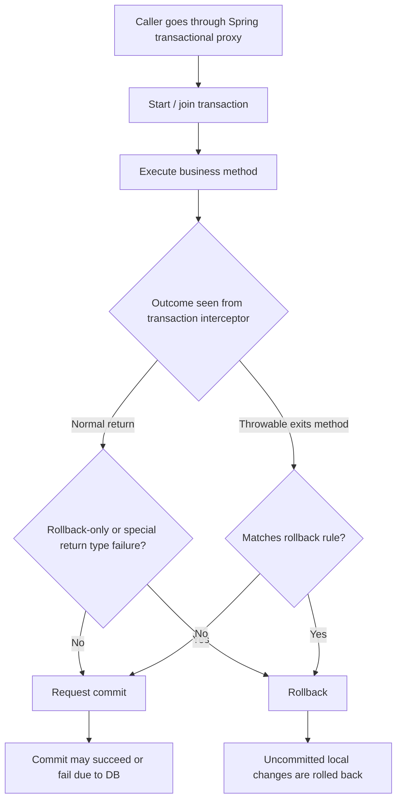

# Business Failures Returned as Data Do Not Trigger Rollback Automatically

## 1. The Problem: Returning an Error Differs from Throwing an Exception

A Spring application can signal a business failure in several ways:

- Throwing `IllegalStateException` or a business `RuntimeException`.
- Returning `false`, `null`, `Optional.empty()`, or a `DECLINED` enum.
- Returning an object such as `Result.failure("OUT_OF_STOCK")`, `Either.Left(error)`, or `ApiResponse.error(...)`.
- In a web application, returning `ResponseEntity.status(409).body(...)` or returning a JSON response with `success=false`.

With Spring `@Transactional` in **standard configuration**, a return value representing a business error as **normal data** does not cause the transaction interceptor to roll back automatically. If the method completes normally and the transaction is not marked rollback-only, Spring will attempt to **commit** the transaction, even if the returned object has `success=false` or the HTTP response has status 400/409/500.

Example:

```java
@Transactional
public Result reserve(Order order) {
    inventoryRepository.decrease(order.productId(), order.quantity());
    if (order.isRejected()) {
        return Result.failure("ORDER_REJECTED");
    }
    return Result.success();
}
```

This is an **illustrative snippet**, assuming the types/repository are already defined. If `decrease()` actually participates in the method's transaction and no DB error or other rollback-only flag occurs, the branch returning `Result.failure(...)` still **commits the inventory deduction**. Data can be modified while the caller sees a business failure.

**Key takeaway:** rollback does not depend on the meaning a developer assigns to a `success` field, `errorCode`, or HTTP status. It depends on the **transaction rules** applied by Spring and the actual transaction state.

> Scope: Spring Framework 6.x, imperative services using `PlatformTransactionManager`/`@Transactional`. There are **two special return-type exceptions supported by Spring** (Vavr `Try.Failure` and certain `Future`s already failed at return time) covered in section 8. Therefore, do not state too broadly that “Spring never inspects return values.”

## 2. Where Does Spring Decide Commit or Rollback?

When a call passes through a Spring transactional proxy, `TransactionInterceptor` resolves transaction attributes, selects the manager, starts or joins the transaction, invokes the method, and completes according to the outcome.



A regular `Result.failure(...)` is still a **normal return**. Without rollback-only or a special mechanism, the interceptor does not infer from the string `"FAIL"`, an `ERROR` enum, or a `success=false` field that it should roll back.

Important default rules:

1. `RuntimeException` or `Error` **escaping** the intercepted method: rolls back by default.
2. **Checked** `Exception` escaping: by default does **not** mark rollback; `rollbackFor` or other rollback rules can be configured.
3. Method returns normally and **is not rollback-only**: usually commits, **even when the returned data reports a business failure**.
4. `TransactionStatus.setRollbackOnly()` or rollback-only status already set from another scope: requests rollback even though the method returns normally.
5. Infrastructure exceptions (constraint violation, aborted database transaction, commit error) can prevent commit regardless of the return value's meaning.

The promise “returning an error triggers rollback” holds only when **the application itself enforces that policy** or uses a return type specifically supported by the transaction infrastructure—not as default behavior for arbitrary `Result` types.

## 3. Scenario Table: Same Business Error, Different Outcomes

Assume the method already updated a table in a valid transaction, no database error has occurred, and it is called from **outside a Spring proxy** with no pre-existing outer transaction.

| How does the method exit? | Typical decision | Reason |
| --- | --- | --- |
| `return Result.failure("DECLINED")` | Commit | Returns a normal object; the error code is just data. |
| `return false` | Commit | A boolean is not a rollback signal by itself. |
| `return Optional.empty()` | Commit | Empty is not a Throwable. |
| `return ResponseEntity.status(409).build()` | Commit | HTTP status 409 does not mean the interceptor saw an exception. |
| `return Either.left(error)` from a regular library | Commit | Spring does not treat every `Left` as a rollback rule. |
| `throw new BusinessDeniedException()`, class extends `RuntimeException` | Default rollback | Unchecked exception crossed the transactional boundary. |
| `throw new BusinessCheckedException()`, class extends `Exception` | Default commit | Checked exceptions do not roll back automatically by default. |
| Checked exception with `@Transactional(rollbackFor = BusinessCheckedException.class)` | Rollback | Explicit rollback rule declared. |
| Return `Result.failure(...)` after `setRollbackOnly()` | Rollback | Transaction state was already marked rollback-only. |
| Return `Vavr Try.Failure` | Special rollback support | Spring recognizes Vavr `Try`; do not generalize to arbitrary result types. |
| Return `CompletableFuture.failedFuture(ex)` already failed **at return time** (Spring 6.1+) | Can roll back per exception/rule | Spring supports inspecting an exceptionally completed Future. |

**Important:** the table assumes the transaction manager governs the right datasource; if the method was not intercepted by a proxy, the annotation may have no effect. If the caller already opened a transaction or a resource failed, the actual outcome also depends on propagation, rollback-only, and DB state.

## 4. Why Is Returning Error Data After Writing Dangerous?

A common sequence:

1. Start local transaction.
2. Write change to the database, e.g., debit balance or reserve stock.
3. Evaluate the next business rule; detect invalid input.
4. Return failure object `Result(false, "REJECTED")`.
5. The interceptor sees the method **returned normally**, so it commits.
6. The caller receives “failure”, yet the change from step 2 is now persisted.

```mermaid
sequenceDiagram
    participant C as Caller
    participant P as Transaction Proxy
    participant S as Service
    participant DB as Database
    C->>P: reserve()
    P->>DB: BEGIN
    P->>S: Execute business method
    S->>DB: UPDATE inventory (-2)
    S-->>P: Result.failure("REJECTED")
    Note over P: No Throwable; not rollback-only
    P->>DB: COMMIT
    P-->>C: Result.failure("REJECTED")
    Note over C,DB: Caller sees failure; DB still reduced inventory
```

Similarly, a controller returning HTTP status 400/409 **does not automatically roll back a local database transaction**. HTTP response status is handled in the web layer; Spring's transaction infrastructure decides based on the transactional method's outcome.

Do not write integration tests that only assert `result.success() == false` and conclude nothing was saved. You must **read back the database state after the transaction completes**.

## 5. Solution 1: Validate Conditions Before Writing

When business rejection can be determined prior to mutating state, prefer **validate first, mutate second**:

```java
@Transactional
public Result reserve(Order order) {
    if (!policy.allows(order)) {
        return Result.failure("ORDER_REJECTED");
    }
    inventoryRepository.decrease(order.productId(), order.quantity());
    return Result.success();
}
```

This is an illustrative snippet. The rejection branch returns normally yet **has not modified the database**, so no rollback is needed merely to “undo” an operation that never happened.

However, pre-checking **does not replace concurrency control**. Between a stock-checking SELECT and an UPDATE, another transaction can alter the data. For critical invariants, put the condition directly into the UPDATE, use row locking/optimistic versioning, or enforce appropriate database constraints.

Example conditional stock-deduction SQL:

```sql
UPDATE inventory
SET quantity = quantity - :amount
WHERE product_id = :productId
  AND quantity >= :amount;
```

If the updated row count is `0`, return `Result.failure("INSUFFICIENT_STOCK")` **with no changes** made by this SQL statement. If other writes already happened before hitting `0`, you must decide to roll back the **entire transaction** or intentionally accept a partial outcome.

## 6. Solution 2: Throw an Exception to Trigger Policy-Based Rollback

A clean approach is throwing an unchecked business exception **out of the transactional method**:

```java
public class OrderRejectedException extends RuntimeException {
    public OrderRejectedException(String code) {
        super(code);
    }
}

@Transactional
public Result reserve(Order order) {
    inventoryRepository.decrease(order.productId(), order.quantity());

    if (order.isRejected()) {
        throw new OrderRejectedException("ORDER_REJECTED");
    }
    return Result.success();
}
```

The snippets above require matching classes/repository and are not a standalone program. With a local transaction on the right datasource and the exception exiting through `TransactionInterceptor`, Spring rolls back by default.

If the HTTP application needs a JSON error response, let the exception **exit outside the transactional service boundary**, then map it in the web layer:

```java
@RestControllerAdvice
public class OrderErrorAdvice {
    @ExceptionHandler(OrderRejectedException.class)
    public ResponseEntity<Map<String, String>> rejected(
            OrderRejectedException ex) {
        return ResponseEntity.status(409)
                .body(Map.of("code", ex.getMessage()));
    }
}
```

This snippet requires Spring Web/`Map` imports and placement in an MVC app. Note: the advice handles the exception outside the transactional service invocation; the transaction interceptor already observed the exception and decided rollback **before** the controller advice turned it into HTTP 409.

### 6.1. Checked Exceptions Do Not Roll Back Automatically by Default

```java
@Transactional(rollbackFor = OrderRejectedCheckedException.class)
public void reserve(Order order) throws OrderRejectedCheckedException {
    inventoryRepository.decrease(order.productId(), order.quantity());
    if (order.isRejected()) {
        throw new OrderRejectedCheckedException("ORDER_REJECTED");
    }
}
```

This snippet assumes a checked exception extending `Exception` is defined. `rollbackFor` is needed when you want rollback from that checked exception under the default policy. Switching to `@Transactional(noRollbackFor = OrderRejectedException.class)` can cause the corresponding unchecked exception **not to roll back** under the method's rule, so never say “throwing a RuntimeException always makes Spring roll back” while ignoring configuration.

### 6.2. Catching Exceptions Inside the Boundary Changes the Outcome

```java
@Transactional
public Result reserve(Order order) {
    try {
        inventoryRepository.decrease(order.productId(), order.quantity());
        if (order.isRejected()) {
            throw new OrderRejectedException("ORDER_REJECTED");
        }
        return Result.success();
    } catch (OrderRejectedException ex) {
        return Result.failure(ex.getMessage());
    }
}
```

If there is no other rollback-only flag or DB failure, the interceptor sees only a **normal return** and may commit. Throwing an exception **and catching it yourself inside the same method** does not ensure rollback. If you need to convert exceptions into data, do so **outside** the transactional service boundary, or explicitly mark rollback-only inside the boundary.

A subtle case: an exception from an intercepted inner `@Transactional(REQUIRED)` **may have already marked the shared transaction rollback-only** before the outer scope caught it. Returning `Result.failure(...)` from the outer method does not “heal” the transaction; at outer commit time, `UnexpectedRollbackException` can occur. Therefore, you cannot claim catching an exception guarantees commit; check whether any transactional scope set rollback-only.

## 7. Solution 3: Return Error as Data and Mark Rollback-Only

When an API intentionally returns `Result`/`Either` instead of throwing exceptions, yet writes already occurred that must be reverted, you can mark the transaction **rollback-only**.

### 7.1. Inside an Intercepted `@Transactional` Method

```java
import org.springframework.transaction.interceptor.TransactionAspectSupport;

@Transactional
public Result reserve(Order order) {
    inventoryRepository.decrease(order.productId(), order.quantity());
    if (order.isRejected()) {
        TransactionAspectSupport.currentTransactionStatus()
                .setRollbackOnly();
        return Result.failure("ORDER_REJECTED");
    }
    return Result.success();
}
```

This snippet requires repository and business types; it is not a standalone program. `setRollbackOnly()` tells Spring the transaction scope must roll back, even though the method finishes by returning a normal value.

**Limitations to understand:**

- `TransactionAspectSupport.currentTransactionStatus()` works only when an active transaction invocation context was established by a Spring interceptor. Calling it outside that mechanism may find no current transaction status and throw `NoTransactionException`.
- This technique couples business code to Spring's transaction API. Use it deliberately, not scattered arbitrarily across helpers.
- If the method joined an **outer transaction via `REQUIRED`**, marking rollback-only can prevent the outer transaction from committing. Depending on the call scope, outer callers may receive `UnexpectedRollbackException` rather than the `Result.failure` value you expected.
- It only rolls back **uncommitted effects managed by the transaction manager**. Sent emails, external HTTP payments, or commits on another database are not automatically compensated.

### 7.2. With `TransactionTemplate`: No Proxy Needed on the Entry Method

```java
import org.springframework.transaction.PlatformTransactionManager;
import org.springframework.transaction.support.TransactionTemplate;

public class StockApplicationService {
    private final StockRepository stock;
    private final TransactionTemplate transactions;

    public StockApplicationService(
            StockRepository stock,
            PlatformTransactionManager manager) {
        this.stock = stock;
        this.transactions = new TransactionTemplate(manager);
    }

    public Result reserve(Order order) {
        return transactions.execute(status -> {
            stock.decrease(order.productId(), order.quantity());
            if (order.isRejected()) {
                status.setRollbackOnly();
                return Result.failure("ORDER_REJECTED");
            }
            return Result.success();
        });
    }
}
```

This class belongs in an application with `StockRepository`, `Order`, and `Result`; it is not a standalone Java SE class. `TransactionTemplate` invokes the manager directly, runs the callback, and commits/rolls back per status; hence it fits the *result-as-data* model without throwing exceptions just to signal errors. Still, `TransactionTemplate` defaults to `REQUIRED` propagation; if joining an outer transaction, outer rollback-only handling must still be designed.

If you only need to validate upfront and return an error, you are **not required** to mark rollback-only on failure branches before any side effect occurs.

## 8. Two Important Exceptions: Spring Supports Certain Special Return Types

Claiming “no return value ever triggers rollback” is **inaccurate** in modern Spring Framework. Per Spring documentation, default support exists specifically for **Vavr `Try`** and, since Spring Framework **6.1**, for `Future`/`CompletableFuture` instances already completed exceptionally when the method returns.

### 8.1. Vavr `Try.Failure`

When a `@Transactional` method returns `io.vavr.control.Try`, Spring has logic to recognize `Failure` and can roll back according to the exception inside the failure and the transaction rules.

```java
@Transactional
public Try<String> execute() {
    return Try.of(() -> {
        repository.updateRecord();
        throw new IllegalStateException("REJECTED");
    });
}
```

This code requires the Vavr library, repository, and `Try` import; it is not a standalone program. `Try.of` catches the exception and represents it as `Try.Failure`. **Unlike a custom `Result.failure`**, Vavr `Try` has dedicated support in Spring's transaction infrastructure.

Do not assume every library's `Either.Left`, `Result.Err`, `Option.None`, or `Validation.Invalid` automatically triggers rollback. With custom result types, you must explicitly adapt your architecture/transaction policy.

### 8.2. `Future`/`CompletableFuture` Exceptionally Completed at Return Time

In Spring **6.1+**, the transaction infrastructure has special handling for a returned `Future`/`CompletableFuture` that is **already completed with an exception at the moment of return**:

```java
@Transactional
public CompletableFuture<String> perform() {
    try {
        String result = repository.performWrite();
        return CompletableFuture.completedFuture(result);
    } catch (RuntimeException ex) {
        return CompletableFuture.failedFuture(ex);
    }
}
```

This example requires `CompletableFuture` and repository imports. It is not a promise that “Spring waits for every async task”: when a method returns a **still-pending** future, the transaction interceptor does not wait for the future to finish later and roll back an already committed transaction. A future failing later cannot retroactively roll back a completed physical transaction.

Distinguishable examples:

| Return value | When is it recognized as a failure? | Transaction consequence |
| --- | --- | --- |
| `CompletableFuture.completedFuture(Result.failure(...))` | Successful future holding business failure *data* | Does not trigger rollback automatically from `Result` contents. |
| `CompletableFuture.failedFuture(new IllegalStateException(...))` | Future is already exceptional upon return | Spring 6.1+ can apply matching rollback rules. |
| `new CompletableFuture<>()` completedExceptionally after method returned and committed | Exception appears only *after* the transaction boundary | Does not roll back the already finished transaction. |

With `@Async`, you must also analyze which transaction applies in the actual thread/call and proxy/advice ordering; never assume the caller's thread transaction propagates to the async thread. This lesson covers **outcome recognition rules**, not claiming all async flows share the same transaction scope.

**Accurate phrasing:** custom business failures returned as data **do not automatically trigger rollback**; Spring provides **documented dedicated support** for specific return types, and you must check exact version, return state, and rollback rules.

## 9. Runnable Java 17+ Example with Spring and H2

The standalone example below shows that the **same business error `DENIED`** can lead to four different outcomes:

1. Write DB then return `Decision(false, "DENIED")` → **commit**.
2. Write DB then throw unchecked exception → **rollback**.
3. Write DB, `setRollbackOnly()`, then return `Decision(false, "DENIED")` → **rollback**.
4. Validate before writing → return error normally with **no changes produced**; valid branch still commits.

The application uses **Java 17**, **Spring Framework 6.2.19**, **H2 2.3.232**, and Maven. No Spring Boot or servlet container is needed. The results are the program's own output; Maven/SLF4J logs may vary by environment.

### 9.1. Project Structure

```text
result-rollback-demo/
├── pom.xml
└── src/main/java/demo/tx/ResultRollbackDemo.java
```

### 9.2. pom.xml

```xml
<project xmlns="http://maven.apache.org/POM/4.0.0"
         xmlns:xsi="http://www.w3.org/2001/XMLSchema-instance"
         xsi:schemaLocation="http://maven.apache.org/POM/4.0.0
                             https://maven.apache.org/xsd/maven-4.0.0.xsd">
    <modelVersion>4.0.0</modelVersion>
    <groupId>demo</groupId>
    <artifactId>result-rollback-demo</artifactId>
    <version>1.0.0</version>
    <properties>
        <maven.compiler.release>17</maven.compiler.release>
        <project.build.sourceEncoding>UTF-8</project.build.sourceEncoding>
    </properties>
    <dependencies>
        <dependency>
            <groupId>org.springframework</groupId>
            <artifactId>spring-context</artifactId>
            <version>6.2.19</version>
        </dependency>
        <dependency>
            <groupId>org.springframework</groupId>
            <artifactId>spring-jdbc</artifactId>
            <version>6.2.19</version>
        </dependency>
        <dependency>
            <groupId>com.h2database</groupId>
            <artifactId>h2</artifactId>
            <version>2.3.232</version>
        </dependency>
    </dependencies>
    <build>
        <plugins>
            <plugin>
                <groupId>org.apache.maven.plugins</groupId>
                <artifactId>maven-compiler-plugin</artifactId>
                <version>3.13.0</version>
            </plugin>
            <plugin>
                <groupId>org.codehaus.mojo</groupId>
                <artifactId>exec-maven-plugin</artifactId>
                <version>3.5.1</version>
            </plugin>
        </plugins>
    </build>
</project>
```

### 9.3. src/main/java/demo/tx/ResultRollbackDemo.java

```java
package demo.tx;

import javax.sql.DataSource;

import org.springframework.context.annotation.AnnotationConfigApplicationContext;
import org.springframework.context.annotation.Bean;
import org.springframework.context.annotation.Configuration;
import org.springframework.jdbc.core.JdbcTemplate;
import org.springframework.jdbc.datasource.DataSourceTransactionManager;
import org.springframework.jdbc.datasource.DriverManagerDataSource;
import org.springframework.transaction.PlatformTransactionManager;
import org.springframework.transaction.annotation.EnableTransactionManagement;
import org.springframework.transaction.annotation.Transactional;
import org.springframework.transaction.interceptor.TransactionAspectSupport;

public final class ResultRollbackDemo {
    public static void main(String[] args) {
        try (var context = new AnnotationConfigApplicationContext(Config.class)) {
            JdbcTemplate jdbc = context.getBean(JdbcTemplate.class);
            WalletService service = context.getBean(WalletService.class);

            jdbc.execute("CREATE TABLE account (" +
                    "id INT PRIMARY KEY, balance INT NOT NULL)");
            jdbc.update("INSERT INTO account (id, balance) VALUES (1, 100)");

            System.out.println("initial balance=" + balance(jdbc));

            Decision returned = service.returnFailureAfterWrite();
            print("return result", returned, jdbc);

            try {
                service.throwAfterWrite();
            } catch (BusinessDeniedException ex) {
                System.out.println("throw exception: " + ex.getMessage()
                        + ", balance=" + balance(jdbc));
            }

            Decision rolledBack = service.markRollbackOnly();
            print("rollback-only", rolledBack, jdbc);

            Decision rejected = service.validateBeforeWrite(false);
            print("precheck reject", rejected, jdbc);

            Decision accepted = service.validateBeforeWrite(true);
            print("precheck accept", accepted, jdbc);
        }
    }

    private static int balance(JdbcTemplate jdbc) {
        Integer result = jdbc.queryForObject(
                "SELECT balance FROM account WHERE id=1", Integer.class);
        return result;
    }

    private static void print(String label, Decision result, JdbcTemplate jdbc) {
        System.out.println(label + ": " + result.code()
                + ", balance=" + balance(jdbc));
    }

    public record Decision(boolean accepted, String code) {
        public static Decision denied() {
            return new Decision(false, "DENIED");
        }

        public static Decision approved() {
            return new Decision(true, "APPROVED");
        }
    }

    public static final class BusinessDeniedException extends RuntimeException {
        public BusinessDeniedException() {
            super("DENIED");
        }
    }

    @Configuration(proxyBeanMethods = false)
    @EnableTransactionManagement(proxyTargetClass = true)
    public static class Config {
        @Bean
        public DataSource dataSource() {
            return new DriverManagerDataSource(
                    "jdbc:h2:mem:business_result;DB_CLOSE_DELAY=-1", "sa", "");
        }

        @Bean
        public PlatformTransactionManager transactionManager(DataSource dataSource) {
            return new DataSourceTransactionManager(dataSource);
        }

        @Bean
        public JdbcTemplate jdbcTemplate(DataSource dataSource) {
            return new JdbcTemplate(dataSource);
        }

        @Bean
        public WalletService walletService(JdbcTemplate jdbc) {
            return new WalletService(jdbc);
        }
    }

    public static class WalletService {
        private final JdbcTemplate jdbc;

        public WalletService(JdbcTemplate jdbc) {
            this.jdbc = jdbc;
        }

        @Transactional
        public Decision returnFailureAfterWrite() {
            jdbc.update("UPDATE account SET balance = balance - 10 WHERE id=1");
            return Decision.denied();
        }

        @Transactional
        public void throwAfterWrite() {
            jdbc.update("UPDATE account SET balance = balance - 20 WHERE id=1");
            throw new BusinessDeniedException();
        }

        @Transactional
        public Decision markRollbackOnly() {
            jdbc.update("UPDATE account SET balance = balance - 30 WHERE id=1");
            TransactionAspectSupport.currentTransactionStatus()
                    .setRollbackOnly();
            return Decision.denied();
        }

        @Transactional
        public Decision validateBeforeWrite(boolean approved) {
            if (!approved) {
                return Decision.denied();
            }
            jdbc.update("UPDATE account SET balance = balance - 5 WHERE id=1");
            return Decision.approved();
        }
    }
}
```

### 9.4. Run and Observe

In the `result-rollback-demo` directory, with JDK 17+ and Maven:

```bash
mvn -q compile exec:java -Dexec.mainClass=demo.tx.ResultRollbackDemo
```

Program output:

```text
initial balance=100
return result: DENIED, balance=90
throw exception: DENIED, balance=90
rollback-only: DENIED, balance=90
precheck reject: DENIED, balance=90
precheck accept: APPROVED, balance=85
```

**Comparing balances:**

- `initial=100`.
- `returnFailureAfterWrite()` subtracts 10 and returns `Decision.denied()`: the interceptor sees a **normal return** → commits, leaving `90`.
- `throwAfterWrite()` subtracts 20 and throws unchecked `BusinessDeniedException`: the proxy rolls back the transaction → balance stays `90`.
- `markRollbackOnly()` subtracts 30, sets rollback-only, and returns the failure as data: the transaction rolls back → still `90`.
- `validateBeforeWrite(false)` rejects before writing: normally commits an empty scope without modifying the balance.
- `validateBeforeWrite(true)` subtracts 5 and returns success → commits, leaving `85`.

**Conditions for understanding the output:** `WalletService` is a Spring bean injected from the context, not `new WalletService(...)` outside Spring; calls to public methods go through a class-based proxy; `JdbcTemplate` and the transaction manager share the same `DataSource`. In-memory H2 illustrates local transactions only, not distributed transactions. The example runs standalone with the dependencies in `pom.xml`; it does not include HTTP calls or broker publishing.

### 9.5. Important Test Variations

Try changing `returnFailureAfterWrite()` to call `throw new BusinessDeniedException()` instead of `return Decision.denied()`: the DB balance does not drop because of rollback. Then keep returning the failure while adding `setRollbackOnly()` before returning: the balance likewise does not drop.

When testing with Spring Test, do not just put `@Transactional` on the test method and read data inside the same test transaction: Spring Test defaults to rolling back at test end, making it hard to see whether the service committed independently or merely ran inside the test's transaction. Verify with a test lacking an outer transaction or manage the test transaction lifecycle explicitly.

## 10. API Design: Distinguishing Expected Failures from Undoable Failures

Not every business failure needs an **exception**. You can group them clearly:

| Scenario | Suggested policy | Reason |
| --- | --- | --- |
| Invalid input detected **before writing** | Return `Result.failure`; no manual rollback needed | No side effects exist to undo. |
| Multiple SQL statements already executed, then invariant violated | Throw unchecked exception or mark rollback-only | Uncommitted local changes must roll back. |
| Checked business exception that genuinely requires rollback | `rollbackFor = ThatException.class` | Defaults usually do not roll back checked exceptions. |
| Want API to always return `Result` while preserving atomicity | `TransactionTemplate` + `status.setRollbackOnly()`, or translate exception to `Result` outside service boundary | Both outcome and transaction policy stay clear. |
| Write step already committed, subsequent step fails | Compensation/workflow; cannot roll back old commit | Transaction already finished. |
| HTTP payment or email inside a transactional method | Design idempotency/compensation/outbox per impact | Local transaction manager does not roll back external systems. |
| Domain returns errors frequently and avoids exceptions for every validation | Pre-validate and write conditionally; separate transaction boundaries clearly | Keeps data-style API without sacrificing atomicity. |

An application may decide certain business errors **are allowed to commit**. For example, inserting a `DECLINED` audit record may be desired behavior; or saving a “request rejected” event in a separate transaction. What to avoid is **assuming returning a failure automatically rolls back everything**.

### If You Need to Write an Audit Record Even When Main Logic Rolls Back

A `@Transactional(propagation = Propagation.REQUIRES_NEW)` method on **another bean** can commit the audit independently if truly called through a proxy with suitable resources/connections. However, `REQUIRES_NEW` can require an extra connection from the pool and will not apply under self-invocation. Do not use it merely as a trick to bypass rollback; define data policy and business states explicitly.

## 11. Common Mistakes When Editing Code

### Mistake 1: Using `@Transactional(rollbackFor=...)` for an Error Object

`rollbackFor` matches **exception types** when the interceptor processes a `Throwable` (or supported special return cases); it does not read arbitrary `Result.errorCode` fields. It cannot turn a Java record/enum/DTO into an exception simply because its name contains `Error`.

### Mistake 2: Assuming HTTP Status 500 Automatically Rolls Back

`ResponseEntity.status(500)` is still a normal return object. If the controller/service wrote to the database inside a transactional scope without marking rollback-only, it can commit. For HTTP 500 to reflect an exception-driven rollback, let the exception cross the transactional boundary before mapping to the response.

### Mistake 3: Swallowing `RuntimeException` and Returning `Result.failure`

If an exception is caught **inside the same transactional method**, the proxy may never see it. If an inner transaction already marked rollback-only, the outer transaction may hit an unexpected rollback, yet you should not depend on an accidental side effect. Decide explicitly: rethrow, mark rollback-only, or move exception-to-result conversion outside the transaction.

### Mistake 4: Calling `setRollbackOnly` on Another Thread

Imperative transaction context is typically thread-bound. An `@Async` or `CompletableFuture` callback running later on a different thread does not automatically carry the `TransactionStatus` of the finished call. To coordinate asynchronous work, design transactions at the appropriate execution boundary.

### Mistake 5: Assuming Non-Database Changes Roll Back

`@Transactional` governs resources controlled by the transaction manager. If a method sends an email, calls a payment gateway, or publishes to a message broker and then rolls back the local database, external effects may already be complete. Consider transactional outbox, idempotency, retries, and compensation.

### Mistake 6: Testing Only the Returned Object

An assertion like `assertFalse(result.accepted())` is insufficient. Check the database **after the transaction ends**, ideally on an independent read transaction/connection. Include a “write then return failure” case to confirm rollback policy matches business requirements.

## 12. Checklist for Reviewing Services Returning Errors as Data

1. **Transaction boundary:** is the method genuinely called through a Spring proxy? Are there self-invocations, final/private methods, or the wrong manager?
2. **Failure condition:** is it detected before or after updating the database?
3. **Return type:** plain `Result`/`Either`/`boolean`/`ResponseEntity` or special types like Vavr `Try`/exceptional `Future`?
4. **Rollback rule:** does an exception exit the method? Unchecked/checked? Are there special `rollbackFor`/`noRollbackFor` rules?
5. **Rollback-only:** who sets it? Is it a new scope or `REQUIRED` joining an outer transaction? Does the outer caller account for `UnexpectedRollbackException`?
6. **Resource scope:** do SQL statements belong to the right datasource/manager? Are there non-transactional side effects?
7. **Testing:** are post-method database states asserted, including concurrency/constraint failure cases where relevant?
8. **Caller contract:** does returning `Result.failure` mean “no changes”, “failed but audited”, or “partially processed”? Define it unambiguously.

## 13. Self-Check

**Question 1.** A `@Transactional` service decrements stock by 1 unit and executes `return false`. No DB error or rollback-only flag. Is stock restored?

*Answer:* No. The interceptor sees a normal return; the transaction typically commits, leaving stock reduced by 1.

**Question 2.** Does `@Transactional(rollbackFor=Exception.class)` automatically roll back on `return Result.error(...)`?

*Answer:* No. Rules inspect exceptions; a custom error object remains ordinary data.

**Question 3.** A service throws an unchecked exception; an outer controller catches it and converts it to HTTP 409. Does the service transaction roll back?

*Answer:* Yes by default, provided the exception exited through the service's interceptor before the controller caught it.

**Question 4.** A service catches an exception inside the method itself and returns `Result.failure`. Is rollback guaranteed?

*Answer:* No. If not already rollback-only and the database has not errored, the proxy can commit. Yet if an inner scope already marked rollback-only, the transaction can still roll back; verify the actual setup.

**Question 5.** A `Future` is `completeExceptionally` **after** the `@Transactional` method already returned and committed. Does Spring undo the prior commit?

*Answer:* No. Special `Future` support since Spring 6.1 inspects exceptional state **at return time** according to rollback rules.

**Question 6.** If you want to keep `Result.failure` after data was already written, what can you do?

*Answer:* Call `TransactionAspectSupport.currentTransactionStatus().setRollbackOnly()` inside a valid invocation; or use `TransactionTemplate` to return `Result` and mark status rollback-only. Carefully analyze any outer transaction scope.

## 14. Summary

- **Business failures returned as ordinary data do not automatically trigger rollback.** A `Result.failure`, `false`, or HTTP status 409 is not an exception to the transaction interceptor.
- **Spring rolls back by default when an unchecked exception/`Error` exits an intercepted method; checked exceptions usually require explicit rollback rules.** You can explicitly call `setRollbackOnly()` to roll back even when returning normally.
- **Writes executed before returning a failure can commit.** Prefer checking failure conditions before writing, or ensure transactional rollback when critical invariants fail.
- **Specialized return-type exceptions exist** in Spring: Vavr `Try.Failure` and `Future`/`CompletableFuture` already exceptionally completed at return time (Spring 6.1+). Do not generalize this to arbitrary custom results.
- **Verify data after the transaction**, distinguish logical scopes from physical transactions, and never expect local rollback to undo external non-transactional side effects.

## References

- [Spring Framework 6.2 — Rolling Back a Declarative Transaction](https://docs.spring.io/spring-framework/reference/6.2/data-access/transaction/declarative/rolling-back.html)
- [Spring Framework — @Transactional Settings](https://docs.spring.io/spring-framework/reference/data-access/transaction/declarative/annotations.html)
- [Spring Framework — Understanding Declarative Transaction Implementation](https://docs.spring.io/spring-framework/reference/data-access/transaction/declarative/tx-decl-explained.html)
- [Spring Framework — Programmatic Transaction Management](https://docs.spring.io/spring-framework/reference/data-access/transaction/programmatic.html)
- [Spring Framework — Transaction Propagation](https://docs.spring.io/spring-framework/reference/data-access/transaction/declarative/tx-propagation.html)
- [Spring Framework API — TransactionAspectSupport](https://docs.spring.io/spring-framework/docs/6.2.x/javadoc-api/org/springframework/transaction/interceptor/TransactionAspectSupport.html)
