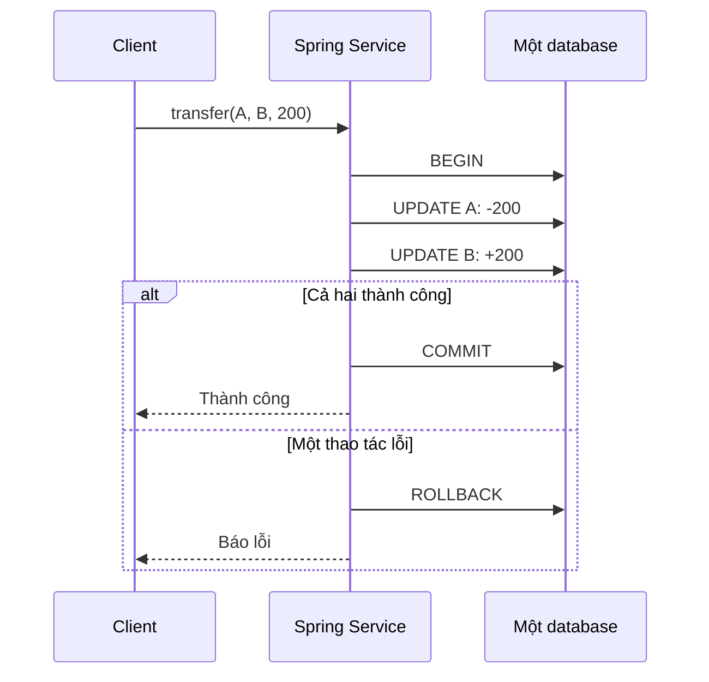
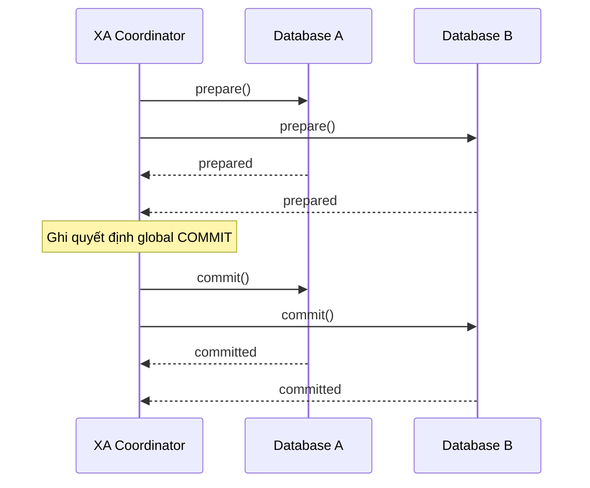
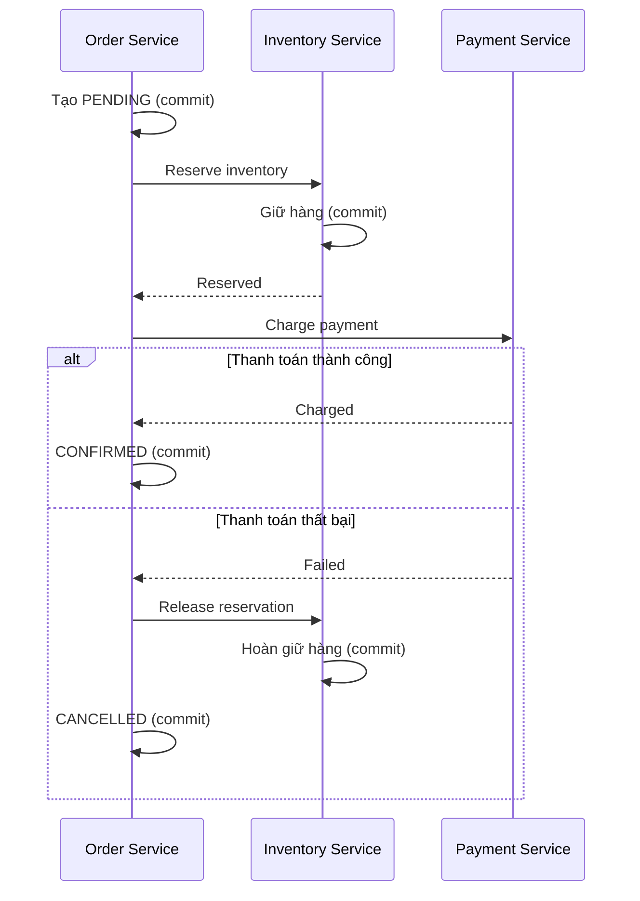

# Phân biệt giao dịch cục bộ với giao dịch phân tán

## 1. Bài toán cần giải quyết

Một nghiệp vụ có thể ghi nhiều bảng, nhiều cơ sở dữ liệu hoặc gọi nhiều dịch vụ. Câu hỏi quan trọng không phải là **có bao nhiêu lệnh ghi**, mà là **ai có khả năng quyết định tất cả thay đổi cùng commit hoặc cùng rollback**.

Ví dụ đặt hàng trực tuyến:

- **Trường hợp A:** Trừ tiền ở tài khoản A và cộng tiền ở tài khoản B, cả hai bản ghi cùng nằm trong một cơ sở dữ liệu quan hệ. Một giao dịch cơ sở dữ liệu có thể bao cả hai cập nhật.
- **Trường hợp B:** Order Service ghi đơn hàng vào database riêng, Inventory Service giữ hàng trong database khác, Payment Service thực hiện thanh toán. Không một giao dịch database cục bộ nào tự điều khiển được cả ba hệ thống.
- **Trường hợp C:** Một ứng dụng Spring dùng hai database qua hai `DataSource`. Dù chỉ có **một ứng dụng**, nếu cần hai database cùng commit/rollback thì vẫn phát sinh bài toán điều phối nhiều tài nguyên.

Mục tiêu của bài: nhận diện ranh giới giao dịch; phân biệt giao dịch ACID cục bộ, giao dịch phân tán phối hợp commit kiểu XA/2PC và quy trình nghiệp vụ phân tán kiểu Saga; hiểu chính xác Spring `@Transactional` bảo đảm điều gì; chọn giải pháp theo yêu cầu nhất quán và khả năng phục hồi.

## 2. Giao dịch cục bộ (local transaction)

**Giao dịch cục bộ** là một đơn vị công việc được một transaction manager quản lý trên **một tài nguyên giao dịch** (thường là một database thông qua connection phù hợp). Các thao tác cùng tham gia giao dịch đó có chung kết quả commit hoặc rollback.

Với database quan hệ, tính ACID thường được hiểu là:

| Tính chất | Ý nghĩa trong phạm vi giao dịch |
| --- | --- |
| **Atomicity** (nguyên tử) | Hoặc tất cả thay đổi thuộc giao dịch được commit, hoặc chúng được rollback. |
| **Consistency** (nhất quán) | Các ràng buộc dữ liệu được giữ; quy tắc nghiệp vụ vẫn cần ứng dụng và schema bảo vệ. |
| **Isolation** (cô lập) | Các giao dịch đồng thời quan sát nhau theo isolation level của database. |
| **Durability** (bền vững) | Dữ liệu đã commit được database lưu bền theo cơ chế đảm bảo của hệ quản trị. |

Một giao dịch cục bộ **không bị giới hạn ở một bảng**: có thể cập nhật `account`, `ledger`, `audit_record` trong cùng database, miễn các thao tác thật sự tham gia cùng transaction/connection. Ngược lại, chỉ vì hai thao tác chạy trong cùng method Java không có nghĩa chúng tự động ở chung giao dịch.

### Luồng giao dịch cục bộ



**Ranh giới bảo đảm:** database có thể rollback những gì **chưa commit trong chính giao dịch đó**. Database không thể rollback một email đã gửi, một lệnh thanh toán đã được bên thứ ba xác nhận, hoặc một ghi dữ liệu đã commit ở database khác chỉ vì method hiện tại ném exception.

## 3. Cách Spring quản lý giao dịch cục bộ

Spring cung cấp abstraction `PlatformTransactionManager` cho mô hình imperative, `ReactiveTransactionManager` cho reactive. Trong ứng dụng sử dụng JDBC có thể gặp `DataSourceTransactionManager` hoặc `JdbcTransactionManager`; với JPA thường dùng `JpaTransactionManager`. Chúng quản lý giao dịch của tài nguyên tương ứng; cần cấu hình đúng transaction manager, `DataSource` và cách truy cập dữ liệu.

Khi một lời gọi **đi qua Spring proxy**, `TransactionInterceptor` xử lý `@Transactional` đại thể như sau:

1. Xác định transaction manager và chính sách propagation/isolation/rollback.
2. Tạo giao dịch mới hoặc tham gia giao dịch hiện có.
3. Chạy method, để các thao tác truy cập đúng tài nguyên cùng tham gia.
4. Commit khi method kết thúc bình thường, hoặc quyết định rollback theo quy tắc exception.

Với `@Transactional` mặc định: propagation là `REQUIRED`; database quyết định isolation mặc định; `RuntimeException` và `Error` gây rollback, còn checked `Exception` không mặc nhiên gây rollback (có thể cấu hình `rollbackFor`). Đây là hành vi **của transaction manager đã chọn**, không phải cam kết toàn cục cho mọi lệnh gọi phát sinh trong method.

### Ví dụ cụ thể: chuyển tiền trên một database

Tạo bảng minh họa (SQL tương thích với PostgreSQL và H2 cho phần cấu trúc cơ bản):

```sql
CREATE TABLE account (
    id BIGINT PRIMARY KEY,
    balance_cents BIGINT NOT NULL CHECK (balance_cents >= 0)
);

INSERT INTO account (id, balance_cents) VALUES (1, 1000);
INSERT INTO account (id, balance_cents) VALUES (2, 300);
```

Một Spring service dùng `JdbcTemplate` trên cùng `DataSource`:

```java
package demo.tx;

import org.springframework.jdbc.core.JdbcTemplate;
import org.springframework.stereotype.Service;
import org.springframework.transaction.annotation.Transactional;

@Service
public class TransferService {
    private final JdbcTemplate jdbc;

    public TransferService(JdbcTemplate jdbc) {
        this.jdbc = jdbc;
    }

    @Transactional
    public void transfer(long fromId, long toId, long amountCents) {
        if (fromId == toId || amountCents <= 0) {
            throw new IllegalArgumentException("Invalid transfer");
        }

        int debited = jdbc.update(
            "UPDATE account SET balance_cents = balance_cents - ? " +
            "WHERE id = ? AND balance_cents >= ?",
            amountCents, fromId, amountCents
        );
        if (debited != 1) {
            throw new IllegalStateException("Source missing or insufficient balance");
        }

        int credited = jdbc.update(
            "UPDATE account SET balance_cents = balance_cents + ? WHERE id = ?",
            amountCents, toId
        );
        if (credited != 1) {
            throw new IllegalStateException("Destination account missing");
        }
    }
}
```

Đây là **một class service hoàn chỉnh bên trong ứng dụng Spring** (Java 17+, có Spring JDBC, transaction infrastructure và `DataSource` được cấu hình), không phải chương trình Java SE có thể chạy chỉ với `javac`. Khi bean được gọi qua proxy và cả hai SQL dùng đúng `DataSource` được quản lý:

- Gọi `transfer(1, 2, 200)` thành công: số dư từ `(1000, 300)` thành `(800, 500)`.
- Gọi `transfer(1, 999, 200)` khi tài khoản 999 không tồn tại: lệnh trừ có thể chạy trước, nhưng exception ở bước cộng khiến **cả giao dịch rollback**; tài khoản 1 vẫn có 1000.
- Điều kiện `balance_cents >= ?` giúp một lần trừ không vượt số dư ngay tại câu SQL; truy cập đồng thời vẫn phải được kiểm thử phù hợp với hệ quản trị và yêu cầu nghiệp vụ.

Không nên đưa HTTP call hay gửi email vào giữa hai lệnh SQL rồi suy diễn rằng các tác động bên ngoài cũng sẽ rollback.

## 4. Giao dịch phân tán (distributed transaction) là gì?

Theo nghĩa **chặt về giao dịch**, một giao dịch phân tán cần một cơ chế điều phối **nhiều tài nguyên giao dịch độc lập** (ví dụ hai database), sao cho việc quyết định commit/rollback có sự phối hợp giữa các bên. Mỗi tài nguyên có log, connection và quyền commit riêng; chỉ đặt `@Transactional` lên một method không làm chúng trở thành một tài nguyên duy nhất.

Trong kiến trúc microservices, người ta cũng dùng cụm “giao dịch phân tán” để nói về **một nghiệp vụ trải qua nhiều dịch vụ**. Cần phân biệt hai cơ chế rất khác nhau:

1. **Global/atomic transaction với XA + two-phase commit (2PC):** cố gắng đạt kết quả commit phối hợp trên các tài nguyên có hỗ trợ protocol và coordinator phù hợp.
2. **Saga:** ghép nhiều **giao dịch cục bộ đã commit riêng lẻ** thành một quy trình nghiệp vụ; khi cần, thực hiện **compensation** để khôi phục trạng thái nghiệp vụ. Saga **không** tạo một giao dịch ACID toàn cục và không thể tự rollback những bước đã commit.

Hai khái niệm này không được đánh đồng khi viết thiết kế hay mô tả tính nhất quán.

### So sánh trọng tâm

| Tiêu chí | Local transaction | XA/2PC phân tán | Saga cho nghiệp vụ phân tán |
| --- | --- | --- | --- |
| Ranh giới | Một tài nguyên giao dịch | Nhiều tài nguyên tham gia global transaction | Nhiều giao dịch local tại các dịch vụ |
| Ai quyết định? | Database/local transaction manager | Transaction coordinator và các XA participant | Workflow/orchestrator hoặc chuỗi sự kiện |
| Commit/rollback | Một lần commit/rollback thống nhất trong resource | Prepare rồi quyết định commit/rollback phối hợp | Từng bước commit độc lập; lỗi dùng compensation |
| Nhất quán | ACID trong phạm vi DB | Atomic commit theo protocol khi đủ điều kiện; isolation tùy từng tài nguyên | Nhất quán nghiệp vụ qua các trạng thái trung gian, thường eventual consistency |
| Khi một bước đã commit | Không có bước khác trong cùng transaction chưa được quyết định riêng | Coordinator điều phối quyết định global; cần phục hồi khi lỗi | Bước đã commit không bị rollback tự động |
| Phụ thuộc kỹ thuật | Transaction manager + một resource | XA-capable resources, coordinator, recovery | Message/command, trạng thái, retry, idempotency, compensation |
| Chi phí/rủi ro | Tương đối đơn giản, giữ lock trong thời gian transaction | Latency, lock, blocking/recovery và coupling cao | Thiết kế trạng thái/compensation phức tạp, phải xử lý kết quả tạm thời |

**Lưu ý về từ “phân tán”:** ba bước trên ba bảng của **một database** chưa phải giao dịch phân tán. Hai database khác nhau trong cùng một tiến trình vẫn là bài toán đa tài nguyên. Một lời gọi REST sang service khác là tác động ngoài local transaction, ngay cả khi hai service đều dùng Spring.

## 5. Phân tán theo XA/2PC: phối hợp commit

Two-phase commit có **coordinator** và nhiều **participant** hỗ trợ prepare/commit, thường thông qua XA và transaction manager kiểu JTA:

**Pha 1 – Prepare:** coordinator yêu cầu mỗi participant chuẩn bị commit; từng bên kiểm tra có thể commit và lưu đủ thông tin cần thiết để thực hiện quyết định về sau. Nếu bất kỳ participant từ chối/không thể prepare, coordinator đi theo nhánh rollback.

**Pha 2 – Decision:** nếu toàn bộ participant đều prepared, coordinator ghi/quyết định commit rồi gửi lệnh commit; nếu không, gửi rollback. Khi xảy ra lỗi mạng hoặc coordinator ngừng hoạt động, các participant đã prepared có thể phải chờ cơ chế recovery. Một global transaction thực tế cũng phải xử lý timeout, heuristic outcome và quan sát trạng thái phục hồi.



Tại Spring, `JtaTransactionManager` là adapter để Spring dùng hạ tầng JTA/global transaction của môi trường hoặc transaction coordinator được cấu hình. **Chỉ khai báo bean `JtaTransactionManager` chưa đủ**: tài nguyên cần phù hợp XA, được enlist đúng cách và có cấu hình coordinator/recovery. Hai bean `DataSourceTransactionManager` độc lập cũng **không** tự ghép thành XA.

Dùng XA khi bắt buộc phối hợp commit giữa một tập tài nguyên có hỗ trợ transaction protocol, đã đánh giá được rủi ro lock/latency và có vận hành recovery đáng tin. Trong microservices độc lập, nơi API HTTP/bên thứ ba thường không tham gia XA, **không thể chỉ “bật 2PC” để bao trùm toàn bộ hệ thống**.

## 6. Saga: phối hợp nhiều giao dịch cục bộ

Với database-per-service, một lựa chọn phổ biến là **Saga**. Mỗi bước xử lý dữ liệu sở hữu bởi một service, commit local transaction và công bố trạng thái/kết quả cho bước tiếp theo. Saga có thể dùng:

- **Orchestration:** một coordinator nghiệp vụ phát lệnh, nhận kết quả, chọn bước tiếp theo hoặc compensation.
- **Choreography:** các service phản ứng với sự kiện và tự kích hoạt bước kế tiếp theo quy ước nghiệp vụ.

Ví dụ đơn hàng:

1. Order Service: tạo đơn `PENDING` (commit local).
2. Inventory Service: giữ số lượng hàng (commit local), phát kết quả.
3. Payment Service: thu tiền (commit qua hệ thống của mình).
4. Order Service: chuyển sang `CONFIRMED` nếu mọi bước thành công.
5. Nếu thanh toán thất bại sau khi đã giữ hàng: chạy bước **release reservation** (một local transaction khác), rồi chuyển đơn thành `CANCELLED`.



**Compensation không phải rollback vật lý.** Nó là **một giao dịch mới** có ý nghĩa đảo ngược tác động nghiệp vụ của bước trước (ví dụ hoàn tiền thay vì xóa một khoản thanh toán đã ghi). Compensation có thể thất bại hoặc đến muộn, nên cần retry có kiểm soát, idempotency key, theo dõi trạng thái và đôi khi xử lý thủ công. Người dùng hoặc hệ thống khác có thể quan sát trạng thái `PENDING`/`RESERVED` trong khi Saga đang chạy: đây là hệ quả của việc không có isolation toàn cục như một local ACID transaction.

Thiết kế Saga cần trả lời rõ: từng bước được retry thế nào; nếu nhận message trùng có ghi trùng không; timeout là lỗi chắc chắn hay kết quả chưa biết; tác vụ nào có thể bù, tác vụ nào không thể hoàn tác (như email đã gửi); khi nào chuyển trạng thái thành `FAILED_REQUIRES_ATTENTION` để đối soát.

## 7. Vấn đề “dual write” và transactional outbox

Giả sử Order Service vừa **ghi đơn vào database** vừa **gửi sự kiện `OrderCreated`** tới broker:

- Nếu gửi message **trước** khi commit DB, consumer có thể xử lý đơn chưa tồn tại, rồi DB rollback.
- Nếu commit DB **trước** rồi gửi message, ứng dụng có thể crash ở khoảng giữa: đơn đã lưu nhưng sự kiện bị mất.
- Đặt lệnh publish vào một method `@Transactional` dùng local DB manager **không** biến việc publish sang broker thành phần commit nguyên tử với DB.

**Transactional outbox** xử lý khoảng trống này bằng cách ghi business data **và bản ghi outbox trong cùng một local DB transaction**. Một relay riêng đọc outbox và gửi message sau:

```text
Local transaction tại Order Service:
    BEGIN
      INSERT orders (..., status = 'PENDING')
      INSERT outbox (event_id, aggregate_id, event_type, payload)
    COMMIT

Relay riêng (polling hoặc CDC):
    đọc outbox đã commit -> publish message -> lưu tiến độ gửi

Consumer:
    kiểm tra event_id / idempotency key -> áp dụng một lần về nghiệp vụ
```

Mẫu schema minh họa:

```sql
CREATE TABLE orders (
    id BIGINT PRIMARY KEY,
    status VARCHAR(30) NOT NULL
);

CREATE TABLE outbox (
    event_id UUID PRIMARY KEY,
    aggregate_id BIGINT NOT NULL,
    event_type VARCHAR(100) NOT NULL,
    payload TEXT NOT NULL,
    published_at TIMESTAMP NULL
);
```

**Điều được bảo đảm:** nếu local transaction rollback, cả `orders` và `outbox` đều không được ghi; nếu commit, có bản ghi outbox bền vững để relay xử lý. **Điều không tự được bảo đảm:** publish “exactly once” tới mọi consumer; relay có thể gửi lặp nếu crash sau khi publish nhưng trước khi ghi nhận đã gửi. Consumer cần **idempotent**, ví dụ lưu `(consumer_id, event_id)` trong bảng có unique constraint cùng transaction xử lý nghiệp vụ. Nếu nghiệp vụ đòi hỏi thứ tự sự kiện, relay còn phải thiết kế ordering theo aggregate.

Outbox **không thay thế Saga**: outbox giúp truyền event tin cậy giữa các bước; Saga xác định logic hoàn thành/bù trừ xuyên dịch vụ. Hai pattern thường dùng cùng nhau.

## 8. Vì sao `@Transactional` không tự tạo distributed transaction?

Xét đoạn **mã minh họa ý tưởng**, không phải chương trình Java độc lập:

```java
@Transactional
public void placeOrder(Command command) {
    orderRepository.save(new Order(command)); // Database của Order Service
    paymentClient.charge(command.payment());  // HTTP sang hệ thống khác
    // Exception sau đây rollback local DB, nhưng không tự hoàn tiền ở Payment
    throw new IllegalStateException("Local processing failed");
}
```

Khi exception xuất hiện, Spring transaction manager của Order Service có thể rollback thay đổi local chưa commit. Payment Service có transaction/commit riêng. Nếu charge đã thành công, tiền **không** tự được hoàn. Nếu HTTP timeout, Order Service **không biết chắc** bên Payment đã charge hay chưa: retry mù có thể charge hai lần. Cần idempotency key của lệnh thanh toán, truy vấn/đối soát trạng thái và quy trình compensation khi thực sự cần.

Những điểm dễ nhầm khác:

- `Propagation.REQUIRED` nối lời gọi nội bộ vào giao dịch hiện có **khi cùng transaction manager/context phù hợp**; nó không truyền transaction qua REST.
- `Propagation.REQUIRES_NEW` tạo **giao dịch vật lý độc lập**; transaction con có thể commit trong khi transaction ngoài rollback. Nó **không** tạo XA hay đảm bảo commit cùng nhau.
- Có nhiều `PlatformTransactionManager` trong một application nghĩa là có nhiều cơ chế quản lý được chọn cho từng method; **không** có commit nguyên tử giữa chúng nếu chưa có hạ tầng điều phối đa tài nguyên.
- Trong proxy mode mặc định, lời gọi method `@Transactional` từ method khác **trong cùng object** (self-invocation) không đi qua proxy để mở transaction mới như mong đợi.
- Với imperative transaction, context thường gắn với thread; tự tạo thread mới hoặc chạy async không tự thừa hưởng transaction đó. Reactive transaction dùng Reactor context, nhưng cũng không tự biến thành global transaction giữa các dịch vụ.
- Catch exception rồi trả về bình thường có thể làm Spring commit nếu giao dịch chưa được đánh dấu rollback-only. Kiểm thử rollback thật, không chỉ kiểm tra method trả lỗi.

## 9. Chọn cách nào cho từng tình huống?

| Tình huống | Lựa chọn thường phù hợp | Lý do/cần kiểm tra |
| --- | --- | --- |
| Chuyển tiền giữa hai account trong **cùng database** | Local `@Transactional` | Một resource có thể commit/rollback cả hai câu SQL; kiểm soát isolation và race condition. |
| Ghi order + outbox event trong **cùng database** | Local transaction + transactional outbox | Bảo đảm order và bản ghi event cùng tồn tại hoặc cùng rollback; relay/consumer cần retry và idempotency. |
| Hai database XA-compatible, bắt buộc đồng bộ all-or-nothing | Đánh giá JTA/XA/2PC | Cần coordinator, enlistment, recovery, hiệu năng và hỗ trợ từ toàn bộ participant. |
| Order/Inventory/Payment là các service sở hữu DB riêng | Saga + outbox/idempotency | Mỗi bên commit riêng; dùng state machine và compensation khi bước sau thất bại. |
| Thanh toán qua nhà cung cấp bên ngoài không hỗ trợ XA | Local transaction + workflow/Saga + idempotency/reconciliation | API provider không rollback theo local DB; timeout có thể là kết quả chưa xác định. |
| Chỉ đọc nhiều API để hiển thị dashboard | Không cần global write transaction | Dữ liệu có thể khác thời điểm; chọn snapshot/versioning theo nhu cầu hiển thị. |

**Câu hỏi ra quyết định theo thứ tự:** (1) Những tài nguyên nào thực sự thay đổi? (2) Có một local transaction manager điều khiển toàn bộ thao tác không? (3) Nếu có nhiều resource, chúng có tham gia XA và hệ thống có chấp nhận chi phí/vận hành 2PC không? (4) Nếu không, nghiệp vụ chấp nhận trạng thái trung gian nào, compensation ra sao? (5) Retry, timeout, duplicate message, ordering và đối soát được thiết kế thế nào?

## 10. Bài kiểm thử và tình huống lỗi nên thực hành

**Local transaction:** tạo hai account như ví dụ. Chạy chuyển 200 thành công và đối chiếu số dư; sau đó cố chuyển tới account không tồn tại, kiểm tra account nguồn **không giảm**. Thêm kiểm thử hai yêu cầu trừ tiền cạnh tranh trên cùng account để phát hiện race/vi phạm bất biến.

**Local + HTTP không phải global:** trong môi trường test, cho Payment stub ghi nhận charge thành công rồi giả lập Order Service ném exception. Quan sát database Order rollback nhưng Payment stub vẫn giữ charge; điều này chứng minh ranh giới local transaction.

**Outbox:** cho lỗi xảy ra giữa insert order và insert outbox trong cùng DB transaction: không bản ghi nào được commit. Chạy thành công: cả hai cùng commit. Cho relay publish xong rồi crash trước khi đánh dấu đã gửi: nhận message trùng và chứng minh consumer bỏ qua lần xử lý trùng bằng `event_id`.

**Saga:** mô phỏng bước giữ hàng thành công nhưng payment thất bại: quan sát reservation được release, order chuyển `CANCELLED`; phát lặp callback/payment event và kiểm tra trạng thái không bị nhân đôi. Nếu compensation cũng thất bại, công việc phải được lưu để retry/đối soát, không được âm thầm coi là đã rollback.

**XA/2PC (chỉ khi môi trường hỗ trợ thật):** thử lỗi tại phase prepare, lỗi mạng sau quyết định commit, restart coordinator và xác nhận recovery. Không mô phỏng bằng hai local `@Transactional` độc lập rồi kết luận đã kiểm thử XA.

## 11. Ghi nhớ và tự kiểm tra

1. **Hai bảng trong cùng database có phải giao dịch phân tán không?** Không, nếu cả hai tham gia cùng một local transaction.
2. **Một microservice gọi hai service khác trong method `@Transactional` thì cả ba cùng rollback?** Không. Annotation chỉ quản lý tài nguyên được transaction manager của lời gọi đó quản lý; HTTP không tự tham gia transaction.
3. **Saga có bảo đảm ACID toàn cục?** Không. Các bước commit riêng, compensation là giao dịch mới, nên cần quản lý trạng thái trung gian.
4. **Khi dùng outbox, consumer có thể nhận message hai lần không?** Có. Relay/broker có thể phát lại; idempotency là yêu cầu cốt lõi.
5. **Khi nào xem xét XA?** Khi có nhiều resource hỗ trợ XA và nghiệp vụ thật sự cần atomic commit phối hợp, đồng thời hệ thống có khả năng vận hành coordinator/recovery.

> **Điểm phân biệt quyết định:** local transaction dựa trên khả năng **một resource** commit/rollback những thay đổi chưa commit; XA/2PC phối hợp quyết định commit của **nhiều resource** có giao thức; Saga điều phối **nhiều local transaction đã commit**, dùng bước bù trừ và trạng thái nghiệp vụ để đi đến kết quả cuối cùng. Spring `@Transactional` là công cụ khai báo ranh giới giao dịch theo transaction manager được cấu hình; nó không tự vượt qua ranh giới database hoặc service.

## Tài liệu tham khảo

- [Spring Framework – Understanding the Transaction Abstraction](https://docs.spring.io/spring-framework/reference/data-access/transaction/strategies.html)
- [Spring Framework – Declarative Transaction Implementation](https://docs.spring.io/spring-framework/reference/data-access/transaction/declarative/tx-decl-explained.html)
- [Spring Framework – Transaction Propagation](https://docs.spring.io/spring-framework/reference/data-access/transaction/declarative/tx-propagation.html)
- [Spring Framework – Using @Transactional](https://docs.spring.io/spring-framework/reference/data-access/transaction/declarative/annotations.html)
- [Microservices Patterns – Saga](https://microservices.io/patterns/data/saga.html)
- [Microservices Patterns – Transactional Outbox](https://microservices.io/patterns/data/transactional-outbox.html)
- [Microservices Patterns – Idempotent Consumer](https://microservices.io/patterns/communication-style/idempotent-consumer.html)