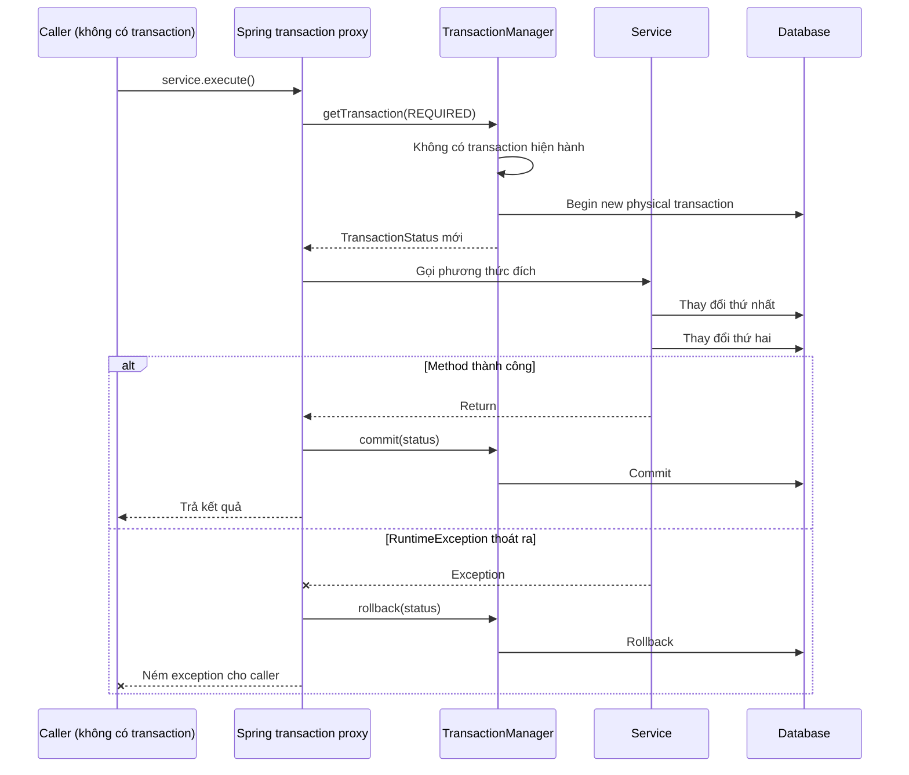

# Tạo giao dịch khi chưa có giao dịch hiện hành với Propagation.REQUIRED trong Spring

## 1. Mục tiêu và tình huống nghiệp vụ

Giả sử một chức năng tạo phiếu ghi nhận phải lưu **hai bản ghi liên quan**: bản ghi đầu tiên cho bên gửi và bản ghi thứ hai cho bên nhận. Nếu bước thứ nhất thành công nhưng bước thứ hai xảy ra lỗi, ứng dụng không được để cơ sở dữ liệu ở trạng thái chỉ có một nửa nghiệp vụ.

Spring giải quyết phần nguyên tử của các thao tác trong cùng nguồn dữ liệu bằng một ranh giới transaction. Trên một phương thức service được Spring quản lý, cách khai báo phổ biến là:

```java
@Transactional(propagation = Propagation.REQUIRED)
public void createEntries() {
    // Các thao tác truy cập cơ sở dữ liệu phải thành công cùng nhau.
}
```

Đây là **cấu trúc minh họa**, chưa phải chương trình biên dịch độc lập. Ví dụ Spring Boot đầy đủ ở mục 7 có thể chạy để quan sát thời điểm transaction được tạo, commit và rollback.

**Trọng tâm của bài:** khi phương thức có propagation `REQUIRED` được gọi **qua Spring transaction proxy** mà **chưa có transaction hiện hành phù hợp với transaction manager được chọn**, Spring sẽ **tạo một transaction mới** để chạy phương thức đó. Khi lời gọi kết thúc, Spring quyết định commit hoặc rollback transaction mà nó vừa mở.

Sau bài này, bạn sẽ:

1. Hiểu chính xác ý nghĩa “required” và điều kiện **không có giao dịch hiện hành**.
2. Phân biệt **transaction scope logic** của Spring với **physical transaction** ở cơ sở dữ liệu.
3. Theo dõi chuỗi caller → proxy → transaction manager → service → commit/rollback.
4. Dùng Java 17+, Spring Boot, JDBC và H2 chứng minh một phương thức `REQUIRED` tự tạo transaction mới khi caller không có transaction.
5. Hiểu ngoại lệ, callback, cách kiểm tra `isNewTransaction()` và những lỗi khiến transaction không được tạo như kỳ vọng.
6. Phân biệt phạm vi bài này với trường hợp `REQUIRED` **tham gia transaction đã tồn tại**.

## 2. Định nghĩa chính xác của REQUIRED

Trong Spring, `Propagation.REQUIRED` có nghĩa:

> **Hỗ trợ transaction hiện hành; nếu không có transaction phù hợp thì tạo transaction mới.**

Cú pháp:

```java
@Transactional(propagation = Propagation.REQUIRED)
public void doWork() {
    // ...
}
```

Và có thể viết ngắn:

```java
@Transactional
public void doWork() {
    // ...
}
```

Hai annotation trên **tương đương về propagation**, vì `REQUIRED` là giá trị mặc định của `@Transactional`. Nếu không cấu hình propagation riêng, Spring không tự chọn `REQUIRES_NEW` hay `SUPPORTS`.

| Trạng thái khi đi vào method | `REQUIRED` làm gì? | Ai quyết định commit cuối cùng? |
| --- | --- | --- |
| **Chưa có transaction hiện hành phù hợp** | Tạo một transaction mới cho lời gọi | Ranh giới transaction vừa được tạo, khi method kết thúc |
| Đã có transaction hiện hành phù hợp | Tham gia transaction đó | Ranh giới ngoài đang sở hữu transaction |
| Method không đi qua Spring transaction interceptor | Annotation không được áp dụng cho lời gọi này | Không có bảo đảm từ annotation; các thao tác có thể dùng auto-commit hoặc transaction của nơi khác |

Bài này đi sâu vào **hàng đầu tiên**. Hàng thứ hai chỉ được nhắc để tránh hiểu lầm rằng REQUIRED “luôn tạo một transaction mới”.

### So sánh nhanh với vài propagation khác

- `REQUIRED`: **có thì dùng, chưa có thì tạo mới**.
- `REQUIRES_NEW`: luôn yêu cầu một transaction mới; nếu có transaction hiện hành thì transaction cũ được tạm ngưng khi hạ tầng hỗ trợ.
- `SUPPORTS`: nếu có transaction thì tham gia; nếu không có, phương thức có thể chạy không cần physical transaction.
- `MANDATORY`: yêu cầu đã có transaction; nếu chưa có thì ném lỗi thay vì tự tạo.

Không nên chọn `REQUIRES_NEW` chỉ vì muốn “bảo đảm có transaction”: trong tình huống **chưa có transaction**, `REQUIRED` đã đáp ứng yêu cầu đó và còn cho phép các caller bên ngoài đặt ranh giới nghiệp vụ lớn hơn trong tương lai.

## 3. “Chưa có giao dịch hiện hành” nghĩa là gì?

Điều kiện này được đánh giá **ở thời điểm transaction interceptor xử lý lời gọi** bằng **transaction manager được chọn**, chứ không đơn thuần dựa trên sự hiện diện của chuỗi `@Transactional` trong source code.

Ví dụ:

```text
REST Controller hoặc CommandLineRunner
    |
    | không mở transaction
    v
Spring proxy của PaymentService
    |
    | @Transactional(REQUIRED)
    v
TransactionManager: không tìm thấy transaction đang hoạt động
    |
    +--> tạo transaction mới
    |
    v
PaymentService.createPayment()
    |
    +--> JDBC UPDATE
    +--> JDBC INSERT
    |
    v
Proxy/TransactionManager:
    +--> commit khi kết thúc hợp lệ
    +--> rollback khi có lỗi thuộc rollback rule
```

**Các điều kiện để kết luận đúng:**

- Service phải là **Spring-managed bean** và lời gọi phải qua cơ chế transaction advice đang hoạt động.
- Transaction manager cần được chọn và cấu hình phù hợp với nguồn dữ liệu mà repository hoặc `JdbcTemplate` sử dụng.
- Không có transaction phù hợp mà manager đó đang quản lý ở ngữ cảnh thực thi hiện tại.
- Với JDBC/JPA imperative thông thường, ngữ cảnh transaction được gắn với **luồng hiện tại**. Một transaction trên thread khác không tự trở thành transaction hiện hành của caller.

Nếu ứng dụng có nhiều transaction manager, có thể tồn tại một transaction trên database A nhưng không có transaction trên database B. Một method `REQUIRED` dùng manager B có thể tạo transaction mới **trên B**. Do vậy, khi nói “chưa có transaction”, phải ngầm hiểu “**chưa có transaction của tài nguyên/manager liên quan**”.

### Transaction logic và transaction vật lý

Spring phân biệt:

- **Logical transaction scope**: ranh giới chính sách do `@Transactional` tạo ra cho lời gọi.
- **Physical transaction**: giao dịch thật do transaction manager điều phối trên DB hoặc tài nguyên tương ứng.

Khi `REQUIRED` không gặp transaction sẵn có, **một scope logic mới trở thành chủ sở hữu một physical transaction mới**. Đây là trường hợp dễ hiểu nhất: commit/rollback của scope ngoài cùng quyết định kết quả DB.

Khi một method REQUIRED gọi qua proxy một method REQUIRED khác cùng manager, có thể có **hai scope logic** nhưng **cùng một physical transaction**; method bên trong không tự commit độc lập. Trường hợp đó giúp giải thích vì sao “scope” và “physical transaction” không phải lúc nào cũng có tỉ lệ 1:1.

## 4. Spring tạo transaction ở thời điểm nào?

Với declarative transaction management dạng proxy thông thường, tiến trình xảy ra **trước khi câu lệnh đầu tiên trong phương thức service bắt đầu** về mặt transaction boundary:

1. Caller lấy và gọi **proxy** của service, thường do constructor injection.
2. `TransactionInterceptor` đọc chính sách từ `TransactionAttributeSource`, nhận propagation REQUIRED và xác định transaction manager.
3. Interceptor yêu cầu manager tạo/tham gia giao dịch (ví dụ `PlatformTransactionManager.getTransaction(definition)`).
4. Manager kiểm tra ngữ cảnh của tài nguyên; vì chưa có transaction phù hợp nên đi theo nhánh **begin new transaction**.
5. Mã service thực sự bắt đầu chạy trong ranh giới đã thiết lập.
6. Khi mã service trả về hoặc ném ngoại lệ, interceptor dùng rollback rules để xử lý transaction và dọn dẹp ngữ cảnh.

Đối với `DataSourceTransactionManager` cùng `JdbcTemplate`, việc bắt đầu thường bao gồm lấy JDBC connection, cấu hình trạng thái transaction (chẳng hạn tắt auto-commit khi cần), gắn connection với luồng qua cơ chế quản lý tài nguyên của Spring, rồi hoàn tác trạng thái/giải phóng tài nguyên khi kết thúc.

Một số hạ tầng có cơ chế **lấy kết nối trễ** hoặc flush SQL trễ. Vì thế, đừng suy luận “mở giao dịch” luôn tương ứng với “đã gửi một câu SQL BEGIN có thể nhìn thấy trong log” ở mọi driver/transaction manager. Điều quan trọng là **transaction boundary và sự quản lý tài nguyên đã được thiết lập trước khi thực thi logic cần bảo vệ**.

### Sơ đồ trình tự cho trường hợp chưa có transaction



Sơ đồ chỉ mô tả transaction manager phục vụ **cùng một database**; nó không ngầm đảm bảo rollback cho email, file hay một database khác.

## 5. Kết quả commit/rollback khi REQUIRED tự tạo transaction

Giả sử database ban đầu có hai tài khoản hoặc một bảng `event_log` rỗng.

### Khi phương thức chạy thành công

```text
Caller chưa có transaction
  -> proxy REQUIRED tạo transaction T1
  -> INSERT bản ghi A
  -> INSERT bản ghi B
  -> method kết thúc bình thường
  -> proxy commit T1
  -> A và B cùng tồn tại bền vững
```

Trong trường hợp này, phương thức được gọi qua proxy là **chủ sở hữu transaction mới**. Commit xảy ra sau khi method trả về và trước khi kết quả thành công đến caller, giả sử không có lỗi phát sinh trong giai đoạn commit.

### Khi phương thức ném runtime exception

```text
Caller chưa có transaction
  -> proxy REQUIRED tạo transaction T2
  -> INSERT bản ghi C
  -> RuntimeException thoát khỏi method
  -> proxy rollback T2
  -> bản ghi C không được commit
  -> caller nhận RuntimeException
```

Tất cả câu SQL tham gia đúng physical transaction T2 đều bị rollback. Điều kiện bắt buộc là thao tác ghi đó thực sự dùng **tài nguyên do transaction manager T2 quản lý**. Nếu một đường ghi tự lấy connection khác và auto-commit hoặc dùng DB khác, annotation này không thể khôi phục dữ liệu ở nơi đó.

### Quy tắc rollback mặc định

Theo mặc định của Spring:

| Kết thúc method | Quyết định điển hình |
| --- | --- |
| Trả về bình thường | Commit, nếu transaction còn hợp lệ và không rollback-only |
| Ném `RuntimeException` | Rollback |
| Ném `Error` | Rollback |
| Ném checked exception như `IOException` | **Không mặc định yêu cầu rollback**, trừ khi cấu hình quy tắc khác |
| Bị đánh dấu rollback-only | Không commit thành công dù method có thể trả về bình thường |

Ví dụ thêm quy tắc:

```java
@Transactional(
    propagation = Propagation.REQUIRED,
    rollbackFor = IOException.class
)
public void importRecords() throws IOException {
    // Nếu IOException thoát khỏi phương thức,
    // physical transaction do REQUIRED tạo sẽ rollback.
}
```

Đây là **đoạn minh họa annotation**, chưa có mã truy cập dữ liệu. Một số phiên bản Spring có tùy chọn cấu hình quy tắc rollback mặc định toàn cục, nên cần xem cấu hình thật của dự án. Bài thực hành chính sử dụng `IllegalStateException` để kiểm chứng quy tắc mặc định không mơ hồ.

## 6. Thuộc tính transaction khi được tạo mới

Khi `REQUIRED` **tự tạo transaction mới**, các thuộc tính khai báo được áp dụng cho transaction mới trong phạm vi hỗ trợ của manager/DB.

Ví dụ:

```java
@Transactional(
    propagation = Propagation.REQUIRED,
    isolation = Isolation.READ_COMMITTED,
    timeout = 10,
    readOnly = false
)
public void updateInventory() {
    // ...
}
```

- `isolation = READ_COMMITTED` yêu cầu mức cô lập READ COMMITTED nếu transaction manager và database hỗ trợ.
- `timeout = 10` yêu cầu timeout khoảng 10 giây theo khả năng transaction manager; cần hiểu chính xác cách timeout được thực thi và tác động đến statement.
- `readOnly = false` là mặc định cho thao tác đọc/ghi.
- `readOnly = true` thường là **gợi ý tối ưu/định hướng** dành cho hạ tầng, không phải bảo đảm không thể ghi ở mọi DB.

Nếu method đang **tham gia transaction có sẵn**, các thuộc tính cục bộ như isolation/timeout/readOnly thường không thay thế transaction ngoài theo cách mặc định của Spring. Điểm này quan trọng để hiểu REQUIRED, nhưng **không thuộc nhánh tạo mới** đang học.

**Không nhầm isolation với atomicity:** transaction dù READ COMMITTED vẫn có thể bị race condition nếu logic “đọc rồi kiểm tra rồi ghi” không có khóa/điều kiện SQL nguyên tử thích hợp. REQUIRED tạo ranh giới atomically commit/rollback; nó không tự biến logic của hai giao dịch song song thành serializable.

## 7. Ví dụ chạy được: chứng minh REQUIRED tạo giao dịch mới

Ta tạo một ứng dụng **Spring Boot 3.x**, **Java 17+**, **Spring JDBC** và **H2 in-memory**. Ứng dụng gọi service từ `CommandLineRunner` **không có transaction**, rồi nhìn thấy:

- Trước lời gọi: không có transaction hiện hành.
- Trong method `@Transactional(REQUIRED)`: transaction đang hoạt động và `TransactionStatus.isNewTransaction() == true`.
- Khi thành công: hai bản ghi được commit.
- Khi ném runtime exception sau khi ghi một bản ghi: bản ghi đó rollback, tổng số hàng không đổi.
- Sau lời gọi: ngữ cảnh transaction của caller đã kết thúc.

### 7.1. Chuẩn bị project

Tạo dự án bằng Spring Initializr với Java 17, Maven, dependency **JDBC API** (`spring-boot-starter-jdbc`) và **H2 Database**. Chọn Spring Boot 3.x phù hợp và giữ toàn bộ file `pom.xml` do Initializr sinh ra.

Các dependency cần có:

```xml
<dependencies>
    <dependency>
        <groupId>org.springframework.boot</groupId>
        <artifactId>spring-boot-starter-jdbc</artifactId>
    </dependency>
    <dependency>
        <groupId>com.h2database</groupId>
        <artifactId>h2</artifactId>
        <scope>runtime</scope>
    </dependency>
</dependencies>
```

Đây là **đoạn dependencies**, không phải toàn bộ `pom.xml`; project của Initializr còn phần parent, version, Maven plugin và cấu hình Java tương thích.

Cấu trúc thư mục:

```text
src/
  main/
    java/
      com/example/required/
        RequiredDemoApplication.java
        EntryService.java
    resources/
      schema.sql
```

### 7.2. Tạo bảng dữ liệu

File `src/main/resources/schema.sql`:

```sql
CREATE TABLE event_log (
    id BIGINT PRIMARY KEY,
    message VARCHAR(100) NOT NULL
);
```

Với H2 embedded và cấu hình khởi tạo SQL mặc định của Spring Boot, `schema.sql` được chạy khi ứng dụng khởi động. Nếu bạn tự cấu hình khởi tạo database khác, phải xác minh lại cơ chế đó. Ví dụ này giả định mỗi lần chạy là một phiên H2 in-memory mới, không có sẵn ID trùng.

### 7.3. Service với propagation REQUIRED

File `src/main/java/com/example/required/EntryService.java`:

```java
package com.example.required;

import org.springframework.jdbc.core.JdbcTemplate;
import org.springframework.stereotype.Service;
import org.springframework.transaction.annotation.Propagation;
import org.springframework.transaction.annotation.Transactional;
import org.springframework.transaction.interceptor.TransactionAspectSupport;
import org.springframework.transaction.support.TransactionSynchronizationManager;

@Service
public class EntryService {

    private final JdbcTemplate jdbc;

    public EntryService(JdbcTemplate jdbc) {
        this.jdbc = jdbc;
    }

    @Transactional(propagation = Propagation.REQUIRED)
    public void writePair(long firstId, long secondId, boolean fail) {
        boolean active =
            TransactionSynchronizationManager.isActualTransactionActive();

        boolean isNew =
            TransactionAspectSupport.currentTransactionStatus()
                .isNewTransaction();

        System.out.printf(
            "inside: active=%s, new=%s%n",
            active, isNew);

        // Hai câu INSERT phải nằm trong cùng một transaction.
        jdbc.update(
            "INSERT INTO event_log (id, message) VALUES (?, ?)",
            firstId, "first");

        if (fail) {
            // Lỗi cố tình xảy ra sau INSERT đầu tiên,
            // nhưng trước INSERT thứ hai.
            throw new IllegalStateException("simulated failure");
        }

        jdbc.update(
            "INSERT INTO event_log (id, message) VALUES (?, ?)",
            secondId, "second");
    }
}
```

Những chi tiết quan trọng:

- `@Service` cho phép Spring quản lý bean.
- `writePair(...)` là public method được Spring transaction interceptor xử lý qua proxy.
- `Propagation.REQUIRED` có nghĩa **tạo mới nếu caller chưa có transaction**.
- `TransactionSynchronizationManager.isActualTransactionActive()` cho biết trạng thái transaction được Spring ghi nhận trên luồng thực thi hiện tại, phù hợp với ví dụ JDBC imperative.
- `TransactionAspectSupport.currentTransactionStatus()` lấy trạng thái gắn với lời gọi transactional đang được interceptor xử lý; trong trường hợp này, `isNewTransaction()` dự kiến là **true**.
- `JdbcTemplate` được tạo từ cùng `DataSource` mà transaction manager auto-config của Spring Boot quản lý, nên hai câu INSERT cùng tham gia physical transaction.
- Ngoại lệ `IllegalStateException` là `RuntimeException`, mặc định kích hoạt rollback nếu thoát ra ngoài proxy.

**Không dùng `currentTransactionStatus()` như một phép thử tùy ý ở bất kỳ đâu.** Nếu gọi nó từ nơi không có transaction advice scope phù hợp, nó có thể ném lỗi. Hãy dùng nó để chẩn đoán **bên trong** một lời gọi đã được Spring transaction interceptor xử lý, như ví dụ này.

### 7.4. Caller bên ngoài transaction

File `src/main/java/com/example/required/RequiredDemoApplication.java`:

```java
package com.example.required;

import org.springframework.boot.CommandLineRunner;
import org.springframework.boot.SpringApplication;
import org.springframework.boot.autoconfigure.SpringBootApplication;
import org.springframework.context.annotation.Bean;
import org.springframework.jdbc.core.JdbcTemplate;
import org.springframework.transaction.annotation.EnableTransactionManagement;
import org.springframework.transaction.support.TransactionSynchronizationManager;

@SpringBootApplication
@EnableTransactionManagement
public class RequiredDemoApplication {

    public static void main(String[] args) {
        SpringApplication.run(RequiredDemoApplication.class, args);
    }

    @Bean
    CommandLineRunner demonstrate(EntryService service, JdbcTemplate jdbc) {
        return args -> {
            System.out.println(
                "before: active=" +
                TransactionSynchronizationManager
                    .isActualTransactionActive());

            service.writePair(1L, 2L, false);

            System.out.println(
                "after success: rows=" + countRows(jdbc));

            try {
                service.writePair(3L, 4L, true);
            } catch (IllegalStateException ex) {
                System.out.println("failure caught: " + ex.getMessage());
            }

            System.out.println(
                "after failure: rows=" + countRows(jdbc));

            System.out.println(
                "after: active=" +
                TransactionSynchronizationManager
                    .isActualTransactionActive());
        };
    }

    private static int countRows(JdbcTemplate jdbc) {
        Integer value = jdbc.queryForObject(
            "SELECT COUNT(*) FROM event_log",
            Integer.class);
        return value;
    }
}
```

Trong `CommandLineRunner`, không có `@Transactional` bao quanh. Vì `EntryService` được inject từ Spring và `writePair(...)` là public method, lời gọi đi qua proxy.

Annotation `@EnableTransactionManagement` được ghi tường minh để dễ thấy rằng hạ tầng declarative transaction được bật. Trong ứng dụng Spring Boot với cấu hình transaction auto-config chuẩn, hạ tầng giao dịch thường đã được thiết lập; khai báo tường minh ở ví dụ này giúp thể hiện mục đích giảng dạy.

### 7.5. Chạy và quan sát output

Trong thư mục dự án Maven:

```bash
./mvnw spring-boot:run
```

Trên Windows PowerShell:

```powershell
.\mvnw.cmd spring-boot:run
```

Bên cạnh log của Spring Boot và Maven, các dòng do chương trình tự in là:

```text
before: active=false
inside: active=true, new=true
after success: rows=2
inside: active=true, new=true
failure caught: simulated failure
after failure: rows=2
after: active=false
```

Kết quả được suy ra trực tiếp từ code trong điều kiện khởi tạo được mô tả:

1. **`before: active=false`:** caller đang ngoài transaction.
2. **Lần đầu `inside: active=true, new=true`:** proxy thấy REQUIRED và không có transaction trước đó, nên manager bắt đầu transaction mới. Hai INSERT thành công; Spring commit sau khi method trả về.
3. **`after success: rows=2`:** cả bản ghi 1 và 2 tồn tại bền vững.
4. **Lần thứ hai `inside: active=true, new=true`:** method được gọi lại từ caller ngoài transaction nên một **transaction mới khác** được tạo cho lần gọi thứ hai. Nó không tái sử dụng transaction đã commit ở lần đầu.
5. Lần hai INSERT bản ghi 3 rồi ném `IllegalStateException`. Proxy rollback transaction của lần gọi hai; bản ghi 3 không còn, bản ghi 4 chưa từng được INSERT.
6. **`after failure: rows=2`:** chỉ còn hai bản ghi đã commit từ lần đầu.
7. **`after: active=false`:** ngữ cảnh transaction do lời gọi REQUIRED tạo ra đã được dọn dẹp, caller tiếp tục ở ngoài transaction.

**Phân biệt hai phép đo:**

- `isActualTransactionActive() == true`: ngữ cảnh hiện tại có actual transaction theo Spring. Nó không tự chứng minh transaction này **mới được tạo ở lần gọi hiện tại**.
- `currentTransactionStatus().isNewTransaction() == true`: transaction status của lần gọi này được manager xem là **chủ sở hữu một transaction mới**. Vì caller không có transaction và propagation là REQUIRED nên ví dụ in ra `new=true`.

### 7.6. Thử thay đổi để hiểu nhân quả

**Thử nghiệm A — Bỏ annotation `@Transactional` khỏi service.** Với cấu hình JDBC/H2 thông thường và không có transaction bên ngoài, mỗi lệnh `jdbc.update` có thể chạy trong chế độ auto-commit. Khi `fail=true`, bản ghi 3 có thể tồn tại sau lỗi; đặc biệt `TransactionAspectSupport.currentTransactionStatus()` sẽ không còn là phép gọi hợp lệ như ví dụ. Muốn thử, **trước hết bỏ dòng gọi `currentTransactionStatus()`** để chương trình không ném lỗi chẩn đoán trước khi INSERT. Khi đó so sánh trạng thái DB để thấy vai trò của transaction boundary.

**Thử nghiệm B — Đổi REQUIRED thành `SUPPORTS`.** Khi caller không có transaction, `SUPPORTS` không yêu cầu bắt đầu physical transaction. Đừng giữ `currentTransactionStatus().isNewTransaction()` làm phép khẳng định có giao dịch mới; kết quả phụ thuộc cách infrastructure thiết lập synchronization scope. Bài tập là dự đoán sự khác biệt về tính nguyên tử rồi kiểm chứng sau khi điều chỉnh code quan sát.

**Thử nghiệm C — Giữ REQUIRED và gọi service hai lần thành công.** Mỗi lần gọi từ caller ngoài transaction sẽ tạo một transaction riêng. Không có một transaction chung trải dài qua hai lần gọi độc lập chỉ vì đó là cùng một method.

**Thử nghiệm D — Dùng `@Transactional` không tham số.** Với cùng context, kết quả phải giữ nguyên vì propagation mặc định chính là REQUIRED.

Các thí nghiệm này dùng một môi trường H2 thử nghiệm. Không thực hiện thao tác cố tình rollback trên dữ liệu production.

## 8. Khi REQUIRED tạo mới, ai commit?

Trong ví dụ `CommandLineRunner → EntryService.writePair(...)`:

- Caller không có transaction trước lời gọi.
- Proxy của method tạo một transaction mới.
- Method kết thúc; Spring interceptor dùng transaction status để commit hoặc rollback transaction **mà nó sở hữu**.
- Caller chỉ nhận thành công sau khi đường xử lý transaction hoàn tất. Nếu lỗi commit xảy ra, caller có thể nhận exception mặc dù body method đã trả về bình thường.

Điều này khác với:

```text
OuterService.outer()  @Transactional(REQUIRED)
  |
  +-- InnerService.inner() @Transactional(REQUIRED)
       (được gọi qua bean khác, cùng transaction manager)
```

Ở kịch bản này, `inner()` **tham gia** physical transaction do `outer()` sở hữu. Việc `inner()` trả về không tự commit physical transaction; commit cuối nằm ở `outer()`. Nếu inner scope đánh dấu transaction chung rollback-only, outer có thể gặp `UnexpectedRollbackException` khi tưởng rằng mình chuẩn bị commit.

Hai trường hợp cùng dùng REQUIRED, nhưng khác **trạng thái transaction tại thời điểm interceptor xử lý lời gọi**. Đây là lý do luôn phải trả lời câu hỏi “caller đã có transaction chưa?” trước khi dự đoán behavior.

## 9. Những lỗi làm REQUIRED không tạo transaction như mong đợi

### 9.1. Gọi nội bộ bằng this (self-invocation)

```java
@Service
class DemoService {
    public void outer() {
        inner(); // Lời gọi trực tiếp bên trong cùng object.
    }

    @Transactional(propagation = Propagation.REQUIRED)
    public void inner() {
        // Trông đợi transaction được tạo ở đây.
    }
}
```

Đây là **đoạn minh họa**, không phải chương trình đầy đủ.

Với proxy mode thường dùng, caller gọi `outer()` qua bean proxy; nhưng `outer()` tự gọi `inner()` trên chính target object, nên **lời gọi inner không đi qua transaction interceptor**. Annotation trên `inner()` không tự tạo transaction mới.

Giải pháp thường là đặt `@Transactional` lên **public entry point `outer()`** nếu toàn bộ hành động là một use case, hoặc tách `inner()` sang service bean riêng và gọi qua dependency do Spring inject.

### 9.2. Tạo service thủ công bằng new

```java
EntryService service = new EntryService(jdbc);
service.writePair(1L, 2L, false);
```

Đây là minh họa hành vi Java, không phải cách gọi đúng trong ví dụ ở mục 7. Đối tượng tạo bằng `new` không phải proxy/bean được Spring cấp phát, nên annotation không được transaction advice áp dụng. Đừng nhầm việc class có `@Service` với mọi instance của class đều được Spring quản lý.

### 9.3. Chọn nhầm transaction manager hoặc DataSource

Trong ứng dụng nhiều database, một method có thể chọn:

```java
@Transactional(transactionManager = "ordersTxManager")
public void saveOrder() {
    // Lẽ ra truy cập DataSource của ordersTxManager.
}
```

Nếu bên trong lại dùng `JdbcTemplate` kết nối đến một database khác, manager được chọn không tự bảo vệ câu SQL ở database đó. REQUIRED có thể **thực sự tạo transaction trên nguồn A** nhưng thao tác SQL trên nguồn B vẫn auto-commit.

Cần xác nhận mối liên hệ **transaction manager → DataSource/EntityManagerFactory → repository/JdbcTemplate**. Lỗi này khác với việc transaction hoàn toàn không được tạo.

### 9.4. Tự bắt và nuốt exception trong service

```java
@Transactional
public void save() {
    jdbc.update("INSERT INTO event_log (id, message) VALUES (10, 'x')");
    try {
        throw new IllegalStateException("problem");
    } catch (IllegalStateException ex) {
        // Không ném tiếp, method trả về như thành công.
    }
}
```

Đoạn này minh họa trong service có `JdbcTemplate`. Vì `IllegalStateException` **không thoát khỏi method đến interceptor**, interceptor có thể quyết định commit. Nếu lỗi phát sinh từ DB, transaction có thể đã bị đánh dấu rollback-only hoặc bị DB làm aborted; vì thế không thể suy luận “bắt mọi lỗi rồi return = chắc chắn commit”.

Khi nghiệp vụ cần thất bại nguyên tử, để ngoại lệ phù hợp thoát ra hoặc thiết kế cơ chế đánh dấu rollback-only rõ ràng.

### 9.5. Method visibility, final và proxy type

Với cách triển khai proxy mặc định:

- Public, non-final method trên một Spring-managed service bean là cách ít bất ngờ nhất.
- Private method không thể trở thành điểm intercept của proxy.
- Class-based proxy không override được final method.
- Với JDK interface-based proxy, lời gọi phải đi qua các method được expose trên interface; annotation và method resolution cần đặt đúng nơi.

Để học REQUIRED, nên giữ ví dụ public method được gọi từ một bean khác thay vì khai thác các ngoại lệ đặc thù của kiểu proxy hoặc phiên bản framework.

### 9.6. Transaction ở một thread khác

Trong JDBC/JPA imperative, transaction được gắn với thread do Spring điều phối. Nếu gọi một method `@Async` hoặc tự chạy `new Thread(...)`, thread mới không tự kế thừa JDBC transaction của caller.

Khi một method `@Transactional(REQUIRED)` ở thread mới được proxy intercept, nó thường **không thấy transaction của thread cũ** và có thể tạo transaction mới ở thread mới. Điều này cần được hiểu là hai transaction độc lập, không phải khả năng “nối tiếp transaction giữa các thread” tự động.

Reactive transaction (R2DBC) dùng cơ chế context khác. Ví dụ trong bài dùng JDBC nên không đem `TransactionSynchronizationManager` theo nghĩa thread-local ở đây áp dụng máy móc cho mọi pipeline reactive.

## 10. REQUIRED không tự bảo đảm mọi bất biến nghiệp vụ

Ví dụ có hai người cùng đặt chiếc vé cuối cùng. Mỗi yêu cầu đều vào một method `@Transactional(REQUIRED)` và caller không có transaction, nên Spring tạo **hai physical transaction riêng**, có thể chạy đồng thời.

Nếu code làm:

```text
T1 đọc remaining=1
T2 đọc remaining=1
T1 kiểm tra đủ vé
T2 kiểm tra đủ vé
T1 cập nhật
T2 cập nhật
```

các giao dịch vẫn có thể ra quyết định dựa trên dữ liệu cũ nếu thiết kế SQL/locking không phù hợp. REQUIRED tạo ranh giới commit/rollback, nhưng **không mặc định tuần tự hóa mọi transaction** và không bảo vệ điều kiện “chỉ bán một vé” bằng phép màu.

Một hướng an toàn cho hàng số lượng là cập nhật có điều kiện ở DB:

```sql
UPDATE ticket_inventory
   SET remaining = remaining - 1
 WHERE id = 1 AND remaining >= 1;
```

Kiểm tra số hàng được cập nhật; nếu là 0 thì ném lỗi nghiệp vụ phù hợp để transaction rollback. Với quy tắc trên nhiều hàng, có thể cần khóa, optimistic locking, serializable isolation kèm retry hoặc cấu trúc dữ liệu phù hợp.

Không nên hiểu “có transaction mới” thành “có tính nhất quán cho mọi bài toán đồng thời”. Tính đúng đắn cần thêm validation, constraints, thuật toán truy cập đồng thời và kiểm thử race conditions.

## 11. Phân biệt REQUIRED với việc mở transaction thủ công

Lập trình viên đôi khi viết JDBC trực tiếp:

```java
Connection c = dataSource.getConnection();
try {
    c.setAutoCommit(false);
    // SQL...
    c.commit();
} catch (Exception ex) {
    c.rollback();
    throw ex;
} finally {
    c.close();
}
```

Đây là **mã phác họa**; cần xử lý checked exceptions, statement/resource cleanup và tương thích API đầy đủ để chạy. Mục đích chỉ là minh họa các bước quản lý connection thủ công.

Với Spring-managed JDBC, `@Transactional(REQUIRED)` cho phép service biểu diễn ranh giới nghiệp vụ mà **transaction manager và Spring JDBC** điều phối trạng thái connection:

```java
@Transactional
public void saveBoth() {
    jdbc.update("INSERT ...");
    jdbc.update("INSERT ...");
}
```

Đây cũng là đoạn minh họa, không phải SQL/Java chạy độc lập. Ưu điểm là quản lý transaction nhất quán qua nhiều DAO cùng nguồn dữ liệu, hỗ trợ rollback rules, propagation và lựa chọn transaction manager rõ ràng.

Có thể mở transaction bằng mã Spring `TransactionTemplate` trong những tình huống cần ranh giới lập trình, nhưng đó là một cách khác với annotation. Mục tiêu ở đây là hiểu **REQUIRED dùng khi chưa có transaction** trong declarative approach.

## 12. Kiểm thử hành vi thay vì chỉ kiểm annotation

Đọc được chữ `@Transactional(REQUIRED)` trong source không đủ để kết luận một physical transaction thực sự đã chạy. Các kiểm thử nên quan sát một vài dấu hiệu đồng thời:

| Kiểm thử | Điều phải thấy |
| --- | --- |
| Caller trước lời gọi không có transaction | `isActualTransactionActive() == false` |
| Vào service qua proxy, REQUIRED | `isActualTransactionActive() == true` |
| Trạng thái transactional scope ở service khi chưa có outer | `currentTransactionStatus().isNewTransaction() == true` |
| Hai INSERT thành công | Đều tồn tại sau khi method hoàn tất |
| Ném runtime exception sau INSERT thứ nhất | Không còn INSERT thứ nhất của lần gọi thất bại |
| Caller sau method kết thúc | Không còn transaction được tạo cho method này |
| Gọi cùng method một lần khác từ caller ngoài transaction | Một transaction mới cho lần gọi mới |
| Trường hợp method được caller transactional bao ngoài | Method trong tham gia existing transaction, không phải chủ sở hữu commit riêng |

### Để kiểm thử thật với database production-like

H2 phù hợp cho việc học khái niệm, nhưng PostgreSQL/MySQL có các khác biệt về mức cô lập, khóa, constraint, transaction lỗi và cách JDBC driver tương tác. Nếu production dùng PostgreSQL, nên có integration test bằng PostgreSQL thật hoặc Testcontainers PostgreSQL.

Tránh đặt `@Transactional` mặc định lên **chính test method** nếu mục tiêu của test là “caller chưa có transaction”. Nhiều test framework mở transaction cho test và rollback khi test kết thúc; điều đó làm bối cảnh ban đầu thay đổi, có thể khiến `isNewTransaction()` ở service không còn `true` và che giấu commit thực sự.

Khi kiểm thử rollback, hãy cố gây lỗi **sau khi một câu SQL đã ghi** rồi truy vấn trạng thái **sau khi phương thức transactional kết thúc**, như ví dụ mục 7.

### Log để đối chiếu

Có thể bật mức log phù hợp trong `application.properties`:

```properties
logging.level.org.springframework.transaction.interceptor=TRACE
logging.level.org.springframework.jdbc.datasource.DataSourceTransactionManager=DEBUG
```

Log thực tế tùy phiên bản Spring và loại manager. Tìm dấu vết “tạo transaction mới”, commit hoặc rollback. Tuy nhiên, **trạng thái DB sau lời gọi** là bằng chứng quan trọng hơn việc khớp một dòng log cố định.

## 13. Các tình huống dễ hiểu sai

### Tình huống 1 — “Không có transaction” nhưng service gọi một repository có @Transactional

Khi service ở ngoài transaction gọi một repository method mặc định `REQUIRED` qua Spring proxy, repository có thể tự tạo transaction cho **riêng method đó**. Nếu service sau đó gọi nhiều repository theo thứ tự mà bản thân service không có `@Transactional`, các thao tác có thể kết thúc trong **những transaction độc lập**, gây nguy cơ ghi một phần.

Vì vậy, với use case gồm nhiều thay đổi phải cùng thành công, đặt `@Transactional(REQUIRED)` ở **service method điều phối toàn bộ nghiệp vụ**. Repository bên dưới có thể tham gia transaction đó thông qua REQUIRED và cùng transaction manager.

### Tình huống 2 — Chưa có transaction nhưng manager không cấu hình được

Annotation không tự sinh transaction manager/DB. Nếu ứng dụng thiếu manager phù hợp, có nhiều manager mơ hồ hoặc nguồn dữ liệu không tương thích, caller có thể gặp exception trước khi phương thức chạy. Phải đảm bảo bean `PlatformTransactionManager` (hoặc `ReactiveTransactionManager` trong reactive flow) được tạo và được chọn chính xác.

### Tình huống 3 — Trong service thấy active=true nhưng method dùng sai nguồn dữ liệu

`TransactionSynchronizationManager.isActualTransactionActive() == true` chỉ cho biết có transaction trong ngữ cảnh đang quan sát. Nó **không đủ chứng minh** mọi lệnh `JdbcTemplate` trong method đã tham gia đúng physical transaction. Cần kiểm tra mapping giữa manager và datasource, đặc biệt khi ứng dụng có nhiều DB.

### Tình huống 4 — Bên trong REQUIRED ném checked exception

Với rollback rules mặc định truyền thống, checked exception có thể để transaction do REQUIRED tạo **commit** dù method trả lỗi. Quyết định đó khác với việc “REQUIRED có tạo transaction hay không”. Hãy cấu hình `rollbackFor` khi nghiệp vụ yêu cầu rollback với checked exception.

### Tình huống 5 — Một lần gọi tạo mới, lần tiếp theo cũng tạo mới

Khi caller không có transaction ở cả hai lần, mỗi lần gọi qua proxy tạo một transaction riêng. Spring **không cache physical transaction** cho method giống như cache metadata annotation. Transaction đã commit/rollback rồi sẽ không tự được dùng lại cho lời gọi tiếp theo.

### Tình huống 6 — Ngoại lệ bị nuốt ở ngoài và trong

Bắt lỗi **bên ngoài** service sau khi proxy đã xử lý transaction (như `CommandLineRunner` trong ví dụ) không làm rollback bị bỏ qua. Bắt và nuốt lỗi **bên trong** method trước khi interceptor thấy exception lại có thể làm Spring nghĩ method hoàn tất bình thường. Vị trí catch là một phần quan trọng của ngữ nghĩa transaction.

## 14. Bài tập tự kiểm tra

**Bài 1.** `Controller.create()` không có annotation. Nó gọi một Spring service bean method có `@Transactional(REQUIRED)`. Không có transaction nào tồn tại lúc gọi. Spring làm gì?

**Đáp án:** transaction interceptor tạo một transaction mới qua manager phù hợp trước khi thực thi method. Khi method kết thúc, proxy commit/rollback theo kết quả và rollback rules.

**Bài 2.** `ServiceA.run()` không có transaction, nó gọi hai repository method riêng lẻ mỗi method có `@Transactional(REQUIRED)`. Có thể chắc chắn cả hai method nằm trong **một transaction chung** không?

**Đáp án:** Không. Nếu mỗi method được proxy intercept độc lập và không có transaction ngoài, mỗi method có thể tự tạo và hoàn tất một transaction riêng. Đặt ranh giới transaction bao toàn bộ use case ở service điều phối.

**Bài 3.** Chạy ví dụ ở mục 7 hai lần gọi `writePair()` từ `CommandLineRunner`. `isNewTransaction()` của lần hai có true không?

**Đáp án:** Có. Vì transaction thứ nhất đã commit và caller không có transaction bao ngoài, lần gọi thứ hai với REQUIRED tạo một physical transaction mới khác.

**Bài 4.** Một method REQUIRED đang chạy trong transaction T1 của caller, cũng trên manager đó. Nó có tạo T2 không?

**Đáp án:** Không. REQUIRED tham gia T1. Đây là nhánh còn lại của định nghĩa REQUIRED; muốn transaction riêng cần xem `REQUIRES_NEW`, nhưng dùng nó có tác động đến tính nhất quán cần cân nhắc.

**Bài 5.** Caller không có transaction, REQUIRED tự mở transaction T1. Method ghi một hàng rồi ném `IllegalStateException` thoát ra ngoài. Kết quả mặc định?

**Đáp án:** Rollback T1, nên hàng vừa ghi không được commit, với điều kiện thao tác SQL thực sự tham gia T1.

**Bài 6.** Tại sao `isActualTransactionActive() == true` chưa đủ chứng minh JDBC update đã được rollback bảo vệ?

**Đáp án:** Vì transaction có thể thuộc manager của DataSource khác. Cần kiểm tra JDBC connection/resource thực sự gắn với transaction manager được chọn.

**Bài 7.** Dùng `@Transactional(readOnly=true)` trong service được gọi từ caller không có transaction. REQUIRED mặc định vẫn tạo transaction mới không?

**Đáp án:** Có, nếu transaction interceptor và manager được thiết lập phù hợp; propagation mặc định vẫn là REQUIRED. Cờ readOnly tác động đến chính sách transaction mới và cách hạ tầng tối ưu, không biến propagation thành SUPPORTS.

## 15. Checklist khi áp dụng REQUIRED cho một use case mới

- [ ] Phương thức service biểu diễn **một nghiệp vụ nguyên tử rõ ràng** (ví dụ tạo đơn và giảm tồn kho).
- [ ] Bean được Spring quản lý; caller gọi qua proxy, không gọi qua `new` hoặc self-invocation.
- [ ] `@Transactional` dùng propagation REQUIRED (tường minh hoặc mặc định).
- [ ] Đã xác định liệu caller **có transaction ngoài hay không**, và điều đó ảnh hưởng đến quyền commit của ai.
- [ ] Transaction manager phù hợp với DataSource/EntityManagerFactory đang được repository sử dụng.
- [ ] Các thao tác cần nguyên tử nằm trong cùng physical transaction; tài nguyên ngoài DB được xử lý riêng.
- [ ] Ngoại lệ không bị nuốt và rollback rules phù hợp, kể cả checked exceptions nếu cần.
- [ ] Đã kiểm thử đường **thành công** và đường **lỗi sau khi ghi một phần**, quan sát trạng thái DB sau khi method kết thúc.
- [ ] Đã cân nhắc race condition và ràng buộc dữ liệu thay vì kỳ vọng REQUIRED tự serializable.
- [ ] Đã kiểm tra transaction status/log chỉ để hỗ trợ chẩn đoán, không thay thế integration test.

## 16. Ghi nhớ

**`Propagation.REQUIRED` = tham gia nếu có, tự tạo mới nếu chưa có.** Khi caller không có transaction và lời gọi đi qua Spring proxy đến một service phù hợp, transaction manager bắt đầu một transaction mới trước phần logic service và điều phối commit/rollback khi method kết thúc. Nhiều thao tác SQL trên cùng tài nguyên được quản lý có thể thành công hoặc thất bại như một đơn vị.

Một method khác, một thread khác hoặc lần gọi tiếp theo không tự chia sẻ transaction đã kết thúc. REQUIRED cũng không bảo vệ tự động các tài nguyên ngoài manager, không tự sửa lỗi self-invocation và không thay thế concurrency control.

### Tài liệu tham khảo chính thức

- Spring Framework — Transaction Propagation, phần *Understanding PROPAGATION_REQUIRED*: https://docs.spring.io/spring-framework/reference/data-access/transaction/declarative/tx-propagation.html
- Spring Framework — Using `@Transactional`: https://docs.spring.io/spring-framework/reference/data-access/transaction/declarative/annotations.html
- Spring Framework — Transaction Management Strategies: https://docs.spring.io/spring-framework/reference/data-access/transaction/strategies.html
- Spring Javadoc — `Propagation.REQUIRED`: https://docs.spring.io/spring-framework/docs/current/javadoc-api/org/springframework/transaction/annotation/Propagation.html
- Spring Javadoc — `TransactionStatus.isNewTransaction()`: https://docs.spring.io/spring-framework/docs/current/javadoc-api/org/springframework/transaction/TransactionStatus.html
- Spring Boot — Database Initialization: https://docs.spring.io/spring-boot/how-to/data-initialization.html
