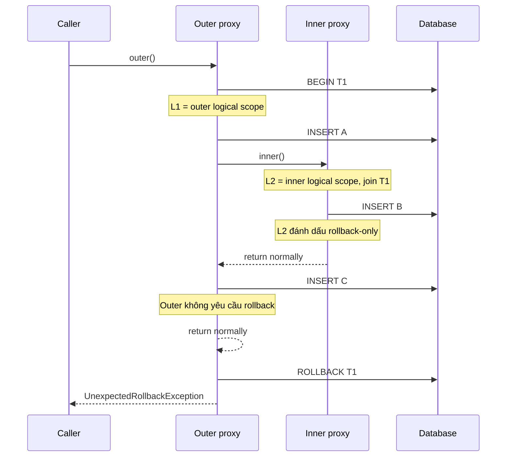

# Mỗi lời gọi vẫn có một phạm vi logic riêng — PROPAGATION_REQUIRED trong Spring

## 1. Ý tưởng quan trọng nhất

Khi hai phương thức Spring được đánh dấu `@Transactional(propagation = Propagation.REQUIRED)` gọi nhau, rất dễ nghĩ rằng vì chúng cùng một transaction nên “chỉ có một transaction scope”. Cách hiểu đó bỏ mất một phân biệt cốt lõi trong Spring:

> **Mỗi lần một phương thức transactional được Spring intercept với propagation `REQUIRED` đều có một phạm vi giao dịch *logic* (logical transaction scope) riêng. Các phạm vi logic này thường cùng tham gia *một giao dịch vật lý* (physical transaction) nếu đã có transaction hiện hành.**

Điều này tạo nên hai sự thật cùng lúc:

- **Nhiều logical scope:** outer method có scope riêng; inner method được intercept có scope riêng; mỗi lần gọi inner tiếp theo lại có scope riêng.
- **Một physical transaction dùng chung:** với `REQUIRED`, nếu outer đã mở local transaction trên datasource, các inner `REQUIRED` tương thích thường sử dụng chính transaction vật lý đó. Inner kết thúc **không đồng nghĩa database commit**; commit vật lý thuộc về boundary đang sở hữu physical transaction, thường là outermost scope.

Bởi vậy, mỗi scope logic có thể đưa ra quyết định rollback-only riêng, nhưng **không có quyền tự commit vĩnh viễn một phần dữ liệu khi đang chia sẻ cùng physical transaction**. Một inner scope đánh dấu rollback-only có thể làm toàn bộ physical transaction phải rollback, ngay cả khi outer method trả về bình thường.

Bài này giải thích khái niệm, timeline, quy tắc commit/rollback, `UnexpectedRollbackException`, policy của inner scope, điều kiện AOP proxy, ví dụ Java 17+ có thể chạy và các bài kiểm thử nên viết.

### 1.1. Ví dụ thực tế: một request, nhiều service

Xét lời gọi:

```text
Controller
  └── CheckoutService.checkout()        @Transactional(REQUIRED)
        ├── orderRepository.insert(...)
        ├── InventoryService.reserve()   @Transactional(REQUIRED)
        │     └── inventoryRepository.update(...)
        └── paymentRecordRepository.insert(...)
```

Giả định `CheckoutService` và `InventoryService` là **hai Spring bean** và lời gọi `reserve()` đi qua proxy của bean thứ hai. Nếu toàn bộ DAO cùng dùng datasource/transaction manager phù hợp:

- `checkout()` có một **logical scope**.
- `reserve()` có một **logical scope** khác.
- Hai scope cùng tham gia **một physical database transaction** được mở ở outer boundary.
- Thành công ở `reserve()` không có nghĩa cập nhật tồn kho đã commit; nếu `checkout()` rollback, phần cập nhật này cũng rollback.
- Nếu inner đánh dấu rollback-only, outer không thể đơn giản “bắt lỗi rồi commit phần còn lại”.

Lưu ý quan trọng: **không phải mọi lời gọi Java đều sinh logical transaction scope**. Nếu gọi `this.reserve()` trên chính object, không đi qua Spring proxy trong proxy mode, interceptor của inner method không chạy và **không hình thành logical scope AOP mới** cho annotation ấy.

## 2. Phân biệt transaction logic và transaction vật lý

### 2.1. Physical transaction là gì?

**Physical transaction** là đơn vị giao dịch thật của resource/provider, ví dụ một JDBC `Connection` đã tắt auto-commit và chạy SQL cho đến `COMMIT` hoặc `ROLLBACK`. Nó xác định điều gì được database ghi bền vững hoặc hoàn tác, chịu ảnh hưởng của isolation, lock, constraint, timeout và khả năng của driver/database.

Với Spring JDBC dùng `DataSourceTransactionManager` hoặc `JdbcTransactionManager`, physical transaction thường gắn với một JDBC connection lấy từ datasource được quản lý, được Spring bind với thread trong thời gian scope thích hợp.

Trong JPA, `JpaTransactionManager` điều phối resource và persistence context tương ứng. Không được nhầm “một physical transaction” với “mọi hệ thống mà code gọi đến”: HTTP service, message broker hoặc một datasource khác **không tự động** nằm trong transaction JDBC/JPA local đó.

### 2.2. Logical transaction scope là gì?

**Logical transaction scope** là *phạm vi quyết định* do transaction interceptor hoặc programmatic transaction boundary mở ra cho một lời gọi. Nó mang policy: propagation, rollback rules, trạng thái scope, tên transaction, read-only/isolation khi có tác dụng…

Ví dụ, một lời gọi đi qua interceptor:

```java
@Transactional(propagation = Propagation.REQUIRED)
public void reserve() {
    // ...
}
```

Spring lấy `TransactionDefinition`, gọi `PlatformTransactionManager.getTransaction(...)` và nhận một `TransactionStatus` tương ứng scope. Nếu transaction vật lý có sẵn, `TransactionStatus.isNewTransaction()` của inner scope sẽ là `false` trong tình huống `REQUIRED` thông thường; dù vậy logical scope **vẫn tồn tại** và interceptor vẫn hoàn tất scope khi method trả về hoặc ném exception.

**Một logical scope không phải một connection mới, không phải savepoint mặc định, không phải transaction độc lập và không tương đương một lần COMMIT.**

### 2.3. Bảng so sánh

| Đặc điểm | Logical scope | Physical transaction |
| --- | --- | --- |
| Được tạo bởi | Một lần transactional interception/programmatic boundary | Transaction manager/resource khi thực sự bắt đầu transaction mới |
| Số lượng khi outer gọi hai inner `REQUIRED` | Có thể có ba scope: outer, inner lần 1, inner lần 2 | Thường chỉ một, dùng chung |
| Có policy riêng không? | Có thể khai báo `rollbackFor`, propagation, v.v. | Chỉ một bộ đặc điểm thực tế (ví dụ isolation) trên transaction đang diễn ra |
| Có rollback-only riêng không? | Có thể đánh dấu quyết định rollback ở scope | Một dấu rollback-only ở participant có thể buộc toàn bộ physical transaction rollback |
| Kết thúc scope có commit DB? | Không nhất thiết; participant hoàn tất logic của nó | Owner commit vật lý một lần nếu không bị rollback |
| Hai scope có isolation độc lập không? | Không khi cùng physical transaction | Isolation thuộc về physical transaction |
| `TransactionStatus.isNewTransaction()` | Có thể là `false` ở inner scope | Là `true` ở scope vừa tạo physical transaction |

Mô hình ngắn gọn: **nhiều phạm vi xử lý logic có thể ánh xạ vào một đơn vị dữ liệu ACID vật lý**.

## 3. REQUIRED lựa chọn transaction hiện có như thế nào?

`Propagation.REQUIRED` là mặc định của `@Transactional`. Về cơ bản:

1. **Không có transaction phù hợp:** Spring yêu cầu manager **tạo transaction vật lý mới**, rồi mở logical scope cho lời gọi.
2. **Đã có transaction phù hợp:** Spring tạo logical scope mới nhưng **tham gia physical transaction hiện hành**.
3. **Lời gọi được intercept khác tiếp theo:** lặp lại quy tắc tương tự; không gộp tất cả intercepted methods thành *một* logical scope duy nhất.
4. **Phạm vi ngoài cùng kết thúc:** khi physical transaction thuộc về scope ngoài cùng, transaction manager commit/rollback thực sự tại boundary đó.

```mermaid
sequenceDiagram
    participant C as Controller
    participant O as Outer proxy
    participant TM as TransactionManager
    participant OS as OuterService
    participant I as Inner proxy
    participant IS as InnerService
    participant DB as Database
    C->>O: checkout()
    O->>TM: getTransaction(REQUIRED)
    TM->>DB: BEGIN physical T1
    Note over O,TM: Logical scope L1; newTransaction=true
    O->>OS: checkout() body
    OS->>DB: INSERT order
    OS->>I: reserve()
    I->>TM: getTransaction(REQUIRED)
    Note over I,TM: Logical scope L2; join T1; newTransaction=false
    I->>IS: reserve() body
    IS->>DB: UPDATE stock
    IS-->>I: return
    I->>TM: complete L2 (commit request)
    Note over TM,DB: T1 chưa COMMIT
    I-->>OS: return
    OS->>DB: INSERT payment record
    OS-->>O: return
    O->>TM: complete L1 (commit request)
    TM->>DB: COMMIT T1
    O-->>C: success
```

Trong sơ đồ, khi inner interceptor gọi `commit(status)`, vì `status.isNewTransaction() == false`, nó thường chỉ hoàn tất **scope tham gia**, không commit DB ngay. Physical commit chỉ xảy ra một lần ở owner của transaction.

Sơ đồ giả định Spring transaction proxy thực sự intercept cả hai method, một manager phù hợp và cùng resource, không có lỗi hay rollback-only.

### 3.1. Nếu chỉ gọi inner khi chưa có outer transaction?

```text
Controller
  └── InventoryService.reserve() @Transactional(REQUIRED)
```

Khi chưa có active transaction, scope của `reserve()` vừa là logical scope, **vừa là owner của một physical transaction mới**. Lần đó `TransactionStatus.isNewTransaction()` thường là `true`, và transaction sẽ hoàn tất khi `reserve()` trả về.

Nếu controller gọi `reserve()` hai lần tách biệt, không có outer transaction bao cả hai, mỗi lần có thể tạo và commit **hai physical transactions** khác nhau. Không nên diễn giải chữ `REQUIRED` như “dùng chung một transaction toàn ứng dụng”.

## 4. Cùng một physical transaction nhưng từng lời gọi vẫn có rollback decision

Đây là hệ quả quan trọng nhất. Spring documentation mô tả: mỗi logical scope `REQUIRED` có thể xác định rollback-only **riêng ở mức scope**, nhưng khi tất cả scope dùng chung một physical transaction, dấu rollback-only của inner có thể làm toàn bộ physical transaction không còn đủ điều kiện commit.



Cả A, B, C đều là các thay đổi **chưa commit** trong T1; cuối cùng chúng cùng rollback. Điều không thể xảy ra ở đây là “inner rollback riêng B nhưng outer commit A và C” khi vẫn là `REQUIRED` chung physical transaction, nếu không có savepoint/nested transaction được thiết kế riêng.

### 4.1. Inner method ném RuntimeException rồi outer bắt lại

Ví dụ **hai bean khác nhau**:

```java
@Service
class InventoryService {
    @Transactional(propagation = Propagation.REQUIRED)
    public void reserve() {
        // update DB rồi lỗi
        throw new IllegalStateException("OUT_OF_STOCK");
    }
}

@Service
class CheckoutService {
    private final InventoryService inventory;

    CheckoutService(InventoryService inventory) {
        this.inventory = inventory;
    }

    @Transactional(propagation = Propagation.REQUIRED)
    public void checkout() {
        // insert order
        try {
            inventory.reserve();
        } catch (IllegalStateException ex) {
            // Bắt lỗi không tự xóa rollback-only của physical T1.
        }
        // tiếp tục cập nhật một số dữ liệu
    }
}
```

Đây là snippet, chưa có repository hoặc đầy đủ imports. Khi lời gọi `inventory.reserve()` đi qua proxy của bean kia, inner interceptor quan sát unchecked exception và theo mặc định yêu cầu rollback cho **logical inner scope**; với `REQUIRED` tham gia T1, thường dẫn đến việc **đánh dấu T1 rollback-only**. Outer catch rồi kết thúc bình thường vẫn không thể commit T1.

Tại outer commit, Spring thường ném `UnexpectedRollbackException` để caller biết rằng transaction bị rollback thay vì commit như cách outer đang kỳ vọng. Nếu outer **không catch** và exception gốc thoát ra ngoài outer interceptor, caller thường thấy exception nghiệp vụ gốc; không phải mọi rollback đều sinh `UnexpectedRollbackException`.

### 4.2. Inner trả Result.failure(...) mà không ném exception

Một trường hợp khác:

```java
@Transactional(propagation = Propagation.REQUIRED)
public Result reserve() {
    // update database
    return Result.failure("OUT_OF_STOCK");
}
```

`Result.failure(...)` là **giá trị trả về thông thường**, không phải exception. Với result type tự tạo, interceptor mặc định **không tự hiểu** đây là rollback request. Nếu không ai đánh dấu rollback-only và không có lỗi database/transaction, outer physical transaction **có thể commit**, mặc dù caller nhìn thấy result thất bại.

Ngoại lệ có điều kiện: Spring hỗ trợ đặc biệt một số result type như Vavr `Try.Failure` hoặc một số `Future` đã exceptionally completed trong phiên bản tương ứng. Không suy diễn hành vi đó cho mọi DTO/Result/Either tự tạo.

### 4.3. Inner tự gọi setRollbackOnly

```java
import org.springframework.transaction.interceptor.TransactionAspectSupport;

@Transactional(propagation = Propagation.REQUIRED)
public void reserve() {
    // update database
    TransactionAspectSupport.currentTransactionStatus().setRollbackOnly();
}
```

Đây là method fragment phải nằm trong một bean có Spring transaction advice phù hợp. Khi inner đang **tham gia** T1, nó ghi nhận yêu cầu rollback ở logical inner scope. Sau khi interceptor xử lý completion, physical transaction T1 có thể bị đánh dấu rollback-only và outer không được commit thực sự.

`setRollbackOnly()` là cơ chế cần dùng **có chủ đích**: code nghiệp vụ phụ thuộc vào Spring transaction API, và caller có thể thấy `UnexpectedRollbackException` nếu outer kỳ vọng commit. Một helper Java bình thường không nằm trong transactional interception không nên gọi `currentTransactionStatus()` rồi giả định status luôn tồn tại.

### 4.4. Outer tự đánh dấu rollback-only thì khác gì?

Nếu **scope sở hữu transaction** (outermost) chủ động gọi `setRollbackOnly()`, rollback là kết quả mà chính scope ngoài mong muốn. Spring có thể thực hiện rollback khi kết thúc mà **không ném `UnexpectedRollbackException` chỉ vì quyết định rollback chủ động đó**. Về mặt dữ liệu, vẫn không có commit.

Ngược lại, inner scope âm thầm khiến global transaction không thể commit trong khi outer yêu cầu commit mới là ngữ cảnh điển hình của `UnexpectedRollbackException`.

## 5. Không nhầm ba phương pháp: REQUIRED, REQUIRES_NEW, NESTED

| Propagation của inner | Khi outer đang có transaction | Physical transaction của inner | Có thể độc lập commit/rollback? |
| --- | --- | --- | --- |
| `REQUIRED` | Tham gia outer | **Cùng T1** | Không: toàn bộ transaction dùng chung kết quả commit/rollback cuối. |
| `REQUIRES_NEW` | Suspend outer, mở transaction mới | **T2 độc lập** | Có: T2 có thể commit trong khi T1 sau đó rollback, tùy không có ràng buộc khác ngăn cản. |
| `NESTED` | Dùng savepoint nếu manager/resource hỗ trợ | **Cùng T1**, có nested savepoint | Có thể rollback về savepoint và để outer tiếp tục; không commit vật lý độc lập trước outer. |

Các mô tả trên chỉ áp dụng khi inner boundary được intercept thật và transaction manager hỗ trợ propagation tương ứng.

### REQUIRED không phải “giả REQUIRES_NEW”

```java
@Transactional(propagation = Propagation.REQUIRED)
public void writeAudit() {
    // ...
}
```

Đặt method này vào service khác **không** tạo physical transaction riêng nếu outer T1 đã tồn tại. Nó tạo thêm logical scope nhưng vẫn chia sẻ T1. Nếu yêu cầu audit commit ngay cả khi outer rollback, phải cân nhắc `REQUIRES_NEW` hoặc thiết kế event/outbox phù hợp và hiểu hệ quả về connection pool/consistency.

### NESTED cũng không phải logical scope REQUIRED

`NESTED` với `DataSourceTransactionManager`/JDBC savepoints cho phép rollback phần cập nhật sau savepoint mà không bắt buộc rollback toàn bộ T1; với JPA/JTA hoặc driver không hỗ trợ, hành vi/support khác. `REQUIRED` thông thường **không tự tạo savepoint** mỗi lần gọi inner.

### REQUIRES_NEW có chi phí

Inner `REQUIRES_NEW` có thể cần connection thứ hai trong khi outer vẫn giữ connection của T1. Với nhiều request đồng thời, pool quá nhỏ có thể gây chờ hoặc hết connection. Đừng đổi `REQUIRED` sang `REQUIRES_NEW` chỉ để tránh `UnexpectedRollbackException` nếu nghiệp vụ thực sự cần all-or-nothing.

## 6. Thời điểm commit: hai logical commit không có nghĩa hai COMMIT

Với interceptor theo proxy mode:

- Trước khi gọi outer body: outer interceptor mở/nhận `TransactionStatus L1`; nếu chưa có transaction, L1 sở hữu T1.
- Trước khi gọi inner body: inner interceptor mở `TransactionStatus L2`, **join T1**.
- Inner trả về: interceptor gọi hoàn tất (có thể gọi `commit(L2)`). Nhưng `isNewTransaction() == false` nên **không commit DB vật lý** tại đây.
- Outer trả về: interceptor hoàn tất L1. Nếu không rollback-only và resource sẵn sàng, transaction manager thực hiện **một COMMIT T1**.
- Nếu inner đánh dấu rollback-only: outer không được commit thật; transaction manager rollback physical T1 và thông báo phù hợp.

Điều này giải thích tại sao việc một repository `save()` trả về entity đã có ID hoặc `flush()` thực hiện SQL **không bảo đảm transaction đã commit**. Data có thể đã được flush/visible trong cùng T1, nhưng sẽ biến mất khi outer rollback.

Lưu ý khi kiểm tra với JDBC: trong một physical transaction, các câu SQL qua cùng Spring-managed datasource có thể được thực thi trên **cùng transaction-bound connection**. Với connection tự mở bằng `DriverManager.getConnection(...)` ngoài Spring hoặc datasource không khớp, không được giả định cùng T1 chỉ vì method chứa annotation `@Transactional`.

## 7. Java 17+ runnable demo: nhiều logical scope, một physical transaction

Ví dụ này cố tình minh họa **hai điểm bằng số liệu thực tế**:

1. Trong outer `REQUIRED`, inner `REQUIRED` có `TransactionStatus.isNewTransaction() == false`, dù mỗi lời gọi có `TransactionStatus` tương ứng một logical scope.
2. Khi inner scope đánh dấu rollback-only, **tất cả INSERT trong T1** (kể cả outer trước/sau inner) cùng bị rollback và outer gặp `UnexpectedRollbackException`.

Code chạy với **Java 17+**, **Spring Framework 6.2.19**, **H2 2.3.232** và Maven; không cần Spring Boot. Đây là giao dịch local trên **một datasource**.

### 7.1. Cấu trúc

```text
required-scope-demo/
├── pom.xml
└── src/main/java/demo/tx/RequiredScopesDemo.java
```

### 7.2. pom.xml

```xml
<project xmlns="http://maven.apache.org/POM/4.0.0"
         xmlns:xsi="http://www.w3.org/2001/XMLSchema-instance"
         xsi:schemaLocation="http://maven.apache.org/POM/4.0.0
                             https://maven.apache.org/xsd/maven-4.0.0.xsd">
    <modelVersion>4.0.0</modelVersion>
    <groupId>demo</groupId>
    <artifactId>required-scope-demo</artifactId>
    <version>1.0.0</version>

    <properties>
        <maven.compiler.release>17</maven.compiler.release>
        <project.build.sourceEncoding>UTF-8</project.build.sourceEncoding>
    </properties>

    <dependencies>
        <dependency>
            <groupId>org.springframework</groupId>
            <artifactId>spring-context</artifactId>
            <version>6.2.19</version>
        </dependency>
        <dependency>
            <groupId>org.springframework</groupId>
            <artifactId>spring-jdbc</artifactId>
            <version>6.2.19</version>
        </dependency>
        <dependency>
            <groupId>com.h2database</groupId>
            <artifactId>h2</artifactId>
            <version>2.3.232</version>
        </dependency>
    </dependencies>

    <build>
        <plugins>
            <plugin>
                <groupId>org.apache.maven.plugins</groupId>
                <artifactId>maven-compiler-plugin</artifactId>
                <version>3.13.0</version>
            </plugin>
            <plugin>
                <groupId>org.codehaus.mojo</groupId>
                <artifactId>exec-maven-plugin</artifactId>
                <version>3.5.1</version>
            </plugin>
        </plugins>
    </build>
</project>
```

### 7.3. src/main/java/demo/tx/RequiredScopesDemo.java

```java
package demo.tx;

import java.util.List;
import javax.sql.DataSource;

import org.springframework.context.annotation.AnnotationConfigApplicationContext;
import org.springframework.context.annotation.Bean;
import org.springframework.context.annotation.Configuration;
import org.springframework.jdbc.core.JdbcTemplate;
import org.springframework.jdbc.datasource.DataSourceTransactionManager;
import org.springframework.jdbc.datasource.DriverManagerDataSource;
import org.springframework.transaction.PlatformTransactionManager;
import org.springframework.transaction.UnexpectedRollbackException;
import org.springframework.transaction.annotation.EnableTransactionManagement;
import org.springframework.transaction.annotation.Propagation;
import org.springframework.transaction.annotation.Transactional;
import org.springframework.transaction.interceptor.TransactionAspectSupport;
import org.springframework.transaction.support.TransactionSynchronizationManager;

public final class RequiredScopesDemo {
    public static void main(String[] args) {
        try (var context = new AnnotationConfigApplicationContext(Config.class)) {
            var jdbc = context.getBean(JdbcTemplate.class);
            var outer = context.getBean(OuterService.class);

            jdbc.execute("CREATE TABLE log_entry (" +
                    "id INT PRIMARY KEY, label VARCHAR(80) NOT NULL)");

            outer.success();
            System.out.println("after success=" + labels(jdbc));

            try {
                outer.innerReject();
            } catch (UnexpectedRollbackException ex) {
                System.out.println("caught=" + ex.getClass().getSimpleName());
            }
            System.out.println("after reject=" + labels(jdbc));

            outer.outerReject();
            System.out.println("after explicit rollback=" + labels(jdbc));
        }
    }

    private static List<String> labels(JdbcTemplate jdbc) {
        return jdbc.queryForList(
                "SELECT label FROM log_entry ORDER BY id", String.class);
    }

    private static void trace(String who) {
        boolean active =
                TransactionSynchronizationManager.isActualTransactionActive();
        boolean newTx =
                TransactionAspectSupport.currentTransactionStatus()
                        .isNewTransaction();
        System.out.println(who + ": active=" + active + ", new=" + newTx);
    }

    @Configuration(proxyBeanMethods = false)
    @EnableTransactionManagement(proxyTargetClass = true)
    public static class Config {
        @Bean
        public DataSource dataSource() {
            return new DriverManagerDataSource(
                    "jdbc:h2:mem:required_scope;DB_CLOSE_DELAY=-1", "sa", "");
        }

        @Bean
        public PlatformTransactionManager transactionManager(DataSource ds) {
            return new DataSourceTransactionManager(ds);
        }

        @Bean
        public JdbcTemplate jdbcTemplate(DataSource ds) {
            return new JdbcTemplate(ds);
        }

        @Bean
        public InnerService innerService(JdbcTemplate jdbc) {
            return new InnerService(jdbc);
        }

        @Bean
        public OuterService outerService(JdbcTemplate jdbc, InnerService inner) {
            return new OuterService(jdbc, inner);
        }
    }

    public static class InnerService {
        private final JdbcTemplate jdbc;

        public InnerService(JdbcTemplate jdbc) {
            this.jdbc = jdbc;
        }

        @Transactional(propagation = Propagation.REQUIRED)
        public void append(int id, String tag, boolean requestRollback) {
            trace("inner " + tag);
            jdbc.update("INSERT INTO log_entry (id, label) VALUES (?, ?)",
                    id, "inner-" + tag);

            if (requestRollback) {
                TransactionAspectSupport.currentTransactionStatus()
                        .setRollbackOnly();
                System.out.println("inner requested rollback-only");
            }
        }
    }

    public static class OuterService {
        private final JdbcTemplate jdbc;
        private final InnerService inner;

        public OuterService(JdbcTemplate jdbc, InnerService inner) {
            this.jdbc = jdbc;
            this.inner = inner;
        }

        @Transactional(propagation = Propagation.REQUIRED)
        public void success() {
            trace("outer success");
            insert(1, "outer-start");
            inner.append(2, "success", false);
            insert(3, "outer-end");
        }

        @Transactional(propagation = Propagation.REQUIRED)
        public void innerReject() {
            trace("outer reject");
            insert(4, "outer-before-reject");
            inner.append(5, "reject", true);
            insert(6, "outer-after-reject");
            System.out.println("outer method finished");
        }

        @Transactional(propagation = Propagation.REQUIRED)
        public void outerReject() {
            trace("outer explicit");
            insert(7, "outer-explicit");
            inner.append(8, "explicit", false);
            TransactionAspectSupport.currentTransactionStatus()
                    .setRollbackOnly();
            System.out.println("outer requested rollback-only");
        }

        private void insert(int id, String label) {
            jdbc.update("INSERT INTO log_entry (id, label) VALUES (?, ?)",
                    id, label);
        }
    }
}
```

**Giải thích cấu trúc:**

- `@EnableTransactionManagement(proxyTargetClass = true)` bật transaction proxy class-based.
- `OuterService` và `InnerService` là **hai Spring beans riêng**. `OuterService` nhận proxy `InnerService` do container inject, nên lời gọi `inner.append(...)` từ outer là lời gọi **qua proxy**.
- Cả hai dùng cùng `JdbcTemplate` và `DataSourceTransactionManager`/`DataSource`; SQL của chúng tham gia cùng physical transaction khi inner `REQUIRED` join outer.
- `trace()` chỉ được gọi bên trong method transactional được intercept, vì `TransactionAspectSupport.currentTransactionStatus()` cần context phù hợp. `isNewTransaction()` giúp nhìn thấy scope outer sở hữu T1 hay scope inner chỉ join.
- `success()` chứng minh các INSERT có thể commit cùng nhau.
- `innerReject()` chứng minh rollback-only từ inner ảnh hưởng đến cả physical T1.
- `outerReject()` chứng minh outer chủ động rollback có thể kết thúc bằng return bình thường, trong khi dữ liệu không commit.

### 7.4. Chạy

Tại thư mục `required-scope-demo` với JDK 17+ và Maven:

```bash
mvn -q compile exec:java -Dexec.mainClass=demo.tx.RequiredScopesDemo
```

**Các dòng do chương trình in ra**, không tính log riêng của Maven/Spring:

```text
outer success: active=true, new=true
inner success: active=true, new=false
after success=[outer-start, inner-success, outer-end]
outer reject: active=true, new=true
inner reject: active=true, new=false
inner requested rollback-only
outer method finished
caught=UnexpectedRollbackException
after reject=[outer-start, inner-success, outer-end]
outer explicit: active=true, new=true
inner explicit: active=true, new=false
outer requested rollback-only
after explicit rollback=[outer-start, inner-success, outer-end]
```

### 7.5. Phân tích kết quả

**Lần thành công**

1. `outer.success()` được proxy intercept lúc chưa có transaction, nên `new=true`: nó sở hữu T1.
2. `inner.append(...)` cũng có interceptor riêng nhưng `new=false`: nó tham gia T1.
3. Sau khi inner return, những INSERT của inner chưa được commit riêng. Khi outer return và T1 commit, database có đúng ba hàng `outer-start`, `inner-success`, `outer-end`.

**Inner rollback-only**

1. Outer mở T2 và INSERT id=4.
2. Inner `REQUIRED` tạo logical scope mới nhưng dùng T2, INSERT id=5, rồi `setRollbackOnly()`.
3. Inner hoàn tất, dấu rollback-only làm T2 không còn khả năng commit hợp lệ. Outer vẫn tiếp tục INSERT id=6 và return bình thường.
4. Outer interceptor cố commit T2, transaction manager rollback cả id 4/5/6 và báo `UnexpectedRollbackException`. Trạng thái DB **vẫn chỉ có ba hàng đầu**.

**Outer rollback-only**

1. Outer mở T3, INSERT id=7; inner join T3 và INSERT id=8.
2. Outer tự đánh dấu rollback-only rồi kết thúc bình thường. Manager rollback T3; không sinh `UnexpectedRollbackException` do inner bất ngờ đánh dấu.
3. Database vẫn có đúng ba hàng đã commit từ lần đầu.

**Không nên suy diễn sai:** `new=false` ở inner không có nghĩa annotation không hoạt động; trái lại, đó là bằng chứng inner đã được intercept để nhận một `TransactionStatus` tham gia T1/T2/T3. Nếu inner method bị gọi bằng `this.append()` mà bỏ qua proxy, `trace()` sẽ không nhìn thấy *một invocation status riêng* cho method đó.

## 8. Programmatic minh họa bằng TransactionTemplate

Có thể quan sát hai logical scopes mà không cần proxy. Một `TransactionTemplate` cùng `PlatformTransactionManager` được gọi lồng nhau qua các callback với propagation `REQUIRED`:

```java
import org.springframework.transaction.PlatformTransactionManager;
import org.springframework.transaction.TransactionDefinition;
import org.springframework.transaction.support.TransactionTemplate;

public final class RequiredTemplateExample {
    public static void run(PlatformTransactionManager manager) {
        var tx = new TransactionTemplate(manager);
        tx.setPropagationBehavior(TransactionDefinition.PROPAGATION_REQUIRED);

        tx.executeWithoutResult(outer -> {
            System.out.println("outer new=" + outer.isNewTransaction());
            tx.executeWithoutResult(inner -> {
                System.out.println("inner new=" + inner.isNewTransaction());
            });
        });
    }
}
```

Đây là class hoàn chỉnh về mặt Java nhưng cần Spring transaction runtime, manager và datasource cấu hình đúng; method `run` được gọi trong ứng dụng, không chứa `main` độc lập. Nếu trước `run` không có active transaction, và manager là local JDBC manager phù hợp, output dự kiến:

```text
outer new=true
inner new=false
```

Chính **hai lần gọi `executeWithoutResult`** đã tạo hai logical scopes; inner không mở physical transaction mới. `TransactionTemplate` điều khiển PTM trực tiếp nên không chịu hạn chế self-invocation của AOP proxy.

Có thể dùng đoạn template để kiểm chứng nguyên tắc mà không cần hỏi Spring có dùng JDK proxy hay CGLIB. Nhưng không nên trộn template và `@Transactional` trong production nếu chưa hiểu rõ cùng một transaction manager/propagation sẽ khiến chúng tham gia transaction của nhau thế nào.

## 9. Policy của inner REQUIRED có độc lập hoàn toàn không?

**Không.** Logical scope có khai báo riêng, nhưng **physical transaction hiện tại** mới quyết định isolation, timeout, read-only characteristics thực sự khi outer đã tạo T1.

Ví dụ:

```java
@Service
class ReportService {
    private final ReaderService reader;

    ReportService(ReaderService reader) {
        this.reader = reader;
    }

    @Transactional(
        propagation = Propagation.REQUIRED,
        isolation = Isolation.READ_COMMITTED,
        readOnly = true,
        timeout = 30)
    public void generate() {
        reader.rebuildIndex();
    }
}

@Service
class ReaderService {
    @Transactional(
        propagation = Propagation.REQUIRED,
        isolation = Isolation.SERIALIZABLE,
        readOnly = false,
        timeout = 5)
    public void rebuildIndex() {
        // ...
    }
}
```

Đây là code minh họa chính sách và cần các imports `@Service`, `@Transactional`, `Propagation`, `Isolation`; không phải chương trình đầy đủ có DAO.

Khi `generate()` đã mở physical T1 và `rebuildIndex()` dùng `REQUIRED` để **join** T1, theo cấu hình mặc định thường gặp Spring **không tạo T2** và **không đổi isolation sang SERIALIZABLE hay reset timeout còn 5 giây** chỉ vì annotation inner. Outer physical T1 vẫn giữ các đặc điểm đang có; dấu `readOnly` inner cũng không trở thành một transaction read-write mới.

Spring transaction manager mặc định có chế độ lenient đối với một số khác biệt policy trong participating scopes. Nếu muốn phát hiện các xung đột isolation/read-only khi join, với manager kế thừa `AbstractPlatformTransactionManager` có thể cấu hình:

```java
@Bean
public PlatformTransactionManager transactionManager(DataSource dataSource) {
    var manager = new DataSourceTransactionManager(dataSource);
    manager.setValidateExistingTransaction(true);
    return manager;
}
```

Đây là fragment cấu hình bean cần import Spring và datasource; không phải file chạy độc lập. Chế độ validate giúp **reject mismatch** thích hợp bằng exception khi inner cố join transaction với đặc điểm không tương thích; nó **không** biến `REQUIRED` thành `REQUIRES_NEW`. Khả năng áp dụng cụ thể còn phụ thuộc manager/resource.

### 9.1. Không ghép isolation/timeout “của từng scope”

Vì T1 là một physical transaction, không thể có “outer T1 isolation READ_COMMITTED” và “inner cùng T1 isolation SERIALIZABLE độc lập” theo nghĩa mỗi nested scope có isolation vật lý riêng trên cùng connection. Muốn một physical transaction thực sự khác phải cân nhắc propagation khác hoặc thiết kế lại ranh giới nghiệp vụ. Đừng lạm dụng transaction mới chỉ vì một annotation inner có timeout khác: đó là thay đổi consistency/locking đáng kể.

### 9.2. Read-only không phải quyền bảo mật

`@Transactional(readOnly=true)` có thể là hint cho driver/ORM hoặc tối ưu hóa flush; nó không mặc nhiên bảo đảm SQL ghi bị từ chối ở mọi database. Khi inner `REQUIRED` tham gia outer read-only, đừng xem `readOnly=false` ở inner như cách bật quyền ghi an toàn. Phải kiểm tra resource, SQL, DB grants và policy physical transaction.

## 10. AOP proxy quyết định có thật sự có logical scope mới không

Phát biểu “mỗi lời gọi vẫn có logical scope riêng” có một điều kiện ngầm: đó phải là **lời gọi được Spring transaction infrastructure áp dụng**.

### 10.1. Hai bean khác nhau và intercepted call

```java
@Service
public class OuterService {
    private final InnerService inner;

    public OuterService(InnerService inner) {
        this.inner = inner;
    }

    @Transactional
    public void outer() {
        inner.inner(); // Qua proxy của bean khác.
    }
}

@Service
public class InnerService {
    @Transactional
    public void inner() {
        // Logical scope riêng, join physical transaction của outer.
    }
}
```

Các snippet này giả định imports và Spring context phù hợp; mỗi `@Transactional` nhận scope riêng khi cả hai lời gọi đi qua interceptor.

### 10.2. Self-invocation bỏ qua proxy

```java
@Service
public class SingleService {
    @Transactional
    public void outer() {
        this.inner(); // Bỏ qua transactional proxy.
    }

    @Transactional
    public void inner() {
        // Có thể chạy trong physical transaction của outer,
        // nhưng annotation này không tạo interceptor scope riêng
        // cho self-invocation trong proxy mode.
    }
}
```

Khi `outer()` được proxy intercept, `inner()` có thể truy cập transaction đang active do outer mở, nhưng **không có lần transactional interception riêng** cho `inner()`. Annotation của inner không áp dụng propagation/rollback rule/timeout mới. Nếu gọi `inner()` trực tiếp từ một bean khác **qua proxy**, nó có logical scope của chính nó.

Ngoài self-invocation, `private`, `static`, final method trên class-based proxy, non-managed object tạo bằng `new`, hoặc gọi qua sai proxy type cũng có thể khiến method không được transactional advice. Đừng dựa vào annotation trong source như bằng chứng duy nhất.

### 10.3. Thread boundary

Imperative Spring transactions thường dựa trên resource binding và synchronization gắn với **thread hiện tại**. `CompletableFuture.supplyAsync`, `@Async`, tự tạo thread không tự kế thừa transaction T1 của caller. Một thread khác mở `@Transactional(REQUIRED)` thường tạo physical transaction riêng vì không thấy context T1, chứ không tham gia T1 qua thread boundary.

Cần phân biệt với mô hình reactive, nơi `ReactiveTransactionManager` dùng Reactor context, không cùng cơ chế ThreadLocal `PlatformTransactionManager`. Bài này tập trung vào imperative `REQUIRED`.

## 11. Khi nào UnexpectedRollbackException xuất hiện — và khi nào không?

`UnexpectedRollbackException` báo rằng Spring đã phải rollback transaction mà caller đang kỳ vọng commit. Đây là **cơ chế minh bạch về kết quả**, không phải lỗi ngẫu nhiên của framework.

### 11.1. Các tình huống điển hình

| Tình huống | Kết quả thường thấy |
| --- | --- |
| Outer T1 + inner `REQUIRED` ném unchecked exception; outer **không** catch | Exception gốc có thể thoát đến caller; toàn bộ T1 rollback. |
| Inner `REQUIRED` ném unchecked exception, outer catch và return bình thường | Inner có thể đánh dấu T1 rollback-only; outer commit bị chuyển thành rollback và thường ném `UnexpectedRollbackException`. |
| Inner `REQUIRED` gọi `setRollbackOnly()` và return bình thường, outer vẫn cố commit | T1 rollback, outer thường nhận `UnexpectedRollbackException`. |
| Outer owner tự gọi `setRollbackOnly()` và return bình thường | T1 rollback theo quyết định của outer, không nhất thiết có `UnexpectedRollbackException`. |
| Inner `REQUIRED` hoàn tất bình thường, không rollback-only | Chỉ hoàn tất logical scope; outer còn quyền quyết định commit/rollback vật lý. |
| Inner trả `Result.failure(...)` tự tạo, không ném exception hoặc mark rollback-only | Return-as-data thông thường không tự đánh dấu T1 rollback. |
| Inner `REQUIRES_NEW` rollback, outer xử lý hợp lệ | Inner T2 có thể rollback độc lập; không đồng nghĩa outer T1 phải rollback. |
| Inner `NESTED` rollback về savepoint được hỗ trợ, outer tiếp tục | Có thể giữ phần trước savepoint và commit outer T1, tùy manager/resource. |

Cần xét đúng **rollback rules** của method: `@Transactional` thông thường rollback với unchecked exception/`Error`, không tự rollback với checked exception. Với `rollbackFor` hoặc `noRollbackFor`, kết quả thay đổi. Lỗi database hoặc transaction resource đã bị đánh dấu rollback-only cũng có thể làm không thể commit, dù code Java không tự ném exception nghiệp vụ.

### 11.2. Tại sao không nên “nuốt” exception để cố commit?

Ví dụ anti-pattern:

```java
@Transactional
public void checkout() {
    try {
        inventoryService.reserve();  // REQUIRED, có rollback-only.
    } catch (InsufficientStockException ex) {
        // "Không sao, ta sẽ trả thành công."
    }
    return;
}
```

Đây là snippet giả định type exception và service có thật. **Bắt exception không xóa dấu rollback-only**. Outer không nên trả thành công nếu yêu cầu all-or-nothing đã bị hủy. Một cách đúng hơn là cho exception đi qua outer boundary hoặc chuyển sang một kết quả rõ ràng *sau* khi transactional boundary đã xử lý exception. Nếu nghiệp vụ chủ ý cần commit một phần, hãy thiết kế tách boundary, dùng transaction riêng hoặc saga/compensation có kiểm soát, không phải cố ép T1 rollback-only thành commit.

### 11.3. Thời điểm ném exception có thể tùy cấu hình

Thông thường Spring báo unexpected rollback ở outermost commit. Một số transaction manager có tùy chọn phát hiện rollback-only sớm hơn, ví dụ `setFailEarlyOnGlobalRollbackOnly(true)` trên manager hỗ trợ. Vị trí exception xuất hiện vì vậy phụ thuộc hạ tầng/cấu hình; **bất biến cần nhớ** là transaction vật lý rollback-only không thể commit như một transaction thành công.

## 12. Cách quan sát và debug trong ứng dụng Spring

### 12.1. Đọc TransactionStatus của từng invocation

Trong method thật sự được `TransactionInterceptor` quản lý:

```java
import org.springframework.transaction.interceptor.TransactionAspectSupport;
import org.springframework.transaction.support.TransactionSynchronizationManager;

boolean active =
        TransactionSynchronizationManager.isActualTransactionActive();

boolean newPhysical =
        TransactionAspectSupport.currentTransactionStatus()
                .isNewTransaction();
```

Đây là fragment cho method Java có Spring transaction context đang active. Kết quả:

- Outer không có T1 trước đó: thường `active=true`, `newPhysical=true`.
- Inner `REQUIRED` join T1: thường `active=true`, `newPhysical=false`.
- Inner `REQUIRES_NEW`: thường `active=true`, `newPhysical=true` nếu manager tạo T2 độc lập.

**Chú ý:** `currentTransactionStatus()` chỉ hoạt động khi có một transaction invocation context do Spring transaction aspect thiết lập; dùng bên ngoài có thể phát sinh `NoTransactionException`. `isActualTransactionActive()` chỉ cho biết thread đang gắn với actual transaction; nó **không** phân biệt method hiện tại có logical scope riêng hay chỉ là helper được gọi trong outer transaction.

Nếu code chỉ ghi log `active=true` trong private helper, điều đó không chứng minh helper có annotation được intercept.

### 12.2. Bật transaction log phù hợp

Có thể cấu hình logger ở mức DEBUG/TRACE trong môi trường kiểm thử đối với `org.springframework.transaction` hoặc hẹp hơn như `org.springframework.jdbc.datasource.DataSourceTransactionManager`. Các log hữu ích thường gồm việc tạo transaction mới, tham gia transaction hiện có, đánh dấu rollback-only và commit/rollback.

Nhưng **đừng chỉ dựa vào log**: xác minh thay đổi DB sau transaction kết thúc. Đảm bảo log không lộ query parameter nhạy cảm, dữ liệu người dùng, token hay credentials.

### 12.3. Nhận diện đúng manager và datasource

Các scope `REQUIRED` chỉ chia sẻ physical transaction khi chúng nằm trên transaction infrastructure tương thích. Nếu outer dùng `ordersTxManager` cho datasource A và inner dùng `reportingTxManager` cho datasource B, bạn **không thể kết luận** cả hai đang chia sẻ một JDBC transaction chỉ vì cả hai có `@Transactional(REQUIRED)`.

Khi có nhiều manager, đặt tên bean/qualifier và dùng `@Transactional(transactionManager = "ordersTxManager")` nếu cần. Với JDBC, hãy dùng `JdbcTemplate` hoặc `DataSourceUtils` để tham gia transaction-bound connection; tự mở `DriverManager.getConnection(...)` độc lập không mặc nhiên tham gia T1.

Không phải annotation `REQUIRED` tạo ra một “giao dịch toàn hệ thống”.

## 13. Kiểm thử cần có cho logical scopes

| Test | Cách thực hiện | Điều cần xác nhận |
| --- | --- | --- |
| Outer + inner `REQUIRED` thành công | Hai Spring beans, chung datasource, outer gọi inner qua proxy | Một transaction vật lý commit; inner `isNewTransaction=false`; dữ liệu cả hai cùng tồn tại. |
| Inner rollback-only | Inner update và mark rollback-only, outer vẫn return bình thường | DB rollback cả outer + inner; caller nhận `UnexpectedRollbackException` ở hoàn tất outer theo cấu hình thông thường. |
| Inner unchecked exception được outer catch | Inner ném lỗi, outer catch | Catch không xóa rollback-only; kết quả commit không thể thành công như bình thường. |
| Outer chủ động rollback | Outer mark rollback-only rồi return | Dữ liệu toàn physical transaction bị rollback theo chủ đích. |
| Return failure như DTO | Inner return `Result.failure`, không throw/rollback-only | Có thể commit nếu không có điều kiện rollback nào khác; test phải đọc dữ liệu. |
| Hai lần gọi inner `REQUIRED` | Outer gọi cùng một method inner hai lần qua proxy | Hai inner logical invocations; vẫn chung T1, không hai physical commits. |
| Gọi inner không có outer | Từ caller không có transaction | Mỗi invocation top-level có physical transaction riêng. |
| Self-invocation | Outer gọi `this.inner()` trong cùng bean | Không có AOP logical scope mới của inner trong proxy mode. |
| Policy inner khác outer | Isolation/read-only/timeout khác nhau | Không được coi inner tự áp policy vật lý mới khi join; có thể bật validate mismatch. |
| Inner `REQUIRES_NEW` | Gọi qua proxy, pool đủ connection | Có T2 độc lập; outer rollback không mặc nhiên rollback T2 đã commit. |

**Lưu ý Spring Test:** test method gắn `@Transactional` thường được Spring Test rollback khi test kết thúc. Một test đã có outer transaction từ framework có thể làm tất cả service `REQUIRED` chỉ **join test transaction**, và khiến số liệu không phản ánh transaction boundary ngoài đời. Để kiểm thử commit/rollback thật của service, viết integration test không có outer test transaction hoặc chủ động dùng `TestTransaction` để kết thúc rồi đọc dữ liệu từ phạm vi độc lập.

### Khi test báo active=true ở cả ba methods

Điều đó chưa nói được có ba logical scopes. Cần bảo đảm mỗi method có intercepted invocation, rồi quan sát `TransactionStatus.isNewTransaction()`, log transaction interceptor và kết quả DB. Tính số lần gọi Java thuần không thay thế việc xác minh proxy path.

## 14. Các sai lầm phổ biến và cách sửa

### Sai lầm 1 — “REQUIRED chỉ có một logical scope”

**Sửa:** một lần intercepted invocation `REQUIRED` tạo một logical scope; outer và inner có thể có scope riêng nhưng cùng physical transaction. Đây chính là mô hình được Spring mô tả trong phần propagation.

### Sai lầm 2 — “Inner return tức là đã commit dữ liệu”

**Sửa:** inner join outer thì việc kết thúc scope không phải COMMIT DB. Dữ liệu vẫn có thể rollback khi outer gặp lỗi hoặc yêu cầu rollback.

### Sai lầm 3 — “Bắt RuntimeException ở outer sẽ khôi phục khả năng commit”

**Sửa:** inner interceptor có thể đã đánh dấu rollback-only trên shared T1. Catch exception chỉ ảnh hưởng luồng Java; nó không đảo rollback-only. Outer có thể gặp `UnexpectedRollbackException` khi commit.

### Sai lầm 4 — “Inner @Transactional(isolation=...) tạo isolation riêng”

**Sửa:** khi join T1, một logical scope mới không tự tạo một isolation vật lý mới. Đặc điểm outer chi phối; bật validateExistingTransaction khi cần phát hiện mismatch.

### Sai lầm 5 — “Cứ hai @Transactional là hai physical transactions”

**Sửa:** với `REQUIRED`, không. Chỉ khi chưa có transaction hoặc dùng propagation khác phù hợp, Spring mới mở physical transaction mới.

### Sai lầm 6 — “Self-invocation cũng tạo logical scope mới”

**Sửa:** proxy mode không intercept `this.inner()`, do đó annotation inner không hình thành AOP transaction scope riêng. Tách bean hoặc dùng `TransactionTemplate` khi cần boundary.

### Sai lầm 7 — “Đang active=true nghĩa là annotation method hiện tại có tác dụng”

**Sửa:** thread có thể đã có T1 do caller mở. Kiểm tra proxy/interceptor status, `isNewTransaction` và SQL outcome.

### Sai lầm 8 — “Mọi local transaction manager dùng chung T1”

**Sửa:** hai datasource hoặc hai transaction managers không mặc nhiên cùng physical transaction; tìm đúng resource identity, transaction manager bean và connection binding.

## 15. Câu hỏi tự kiểm tra

**Câu 1.** Outer và inner đều `@Transactional(REQUIRED)`, inner được gọi đúng qua proxy. Có bao nhiêu logical scopes và physical transactions?

*Đáp án:* Hai logical scopes (outer và inner) và thường một physical transaction nếu outer đã mở transaction phù hợp.

**Câu 2.** Inner `REQUIRED` trả về không exception; liệu dữ liệu đã commit chưa?

*Đáp án:* Chưa chắc. Nếu inner chỉ tham gia outer physical transaction, commit vật lý thường chờ outer boundary hoàn tất.

**Câu 3.** Inner gọi `setRollbackOnly()`, outer vẫn cố commit. Hệ quả?

*Đáp án:* Physical transaction có thể bị rollback và outer nhận `UnexpectedRollbackException` trong cấu hình thông thường, vì outer kỳ vọng commit nhưng transaction đã được inner đánh dấu rollback-only.

**Câu 4.** Inner ném unchecked exception, outer không catch. Có nhất thiết bị `UnexpectedRollbackException` không?

*Đáp án:* Không. Exception gốc có thể thoát qua outer interceptor và làm rollback. Unexpected rollback chủ yếu phát sinh khi outer cố commit một physical transaction đã bị đánh dấu rollback-only từ bên trong.

**Câu 5.** Inner `REQUIRED` khai báo isolation khác outer. Spring tự chuyển isolation vật lý khi join?

*Đáp án:* Không. Trong cấu hình mặc định, inner thường tham gia đặc điểm outer; có thể bật validation của manager để reject bất tương thích.

**Câu 6.** Vì sao helper gọi `TransactionSynchronizationManager.isActualTransactionActive()` trả true nhưng không chứng minh helper được intercept?

*Đáp án:* Helper có thể chạy trong transaction do một method khác đã mở trên cùng thread; active transaction không đồng nghĩa có logical scope mới cho helper.

**Câu 7.** Đổi inner sang `REQUIRES_NEW` thì khác gì?

*Đáp án:* Inner có thể mở T2 độc lập khi được intercept, commit/rollback riêng; phải đánh giá consistency, pool connection và business requirement.

**Câu 8.** Khi cùng một bean tự gọi `this.inner()`, cả hai method đều annotate `REQUIRED`, mặc nhiên có hai logical scopes không?

*Đáp án:* Không trong Spring proxy mode. Lời gọi nội bộ không đi qua proxy cho inner nên không tạo transactional invocation mới.

## 16. Tóm tắt

- **`PROPAGATION_REQUIRED` tạo một logical transaction scope cho mỗi lời gọi được intercept**; không phải mỗi lời gọi đều tạo physical transaction mới.
- **Outer và inner `REQUIRED` thường chia sẻ một physical transaction**, một connection/resource context phù hợp, một kết quả COMMIT/ROLLBACK vật lý.
- **Inner hoàn tất không có nghĩa dữ liệu đã commit**; inner rollback-only có thể khiến toàn bộ physical transaction rollback và outer gặp `UnexpectedRollbackException` nếu vẫn kỳ vọng commit.
- **Logical scope riêng không đồng nghĩa isolation/timeout/read-only vật lý riêng** khi tham gia transaction đã tồn tại.
- **Proxy path, transaction manager và resource identity** quyết định có thật sự tạo scope và cùng chia sẻ T1 hay không.
- **Kiểm thử theo transaction boundary và DB state sau khi hoàn tất**, không chỉ nhìn annotation, số lượng method gọi hoặc `active=true`.

## Tài liệu tham khảo

- [Spring Framework — Transaction Propagation: Understanding PROPAGATION_REQUIRED](https://docs.spring.io/spring-framework/reference/data-access/transaction/declarative/tx-propagation.html)
- [Spring Framework — Using @Transactional](https://docs.spring.io/spring-framework/reference/data-access/transaction/declarative/annotations.html)
- [Spring Framework — Declarative Transaction Management](https://docs.spring.io/spring-framework/reference/data-access/transaction/declarative.html)
- [Spring Framework — Programmatic Transaction Management](https://docs.spring.io/spring-framework/reference/data-access/transaction/programmatic.html)
- [Spring API — PlatformTransactionManager](https://docs.spring.io/spring-framework/docs/6.2.19/javadoc-api/org/springframework/transaction/PlatformTransactionManager.html)
- [Spring API — TransactionStatus](https://docs.spring.io/spring-framework/docs/6.2.19/javadoc-api/org/springframework/transaction/TransactionStatus.html)
- [Spring API — AbstractPlatformTransactionManager](https://docs.spring.io/spring-framework/docs/6.2.19/javadoc-api/org/springframework/transaction/support/AbstractPlatformTransactionManager.html)
