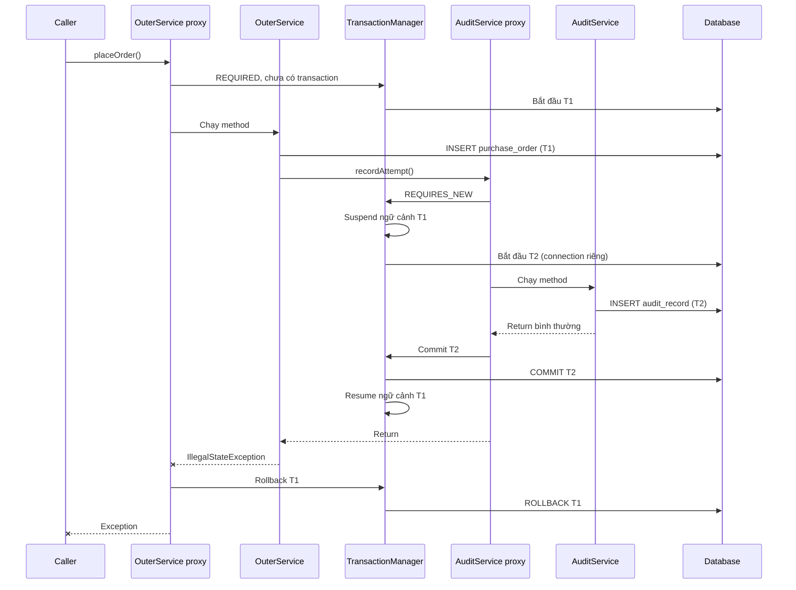

# REQUIRES_NEW: Dữ liệu đã commit bên trong có thể tồn tại dù giao dịch bên ngoài rollback

## 1. Một kết quả dễ gây bất ngờ

Giả sử một nghiệp vụ đặt hàng có hai bước:

1. Ghi đơn hàng trong một transaction của phương thức service bên ngoài.
2. Gọi một service khác để ghi **nhật ký lần thử đặt hàng** trong transaction riêng.

Sau khi ghi nhật ký thành công, hệ thống phát hiện lỗi và **rollback giao dịch đặt hàng**. Nếu method ghi nhật ký sử dụng `Propagation.REQUIRES_NEW` và giao dịch con này **đã commit thành công**, bản ghi nhật ký **vẫn có thể tồn tại** trong database.

```text
OuterService.placeOrder()       @Transactional(REQUIRED)
    |
    |  T1: INSERT purchase_order (id = 1)    [chưa commit]
    |
    +--> AuditService.recordAttempt()         @Transactional(REQUIRES_NEW)
    |        |
    |        |  T1 tạm ngưng
    |        |  T2: INSERT audit_record (id = 100)
    |        |  COMMIT T2                         [dữ liệu audit bền vững]
    |        |  T1 được tiếp tục
    |        v
    |
    |  throw IllegalStateException
    |
    v
ROLLBACK T1                                [xóa thay đổi của order]

Kết quả cuối:
    purchase_order: 0 bản ghi
    audit_record:   1 bản ghi
```

Đó không phải lỗi rollback. Đây là **ngữ nghĩa có chủ đích của `REQUIRES_NEW`**: transaction bên trong có ranh giới commit/rollback **độc lập** với transaction bên ngoài.

> **Ý chính:** `REQUIRES_NEW` tạo một *physical transaction* riêng. Nếu transaction đó commit thành công, việc transaction ngoài rollback **không tự động đảo ngược commit đã hoàn tất**. Ngược lại, nếu transaction bên trong lỗi, bị rollback hoặc chưa commit, không được kết luận rằng dữ liệu bên trong chắc chắn tồn tại.

Bài học thuộc Spring Framework transaction management, tập trung vào đúng câu hỏi: **vì sao dữ liệu bên trong đã commit còn lại khi bên ngoài rollback, điều kiện để điều đó xảy ra và hệ quả trong thiết kế nghiệp vụ**.

### Sau bài học, bạn sẽ làm được gì?

- Giải thích khác nhau giữa logical transaction scope và physical transaction đối với `REQUIRED`, `REQUIRES_NEW` và `NESTED`.
- Đọc được trình tự **suspend outer → begin inner → commit inner → resume outer → rollback outer**.
- Chạy ứng dụng Spring Boot Java 17+ với hai service bean, JDBC/H2 và xem chứng cứ dữ liệu tồn tại sau rollback.
- Nhận biết khi nào *cố ý* để một bản ghi độc lập tồn tại (nhật ký lần thử), và khi nào cách này tạo trạng thái nghiệp vụ nguy hiểm.
- Tránh các bẫy proxy/self-invocation, pool thiếu connection, lock contention, sai manager, rollback rules và transaction test.
- Chọn outbox, after-commit event hoặc thiết kế khác nếu dữ liệu bên trong **không được tồn tại** khi nghiệp vụ ngoài thất bại.

## 2. REQUIRES_NEW thực sự cam kết điều gì?

Trong Spring, annotation:

```java
@Transactional(propagation = Propagation.REQUIRES_NEW)
public void recordAttempt(...) {
    // Ghi dữ liệu trong transaction riêng.
}
```

yêu cầu transaction interceptor sử dụng **transaction mới độc lập** cho method đủ điều kiện được intercept. Khác với `REQUIRED`, nó **không tham gia cùng physical transaction** đang tồn tại của caller.

Nếu đã có một transaction T1 hoạt động trên tài nguyên do manager kiểm soát:

1. Spring **tạm ngưng** ngữ cảnh tài nguyên/transaction đồng bộ với T1.
2. Manager yêu cầu **một physical transaction T2 mới** cho method bên trong.
3. Method bên trong thao tác với tài nguyên/connection thuộc T2.
4. Khi method hoàn thành, Spring kết thúc T2 theo kết quả và rollback rules. T2 có thể **commit** mà không đợi T1.
5. Spring **khôi phục ngữ cảnh T1** để method bên ngoài tiếp tục.
6. T1 về sau commit hoặc rollback **theo kết quả riêng của T1**. Nó không hồi tố hủy commit của T2.

Điều này đúng trong mô hình Spring local transactions thường gặp với một `PlatformTransactionManager` phù hợp. Khi dùng nhiều transaction manager, nhiều datasource hoặc transaction phân tán, phải phân tích riêng **tài nguyên nào** thực sự được quản lý.

### Ba hình dung cần phân biệt

| Propagation của method bên trong | Quan hệ với transaction ngoài | Nếu bên trong thành công, sau đó ngoài rollback |
| --- | --- | --- |
| `REQUIRED` | Tham gia **cùng physical transaction** | Thay đổi của cả hai scope thường cùng bị rollback |
| `REQUIRES_NEW` | **Physical transaction độc lập**; transaction ngoài bị suspend | Thay đổi bên trong **đã commit có thể còn lại** |
| `NESTED` | Thường dùng **savepoint trong cùng physical transaction** ở JDBC | Outer rollback toàn bộ vẫn hủy cả thay đổi sau savepoint |

`NESTED` không tương đương `REQUIRES_NEW`. Savepoint cho phép rollback một phần **trong cùng transaction**, nhưng không tạo commit bền vững độc lập trước khi outer commit.

Nếu bên ngoài **không có transaction**, `REQUIRES_NEW` vẫn bắt đầu một transaction mới; trong trường hợp đó không có T1 nào để suspend, vì vậy không có hiện tượng “inner commit sống sót sau outer rollback” để so sánh.

## 3. Hai ranh giới giao dịch khác hai lệnh ghi

Để tránh nhầm, cần phân biệt:

- **Logical transaction scope**: ranh giới chính sách ứng với một lời gọi `@Transactional` được Spring transaction interceptor quản lý.
- **Physical transaction**: transaction trên database/connection/tài nguyên mà transaction manager tạo và hoàn tất.

Với chuỗi `REQUIRED → REQUIRED` cùng manager, có thể có hai scope logic nhưng dùng **một physical transaction T1**. Một rollback-only marker được thiết lập bên trong có thể khiến toàn bộ T1 rollback.

Với chuỗi `REQUIRED → REQUIRES_NEW`:

```text
Logical scope ngoài                  Logical scope trong
@Transaction(REQUIRED)               @Transactional(REQUIRES_NEW)
         |                                       |
         v                                       v
Physical transaction T1             Physical transaction T2
         |                                       |
  INSERT order                             INSERT audit
         |                                       |
  Tạm ngưng T1                       COMMIT T2 độc lập
         |                                       |
  Tiếp tục T1                                Kết thúc
         |
  ROLLBACK T1
```

Ở đây T1 và T2 tồn tại trong **cùng một lời gọi Java từ trên xuống**, nhưng **không dùng chung kết quả commit/rollback**.

**Transaction lồng theo call stack ≠ physical transaction lồng theo quan hệ cha-con có tính chất “cha rollback thì con tự rollback”.** `REQUIRES_NEW` chính là cơ chế phá sự phụ thuộc đó.

### Tại sao đã commit thì outer không rollback được?

Commit của T2 là thao tác kết thúc transaction độc lập đối với hệ quản trị CSDL. Khi T2 commit thành công, các thay đổi của nó trở thành dữ liệu đã commit. T1 chỉ điều khiển **các thay đổi tham gia T1**. Khi T1 rollback, database không có lý do hay cơ chế mặc định để đưa commit T2 về quá khứ và hủy nó.

Muốn hủy dữ liệu đã commit bởi T2, ứng dụng phải có **một tác động bù trừ riêng** (ví dụ một giao dịch khác thực hiện xóa/đánh dấu hủy); đó là **compensation**, không phải rollback của T1.

## 4. Trình tự suspend, commit và resume

Một trình tự đúng đối với hai service bean và một transaction manager JDBC:



**Các mốc quan trọng:**

- Lời gọi phải đi qua **Spring proxy của cả hai service**, không phải một method trong cùng object gọi `this.inner()`.
- **Inner method hoàn tất trước khi outer method ném lỗi** trong ví dụ; vì thế Spring có cơ hội commit T2.
- Dữ liệu ghi trong T2 phải dùng datasource/manager thực sự gắn với T2.
- Khi T1 rollback, chỉ dữ liệu chưa commit hoặc thay đổi thuộc T1 bị hoàn tác.
- Đây là một luồng *imperative JDBC*. Với reactive transaction, cơ chế context khác, nhưng nguyên tắc physical transaction độc lập vẫn là nội dung chính của REQUIRES_NEW khi được hỗ trợ.

### “Tạm ngưng” có nghĩa là gì?

Khi suspend, Spring thường **tháo ngữ cảnh transaction hiện hành khỏi luồng thực thi**, trong khi tài nguyên như JDBC connection của T1 vẫn được giữ để sau đó nối lại. T1 không tự biến mất hoặc commit. Lúc inner chạy, hạ tầng dùng một transaction khác với tài nguyên phù hợp. Sau khi T2 kết thúc, ngữ cảnh T1 được gắn lại.

Do đó, cùng một thread có thể lần lượt thấy T1 → T2 → T1, nhưng **không** vì thế mà T2 “nằm bên trong” T1 trên phương diện ACID.

## 5. Khi nào dữ liệu bên trong thực sự tồn tại?

Một bản ghi T2 sẽ tồn tại sau rollback T1 nếu ít nhất các điều kiện sau được thỏa mãn:

1. Lời gọi inner qua transaction interceptor và policy `REQUIRES_NEW` thực sự được áp dụng.
2. Transaction manager khởi tạo thành công T2 và câu lệnh ghi **tham gia T2**, không chạy bằng kết nối/nguồn dữ liệu sai.
3. Dữ liệu được ghi hợp lệ và **T2 commit thành công**.
4. Không có cơ chế hoặc transaction khác bù trừ/xóa/ghi đè bản ghi đó về sau.
5. Khi truy vấn kiểm chứng, ta đọc trạng thái database **sau khi các lời gọi và transaction đã kết thúc**, không phải object Java đang nằm trong persistence context chưa flush.

Từ “**có thể**” trong tiêu đề rất quan trọng: `REQUIRES_NEW` mang lại **khả năng commit độc lập**, không phải bảo đảm “hễ gọi inner là dữ liệu sẽ luôn tồn tại”. Inner có thể:

- Ném `RuntimeException`, khiến Spring rollback T2 theo mặc định.
- Bị lỗi khi commit, bị timeout hoặc database từ chối SQL.
- Thực hiện thao tác read-only không ghi dữ liệu.
- Bị gọi theo cách không đi qua proxy, dẫn đến không tạo T2 như kỳ vọng.
- Ghi dữ liệu rồi bị một transaction khác thay đổi/xóa.
- Không nhận được connection vì connection pool đã cạn.

Nói chính xác: **đã commit T2 là đủ để T1 rollback không tự hủy thay đổi của T2**, nhưng việc T2 có commit hay không phải được chứng minh từ cấu hình và kết quả thực tế.

## 6. Ví dụ chạy được: outer rollback, inner commit tồn tại

Bài thực hành dùng **Java 17+**, **Spring Boot**, **Spring JDBC** và **H2 in-memory**. Cả outer và inner dùng cùng một database H2, cùng `JdbcTemplate`/transaction manager, nhưng do `REQUIRES_NEW` nên mỗi transaction sử dụng **connection/physical transaction khác nhau** ở thời điểm tương ứng.

Ta cố ý dùng **hai bảng độc lập** để tránh inner phải chờ khóa từ dữ liệu chưa commit của outer:

- `purchase_order`: đơn hàng; ghi trong T1.
- `audit_record`: nhật ký **lần thử** đặt hàng; ghi trong T2, **không có foreign key đến purchase_order**.

Lý do không tạo foreign key trong ví dụ: nếu inner T2 phải tham chiếu một order mà T1 vừa INSERT **chưa commit**, inner không thể giả định đã nhìn thấy order đó. Một FK hoặc truy vấn cần đọc dữ liệu đang bị outer khóa có thể chờ hoặc thất bại. Thiết kế dùng bảng audit độc lập giúp quan sát đúng tác động transaction, không bị đánh lạc hướng bởi tranh chấp khóa/constraint.

### 6.1. Khởi tạo project

Tạo Maven project từ Spring Initializr:

- Java **17** hoặc cao hơn.
- Spring Boot phiên bản tương thích với Java đã chọn.
- Dependencies **Spring JDBC** (thường là `spring-boot-starter-jdbc`) và **H2 Database**.
- Base package: `com.example.requiresnew`.

Giữ file `pom.xml` được Spring Initializr tạo, gồm parent/dependency management/plugin. Đoạn dependencies bên dưới chỉ để đối chiếu:

```xml
<dependencies>
    <dependency>
        <groupId>org.springframework.boot</groupId>
        <artifactId>spring-boot-starter-jdbc</artifactId>
    </dependency>
    <dependency>
        <groupId>com.h2database</groupId>
        <artifactId>h2</artifactId>
        <scope>runtime</scope>
    </dependency>
</dependencies>
```

Cấu trúc dự án:

```text
src/main/
├── java/com/example/requiresnew/
│   ├── RequiresNewApplication.java
│   ├── AuditService.java
│   └── OrderService.java
└── resources/
    ├── schema.sql
    └── application.properties
```

### 6.2. Database schema

File `src/main/resources/schema.sql`:

```sql
CREATE TABLE purchase_order (
    id BIGINT PRIMARY KEY,
    description VARCHAR(100) NOT NULL
);

CREATE TABLE audit_record (
    id BIGINT PRIMARY KEY,
    order_id BIGINT NOT NULL,
    message VARCHAR(100) NOT NULL
);
```

Chú ý `audit_record.order_id` ở đây là **mã tham chiếu nghiệp vụ**, chưa phải foreign key. Sau khi order bị rollback, `audit_record.order_id = 1` vẫn được lưu để biểu thị “đã có lần thử đặt order 1”, chứ **không khẳng định order 1 đã được tạo thành công**.

Trong một ứng dụng thật, nếu luật dữ liệu yêu cầu **audit luôn tham chiếu tới một order đã tồn tại**, cách ghi inner độc lập trước outer commit có thể **không thỏa invariant này**. Khi đó phải đổi thiết kế, không loại bỏ foreign key chỉ để code REQUIRES_NEW “chạy được”.

File `src/main/resources/application.properties`:

```properties
spring.datasource.url=jdbc:h2:mem:requires_new_demo;DB_CLOSE_DELAY=-1
spring.datasource.driver-class-name=org.h2.Driver
spring.datasource.username=sa
spring.datasource.password=
spring.datasource.hikari.maximum-pool-size=4
```

Spring Boot cùng H2 embedded thường tự chạy `schema.sql` ở giai đoạn khởi động. Cấu hình pool trên cung cấp đủ connection cho bài thực hành đơn luồng: outer đang giữ một connection, inner cần lấy **một connection khác**. Trong hệ thống thực, cần tính pool theo tải đồng thời, không áp dụng số `4` cho production một cách máy móc.

### 6.3. Inner service: commit nhật ký bằng REQUIRES_NEW

File `src/main/java/com/example/requiresnew/AuditService.java`:

```java
package com.example.requiresnew;

import org.springframework.jdbc.core.JdbcTemplate;
import org.springframework.stereotype.Service;
import org.springframework.transaction.annotation.Propagation;
import org.springframework.transaction.annotation.Transactional;
import org.springframework.transaction.interceptor.TransactionAspectSupport;
import org.springframework.transaction.support.TransactionSynchronizationManager;

@Service
public class AuditService {

    private final JdbcTemplate jdbc;

    public AuditService(JdbcTemplate jdbc) {
        this.jdbc = jdbc;
    }

    @Transactional(propagation = Propagation.REQUIRES_NEW)
    public void recordAttempt(long auditId, long orderId) {
        boolean active =
                TransactionSynchronizationManager
                        .isActualTransactionActive();
        boolean createdNew =
                TransactionAspectSupport.currentTransactionStatus()
                        .isNewTransaction();

        System.out.printf(
                "inner: active=%s, new=%s%n",
                active, createdNew);

        jdbc.update("""
            INSERT INTO audit_record (id, order_id, message)
            VALUES (?, ?, ?)
            """, auditId, orderId, "attempt-started");
    }
}
```

Vì service này là một bean `@Service` riêng, lời gọi từ `OrderService` vào bean được inject có thể đi qua proxy của `AuditService`.

- `active=true` trong method cho biết đang có transaction được Spring quản lý trong luồng.
- `new=true` cho biết scope của inner được transaction manager xem là **transaction mới**.
- Lời gọi `recordAttempt(...)` kết thúc bình thường, nên sau khi body method trả về và transaction interceptor xử lý, T2 sẽ **commit**, miễn không có rollback-only/commit failure.
- Bên trong method, `INSERT` đã chạy nhưng **không tự gọi `commit()`**; transaction interceptor thực hiện commit bên ngoài body method. Đây là lý do dòng code Java gọi inner **trả về bên ngoài proxy** mới có ý nghĩa “T2 đã hoàn tất”.

### 6.4. Outer service: ghi order, gọi inner, rồi thất bại

File `src/main/java/com/example/requiresnew/OrderService.java`:

```java
package com.example.requiresnew;

import org.springframework.jdbc.core.JdbcTemplate;
import org.springframework.stereotype.Service;
import org.springframework.transaction.annotation.Propagation;
import org.springframework.transaction.annotation.Transactional;
import org.springframework.transaction.interceptor.TransactionAspectSupport;
import org.springframework.transaction.support.TransactionSynchronizationManager;

@Service
public class OrderService {

    private final JdbcTemplate jdbc;
    private final AuditService auditService;

    public OrderService(JdbcTemplate jdbc, AuditService auditService) {
        this.jdbc = jdbc;
        this.auditService = auditService;
    }

    @Transactional(propagation = Propagation.REQUIRED)
    public void createOrderThenFail() {
        boolean active =
                TransactionSynchronizationManager
                        .isActualTransactionActive();
        boolean createdNew =
                TransactionAspectSupport.currentTransactionStatus()
                        .isNewTransaction();

        System.out.printf(
                "outer: active=%s, new=%s%n",
                active, createdNew);

        // Ghi trong T1, chưa commit.
        jdbc.update("""
            INSERT INTO purchase_order (id, description)
            VALUES (?, ?)
            """, 1L, "demo-order");

        // Lời gọi qua bean khác: REQUIRES_NEW suspend T1,
        // tạo T2, ghi audit và commit T2 trước khi trả về.
        auditService.recordAttempt(100L, 1L);

        System.out.println("outer: inner method returned");

        // Mô phỏng lỗi xảy ra SAU KHI inner đã commit.
        throw new IllegalStateException("simulate outer failure");
    }
}
```

Một điểm khó nhưng quan trọng: ở dòng `auditService.recordAttempt(100L, 1L)`, method inner không chỉ “được gọi” mà còn **đi qua proxy để T2 thực sự kết thúc** trước khi chương trình thực thi dòng tiếp theo `System.out.println("outer: inner method returned")`.

Lỗi `IllegalStateException` là `RuntimeException`; theo rollback rules mặc định, nó làm interceptor của outer rollback T1. Việc đó không tạo một lời gọi rollback đến T2 đã hoàn tất.

### 6.5. Chạy từ bên ngoài cả hai transaction

File `src/main/java/com/example/requiresnew/RequiresNewApplication.java`:

```java
package com.example.requiresnew;

import org.springframework.boot.CommandLineRunner;
import org.springframework.boot.SpringApplication;
import org.springframework.boot.autoconfigure.SpringBootApplication;
import org.springframework.context.annotation.Bean;
import org.springframework.jdbc.core.JdbcTemplate;
import org.springframework.transaction.annotation.EnableTransactionManagement;

@SpringBootApplication
@EnableTransactionManagement
public class RequiresNewApplication {

    public static void main(String[] args) {
        SpringApplication.run(RequiresNewApplication.class, args);
    }

    @Bean
    CommandLineRunner demonstrate(
            OrderService orderService,
            JdbcTemplate jdbc) {
        return args -> {
            printCounts("before", jdbc);

            try {
                orderService.createOrderThenFail();
            } catch (IllegalStateException ex) {
                System.out.println("caught: " + ex.getMessage());
            }

            printCounts("after", jdbc);

            String message = jdbc.queryForObject(
                    "SELECT message FROM audit_record WHERE id = ?",
                    String.class, 100L);

            System.out.println("audit[100]: " + message);
        };
    }

    private static void printCounts(String label, JdbcTemplate jdbc) {
        Integer orders = jdbc.queryForObject(
                "SELECT COUNT(*) FROM purchase_order",
                Integer.class);
        Integer audits = jdbc.queryForObject(
                "SELECT COUNT(*) FROM audit_record",
                Integer.class);

        System.out.printf(
                "%s: orders=%d, audit=%d%n",
                label, orders, audits);
    }
}
```

Vì `CommandLineRunner` không mở transaction trước khi gọi `orderService`, outer REQUIRED tạo T1 mới. Inner REQUIRES_NEW tạo T2 mới, khiến cả hai lần `isNewTransaction()` đều in `true`. Riêng các giá trị đó **không đủ chứng minh hai physical transaction khác nhau**; kết quả DB sau rollback là bằng chứng trực tiếp hơn.

`@EnableTransactionManagement` được ghi rõ để dễ nhận diện hạ tầng annotation-driven transaction. Trong Spring Boot với JDBC auto-configuration chuẩn, hạ tầng transaction thường đã được đăng ký tương ứng.

### 6.6. Lệnh chạy và stdout dự kiến

Trong thư mục chứa `pom.xml`, chạy:

```bash
./mvnw spring-boot:run
```

Trên Windows PowerShell:

```powershell
.\mvnw.cmd spring-boot:run
```

Bỏ qua log Spring/Maven, các dòng được in bởi chính chương trình:

```text
before: orders=0, audit=0
outer: active=true, new=true
inner: active=true, new=true
outer: inner method returned
caught: simulate outer failure
after: orders=0, audit=1
audit[100]: attempt-started
```

### 6.7. Phân tích chi tiết từng dòng

1. **`before: orders=0, audit=0`** — H2 mới khởi tạo hai bảng rỗng.
2. **`outer: active=true, new=true`** — outer được gọi qua proxy từ caller không có transaction, nên REQUIRED tạo T1.
3. Outer INSERT `purchase_order(1)` trong T1. Dữ liệu **chưa commit**.
4. **`inner: active=true, new=true`** — proxy của AuditService tạm ngưng T1 và tạo T2. Hai scope đều là “new” so với ngữ cảnh của riêng chúng, không phải cùng một transaction.
5. Inner INSERT `audit_record(100, 1, "attempt-started")` trong T2 và method hoàn thành. Proxy **commit T2** trước khi cho `recordAttempt(...)` trả về caller.
6. **`outer: inner method returned`** — T1 đã được resume. T2 đã commit nếu không có lỗi commit.
7. Outer ném `IllegalStateException`. Interceptor của outer **rollback T1**, nên `purchase_order(1)` không tồn tại.
8. `CommandLineRunner` bắt exception **bên ngoài proxy** rồi truy vấn DB sau khi T1 hoàn tất.
9. **`after: orders=0, audit=1`** và **`audit[100]: attempt-started`** — chứng minh inner commit **sống sót** dù outer rollback.

Nếu bạn chạy theo đúng cấu hình sample đơn luồng, kết quả này minh họa hành vi của `REQUIRES_NEW`. Với database khác, khóa/timing/transaction manager khác, cần có test tương đương trong môi trường thực tế.

## 7. Vì sao hai bảng độc lập là lựa chọn có chủ đích?

Có một lỗi thử nghiệm dễ gặp: outer T1 vừa INSERT một order chưa commit, inner T2 lại cố đọc order đó hoặc thêm record có **foreign key tham chiếu vào order vừa ghi**. Inner không dùng cùng transaction T1 nên có thể:

- Không nhìn thấy dòng chưa commit của T1 ở mức isolation thông thường.
- Phải chờ một lock đang được T1 giữ.
- Nhận lỗi foreign key hoặc timeout, tùy database và lịch thực thi.
- Làm hai transaction tự chờ nhau: outer giữ tài nguyên và đang đợi inner; inner lại cần tài nguyên do outer giữ.

Vì vậy, trong bài thực hành, inner chỉ ghi một bản ghi **nhật ký lần thử độc lập**. Thông tin `order_id` chỉ là dữ liệu mô tả, không áp một foreign key sai với ý nghĩa “order đã tồn tại”.

**Bài học về kiến trúc:** nếu business invariant bắt buộc “mỗi audit record phải tham chiếu order đã commit”, không thể tự ý bỏ ràng buộc dữ liệu để đổi lấy việc REQUIRES_NEW commit trước. Thay vào đó hãy chọn cách tạo audit sau khi order commit hoặc dùng outbox/sự kiện phù hợp.

### Độc lập về transaction không đồng nghĩa độc lập về mọi nguồn lực

T1 và T2 không chia sẻ commit/rollback; tuy nhiên chúng vẫn có thể tranh chấp:

- Connection pool.
- Locks trên cùng bảng/hàng/index.
- Database capacity và thread.
- Unique constraints hoặc business identifiers.
- Transaction timeout, retry và deadlock detection.

“Độc lập vật lý” ở đây nói về **ranh giới transaction**, không có nghĩa hai transaction không tương tác qua các ràng buộc database.

## 8. Sự khác biệt với REQUIRED và NESTED khi outer rollback

Hãy thay propagation của inner trong ví dụ mà **không đổi phần logic nghiệp vụ**:

| Cấu hình inner | Khi outer T1 đang hoạt động | Outcome sau outer rollback |
| --- | --- | --- |
| `REQUIRED` | Inner tham gia T1; không commit riêng | `purchase_order` và `audit_record` đều rollback |
| `REQUIRES_NEW` | T1 suspend; T2 độc lập, có thể commit trước | `purchase_order` rollback, `audit_record` từ T2 đã commit còn lại |
| `NESTED` | Dùng savepoint trong T1 nếu manager/DB hỗ trợ | Outer rollback T1 vẫn rollback audit, kể cả inner scope đã kết thúc bình thường |

Điểm không thể thay thế:

- `REQUIRES_NEW` phục vụ **commit/rollback độc lập**.
- `NESTED` phục vụ **rollback cục bộ bằng savepoint** trong physical transaction chung, không phục vụ commit bền vững trước outer.

Vì vậy không đổi sang `REQUIRES_NEW` chỉ để “ít bị rollback hơn” mà bỏ qua ý nghĩa nhất quán dữ liệu.

## 9. Chiều ngược lại: inner rollback nhưng outer có thể commit

Cơ chế độc lập hoạt động **theo cả hai hướng**.

Giả sử inner REQUIRES_NEW gặp runtime exception khiến **T2 rollback**. Lúc đó:

- Nếu exception **thoát qua outer** và outer có `@Transactional(REQUIRED)` với rollback rules mặc định, outer cũng sẽ rollback **do exception được truyền lên**, không phải vì T2 chia sẻ transaction với T1.
- Nếu outer **bắt exception sau khi T2 đã rollback**, quyết định nghiệp vụ cho phép tiếp tục và không có lý do rollback-only khác trên T1, outer **có thể commit T1**.

Ví dụ minh họa (chỉ là trích đoạn service, chưa phải file độc lập):

```java
@Service
class AuditService {
    @Transactional(propagation = Propagation.REQUIRES_NEW)
    public void recordAndFail() {
        // INSERT vào audit trong T2.
        throw new IllegalStateException("audit failed");
        // T2 rollback khi exception thoát qua inner proxy.
    }
}

@Service
class OrderService {
    private final AuditService audit;

    OrderService(AuditService audit) {
        this.audit = audit;
    }

    @Transactional
    public void createDespiteAuditFailure() {
        // INSERT đơn trong T1.
        try {
            audit.recordAndFail(); // T2 rollback.
        } catch (IllegalStateException ex) {
            // Chính sách nghiệp vụ chấp nhận thiếu audit.
        }
        // T1 có thể commit khi method trả về bình thường.
    }
}
```

Các dòng `INSERT` là chú thích mô tả, cần triển khai bằng repository/JDBC để chạy thực tế.

Điểm khác với `REQUIRED → REQUIRED`: inner REQUIRED có thể đánh dấu **physical transaction chung** là rollback-only; outer dù bắt exception vẫn có thể gặp `UnexpectedRollbackException` lúc commit. Với `REQUIRES_NEW`, rollback-only của T2 **không tự lan sang T1**, dù exception vẫn có thể làm T1 rollback nếu outer không xử lý.

### Ma trận kết quả

Giả sử T1 ghi order, T2 ghi audit, cả hai dùng nguồn dữ liệu phù hợp và có quyền commit độc lập.

| T2 (inner) | T1 (outer) | Kết quả dự kiến |
| --- | --- | --- |
| Commit | Commit | Order và audit đều còn |
| **Commit** | **Rollback** | **Order mất, audit còn** |
| Rollback | Commit | Order còn, audit mất |
| Rollback | Rollback | Cả hai mất |

Bảng trên mô tả **hai physical transactions đã kết thúc đúng như chỉ định**. Nó không bảo đảm một transaction sẽ commit nếu DB lỗi, không có connection, bị timeout hoặc có rollback-only.

## 10. Những tác dụng phụ có thể phù hợp nghiệp vụ

Một lý do hợp lý để tách inner transaction là **ghi nhận sự kiện/nhật ký bắt buộc giữ lại ngay cả khi thao tác chính thất bại**. Ví dụ:

- Ghi lịch sử một lần thử thanh toán bị từ chối.
- Ghi một bản ghi kiểm toán rằng yêu cầu đã được nhận/xử lý đến một bước nhất định.
- Ghi thông tin chẩn đoán quan trọng (không chứa bí mật không cần thiết) để điều tra một tác vụ thất bại.

Trong các trường hợp này, record phải mô tả **sự kiện thực sự đã diễn ra**, không khẳng định sai rằng thao tác chính đã thành công.

**Tên sự kiện nên phản ánh thực tế:**

```text
ORDER_ATTEMPTED      [đã có lần thử đặt hàng]
PAYMENT_REJECTED     [cổng thanh toán đã trả từ chối]
JOB_STARTED          [đã vào xử lý]
```

Không nên dùng `ORDER_CREATED` cho một order mà outer transaction vẫn chưa commit. Nếu outer rollback, audit còn lại với nhãn `ORDER_CREATED` sẽ gây hiểu lầm cho downstream consumers.

**Độc lập commit là trách nhiệm thiết kế.** Khi chấp nhận dữ liệu inner tồn tại sau outer rollback, cần coi đó là một trạng thái **hợp lệ được mô tả trong domain model**, chứ không phải trường hợp bị bỏ quên.

## 11. Khi nào KHÔNG nên dùng REQUIRES_NEW?

### 11.1. Hai bước phải cùng thành công hoặc cùng thất bại

Ví dụ chuyển tiền: trừ tiền bên gửi và cộng tiền bên nhận phải nằm trong **một transaction nguyên tử** nếu cùng hệ thống DB.

Nếu đặt phần “cộng tiền bên nhận” trong REQUIRES_NEW, bước cộng có thể commit; sau đó outer trừ tiền rollback. Kết quả có thể tạo tiền từ không khí — **vi phạm invariant nghiêm trọng**.

Cách đúng thường là giữ cả hai thao tác trong **cùng ranh giới REQUIRED** và bổ sung concurrency control, constraints, kiểm thử đầy đủ.

### 11.2. Dữ liệu inner chỉ có nghĩa khi outer thành công

Một ví dụ phổ biến: khi đơn hàng được tạo thành công, hệ thống phải phát event `OrderCreated` để gửi email. Nếu sự kiện được ghi hoặc gửi ngay trong một inner REQUIRES_NEW transaction trước khi outer commit, event đó có thể tồn tại trong khi order thực tế rollback.

Cách tiếp cận tốt hơn thường là:

- **Transactional outbox**: lưu bản ghi outbox **trong cùng physical transaction T1** với order; nếu order rollback, outbox rollback theo. Một worker khác sẽ phát event sau khi commit.
- **Transaction synchronization / `@TransactionalEventListener(phase = AFTER_COMMIT)`**: chỉ thực hiện xử lý tương ứng **sau khi transaction nguồn commit thành công**. Khi handler cần ghi DB độc lập sau commit, có thể cần transaction mới cho thao tác DB đó; phải hiểu rõ phase và xử lý lỗi.
- Nếu chỉ là thay đổi dữ liệu cùng DB: ghi trong **cùng T1**, không cần REQUIRES_NEW.

Outbox thường được chọn khi cần bảo đảm khôi phục/retry phát message sau crash; event listener đơn thuần không tự bảo đảm giao hàng chắc chắn qua sự cố tiến trình. **REQUIRES_NEW không thay thế outbox** cho nhiệm vụ chỉ được phép xảy ra sau commit của nghiệp vụ chính.

### 11.3. Có ràng buộc FK trên dữ liệu outer chưa commit

Nếu inner bắt buộc tham chiếu một order vừa INSERT trong T1, inner không nhất thiết đọc được order đó. Kiểm thử cùng một thread không khiến T2 nhìn thấy uncommitted changes của T1. Đừng chữa lỗi bằng cách tắt FK/isolation mà chưa hiểu hệ quả.

### 11.4. Chỉ muốn method inner có @Transactional “cho chắc”

Một method `@Transactional(REQUIRED)` gọi từ outer transaction đã được bảo vệ bởi T1. Không cần `REQUIRES_NEW` nếu không có yêu cầu **commit/rollback độc lập** thật sự.

## 12. Connection pool: một nguy cơ đặc trưng của REQUIRES_NEW

Spring cảnh báo rõ khi dùng `REQUIRES_NEW` ở bên trong transaction đang tồn tại: **connection của T1 vẫn bị giữ**, trong khi T2 cần một connection khác từ pool.

Giả sử `N` request đồng thời:

```text
Request 1: giữ conn-1 (T1) -> chờ connection cho T2
Request 2: giữ conn-2 (T1) -> chờ connection cho T2
Request 3: giữ conn-3 (T1) -> chờ connection cho T2
...
Connection pool chỉ có N connections.
```

Nếu tất cả N request đã giữ mỗi request một connection và cùng chờ connection mới cho inner, không request nào có thể tiến lên để trả connection → **pool starvation** và có nguy cơ deadlock hoặc timeout.

Tài liệu Spring khuyến nghị khi dùng REQUIRES_NEW, kích thước pool phải **lớn hơn số luồng đồng thời** ít nhất một connection cho tình huống tương ứng; hệ thống thực có nhiều tầng nested, SQL song song và nhiều datasource cần capacity planning cẩn thận hơn. Đây **không phải** công thức duy nhất bảo đảm mọi workload không deadlock.

Trong ví dụ:

```properties
spring.datasource.hikari.maximum-pool-size=4
```

đủ cho **một** outer transaction và một inner transaction cùng lúc. Production phải dựa trên:

- Độ đồng thời thực tế.
- Số transaction ngoài có thể cùng giữ connection.
- Số lớp REQUIRES_NEW lồng nhau.
- Thời gian giữ connection, timeout và lock wait.
- Dung lượng kết nối mà database cho phép.

Nếu không có yêu cầu độc lập commit rõ ràng, loại bỏ REQUIRES_NEW thường tốt hơn việc liên tục tăng pool.

## 13. Lock contention và deadlock: transaction độc lập vẫn xung đột

Ví dụ outer T1:

```sql
UPDATE inventory SET quantity = quantity - 1 WHERE id = 1;
```

T1 có thể giữ lock trên hàng inventory id=1 cho tới khi kết thúc.

Nếu inner T2 cũng cố UPDATE chính hàng đó:

```sql
UPDATE inventory SET last_checked = CURRENT_TIMESTAMP WHERE id = 1;
```

T2 có thể **chờ lock của T1**. Nhưng Java outer đang tạm ngưng và **đợi inner trả về**; do đó T1 không thể tiếp tục để giải phóng lock. Kết quả có thể là timeout hoặc deadlock (tùy DB/driver/lock manager).

Chọn hai bảng độc lập trong bài thực hành giúp tránh kịch bản này. Trong production, cần:

1. Không cho inner phụ thuộc vào hàng đang bị outer lock nếu có thể.
2. Giữ transaction ngắn, thiết kế đúng thứ tự truy cập tài nguyên.
3. Cấu hình lock/statement timeout phù hợp; kiểm thử cạnh tranh.
4. Xem xét outbox hoặc xử lý sau commit nếu inner thực sự phụ thuộc kết quả outer.

**T2 không nhìn thấy uncommitted data của T1** ở isolation phổ biến cũng là hệ quả quan trọng: T2 không chỉ “có thể commit khác lúc” mà còn có **tầm nhìn dữ liệu khác**. Nếu inner đọc cùng DB, nó có thể nhìn thấy trạng thái cũ thay vì cập nhật chưa commit của outer.

## 14. Điều kiện proxy và transaction manager: có annotation chưa đủ

### 14.1. Self-invocation làm REQUIRES_NEW không có hiệu lực

```java
@Service
class PaymentService {

    @Transactional
    public void pay() {
        writeAudit();
        throw new IllegalStateException("failed");
    }

    @Transactional(propagation = Propagation.REQUIRES_NEW)
    public void writeAudit() {
        // Ghi audit.
    }
}
```

Đây là đoạn minh họa. Trong Spring AOP proxy mode mặc định, lời gọi `writeAudit()` từ `pay()` trên **chính object** không đi qua proxy. Hệ quả là không có REQUIRES_NEW riêng cho lời gọi đó; các SQL của `writeAudit()` có thể tham gia transaction ngoài T1 và bị outer rollback.

Sửa bằng cách:

- Tách `writeAudit()` thành method public của **bean khác** và gọi qua injection, như `AuditService` trong ví dụ.
- Hoặc cấu trúc lại transaction boundary ở các public entry points theo use case thực tế.

Không dựa vào `new AuditService(...)`, vì object tạo thủ công không được Spring transaction proxy áp dụng.

### 14.2. Chọn sai manager hoặc DataSource

Nếu outer và inner sử dụng nhiều datasource, cần biết:

- Manager nào được áp dụng cho outer?
- Manager nào được áp dụng cho inner?
- JDBC/JPA thực sự truy cập tài nguyên nào?

Một `DataSourceTransactionManager` chỉ điều phối tài nguyên mà nó được cấu hình quản lý. Nếu method REQUIRES_NEW dùng manager A nhưng SQL lại chạy qua datasource B không nằm trong giao dịch của A, chữ REQUIRES_NEW **không đủ bảo vệ SQL đó**.

Ví dụ chọn manager tường minh:

```java
@Transactional(
    transactionManager = "auditTxManager",
    propagation = Propagation.REQUIRES_NEW
)
public void recordAttempt() {
    // Repository/JdbcTemplate phải dùng tài nguyên của auditTxManager.
}
```

Đây là cấu hình minh họa. Nó không biến hai database thành một transaction phân tán và cũng không thay đổi ngữ nghĩa commit độc lập của từng transaction.

### 14.3. Ngoại lệ bị bắt trong inner

```java
@Transactional(propagation = Propagation.REQUIRES_NEW)
public void saveAudit() {
    try {
        writeAudit();
        throw new IllegalStateException("problem");
    } catch (IllegalStateException ex) {
        // Nuốt lỗi: method có thể trả về bình thường.
    }
}
```

Đây là mã minh họa với helper `writeAudit()` chưa định nghĩa. Trong trường hợp ngoại lệ Java bị nuốt và transaction chưa rollback-only, proxy nhìn thấy method thành công và có thể **commit T2**, ngay cả khi caller bên ngoài sau đó rollback T1. Phải thiết kế đường lỗi và rollback rules phù hợp, không xem việc catch là chi tiết không ảnh hưởng dữ liệu.

### 14.4. Checked exception

Spring mặc định thường rollback cho `RuntimeException` và `Error`; checked exception như `IOException` không mặc định yêu cầu rollback. Nếu inner:

```java
@Transactional(
    propagation = Propagation.REQUIRES_NEW,
    rollbackFor = java.io.IOException.class
)
public void persistAudit() throws java.io.IOException {
    // Ghi DB rồi có thể ném IOException.
}
```

đây là đoạn minh họa rằng lỗi checked được yêu cầu rollback bằng `rollbackFor`. Với cấu hình rollback default được tùy chỉnh ở những phiên bản Spring mới, cần kiểm tra chính sách cụ thể. Không suy luận rằng mọi exception thoát ra đều khiến T2 rollback như nhau.

## 15. Outer rollback không nhất thiết hủy mọi side effect khác

Phân biệt ba loại tác động:

| Loại tác động | Transaction ngoài T1 rollback có tự hủy không? |
| --- | --- |
| Ghi DB tham gia T1 qua cùng transaction manager | Có, theo rollback DB |
| Ghi DB trong T2 REQUIRES_NEW **đã commit** | **Không** |
| Email/API call/file write đã hoàn tất ngoài DB transaction | **Không**, trừ cơ chế bù trừ riêng |

Với nghiệp vụ liên hệ thống, đừng cho rằng “mọi việc nằm trong cùng hàm Java” tức là có cùng tính nguyên tử. `@Transactional` điều phối các resource mà transaction manager quản lý, không tự bọc HTTP hay email trong cơ chế rollback.

Khi một tác động phải chỉ xuất hiện nếu order commit thành công, nên thiết kế nó theo **outbox/after-commit** thay vì inner transaction commit trước outer.

## 16. Cách kiểm thử bằng dữ liệu, không chỉ bằng log

### 16.1. Kịch bản cốt lõi

Bộ test tốt cho tình huống của bài:

1. Khởi tạo hai bảng rỗng.
2. Gọi public method outer từ **bên ngoài mọi transaction** thông qua Spring bean proxy.
3. Outer INSERT order trong T1.
4. Outer gọi inner REQUIRES_NEW trên một **bean khác**; inner INSERT audit và commit.
5. Outer ném runtime exception, transaction interceptor rollback T1.
6. Bắt exception ở caller **sau khi proxy đã hoàn tất rollback**.
7. Query DB bằng lời gọi riêng: order count = 0, audit count = 1.

Nếu muốn test JUnit/Spring Boot, **không đặt `@Transactional` trên test method** cho kịch bản này, vì Spring Test có thể tạo transaction ngoài cho cả test và rollback nó sau test. Khi đó cách quan sát thời điểm commit/rollback trở nên khó hiểu.

Ngoài H2, hệ thống dùng PostgreSQL/MySQL ở production nên có integration test với cùng loại database (chẳng hạn Testcontainers), đặc biệt cho lock, isolation và constraint.

### 16.2. Một ma trận test bổ sung

| Case | Outer | Inner | Kỳ vọng |
| --- | --- | --- | --- |
| A | Thành công | Thành công | Cả order và audit tồn tại |
| B | **Rollback** | **Commit** | **Chỉ audit tồn tại** |
| C | Commit sau khi xử lý lỗi inner | Rollback | Chỉ order tồn tại |
| D | Rollback | Rollback | Không có record mới |
| E | Rollback | Self-invocation khiến inner REQUIRES_NEW không được áp dụng | Audit không có commit độc lập; có thể bị rollback theo outer |
| F | Rollback | T2 không lấy được connection/commit thất bại | Không được giả định audit tồn tại |
| G | Rollback | Inner UPDATE dòng bị T1 khóa | Có thể chờ/timeout/deadlock; cần test theo DB |

Bằng chứng tốt nhất về tính độc lập là **kết quả query sau khi hai transaction hoàn tất**, không chỉ là `isNewTransaction() == true`. Giá trị `new=true` rất hữu ích để debug, nhưng không xác minh riêng rằng commit của inner **đã thành công**.

### 16.3. Logging hỗ trợ

Trong `application.properties`, có thể bổ sung:

```properties
logging.level.org.springframework.transaction.interceptor=TRACE
logging.level.org.springframework.jdbc.datasource.DataSourceTransactionManager=DEBUG
```

Tùy phiên bản Spring Boot và loại transaction manager (có thể là `JdbcTransactionManager`), category log hữu ích có thể khác. Khi debug, tìm các mốc tạo transaction, suspend, resume, commit và rollback. Không dựa vào đúng một chuỗi log cố định; so sánh với dữ liệu DB mới là cách kiểm chứng đáng tin.

## 17. Những nhận định sai cần tránh

**Sai 1 — Outer rollback là rollback toàn bộ call stack Java.** Không. Outer chỉ rollback các thay đổi thuộc transaction của nó; T2 REQUIRES_NEW đã commit nằm ngoài phạm vi đó.

**Sai 2 — Inner REQUIRES_NEW tạo “savepoint” trong outer.** Không. Với cùng manager và JDBC thông thường, nó tạo physical transaction riêng, khác `NESTED`.

**Sai 3 — Hễ inner có `@Transactional(REQUIRES_NEW)` thì dữ liệu luôn còn lại.** Không. Phải có proxy interception, manager/resource đúng và commit T2 thành công.

**Sai 4 — Cùng database nghĩa là cùng transaction.** Không. T1 và T2 có thể cùng H2/PostgreSQL database nhưng dùng **hai connection/physical transaction khác nhau**.

**Sai 5 — T2 có thể đọc mọi thay đổi mà outer vừa ghi.** Không. T1 chưa commit, nên isolation thông thường ngăn T2 nhìn thấy các thay đổi chưa commit đó; T2 còn có thể bị chờ khóa.

**Sai 6 — Outer bắt lỗi inner rồi tiếp tục thì outer chắc chắn rollback.** Không. Rollback của T2 không tự lan sang T1; outer có thể commit nếu tự xử lý exception và transaction ngoài còn hợp lệ.

**Sai 7 — REQUIRES_NEW tốt hơn REQUIRED ở mọi nơi.** Không. Việc commit độc lập có thể phá invariant, tạo event ma, tăng số connection cần thiết và rủi ro lock contention.

**Sai 8 — Dùng hai datasource và hai manager sẽ tự có transaction phân tán nguyên tử.** Không. Mỗi local manager chỉ quản lý tài nguyên tương ứng; phải thiết kế consistency xuyên DB riêng.

**Sai 9 — Dữ liệu audit còn tức là order đã thành công.** Không. Trong ví dụ, audit chỉ có nghĩa **đã có lần thử order**. Domain event và tên trạng thái phải diễn đạt đúng thực tế.

**Sai 10 — No rollback rule ở inner chắc chắn buộc commit T2.** Không. DB có thể đã abort, transaction bị rollback-only hoặc commit thất bại. Rollback rule chỉ ảnh hưởng quyết định của interceptor khi exception thoát ra.

## 18. Bài tập tự kiểm tra

### Bài 1 — Dự đoán số lượng record

Outer `REQUIRED` INSERT order id=10. Inner `REQUIRES_NEW` INSERT audit id=20 rồi trả về bình thường. Outer ném `IllegalStateException` thoát qua proxy. Hỏi sau lời gọi có bao nhiêu bản ghi nếu ban đầu hai bảng rỗng?

**Đáp án:** Order 0, audit 1, giả sử T2 commit thành công và T1 rollback. Inner commit độc lập, outer rollback không tác động lên T2.

### Bài 2 — Thay REQUIRES_NEW bằng REQUIRED

Giữ nguyên code, thay annotation inner thành `@Transactional(REQUIRED)`. Điều gì thay đổi?

**Đáp án:** Inner tham gia cùng T1, không có T2 độc lập. Outer rollback T1 khiến cả order lẫn audit bị hoàn tác. Nếu không có transaction ngoài từ caller, outer REQUIRED đã tạo một T1 duy nhất.

### Bài 3 — Dùng NESTED thay REQUIRES_NEW

Nếu transaction manager JDBC hỗ trợ savepoint và inner dùng `NESTED`, inner hoàn tất bình thường rồi outer rollback, audit có tồn tại không?

**Đáp án:** Không. `NESTED` dùng savepoint trong cùng physical transaction T1, không commit bền vững trước khi outer commit.

### Bài 4 — Inner rollback, outer bắt lỗi

Inner `REQUIRES_NEW` INSERT rồi ném RuntimeException; exception đi qua inner proxy khiến T2 rollback. Outer bắt exception và tiếp tục, trả về bình thường. Có buộc T1 rollback không?

**Đáp án:** Không tự buộc rollback chỉ vì T2 rollback. T1 có thể commit, miễn không bị rollback-only bởi nguyên nhân khác và không có lỗi mới.

### Bài 5 — Bài toán khóa

Outer giữ lock trên hàng `inventory(id=1)`. Inner REQUIRES_NEW cũng UPDATE hàng này. Vì sao có thể chờ vô hạn tới timeout dù hai method chạy trong cùng một thread?

**Đáp án:** T2 dùng transaction/connection độc lập và cần lock đang bị T1 giữ. Outer T1 đang tạm ngưng để chờ inner, nên không thể tiến lên giải phóng lock; database có thể phát hiện deadlock hoặc timeout.

### Bài 6 — Bài toán phát event

Một order chưa commit, nhưng inner REQUIRES_NEW đã ghi `OrderCreated` event trong một bảng outbox riêng. Outer rollback. Event có thể được consumer gửi đi không?

**Đáp án:** Có. Nếu event đã commit độc lập thì consumer có thể thấy event của order không tồn tại. Nếu chỉ muốn phát sau khi order commit, lưu outbox **trong cùng T1** với order hoặc thiết kế sự kiện after-commit phù hợp.

### Bài 7 — Self-invocation

Một class có `outer()` gọi `this.inner()`, trong đó `inner()` annotated `REQUIRES_NEW`. Vì sao audit bị rollback cùng outer?

**Đáp án:** Trong proxy mode, lời gọi `this.inner()` bỏ qua transaction proxy, nên không áp dụng policy REQUIRES_NEW tại ranh giới inner. Tách sang bean khác hoặc sửa thiết kế entry point.

### Bài 8 — Ý nghĩa của “có thể”

Outer rollback, inner có `REQUIRES_NEW` nhưng inner gặp lỗi unique constraint và transaction không commit. Có thể khẳng định audit còn không?

**Đáp án:** Không. Chỉ một **T2 đã commit thành công** mới là cơ sở cho kết luận outer rollback không tự hủy dữ liệu của T2.

## 19. Checklist áp dụng trong dự án thực

- [ ] Yêu cầu nghiệp vụ **thật sự cần dữ liệu inner tồn tại sau khi outer thất bại**.
- [ ] Tên record/event mô tả chính xác “đã thử”, “đã thất bại” hay “đã commit”, không gây hiểu nhầm.
- [ ] Inner là public method của Spring bean được gọi qua proxy, không phải self-invocation.
- [ ] `@Transactional(propagation = REQUIRES_NEW)` nằm ở điểm vào thích hợp và manager được cấu hình đúng.
- [ ] SQL/repository tham gia đúng datasource/physical transaction T2.
- [ ] Inner không phụ thuộc vào dòng chưa commit hoặc lock do T1 giữ.
- [ ] Connection pool có đủ capacity cho cả outer và inner trong tải đồng thời thực tế.
- [ ] Rollback rules, checked exceptions và lỗi commit/timeout được kiểm thử.
- [ ] Có test outer rollback sau inner commit, đọc database sau khi proxy hoàn tất.
- [ ] Nếu dữ liệu inner **không** được tồn tại khi outer rollback, chọn cùng transaction REQUIRED, transactional outbox hoặc after-commit workflow phù hợp.
- [ ] Có cơ chế idempotency, retry và phân tích compensation khi nhiều transaction độc lập có thể gây trạng thái trung gian.

## 20. Kết luận

**`Propagation.REQUIRES_NEW` tạo một physical transaction độc lập cho phương thức bên trong.** Nếu T1 bên ngoài đang hoạt động, Spring tạm ngưng T1, xử lý T2, commit/rollback T2 rồi mới tiếp tục T1.

Vì thế, **T2 đã commit có thể để lại dữ liệu bền vững dù T1 sau đó rollback**. Đó là hành vi đúng theo transaction propagation, không phải dấu hiệu Spring rollback sai. Chỉ dùng cơ chế này khi trạng thái “inner thành công, outer thất bại” thực sự được nghiệp vụ chấp nhận. Nếu không, cần giữ thay đổi trong cùng transaction hoặc dời hành động sang quy trình sau khi outer commit.

### Tài liệu chính thức

- Spring Framework — *Transaction Propagation* (đặc biệt `Understanding PROPAGATION_REQUIRES_NEW`): https://docs.spring.io/spring-framework/reference/data-access/transaction/declarative/tx-propagation.html
- Spring Framework — *Using @Transactional*: https://docs.spring.io/spring-framework/reference/data-access/transaction/declarative/annotations.html
- Spring Framework — *Understanding the Spring Framework's Declarative Transaction Implementation*: https://docs.spring.io/spring-framework/reference/data-access/transaction/declarative/tx-decl-explained.html
- Spring API — `Propagation.REQUIRES_NEW`: https://docs.spring.io/spring-framework/docs/current/javadoc-api/org/springframework/transaction/annotation/Propagation.html
- Spring Boot — *Database Initialization*: https://docs.spring.io/spring-boot/how-to/data-initialization.html
