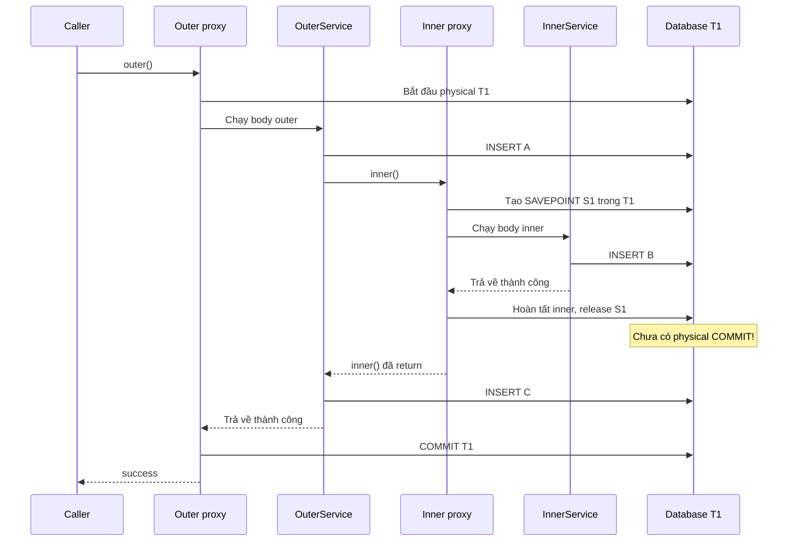

# Commit phạm vi con không phải commit độc lập — NESTED và savepoint trong Spring

## 1. Kết luận cốt lõi

Trong Spring transaction management, `PROPAGATION_NESTED` cho phép một lời gọi con có **phạm vi giao dịch logic riêng** và một **savepoint** bên trong **transaction vật lý đang tồn tại**. Khi lời gọi con thành công, Spring có thể hoàn tất phạm vi con và giải phóng savepoint. Nhưng:

> **Commit của phạm vi `NESTED` con không phải một lần COMMIT database độc lập. Nếu outer transaction rollback về sau, mọi thay đổi của phạm vi con — dù nó đã trả về thành công — vẫn rollback theo.**

Đây là ý nghĩa chính xác của “Commit phạm vi con không phải commit độc lập”.

- **Inner thành công, outer commit:** thay đổi của outer và inner cùng commit cuối cùng.
- **Inner thất bại, rollback về savepoint; outer vẫn commit:** thay đổi sau savepoint trong inner được hoàn tác, nhưng outer có thể tiếp tục và commit các thao tác hợp lệ.
- **Inner thành công, outer rollback:** thay đổi của **cả outer và inner** bị hoàn tác; inner thành công không thể “chống” rollback của outer.
- **Inner `NESTED` được gọi khi chưa có transaction bên ngoài:** không có transaction vật lý để tạo savepoint bên trong; `NESTED` thường bắt đầu một transaction vật lý mới, và lúc đó scope này chính là owner của commit/rollback.

Bài viết áp dụng chủ yếu cho **imperative Spring Framework 6.x + JDBC**, thông qua `DataSourceTransactionManager` hoặc `JdbcTransactionManager` và driver/database hỗ trợ JDBC savepoint. Không nên mặc định suy ra hành vi giống hệt với JPA, JTA, reactive transactions hoặc nhiều datasource.

## 2. Savepoint, logical scope và physical transaction

### 2.1. Physical transaction là giao dịch thật của database

Một JDBC transaction vật lý gắn với connection/resource được transaction manager quản lý. Ở mức ý tưởng:

```sql
BEGIN;
INSERT INTO orders (id) VALUES (101);
-- thao tác khác
COMMIT;
```

Câu `COMMIT` cuối làm cho toàn bộ các thay đổi thành công của transaction này bền vững, theo quy tắc database. `ROLLBACK` của transaction làm mất những thay đổi chưa commit.

Trong Spring JDBC, transaction manager thường thao tác với `Connection.setAutoCommit(false)` và hoàn tất thông qua `Connection.commit()` hoặc `Connection.rollback()`. Hệ thống không nhất thiết phát SQL `BEGIN` đúng nghĩa trong mọi driver; đoạn SQL trên chỉ là sơ đồ khái niệm.

### 2.2. Savepoint là mốc để hoàn tác một phần

Savepoint cho phép đánh dấu một vị trí giữa các câu lệnh của **cùng physical transaction**.

```sql
BEGIN;
INSERT INTO log_entry(id, label) VALUES (1, 'outer-before');

SAVEPOINT nested_point;
INSERT INTO log_entry(id, label) VALUES (2, 'inner');
ROLLBACK TO SAVEPOINT nested_point;

INSERT INTO log_entry(id, label) VALUES (3, 'outer-after');
COMMIT;
```

Kết quả logic: hàng 1 và 3 có thể được commit; hàng 2 được hoàn tác tới savepoint. Savepoint **không** tạo một transaction vật lý riêng; không có connection hay `COMMIT` độc lập dành riêng cho hàng 2.

Một đoạn khác:

```sql
BEGIN;
INSERT INTO log_entry(id, label) VALUES (4, 'outer');

SAVEPOINT nested_point;
INSERT INTO log_entry(id, label) VALUES (5, 'inner');
RELEASE SAVEPOINT nested_point;

ROLLBACK;
```

Hàng 4 **và 5 đều biến mất**. `RELEASE SAVEPOINT` chỉ bỏ mốc savepoint; **không** tương đương `COMMIT`. Cú pháp/khả năng `RELEASE SAVEPOINT` có thể khác giữa các database; ý nghĩa giao dịch được minh họa là điểm quan trọng.

### 2.3. Hai logical scopes dùng một physical transaction

Giả sử lời gọi Spring được intercept như sau:

```text
CheckoutService.checkout()         @Transactional(REQUIRED)
  ├── INSERT outer
  ├── AuditService.writeAttempt()  @Transactional(NESTED)
  │     └── INSERT inner
  └── INSERT outer tiếp theo
```

Nếu hai service là hai Spring beans, cùng datasource/transaction manager và inner được gọi **qua proxy**:

- `checkout()` tạo logical scope **L1** và, khi chưa có transaction trước đó, mở physical transaction **T1**.
- `writeAttempt()` tạo logical scope **L2**, nhưng không mở T2; Spring thiết lập savepoint **S1** trong T1.
- Inner thành công: L2 hoàn tất, S1 được giải phóng khi khả năng JDBC/manager cho phép. **T1 vẫn mở**.
- Outer cuối cùng quyết định COMMIT hoặc ROLLBACK T1.

Cần phân biệt ba hành động: **kết thúc method Java**, **hoàn tất logical transaction scope**, **commit physical transaction**. Chúng có thể diễn ra ở những thời điểm khác nhau.

## 3. Timeline: inner “commit” trước, outer mới là nơi quyết định cuối



Ở trường hợp trên, các hàng A/B/C được commit **cùng nhau** tại T1. Nếu outer thay vì trả thành công lại ném exception làm rollback, hàng B vẫn bị rollback dù inner đã từng “commit scope”.

### 3.1. Vì sao Spring vẫn dùng từ commit khi hoàn tất inner?

API chung của Spring là `PlatformTransactionManager.commit(TransactionStatus)`. Interceptor có thể gọi `commit(status)` cho logical inner scope. Nhưng `TransactionStatus` được tạo cho nested participating transaction **có savepoint** và **không sở hữu một transaction vật lý mới**. Khi hoàn tất thành công, transaction manager có thể xử lý bằng việc **release savepoint**, không gọi physical `Connection.commit()`.

Đó là lý do đọc log “Initiating transaction commit” hoặc thấy interceptor hoàn tất inner **không đủ** để kết luận dữ liệu đã durable. Phải biết status đang sở hữu physical transaction hay chỉ có savepoint.

### 3.2. Nếu inner bị rollback thì sao?

```mermaid
sequenceDiagram
    participant OP as OuterService
    participant IP as Inner proxy
    participant DB as Database T1
    OP->>DB: INSERT outer-A
    OP->>IP: inner()
    IP->>DB: SAVEPOINT S1
    IP->>DB: INSERT inner-B
    IP-->>IP: RuntimeException hoặc rollback-only
    IP->>DB: ROLLBACK TO SAVEPOINT S1
    IP-->>OP: Ném exception / return theo policy
    Note over OP: Outer xử lý tình huống phù hợp
    OP->>DB: INSERT outer-C
    OP->>DB: COMMIT T1
    Note over DB: A và C tồn tại; B không tồn tại
```

Việc rollback về S1 được phép **giữ T1 tiếp tục**, nếu database/transaction vẫn hợp lệ. Điều đó khác `REQUIRED`: inner `REQUIRED` không mặc nhiên có savepoint để rollback một phần; rollback-only của inner tham gia có thể làm cả T1 không còn commit được.

### 3.3. Một ngoại lệ quan trọng: lỗi đã làm hỏng transaction vật lý

Savepoint không phải “bảo hiểm” cho mọi lỗi. Nếu database đánh dấu cả transaction là aborted, connection hỏng, timeout của transaction đã hết, hoặc lỗi khác khiến transaction không thể tiếp tục, outer **không thể cứ rollback-to-savepoint rồi bảo đảm commit**. Hành vi tùy DB, driver và loại lỗi.

Ví dụ PostgreSQL cần rollback tới savepoint phù hợp sau một số lỗi SQL để khôi phục trạng thái cho phép thực hiện statement tiếp; nếu lỗi nghiêm trọng hoặc transaction đã bị đánh dấu rollback-only toàn cục bởi một cơ chế khác, savepoint không tự phục hồi khả năng commit. Phải kiểm thử trên database production tương ứng.

## 4. PROPAGATION_NESTED được Spring triển khai như thế nào?

`Propagation.NESTED` thuộc Spring:

```java
import org.springframework.transaction.annotation.Propagation;
import org.springframework.transaction.annotation.Transactional;
```

Khai báo:

```java
@Transactional(propagation = Propagation.NESTED)
public void performOptionalStep() {
    // Các lệnh JDBC qua đúng datasource/manager.
}
```

Nếu có transaction T1 hiện hữu và manager hỗ trợ nested savepoint, Spring tạo **một nested logical scope cùng savepoint**. Nếu không có T1, nó tạo transaction vật lý mới như một top-level boundary.

Điều kiện thực tế:

1. Bean có transactional advice và method được gọi qua proxy hoặc mechanism tương đương.
2. Outer T1 và inner scope dùng cùng **transaction manager/physical datasource**.
3. Manager cho phép nested transaction.
4. JDBC driver/database hỗ trợ savepoint với loại transaction hiện hành.
5. DML được thực hiện qua resource/connection tham gia đúng T1.

`DataSourceTransactionManager` hỗ trợ JDBC savepoints và thông thường `nestedTransactionAllowed` mặc định là **true**. `JdbcTransactionManager` là subclass mở rộng tương thích (bổ sung exception translation). Nhưng không phải mọi `PlatformTransactionManager` đều hỗ trợ nested transaction như nhau.

Nếu transaction manager không hỗ trợ nested propagation/savepoint, Spring có thể ném `NestedTransactionNotSupportedException` hoặc lỗi resource tương ứng. Không nên tạo code mặc định “NESTED luôn chạy” chỉ từ annotation.

### 4.1. Phân biệt nested Spring với transaction lồng vật lý của DB

SQL engines không nhất thiết hỗ trợ nhiều transaction vật lý lồng thật. `NESTED` trong Spring JDBC thường được **mô phỏng bằng savepoint trên cùng physical transaction**, không phải “BEGIN T2, COMMIT T2” trong khi T1 vẫn mở.

Savepoint là công cụ **hoàn tác một phần**, không phải cơ chế durable commit một phần.

### 4.2. Khác biệt khi không có outer transaction

Nếu caller gọi trực tiếp một method `@Transactional(NESTED)` từ ngoài lúc chưa có transaction, thì không có mốc bên trong T1 để tạo. Spring mở một physical transaction mới cho method này và nó **có thể commit ngay khi method trả thành công**, bởi lúc ấy method chính là owner của physical transaction.

Do đó câu “inner NESTED không commit độc lập” phải luôn được hiểu trong **ngữ cảnh có outer physical transaction mà inner đang tham gia**. Nếu không có outer T1, top-level `NESTED` có thể commit vì nó chính là outermost physical transaction, không phải vì savepoint đã commit.

## 5. Mô hình minh họa bốn đường đi

Giả sử T1 chứa những câu lệnh:

```text
BEGIN T1
  INSERT outer-before
  SAVEPOINT S1
    INSERT inner
  END INNER
  INSERT outer-after
END OUTER
```

| Tình huống | Inner kết thúc | Outer kết thúc | Kết quả DB sau T1 |
| --- | --- | --- | --- |
| A: mọi bước thành công | Release S1, chưa commit physical | Commit T1 | outer-before, inner, outer-after |
| B: inner lỗi, outer xử lý và tiếp tục | Rollback to S1 | Commit T1 | outer-before, outer-after |
| C: inner thành công, outer lỗi | Release S1 | Rollback T1 | Không có hàng nào của T1 |
| D: inner lỗi, outer cũng lỗi | Rollback to S1 | Rollback T1 | Không có hàng nào của T1 |

Trong tình huống B, outer phải **xử lý exception đúng sau khi inner proxy đã thực hiện rollback tới savepoint**. Nếu outer catch exception ngay bên trong cùng một method không có nested intercepted scope, thì không có savepoint nào được Spring tự tạo để rollback.

### 5.1. Khi inner trả về bình thường nhưng kết quả nghiệp vụ là lỗi

```java
@Transactional(propagation = Propagation.NESTED)
public Decision reserve() {
    jdbc.update("UPDATE inventory SET quantity=quantity-1 WHERE id=1");
    return Decision.rejected();
}
```

Đây là snippet giả định đã có `JdbcTemplate` và `Decision`. Với một custom `Decision` bình thường, Spring **không tự hiểu** dữ liệu `rejected` là yêu cầu rollback. Inner được coi là hoàn tất thành công; savepoint có thể được release, và nếu outer commit sau đó thì SQL inner cũng được commit.

Nếu API chủ ý trả lỗi dạng dữ liệu nhưng vẫn cần rollback phần inner, inner cần **đánh dấu rollback-only đúng scope** hoặc dùng transaction API tường minh:

```java
@Transactional(propagation = Propagation.NESTED)
public Decision reserve() {
    jdbc.update("UPDATE inventory SET quantity=quantity-1 WHERE id=1");
    TransactionAspectSupport.currentTransactionStatus()
            .setRollbackOnly();
    return Decision.rejected();
}
```

Đoạn này cần `TransactionAspectSupport` import và lời gọi thực sự qua transactional interceptor. Khi status thuộc **nested scope có savepoint**, manager có thể rollback phạm vi con về savepoint khi hoàn tất. Không nhầm nó với việc đánh dấu global rollback-only thông qua resource trực tiếp, vì tác động của rollback-only ở cấp global có thể khiến cả T1 không commit được.

Phải kiểm thử đường đi này với đúng manager, driver và transaction context; nếu inner chỉ là lời gọi `this.reserve()` bỏ qua proxy thì không có scope savepoint tự động.

## 6. Ví dụ runnable Java 17: nested success, inner rollback, outer rollback

Ví dụ này chạy được bằng Java 17+, Maven, **Spring Framework 6.2.19** và **H2 2.3.232**. Nó sử dụng `DataSourceTransactionManager` và `JdbcTemplate` cùng một datasource.

Bốn kịch bản được chạy lần lượt:

1. Outer + nested cùng thành công, outer commit cả hai.
2. Nested ném unchecked exception, Spring rollback về savepoint; outer catch exception **bên ngoài inner interceptor**, tiếp tục và commit phần còn lại.
3. Nested thành công, nhưng outer ném unchecked exception; outer rollback, bao gồm phần nested vừa thành công.
4. Gọi nested method như entry point độc lập khi **không có outer transaction**; nó bắt đầu transaction vật lý mới và tự commit khi kết thúc.

### 6.1. Cấu trúc project

```text
nested-savepoint-demo/
├── pom.xml
└── src/main/java/demo/tx/NestedSavepointDemo.java
```

### 6.2. pom.xml

```xml
<project xmlns="http://maven.apache.org/POM/4.0.0"
         xmlns:xsi="http://www.w3.org/2001/XMLSchema-instance"
         xsi:schemaLocation="http://maven.apache.org/POM/4.0.0
                             https://maven.apache.org/xsd/maven-4.0.0.xsd">
    <modelVersion>4.0.0</modelVersion>
    <groupId>demo</groupId>
    <artifactId>nested-savepoint-demo</artifactId>
    <version>1.0.0</version>
    <properties>
        <maven.compiler.release>17</maven.compiler.release>
        <project.build.sourceEncoding>UTF-8</project.build.sourceEncoding>
    </properties>
    <dependencies>
        <dependency>
            <groupId>org.springframework</groupId>
            <artifactId>spring-context</artifactId>
            <version>6.2.19</version>
        </dependency>
        <dependency>
            <groupId>org.springframework</groupId>
            <artifactId>spring-jdbc</artifactId>
            <version>6.2.19</version>
        </dependency>
        <dependency>
            <groupId>com.h2database</groupId>
            <artifactId>h2</artifactId>
            <version>2.3.232</version>
        </dependency>
    </dependencies>
    <build>
        <plugins>
            <plugin>
                <groupId>org.apache.maven.plugins</groupId>
                <artifactId>maven-compiler-plugin</artifactId>
                <version>3.13.0</version>
            </plugin>
            <plugin>
                <groupId>org.codehaus.mojo</groupId>
                <artifactId>exec-maven-plugin</artifactId>
                <version>3.5.1</version>
            </plugin>
        </plugins>
    </build>
</project>
```

### 6.3. src/main/java/demo/tx/NestedSavepointDemo.java

```java
package demo.tx;

import java.util.List;
import javax.sql.DataSource;

import org.springframework.context.annotation.AnnotationConfigApplicationContext;
import org.springframework.context.annotation.Bean;
import org.springframework.context.annotation.Configuration;
import org.springframework.jdbc.core.JdbcTemplate;
import org.springframework.jdbc.datasource.DataSourceTransactionManager;
import org.springframework.jdbc.datasource.DriverManagerDataSource;
import org.springframework.transaction.PlatformTransactionManager;
import org.springframework.transaction.annotation.EnableTransactionManagement;
import org.springframework.transaction.annotation.Propagation;
import org.springframework.transaction.annotation.Transactional;
import org.springframework.transaction.interceptor.TransactionAspectSupport;
import org.springframework.transaction.support.TransactionSynchronizationManager;

public final class NestedSavepointDemo {
    public static void main(String[] args) {
        try (var ctx = new AnnotationConfigApplicationContext(Config.class)) {
            JdbcTemplate jdbc = ctx.getBean(JdbcTemplate.class);
            OuterService outer = ctx.getBean(OuterService.class);
            InnerService inner = ctx.getBean(InnerService.class);

            jdbc.execute("CREATE TABLE log_entry (" +
                    "id INT PRIMARY KEY, label VARCHAR(60) NOT NULL)");

            outer.success();
            System.out.println("after success=" + labels(jdbc));

            outer.recoverInnerFailure();
            System.out.println("after recover=" + labels(jdbc));

            try {
                outer.outerFailureAfterInnerSuccess();
            } catch (IllegalStateException ex) {
                System.out.println("caught outer=" + ex.getMessage());
            }
            System.out.println("after outer rollback=" + labels(jdbc));

            inner.append(9, "top-level-nested", false);
            System.out.println("after top-level=" + labels(jdbc));
        }
    }

    private static List<String> labels(JdbcTemplate jdbc) {
        return jdbc.queryForList(
                "SELECT label FROM log_entry ORDER BY id", String.class);
    }

    private static void trace(String label) {
        var status = TransactionAspectSupport.currentTransactionStatus();
        boolean active =
                TransactionSynchronizationManager.isActualTransactionActive();
        System.out.println(label + ": active=" + active
                + ", new=" + status.isNewTransaction()
                + ", savepoint=" + status.hasSavepoint());
    }

    @Configuration(proxyBeanMethods = false)
    @EnableTransactionManagement(proxyTargetClass = true)
    public static class Config {
        @Bean
        public DataSource dataSource() {
            return new DriverManagerDataSource(
                    "jdbc:h2:mem:nested_demo;DB_CLOSE_DELAY=-1", "sa", "");
        }

        @Bean
        public PlatformTransactionManager transactionManager(DataSource dataSource) {
            return new DataSourceTransactionManager(dataSource);
        }

        @Bean
        public JdbcTemplate jdbcTemplate(DataSource dataSource) {
            return new JdbcTemplate(dataSource);
        }

        @Bean
        public InnerService innerService(JdbcTemplate jdbc) {
            return new InnerService(jdbc);
        }

        @Bean
        public OuterService outerService(JdbcTemplate jdbc, InnerService inner) {
            return new OuterService(jdbc, inner);
        }
    }

    public static class InnerService {
        private final JdbcTemplate jdbc;

        public InnerService(JdbcTemplate jdbc) {
            this.jdbc = jdbc;
        }

        @Transactional(propagation = Propagation.NESTED)
        public void append(int id, String label, boolean fail) {
            trace("inner " + label);
            jdbc.update("INSERT INTO log_entry (id, label) VALUES (?, ?)",
                    id, label);
            if (fail) {
                throw new IllegalStateException("INNER_REJECTED");
            }
        }
    }

    public static class OuterService {
        private final JdbcTemplate jdbc;
        private final InnerService inner;

        public OuterService(JdbcTemplate jdbc, InnerService inner) {
            this.jdbc = jdbc;
            this.inner = inner;
        }

        @Transactional
        public void success() {
            trace("outer success");
            put(1, "outer-start");
            inner.append(2, "nested-accepted", false);
            put(3, "outer-end");
        }

        @Transactional
        public void recoverInnerFailure() {
            trace("outer recover");
            put(4, "outer-before");
            try {
                inner.append(5, "nested-discarded", true);
            } catch (IllegalStateException ex) {
                System.out.println("caught inner=" + ex.getMessage());
            }
            put(6, "outer-after");
        }

        @Transactional
        public void outerFailureAfterInnerSuccess() {
            trace("outer cancel");
            put(7, "outer-will-rollback");
            inner.append(8, "nested-will-rollback", false);
            throw new IllegalStateException("OUTER_CANCELLED");
        }

        private void put(int id, String label) {
            jdbc.update("INSERT INTO log_entry (id, label) VALUES (?, ?)",
                    id, label);
        }
    }
}
```

### 6.4. Lệnh chạy

Cài JDK 17+ và Maven; tại thư mục `nested-savepoint-demo`:

```bash
mvn -q compile exec:java -Dexec.mainClass=demo.tx.NestedSavepointDemo
```

**Các dòng được chương trình in ra** (bỏ log riêng của Maven hoặc Spring):

```text
outer success: active=true, new=true, savepoint=false
inner nested-accepted: active=true, new=false, savepoint=true
after success=[outer-start, nested-accepted, outer-end]
outer recover: active=true, new=true, savepoint=false
inner nested-discarded: active=true, new=false, savepoint=true
caught inner=INNER_REJECTED
after recover=[outer-start, nested-accepted, outer-end, outer-before, outer-after]
outer cancel: active=true, new=true, savepoint=false
inner nested-will-rollback: active=true, new=false, savepoint=true
caught outer=OUTER_CANCELLED
after outer rollback=[outer-start, nested-accepted, outer-end, outer-before, outer-after]
inner top-level-nested: active=true, new=true, savepoint=false
after top-level=[outer-start, nested-accepted, outer-end, outer-before, outer-after, top-level-nested]
```

### 6.5. Diễn giải từng đoạn

**A. Inner thành công không commit riêng**

Trong `success()`, outer mở T1: `new=true, savepoint=false`. Inner `append()` nhận status `new=false, savepoint=true`: nó dùng savepoint trong T1, không tạo physical T2. Khi inner return, savepoint hoàn tất nhưng dữ liệu chưa durable. Outer return rồi COMMIT T1: cả ba hàng `outer-start`, `nested-accepted` và `outer-end` cùng xuất hiện.

**B. Inner rollback về savepoint, outer vẫn commit**

Trong `recoverInnerFailure()`, outer bắt đầu T2 và chèn `outer-before`. Inner tạo S2, chèn `nested-discarded`, rồi ném unchecked exception. Transaction interceptor của inner rollback về S2 **trước khi** exception đến catch của outer. Outer bắt exception để chủ động chọn phương án tiếp tục, chèn `outer-after` rồi COMMIT T2. Kết quả có hai hàng outer, **không có `nested-discarded`**.

Điều này không đảm bảo với mọi lỗi DB và mọi manager; nó có hiệu lực ở ví dụ H2/JDBC savepoint được hỗ trợ.

**C. Inner thành công nhưng outer rollback**

Trong `outerFailureAfterInnerSuccess()`, outer mở T3, chèn `outer-will-rollback`. Inner tạo S3, chèn `nested-will-rollback`, hoàn tất thành công. Sau đó outer ném `OUTER_CANCELLED`. Transaction interceptor của outer rollback **toàn bộ T3**, khiến cả hai hàng 7 và 8 đều không tồn tại. Đây là bằng chứng trực tiếp rằng **inner success/inner commit scope không phải commit độc lập**.

**D. NESTED là entry point không có outer transaction**

Cuối cùng, gọi `inner.append(9, ...)` từ main qua proxy khi không còn T1/T2/T3. Vì không có physical transaction để join, `NESTED` mở transaction mới; status `new=true, savepoint=false`. Khi method thành công, transaction này commit và hàng `top-level-nested` xuất hiện. Trường hợp này **không mâu thuẫn** với quy tắc nested participating scope không commit độc lập.

### 6.6. Vì sao ví dụ này đủ để kiểm chứng?

- Hai class `OuterService`, `InnerService` do Spring container quản lý; không gọi `new` trực tiếp từ main để bỏ qua transaction.
- Lời gọi outer → inner được thực hiện qua bean được inject, nên Spring proxy có thể intercept inner method.
- Cả hai dùng cùng `JdbcTemplate`, datasource và `DataSourceTransactionManager`.
- `TransactionAspectSupport.currentTransactionStatus()` cung cấp status của invocation hiện tại. `hasSavepoint()` được kiểm tra để **phân biệt nested scope với transaction mới**.
- Database H2 được đọc lại **sau khi mỗi outer method đã hoàn tất**: output phản ánh commit/rollback, không chỉ suy luận từ annotation.

Mẫu trên là một project chạy độc lập theo dependency công bố, nhưng kết quả vẫn phụ thuộc build/runtime thực tế; nếu thử trên database khác, cần kiểm tra driver savepoint support và transaction manager.

## 7. Khi nào inner NESTED hoàn tất mà outer chưa commit?

### 7.1. Method con return không đồng nghĩa durable

```java
@Transactional
public void outer() {
    nestedService.inner();
    // inner đã return, chưa hề bắt buộc physical COMMIT.
    throw new IllegalStateException("CANCEL");
}
```

Đây là snippet, giả định `nestedService.inner()` được intercept và dùng `NESTED` với JDBC savepoint. Outer ném unchecked exception: T1 rollback, bao gồm thay đổi inner đã thực hiện.

Đừng dựa vào các tín hiệu sau làm bằng chứng commit:

- Method inner trả entity có id.
- Method inner không ném exception.
- `JdbcTemplate.update` trả số hàng cập nhật lớn hơn 0.
- JPA entity đã `flush` hoặc một query trong cùng T1 nhìn thấy row.
- Log ghi “nested commit” hoặc “releasing savepoint”.
- Một câu SELECT trên **cùng transaction-bound connection** thấy dữ liệu.

Muốn biết durability, kiểm tra khi **outer physical transaction đã kết thúc thành công**, lý tưởng đọc từ transaction/connection độc lập và phù hợp isolation.

### 7.2. Savepoint được release không có nghĩa lock đã được giải phóng

Các lock phát sinh trong T1 thường chịu quy tắc **physical transaction** và database engine. `RELEASE SAVEPOINT` có thể xóa mốc quản lý nhưng **không có nghĩa** các khóa, phiên database hay tài nguyên outer sẽ được trả về như sau một COMMIT T1. Một số DB có quy tắc riêng khi rollback về savepoint; không suy luận lock lifetime chung cho mọi database.

Đây là điểm khác với `REQUIRES_NEW`: một transaction vật lý T2 độc lập có thể kết thúc và release tài nguyên riêng trước khi T1 hoàn tất.

### 7.3. Transaction synchronization/afterCommit không phải commit của savepoint

Các cơ chế như `TransactionSynchronization.afterCommit()`, hooks sau transaction, listener chỉ chạy sau commit thực tế nếu được cấu hình/lifecycle tương ứng. **Không coi việc release savepoint của nested scope là một sự kiện physical commit** để phát side effect bền vững.

Khi cần phát event sau commit thực của giao dịch cha, hãy thiết kế transaction synchronization/outbox theo physical boundary; cần kiểm thử callback behavior cụ thể theo Spring version và cách đăng ký. Spring 6.2 có API savepoint callbacks trong `TransactionSynchronization` cho các tình huống nâng cao, nhưng callback savepoint **không phải** tín hiệu dữ liệu đã commit.

## 8. So sánh NESTED, REQUIRED và REQUIRES_NEW

| Thuộc tính | `REQUIRED` tham gia outer | `NESTED` tham gia outer | `REQUIRES_NEW` bên trong outer |
| --- | --- | --- | --- |
| Transaction vật lý | T1 chung | **T1 chung** | **T2 độc lập** |
| Phạm vi logic | Có scope riêng cho intercepted method | Có scope riêng và savepoint | Có scope riêng với transaction mới |
| Điểm rollback riêng | Không tự tạo savepoint | Có S1 trên T1 nếu hỗ trợ | Có T2 riêng |
| Inner return thành công | Không commit T1 | **Không commit T1**, có thể release S1 | Có thể commit **T2** ngay |
| Inner rollback | Có thể đánh dấu cả T1 rollback-only | Có thể rollback về S1 và tiếp tục T1 | Rollback T2, T1 không bị rollback-only chỉ bởi việc này |
| Outer rollback sau inner success | Toàn bộ thay đổi inner mất | **Toàn bộ thay đổi inner mất** | T2 đã commit có thể vẫn tồn tại |
| Isolation/timeout vật lý riêng | Không khi join | Không khi join T1 | Có thể có policy riêng trên T2 |
| Resource | Thường cùng transaction-bound connection | Cùng connection, sử dụng JDBC savepoint | Có thể cần connection thứ hai |
| Hỗ trợ | Rộng rãi với transaction manager thích hợp | Phụ thuộc savepoint/manager | Phụ thuộc manager/resource và pool |

Đọc bảng theo đúng điều kiện: outer đã có physical T1 và lời gọi vào inner được Spring transaction infrastructure intercept.

### 8.1. Khi nên chọn NESTED?

Chọn `NESTED` khi ứng dụng muốn **hoàn tác một bước tùy chọn** nhưng vẫn giữ một physical transaction tổng thể, ví dụ ghi một phần batch mà một phần có thể thất bại và phần còn lại vẫn hợp lệ theo business invariant.

Tuy nhiên, “tiếp tục sau khi một phần lỗi” phải được thiết kế có chủ đích. Nếu business yêu cầu **mọi thao tác cùng thành công hoặc cùng thất bại**, thì việc rollback một phần và commit outer lại có thể vi phạm yêu cầu. `REQUIRED` hoặc một boundary transaction đơn giản hơn có thể phù hợp.

### 8.2. Khi cần commit độc lập thật sự

Nếu audit phải commit dù outer rollback, savepoint **không đáp ứng** yêu cầu. Cân nhắc một public method ở bean khác với:

```java
@Transactional(propagation = Propagation.REQUIRES_NEW)
public void saveAudit() {
    // Ghi trong physical transaction độc lập nếu được intercept.
}
```

`REQUIRES_NEW` có thể suspend T1, mở T2 và commit T2 trước khi outer T1 tiếp tục. Điều đó có hệ quả về ordering, consistency, pool connection, deadlock và rollback độc lập; không chỉ là đổi một từ trong annotation.

Nếu cần publish message cùng trạng thái database, cân nhắc transactional outbox/saga thay vì kỳ vọng một savepoint JDBC commit message broker.

## 9. Các giới hạn về JDBC, JPA, JTA và database

### 9.1. JDBC: savepoint là cơ chế phù hợp nhất

`DataSourceTransactionManager` và `JdbcTransactionManager` thường là lựa chọn đúng cho use case JDBC savepoint trên **một datasource**. Cần driver báo hỗ trợ savepoints và transaction thực sự được quản lý (không phải connection auto-commit độc lập do code tự mở).

Ở JDBC mức thấp:

```java
Connection con = DataSourceUtils.getConnection(dataSource);
Savepoint point = con.setSavepoint("optional");
try {
    // Những thao tác JDBC dùng cùng connection
    con.releaseSavepoint(point);
} catch (SQLException ex) {
    con.rollback(point);
    throw ex;
}
```

**Đây là fragment minh họa, không phải mẫu nên chép vào `@Transactional` service.** Nó cần imports `Connection`, `Savepoint`, `SQLException`, `DataSourceUtils`, datasource và lifecycle quản lý đúng; tự thao tác savepoint/connection có thể xung đột với transaction manager nếu không cẩn thận. Trong Spring, ưu tiên `@Transactional(NESTED)` hoặc `TransactionTemplate` khi manager hỗ trợ.

### 9.2. JPA không giống JDBC savepoint

`JpaTransactionManager` không mặc định cung cấp một `PROPAGATION_NESTED` dễ dùng tương đương JDBC savepoints cho các thay đổi entity. Ngay cả khi cấu hình cho phép JDBC savepoints, chúng chủ yếu áp dụng vào JDBC connection phía dưới; **JPA first-level cache/persistence context không tự trở về trạng thái cũ** sau rollback về JDBC savepoint. Entity in-memory có thể lệch với DB.

Không nên dùng NESTED ở service JPA rồi suy luận rằng mọi thay đổi entity đã `persist`, `flush` hay dirty-check sẽ được quản lý hoàn hảo như nested JDBC transaction. Xác minh manager cụ thể, điều kiện mixed JDBC/JPA, cache và test tích hợp trên provider/database thật. Nếu cần partial failure trên JPA aggregates, nhiều khi cần thiết kế lại boundary và invariant thay vì dựa vào savepoint.

### 9.3. JTA/distributed transaction không tự đồng nghĩa savepoint

`JtaTransactionManager` điều phối transaction theo cơ chế JTA/XA tương ứng, không mặc nhiên cho phép tạo SQL savepoint và rollback con như `DataSourceTransactionManager`. NESTED có thể không được hỗ trợ; check đúng manager, datasource/driver và tài liệu. Không giả định một annotation biến giao dịch đa resource thành hệ thống savepoint JDBC thông thường.

### 9.4. Resource bên ngoài database vẫn không được hoàn tác

Nếu nested method đã gửi email, gọi payment gateway hoặc publish message, rollback về savepoint **không thu hồi** tác động ở hệ thống bên ngoài. Cả outer rollback toàn phần cũng không tự hoàn tác những side effects không do transaction manager quản lý.

Muốn bảo đảm hệ thống nhất quán trong các tác động phân tán, cần cơ chế idempotency, transactional outbox, retry hoặc compensation phù hợp nghiệp vụ.

### 9.5. Timeout, isolation và readOnly thuộc physical transaction

Inner `NESTED` có logical metadata riêng nhưng vẫn trên T1. Không kỳ vọng đổi isolation/timeout của physical T1 chỉ bằng `@Transactional(isolation = ...)` tại nested method:

```java
@Transactional(isolation = Isolation.READ_COMMITTED, timeout = 30)
public void outer() {
    nested.inner();
}

@Transactional(
        propagation = Propagation.NESTED,
        isolation = Isolation.SERIALIZABLE,
        timeout = 5)
public void inner() {
    // Không được tạo physical T2 riêng chỉ vì policy khác.
}
```

Đây là hai method minh họa ở hai bean, cần imports và wiring. Việc policy nào được validate/áp dụng khi join phụ thuộc manager; một số transaction managers có `validateExistingTransaction`. Một savepoint không tạo bộ isolation/timeout độc lập mới trên cùng JDBC connection.

## 10. Lỗi lập trình khiến tưởng có NESTED nhưng thật ra không

### 10.1. Self-invocation bỏ qua Spring proxy

```java
@Service
public class CheckoutService {
    @Transactional
    public void checkout() {
        this.optionalStep(); // Không đi qua proxy.
    }

    @Transactional(propagation = Propagation.NESTED)
    public void optionalStep() {
        // Metadata NESTED không tự được advice trong lời gọi này.
    }
}
```

Trong Spring proxy mode, `this.optionalStep()` gọi trực tiếp trên object. Nó vẫn có thể chạy bên trong physical T1 do `checkout()` mở, nhưng **không có nested scope/savepoint do annotation inner tự tạo**. Nếu inner ném unchecked exception rồi outer catch bên trong cùng method, bạn không thể mặc nhiên kết luận phần SQL inner đã được rollback về savepoint.

Cách sửa là chuyển inner sang bean khác được inject và gọi qua proxy, hoặc dùng `TransactionTemplate` với propagation NESTED.

### 10.2. Private/final/static không phù hợp với class proxy boundary

Private method không thể được class-based proxy override/advice; final method cũng không thể được override; static call không qua proxy instance. JDK interface proxy có khả năng intercept public interface method dù target implementation final trong trường hợp phù hợp, nhưng **không** nên dựa vào sự tình cờ đó để xây dựng nested boundary mơ hồ.

Cách dễ dự đoán: public non-final method trên Spring-managed service, gọi từ một bean khác qua proxy. Nếu class bị ép final (ví dụ Kotlin), cần kiểm tra khả năng tạo proxy và all-open/plugin tương ứng.

### 10.3. Cùng annotation nhưng dùng nhầm transaction manager

Giả sử outer dùng `ordersTxManager` cho datasource A; inner dùng `reportingTxManager` cho datasource B. Hai manager không tự trở thành một physical T1 chỉ vì annotation propagation giống nhau. Nested savepoint phải thuộc **cùng resource thực tế**.

Khi nhiều managers, annotate rõ:

```java
@Transactional(transactionManager = "ordersTxManager",
               propagation = Propagation.NESTED)
public void optionalDbStep() {
    // Phải dùng datasource thuộc ordersTxManager.
}
```

### 10.4. Tưởng exception bị catch là savepoint đã rollback

Nếu exception **được catch ngay bên trong inner method** trước khi thoát qua interceptor, và method trả về bình thường, Spring thường xử lý nested scope là thành công. Savepoint có thể release dù code đã có side effects. Muốn rollback, hãy ném exception thoát inner boundary, gọi `currentTransactionStatus().setRollbackOnly()` đúng scope hoặc dùng programmatic transaction status.

### 10.5. Dùng SQL DDL rồi mong savepoint giống DML

Một số database thực hiện implicit commit trước/sau DDL hoặc hạn chế rollback DDL. Vì vậy các ví dụ partial rollback nên dùng DML và kiểm chứng trên engine thực tế. Savepoint không thể hoàn tác dữ liệu đã bị commit do behavior của database.

## 11. Programmatic NESTED bằng TransactionTemplate

`TransactionTemplate` có thể tạo một nested scope rõ ràng mà không cần Spring AOP interception trên method inner.

```java
import org.springframework.transaction.PlatformTransactionManager;
import org.springframework.transaction.TransactionDefinition;
import org.springframework.transaction.support.TransactionTemplate;

public final class NestedTemplateExample {
    public static void run(PlatformTransactionManager manager) {
        TransactionTemplate outer = new TransactionTemplate(manager);
        outer.setPropagationBehavior(
                TransactionDefinition.PROPAGATION_REQUIRED);

        TransactionTemplate nested = new TransactionTemplate(manager);
        nested.setPropagationBehavior(
                TransactionDefinition.PROPAGATION_NESTED);

        outer.executeWithoutResult(outerStatus -> {
            System.out.println("outer new="
                    + outerStatus.isNewTransaction());

            nested.executeWithoutResult(innerStatus -> {
                System.out.println("inner new="
                        + innerStatus.isNewTransaction()
                        + ", savepoint=" + innerStatus.hasSavepoint());
            });
        });
    }
}
```

Đây là class Java hoàn chỉnh về mặt cú pháp nhưng không có `main` hoặc manager bean riêng; gọi `run(manager)` trong một Spring context đã cấu hình đúng JDBC transaction manager và datasource. Với local JDBC manager và không có transaction từ trước, output dự kiến:

```text
outer new=true
inner new=false, savepoint=true
```

Khi inner callback return, `TransactionTemplate` hoàn tất nested scope và có thể release savepoint. Tới cuối outer callback, nếu không có lỗi/rollback-only, `TransactionTemplate` outer mới commit physical transaction. Nếu callback inner đánh dấu `innerStatus.setRollbackOnly()`, transaction manager có thể rollback về savepoint mà outer vẫn tiếp tục, tùy tình trạng resource.

Cách này hữu ích khi helper là private hoặc cần boundary programmatic. Tuy nhiên không trộn `TransactionTemplate` với declarative transaction một cách tùy tiện: chúng có thể join nhau nếu cùng manager/propagation, cần hiểu ownership và rollback semantics.

## 12. Test suite cần có để phân biệt “inner success” với “durable commit”

### Test 1 — Inner thành công, outer commit

- Arrange: tạo một bảng test và hai bean Spring dùng chung manager/datasource.
- Act: outer INSERT A → inner NESTED INSERT B → outer INSERT C → return thành công.
- Assert: sau khi outer commit, A/B/C đều tồn tại.
- Quan sát status: inner thường có `isNewTransaction=false` và `hasSavepoint=true`.

### Test 2 — Inner rollback-to-savepoint, outer commit

- Act: outer INSERT A → inner NESTED INSERT B rồi ném RuntimeException → outer catch exception sau khi inner proxy xử lý → outer INSERT C.
- Assert: A/C tồn tại, B không tồn tại.
- Nếu B vẫn tồn tại, xem có self-invocation, sai manager, exception bị catch bên trong inner hay không.

### Test 3 — Inner thành công, outer rollback

- Act: outer INSERT A → inner NESTED INSERT B thành công → outer ném RuntimeException.
- Assert: **A/B đều không tồn tại** sau outer rollback.
- Đây là test quan trọng nhất để bác bỏ giả định “nested commit là independent commit”.

### Test 4 — Inner trả result failure bình thường

- Act: inner ghi DB rồi trả `Result.failure(...)` mà không ném exception hoặc mark rollback-only.
- Assert: nếu outer commit, thay đổi của inner có thể vẫn tồn tại.
- Sau đó thử phiên bản `setRollbackOnly()` tại đúng nested invocation để so sánh.

### Test 5 — NESTED làm top-level entry

- Act: gọi inner NESTED qua proxy từ caller không có transaction.
- Assert: `isNewTransaction=true`, thường `hasSavepoint=false`; inner sở hữu một physical transaction và commit khi thành công.

### Test 6 — Unsupported manager/driver

- Cấu hình manager hoặc datasource không hỗ trợ savepoint.
- Assert: ứng dụng không được âm thầm tuyên bố partial rollback thành công; xử lý `NestedTransactionNotSupportedException`/lỗi cụ thể.
- Không “chữa” bằng cách tự động đổi sang `REQUIRES_NEW`: nghĩa của nghiệp vụ khác hẳn.

### Test 7 — Concurrency và side effects

- Dùng database thực tế để kiểm tra lock, unique constraint, timeout và hành vi rollback về savepoint.
- Nếu inner gọi HTTP/email/broker, xác nhận rõ side effect không được savepoint hoàn tác.
- Nếu code dùng ORM/JPA, kiểm tra persistence-context state sau savepoint rollback, không chỉ SQL state.

**Lưu ý Spring Test:** test method tự có `@Transactional` thường chạy trong transaction do test framework mở và rollback cuối test. Nếu dùng như vậy, service `NESTED` có thể join **test transaction**, không phải mở transaction production-like ở service entry. Để kiểm thử physical commit thật, dùng test không có outer test transaction hoặc chủ động điều khiển `TestTransaction` và đọc dữ liệu sau boundary.

## 13. Ma trận quyết định thiết kế

| Yêu cầu nghiệp vụ | Lựa chọn có thể phù hợp | Vì sao |
| --- | --- | --- |
| Mọi thay đổi phải all-or-nothing | Một `REQUIRED` boundary chung | Ít phức tạp, rollback toàn bộ nếu có lỗi. |
| Một bước tùy chọn được phép rollback riêng, outer vẫn commit | `NESTED` với JDBC savepoint | Partial rollback trên cùng T1. |
| Inner cần commit tồn tại kể cả khi outer rollback | `REQUIRES_NEW` hoặc kiến trúc tách transaction | Có physical T2 riêng; NESTED không đáp ứng. |
| Nghiệp vụ cần audit được ghi sau commit thành công | Transaction synchronization/outbox | Gắn hành vi với physical commit thay vì savepoint release. |
| ORM/JPA entity state phức tạp cần partial rollback | Cân nhắc lại boundary / transaction độc lập / workflow | JDBC savepoint không tự rollback persistence context. |
| Batch xử lý nhiều item, lỗi item nào bỏ item đó | Cân nhắc savepoint theo item với JDBC, hoặc phân chia transactions | Phải bảo đảm DB/driver hỗ trợ, kiểm tra độ lớn/locks. |
| Inner có HTTP/payment side effect | Idempotency, compensation, outbox/saga | JDBC savepoint không undo hệ thống ngoài. |

Chọn propagation theo **mức độ độc lập của kết quả commit**, không chỉ theo nhu cầu “bắt exception và chạy tiếp”.

## 14. Những câu hỏi tự kiểm tra

**Câu 1.** Outer T1 gọi inner `NESTED`, inner INSERT và return bình thường. SQL của inner đã durable chưa?

*Đáp án:* Chưa. Inner có thể release savepoint, còn physical COMMIT của T1 vẫn do owner outer quyết định.

**Câu 2.** Inner NESTED thành công nhưng sau đó outer ném unchecked exception. Dữ liệu inner có bị rollback không?

*Đáp án:* Có, nếu dữ liệu nằm trong T1 chưa commit. Outer rollback physical T1 bao gồm thay đổi inner, dù inner đã hoàn tất logical scope.

**Câu 3.** Inner NESTED ném unchecked exception và outer catch sau khi interceptor rollback-to-savepoint. Outer có thể commit không?

*Đáp án:* Có thể nếu T1 vẫn hợp lệ, không có rollback-only toàn cục và nghiệp vụ cho phép giữ phần outer. Savepoint rollback chỉ hoàn tác phần tương ứng.

**Câu 4.** Lời gọi `@Transactional(NESTED)` đi vào khi không có outer transaction: sẽ có savepoint bên trong transaction nào?

*Đáp án:* Không có outer để join; Spring thường mở physical transaction mới. Status thường là new transaction, không phải nested savepoint participating scope.

**Câu 5.** Muốn inner commit độc lập trước outer, có nên dùng NESTED không?

*Đáp án:* Không. Khi có outer, NESTED vẫn dùng cùng T1. Cân nhắc REQUIRES_NEW hoặc transaction boundary/kiến trúc tách biệt.

**Câu 6.** `hasSavepoint=true` ở inner nói lên điều gì?

*Đáp án:* TransactionStatus hiện hành đang gắn với savepoint, thường là nested participating scope trong JDBC. Nó **không** nói rằng có physical T2 hoặc commit riêng.

**Câu 7.** Catch exception **bên trong** inner rồi return bình thường thì có tự rollback-to-savepoint không?

*Đáp án:* Không theo nguyên tắc mặc định; interceptor thấy method hoàn tất bình thường. Cần ném exception thoát inner scope hoặc đánh dấu rollback-only hợp lệ nếu muốn rollback.

**Câu 8.** Nếu inner dùng JPA EntityManager và manager không hỗ trợ NESTED, có thể mặc nhiên coi savepoint hoạt động như JDBC không?

*Đáp án:* Không. Phải xác minh manager support và persistence context; JDBC savepoint không tự đồng bộ rollback với state của managed entities.

**Câu 9.** Hai method cùng bean gọi nhau bằng `this.inner()`, annotation inner là NESTED. Có savepoint do proxy tự tạo không?

*Đáp án:* Không trong proxy mode; self-invocation bỏ qua interceptor cho inner. Cần gọi qua Spring bean proxy khác hoặc dùng TransactionTemplate.

## 15. Tổng kết

1. **NESTED khi tham gia outer = một physical transaction và nhiều logical scopes/savepoints.**
2. **Inner commit scope/release savepoint ≠ physical database COMMIT.** Khi outer rollback, thay đổi inner vẫn rollback.
3. **Inner rollback-to-savepoint** có thể chỉ hoàn tác bước con và cho outer tiếp tục, nếu database/transaction còn hợp lệ.
4. **Top-level NESTED khi chưa có outer** có thể mở và commit physical transaction mới, vì chính nó là owner.
5. **REQUIRES_NEW mới tạo physical transaction riêng** khi outer tồn tại; nó có chi phí và semantics khác NESTED.
6. **Chỉ áp dụng khi có interception và hỗ trợ tài nguyên thật.** Với JDBC, cùng manager/datasource và savepoint-capable driver là điều kiện thiết yếu; JPA/JTA và external side effects cần đánh giá riêng.
7. **Kiểm thử bằng database state sau khi outer kết thúc**, nhất là trường hợp nested success rồi outer rollback. Đây là bằng chứng rõ nhất rằng nested commit không độc lập.

## Tài liệu tham khảo chính thức

- [Spring Framework — Transaction Propagation, PROPAGATION_NESTED](https://docs.spring.io/spring-framework/reference/data-access/transaction/declarative/tx-propagation.html)
- [Spring Framework 6.2 — Declarative Transaction Management](https://docs.spring.io/spring-framework/reference/6.2/data-access/transaction/declarative.html)
- [Spring Framework API — DataSourceTransactionManager](https://docs.spring.io/spring-framework/docs/6.2.19/javadoc-api/org/springframework/jdbc/datasource/DataSourceTransactionManager.html)
- [Spring Framework API — JdbcTransactionManager](https://docs.spring.io/spring-framework/docs/6.2.19/javadoc-api/org/springframework/jdbc/support/JdbcTransactionManager.html)
- [Spring Framework API — TransactionStatus](https://docs.spring.io/spring-framework/docs/6.2.19/javadoc-api/org/springframework/transaction/TransactionStatus.html)
- [Spring Framework API — TransactionSynchronization](https://docs.spring.io/spring-framework/docs/6.2.19/javadoc-api/org/springframework/transaction/support/TransactionSynchronization.html)
- [Spring Framework — Programmatic Transaction Management](https://docs.spring.io/spring-framework/reference/data-access/transaction/programmatic.html)
- [JDBC API — Connection.setSavepoint](https://docs.oracle.com/en/java/javase/17/docs/api/java.sql/java/sql/Connection.html#setSavepoint())
