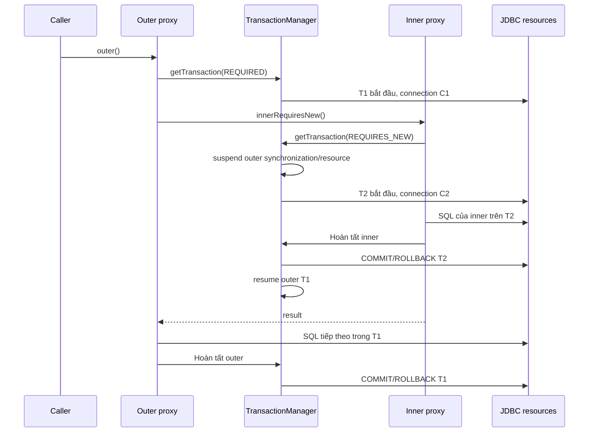

# Giới hạn tạm ngưng theo chiến lược manager trong Spring Transaction Management

## 1. Vấn đề cốt lõi

Trong Spring, propagation `REQUIRES_NEW` và `NOT_SUPPORTED` thường được giải thích bằng câu “Spring tạm ngưng giao dịch đang có”. Câu đó **đúng về ý định propagation**, nhưng chưa đủ để dự đoán hành vi runtime: **khả năng suspend/resume phụ thuộc loại `PlatformTransactionManager`, resource đang quản lý, hạ tầng transaction thực tế và đường đi qua transaction interceptor**.

Hai yêu cầu hoàn toàn khác nhau:

- `REQUIRES_NEW`: tạm ngưng outer transaction (nếu có), bắt đầu **một physical transaction mới** cho inner scope, sau đó hoàn tất inner và khôi phục outer.
- `NOT_SUPPORTED`: tạm ngưng outer transaction (nếu có), chạy inner **không có actual transaction do manager đó quản lý**, rồi khôi phục outer.

Đặt annotation **không bảo đảm** mọi transaction manager đều có thể tạm ngưng transaction vật lý, cũng không bảo đảm tất cả tài nguyên bên ngoài (HTTP, message broker, nhiều datasource, thread khác) đồng loạt được “pause”.

Theo Javadoc chính thức của `Propagation.REQUIRES_NEW` và `Propagation.NOT_SUPPORTED`, **actual transaction suspension không hoạt động mặc định trên mọi transaction manager**. Trường hợp cần chú ý nhất là `JtaTransactionManager`: để suspend/resume JTA transaction thực sự, Spring phải có quyền truy cập `jakarta.transaction.TransactionManager` tương ứng; chỉ có `UserTransaction` là chưa đủ.

Bài học phân biệt rõ việc “tạm gỡ resource khỏi thread” với “tạm ngưng JTA transaction”, bảng propagation, các transaction manager phổ biến, lỗi cấu hình, giới hạn connection pool và một ví dụ Java 17/Spring JDBC chạy được.

### Kết luận ngắn

1. **Propagation là yêu cầu về semantics; transaction manager quyết định cách thực thi.**
2. **JDBC local transaction thường được “tạm ngưng” bằng cách unbind connection holder** khỏi thread; outer transaction vẫn mở trên connection cũ và giữ resource/lock liên quan. Đây không nhất thiết là lệnh `SUSPEND` của DB.
3. **JTA suspension thực tế cần JTA TransactionManager**, không chỉ `UserTransaction`, và chịu khả năng của transaction provider/application server.
4. **`NOT_SUPPORTED` không đồng nghĩa “không thể ghi/không commit”.** JDBC statement chạy bằng connection auto-commit bên ngoài outer transaction có thể commit ngay, cho dù outer rollback sau đó.
5. **`REQUIRES_NEW` không tham gia physical outer transaction.** Inner có transaction độc lập nhưng có thể cần thêm connection và gây cạn pool nếu cấu hình không phù hợp.
6. **Không có outer transaction thì không có gì để suspend.** Cùng annotation có thể chạy bình thường mà không hề đi qua con đường tạm ngưng.

## 2. “Tạm ngưng” nghĩa là gì: ba tầng cần phân biệt

### 2.1. Transactional invocation trong Spring

Với proxy mode, `@Transactional` được xử lý khi lời gọi đi qua Spring transaction interceptor:

```java
@Transactional(propagation = Propagation.REQUIRES_NEW)
public void writeAudit() {
    // Method phải được gọi qua Spring proxy để advice chạy.
}
```

Đoạn này là snippet minh họa; cần imports, bean, manager và DAO thực tế. Trong một invocation hợp lệ, Spring thực hiện đại ý:

- Đọc `TransactionDefinition`/`TransactionAttribute`.
- Chọn transaction manager.
- Kiểm tra manager có nhận diện một transaction hiện tại hay không.
- Nếu propagation yêu cầu, suspend context cũ.
- Bắt đầu transaction mới hoặc chuyển vào nontransactional scope.
- Chạy body, xử lý exception/rollback rule.
- Hoàn tất inner scope, rồi **resume** transaction cũ trong quá trình cleanup nếu suspension thành công.

Nếu method gọi bằng `this.writeAudit()` từ cùng instance trong Spring proxy mode, interceptor của inner thường **không chạy**; không có transaction mới và cũng không có suspension riêng cho annotation inner.

### 2.2. Suspend resource binding của Spring

Với imperative transaction manager, `TransactionSynchronizationManager` gắn resource và transaction synchronization với **thread hiện hành**. Ví dụ JDBC manager bind một `ConnectionHolder` theo `DataSource`; JPA manager có thể bind `EntityManagerHolder`.

Khi local manager hỗ trợ suspend, nó có thể:

1. Tạm dừng synchronization đang hoạt động.
2. **Unbind** resource holder của outer transaction khỏi thread.
3. Giữ lại suspended resource trong một holder để resume về sau.
4. Tạo/thiết lập context của inner.
5. Kết thúc inner, cleanup resource của inner.
6. **Rebind** outer resource holder, phục hồi synchronization và transaction metadata.

Trong khoảng này, **outer JDBC transaction không bị commit hoặc rollback chỉ vì bị unbind**. Connection của outer vẫn có thể đang mở với các thay đổi chưa commit và lock đang giữ. Nó chỉ tạm thời không phải connection mà `JdbcTemplate`/`DataSourceUtils` trên thread ấy tìm thấy qua binding thông thường.

### 2.3. Suspend một JTA transaction thực sự

Trong Jakarta Transactions:

- `jakarta.transaction.UserTransaction` cung cấp các thao tác dạng `begin`, `commit`, `rollback`, trạng thái và timeout.
- `jakarta.transaction.TransactionManager` còn có `suspend()`/`resume(...)` để chuyển association của JTA transaction với current thread theo transaction provider.

Vì `UserTransaction` **không** cung cấp `suspend()/resume()`, một `JtaTransactionManager` chỉ tiếp cận được `UserTransaction` có thể xử lý các propagation cơ bản nhưng **không đủ khả năng bảo đảm `REQUIRES_NEW`/`NOT_SUPPORTED` sẽ tạm ngưng transaction JTA thực sự**.

Spring có thể auto-detect một `TransactionManager` thích hợp qua môi trường/JNDI hoặc được cấu hình tường minh. Hành vi phụ thuộc application server/transaction provider; không nên kết luận “JTA luôn không hỗ trợ suspend” cũng không nên kết luận “cứ có JtaTransactionManager là hỗ trợ đầy đủ”.

### 2.4. Không phải các tầng trên tương đương

| Cấp độ | Ý nghĩa | Ví dụ | Không hàm ý |
| --- | --- | --- | --- |
| Transactional scope logic | Spring thay ngữ cảnh giao dịch của một method invocation | `@Transactional(REQUIRES_NEW)` đi qua proxy | Không tự bảo đảm physical transaction mới nếu manager báo lỗi. |
| Spring thread-bound resource/synchronization | Unbind/rebind context của outer trong current thread | `DataSourceTransactionManager.doSuspend/doResume` | Không phát lệnh “pause transaction” phổ quát cho database. |
| JTA transaction association | Transaction provider suspend/resume JTA transaction khỏi current thread | `jakarta.transaction.TransactionManager.suspend()/resume()` | Không tự chuyển transaction sang thread khác hoặc thay thế XA coordinator. |
| Database physical transaction | Connection/transaction đang mở, giữ lock và chưa commit | Outer JDBC connection vẫn chờ | Unbind không release lock hay commit outer. |

Mọi kết luận về durability, lock, pool hay rollback phải dựa trên **physical resource** và manager cụ thể, không chỉ từ tên propagation.

## 3. Propagation nào thật sự đòi suspension?

Bảng sau giả định **đang có outer physical transaction tương thích**, và lời gọi inner được Spring interceptor xử lý:

| Propagation của inner | Hành vi khi đã có outer transaction | Cần suspend outer? | Có physical transaction mới? |
| --- | --- | --- | --- |
| `REQUIRED` | Tham gia outer | Không | Không |
| `SUPPORTS` | Tham gia outer | Không | Không |
| `MANDATORY` | Bắt buộc phải có và tham gia outer | Không | Không |
| `REQUIRES_NEW` | Tạm ngưng outer, tạo inner transaction độc lập | **Có** | **Có, nếu manager thực thi được** |
| `NOT_SUPPORTED` | Tạm ngưng outer, chạy inner ngoài actual transaction | **Có** | **Không** |
| `NEVER` | Từ chối chạy khi có transaction | Không; thường ném exception | Không |
| `NESTED` | Dùng savepoint trong cùng physical transaction nếu hỗ trợ | **Không** trong mô hình JDBC savepoint chuẩn | Không |

**Điều kiện cần nhấn mạnh:** chỉ `REQUIRES_NEW` và `NOT_SUPPORTED` yêu cầu suspend transaction hiện có trong trường hợp bình thường. `NESTED` không dùng suspend để tạo giao dịch độc lập: với JDBC nó dùng **savepoint của outer physical transaction**. `NEVER` không “tự suspend để chạy ngoài transaction”; nó báo lỗi khi transaction đang active.

Khi **chưa có outer transaction**:

- `REQUIRES_NEW` tạo transaction mới mà không cần suspend gì.
- `NOT_SUPPORTED` chạy nontransactionally, cũng không cần suspend gì.
- `REQUIRED`, `NESTED` thường tạo transaction mới.
- `SUPPORTS` chạy không có actual transaction, nhưng có thể có transaction synchronization scope tùy manager và cấu hình.
- `MANDATORY` báo lỗi vì thiếu transaction.
- `NEVER` chạy không transaction.

Từ đó, một test chỉ gọi `REQUIRES_NEW` trong trạng thái “không có outer transaction” **không chứng minh manager có khả năng suspension**. Phải kiểm thử **từ bên trong một outer transaction đang hoạt động**.

## 4. REQUIRES_NEW: suspension rồi bắt đầu physical transaction độc lập

### 4.1. Timeline thông thường



Ở **JDBC local transaction** thường dùng Spring `DataSourceTransactionManager`, outer connection C1 có thể bị gỡ khỏi current-thread resource binding nhưng **vẫn được giữ** trong thời gian inner dùng C2. Khi inner T2 commit, T1 vẫn chưa commit và có thể rollback sau đó.

`REQUIRES_NEW` cho phép:

- Inner có isolation, timeout, read-only settings phù hợp riêng cho T2.
- Inner commit/rollback **độc lập** với outer T1.
- Inner failure có thể được outer bắt và xử lý mà không tự làm outer T1 rollback-only **chỉ vì** T2 rollback. Tuy nhiên outer vẫn có thể rollback theo exception và business policy của chính outer.
- Inner lock/connection của T2 có thể được hoàn tất và release khi T2 kết thúc, tùy resource/connection pool.

### 4.2. Độc lập không đồng nghĩa không có liên hệ dữ liệu

T1 và T2 vẫn có thể truy cập **cùng database** và chịu isolation/lock/constraint. Nếu T1 đang giữ lock trên hàng mà T2 muốn sửa, T2 có thể bị chặn bởi **chính tài nguyên mà outer đã giữ**. Suspend outer transaction không bắt database nhả lock của T1.

Ví dụ anti-pattern:

```text
T1: UPDATE account SET balance = balance - 10 WHERE id=7
T1: gọi inner REQUIRES_NEW
T2: UPDATE account SET balance = balance - 5 WHERE id=7
T2: đợi lock của T1
T1: đang đợi T2 kết thúc để resume
```

Có thể gây lock wait/timeout/deadlock ở cấp ứng dụng. “Đã tạm ngưng outer” **không** đồng nghĩa outer resources được tự động unlock hoặc rolled back.

### 4.3. Connection pool là giới hạn thực tế

Khi outer T1 giữ C1 và inner T2 cần C2, một request có thể đồng thời chiếm **hai JDBC connections** cho cùng datasource. Nếu nhiều thread đều giữ outer connection và đồng loạt chờ inner connection, pool có thể cạn.

Tài liệu Spring khuyến nghị tránh `REQUIRES_NEW` trừ khi pool được sizing phù hợp; với kiểu một mức inner và các thread đều có outer transaction, pool nên **vượt số lượng thread đồng thời ít nhất một connection** để không bị chặn toàn bộ, và cần dự phòng lớn hơn cho tải thật, nested depth, các connection khác.

Giới hạn này không áp dụng theo cùng cách cho `NOT_SUPPORTED` ở mọi workload, nhưng nontransactional JDBC vẫn có thể cần connection trong lúc outer đang giữ một connection. `NOT_SUPPORTED` cũng không “cho không” một kết nối.

## 5. NOT_SUPPORTED: không tham gia outer không có nghĩa không commit

### 5.1. Đường đi của NOT_SUPPORTED

Khi đã có T1:

1. Spring transaction manager **suspend** outer context theo khả năng của manager.
2. Inner chạy với `isActualTransactionActive() == false` đối với transaction của manager ấy.
3. JDBC code có thể lấy **connection khác** không tham gia T1.
4. Nếu connection đó ở auto-commit mode (như trong ví dụ H2 bên dưới), từng statement có thể commit ngay.
5. Khi inner kết thúc, manager cleanup scope rồi **resume** T1 để outer tiếp tục.

```mermaid
sequenceDiagram
    participant O as Outer
    participant M as Manager
    participant N as NOT_SUPPORTED method
    participant DB as Database
    O->>DB: BEGIN T1, UPDATE A
    O->>M: call NOT_SUPPORTED
    M->>M: suspend T1 binding
    M->>N: execute nontransactionally
    N->>DB: INSERT B trên connection khác
    Note over DB: B có thể auto-commit ngay
    M->>M: resume T1
    O->>DB: ROLLBACK T1
    Note over DB: A mất; B có thể vẫn tồn tại
```

**Chú ý:** “nontransactional” ở đây nghĩa là *không có physical transaction do inner `@Transactional` scope mở/đang tham gia*; không có nghĩa SQL hoàn toàn không dùng cơ chế transaction của database. JDBC auto-commit vẫn có commit transaction statement của chính nó.

### 5.2. NOT_SUPPORTED không phải read-only

Một đoạn mã:

```java
@Transactional(propagation = Propagation.NOT_SUPPORTED)
public void writeDiagnostic() {
    diagnosticRepository.save("OUTER_FAILED");
}
```

là snippet, không phải class chạy độc lập. Khi được gọi qua proxy, nó **không chịu rollback của outer JDBC T1** nếu nó đã ghi thành công trên một resource/connection tự commit ngoài T1. Do đó `NOT_SUPPORTED` không phải công cụ “bỏ qua transaction nhưng vẫn rollback cùng nhau”.

Nếu cần audit độc lập với transaction rõ ràng, `REQUIRES_NEW` có thể thể hiện intent tốt hơn vì có một T2 được quản lý commit/rollback như một đơn vị; nhưng sẽ có chi phí và ràng buộc resource. Nếu cần atomicity cùng outer, giữ write trong `REQUIRED` hoặc thiết kế consistency boundary khác.

### 5.3. Không đồng nhất NOT_SUPPORTED với NEVER

- `NOT_SUPPORTED`: khi có T1, **cố suspend T1** rồi chạy nontransactionally.
- `NEVER`: khi có T1, **từ chối chạy** bằng exception, không suspend T1 để tiếp tục.

Chỉ đổi enum từ `NOT_SUPPORTED` sang `NEVER` có thể biến logic vốn chạy được thành exception ở runtime. Chúng phục vụ hai business contracts khác nhau.

## 6. Transaction manager nào thực sự hỗ trợ suspend?

Không có bảng “mọi `PlatformTransactionManager` đều hỗ trợ tất cả propagation” áp dụng tuyệt đối. Cần đọc implementation cụ thể và chạy integration test phù hợp.

### 6.1. Cơ chế nền: AbstractPlatformTransactionManager

Spring `AbstractPlatformTransactionManager` điều phối các bước suspend/resume và transaction synchronization. Các hook dành cho manager cụ thể bao gồm:

```java
protected Object doSuspend(Object transaction);

protected void doResume(
        Object transaction, Object suspendedResources);
```

Đây là chữ ký **khái niệm** của extension hooks, không phải code cần tự gọi trong service. Trong base class, implementation mặc định của các hook liên quan có thể ném `TransactionSuspensionNotSupportedException` nếu subclass chưa cung cấp khả năng suspend/resume thích hợp.

Vì vậy:

- `@Transactional(propagation = REQUIRES_NEW)` mô tả **yêu cầu**.
- `getTransaction(...)` của manager phải xử lý suspension **thành công** trước khi inner transaction mới có thể chạy theo semantics đó.
- Nếu manager/resource không hỗ trợ, lỗi cần được phát hiện và không nên lặng lẽ đổi ý nghĩa thành `REQUIRED` hoặc bỏ qua transaction để “cố chạy”.

Manager còn phải xử lý việc tạm dừng/khôi phục `TransactionSynchronization`, resource bindings và metadata thread; application code không nên tự thao tác các holder đó khi chưa thật sự cần tùy biến transaction infrastructure.

### 6.2. DataSourceTransactionManager — local JDBC transaction

`DataSourceTransactionManager` là trường hợp dễ hiểu nhất:

- Quản lý transaction JDBC trên **một `DataSource`**.
- Sử dụng resource binding theo thread cho `ConnectionHolder`.
- Có các hook `doSuspend/doResume` để **unbind/rebind connection holder** của outer transaction.
- `REQUIRES_NEW` có thể mở inner JDBC transaction trên connection khác.
- `NOT_SUPPORTED` có thể cho inner chạy không tham gia outer JDBC transaction.
- Outer connection/transaction **không tự commit, rollback hay unlock** vì tạm bị unbind.
- Code truy cập DB phải dùng đường tương thích như `JdbcTemplate` hoặc `DataSourceUtils`; việc tự quản lý connection ngoài Spring có thể không tham gia đúng boundary.

Khi manager chỉ quản lý datasource A, nó **không có quyền tự động suspend toàn bộ datasource B, JPA context khác hoặc lời gọi HTTP** ngoài tài nguyên nó biết.

### 6.3. JdbcTransactionManager

`JdbcTransactionManager` kế thừa từ `DataSourceTransactionManager` và thêm khả năng translate một số lỗi transaction commit/rollback sang Spring `DataAccessException` thích hợp. Với câu hỏi suspension, nó dựa vào chiến lược JDBC resource của parent, không biến local JDBC transaction thành JTA global transaction.

Nếu dự án dùng Spring JDBC thông thường, cả `DataSourceTransactionManager` và `JdbcTransactionManager` thường phù hợp cho ngữ cảnh local resource suspension, nhưng cần kiểm chứng driver/pool/DAO đúng `DataSource`.

### 6.4. JpaTransactionManager — tạm ngưng JPA resource, không phải XA toàn cục

`JpaTransactionManager` quản lý một `EntityManagerFactory` và transaction JPA resource-local; khi có cơ chế suspend/resume, Spring có thể tạm unbind/rebind `EntityManagerHolder` và JDBC connection holder liên quan khỏi current thread.

Điểm cần tránh suy diễn:

- Việc suspend một `EntityManagerHolder` **không** phải JTA `TransactionManager.suspend()` toàn cục.
- JPA entity state/first-level cache, flush, lazy loading và sự tồn tại của nhiều EntityManagers cần được đánh giá theo provider và transaction lifecycle.
- `REQUIRES_NEW` trong tầng JPA có thể dùng transaction/EntityManager riêng; không chắc inner nhìn thấy dữ liệu outer chưa commit do isolation.
- Nếu inner truy cập resource khác không thuộc cùng manager, không có một “suspension toàn hệ thống” tự động.
- `NESTED`/JDBC savepoint không tương đương với việc JPA persistence context tự rollback một phần.

Do vậy, `JpaTransactionManager` có khả năng xử lý resource binding của **JPA local context**, nhưng không nên gắn nhãn “suspend mọi tài nguyên” hay coi nó thay thế `JtaTransactionManager` cho transaction phân tán.

### 6.5. JtaTransactionManager — cần Jakarta TransactionManager để suspend thực

`JtaTransactionManager` tích hợp transaction API của Jakarta EE. Với standard `UserTransaction`, Spring có thể begin/commit/rollback, nhưng `UserTransaction` **không có suspend/resume API**.

Muốn thực thi actual JTA suspension cho `REQUIRES_NEW` hoặc `NOT_SUPPORTED` khi đang có transaction JTA, `JtaTransactionManager` cần tiếp cận một `jakarta.transaction.TransactionManager` phù hợp. Handle này có thể:

- Được Spring auto-detect ở môi trường hỗ trợ.
- Được lookup qua JNDI hoặc integration đặc thù application server.
- Được cấu hình trực tiếp qua `setTransactionManager(...)` hoặc `setTransactionManagerName(...)`, tùy setup.

Nếu handle này không có hoặc provider không hỗ trợ thao tác cần thiết, runtime có thể không xử lý suspension như mong muốn; cần kiểm tra lỗi hạ tầng và thử theo đúng container/provider.

**Đừng khẳng định “trên JTA chắc chắn phải set thủ công”.** Nhiều application server cho phép Spring tự tìm `TransactionManager`. Ngược lại, **đừng khẳng định “cứ có UserTransaction là suspend được”**.

### 6.6. Các manager tùy chỉnh hoặc khác loại

Một implementation tùy chỉnh của `PlatformTransactionManager` có thể không override `doSuspend/doResume`. JMS, provider-specific transaction managers, reactive manager hay các adapter đặc thù có resource/synchronization semantics riêng.

Quy trình đúng là:

1. Xác định class transaction manager thật đang được dùng.
2. Đọc Javadoc/source của implementation tương ứng phiên bản.
3. Kiểm tra support cho `REQUIRES_NEW`/`NOT_SUPPORTED` với **outer transaction thực sự active**.
4. Quan sát việc suspend/resume resource, trạng thái active và DB behavior sau khi outer commit/rollback.
5. Không tự suy ra từ tên bean `transactionManager` hoặc chỉ nhìn annotation.

`ReactiveTransactionManager` dùng **Reactor context** thay vì ThreadLocal imperative. Các ví dụ `DataSourceTransactionManager`/JTA ở bài này không mô tả đầy đủ reactive resource suspension; cần tham khảo manager reactive cụ thể.

### 6.7. Ma trận chiến lược manager

| Manager/resource | Chiến lược suspension cần hiểu | Điều kiện/giới hạn điển hình |
| --- | --- | --- |
| `DataSourceTransactionManager` | Unbind/rebind `ConnectionHolder` của local JDBC T1; inner có thể dùng connection mới | Cùng datasource, code tham gia Spring-managed connection, pool đủ |
| `JdbcTransactionManager` | Theo `DataSourceTransactionManager`, có thêm exception translation | Giới hạn tương tự local JDBC |
| `JpaTransactionManager` | Unbind/rebind JPA `EntityManagerHolder` và resource liên quan | JPA context/provider, resource-local semantics, không phải global XA |
| `JtaTransactionManager` | Nhờ JTA `TransactionManager.suspend()/resume()` để suspend actual JTA transaction | Có thể cần server-specific handle/provider; `UserTransaction` một mình không đủ |
| Manager custom/khác | Phụ thuộc `doSuspend/doResume` hoặc API tương ứng | Có thể báo `TransactionSuspensionNotSupportedException` |
| Reactive manager | Context/resource model khác imperative | Không suy diễn từ JDBC ThreadLocal |

Bảng không cam kết một tổ hợp manager/driver sẽ thành công trong **mọi** hoàn cảnh (connection failure, pool exhaustion, nested calls, không đúng manager, synchronization state, container policy).

## 7. “Tạm ngưng” không phải tắt một giao dịch đang giữ lock

### 7.1. Outer vẫn mở khi inner chạy

Trong local JDBC:

```text
Thread request
   Outer T1: Connection C1, chưa commit, có thể đang giữ lock
       │
       ├── Spring unbind C1 khỏi thread
       │      Inner T2: Connection C2, transaction riêng
       │      Inner T2: COMMIT / ROLLBACK
       │
       └── Spring rebind C1 vào thread
   Outer T1: tiếp tục với dữ liệu và lock còn lại
   Outer T1: COMMIT / ROLLBACK
```

T1 vẫn còn tồn tại trong thời gian inner. Suspend không bảo đảm giải phóng lock của T1 hoặc cho C2 nhìn thấy các thay đổi chưa commit của C1.

Nếu inner T2 truy cập hàng mà T1 đang khóa, có thể bị timeout/deadlock. Nếu inner đọc dữ liệu chưa commit của T1, kết quả còn tùy isolation/database, nhưng với `READ_COMMITTED` thông thường inner **không tự thấy** dữ liệu chưa commit từ outer.

### 7.2. Khi inner fail, outer có được resume không?

Khi manager suspend thành công và đang kiểm soát lời gọi, transaction infrastructure có cơ chế cleanup để resume suspended context sau khi inner kết thúc, kể cả khi inner ném exception. Tuy nhiên **không được xem restore là chắc chắn bất chấp mọi lỗi hạ tầng**: lỗi resume, connection/provider failure hoặc transaction đã rollback-only có thể khiến outer không còn dùng được.

Việc resume thành công **không có nghĩa outer được xóa rollback-only**. Nếu T1 đã không thể commit do lỗi độc lập, inner hoàn tất cũng không “reset” lại tình trạng đó.

### 7.3. Suspend không chuyển transaction cho thread mới

Trong imperative Spring, transaction resources thường gắn với thread. `@Async`, `CompletableFuture.supplyAsync` hoặc tự tạo thread không tự nhận T1 đang được suspend/resume trên thread cũ. “Suspend” không phải cách truyền transaction từ request thread sang worker thread.

Nếu cần transaction trong async task, đặt transaction boundary ở task thực thi trên thread của nó hoặc dùng cơ chế orchestration thích hợp. Đối với reactive flow, cần xét Reactor context riêng.

## 8. Ví dụ Java 17+: REQUIRES_NEW và NOT_SUPPORTED khi outer rollback

Ví dụ có thể chạy bằng Java 17+, Maven, Spring Framework 6.2.x và H2. Nó được thiết kế để quan sát **suspension và kết quả dữ liệu thật**, không chỉ in log transaction.

Hai Spring beans riêng biệt:

- `OuterService` có các public methods `@Transactional(REQUIRED)`.
- `InnerService` có `@Transactional(NOT_SUPPORTED)` và `@Transactional(REQUIRES_NEW)`.
- Cả hai dùng cùng `DataSourceTransactionManager`/`DataSource` thông qua `JdbcTemplate`.
- `InnerService` được inject vào `OuterService` từ Spring context, nên lời gọi inner đi **qua proxy**, tránh self-invocation.

Kịch bản A: outer INSERT id=1; inner `NOT_SUPPORTED` INSERT id=2 (auto-commit); inner `REQUIRES_NEW` INSERT id=3 (T2 commit); outer ném unchecked exception và rollback T1. Kết quả DB vẫn giữ id=2,3.

Kịch bản B: outer INSERT id=4; inner `REQUIRES_NEW` INSERT id=5 rồi ném exception nên T2 rollback; outer bắt exception và tiếp tục INSERT id=6 rồi commit T1. Kết quả có id=4,6 nhưng không có id=5.

### 8.1. Cấu trúc thư mục

```text
suspension-demo/
├── pom.xml
└── src/main/java/demo/tx/SuspensionDemo.java
```

### 8.2. pom.xml

```xml
<project xmlns="http://maven.apache.org/POM/4.0.0"
         xmlns:xsi="http://www.w3.org/2001/XMLSchema-instance"
         xsi:schemaLocation="http://maven.apache.org/POM/4.0.0
                             https://maven.apache.org/xsd/maven-4.0.0.xsd">
    <modelVersion>4.0.0</modelVersion>
    <groupId>demo</groupId>
    <artifactId>suspension-demo</artifactId>
    <version>1.0.0</version>

    <properties>
        <maven.compiler.release>17</maven.compiler.release>
        <project.build.sourceEncoding>UTF-8</project.build.sourceEncoding>
    </properties>

    <dependencies>
        <dependency>
            <groupId>org.springframework</groupId>
            <artifactId>spring-context</artifactId>
            <version>6.2.19</version>
        </dependency>
        <dependency>
            <groupId>org.springframework</groupId>
            <artifactId>spring-jdbc</artifactId>
            <version>6.2.19</version>
        </dependency>
        <dependency>
            <groupId>com.h2database</groupId>
            <artifactId>h2</artifactId>
            <version>2.3.232</version>
        </dependency>
    </dependencies>

    <build>
        <plugins>
            <plugin>
                <groupId>org.apache.maven.plugins</groupId>
                <artifactId>maven-compiler-plugin</artifactId>
                <version>3.13.0</version>
            </plugin>
            <plugin>
                <groupId>org.codehaus.mojo</groupId>
                <artifactId>exec-maven-plugin</artifactId>
                <version>3.5.1</version>
            </plugin>
        </plugins>
    </build>
</project>
```

### 8.3. src/main/java/demo/tx/SuspensionDemo.java

```java
package demo.tx;

import java.util.List;
import javax.sql.DataSource;

import org.springframework.context.annotation.AnnotationConfigApplicationContext;
import org.springframework.context.annotation.Bean;
import org.springframework.context.annotation.Configuration;
import org.springframework.jdbc.core.JdbcTemplate;
import org.springframework.jdbc.datasource.DataSourceTransactionManager;
import org.springframework.jdbc.datasource.DriverManagerDataSource;
import org.springframework.transaction.PlatformTransactionManager;
import org.springframework.transaction.annotation.EnableTransactionManagement;
import org.springframework.transaction.annotation.Propagation;
import org.springframework.transaction.annotation.Transactional;
import org.springframework.transaction.support.TransactionSynchronizationManager;

public final class SuspensionDemo {
    public static void main(String[] args) {
        try (var ctx = new AnnotationConfigApplicationContext(Config.class)) {
            JdbcTemplate jdbc = ctx.getBean(JdbcTemplate.class);
            OuterService outer = ctx.getBean(OuterService.class);

            jdbc.execute("CREATE TABLE events (" +
                    "id INT PRIMARY KEY, label VARCHAR(80) NOT NULL)");

            try {
                outer.rollBackOuter();
            } catch (IllegalStateException ex) {
                System.out.println("caught outer=" + ex.getMessage());
            }
            System.out.println("after outer rollback=" + labels(jdbc));

            outer.recoverAfterInnerRollback();
            System.out.println("after inner rollback=" + labels(jdbc));
        }
    }

    private static List<String> labels(JdbcTemplate jdbc) {
        return jdbc.queryForList(
                "SELECT label FROM events ORDER BY id", String.class);
    }

    private static void trace(String label, DataSource dataSource) {
        boolean active =
                TransactionSynchronizationManager.isActualTransactionActive();
        boolean bound =
                TransactionSynchronizationManager.hasResource(dataSource);
        System.out.println(label + ": active=" + active
                + ", bound=" + bound);
    }

    @Configuration(proxyBeanMethods = false)
    @EnableTransactionManagement(proxyTargetClass = true)
    public static class Config {
        @Bean
        public DataSource dataSource() {
            return new DriverManagerDataSource(
                    "jdbc:h2:mem:suspension;DB_CLOSE_DELAY=-1", "sa", "");
        }

        @Bean
        public PlatformTransactionManager transactionManager(DataSource ds) {
            return new DataSourceTransactionManager(ds);
        }

        @Bean
        public JdbcTemplate jdbcTemplate(DataSource ds) {
            return new JdbcTemplate(ds);
        }

        @Bean
        public InnerService innerService(JdbcTemplate jdbc, DataSource ds) {
            return new InnerService(jdbc, ds);
        }

        @Bean
        public OuterService outerService(
                JdbcTemplate jdbc, DataSource ds, InnerService inner) {
            return new OuterService(jdbc, ds, inner);
        }
    }

    public static class InnerService {
        private final JdbcTemplate jdbc;
        private final DataSource dataSource;

        public InnerService(JdbcTemplate jdbc, DataSource dataSource) {
            this.jdbc = jdbc;
            this.dataSource = dataSource;
        }

        @Transactional(propagation = Propagation.NOT_SUPPORTED)
        public void nonTransactionalInsert() {
            trace("notSupported", dataSource);
            jdbc.update("INSERT INTO events (id, label) VALUES (?, ?)",
                    2, "non-transactional");
        }

        @Transactional(propagation = Propagation.REQUIRES_NEW)
        public void independentInsert() {
            trace("requiresNew", dataSource);
            jdbc.update("INSERT INTO events (id, label) VALUES (?, ?)",
                    3, "independent");
        }

        @Transactional(propagation = Propagation.REQUIRES_NEW)
        public void failingIndependentInsert() {
            trace("requiresNewFail", dataSource);
            jdbc.update("INSERT INTO events (id, label) VALUES (?, ?)",
                    5, "rolled-back-inner");
            throw new IllegalStateException("INNER_ABORT");
        }
    }

    public static class OuterService {
        private final JdbcTemplate jdbc;
        private final DataSource dataSource;
        private final InnerService inner;

        public OuterService(
                JdbcTemplate jdbc, DataSource dataSource, InnerService inner) {
            this.jdbc = jdbc;
            this.dataSource = dataSource;
            this.inner = inner;
        }

        @Transactional(propagation = Propagation.REQUIRED)
        public void rollBackOuter() {
            trace("outer-start", dataSource);
            jdbc.update("INSERT INTO events (id, label) VALUES (?, ?)",
                    1, "outer-rolled-back");

            inner.nonTransactionalInsert();
            inner.independentInsert();

            trace("outer-resumed", dataSource);
            throw new IllegalStateException("OUTER_ABORT");
        }

        @Transactional(propagation = Propagation.REQUIRED)
        public void recoverAfterInnerRollback() {
            trace("outer2-start", dataSource);
            jdbc.update("INSERT INTO events (id, label) VALUES (?, ?)",
                    4, "outer-before");

            try {
                inner.failingIndependentInsert();
            } catch (IllegalStateException ex) {
                System.out.println("caught inner=" + ex.getMessage());
            }

            trace("outer2-resumed", dataSource);
            jdbc.update("INSERT INTO events (id, label) VALUES (?, ?)",
                    6, "outer-after");
        }
    }
}
```

### 8.4. Chạy chương trình

Trong thư mục `suspension-demo`, có Maven và JDK 17+:

```bash
mvn -q compile exec:java -Dexec.mainClass=demo.tx.SuspensionDemo
```

**Các dòng do chính chương trình in ra** (không tính log riêng của Maven/Spring):

```text
outer-start: active=true, bound=true
notSupported: active=false, bound=false
requiresNew: active=true, bound=true
outer-resumed: active=true, bound=true
caught outer=OUTER_ABORT
after outer rollback=[non-transactional, independent]
outer2-start: active=true, bound=true
requiresNewFail: active=true, bound=true
caught inner=INNER_ABORT
outer2-resumed: active=true, bound=true
after inner rollback=[non-transactional, independent, outer-before, outer-after]
```

### 8.5. Giải thích output

**Tình huống A**

1. `outer-start active=true, bound=true`: outer `REQUIRED` được intercept, đã bắt đầu T1 và bind JDBC resource.
2. `notSupported active=false, bound=false`: inner `NOT_SUPPORTED` được intercept; outer binding được suspend. Dòng này được in **trước khi inner lấy JDBC connection**. Khi `JdbcTemplate.update` chạy, ví dụ `DriverManagerDataSource` cấp một connection auto-commit ngoài T1; insert id=2 commit riêng theo statement.
3. `requiresNew active=true, bound=true`: inner `REQUIRES_NEW` có transaction T2 mới với resource binding của mình; insert id=3 commit khi inner kết thúc.
4. `outer-resumed active=true, bound=true`: Spring đã phục hồi outer context T1 sau các inner scopes.
5. Outer ném `OUTER_ABORT`: default rollback rule áp dụng; T1 rollback id=1.
6. Database vẫn giữ id=2 và id=3 đã commit **ngoài T1**, chứng minh suspend không có nghĩa outer rollback được mọi side effect.

**Tình huống B**

1. Outer T3 insert id=4.
2. Inner `REQUIRES_NEW` bắt đầu T4, insert id=5 rồi ném `INNER_ABORT`. Interceptor rollback T4.
3. Outer bắt lỗi **sau khi inner interceptor xử lý**, T3 đã được resume và có thể tiếp tục.
4. Outer insert id=6, kết thúc bình thường và commit T3. Kết quả có id 4,6; không có id 5.

Đây là behavior của **local JDBC/H2 với đúng cấu hình trong code**. Với JTA hoặc manager tùy chỉnh, không được suy ra suspension support chỉ từ output của ví dụ này.

### 8.6. Điều gì không được chứng minh chỉ bằng active/bound?

`TransactionSynchronizationManager.isActualTransactionActive()` cho biết trạng thái actual transaction theo current thread; `hasResource(dataSource)` chỉ cho biết có resource binding theo key ấy. Hai boolean này **không** tự chứng minh:

- Một transaction JTA bên ngoài đã được provider thực sự suspend.
- Tất cả datasource/EntityManager/JMS resources khác đều tạm ngưng.
- Connection pool có đủ tài nguyên dưới tải thật.
- Không có lock wait giữa outer và inner.
- Một câu lệnh ngoài phạm vi đã durable chỉ vì `active=false`.

Vì vậy ví dụ còn **đọc lại database sau khi outer boundary hoàn tất**, và production tests nên làm tương tự.

## 9. Khi transaction manager không hỗ trợ tạm ngưng

### 9.1. Điều gì có thể xảy ra?

Một manager không implement suspension, hoặc JTA provider thiếu transaction-manager handle, có thể không đáp ứng yêu cầu `REQUIRES_NEW`/`NOT_SUPPORTED` khi outer đang active. Spring có thể báo lỗi transaction infrastructure (điển hình `TransactionSuspensionNotSupportedException` hoặc exception đặc thù manager/provider) thay vì chạy inner với semantics sai.

Không nên:

- Bắt mọi suspension exception rồi cho business logic chạy trực tiếp dưới T1 mà vẫn dán nhãn “REQUIRES_NEW”.
- Ngầm đổi sang `REQUIRED` chỉ để không phát sinh lỗi.
- Dùng `NOT_SUPPORTED` thay `REQUIRES_NEW` rồi giả định cùng atomicity và rollback behavior.
- Gọi repository bên ngoài Spring-managed datasource để “né” manager mà không hiểu auto-commit/isolation.
- Tin rằng thiếu lỗi khi gọi từ ngoài transaction chứng minh feature hoạt động khi đã có T1.

### 9.2. Cấu hình JTA đúng theo môi trường

Ví dụ **mã cấu hình khái niệm** khi application server có một `jakarta.transaction.TransactionManager` thực:

```java
import jakarta.transaction.TransactionManager;
import org.springframework.transaction.jta.JtaTransactionManager;

public final class JtaSetupExample {
    public static JtaTransactionManager create(TransactionManager jtaManager) {
        var springManager = new JtaTransactionManager();
        springManager.setTransactionManager(jtaManager);
        return springManager;
    }
}
```

Đây là **class minh họa cách truyền một handle đã có**, không phải chương trình tự chạy vì phải có Jakarta Transaction API và provider thực tế. Trên nhiều container, Spring có thể auto-detect `TransactionManager` qua JNDI/integration nên không cần cấu hình trên.

Đừng tự tạo instance `TransactionManager` tùy tiện trong business code hay ép cast `UserTransaction` nếu provider không implement interface ấy. Cần dùng handle do container/coordinator hỗ trợ, và xác minh `suspend()/resume()` bằng integration test.

### 9.3. Xác minh chính khả năng suspend, không chỉ khả năng start transaction

Một bộ test hợp lệ gồm:

1. Gọi method `REQUIRES_NEW` **không có outer T1** → xác nhận manager mở/commit T2 thành công.
2. Gọi đúng method đó **khi outer T1 active** → xác nhận T1 bị tạm gỡ, T2 thật sự độc lập, outer được restore.
3. Outer T1 rollback sau inner T2 commit → dữ liệu inner vẫn có, outer bị rollback.
4. Gọi `NOT_SUPPORTED` từ trong T1 → xác nhận method không nằm trong actual T1, rồi outer tiếp tục đúng context.
5. Gây inner exception → xem cleanup và outer resume; kiểm tra không leak thread-bound resource.
6. Thử trên transaction provider/application server thật (đặc biệt JTA), không chỉ unit-test mock transaction manager.

Nếu test thứ nhất thành công nhưng thứ hai lỗi, điều này hoàn toàn có thể phù hợp với một manager **tạo transaction được nhưng chưa hỗ trợ suspend**.

## 10. Hai manager khác nhau không tự tạo một global suspension

Một service có thể khai báo rõ manager:

```java
@Transactional(transactionManager = "ordersTxManager")
public void processOrder() {
    reportingService.writeReport();
}

@Transactional(
        transactionManager = "reportingTxManager",
        propagation = Propagation.REQUIRES_NEW)
public void writeReport() {
    // Cần xét datasource/transaction manager nào đang được dùng.
}
```

Đây là **hai method snippets ở hai bean** và cần imports/wiring thực tế. `ordersTxManager` và `reportingTxManager` có thể quản lý hai datasources khác nhau.

Điều cần hiểu:

- Mỗi transaction manager quyết định sự tồn tại của transaction **đối với resource nó quản lý**.
- Spring transaction synchronization có thể được gắn trên current thread, nhưng **không có quy tắc chung** rằng một local manager B có thể làm cho mọi resource thuộc manager A tạm ngưng ở mức vật lý.
- Hai local managers không hợp thành một XA/distributed transaction chỉ vì nested method có `REQUIRES_NEW`.
- Nếu cần atomicity giữa nhiều resource, đánh giá JTA/XA hoặc kiến trúc outbox/saga, không dùng propagation như phép màu.

Khi có nhiều manager trong một method chain, quan sát resource IDs, JTA/XA enlistment, commit/rollback thực tế và transaction synchronization. Đặc biệt cẩn thận khi dùng cùng một physical datasource nhưng tạo **hai transaction manager beans** khác nhau: có thể gây nhầm resource binding và ownership.

## 11. Các giới hạn khác ở runtime

### 11.1. Không có suspension nếu không đi qua proxy

```java
@Service
public class ExampleService {
    @Transactional
    public void outer() {
        this.inner();
    }

    @Transactional(propagation = Propagation.NOT_SUPPORTED)
    public void inner() {
        // NOT_SUPPORTED không tự chạy advice khi self-invocation.
    }
}
```

Đây là snippet, cần Spring imports. Trong proxy mode, `this.inner()` là lời gọi trực tiếp nên **không suspend outer**. Logic inner vẫn chạy trong transaction của outer nếu dùng cùng transaction-bound resource.

Tương tự, `private`/`static` method hoặc `final` method với class-based proxy không phải transactional entry point phù hợp. Nên đặt boundary trên **public non-final service method của bean khác** hoặc dùng `TransactionTemplate`.

### 11.2. TransactionTemplate yêu cầu cùng chiến lược manager

Với manager hỗ trợ, có thể gọi programmatic:

```java
import org.springframework.transaction.PlatformTransactionManager;
import org.springframework.transaction.TransactionDefinition;
import org.springframework.transaction.support.TransactionTemplate;

public final class TemplateSuspensionExample {
    public static void run(PlatformTransactionManager manager) {
        TransactionTemplate outer = new TransactionTemplate(manager);

        TransactionTemplate independent = new TransactionTemplate(manager);
        independent.setPropagationBehavior(
                TransactionDefinition.PROPAGATION_REQUIRES_NEW);

        outer.executeWithoutResult(outerStatus -> {
            independent.executeWithoutResult(innerStatus -> {
                System.out.println("outer new="
                        + outerStatus.isNewTransaction());
                System.out.println("inner new="
                        + innerStatus.isNewTransaction());
            });
        });
    }
}
```

Class trên có cú pháp Java hợp lệ nhưng cần manager/resource runtime và caller gọi `run`. Khi chưa có T1 trước `run`, và manager là local JDBC manager hỗ trợ suspend, output dự kiến:

```text
outer new=true
inner new=true
```

`TransactionTemplate` cũng gọi `PlatformTransactionManager`: **nó không vượt qua giới hạn của manager**. Programmatic style tránh hạn chế self-invocation của AOP proxy, nhưng nếu manager không hỗ trợ suspension thì template vẫn không thể “tự phát minh” tính năng đó.

### 11.3. Read-only, isolation và timeout

`REQUIRES_NEW` có thể có transaction vật lý T2 riêng nên các thuộc tính isolation/timeout/readOnly của T2 có thể được áp dụng độc lập khi manager/resource hỗ trợ.

`NOT_SUPPORTED` **không mở transaction mới** theo yêu cầu propagation này; đặt isolation/timeout trên method `NOT_SUPPORTED` không bảo đảm có một physical transaction mới để áp dụng những thuộc tính đó. ReadOnly không phải cơ chế bảo mật hay cấm ghi tuyệt đối.

Khi outer đã có T1, `REQUIRED` chỉ join T1; annotation isolation mới của inner không tự đổi isolation vật lý. `NESTED` dùng savepoint trong T1 và cũng không tạo bộ đặc điểm isolation vật lý độc lập.

### 11.4. Tạm ngưng không bảo đảm side effects được hoàn tác

Gửi email, gọi payment gateway hoặc publish broker message bên trong `NOT_SUPPORTED`/`REQUIRES_NEW` không tự trở thành side effect rollback được của T1. Nếu cần consistency liên hệ giữa database và hệ thống ngoài, cân nhắc **transactional outbox**, idempotency, retry, compensation hoặc cơ chế transaction coordination thực sự hỗ trợ resource đó.

### 11.5. Một transaction đang rollback-only không thể “cứu” bằng suspension

Giả sử outer T1 đã bị đánh dấu rollback-only. Inner `REQUIRES_NEW` có thể commit T2 độc lập, nhưng khi resume T1, dấu rollback-only trên T1 vẫn còn. Outer commit có thể thất bại/rollback và có thể sinh `UnexpectedRollbackException` khi caller kỳ vọng commit.

Suspend/resume là **quản lý association/context**, không phải xóa rollback-only hay khôi phục một transaction đã hỏng.

## 12. Chẩn đoán: phân biệt lỗi manager, lỗi proxy và lỗi resource

| Hiện tượng | Khả năng nguyên nhân | Cách kiểm tra |
| --- | --- | --- |
| `REQUIRES_NEW` hoạt động khi gọi riêng, lỗi khi gọi từ outer | Manager không hỗ trợ suspend hoặc thiếu JTA `TransactionManager` | Test với outer T1 active, xem stack trace `doSuspend`/provider |
| `NOT_SUPPORTED` vẫn thấy transaction active | Self-invocation, không qua proxy, hoặc đang xem resource không thuộc manager mong muốn | Tách bean, kiểm tra proxy và đúng manager |
| `REQUIRES_NEW` inner không thấy dữ liệu vừa INSERT của outer | T2 độc lập, isolation chặn đọc dữ liệu chưa commit | Không dùng dữ liệu T1 chưa commit làm tiền đề bắt buộc của T2 |
| Inner chờ rồi timeout dù outer “đã suspend” | T1 vẫn giữ lock trên row inner cần | Kiểm tra lock waits, thứ tự SQL, tránh hai scope truy cập cùng row |
| Pool bị cạn ở tải đồng thời | Outer giữ C1, inner cần C2 | Đo active/idle/pending connections và sizing pool |
| Outer rollback nhưng dữ liệu `NOT_SUPPORTED` vẫn tồn tại | Nontransactional JDBC statement auto-commit ngoài T1 | Đây có thể là semantics đúng; kiểm tra yêu cầu nghiệp vụ |
| Outer rollback nhưng `REQUIRES_NEW` audit vẫn tồn tại | T2 commit độc lập | Đúng theo propagation; cân nhắc consistency/business contract |
| Exception khi suspend JTA | Không có `jakarta.transaction.TransactionManager` hoặc provider không hỗ trợ | Kiểm tra lookup/integration và transaction coordinator |
| Outer sau inner mất resource binding | Lỗi cleanup/resume hoặc can thiệp thread-local thủ công | Bật Spring transaction logs; xem nested boundary và custom synchronization |
| `@Async` inner không join outer | Thread khác không tự kế thừa imperative transaction context | Thiết kế transaction trên async execution boundary |
| Mọi test đều active=true | Test method có `@Transactional` bọc ngoài | Test không có outer test transaction hoặc dùng `TestTransaction` |

### 12.1. Chẩn đoán bằng Spring log

Trong môi trường test, có thể bật DEBUG/TRACE hẹp:

```properties
logging.level.org.springframework.transaction=TRACE
logging.level.org.springframework.jdbc.datasource.DataSourceTransactionManager=DEBUG
```

Đây là ví dụ **cấu hình Spring Boot properties**, không dùng nguyên văn trong plain Spring `AnnotationConfigApplicationContext` demo nếu chưa có logging configuration. Theo dõi thông điệp tạo transaction, suspend/resume context, acquisition/cleanup connection, commit/rollback; kết hợp metrics của connection pool và log DB.

Không coi một dòng “suspending current transaction” là bằng chứng đã suspend **mọi** resource/JTA provider; luôn kiểm chứng runtime behavior và actual manager.

### 12.2. Không đo suspension bằng active flag duy nhất

Trong một `NOT_SUPPORTED` scope, `TransactionSynchronizationManager.isActualTransactionActive()` có thể false, nhưng điều đó **không** luôn có nghĩa `isSynchronizationActive()` cũng false. Tùy `AbstractPlatformTransactionManager` transaction synchronization policy, có thể tồn tại synchronization scope “empty” dù không có physical transaction.

Vì vậy kiểm tra kết hợp: actual transaction flag, datasource resource binding, transaction status, manager implementation, SQL/database outcome, connection pool state. Không dùng `isSynchronizationActive()` như một phép thử duy nhất cho “có transaction vật lý”.

### 12.3. Quan sát transaction manager thật đang chạy

Nếu Spring Boot có auto-configuration, đừng đoán `@Transactional` đang dùng manager nào. Kiểm tra bean type, `@Primary`/qualifier, `@Transactional(transactionManager = "...")` và datasource được repository sử dụng.

Trong codebase nhiều datasource, có thể cần chọn rõ manager trên service method, không dựa vào default bean name. Một manager có thể hoạt động hoàn hảo với datasource A nhưng không quản lý connection do library khác mở ở datasource B.

## 13. Checklist kiểm thử manager theo propagation

### 13.1. Ca cơ bản với Spring JDBC

1. Bật transaction management, khai báo local `DataSourceTransactionManager`.
2. Gọi outer `@Transactional(REQUIRED)` để tạo T1 và ghi một hàng chưa commit.
3. Gọi `NOT_SUPPORTED` qua bean proxy; trong inner, xác nhận không có actual T1 và thử một INSERT độc lập.
4. Gọi `REQUIRES_NEW` qua bean proxy; xác nhận inner T2 có actual transaction riêng.
5. Quay lại outer, xác nhận resource binding T1 đã được resume.
6. Outer ném unchecked exception; kiểm tra chỉ hàng T1 bị rollback, những hàng đã commit ngoài T1 còn lại.
7. Thử inner T2 rollback riêng, outer catch và commit để xác nhận independence.
8. Thử concurrent load và connection pool hạn chế để phát hiện deadlock/resource exhaustion.

### 13.2. Ca riêng với JTA

1. Xác nhận `JtaTransactionManager` có `jakarta.transaction.TransactionManager` thực sự khả dụng, không chỉ `UserTransaction`.
2. Chạy ca `REQUIRES_NEW`/`NOT_SUPPORTED` **khi có outer global transaction**; ghi nhận provider exception nếu thiếu support.
3. Kiểm tra thread association trước, trong và sau suspension.
4. Kiểm tra enlistment và commit/rollback của những XA-capable resources được coordinator quản lý.
5. Xác nhận auto-detection/JNDI hoạt động trong chính application server/environment production-like.
6. Kiểm tra lỗi resume/rollback-only, timeout, crash và cleanup.

### 13.3. Test đúng boundary

Trong Spring Test, nếu test method tự gắn `@Transactional`, test framework có thể mở outer transaction và tự rollback sau test. Điều đó có thể che khuất việc service đã commit hay chưa, hoặc làm propagation/manager behavior khác so với app production.

Để kiểm tra T1/T2 thật, dùng integration test không có test-level outer transaction, hoặc chủ động quản lý với `TestTransaction` rồi đọc database **sau khi physical transaction hoàn tất** từ một context phù hợp.

Các case được viết thành **bài kiểm tra hành vi**, không chỉ assert rằng method không ném exception. Đặc biệt, cùng một `REQUIRES_NEW` chạy thành công khi không có outer transaction **chưa chứng minh suspension support**.

## 14. Quy tắc thiết kế chọn propagation theo mục đích

### 14.1. Khi mọi thao tác phải cùng commit hoặc rollback

Dùng **một `REQUIRED` physical transaction boundary** với các methods tham gia chung. Không cần suspension. Nếu nghiệp vụ all-or-nothing, đặt `NOT_SUPPORTED` vào giữa có thể tạo data committed không thể rollback cùng outer.

### 14.2. Khi một bước phải độc lập với outer

Chọn `REQUIRES_NEW` nếu cần transaction T2 có rollback/commit riêng và manager/resource hỗ trợ. Kiểm tra connection pool, lock contention, order dependency và business consistency. Đừng dùng T2 nếu logic inner bắt buộc đọc những thay đổi outer T1 chưa commit.

### 14.3. Khi một bước thật sự không muốn transaction đang active

`NOT_SUPPORTED` thể hiện ý định chạy ngoài actual transaction; nhưng phải hiểu nó **không ngăn ghi dữ liệu** và có thể auto-commit. Trên JTA, phải kiểm tra có đúng transaction-suspension capability hay không.

### 14.4. Khi cần rollback một phần nhưng vẫn cùng physical transaction

Xem xét `NESTED` với JDBC savepoints nếu manager/driver hỗ trợ, thay vì `REQUIRES_NEW`. `NESTED` không phải independent commit và không đòi suspend outer trong mô hình savepoint. Không đồng nhất với JPA persistence-context rollback.

### 14.5. Khi feature phụ thuộc manager/provider chưa được xác nhận

Nếu suspend không được hỗ trợ, **không tự động hạ cấp propagation**. Chọn một thiết kế thỏa semantics như tách xử lý thành transaction boundary khác, workflow/outbox, hoặc cấu hình đúng JTA coordinator — và kiểm thử integration tương ứng.

## 15. Câu hỏi tự kiểm tra

**Câu 1.** `REQUIRES_NEW` được gọi khi không có outer transaction và thành công. Điều đó chứng minh manager hỗ trợ suspend không?

*Đáp án:* Không. Chưa có T1 để suspend. Phải gọi từ một outer transaction đang active để kiểm chứng.

**Câu 2.** Vì sao Spring JDBC có thể “suspend” mà database không có câu lệnh `SUSPEND TRANSACTION`?

*Đáp án:* Local JDBC manager có thể unbind outer `ConnectionHolder` khỏi current thread, giữ outer transaction mở trên C1, cho inner dùng connection khác rồi rebind C1. Nó không buộc database tạm dừng physical T1 theo một lệnh chung.

**Câu 3.** `JtaTransactionManager` chỉ được cung cấp `UserTransaction`. Có chắc dùng `REQUIRES_NEW` khi T1 active không?

*Đáp án:* Không. Actual JTA suspension cần `jakarta.transaction.TransactionManager` hỗ trợ `suspend()/resume()`; Spring có thể auto-detect hoặc cần cấu hình tường minh tùy container.

**Câu 4.** Outer T1 cập nhật một hàng, inner `NOT_SUPPORTED` ghi một hàng khác bằng auto-commit connection rồi outer rollback. Inner row có thể còn không?

*Đáp án:* Có. Inner không tham gia T1; câu lệnh được auto-commit trên connection khác thì outer rollback không hoàn tác được.

**Câu 5.** Suspend outer có release lock T1 không?

*Đáp án:* Không phải hệ quả mặc định. T1 vẫn mở; lock thường còn cho đến COMMIT/ROLLBACK hoặc theo quy tắc DB.

**Câu 6.** `NESTED` có dùng suspension tương tự `REQUIRES_NEW` không?

*Đáp án:* Không trong JDBC savepoint strategy thông thường: NESTED tạo savepoint trong T1, vẫn dùng chung physical transaction và không commit độc lập.

**Câu 7.** Tại sao một pool có số connections bằng đúng số thread có outer transactions có thể bị chặn khi tất cả gọi `REQUIRES_NEW`?

*Đáp án:* Mỗi thread giữ C1 của T1 và chờ thêm C2; không còn connection rảnh để tiến hành inner, khiến cả nhóm đợi. Cần sizing dư, giảm nested transactions hoặc đổi thiết kế.

**Câu 8.** Nếu gọi `this.innerRequiresNew()` trong cùng bean, vì sao `REQUIRES_NEW` không được thực hiện theo annotation?

*Đáp án:* Trong Spring proxy mode, self-invocation bypass proxy; không có transactional interception mới nên không có suspension hoặc physical T2 từ annotation inner.

**Câu 9.** `TransactionTemplate` có thể dùng được `REQUIRES_NEW` dù manager không hỗ trợ suspend không?

*Đáp án:* Không. Template gọi cùng `PlatformTransactionManager` và chịu cùng giới hạn resource/suspension; nó chỉ tránh phụ thuộc proxy interception.

**Câu 10.** Inner T2 commit, nhưng outer T1 đã rollback-only. T1 có được “chữa lành” khi resume không?

*Đáp án:* Không. Resume không xóa rollback-only. T2 commit độc lập còn T1 vẫn phải xử lý rollback theo trạng thái của nó.

## 16. Tóm tắt thực hành

- **Semantics của `REQUIRES_NEW` và `NOT_SUPPORTED` đòi suspension khi có outer transaction**, nhưng khả năng thực thi tùy transaction manager.
- **JDBC local manager** có thể unbind/rebind thread-bound connection holder, trong khi physical outer T1 vẫn mở, còn giữ lock/connection và chưa commit.
- **JTA cần `jakarta.transaction.TransactionManager`** cho actual suspend/resume; `UserTransaction` không đủ. Spring có thể tự phát hiện handle từ application server, hoặc phải cấu hình thích hợp.
- **`REQUIRES_NEW` tạo T2 độc lập**, có thể commit dù T1 rollback, nhưng tốn tài nguyên và có thể gặp lock contention/pool starvation.
- **`NOT_SUPPORTED` chạy ngoài T1**, không có nghĩa read-only hay không commit. Auto-commit statement của inner có thể bền vững ngay.
- **`NESTED` dùng savepoint** trên T1, không phải suspension/commit vật lý độc lập. `NEVER` từ chối chạy khi có outer chứ không suspend.
- **Kiểm thử tình huống có outer transaction active, đúng proxy, đúng manager và dữ liệu thật sau commit/rollback**. Một test top-level thành công không chứng minh manager hỗ trợ tạm ngưng.

## Tài liệu tham khảo chính thức

- [Spring Framework API — Propagation (REQUIRES_NEW, NOT_SUPPORTED và cảnh báo suspension)](https://docs.spring.io/spring-framework/docs/6.2.19/javadoc-api/org/springframework/transaction/annotation/Propagation.html)
- [Spring Framework — Transaction Propagation](https://docs.spring.io/spring-framework/reference/6.2/data-access/transaction/declarative/tx-propagation.html)
- [Spring Framework API — AbstractPlatformTransactionManager](https://docs.spring.io/spring-framework/docs/6.2.x/javadoc-api/org/springframework/transaction/support/AbstractPlatformTransactionManager.html)
- [Spring Framework API — DataSourceTransactionManager](https://docs.spring.io/spring-framework/docs/6.2.x/javadoc-api/org/springframework/jdbc/datasource/DataSourceTransactionManager.html)
- [Spring Framework API — JdbcTransactionManager](https://docs.spring.io/spring-framework/docs/6.2.x/javadoc-api/org/springframework/jdbc/support/JdbcTransactionManager.html)
- [Spring Framework API — JpaTransactionManager](https://docs.spring.io/spring-framework/docs/6.2.x/javadoc-api/org/springframework/orm/jpa/JpaTransactionManager.html)
- [Spring Framework API — JtaTransactionManager](https://docs.spring.io/spring-framework/docs/6.2.x/javadoc-api/org/springframework/transaction/jta/JtaTransactionManager.html)
- [Spring Framework — Application server-specific transaction integration](https://docs.spring.io/spring-framework/reference/6.2/data-access/transaction/application-server-integration.html)
- [Spring Framework — Programmatic Transaction Management](https://docs.spring.io/spring-framework/reference/data-access/transaction/programmatic.html)
- [Spring Framework API — TransactionSynchronizationManager](https://docs.spring.io/spring-framework/docs/6.2.x/javadoc-api/org/springframework/transaction/support/TransactionSynchronizationManager.html)
