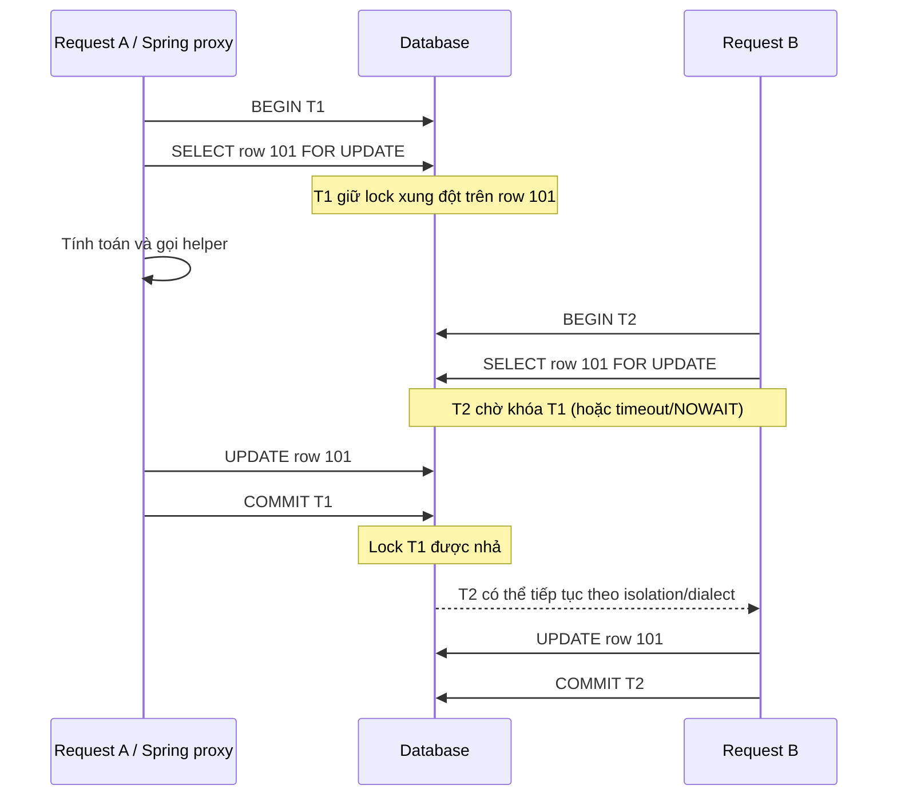
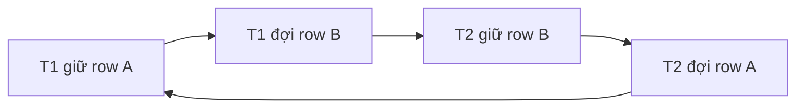

# Khóa bi quan và thời gian giữ khóa trong giao dịch — Spring Transaction Management

## 1. Vấn đề cần hiểu

**Pessimistic locking** (khóa bi quan) là cách để một transaction yêu cầu database khóa dữ liệu trước hoặc trong khi xử lý, nhằm ngăn những transaction khác thực hiện các thao tác *xung đột* cho đến khi khóa được giải phóng.

Trong ứng dụng Spring, một lỗi suy luận thường gặp:

> “Repository method đã `SELECT ... FOR UPDATE` và đã return, nên lock đã được thả.”

**Không đúng trong trường hợp transaction vẫn đang mở.** Với row lock giao dịch điển hình, **khóa được giữ đến khi physical transaction kết thúc bằng COMMIT/ROLLBACK**, hoặc đến một thời điểm đặc thù do database quy định, **không** phải tự động thả khi `ResultSet` đóng, repository method return, một helper kết thúc hoặc inner `@Transactional(REQUIRED)` trả về.

Điều này quan trọng vì `@Transactional` trong Spring tạo *ranh giới giao dịch*: một service method ở tầng ngoài có thể tiếp tục xử lý nhiều việc sau câu SQL lấy khóa. Tất cả thời gian ấy, transaction có thể còn giữ row lock; request khác phải chờ, timeout hoặc bị deadlock.

Bài này tập trung vào **khóa bi quan, thời gian giữ khóa, transaction boundary và ảnh hưởng đến xử lý đồng thời** trong Spring Framework (imperative Spring JDBC/JPA). Cú pháp và thời điểm nhả khóa chính xác **phụ thuộc database, lock mode, isolation và savepoint semantics**; ví dụ sẽ chỉ rõ phần nào dựa trên H2 hoặc PostgreSQL.

### Mục tiêu học tập

Sau bài này, bạn có thể:

1. Giải thích sự khác nhau giữa **logical method scope**, **physical transaction** và **database row lock**.
2. Xác định khi nào `SELECT ... FOR UPDATE` hoặc JPA `PESSIMISTIC_WRITE` thực sự giữ khóa.
3. Dự đoán chuyện gì xảy ra khi transaction T2 cố sửa cùng row đang bị T1 khóa.
4. Tránh giữ khóa qua HTTP call, chờ người dùng, sleep hoặc thao tác tính toán dài.
5. Phân biệt `REQUIRED`, `REQUIRES_NEW`, `NESTED` và thời điểm commit/rollback đối với lock.
6. Thiết lập và xử lý timeout/NOWAIT/SKIP LOCKED, nhận biết deadlock và retry an toàn.
7. Viết integration test thật với ít nhất **hai kết nối/transaction đồng thời**.

## 2. Khóa bi quan là gì — và không phải là gì?

### 2.1. Ví dụ cạnh tranh trên một dòng tồn kho

Giả sử bảng:

```sql
CREATE TABLE inventory (
    product_id BIGINT PRIMARY KEY,
    quantity INT NOT NULL
);

INSERT INTO inventory (product_id, quantity) VALUES (101, 5);
```

Hai transaction cùng muốn trừ bốn sản phẩm:

- T1 đọc quantity = 5.
- T2 cũng đọc quantity = 5.
- Nếu cả hai dùng mô hình “đọc → tính toán → update” không kiểm soát concurrency, có nguy cơ bán quá tồn hoặc lost update tùy SQL, isolation và lịch thực thi.
- Nếu T1 thực hiện `SELECT ... FOR UPDATE` trước khi quyết định và T2 cũng cố khóa **cùng dòng**, T2 thường phải chờ T1 kết thúc, nhận lỗi ngay (NOWAIT) hoặc bỏ qua dòng (SKIP LOCKED), tùy dialect/option.

Cách viết SQL điển hình:

```sql
BEGIN;

SELECT quantity
FROM inventory
WHERE product_id = 101
FOR UPDATE;

-- Kiểm tra quantity trong cùng transaction rồi update nếu còn đủ.
UPDATE inventory
SET quantity = quantity - 4
WHERE product_id = 101;

COMMIT;
```

Đây là **sơ đồ PostgreSQL/SQL phổ biến**, không phải lời hứa mọi DB hỗ trợ cú pháp như nhau. Trong ứng dụng Spring, `BEGIN/COMMIT` thường do transaction manager thực hiện, không nên tự nhét chúng vào repository SQL khi đã dùng `@Transactional`.

### 2.2. Pessimistic khác optimistic locking

| Tiêu chí | Pessimistic locking | Optimistic locking |
| --- | --- | --- |
| Ý tưởng | Yêu cầu lock trước/khi cập nhật; transaction khác có thể phải chờ | Cho phép xử lý đồng thời, phát hiện conflict qua version/điều kiện cập nhật |
| Công cụ | `SELECT FOR UPDATE`; JPA `PESSIMISTIC_WRITE` | Cột `@Version` và kiểm tra version; conditional update |
| Khi nào conflict được xử lý? | Khi xin lock, đợi hoặc bị từ chối | Khi update/flush/commit phát hiện version mismatch |
| Chi phí | Lock wait, giảm throughput, deadlock/timeout | Retry khi conflict, nhưng không giữ exclusive lock từ lúc đọc |
| Phù hợp | Dữ liệu tranh chấp cao, invariant cần serialization khi xử lý | Tranh chấp thấp-vừa, nhiều read, xử lý có thể retry |
| Không bảo đảm | Không tạo transaction toàn cục hay thay thế unique constraint | Không ngăn mọi business race ngoài entity/version |

Không nhất thiết chọn pessimistic locking cho mọi bảng. Với tồn kho, một câu **atomic conditional UPDATE** thường gọn hơn và giữ lock ngắn:

```sql
UPDATE inventory
SET quantity = quantity - :amount
WHERE product_id = :productId
  AND quantity >= :amount;
```

Nếu số row cập nhật là `1` thì giữ hàng thành công, `0` nghĩa là không đủ tồn kho/không có row (cần phân biệt nếu nghiệp vụ yêu cầu). Database tự đồng bộ thay đổi của câu UPDATE; vẫn có row lock trong thời gian câu lệnh/transaction, nhưng có thể tránh một bước `SELECT FOR UPDATE` dài.

## 3. Phân biệt các thời điểm: lấy khóa, dùng khóa, nhả khóa

Trong transaction vật lý T1:



**Thời gian giữ khóa** bắt đầu khi database thực sự cấp lock và thường kết thúc khi **physical T1 commit/rollback**. Giữa hai mốc ấy, việc code đang chạy Java thay vì SQL **không** làm database tự thả lock.

Nếu transaction T2 dùng `NOWAIT`, nó có thể **không chờ**, mà nhận lỗi lock ngay. Nếu T2 dùng `SKIP LOCKED`, nó có thể bỏ qua những row đang bị lock và tiếp tục với row khác; semantics đặc biệt quan trọng với work queue.

### 3.1. Một method return nhưng transaction vẫn chưa kết thúc

```java
@Service
public class CheckoutService {
    private final InventoryRepository inventory;
    private final PricingClient pricing;

    public CheckoutService(
            InventoryRepository inventory, PricingClient pricing) {
        this.inventory = inventory;
        this.pricing = pricing;
    }

    @Transactional
    public void checkout(long productId) {
        inventory.lockForUpdate(productId);
        pricing.fetchPrice(productId);  // Remote call có thể chậm.
        inventory.decrease(productId);
    }
}
```

Đây là snippet minh họa, giả định có hai dependencies. Sau khi `inventory.lockForUpdate(...)` **return**, Spring vẫn đang thực thi `CheckoutService.checkout(...)`. Nếu `checkout` là owner của physical transaction và lock được DB cấp, lock có thể còn giữ **trong suốt network call**.

Chính remote request chậm, timeout, retry hoặc downstream outage có thể khiến T1 giữ khóa lâu hơn nhiều so với thời gian cần thiết. Đây là một nguồn gây “mọi request khác đều đứng chờ” khó phát hiện nếu chỉ nhìn SQL query execution time.

### 3.2. Nơi commit thật là nơi transaction kết thúc

Nếu `checkout()` được gọi qua Spring proxy khi chưa có transaction bên ngoài:

1. Transaction interceptor bắt đầu T1.
2. Method chạy `SELECT FOR UPDATE`, lấy lock L1.
3. Method chạy các bước còn lại.
4. Method return/throw ra interceptor.
5. Interceptor + transaction manager **commit hoặc rollback T1**.
6. Database release row locks của T1 theo engine semantics.

Nếu `checkout()` đang tham gia một **outer transaction** khác (propagation `REQUIRED`), bước 5 tại scope `checkout` **chưa nhất thiết commit vật lý**. Lock có thể kéo dài đến khi **outermost T1** kết thúc.

Một log “repository hoàn thành trong 8 ms” không cho biết lock được giữ 8 ms; nó có thể được giữ hàng giây nếu outer transaction còn mở.

## 4. SQL SELECT ... FOR UPDATE hoạt động ra sao?

### 4.1. PostgreSQL: lock row được chọn

Trong PostgreSQL, `SELECT ... FOR UPDATE` lấy row-level lock trên những row được truy vấn chọn khóa. Nó ngăn transaction khác có các yêu cầu lock/write xung đột với row ấy cho đến khi transaction hoàn tất, hoặc theo quy tắc savepoint rollback cụ thể.

```sql
BEGIN;

SELECT id, balance
FROM wallet
WHERE id = 1
FOR UPDATE;

UPDATE wallet
SET balance = balance - 10
WHERE id = 1;

COMMIT;
```

Một transaction T2 yêu cầu `UPDATE wallet SET ... WHERE id=1` hoặc `SELECT ... FOR UPDATE` cùng row thường chờ T1. **SELECT thường không có locking clause** có thể vẫn đọc một committed version dưới PostgreSQL MVCC; đừng diễn giải `FOR UPDATE` như “mọi người đều không đọc được row”.

PostgreSQL còn có các row lock modes: `FOR NO KEY UPDATE`, `FOR SHARE`, `FOR KEY SHARE`. Chúng có ma trận conflict khác nhau. Với tính đúng đắn cần dựa trên mode được SQL/ORM thực sự sinh ra, không chỉ tên “lock read” hoặc “lock write”.

### 4.2. H2 và các database khác

H2 2.x hỗ trợ `SELECT ... FOR UPDATE` với options `NOWAIT`, `WAIT`, `SKIP LOCKED`; có cấu hình `SET LOCK_TIMEOUT <milliseconds>` cho từng session. H2 docs ghi các lock thông thường được giải phóng bởi `COMMIT/ROLLBACK`, và savepoint operations có behavior riêng.

MySQL/InnoDB cũng hỗ trợ locking reads nhưng **các chi tiết về gap/next-key locks, index và isolation** rất quan trọng: một query theo range không có index phù hợp có thể giữ khóa trên phạm vi lớn hơn một row. PostgreSQL có cơ chế MVCC và lock conflicts riêng. Không đưa giả định “FOR UPDATE luôn chỉ khóa đúng một row” vào code portable.

**DDL và transaction boundaries:** một số database có implicit commit khi thực hiện DDL. Không dùng ví dụ `ALTER TABLE`/`CREATE INDEX` bên trong critical section rồi suy luận lock lifetime như DML thông thường trên mọi engine.

### 4.3. NOWAIT và SKIP LOCKED

```sql
-- PostgreSQL/H2 dialect khi hỗ trợ:
SELECT id, status
FROM job
WHERE status = 'READY'
ORDER BY id
FOR UPDATE NOWAIT;
```

Nếu lock không lấy được ngay, câu truy vấn có thể báo lỗi. Nó **không** tự retry theo `@Transactional`. Exception cần được xử lý ở ranh giới transaction; tùy database, failed statement có thể làm transaction phải rollback trước khi retry.

```sql
-- Mẫu hàng đợi, cú pháp cụ thể cần điều chỉnh theo dialect:
SELECT id
FROM job
WHERE status = 'READY'
ORDER BY id
FOR UPDATE SKIP LOCKED
LIMIT 10;
```

`SKIP LOCKED` bỏ qua row đang bị khóa, thường hữu ích khi nhiều worker nhận job. Nó **không phù hợp** cho thao tác yêu cầu đọc mọi row một cách nhất quán: việc bỏ qua row có thể khiến tập kết quả tạm thời không đầy đủ. Không xem nó là cách “fix” mọi lock contention của nghiệp vụ thanh toán/chuyển tiền.

## 5. Thời gian giữ khóa phụ thuộc @Transactional và propagation

| Cấu trúc | Khi nào có lock? | Khi nào thường được thả? |
| --- | --- | --- |
| `@Transactional(REQUIRED)` top-level | Khi SQL/JPA provider lấy lock trong physical T1 | Khi T1 commit/rollback ở kết thúc intercepted method |
| Inner `@Transactional(REQUIRED)` join outer T1 | Khi inner lấy lock trên cùng T1 | **Khi outer T1 thực sự kết thúc**, không phải lúc inner return |
| Inner `@Transactional(REQUIRES_NEW)` | Khi T2 độc lập lấy lock | Khi **T2** kết thúc; outer T1 vẫn tồn tại |
| Inner `@Transactional(NESTED)` với JDBC savepoint | Khi T1 lấy lock; có savepoint bên trong | Quy tắc release tại commit/rollback T1 hoặc savepoint rollback **tùy DB**, không có commit T2 riêng |
| `@Transactional(NOT_SUPPORTED)` | Nếu có SQL bên ngoài transaction Spring, DB vẫn có thể lấy lock ngắn theo statement/auto-commit | Thường cuối statement nếu auto-commit, nhưng không được coi là universal |
| Không có `@Transactional` và JDBC auto-commit | DB lấy lock cho statement | Thường sau từng statement/auto-commit |
| Một outer transaction trong test framework | Service có thể chỉ join test transaction | Lock có thể kéo đến khi **test transaction** hoàn tất |

**Mấu chốt:** transaction scope của *method hiện tại* không nhất thiết sở hữu physical transaction. Một số lock có thể được giữ lâu hơn rất nhiều so với method đã lấy chúng.

### 5.1. REQUIRED: inner return không nhả lock của outer

```java
@Service
public class StockReader {
    private final JdbcTemplate jdbc;

    public StockReader(JdbcTemplate jdbc) {
        this.jdbc = jdbc;
    }

    @Transactional(propagation = Propagation.REQUIRED)
    public int lockedQuantity(long productId) {
        return jdbc.queryForObject(
                "SELECT quantity FROM inventory WHERE product_id=? FOR UPDATE",
                Integer.class, productId);
    }
}

@Service
public class PurchaseService {
    private final StockReader stock;

    public PurchaseService(StockReader stock) {
        this.stock = stock;
    }

    @Transactional
    public void purchase(long productId) {
        int quantity = stock.lockedQuantity(productId);
        // Dù lockedQuantity đã return, outer T1 vẫn mở.
        validateBusinessRules(quantity);
        // T1 chỉ commit/rollback khi outer scope hoàn tất.
    }
}
```

Đây là snippet chưa cung cấp implementation `validateBusinessRules`, imports, schema hoàn chỉnh. Điều kiện: hai service là Spring beans, cùng manager/datasource, inner `REQUIRED` được gọi qua proxy, query thực sự lấy lock và physical T1 còn active.

### 5.2. REQUIRES_NEW: transaction độc lập nhưng có thể tự chặn outer

Giả sử outer T1 giữ lock trên `wallet(id=1)`, rồi gọi inner `REQUIRES_NEW` để update **cùng row**. Spring suspend T1 resource binding và mở T2 với connection mới. T1 **không tự thả lock** khi bị suspend; T2 có thể chờ lock T1 trong khi T1 đang chờ method T2 return.

```text
T1 giữ lock(row 1)
  └── T1 gọi inner REQUIRES_NEW và chờ
         └── T2 cố lock(row 1) -> đợi T1
               └── T1 không thể commit vì đang đợi T2
```

Đây là tình huống tự gây lock wait/timeout/deadlock. `REQUIRES_NEW` không phải công cụ an toàn để “nhả lock outer”. Nó còn có thể cần **connection thứ hai**, nên phải sizing connection pool phù hợp.

### 5.3. NESTED và savepoint: không được gộp tất cả DB thành một quy tắc

`NESTED` với JDBC thường tạo **savepoint trong cùng physical T1**, không mở T2. Khi inner thành công, release savepoint **không phải COMMIT T1**, vì vậy lock có thể còn đến physical transaction end.

Với rollback về savepoint, behavior lock release khác nhau:

- **PostgreSQL** tài liệu hóa rằng lock được lấy **sau savepoint** có thể được giải phóng khi rollback về savepoint, phù hợp với subtransaction semantics.
- **H2** tài liệu nêu `SAVEPOINT` và `ROLLBACK TO SAVEPOINT` **không ảnh hưởng đến locks**; không áp dụng quy tắc PostgreSQL nguyên xi cho H2.
- Các DB/driver khác cần tham khảo tài liệu riêng, đặc biệt với next-key/gap locks, lock escalation và isolation.

Quan trọng hơn: một savepoint đã release thành công **không tạo commit độc lập**; nếu outer rollback T1, dữ liệu inner chưa commit vẫn bị rollback cùng T1.

### 5.4. NOT_SUPPORTED và auto-commit

`NOT_SUPPORTED` tạm ngưng outer transaction scope khi manager hỗ trợ, rồi chạy inner **không có actual transaction của manager ấy**. SQL qua connection auto-commit vẫn có thể lấy lock và commit ngay sau statement; side effect đó không tự bị outer rollback.

Với JDBC, không nên dùng `NOT_SUPPORTED` chỉ để “mở khóa sớm” nếu vẫn cần atomicity all-or-nothing với outer. Nó thay đổi consistency contract: những cập nhật nontransactional/auto-committed có thể tồn tại sau khi outer thất bại.

### 5.5. Self-invocation và proxy

`@Transactional` chỉ tác động qua interceptor trong Spring proxy mode. Gọi `this.inner()` từ cùng bean **bỏ qua proxy**, nên metadata propagation/timeout/rollback của inner không tạo boundary độc lập. Nếu outer đã có transaction, SQL trong inner vẫn có thể tham gia transaction đó.

Với class-based proxy, private/final/static methods còn có hạn chế interception riêng. Nếu transaction boundary không được kích hoạt, “khi nào thả khóa” phải được xác định theo connection/manager thực tế, **không** theo annotation nhìn thấy trong source code.

## 6. JPA/Hibernate: PESSIMISTIC_READ, PESSIMISTIC_WRITE và FORCE_INCREMENT

Jakarta Persistence cung cấp `jakarta.persistence.LockModeType`:

| Lock mode | Ý nghĩa dự kiến | Lưu ý |
| --- | --- | --- |
| `PESSIMISTIC_READ` | Yêu cầu khóa đọc nhằm bảo vệ dữ liệu khỏi sửa/xóa trong lúc transaction đọc | Provider có thể nâng lên khóa mạnh hơn tùy DB; không đồng nhất với `SELECT` thường |
| `PESSIMISTIC_WRITE` | Yêu cầu khóa bi quan cho cập nhật, ngăn conflicting writers | Provider sinh SQL phù hợp dialect; không có nghĩa mọi ordinary SELECT bị chặn dưới MVCC |
| `PESSIMISTIC_FORCE_INCREMENT` | Khóa write và tăng version của entity có version | Cần entity/version/provider phù hợp; không portable trên entity không có version |
| `OPTIMISTIC` / `OPTIMISTIC_FORCE_INCREMENT` | Cơ chế version/validation thay vì pessimistic lock ngay lúc đọc | Không phải cùng semantics thời gian giữ row lock |
| `NONE` | Không yêu cầu locking mode bổ sung | UPDATE/DDL của DB vẫn có thể tự lấy lock |

### 6.1. EntityManager.find với PESSIMISTIC_WRITE

```java
@Transactional
public void reserve(long productId, int amount) {
    Inventory item = entityManager.find(
            Inventory.class,
            productId,
            LockModeType.PESSIMISTIC_WRITE);

    if (item.getQuantity() < amount) {
        throw new IllegalStateException("INSUFFICIENT_STOCK");
    }
    item.setQuantity(item.getQuantity() - amount);
}
```

Đây là **method snippet**, cần `Inventory` entity, injected `EntityManager`, imports và provider/database. JPA provider có thể phát locking SELECT và trì hoãn SQL UPDATE đến flush/commit; **khóa lấy từ locking SELECT vẫn có thể tiếp tục được giữ** trong physical transaction đến khi nó kết thúc. Đừng coi `entityManager.flush()` là COMMIT.

### 6.2. Spring Data JPA @Lock

```java
public interface InventoryRepository extends JpaRepository<Inventory, Long> {
    @Lock(LockModeType.PESSIMISTIC_WRITE)
    @Query("select i from Inventory i where i.id = :id")
    Optional<Inventory> findByIdForUpdate(@Param("id") Long id);
}
```

Snippet này cần Spring Data JPA dependencies, entity và imports `JpaRepository`, `Lock`, `Query`, `Param`, `Optional`, `LockModeType`. Tầng service **nên** có `@Transactional` bao trùm cả locking read + business check + update:

```java
@Transactional
public void reserve(long id, int amount) {
    Inventory item = inventoryRepository.findByIdForUpdate(id)
            .orElseThrow(() -> new IllegalArgumentException("Not found"));
    if (item.getQuantity() < amount) {
        throw new IllegalStateException("Insufficient stock");
    }
    item.setQuantity(item.getQuantity() - amount);
}
```

Đây vẫn là snippet, không phải chương trình độc lập. Đặt transaction boundary chỉ quanh repository call rồi trả entity ra ngoài để xử lý lâu có thể khiến lock **đã nhả trước khi cập nhật**, hoặc entity trở thành detached, tùy cách quản lý transaction/EntityManager. Mục đích của pessimistic locking chỉ đạt được khi **đọc có khóa, kiểm tra invariant và cập nhật** nằm trong transaction hợp lệ.

### 6.3. Pessimistic lock không giống khóa mọi lần đọc

Với MVCC trong PostgreSQL, một `SELECT` thường có thể đọc snapshot/committed version ngay cả khi T1 giữ `FOR UPDATE` lock. Những thứ bị chặn là **các lock/write xung đột**. Jakarta Persistence mô tả semantics của `PESSIMISTIC_READ`/`WRITE`, nhưng SQL cụ thể phụ thuộc provider và dialect. Không mô tả rằng “`PESSIMISTIC_WRITE` khiến không ai đọc được row” như quy tắc portable.

### 6.4. LockTimeoutException và PessimisticLockException

Theo Jakarta Persistence:

- `LockTimeoutException` thường mô tả thất bại lock ở **statement-level**, nơi transaction không nhất thiết bị đánh dấu rollback bởi provider.
- `PessimisticLockException` mô tả thất bại locking khiến **transaction-level rollback**; provider phải đảm bảo transaction được đánh dấu rollback phù hợp.

Tuy vậy, phương thức `@Transactional` với default Spring rollback rules vẫn có thể rollback toàn bộ transaction nếu một runtime exception **thoát qua interceptor**, kể cả khi provider chỉ hủy một statement. Vì thế phải tách **provider exception semantics** với **Spring interceptor rollback policy**, và không đơn giản “catch LockTimeoutException là chắc chắn có thể commit”.

## 7. Timeout: lock wait, transaction timeout, statement timeout

Ba loại timeout thường bị nhầm:

| Timeout | Ý nghĩa | Ví dụ |
| --- | --- | --- |
| **Lock wait timeout** | Thời gian đợi lock xung đột trước khi báo lỗi | H2 `SET LOCK_TIMEOUT 250`; PostgreSQL `lock_timeout`; MySQL/InnoDB `innodb_lock_wait_timeout` |
| **Statement/query timeout** | Thời gian tối đa cho execution của SQL statement, phụ thuộc driver/framework | JDBC `Statement.setQueryTimeout`, Spring `JdbcTemplate` timeout |
| **Transaction timeout** | Giới hạn cho transaction/scope theo transaction manager | `@Transactional(timeout = 5)` |

Không được thay một giá trị bằng giá trị kia rồi giả định có cùng behavior. `@Transactional(timeout=5)` **không phải một cách portable** để nói DB chỉ chờ row lock đúng 5 giây. Manager có thể áp timeout vào JDBC statements, nhưng chi tiết phụ thuộc resource/driver/provider.

### 7.1. H2 per-session lock timeout

```sql
SET LOCK_TIMEOUT 250;

SELECT balance
FROM wallet
WHERE id=1
FOR UPDATE;
```

Ở H2, thời gian là **milliseconds**, áp dụng cho **connection/session** hiện hành; docs H2 nói lệnh `SET LOCK_TIMEOUT` không commit transaction và rollback không tự đảo setting đó. Connection pool có thể tái sử dụng session: nếu thay đổi setting trên connection mà không reset, request sau có thể bị ảnh hưởng. Vì thế demo dùng `DriverManagerDataSource` tạo connection riêng cho mỗi invocation; production nên kiểm soát session initialization/reset đúng cách.

### 7.2. PostgreSQL lock timeout

```sql
BEGIN;
SET LOCAL lock_timeout = '250ms';
SELECT balance FROM wallet WHERE id=1 FOR UPDATE;
COMMIT;
```

Đây là SQL minh họa PostgreSQL; `SET LOCAL` áp dụng trong transaction và không lưu vào session sau commit. Đừng lạm dụng `lock_timeout` quá thấp khiến workload hợp lệ thường xuyên thất bại. Khi timeout query trong PostgreSQL, transaction có thể ở trạng thái aborted và cần rollback (hoặc rollback tới savepoint hợp lệ) trước khi thực thi SQL khác.

### 7.3. JPA lock timeout hint

```java
Map<String, Object> hints = Map.of(
        "jakarta.persistence.lock.timeout", 250);

Inventory item = entityManager.find(
        Inventory.class, productId,
        LockModeType.PESSIMISTIC_WRITE, hints);
```

Đây là fragment cần `EntityManager`, `Inventory`, `Map` và cấu hình provider. Giá trị hint thường tính bằng **milliseconds** trong Jakarta Persistence, nhưng **không phải mọi provider/database đều thực thi giống nhau**. Khi cần NOWAIT, nhiều provider/dialect dùng hint 0 hoặc locking SQL riêng; phải integration-test thay vì coi hint là SLA bảo đảm.

## 8. Demo chạy được: hai transaction tranh chấp một row trong Spring JDBC/H2

Mục tiêu: chứng minh một **locking SELECT đã return** mà lock vẫn còn trong physical transaction, khiến transaction thứ hai không lấy được lock cho đến khi transaction đầu kết thúc.

Demo sử dụng:

- **Java 17+**, Maven.
- **Spring Framework 6.2.19**, `spring-context`, `spring-jdbc`.
- **H2 2.3.232**, in-memory database.
- `DataSourceTransactionManager`.
- Hai Spring beans: `HolderService` giữ lock và chờ tín hiệu; `ContenderService` xin cùng row lock.
- **Hai threads và hai JDBC connections**; `CountDownLatch` bảo đảm T1 đã lấy lock trước khi T2 thử.
- H2 `SET LOCK_TIMEOUT 250` và mã lỗi H2 `50200` (lock timeout). Demo không đoán loại `DataAccessException` do translator chọn.

### 8.1. Cấu trúc

```text
pessimistic-lock-demo/
├── pom.xml
└── src/main/java/demo/tx/PessimisticLockDemo.java
```

### 8.2. pom.xml

```xml
<project xmlns="http://maven.apache.org/POM/4.0.0"
         xmlns:xsi="http://www.w3.org/2001/XMLSchema-instance"
         xsi:schemaLocation="http://maven.apache.org/POM/4.0.0
                             https://maven.apache.org/xsd/maven-4.0.0.xsd">
    <modelVersion>4.0.0</modelVersion>
    <groupId>demo</groupId>
    <artifactId>pessimistic-lock-demo</artifactId>
    <version>1.0.0</version>
    <properties>
        <maven.compiler.release>17</maven.compiler.release>
        <project.build.sourceEncoding>UTF-8</project.build.sourceEncoding>
    </properties>
    <dependencies>
        <dependency>
            <groupId>org.springframework</groupId>
            <artifactId>spring-context</artifactId>
            <version>6.2.19</version>
        </dependency>
        <dependency>
            <groupId>org.springframework</groupId>
            <artifactId>spring-jdbc</artifactId>
            <version>6.2.19</version>
        </dependency>
        <dependency>
            <groupId>com.h2database</groupId>
            <artifactId>h2</artifactId>
            <version>2.3.232</version>
        </dependency>
    </dependencies>
    <build>
        <plugins>
            <plugin>
                <groupId>org.apache.maven.plugins</groupId>
                <artifactId>maven-compiler-plugin</artifactId>
                <version>3.13.0</version>
            </plugin>
            <plugin>
                <groupId>org.codehaus.mojo</groupId>
                <artifactId>exec-maven-plugin</artifactId>
                <version>3.5.1</version>
            </plugin>
        </plugins>
    </build>
</project>
```

### 8.3. src/main/java/demo/tx/PessimisticLockDemo.java

```java
package demo.tx;

import java.sql.SQLException;
import java.util.concurrent.CountDownLatch;
import java.util.concurrent.ExecutorService;
import java.util.concurrent.Executors;
import java.util.concurrent.ExecutionException;
import java.util.concurrent.Future;
import java.util.concurrent.TimeUnit;
import javax.sql.DataSource;

import org.springframework.context.annotation.AnnotationConfigApplicationContext;
import org.springframework.context.annotation.Bean;
import org.springframework.context.annotation.Configuration;
import org.springframework.dao.DataAccessException;
import org.springframework.jdbc.core.JdbcTemplate;
import org.springframework.jdbc.datasource.DataSourceTransactionManager;
import org.springframework.jdbc.datasource.DriverManagerDataSource;
import org.springframework.transaction.PlatformTransactionManager;
import org.springframework.transaction.annotation.EnableTransactionManagement;
import org.springframework.transaction.annotation.Transactional;

public final class PessimisticLockDemo {
    public static void main(String[] args) throws Exception {
        try (var context =
                     new AnnotationConfigApplicationContext(Config.class)) {
            JdbcTemplate jdbc = context.getBean(JdbcTemplate.class);
            HolderService holder = context.getBean(HolderService.class);
            ContenderService contender = context.getBean(ContenderService.class);

            jdbc.execute("CREATE TABLE wallet (" +
                    "id INT PRIMARY KEY, balance INT NOT NULL)");
            jdbc.update("INSERT INTO wallet (id, balance) VALUES (1, 100)");

            CountDownLatch locked = new CountDownLatch(1);
            CountDownLatch release = new CountDownLatch(1);
            ExecutorService executor = Executors.newSingleThreadExecutor();

            try {
                Future<?> holding = executor.submit(
                        () -> holder.holdRow(locked, release));

                if (!locked.await(5, TimeUnit.SECONDS)) {
                    throw new IllegalStateException(
                            "Holder did not acquire the lock in time");
                }

                // Holder vẫn còn trong @Transactional dù SELECT đã return.
                try {
                    contender.debit(5);
                    throw new AssertionError(
                            "Expected lock timeout while holder owns row");
                } catch (DataAccessException ex) {
                    SQLException sql = findSqlException(ex);
                    if (sql == null || sql.getErrorCode() != 50200) {
                        throw ex;
                    }
                    System.out.println("contender while held=LOCK_TIMEOUT");
                }

                // Chỉ bây giờ holder được tiếp tục và kết thúc T1.
                release.countDown();
                holding.get(5, TimeUnit.SECONDS);
                System.out.println("after holder commit balance="
                        + balance(jdbc));

                // T1 đã COMMIT: T2 mới có thể lấy row lock và cập nhật.
                contender.debit(5);
                System.out.println("after contender commit balance="
                        + balance(jdbc));
            } finally {
                release.countDown();
                executor.shutdownNow();
            }
        }
    }

    private static int balance(JdbcTemplate jdbc) {
        Integer n = jdbc.queryForObject(
                "SELECT balance FROM wallet WHERE id=1", Integer.class);
        return n;
    }

    private static SQLException findSqlException(Throwable t) {
        while (t != null) {
            if (t instanceof SQLException sql) {
                return sql;
            }
            t = t.getCause();
        }
        return null;
    }

    @Configuration(proxyBeanMethods = false)
    @EnableTransactionManagement(proxyTargetClass = true)
    public static class Config {
        @Bean
        public DataSource dataSource() {
            return new DriverManagerDataSource(
                    "jdbc:h2:mem:pessimistic_lock_demo;DB_CLOSE_DELAY=-1",
                    "sa", "");
        }

        @Bean
        public PlatformTransactionManager transactionManager(DataSource ds) {
            return new DataSourceTransactionManager(ds);
        }

        @Bean
        public JdbcTemplate jdbcTemplate(DataSource ds) {
            return new JdbcTemplate(ds);
        }

        @Bean
        public HolderService holderService(JdbcTemplate jdbc) {
            return new HolderService(jdbc);
        }

        @Bean
        public ContenderService contenderService(JdbcTemplate jdbc) {
            return new ContenderService(jdbc);
        }
    }

    public static class HolderService {
        private final JdbcTemplate jdbc;

        public HolderService(JdbcTemplate jdbc) {
            this.jdbc = jdbc;
        }

        @Transactional
        public void holdRow(CountDownLatch locked, CountDownLatch release) {
            int current = jdbc.queryForObject(
                    "SELECT balance FROM wallet WHERE id=1 FOR UPDATE",
                    Integer.class);
            System.out.println("holder locked balance=" + current);

            locked.countDown();
            try {
                if (!release.await(10, TimeUnit.SECONDS)) {
                    throw new IllegalStateException("Release signal timed out");
                }
            } catch (InterruptedException ex) {
                Thread.currentThread().interrupt();
                throw new IllegalStateException("Interrupted", ex);
            }

            jdbc.update(
                    "UPDATE wallet SET balance=balance-10 WHERE id=1");
            System.out.println("holder staged debit=10");
        }
    }

    public static class ContenderService {
        private final JdbcTemplate jdbc;

        public ContenderService(JdbcTemplate jdbc) {
            this.jdbc = jdbc;
        }

        @Transactional
        public void debit(int amount) {
            // H2-specific: lock timeout theo session, milliseconds.
            jdbc.execute("SET LOCK_TIMEOUT 250");

            int seen = jdbc.queryForObject(
                    "SELECT balance FROM wallet WHERE id=1 FOR UPDATE",
                    Integer.class);

            jdbc.update(
                    "UPDATE wallet SET balance=balance-? WHERE id=1",
                    amount);
            System.out.println("contender acquired balance=" + seen);
        }
    }
}
```

**Tại sao code này kiểm chứng được phạm vi khóa?**

- `HolderService.holdRow` được gọi qua Spring proxy, bắt đầu T1 trên worker thread.
- Câu `SELECT ... FOR UPDATE` trả về `100`, **lúc này method chưa return và T1 chưa commit**.
- `locked.countDown()` báo cho main rằng row lock đã được lấy. Holder chờ `release` **ở bên trong** transactional method, vì vậy T1 vẫn mở.
- Main gọi `ContenderService.debit` qua Spring proxy trên thread khác: nó mở T2 với **connection khác**, đặt H2 lock timeout 250 ms rồi cố `SELECT ... FOR UPDATE` đúng row.
- Vì holder chưa nhận `release`, T2 không thể lấy lock; H2 trả SQLException code `50200`. Code chỉ in trạng thái lock-timeout **nếu đúng mã H2**; không nuốt lỗi SQL ngẫu nhiên.
- Main nhả latch, holder update -10, method return, interceptor commit T1; `Future.get` bảo đảm completion.
- Main gọi contender lần nữa, lúc này lock T1 đã được thả; T2 mới lấy row, trừ 5, commit thành công.
- Dữ liệu cuối cùng giảm từ `100 → 90 → 85`, không mất update.

### 8.4. Lệnh chạy

Đặt hai file ở đúng vị trí, có JDK 17+ và Maven:

```bash
mvn -q compile exec:java -Dexec.mainClass=demo.tx.PessimisticLockDemo
```

**Những dòng do chương trình in ra**, không tính log của Maven/Spring:

```text
holder locked balance=100
contender while held=LOCK_TIMEOUT
holder staged debit=10
after holder commit balance=90
contender acquired balance=90
after contender commit balance=85
```

**Giới hạn tính xác định:** latches kiểm soát thứ tự lấy khóa/thử khóa, nhưng mọi integration test concurrent đều phụ thuộc scheduling và máy chạy; giới hạn 5 giây/10 giây trong demo để tránh treo vô hạn, không phải khuyến nghị cấu hình production. Máy quá chậm hoặc lỗi driver có thể làm demo fail-fast; điều đó tốt hơn là “báo thành công giả”. Ví dụ được rà soát cú pháp và logic, nhưng vẫn nên chạy trong môi trường dự án để xác nhận dependency/runtime.

### 8.5. Tại sao phải có hai connections?

Nếu cả hai thao tác cùng tham gia **một physical transaction/connection**, chúng không đại diện cho hai transaction cạnh tranh. Để kiểm chứng lock wait, phải có **hai physical transactions thực**, thường là hai connections.

`DriverManagerDataSource` tạo connection mới theo yêu cầu và phù hợp cho demo đơn giản, **không phải pool khuyến nghị cho production**. Trong ứng dụng thật, dùng pool như HikariCP và kiểm tra pool sizing. Nếu pool chỉ có một connection, contender có thể chờ **mượn connection** thay vì chờ **row lock**; phải phân biệt hai loại contention trong metrics.

### 8.6. Khi holder rollback thì lock có được giải phóng?

Theo mô hình JDBC/H2 của demo, nếu holder sau khi lấy lock ném unchecked exception ra khỏi intercepted method thay vì return, transaction manager sẽ rollback physical T1. Database giải phóng transaction locks khi rollback; contender khác có thể xin lock sau khi rollback đã hoàn tất.

**Điều quan trọng:** không phải gọi `catch` bên trong method là đã rollback. Nếu exception bị swallow và method tiếp tục, T1 có thể vẫn giữ lock cho đến khi commit/rollback thật. Mọi đường thoát cần có transaction cleanup do Spring quản lý.

## 9. Thiết kế đúng: giữ critical section ngắn nhất có thể

### 9.1. Anti-pattern: gọi remote service trong lúc giữ lock

```java
@Transactional
public void checkout(long itemId) {
    Inventory row = inventoryRepository.lock(itemId);
    paymentGateway.authorize();  // HTTP call có thể chậm/hỏng.
    row.decrease(1);
}
```

Đây là snippet, chưa có type/imports đầy đủ. Nếu lock được lấy trước network call, row có thể bị giữ hàng giây, nhiều requests khác bị xếp hàng.

**Mẫu thiết kế thường an toàn hơn** là tách phần có thể làm trước ra khỏi đoạn khóa:

```text
Validate request, tính giá, chuẩn hóa input  [ngoài DB lock]
        |
        v
Mở transaction T1
  - Lock đúng row cần cập nhật
  - Re-read dữ liệu mới nhất
  - Kiểm tra invariant
  - Update ít row nhất
Commit/rollback T1
        |
        v
Phát notification / bước tiếp theo theo workflow
```

Không thể máy móc chuyển payment call ra ngoài transaction mà vẫn giữ đúng semantics của thanh toán: có thể cần mô hình **reservation/intent + idempotency + state machine + outbox/saga**. Điều cần tối ưu không phải “không bao giờ gọi network trong transaction” như một luật tuyệt đối, mà là **đảm bảo consistency trong khi không khóa row quá lâu**.

### 9.2. Kiểm tra lại sau khi lấy lock

Nếu đã validate trước khi vào transaction, hãy **re-check những invariant phụ thuộc state chia sẻ** sau khi lấy lock:

```java
@Transactional
public ReservationResult reserve(long productId, int quantity) {
    Inventory current = inventoryRepository.findByIdForUpdate(productId)
            .orElseThrow();
    if (current.getAvailable() < quantity) {
        return ReservationResult.rejected();
    }
    current.decreaseAvailable(quantity);
    return ReservationResult.accepted();
}
```

Đây là snippet trong ứng dụng có các domain types/repository. Mọi quyết định liên quan tồn kho phải dựa trên state mà transaction có thể bảo vệ, không dựa vào snapshot cũ đọc trước khóa.

Một `Result.rejected()` trả bình thường không tự rollback transaction đã ghi khác; nếu đã có side effects cần rollback, policy phải rõ ràng. Validation thất bại **trước khi ghi** có thể trả bình thường vì không có gì để hoàn tác.

### 9.3. Chọn index, predicate và lock scope

Truy vấn:

```sql
SELECT * FROM wallet WHERE id = 1 FOR UPDATE;
```

sử dụng primary key rõ ràng, nhắm một row. Truy vấn scan range không có index phù hợp có thể:

- Chạm nhiều row hơn mức cần thiết.
- Giữ những row locks khác nhau theo engine và execution plan.
- Gây gap/next-key locking trong InnoDB ở isolation thích hợp.
- Tăng thời gian giữ lock do scan/query lâu.

Kiểm tra `EXPLAIN`/query plan, index và lock diagnostics trên **database thực**, không dựa vào diễn giải “WHERE chỉ ra một row” khi index hoặc predicate không bảo đảm.

### 9.4. Không dùng sleep để “sửa” race

Một đoạn `Thread.sleep(100)` trong transaction đang giữ lock **chỉ làm thời gian khóa dài hơn**. Sleep có thể giúp tái hiện contention trong demo, nhưng không sửa race condition. Test concurrency chuẩn nên dùng latches/barriers và kiểm tra final DB state.

## 10. Deadlock và lock ordering

Một transaction timeout vì đợi lock chưa chắc là deadlock. Deadlock xảy ra khi có **chu trình chờ**:



Database có thể phát hiện deadlock và abort một transaction. Chiến lược tốt:

1. **Thứ tự lock ổn định**: luôn khóa accountId nhỏ trước accountId lớn, hoặc luôn khóa parent trước child.
2. **Critical section ngắn**: tránh giữ lock qua remote call.
3. **Index và truy vấn chính xác**: tránh phạm vi lock ngoài ý muốn.
4. **Timeout hợp lý**: fail-fast khi cần, nhưng không đặt quá thấp tùy tiện.
5. **Retry toàn bộ transaction** khi exception thuộc nhóm tạm thời, với backoff/jitter, giới hạn số lần và idempotency.
6. **Quan sát metrics**: lock wait, deadlock count, transaction age, pool wait, slow query.

### 10.1. Retry đúng scope

Nếu transaction T1 đã bị DB abort hoặc đánh dấu rollback-only, không nên catch lock exception rồi tiếp tục dùng **cùng T1** để thử lại. Cách đáng tin cậy hơn thường là **để transaction thất bại và tạo transaction mới cho lần retry tiếp theo**.

Ví dụ pseudocode service ở **bên ngoài** transactional method:

```java
public void retryReserve(long productId) {
    for (int attempt = 1; attempt <= 3; attempt++) {
        try {
            transactionalWorker.reserve(productId); // Proxy boundary mới.
            return;
        } catch (TransientDataAccessException ex) {
            if (attempt == 3) {
                throw ex;
            }
            backoff(attempt);
        }
    }
}
```

Đây là snippet: cần injected `transactionalWorker`, imports và implementation `backoff`. Không tự động retry mọi `DataAccessException`; duplicate key do business rule, syntax SQL hoặc invalid parameter thường **không** là transient error. Với thanh toán, tạo order và broker event, idempotency là bắt buộc để retry không nhân đôi tác động.

### 10.2. Spring exception translation không thay thế kiểm tra SQLState

Spring JDBC thường translate SQLException thành `DataAccessException` subclasses, ví dụ nhóm `TransientDataAccessException`, `CannotAcquireLockException`, `PessimisticLockingFailureException` hoặc timeout exception phù hợp. **Class được chọn phụ thuộc driver, dialect/error-code translator và Spring version**.

Đừng hardcode một catch chỉ cho một subclass rồi khẳng định nó hoạt động với PostgreSQL/MySQL/H2 như nhau. Với một integration test chặt chẽ, có thể kiểm tra cả error code/SQLState được database công bố; ứng dụng production nên có abstraction/policy xử lý lỗi cụ thể.

## 11. Lock, isolation, rollback-only và transactional listeners

### 11.1. Isolation không xóa nhu cầu hiểu lock

`Isolation.READ_COMMITTED`, `REPEATABLE_READ` và `SERIALIZABLE` thay đổi những hiện tượng đọc và chiến lược concurrency mà database cho phép. Nhưng:

- `SELECT FOR UPDATE` vẫn là một yêu cầu locking read trên database hỗ trợ.
- Plain SELECT có thể không đợi row lock trong MVCC.
- Update vẫn lấy lock phù hợp để bảo vệ ghi.
- Predicate/range locks, gap locks và deadlocks có thể khác nhau giữa isolation levels.

Không dùng `@Transactional(isolation=SERIALIZABLE)` như một lời hứa mọi bài toán race đã được giải quyết mà không cần retry khi serialization conflict.

### 11.2. Rollback-only và thời gian giữ lock

Nếu inner `REQUIRED` đánh dấu shared T1 rollback-only, physical T1 có thể vẫn tiếp tục tồn tại cho đến lúc outer interceptor xử lý completion. Những lock đã lấy có thể còn giữ đến thời điểm rollback thật, dù một inner method đã biết giao dịch sẽ thất bại.

`UnexpectedRollbackException` có thể xuất hiện khi outer cố commit transaction đã bị đánh dấu rollback-only. Thời gian giữ lock vì vậy không nhất thiết dừng ngay tại dòng Java `setRollbackOnly()`.

### 11.3. Flush không phải commit

Trong JPA:

```java
entityManager.flush();
```

có thể gửi SQL xuống DB sớm hơn, thậm chí làm xuất hiện lock/constraint error tại thời điểm flush, nhưng **không phải physical commit**. Những lock transaction đang giữ vẫn chịu lifecycle DB transaction. Với batch JPA write, một lần flush sớm có thể khiến lock được lấy **sớm hơn**, kéo dài thời gian giữ lock nếu transaction còn nhiều việc.

### 11.4. TransactionSynchronization và afterCommit

Nếu cần gửi notification sau khi dữ liệu đã commit, dùng transaction synchronization/hook/outbox phù hợp. `afterCommit` liên quan **physical commit thành công** theo context manager; không nên diễn giải inner `REQUIRED` return hoặc release savepoint của `NESTED` như một after-commit event đã durable.

Với external systems, outbox + retry/idempotency thường rõ ràng hơn việc gửi message trong lúc đang giữ database row lock.

## 12. Phân biệt “bị block vì lock” với “bị block vì connection”

Hai request chờ có thể đến từ nguyên nhân khác nhau:

| Triệu chứng | Điểm nghẽn | Cách xác minh |
| --- | --- | --- |
| T2 đã có JDBC connection nhưng `SELECT FOR UPDATE` chờ | Database row/table lock | DB lock wait views, blocking transaction id, SQLState |
| T2 chưa lấy được connection từ pool | Connection pool exhaustion | Hikari active/idle/pending, connection acquisition timeout |
| T2 đợi một remote call trong khi T1 giữ khóa | Business critical section quá dài | Tracing transaction span và downstream latency |
| T2 bị deadlock victim | Chu trình khóa giữa transactions | DB deadlock reports, SQL transaction order |
| T2 query timeouts không phải lock timeouts | Statement execution quá chậm | Query plan, EXPLAIN, driver query timeout |
| T2 trả dữ liệu cũ dù T1 đã update chưa commit | MVCC isolation/snapshot | Isolation level và transaction snapshot semantics |

Đặc biệt, `REQUIRES_NEW` có thể gặp **cả hai** vấn đề: nó cần connection mới trong khi outer giữ connection cũ, và connection mới có thể còn bị khóa bởi outer trên cùng row.

## 13. Những sai lầm phổ biến

### Sai lầm 1: “Repository method return là lock nhả”

**Sửa:** lock vật lý được giải phóng theo transaction/database lifecycle; inner `REQUIRED` return không commit outer. Kiểm tra outermost physical transaction.

### Sai lầm 2: “@Transactional tự khóa tất cả dữ liệu được đọc”

**Sửa:** `@Transactional` tạo transaction boundary, **không tự biến mọi SELECT thường thành SELECT FOR UPDATE**. Lock được lấy theo SQL, isolation, ORM mode và các operation thực tế.

### Sai lầm 3: “PESSIMISTIC_WRITE chặn mọi SELECT”

**Sửa:** dưới PostgreSQL MVCC, ordinary SELECT có thể đọc committed version; bị chặn thường là các write/locking operations xung đột. Provider/dialect có thể khác.

### Sai lầm 4: “readOnly=true đồng nghĩa không bao giờ giữ khóa”

**Sửa:** read-only có thể là hint/optimization hay policy DB; transaction read-only không biến locking semantics thành vô hiệu chung. Trên một số database, locking clause với read-only transaction có thể bị từ chối; phải xét engine cụ thể.

### Sai lầm 5: “NESTED release savepoint là release mọi row locks”

**Sửa:** release savepoint không phải commit. Rollback-to-savepoint ảnh hưởng locks **phụ thuộc database**; H2 và PostgreSQL có behavior được tài liệu hóa khác nhau.

### Sai lầm 6: “REQUIRES_NEW giải quyết deadlock do outer lock”

**Sửa:** T1 bị suspend **vẫn giữ lock**, trong khi T2 có thể chờ T1 trên cùng row và T1 chờ T2 return. Cần thay đổi thứ tự/boundary/resource, không chỉ propagation.

### Sai lầm 7: “Đặt @Transactional(timeout=2) là lock timeout 2 giây trên mọi DB”

**Sửa:** transaction timeout, statement timeout và lock wait timeout không portable như nhau. Cần driver/manager/dialect specific configuration và integration test.

### Sai lầm 8: “Một test tuần tự sẽ tái hiện được contention”

**Sửa:** phải có hai transactions/connections song song và đồng bộ thời điểm lock bằng latch/barrier; nếu dùng một connection, kết quả không phản ánh blocking giữa T1 và T2.

### Sai lầm 9: “Nếu transaction lỗi và catch exception, lock sẽ biến mất ngay”

**Sửa:** phải xác định physical transaction đã rollback/commit chưa, connection cleanup có chạy không. Catch một exception trong method chưa chắc kết thúc T1; rollback-only cũng không tự biến thành physical rollback tại thời điểm được đặt.

### Sai lầm 10: “FOR UPDATE giải quyết mọi invariant đa bảng”

**Sửa:** khóa đúng row cần thiết, xác định thứ tự lấy nhiều locks, dùng database constraints, atomic updates hoặc serializable/retry khi phù hợp. Invariant có thể phụ thuộc rows **chưa tồn tại** hoặc predicate range; chỉ khóa một row hiện tại là chưa đủ.

## 14. Kiểm thử tích hợp nên có

| Trường hợp | Thiết lập | Điều cần khẳng định |
| --- | --- | --- |
| Lock vẫn giữ sau repository return | T1 transaction khóa row rồi dừng ở latch; T2 thử khóa | T2 bị block/timeout trong khi T1 chưa commit |
| Release khi COMMIT | T1 lấy lock rồi commit | T2 lấy lock và update thành công sau T1 |
| Release khi ROLLBACK | T1 lấy lock rồi ném unchecked exception ra ngoài proxy | T2 lấy lock sau khi T1 rollback thật |
| Inner REQUIRED return | Outer T1 gọi inner REQUIRED lock row, inner return; T2 tranh chấp | Lock vẫn có thể kéo tới outer T1 completion |
| Inner REQUIRES_NEW | Outer không khóa cùng row, inner có T2 riêng | Lock của T2 có thể nhả khi T2 kết thúc; không kéo tới T1 nếu T2 thực sự độc lập |
| Outer khóa cùng row rồi gọi REQUIRES_NEW | T1 lock row A, T2 cố lock A | Có thể lock wait/timeout dù T1 đã suspend |
| NESTED savepoint rollback | Dùng đúng database và manager hỗ trợ | Kiểm tra behavior lock release theo docs **DB cụ thể** |
| NOWAIT | T1 lock row; T2 dùng NOWAIT | T2 nhận lỗi ngay theo dialect, không chờ lâu |
| SKIP LOCKED queue | T1 lock job 1; T2 dequeue job | T2 có thể bỏ qua job 1 và lấy job khác |
| Concurrent conditional update | Nhiều worker trừ tồn kho từ một row | Không âm kho, tổng cập nhật đúng |
| Deadlock | T1 lock A rồi B, T2 lock B rồi A | DB báo deadlock victim, retry đúng transaction boundary |
| Pool nhỏ | Outer giữ connection, inner cần thêm | Tách được pool acquisition wait khỏi row lock wait |

**Cảnh báo Spring Test:** `@Transactional` ở chính JUnit test method thường mở một transaction bao test và rollback ở cuối. Điều đó có thể khiến service join outer test transaction, giữ lock lâu hơn hoặc khiến việc commit không giống production. Với concurrency tests, đừng chia sẻ `EntityManager`/JDBC connection từ test thread vào worker threads. Tạo hai Spring-managed service invocations thực tế, không có outer test transaction vô tình bao cả test, rồi kiểm tra database sau commit/rollback.

### Các công cụ quan sát hữu ích

- PostgreSQL: `pg_stat_activity`, `pg_locks`, `pg_blocking_pids(pid)`, slow query/lock wait logging.
- MySQL/InnoDB: `performance_schema.data_locks`, `data_lock_waits`, InnoDB status/deadlock logs (tùy version).
- H2: `INFORMATION_SCHEMA.LOCKS` tùy version/schema; lock timeout errors và test đồng bộ.
- Connection pool: active, idle, pending, acquisition timeout.
- Tracing: khoảng thời gian từ lúc gọi locking SQL đến lúc outer transaction completion.

Quan sát cả **thời gian transaction tồn tại** lẫn **thời gian khóa thực tế**. Một query nhanh có thể nằm trong transaction kéo dài nhiều giây.

## 15. Bảng quyết định áp dụng

| Nhu cầu | Phương án thường phù hợp | Cảnh báo |
| --- | --- | --- |
| Cập nhật số lượng nếu còn đủ | Atomic conditional `UPDATE ... WHERE quantity >= ?` | Kiểm tra affected rows và invariant |
| Đọc row rồi thay đổi có nhiều bước phụ thuộc | `SELECT FOR UPDATE` trong một service `@Transactional` ngắn | Giữ lock đến physical commit/rollback |
| Ít conflict, read nhiều | Optimistic locking với `@Version` | Retry version mismatch và giữ idempotency |
| Nhiều workers nhận jobs | `FOR UPDATE SKIP LOCKED` theo dialect | Kết quả không phải snapshot đầy đủ, tránh starvation |
| Muốn trả ngay nếu row đang bận | `NOWAIT`/lock timeout ngắn phù hợp | Xử lý transient failure; không retry vô hạn |
| Muốn audit commit dù outer rollback | `REQUIRES_NEW` với boundary riêng, hoặc outbox/workflow | Có thể gây pool starvation/lock conflict |
| Muốn rollback một bước trong cùng physical transaction | `NESTED` và savepoint khi JDBC hỗ trợ | Lock behavior savepoint phụ thuộc DB |
| Transaction có HTTP payment lâu | Reservation/state machine/idempotency, tách critical section | Không được làm mất tính nhất quán chỉ để giảm lock time |

## 16. Câu hỏi tự kiểm tra

**1.** `@Transactional` outer gọi repository `SELECT ... FOR UPDATE`; repository return, outer còn xử lý 3 giây. Lock có thể vẫn giữ không?

*Đáp án:* Có. Lock transactional thường giữ đến khi **physical transaction** commit/rollback; repository method return không thả.

**2.** T1 giữ `FOR UPDATE` row A, T2 gọi ordinary `SELECT` row A trong PostgreSQL. T2 luôn bị chặn?

*Đáp án:* Không. Với MVCC, SELECT thường có thể đọc committed version; các write/locking operations xung đột mới chịu quy tắc block tương ứng.

**3.** Inner `@Transactional(REQUIRED)` lấy lock rồi return, outer vẫn đang mở. Lock đã thả?

*Đáp án:* Thường chưa. Inner tham gia chung physical T1, không có commit vật lý ở inner completion.

**4.** Outer lock row rồi gọi inner `REQUIRES_NEW` khóa cùng row. Inner có chắc chạy ngay?

*Đáp án:* Không. Outer T1 vẫn giữ lock dù bị suspend; T2 có thể chờ/timeout.

**5.** Có thể dùng `@Transactional(timeout = 1)` làm lock-wait timeout chính xác 1 giây trên mọi DB?

*Đáp án:* Không. Transaction timeout khác lock wait timeout; behavior tùy manager/driver/database.

**6.** Khi lock wait timeout, có thể tiếp tục dùng transaction đã lỗi để retry vô hạn?

*Đáp án:* Không nên. Một số DB đã abort transaction; thường phải rollback rồi mở transaction mới để retry an toàn.

**7.** Tại sao `SKIP LOCKED` phù hợp work queue hơn báo cáo tồn kho toàn diện?

*Đáp án:* Nó cố ý bỏ qua row bị khóa, tạo tập kết quả tạm thời không đầy đủ — hữu ích cho chia job, nhưng sai cho truy vấn phải nhìn tất cả row.

**8.** `PESSIMISTIC_FORCE_INCREMENT` khác `PESSIMISTIC_WRITE` thế nào?

*Đáp án:* Nó còn yêu cầu tăng version của entity versioned theo JPA semantics; không portable trên entity không có version.

**9.** `ROLLBACK TO SAVEPOINT` luôn nhả tất cả locks lấy sau savepoint trên mọi DB?

*Đáp án:* Không. PostgreSQL và H2 có quy tắc khác được nêu trong docs; phải dựa trên database thực.

**10.** Test chỉ dùng một JDBC connection nhưng có hai method `@Transactional` đã chứng minh lock contention?

*Đáp án:* Chưa. Contention giữa transactions cần ít nhất hai physical transactions/connections thật và concurrency được đồng bộ.

**11.** JPA `flush()` có phải physical commit và nhả lock không?

*Đáp án:* Không. Flush gửi SQL đến database nhưng transaction còn mở; lock tiếp tục theo lifecycle DB.

**12.** Làm sao giảm lock time mà vẫn giữ invariant?

*Đáp án:* Precompute/validate những gì không phụ thuộc shared state ở ngoài; bên trong transaction lấy lock đúng row, re-check invariant, update và nhanh chóng commit/rollback; dùng atomic conditional SQL khi phù hợp.

## 17. Tổng kết

- **Pessimistic locking là lock do database cấp**, không phải một mutex Java tự thả khi method return.
- **Thời gian giữ row lock thường gắn với physical transaction**: từ lúc lock được cấp đến COMMIT/ROLLBACK; inner `REQUIRED` return không commit outer.
- **Không đồng nhất mọi SELECT với blocking read**: PostgreSQL MVCC cho phép ordinary SELECT đọc committed snapshot; blocking phụ thuộc lock mode và loại operation.
- **REQUIRES_NEW tạo physical transaction khác nhưng outer vẫn có thể giữ lock**; nó không tự giải quyết lock contention và có thể cần connection thứ hai.
- **NESTED/savepoint không phải commit độc lập**; rollback-to-savepoint có lock semantics tùy DB (PostgreSQL khác H2).
- **Hạn chế critical section**: tránh remote call hoặc sleep lâu khi đang giữ lock; dùng index/conditional update và transaction boundaries hợp lý.
- **NOWAIT/SKIP LOCKED/lock wait timeout** là công cụ xử lý contention, không thay thế consistency requirements.
- **Kiểm thử bằng hai connections, latches và DB state sau transaction**, đồng thời giám sát lock wait, deadlock, transaction age và pool wait.

## Tài liệu tham khảo chính thức

- [Spring Framework 6.2 — Transaction Management](https://docs.spring.io/spring-framework/reference/6.2/data-access/transaction.html)
- [Spring Framework — Transaction Propagation](https://docs.spring.io/spring-framework/reference/data-access/transaction/declarative/tx-propagation.html)
- [Spring Framework — @Transactional settings](https://docs.spring.io/spring-framework/reference/data-access/transaction/declarative/annotations.html)
- [Spring Framework API — DataSourceTransactionManager](https://docs.spring.io/spring-framework/docs/6.2.x/javadoc-api/org/springframework/jdbc/datasource/DataSourceTransactionManager.html)
- [Spring Data JPA — Locking](https://docs.spring.io/spring-data/jpa/reference/jpa/locking.html)
- [Jakarta Persistence 3.2 — LockModeType](https://jakarta.ee/specifications/persistence/3.2/apidocs/jakarta.persistence/jakarta/persistence/lockmodetype)
- [Jakarta EE Tutorial — Controlling Concurrent Access with Locking](https://jakarta.ee/learn/docs/jakartaee-tutorial/current/persist/persistence-locking/persistence-locking.html)
- [PostgreSQL — Explicit Locking](https://www.postgresql.org/docs/current/explicit-locking.html)
- [PostgreSQL — SELECT locking clauses](https://www.postgresql.org/docs/current/sql-select.html)
- [PostgreSQL — SAVEPOINT semantics](https://www.postgresql.org/docs/current/sql-savepoint.html)
- [H2 — Features (locking and savepoint behavior)](https://h2database.github.io/html/features.html)
- [H2 — SQL Commands (SELECT FOR UPDATE, SET LOCK_TIMEOUT)](https://h2database.github.io/html/commands.html)
- [H2 API — ErrorCode.LOCK_TIMEOUT_1 = 50200](https://h2database.github.io/javadoc/org/h2/api/ErrorCode.html)
