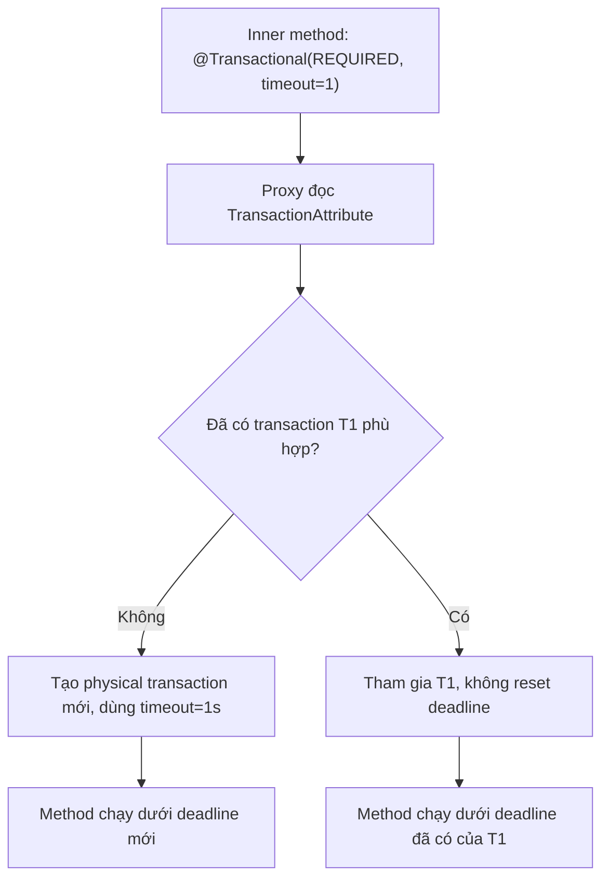

# Đơn vị timeout và thời điểm thuộc tính được áp dụng trong Spring Transaction Management

## 1. Câu trả lời cốt lõi

Trong Spring, khi khai báo:

```java
@Transactional(timeout = 5)
public void processOrder() {
    // Các thao tác thuộc transaction của phương thức.
}
```

**`timeout = 5` nghĩa là 5 giây, không phải 5 mili giây hay 5 phút.** Đây là chính sách timeout của **transaction** mà Spring yêu cầu transaction manager áp dụng **khi bắt đầu một transaction vật lý mới**. Mốc thời gian đó không được “khởi động lại” cho mỗi câu SQL, mỗi phương thức con hay mỗi lần đọc dữ liệu.

Đặc biệt:

- Nếu phương thức `REQUIRED` được gọi qua Spring proxy và **chưa có transaction hiện hành phù hợp**, manager bắt đầu transaction mới và áp dụng timeout.
- Nếu phương thức `REQUIRED` **tham gia một transaction đã có**, `timeout` khai báo trên method bên trong **không thay deadline của transaction ngoài** theo hành vi mặc định.
- Nếu phương thức sử dụng `REQUIRES_NEW`, Spring tạm ngưng transaction hiện hành và bắt đầu transaction mới có **deadline riêng**, miễn transaction manager hỗ trợ cách thực thi đó.
- Deadline **không phải bộ hẹn giờ tự động ngắt mọi Java code**. Khả năng phát hiện và cưỡng chế timeout phụ thuộc transaction manager, công nghệ persistence, JDBC statements, database và thao tác nào được thực thi sau khi quá hạn.

Đây là bài Knowledge về nhóm **Read-only và timeout** trong **Spring Framework transaction management**, tập trung vào **đơn vị**, **thời điểm timeout có hiệu lực** và **cách kiểm chứng bằng dữ liệu**.

### Mục tiêu học tập

Sau bài học, bạn có thể:

1. Chọn đúng giá trị `timeout` và `timeoutString`, không nhầm giây với mili giây.
2. Giải thích `TransactionDefinition.TIMEOUT_DEFAULT = -1`.
3. Mô tả thời điểm proxy đọc annotation, manager khởi tạo transaction và tính phần thời gian còn lại.
4. Phân biệt timeout của **transaction**, timeout của **một JDBC Statement**, timeout của **kết nối** và timeout của **HTTP client**.
5. Dự đoán hành vi `REQUIRED` tham gia transaction đang có so với `REQUIRES_NEW` mở transaction độc lập.
6. Chạy Java 17+ với Spring Boot/JDBC/H2 để quan sát commit bình thường, transaction hết hạn và timeout bên trong REQUIRED không làm ngắn deadline transaction ngoài.
7. Nhận diện những lỗi như self-invocation, sai transaction manager, sleep rồi kỳ vọng Java tự bị interrupt, hay bắt lỗi timeout rồi cố commit.

## 2. Đơn vị timeout: giây

Hai thuộc tính trên annotation được Spring định nghĩa như sau:

```java
@Transactional(timeout = 10)
public void byNumber() {
    // 10 giây.
}

@Transactional(timeoutString = "10")
public void byString() {
    // Cũng là 10 giây.
}
```

Đây là **mã minh họa hai phương thức**, cần đặt trong class Spring-managed phù hợp. `timeout` nhận một số nguyên `int`, còn `timeoutString` nhận một `String` biểu thị **số giây** sau khi được phân giải.

| Khai báo | Ý nghĩa |
| --- | --- |
| `@Transactional(timeout = 3)` | Yêu cầu timeout transaction là **3 giây** |
| `@Transactional(timeout = 60)` | Yêu cầu timeout **60 giây = 1 phút** |
| `@Transactional(timeout = 300)` | Yêu cầu timeout **300 giây = 5 phút** |
| `@Transactional(timeout = 30000)` | **30.000 giây**, không phải 30 giây |
| `@Transactional(timeoutString = "15")` | Yêu cầu **15 giây** từ chuỗi |
| `@Transactional(timeoutString = "\${app.tx.timeout-seconds}")` | Đọc cấu hình, phân giải thành **số giây** |
| `@Transactional` không ghi timeout | Dùng **timeout mặc định** của transaction manager/hạ tầng |

**Đơn vị không đổi** khi chuyển từ `timeout` sang `timeoutString`: vẫn là **giây**. `timeoutString = "PT5S"` không phải cú pháp Duration được bảo đảm của thuộc tính này; hãy dùng chuỗi số giây, ví dụ `"5"` hoặc placeholder có giá trị `5`.

### 2.1. Không nhầm với Duration hoặc millisecond

Nhiều API Java dùng `Duration.ofMillis(500)`, `Thread.sleep(500)` hoặc cấu hình HTTP như `connectTimeout(Duration.ofSeconds(5))`. Chúng **không quyết định đơn vị của Spring transaction annotation**.

```java
@Transactional(timeout = 2)
public void operation() {
    // 2 GIÂY, không phải 2 mili giây.
}
```

Nếu muốn đặt timeout 2 phút, ghi `timeout = 120`. Không viết `timeout = 120_000` theo thói quen cấu hình mili giây.

### 2.2. Mặc định -1 không phải “chắc chắn vô hạn”

`TransactionDefinition.TIMEOUT_DEFAULT` có giá trị **-1**. Đây là một **sentinel** báo Spring dùng timeout mặc định của transaction manager hoặc hệ thống giao dịch nằm bên dưới:

```java
int value = TransactionDefinition.TIMEOUT_DEFAULT; // -1
```

Đoạn code cần import `org.springframework.transaction.TransactionDefinition`.

- Một transaction manager có thể có timeout mặc định riêng.
- Hệ thống JTA có thể có policy timeout do server quy định.
- Một manager/hạ tầng không hỗ trợ timeout có thể không có giới hạn transaction-level tương ứng.
- Database vẫn có thể đặt `statement_timeout`, `lock_timeout` hay chính sách riêng **độc lập với giá trị -1 của Spring**.

Do đó, `timeout = -1` không phải lệnh “bắt buộc transaction sống mãi”. Nó chỉ chọn chính sách mặc định. Với Spring Framework, các cách cấu hình đặc biệt như `AbstractPlatformTransactionManager.setDefaultTimeout(int)` đặt mặc định **theo giây** cho manager phù hợp.

**Với `timeout = 0`:** đừng dùng như cách viết tắt “không timeout”. Trong các hạ tầng, 0 có thể được hiểu như thời hạn ngay lập tức hoặc có xử lý khác, và Spring có các quy tắc kiểm tra giá trị. Nếu mục tiêu là dùng mặc định, hãy **bỏ thuộc tính** hoặc dùng `TIMEOUT_DEFAULT` theo đúng API. Với các deadline nghiệp vụ, nên chọn số giây dương rõ ràng.

### 2.3. timeoutString và cấu hình ngoài source

Ví dụ `application.properties`:

```properties
app.tx.process-seconds=8
```

Và phương thức service:

```java
@Transactional(timeoutString = "\${app.tx.process-seconds}")
public void process() {
    // Timeout lấy từ property, giá trị hiệu lực = 8 giây.
}
```

Hai đoạn này là ví dụ cú pháp; Spring Framework 5.3+ hỗ trợ `timeoutString`. Giá trị sau khi phân giải cần chuyển thành **số giây hợp lệ**, không phải `"8s"` hay `"8000ms"` theo cách tùy tiện.

Dùng `timeoutString` khi muốn cấu hình timeout khác nhau giữa môi trường, và dùng `timeout` khi con số là một phần ổn định của hợp đồng method. Không đặt hai thuộc tính với giá trị xung đột trong cùng annotation; hãy chọn **một nguồn cấu hình** rõ ràng.

## 3. Timeout được áp dụng ở thời điểm nào?

Hai thời điểm dễ bị nhầm là:

1. **Thời điểm Spring đọc `@Transactional`:** việc tìm annotation và tạo `TransactionAttribute` có thể xảy ra ở startup hoặc lần đầu method được intercept. Đây là **metadata lookup**, không phải lúc thời gian timeout bắt đầu trôi.
2. **Thời điểm transaction manager thực sự bắt đầu một transaction mới:** đây mới là lúc policy timeout được sử dụng để thiết lập deadline/giới hạn cho physical transaction tương ứng, tùy manager.

Khi sử dụng declarative transactions dạng proxy:

```text
Ứng dụng khởi động
    |
    | Spring tìm @Transactional và có thể cache metadata.
    | Chưa bắt đầu transaction của request.
    v
Caller gọi service qua Spring proxy
    |
    v
TransactionInterceptor đọc TransactionAttribute
    |
    | propagation = REQUIRED
    | timeout = 5 seconds
    v
TransactionManager.getTransaction(definition)
    |
    +-- Không có transaction phù hợp đang chạy:
    |       tạo T1 MỚI
    |       thiết lập timeout/deadline cho T1
    |       chạy method
    |
    +-- Đã có transaction T0 phù hợp:
            tham gia T0
            không tự đặt lại deadline của T0 thành 5s
            chạy method
```

### 3.1. Lời gọi method có transaction mới

Với:

```java
@Service
class ReportService {

    @Transactional(timeout = 5)
    public void createReport() {
        // ...
    }
}
```

Nếu một controller **không có transaction** gọi bean qua proxy, `REQUIRED` mặc định yêu cầu tạo transaction mới T1. Timeout 5 giây được manager sử dụng khi T1 bắt đầu.

Thứ tự khái niệm:

```text
t0: Caller đi qua transaction interceptor
t1: Manager bắt đầu T1 và thiết lập timeout ~5 giây
t2: Method body bắt đầu chạy
t3: JDBC Statement đầu tiên chạy
t4: JDBC Statement tiếp theo chạy
t5: Method trả về, manager commit/rollback
```

**Không phải** cứ đến `t3` mới bắt đầu “5 giây” theo quy tắc chung, và cũng **không phải** mỗi Statement lại được cấp một gói 5 giây mới. Một số datasource dùng **lazy connection acquisition**, nhưng policy/deadline của transaction vẫn được manager điều phối ở boundary tương ứng.

### 3.2. Khoảng thời gian có còn khi method gọi tiếp method khác?

Có thể có:

```text
T1 bắt đầu, timeout=5s, deadline khoảng t=5s
  |
  | ~1.0s xử lý Java
  | ~0.5s truy vấn DB
  | ~1.0s gọi helper
  v
Statement tiếp theo được thực thi khi T1 còn khoảng 2.5s
```

Statement mới **không được tăng deadline lên t=7.5s**. Nếu Spring JDBC áp dụng `Statement.setQueryTimeout(...)` theo thời gian còn lại của T1, con số timeout của câu SQL có thể **ngắn hơn timeout ban đầu**.

Đây là nguyên lý **thời hạn toàn transaction**, không phải “mỗi câu SQL được 5 giây”.

### 3.3. Thời gian chờ bên ngoài DB vẫn làm trôi thời hạn

Trong một transaction T1, những thao tác sau có thể tiêu tốn thời gian:

- CPU xử lý Java.
- `Thread.sleep(...)`.
- Chờ HTTP API, file I/O hoặc mạng.
- Chờ lấy lock DB, chờ query.
- Gọi service khác cùng transaction.

**Không có bảo đảm Spring sẽ ngắt Thread.sleep đúng khi deadline đến.** Với local JDBC transactions, timeout thường được phát hiện khi một thao tác truy cập resource tiếp theo kiểm tra deadline hoặc khi JDBC driver/database áp dụng statement timeout. Một đoạn Java chạy CPU lâu mà không đụng vào resource có thể tiếp tục qua mốc deadline trước khi lỗi được phát hiện.

Điều này quan trọng trong test: hãy cho timeout thực sự **bị kiểm tra** bằng cách dùng `JdbcTemplate` hoặc thao tác transaction-aware sau khi thời hạn đã qua, thay vì chỉ đặt `Thread.sleep(2000)` trong method rồi kỳ vọng JVM tự ném lỗi tại giây thứ hai.

## 4. Cơ chế JDBC: transaction deadline và query timeout

Với `DataSourceTransactionManager` hoặc `JdbcTransactionManager`, Spring thường giữ tài nguyên JDBC/metadata của transaction trong context phù hợp. Khi transaction có timeout, Spring có thể lưu deadline trong `ConnectionHolder` của `DataSource`.

Khi `JdbcTemplate` tạo một JDBC `Statement`, nó dùng hỗ trợ của Spring JDBC để áp timeout hiện hành. Theo `DataSourceUtils.applyTimeout(...)`:

- Nếu connection holder có deadline transaction, **thời gian transaction còn lại** được sử dụng cho `Statement.setQueryTimeout(int seconds)`.
- Nếu **không có** timeout của transaction, timeout do `JdbcTemplate` cấu hình riêng có thể được dùng.
- Nếu đã hết hạn, việc tra thời gian còn lại có thể ném `TransactionTimedOutException`; hoặc JDBC query có thể bị driver/database hủy bằng một `SQLException`, được Spring dịch thành `DataAccessException` thích hợp.

### Ví dụ về thời gian còn lại

Giả sử timeout T1 = **6 giây**.

| Thời điểm | T1 đã chạy khoảng | Thời gian T1 còn lại | Kỳ vọng tại Statement tiếp theo |
| --- | ---: | ---: | --- |
| Sau khi begin | 0 giây | 6 giây | Có thể nhận query timeout xấp xỉ 6 giây |
| Trước query 2 | 2 giây | 4 giây | Có thể nhận query timeout xấp xỉ 4 giây |
| Trước query 3 | 5 giây | 1 giây | Có thể nhận query timeout xấp xỉ 1 giây |
| Sau deadline | hơn 6 giây | 0 hoặc âm | Có thể bị phát hiện timeout, không có thêm 6 giây mới |

Các số trong bảng **minh họa timeline**, không phải output được đo từ driver: Spring dùng đồng hồ và làm tròn thời gian trong giới hạn API seconds, có độ trễ scheduling, nên không được khẳng định từng `getQueryTimeout()` phải in chính xác 6, 4, 1 ở mọi máy.

### 4.1. Mẫu JDBC thủ công có timeout-aware

Khi tự tạo `Statement` qua một connection Spring-managed, có thể dùng:

```java
Connection con = DataSourceUtils.getConnection(dataSource);
try {
    try (Statement stmt = con.createStatement()) {
        DataSourceUtils.applyTransactionTimeout(stmt, dataSource);
        try (ResultSet rs = stmt.executeQuery("SELECT 1")) {
            // Đọc dữ liệu.
        }
    }
} finally {
    DataSourceUtils.releaseConnection(con, dataSource);
}
```

Đây là **snippet minh họa**, cần import JDBC `Connection`, `Statement`, `ResultSet`, `DataSource` và `DataSourceUtils`, cùng context quản lý `dataSource`. Trong ứng dụng điển hình, ưu tiên `JdbcTemplate` vì nó **tự** xử lý kết nối Spring-aware và query timeout phù hợp; không cần viết thủ công.

**Đừng** lấy `dataSource.getConnection()` tùy ý rồi coi connection đó chắc chắn đã tham gia T1. Với `DataSourceTransactionManager`, truy xuất transaction-aware qua Spring JDBC là điều quan trọng. Nếu dùng ORM, tương tác deadline còn phụ thuộc transaction manager/JPA provider.

### 4.2. Timeout của JdbcTemplate riêng có phải transaction timeout không?

Không. Ví dụ:

```java
JdbcTemplate jdbc = new JdbcTemplate(dataSource);
jdbc.setQueryTimeout(2);
```

Đây là snippet minh họa một object JDBC. Cấu hình `queryTimeout = 2` nhằm đặt giới hạn **cho các statement mà JdbcTemplate thực thi**, không đặt deadline toàn bộ method transactional. Khi transaction hiện hành có deadline, Spring có thể dùng **timeout còn lại của transaction** thay cho timeout riêng của JdbcTemplate.

Khi muốn giới hạn một query dù không có transaction, dùng API statement/query timeout phù hợp. Khi muốn giới hạn **một transaction mới**, dùng `@Transactional(timeout = ...)` và transaction manager hỗ trợ. Hai mục đích khác nhau.

### 4.3. Có phải Spring luôn rollback ngay đúng giây timeout?

Không. Cần phân biệt:

- **Deadline/timeout policy**: Spring/transaction manager đã định nghĩa một thời hạn.
- **Enforcement**: query/driver/database/hạ tầng giao dịch nhận biết và hủy hoặc ném exception khi quá hạn.
- **Rollback**: transaction manager hoàn tác các thay đổi thuộc transaction khi điều kiện rollback thực sự được kích hoạt, hoặc do resource/coordinator từ chối commit.

Một phương thức chạy `Thread.sleep(10_000)` trong transaction timeout 1 giây **không đồng nghĩa** JVM sẽ ngắt giấc ngủ đúng giây thứ nhất. Với mô hình local JDBC, lần thao tác JDBC sau giấc ngủ có thể bị từ chối do deadline đã qua. Nếu lỗi runtime thoát qua interceptor, transaction thông thường rollback.

Nếu framework hoặc driver trả exception khác hay timeout không được resource hỗ trợ, hành vi cần kiểm chứng theo stack thực tế. Vì vậy **không hứa mọi method vượt timeout chắc chắn bị dừng hoặc rollback đúng mili giây**.

## 5. Khi timeout **có** và **không** được áp dụng

Theo Spring Javadoc, `@Transactional.timeout` và `timeoutString` được thiết kế cho **transaction mới** — thường thông qua `REQUIRED` hoặc `REQUIRES_NEW`.

| Bối cảnh lời gọi | Có tạo physical transaction mới? | Timeout trên method đó có hiệu lực cho deadline mới? |
| --- | --- | --- |
| `REQUIRED`, caller chưa có transaction | Có | **Có** nếu manager hỗ trợ |
| `REQUIRED`, caller đã có transaction T1 cùng manager | Không, tham gia T1 | **Không đặt lại** timeout T1 |
| `REQUIRES_NEW`, caller chưa có transaction | Có | **Có** |
| `REQUIRES_NEW`, caller đang có T1 | Có, T1 bị suspend | **Có**, deadline riêng cho T2 |
| `SUPPORTS`, không có transaction | Không yêu cầu physical transaction | Không tạo deadline transaction mới |
| `NOT_SUPPORTED`, caller đang có T1 | Suspend T1, chạy non-transactionally | Không tạo deadline transaction mới |
| `MANDATORY`, đã có T1 | Tham gia T1 | Không tự đặt lại deadline của T1 |
| `NESTED`, đã có T1 và dùng savepoint | Thường không có physical transaction mới | Không nên kỳ vọng deadline độc lập cho savepoint |

**Chú ý với NESTED:** khi chưa có transaction, NESTED có thể hành xử như REQUIRED để tạo transaction mới tùy manager. Khi đã nằm trong T1 và sử dụng JDBC savepoint, nó **không phải** REQUIRES_NEW và không có transaction vật lý mới để áp deadline độc lập.

### 5.1. Vì sao REQUIRED bên trong không “xin thêm thời gian”?

Ví dụ:

```java
@Service
class InnerService {
    @Transactional(
        propagation = Propagation.REQUIRED,
        timeout = 30
    )
    public void inner() {
        // Tham gia transaction đang tồn tại nếu caller có T1.
    }
}

@Service
class OuterService {
    private final InnerService inner;

    @Transactional(timeout = 5)
    public void outer() {
        inner.inner();  // Cùng transaction manager.
    }
}
```

Đây là snippet minh họa cấu trúc, chưa phải các file compile độc lập. Nếu outer được intercept và đã tạo T1 timeout 5 giây, `inner()` dùng REQUIRED để **tham gia T1**. Mức 30 giây trên inner **không mở rộng** T1 thành 30 giây.

Chiều ngược lại cũng quan trọng:

```text
Outer: REQUIRED timeout=30s => tạo T1
  |
  +-- Inner: REQUIRED timeout=2s => tham gia T1
       (không tự rút deadline T1 xuống 2s)
```

T1 được quản lý theo deadline do outer đã thiết lập. **Annotation inner không tự tạo một đồng hồ riêng** khi chỉ tham gia T1. Mặt khác, một query timeout hoặc rule database độc lập đặt trong inner **có thể** ngắn hơn; đó là cấu hình resource khác, không phải timeout của transaction T1 bị thay thế.

### 5.2. REQUIRES_NEW: đồng hồ riêng, không tự cộng thời gian

```java
@Transactional(timeout = 20)
public void outer() {
    independentService.inner();
}

@Transactional(
    propagation = Propagation.REQUIRES_NEW,
    timeout = 3
)
public void inner() {
    // Có transaction mới T2 và deadline ~3s riêng.
}
```

Đây là snippet minh họa trong **hai Spring beans khác nhau**, gọi qua proxy và cùng một manager có hỗ trợ transaction suspension. Inner có **T2** với timeout 3 giây. Outer có **T1** với timeout 20 giây.

Lịch khái niệm:

```text
t=0s:  outer bắt đầu T1, timeout 20s
t=2s:  inner bắt đầu T2, timeout 3s, suspend T1
t=4s:  inner commit T2
t=4s:  resume T1, thời gian T1 còn khoảng 16s
t=...: outer kết thúc T1
```

**T1 không được tặng thêm 2 giây** vì bị suspend. Với cơ chế deadline theo thời gian thực của local JDBC, thời gian vẫn trôi trong lúc outer chờ inner. Đừng trông chờ resume sẽ reset timeout outer.

Nếu T2 vượt timeout, nó có thể rollback, nhưng **T1 không tự rollback chỉ vì T2 hết hạn** nếu outer xử lý ngoại lệ và không có nguyên nhân rollback-only khác. Nếu exception runtime thoát luôn qua outer, outer có thể rollback theo quy tắc của **chính outer**.

### 5.3. Annotation class và method: timeout nào được chọn?

```java
@Transactional(timeout = 30, readOnly = true)
public class ReportService {

    public void list() {
        // Theo policy ở class.
    }

    @Transactional(timeout = 5)
    public void recompute() {
        // Policy của method thắng toàn bộ policy class.
    }
}
```

Đây là snippet minh họa. Khi cả method và class có annotation, metadata của **method** được chọn cho method đó; không tự merge thuộc tính từng trường:

- `list()`: timeout 30 giây, readOnly=true từ class nếu method đủ điều kiện intercept.
- `recompute()`: timeout 5 giây, readOnly mặc định `false` — không tự “kế thừa thêm readOnly=true” từ annotation của class.

Đó là **quy tắc chọn transaction attributes**. Sau khi chọn policy, timeout của nó vẫn chỉ tác động deadline khi transaction mới thực sự được mở.

## 6. Read-only và timeout: hai thuộc tính khác mục đích

Ví dụ:

```java
@Transactional(readOnly = true, timeout = 4)
public Report loadReport() {
    // ...
}
```

Đây là chữ ký minh họa, cần định nghĩa kiểu `Report`. Hai thuộc tính:

- `readOnly = true`: mô tả ý định giao dịch thiên về đọc, thường là **gợi ý** để transaction manager/driver/ORM tối ưu. Không phải phương thức “bảo mật” để cấm mọi ghi.
- `timeout = 4`: yêu cầu manager giới hạn **thời gian của transaction mới**, tính bằng **giây**.

Không có quan hệ “readOnly=true thì timeout được đo bằng đơn vị khác”. Cả hai đều thuộc metadata của transaction, nhưng được áp dụng theo semantics của từng loại manager và resource.

Với `REQUIRED` tham gia transaction đang có, các thuộc tính của transaction ngoài thường chi phối physical transaction. Một số manager có tùy chọn `validateExistingTransaction` để từ chối một số policy không tương thích (chẳng hạn mismatch isolation hoặc read-only), nhưng không nên kỳ vọng mỗi method con có thể tự thay đổi deadline của outer.

Một read-only query chậm vẫn có thể timeout. Ngược lại, đọc nhanh không có nghĩa transaction đã commit; deadline và các bước commit/rollback vẫn theo ranh giới transaction.

## 7. Ví dụ Java 17+ chạy được: giây, deadline và REQUIRED tham gia transaction ngoài

Bài thực hành dùng **Spring Boot 3.x**, **Java 17+**, **Spring JDBC** và **H2 in-memory** để chứng minh ba tình huống:

1. Transaction mới có timeout đủ dài → commit.
2. Transaction mới có timeout ngắn; method chờ quá deadline rồi **thực hiện JDBC tiếp** → Spring phát hiện timeout, rollback.
3. Outer REQUIRED timeout 15 giây gọi inner REQUIRED timeout 1 giây; inner chờ hơn 1 giây rồi ghi DB thành công → **timeout trên inner không thay deadline của T1**.

Để không phụ thuộc vào tốc độ query H2, kịch bản hết hạn sử dụng `Thread.sleep(...)` để **chủ động tiêu thụ thời gian** và sau đó gọi `JdbcTemplate`, nơi Spring JDBC kiểm tra timeout còn lại. **Sleep không phải cơ chế timeout**; chính lần truy cập tài nguyên sau thời hạn mới là điểm quan sát.

### 7.1. Tạo project

Tạo Maven project bằng Spring Initializr:

- Spring Boot **3.x** tương thích JDK 17.
- Java **17** hoặc cao hơn.
- Dependencies **Spring JDBC** (`spring-boot-starter-jdbc`) và **H2 Database**.
- Package gốc `com.example.txtimeout`.

Giữ `pom.xml` hoàn chỉnh do Spring Initializr sinh ra. Những dependency cần có:

```xml
<dependencies>
    <dependency>
        <groupId>org.springframework.boot</groupId>
        <artifactId>spring-boot-starter-jdbc</artifactId>
    </dependency>
    <dependency>
        <groupId>com.h2database</groupId>
        <artifactId>h2</artifactId>
        <scope>runtime</scope>
    </dependency>
</dependencies>
```

Đây chỉ là **phần dependencies**, không phải toàn bộ `pom.xml`.

Cấu trúc file:

```text
src/main/
  java/com/example/txtimeout/
    TimeoutApplication.java
    TimedWorkService.java
    OuterService.java
    JoiningService.java
  resources/
    schema.sql
    application.properties
```

### 7.2. Schema và cấu hình

File `src/main/resources/schema.sql`:

```sql
CREATE TABLE tx_event (
    id BIGINT PRIMARY KEY,
    label VARCHAR(40) NOT NULL
);
```

File `src/main/resources/application.properties`:

```properties
spring.main.web-application-type=none
spring.datasource.url=jdbc:h2:mem:tx_timeout_demo;DB_CLOSE_DELAY=-1
spring.datasource.driver-class-name=org.h2.Driver
spring.datasource.username=sa
spring.datasource.password=
spring.datasource.hikari.maximum-pool-size=4
app.tx.configured-seconds=6
```

Với H2 embedded và khởi tạo SQL mặc định của Spring Boot, `schema.sql` chạy lúc ứng dụng khởi động. Database tồn tại in-memory trong quá trình JVM chạy. Nếu bạn bật cơ chế khởi tạo khác hoặc chạy nhiều lần trong cùng tiến trình với dữ liệu cũ, reset schema trước khi so sánh output.

Giá trị `app.tx.configured-seconds=6` sẽ được dùng trong phần minh họa `timeoutString`, giúp thấy rõ một property được chuyển thành **sáu giây**.

### 7.3. Service có transaction mới và deadline hết hạn

File `src/main/java/com/example/txtimeout/TimedWorkService.java`:

```java
package com.example.txtimeout;

import org.springframework.jdbc.core.JdbcTemplate;
import org.springframework.stereotype.Service;
import org.springframework.transaction.annotation.Transactional;
import org.springframework.transaction.support.TransactionSynchronizationManager;

@Service
public class TimedWorkService {

    private final JdbcTemplate jdbc;

    public TimedWorkService(JdbcTemplate jdbc) {
        this.jdbc = jdbc;
    }

    @Transactional(timeout = 5)
    public void fastCommit() {
        System.out.println(
            "fast: active=" +
            TransactionSynchronizationManager
                .isActualTransactionActive());

        jdbc.update(
            "INSERT INTO tx_event(id, label) VALUES (?, ?)",
            1L, "fast");
    }

    @Transactional(timeout = 1)
    public void expiresBeforeNextStatement() {
        System.out.println(
            "expiring: active=" +
            TransactionSynchronizationManager
                .isActualTransactionActive());

        // Ghi vào transaction đang có, chưa commit.
        jdbc.update(
            "INSERT INTO tx_event(id, label) VALUES (?, ?)",
            2L, "should-rollback");

        // Thread.sleep chỉ tiêu tốn wall-clock time.
        // Nó không tự bị @Transactional ngắt đúng giây thứ nhất.
        pause(1800L);

        // Spring JDBC kiểm tra thời gian transaction còn lại
        // khi chuẩn bị Statement này; deadline đã hết.
        jdbc.queryForObject(
            "SELECT COUNT(*) FROM tx_event",
            Integer.class);
    }

    @Transactional(timeoutString = "\${app.tx.configured-seconds}")
    public void configuredCommit() {
        jdbc.update(
            "INSERT INTO tx_event(id, label) VALUES (?, ?)",
            5L, "configured");
    }

    static void pause(long millis) {
        try {
            Thread.sleep(millis);
        } catch (InterruptedException ex) {
            Thread.currentThread().interrupt();
            throw new IllegalStateException("Interrupted", ex);
        }
    }
}
```

**Vì sao `expiresBeforeNextStatement()` phải gọi JDBC sau khi sleep?**

Vì transaction timeout của Spring không nhất thiết được thực thi bằng một thread timer “hẹn giờ ném exception”. Với local JDBC, Spring có thể phát hiện deadline đã hết khi `JdbcTemplate` chuẩn bị Statement dựa trên timeout của `ConnectionHolder`. Do đó:

- Trước `pause(...)`, INSERT id=2 đã chạy trong transaction mới nhưng **chưa commit**.
- `pause(1800)` lâu hơn timeout **1 giây**.
- Khi chuẩn bị câu SQL tiếp theo, deadline đã qua. Trong cấu hình Spring JDBC/H2 này, lỗi timeout được phát hiện và `TransactionTimedOutException` thoát khỏi method.
- Transaction interceptor thực hiện rollback, nên id=2 không còn.
- Method khác có `timeoutString` là minh họa rằng placeholder nhận giá trị **6 giây**, không phải sáu mili giây.

Hành vi exception cụ thể có thể khác nếu resource/driver tự báo timeout sớm theo cơ chế khác. Với đường truy vấn sau khi deadline đã qua trong Spring JDBC, thường sẽ gặp `TransactionTimedOutException`; trên câu SQL chạy dài, có thể gặp `DataAccessException` do driver/database hủy statement. Hãy ưu tiên kiểm tra **DB state sau lời gọi**.

### 7.4. Inner REQUIRED với timeout ngắn nhưng tham gia transaction dài của outer

File `src/main/java/com/example/txtimeout/JoiningService.java`:

```java
package com.example.txtimeout;

import org.springframework.jdbc.core.JdbcTemplate;
import org.springframework.stereotype.Service;
import org.springframework.transaction.annotation.Propagation;
import org.springframework.transaction.annotation.Transactional;
import org.springframework.transaction.interceptor.TransactionAspectSupport;

@Service
public class JoiningService {

    private final JdbcTemplate jdbc;

    public JoiningService(JdbcTemplate jdbc) {
        this.jdbc = jdbc;
    }

    @Transactional(
        propagation = Propagation.REQUIRED,
        timeout = 1
    )
    public void joinOuter() {
        boolean newTransaction =
            TransactionAspectSupport.currentTransactionStatus()
                .isNewTransaction();

        System.out.println("inner REQUIRED: new=" + newTransaction);

        // Cố ý lâu hơn timeout khai báo trên inner.
        TimedWorkService.pause(1500L);

        // Câu SQL vẫn có thể thành công vì physical T1
        // đang dùng deadline 15 giây được outer đặt lúc begin.
        jdbc.update(
            "INSERT INTO tx_event(id, label) VALUES (?, ?)",
            4L, "inner-joined");
    }
}
```

Trong mô hình Spring JDBC/H2, khi `joinOuter()` được gọi từ một **Spring bean khác** qua proxy và transaction T1 của outer đã tồn tại trên cùng manager, `REQUIRED` tham gia T1; do đó `isNewTransaction() == false`.

Chữ `timeout = 1` trên inner vẫn hiện diện trong annotation metadata, nhưng **không tạo một deadline vật lý mới** khi method chỉ tham gia T1. Sleep 1,5 giây không làm T1 bị timeout do “deadline 1 giây của inner”.

File `src/main/java/com/example/txtimeout/OuterService.java`:

```java
package com.example.txtimeout;

import org.springframework.jdbc.core.JdbcTemplate;
import org.springframework.stereotype.Service;
import org.springframework.transaction.annotation.Transactional;
import org.springframework.transaction.interceptor.TransactionAspectSupport;

@Service
public class OuterService {

    private final JdbcTemplate jdbc;
    private final JoiningService joiningService;

    public OuterService(
            JdbcTemplate jdbc,
            JoiningService joiningService) {
        this.jdbc = jdbc;
        this.joiningService = joiningService;
    }

    @Transactional(timeout = 15)
    public void outerWithJoinedInner() {
        System.out.println(
            "outer: new=" +
            TransactionAspectSupport.currentTransactionStatus()
                .isNewTransaction());

        jdbc.update(
            "INSERT INTO tx_event(id, label) VALUES (?, ?)",
            3L, "outer");

        // Gọi bean khác, nên @Transactional của inner
        // thực sự được interceptor đọc và áp dụng.
        joiningService.joinOuter();
    }
}
```

**Tại sao phải tách thành hai service?** Nếu `outerWithJoinedInner()` tự gọi `this.joinOuter()` trong cùng class, proxy mode có thể không intercept inner method. Khi đó bạn không chứng minh được rằng Spring đã thấy chính sách inner REQUIRED mà vẫn không tạo transaction mới. Tách bean giúp quan sát đúng propagation semantics.

### 7.5. Caller và stdout

File `src/main/java/com/example/txtimeout/TimeoutApplication.java`:

```java
package com.example.txtimeout;

import org.springframework.boot.CommandLineRunner;
import org.springframework.boot.SpringApplication;
import org.springframework.boot.autoconfigure.SpringBootApplication;
import org.springframework.context.annotation.Bean;
import org.springframework.jdbc.core.JdbcTemplate;
import org.springframework.transaction.TransactionTimedOutException;
import org.springframework.transaction.annotation.EnableTransactionManagement;

@SpringBootApplication
@EnableTransactionManagement
public class TimeoutApplication {

    public static void main(String[] args) {
        SpringApplication.run(TimeoutApplication.class, args);
    }

    @Bean
    CommandLineRunner demonstrate(
            TimedWorkService work,
            OuterService outer,
            JdbcTemplate jdbc) {

        return args -> {
            System.out.println("initial rows=" + count(jdbc));

            work.fastCommit();
            System.out.println("after fast rows=" + count(jdbc));

            try {
                work.expiresBeforeNextStatement();
            } catch (TransactionTimedOutException ex) {
                System.out.println("deadline caught");
            }
            System.out.println("after expired rows=" + count(jdbc));

            outer.outerWithJoinedInner();
            System.out.println("after outer rows=" + count(jdbc));

            work.configuredCommit();
            System.out.println("after configured rows=" + count(jdbc));
        };
    }

    private static int count(JdbcTemplate jdbc) {
        Integer value = jdbc.queryForObject(
            "SELECT COUNT(*) FROM tx_event",
            Integer.class);
        return value;
    }
}
```

Chạy project Maven trong thư mục chứa `pom.xml`:

```bash
./mvnw spring-boot:run
```

Trên Windows PowerShell:

```powershell
.\mvnw.cmd spring-boot:run
```

Với Spring Boot 3.x, H2 và nguồn dữ liệu/test schema nêu trên, các dòng do **chính chương trình in** (bỏ qua log khởi động) là:

```text
initial rows=0
fast: active=true
after fast rows=1
expiring: active=true
deadline caught
after expired rows=1
outer: new=true
inner REQUIRED: new=false
after outer rows=3
after configured rows=4
```

### 7.6. Giải thích kết quả từng bước

| Lời gọi | Timeout policy | Có tạo physical transaction mới? | Kết quả |
| --- | --- | --- | --- |
| `work.fastCommit()` | 5 giây | Có, vì caller chưa có transaction | INSERT id=1 commit, count=1 |
| `work.expiresBeforeNextStatement()` | 1 giây | Có | Sau sleep ~1,8 giây, truy cập JDBC phát hiện timeout, rollback id=2; count vẫn 1 |
| `outer.outerWithJoinedInner()` | 15 giây | Có | INSERT id=3 và gọi inner trong cùng T1 |
| `joiningService.joinOuter()` | Ghi `timeout=1` nhưng REQUIRED tham gia T1 | **Không**, `new=false` | Sleep ~1,5 giây rồi INSERT id=4 vẫn thành công theo deadline T1 15 giây |
| `work.configuredCommit()` | Placeholder resolve thành 6 giây | Có | INSERT id=5 commit, count=4 |

**Tại sao sau outer có ba hàng?** Id=1 (fast), id=3 (outer) và id=4 (inner joined) tồn tại. Id=2 đã rollback do timeout. Sau configuredCommit, id=5 được thêm nên tổng thành bốn.

**Tại sao inner vẫn thành công sau 1,5 giây dù timeout=1?** Bởi vì đó là **scope REQUIRED tham gia transaction T1 đã mở với timeout=15**. Nó không có physical deadline riêng 1 giây. Nếu outer timeout chỉ 1 giây, kết quả có thể ngược lại vì deadline T1 đã hết khi inner thực hiện JDBC.

**Vì sao exception được bắt ở CommandLineRunner, không ở service?** Nó cần **thoát qua transaction interceptor** để Spring rollback transaction mới. Nếu service bắt exception rồi tiếp tục, kết quả có thể khác hoặc commit vẫn bị chặn do transaction/resource đã quá hạn. Đừng bắt và nuốt lỗi timeout rồi coi transaction còn khỏe.

### 7.7. Những điều kiện ảnh hưởng việc tái lập

- `Thread.sleep(1800)` có độ trễ ít nhất gần 1,8 giây khi không bị interrupt, vượt timeout 1 giây. Tuy nhiên môi trường quá tải, cấu hình driver khác hoặc transaction manager khác có thể cho exception khác; ghi rõ stack thực tế nếu quan sát sai.
- `schema.sql` phải được khởi tạo trên database H2 trống; không chạy song song một runner thứ hai dùng cùng ID.
- Service phải được Spring tạo và được gọi qua **proxy**; không gọi `new TimedWorkService(...)`.
- `JdbcTemplate` và manager phải dùng **cùng DataSource**. Nếu có nhiều manager, chọn đúng bean và resource.
- Bài này không test “đồng hồ tự động interrupt thread”; nó test **deadline được kiểm tra trước JDBC Statement tiếp theo**.
- Timeout của transaction không chứng minh email/API/file I/O ngoài DB có khả năng rollback.

## 8. Vì sao timeout của service con không áp dụng khi tham gia transaction ngoài?

Có hai tầng khái niệm:

**Tầng metadata:** `TransactionAttributeSource` đọc và biết inner có `@Transactional(timeout=1, propagation=REQUIRED)`.

**Tầng transaction manager:** khi inner được proxy intercept, manager nhìn thấy **physical transaction T1 đã tồn tại**. Với REQUIRED, inner **tham gia T1**. Do đó nó không gọi lại đường bắt đầu transaction vật lý mới để thiết lập timeout=1.



**Điều cần ghi nhớ:** annotation có mặt không đồng nghĩa mọi thuộc tính của nó sẽ được áp dụng lại cho một transaction đã tồn tại. Isolation và timeout thuộc những đặc tính được chọn khi physical transaction được tạo.

Nếu muốn một deadline độc lập ngắn hơn cho một khối công việc, cân nhắc `REQUIRES_NEW` **chỉ khi** nghiệp vụ chấp nhận commit/rollback độc lập. Không thay `REQUIRED` bằng `REQUIRES_NEW` chỉ để “thắt thời gian” mà bỏ qua rủi ro consistency và pool.

Nếu chỉ muốn hạn chế một câu SQL cụ thể, có thể đặt **query timeout** hoặc database statement timeout thích hợp mà không tạo physical transaction mới. Cần cân nhắc kết quả nếu câu SQL fail giữa transaction ngoài, đặc biệt trạng thái rollback-only.

## 9. So sánh những loại timeout khác nhau

Không nên dùng từ “timeout” mà không chỉ ra **đối tượng được giới hạn**.

| Loại | Đơn vị thường gặp | Bắt đầu tính từ đâu? | Nó giới hạn cái gì? |
| --- | --- | --- | --- |
| `@Transactional(timeout=5)` | **Giây** | Khi transaction mới được manager bắt đầu | Thời hạn quản lý transaction, thực thi phụ thuộc hạ tầng |
| `JdbcTemplate.setQueryTimeout(5)` | **Giây** | Theo JDBC `Statement` | Thời gian chờ/cho phép thực thi Statement, tùy driver |
| JDBC `Statement.setQueryTimeout(5)` | **Giây** | Theo Statement/query invocation của driver | Một statement |
| HikariCP `connectionTimeout` | **Mili giây** khi dùng property HikariCP chuẩn | Khi yêu cầu mượn connection từ pool | Chờ có connection rảnh, không phải thời gian transaction |
| PostgreSQL `statement_timeout` | Đơn vị theo SQL configuration | Theo SQL statement | Thời gian chạy statement ở DB |
| PostgreSQL `lock_timeout` | Đơn vị theo SQL configuration | Khi chờ lock | Thời gian chờ lock, không phải toàn transaction |
| HTTP client read/response timeout | Thường `Duration`/mili giây, tùy thư viện | Tùy request/operation | Chờ network/response |
| Database socket timeout | Tùy JDBC driver | Theo socket I/O | Chờ network DB |

Một số timeout được khai báo bằng property có hậu tố rõ ràng như `-ms` hoặc giá trị `Duration`; không thể lấy đơn vị của chúng để áp vào `@Transactional(timeout=...)`.

### Trường hợp nhiều timeout cùng tồn tại

Giả sử transaction T1 có 10 giây, một query có timeout riêng 2 giây, database có statement_timeout 4 giây và HTTP client có 1 giây. Không được tuyên bố “Spring sẽ luôn hủy toàn bộ hoạt động ngay sau 1 giây”. Những cơ chế này **kiểm soát các đối tượng khác nhau** và có thể phát sinh exception ở những thời điểm khác nhau.

Với Spring JDBC, transaction deadline có thể override queryTimeout riêng của JdbcTemplate khi áp trên Statement thông qua `DataSourceUtils`. Với DBMS còn có timeout phía server; driver và DB có thể hủy statement theo hạn ngắn hơn mà không tự cung cấp cùng semantics rollback như transaction timeout Spring.

**Thực hành tốt:** đặt timeout dựa trên mục tiêu cụ thể (pool, statement, transaction, remote API), theo dõi metric và kiểm thử đường lỗi, không dùng một thuộc tính để thay thế tất cả timeout của hệ thống.

## 10. Ngữ nghĩa khi có ngoại lệ timeout

### 10.1. TransactionTimedOutException

Spring có ngoại lệ:

```java
org.springframework.transaction.TransactionTimedOutException
```

Trong local transaction strategies, Spring có thể ném ngoại lệ này khi phát hiện deadline đã qua. Nó là runtime exception, nên với rollback rules mặc định, khi nó thoát ra từ method được transaction interceptor quản lý, transaction mới thường **rollback**.

Nhưng có hai cảnh báo:

1. Một query bị timeout ở JDBC driver có thể ném `SQLException`, được `JdbcTemplate` chuyển thành một `DataAccessException` khác. **Không phải mọi timeout đều cùng một class exception**.
2. Transaction manager/database có thể xử lý timeout khác nhau. Không dùng một đoạn `catch (TransactionTimedOutException)` duy nhất để khẳng định đã xử lý toàn bộ trường hợp query timeout, lock timeout, pool timeout và network timeout.

### 10.2. Không tiếp tục ghi sau khi transaction hết hạn

Ví dụ anti-pattern:

```java
@Transactional(timeout = 1)
public void process() {
    try {
        slowJdbcOperation();
    } catch (RuntimeException ex) {
        // Bỏ qua lỗi và tiếp tục INSERT khác trong cùng transaction.
    }
}
```

Đây là snippet minh họa có helper chưa định nghĩa. Việc nuốt lỗi timeout có thể làm transaction ở trạng thái hết hạn, rollback-only hoặc database đã abort. Một thao tác tiếp theo có thể tiếp tục thất bại; việc commit có thể ném lỗi hoặc rollback.

Hướng đúng là:

- Để exception phù hợp **thoát qua interceptor** cho transaction rollback.
- Nếu cần retry, thực hiện **toàn bộ use case trong transaction mới**, có giới hạn số lần, backoff và idempotency.
- Nếu cần ghi thông tin thất bại, thiết kế nhật ký/audit độc lập với nghiệp vụ chính, hiểu rõ rollback và consistency.
- Ghi nhận loại timeout thực sự để tối ưu đúng tầng (SQL chậm, lock, pool, remote API hay transaction duration).

### 10.3. Exception nào làm rollback?

Rollback rule mặc định của Spring thường rollback với `RuntimeException` và `Error`, không tự rollback checked exceptions. Có thể đặt `rollbackFor` tùy nghiệp vụ. Tuy nhiên một timeout ở transaction/database có thể đã khiến transaction không còn đủ điều kiện commit; **`noRollbackFor` không phải phép màu buộc DB commit một giao dịch đã hết hạn/aborted**.

## 11. Kiểm chứng chính sách bằng metadata và runtime

### 11.1. Metadata cho biết chính sách được yêu cầu

Bạn có thể đọc attribute của method mà **không mở transaction**:

```java
AnnotationTransactionAttributeSource source =
    new AnnotationTransactionAttributeSource(true);

Method method = TimedWorkService.class
    .getMethod("fastCommit");

TransactionAttribute attr =
    source.getTransactionAttribute(
        method, TimedWorkService.class);

if (attr != null) {
    System.out.println(attr.getTimeout()); // 5
}
```

Đây là snippet minh họa sử dụng classes ở mục 7, cần import `java.lang.reflect.Method`, `AnnotationTransactionAttributeSource` và `TransactionAttribute`. Kết quả metadata `5` chứng minh Spring đã đọc annotation **5 giây**, nhưng **không chứng minh manager đã bắt đầu transaction mới** hoặc transaction đã timeout.

### 11.2. Runtime cho biết transaction đang mới hay tham gia

Bên trong method thực sự đi qua proxy:

```java
boolean newPhysicalTransaction =
    TransactionAspectSupport.currentTransactionStatus()
        .isNewTransaction();
```

Giá trị thường:

- `true`: scope này là chủ sở hữu transaction mới trong case REQUIRED không có outer.
- `false`: inner REQUIRED tham gia transaction hiện có.

Đừng dùng `isNewTransaction()` để đo số giây còn lại: nó chỉ mô tả status, **không trả về deadline**. Trong Spring JDBC có các API holder để chẩn đoán thời gian còn lại, nhưng đó là API hạ tầng/resource-specific, không nên dùng làm hợp đồng nghiệp vụ.

### 11.3. Test tích hợp phải kiểm tra database

Bài thực hành mục 7 không chỉ bắt exception mà còn query sau khi method đã hoàn tất:

- Method fast: id=1 tồn tại.
- Method expired: id=2 **không tồn tại** do rollback.
- Outer + inner REQUIRED: id=3 và id=4 cùng commit dưới deadline T1.
- Method property timeoutString: id=5 commit.

Nếu test chỉ in `"timeout caught"` mà không đọc DB, bạn chưa chứng minh dữ liệu được hoàn tác chính xác.

### 11.4. Khi dùng Spring Test

Một test method có `@Transactional` có thể được Spring Test mở transaction ngoài trước khi gọi service. Lúc đó method service `REQUIRED` **tham gia transaction của test**; timeout trên service không được áp dụng như một deadline mới. Nếu test tự rollback sau cùng, bạn cũng không quan sát commit thật của service.

Để kiểm tra timeout của **transaction mới**:

- Gọi service từ test/caller **không có outer transaction**.
- Hoặc điều khiển transaction của test tường minh bằng tiện ích test phù hợp.
- Truy vấn DB **sau khi transaction service kết thúc**, không dùng session cache có dữ liệu chưa flush làm bằng chứng.

## 12. Những lỗi thường gặp khi cấu hình timeout

**Lỗi 1 — Nhầm đơn vị.** `timeout=5000` bị hiểu nhầm là 5 giây. Thực tế là **5.000 giây**, hơn 83 phút. Với 5 giây, ghi `timeout=5`.

**Lỗi 2 — Dùng `timeoutString="5s"` hoặc ISO duration như một chuẩn.** Annotation của Spring yêu cầu giá trị timeout tính **bằng giây** ở dạng string số, thường là `"5"` hoặc placeholder. Không tự giả định các cú pháp duration của cấu hình ứng dụng được hỗ trợ ở đây.

**Lỗi 3 — Đặt timeout trên inner REQUIRED rồi tưởng reset deadline outer.** Inner chỉ tham gia T1; timeout vật lý là của T1 khi mở. Muốn thời gian riêng cần thiết kế khác, nhưng đổi thành REQUIRES_NEW sẽ có consistency tradeoffs.

**Lỗi 4 — Tưởng sleep bị ngắt tự động.** Spring transaction timeout không phải timer bảo đảm interrupt Java thread đúng thời điểm. Test phải thực hiện resource operation hoặc kiểm tra commit/rollback thực tế.

**Lỗi 5 — Tưởng mọi JDBC statement có nguyên timeout mới.** Với Spring JDBC, deadline transaction còn lại thường được áp cho statement; mỗi statement không tự gia hạn transaction.

**Lỗi 6 — Gọi bằng self-invocation.** Method có annotation nhưng được gọi bằng `this.method()` trong cùng bean thường không đi qua transaction advice, nên timeout policy không được áp dụng tại đó.

**Lỗi 7 — Sai manager/datasource.** Một manager có deadline trên datasource A không tự áp timeout cho câu SQL chạy qua datasource B không tham gia transaction đó.

**Lỗi 8 — Dùng timeout transaction để thay timeout pool/HTTP.** Timeout của `@Transactional` không bảo đảm ngắt chờ Hikari connection hay remote request. Mỗi tài nguyên cần timeout thích hợp.

**Lỗi 9 — Dựa vào timeout để sửa query chậm.** Timeout chỉ giới hạn thất bại; cần EXPLAIN, chỉ mục, transaction ngắn, khóa, phân trang, batch và xử lý concurrency.

**Lỗi 10 — Bắt và nuốt timeout rồi tiếp tục commit.** Giao dịch có thể không còn hợp lệ. Nên rollback và retry an toàn ở một transaction mới, hoặc trả lỗi rõ ràng.

**Lỗi 11 — Kỳ vọng readOnly=true nghĩa là timeout không còn cần thiết.** Read-only query vẫn có thể giữ connection/lock hoặc tốn nhiều thời gian; timeout và read-only là hai thuộc tính độc lập.

**Lỗi 12 — Đặt timeout quá ngắn cho công việc cần nhiều thao tác chậm.** Một transaction dài có thể vượt thời hạn do SQL, chờ lock, hoặc I/O. Tách I/O ngoài transaction khi phù hợp, đo p95/p99 và chọn deadline theo SLO thật.

## 13. Bài tập dự đoán

### Câu 1 — Đơn vị

`@Transactional(timeout = 90)` cho phép thời hạn yêu cầu bao nhiêu?

**Đáp án:** **90 giây = 1 phút 30 giây**, không phải 90 mili giây.

### Câu 2 — Default

`TransactionDefinition.TIMEOUT_DEFAULT = -1` có bắt buộc nghĩa là transaction không bao giờ hết hạn?

**Đáp án:** Không. Nó yêu cầu **dùng default** của transaction manager/hạ tầng, có thể có một timeout riêng hoặc không có giới hạn transaction-level tương ứng.

### Câu 3 — Inner REQUIRED tăng timeout

Outer mới mở T1 timeout 5 giây. Inner REQUIRED được gọi qua bean khác với `timeout=60`. Deadline T1 có được tăng thành 60 giây?

**Đáp án:** **Không.** Inner tham gia transaction T1 đã có; timeout của T1 được chọn khi outer mở physical transaction.

### Câu 4 — Inner REQUIRED giảm timeout

Outer mới mở T1 timeout 20 giây. Inner REQUIRED `timeout=1` ngủ 1,5 giây rồi JDBC query. Có bắt buộc query thất bại do timeout=1 của inner?

**Đáp án:** **Không**, vì không có physical transaction mới cho inner; deadline của T1 vẫn từ outer, giả sử còn đủ thời gian và query/resource không có timeout khác.

### Câu 5 — REQUIRES_NEW

Outer T1 timeout 20 giây, sau 4 giây gọi inner `REQUIRES_NEW timeout=3`, inner kết thúc sau 2 giây. Khi outer resume, T1 có được 20 giây mới?

**Đáp án:** **Không.** T2 có deadline riêng; T1 đã trôi khoảng 6 giây từ lúc mở, chỉ còn khoảng 14 giây trong cơ chế deadline theo wall-clock.

### Câu 6 — Sleep và timeout

Method có `@Transactional(timeout=1)`, gọi `Thread.sleep(3000)` rồi trả về mà không đụng resource nào. Có chắc JVM ném `TransactionTimedOutException` ngay giây thứ nhất?

**Đáp án:** **Không.** Local transaction timeout không phải cơ chế interrupt Java thread chính xác. Việc thực thi và kiểm tra hạn phụ thuộc manager/resource; không nên dựa vào sleep-only để chứng minh cưỡng chế timeout.

### Câu 7 — Timeout của JdbcTemplate

Transaction timeout 10 giây, sau nhiều thao tác đã trôi 8 giây, JdbcTemplate chuẩn bị query mới với `queryTimeout=30` riêng. Query có chắc được 30 giây độc lập?

**Đáp án:** **Không.** Khi Spring JDBC nhận deadline transaction qua connection holder, nó có thể áp **thời gian còn lại của transaction** (~2 giây) lên JDBC Statement, thay vì queryTimeout riêng 30 giây.

### Câu 8 — timeoutString

`app.tx.wait-seconds=12` và `@Transactional(timeoutString="\${app.tx.wait-seconds}")`. Thời hạn policy mới là bao nhiêu?

**Đáp án:** 12 **giây**, nếu property được resolve hợp lệ và transaction manager khởi tạo transaction mới.

### Câu 9 — Truy cập sai datasource

Service có manager orders và timeout 3 giây, nhưng `JdbcTemplate` bên trong truy cập audit datasource không cùng manager. Có thể khẳng định SQL audit sẽ chịu deadline 3 giây không?

**Đáp án:** **Không**. Transaction timeout không tự đi qua mọi datasource; resource/connection phải thực sự tham gia manager/transaction được chọn.

### Câu 10 — Read-only

`@Transactional(readOnly=true, timeout=4)` có nghĩa DB luôn cấm ghi và tự hủy method đúng 4 giây?

**Đáp án:** **Không** cho cả hai vế. readOnly thường là gợi ý/constraint tùy manager/DB, còn timeout là policy tính bằng giây cho transaction mới, với cơ chế thực thi phụ thuộc tài nguyên.

## 14. Checklist khi áp dụng trong production

- [ ] Giá trị timeout ghi **bằng giây** và có đơn vị rõ trong tên property (ví dụ `timeout-seconds`).
- [ ] Không nhầm `TIMEOUT_DEFAULT=-1` với “unlimited” được bảo đảm.
- [ ] Đã xác định method có **tự mở transaction mới** không hay chỉ tham gia transaction ngoài.
- [ ] Với `REQUIRES_NEW`, đã cân nhắc transaction/connection độc lập, suspend outer, consistency và pool.
- [ ] Với `REQUIRED`, đã hiểu timeout inner không thay deadline vật lý của outer.
- [ ] Lời gọi đi qua Spring transaction interceptor; không self-invocation hoặc `new Service()`.
- [ ] Manager quản lý đúng DataSource/EntityManagerFactory/ConnectionFactory được DAO sử dụng.
- [ ] Đã cấu hình/query timeout, pool timeout, lock timeout và network timeout riêng khi cần.
- [ ] Thực hiện timeout test bằng thao tác resource có kiểm tra deadline, không chỉ chờ `Thread.sleep`.
- [ ] Kiểm tra dữ liệu sau commit/rollback thật; không chỉ khẳng định loại exception.
- [ ] Có retry/idempotency phù hợp khi timeout/serialization/lock error; không tiếp tục ghi trong transaction hết hạn.
- [ ] Với readOnly=true, hiểu đó thường là gợi ý cho transaction subsystem, không thay thế quyền DB hoặc constraints.
- [ ] Đã đo độ trễ thực tế, lock contention, connection pool và thời gian transaction trước khi chọn ngưỡng.
- [ ] Phần chú thích/documentation phân biệt rõ giây, mili giây, query timeout và transaction deadline.

## 15. Tổng kết

**`@Transactional(timeout = N)` dùng đơn vị giây.** `timeoutString` cũng biểu diễn số giây, thường dùng placeholder cấu hình. Khi không chỉ định, `TIMEOUT_DEFAULT = -1` nghĩa là lấy default của transaction manager/hệ thống bên dưới.

Điểm quan trọng hơn con số là **thời điểm áp dụng**: timeout được manager xem xét **khi physical transaction mới bắt đầu**. Một method `REQUIRED` tham gia transaction đã có **không tăng hay giảm deadline của transaction ngoài** chỉ bằng annotation timeout riêng. `REQUIRES_NEW` tạo transaction mới với deadline riêng nhưng có hệ quả về tính nhất quán và tài nguyên.

Với Spring JDBC, phần thời gian còn lại của transaction có thể được áp cho **JDBC Statement**. Vì thế một transaction timeout 5 giây không phải mỗi câu SQL được thêm 5 giây. Đồng thời, nó cũng **không phải cơ chế ngắt mọi Java code theo thời gian thực**. Muốn kiểm chứng, hãy quan sát đúng transaction boundary, exception và **trạng thái dữ liệu sau rollback**.

### Tài liệu chính thức

- Spring Framework — `@Transactional` Javadoc (`timeout`, `timeoutString`, `readOnly`): https://docs.spring.io/spring-framework/docs/current/javadoc-api/org/springframework/transaction/annotation/Transactional.html
- Spring Framework — Declarative Transaction Annotations: https://docs.spring.io/spring-framework/reference/data-access/transaction/declarative/annotations.html
- Spring Framework — Transaction Propagation: https://docs.spring.io/spring-framework/reference/data-access/transaction/declarative/tx-propagation.html
- Spring Framework — `TransactionDefinition` Javadoc (`TIMEOUT_DEFAULT`): https://docs.spring.io/spring-framework/docs/current/javadoc-api/org/springframework/transaction/TransactionDefinition.html
- Spring Framework — `DataSourceTransactionManager` Javadoc: https://docs.spring.io/spring-framework/docs/current/javadoc-api/org/springframework/jdbc/datasource/DataSourceTransactionManager.html
- Spring Framework — `DataSourceUtils.applyTransactionTimeout` Javadoc: https://docs.spring.io/spring-framework/docs/current/javadoc-api/org/springframework/jdbc/datasource/DataSourceUtils.html
- Spring Framework — `TransactionTimedOutException` Javadoc: https://docs.spring.io/spring-framework/docs/current/javadoc-api/org/springframework/transaction/TransactionTimedOutException.html
- Spring Framework — `JdbcTemplate.setQueryTimeout` Javadoc: https://docs.spring.io/spring-framework/docs/current/javadoc-api/org/springframework/jdbc/core/JdbcTemplate.html
