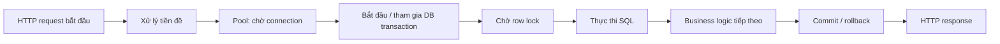

# Lựa chọn timeout giao dịch, truy vấn và kết nối một cách nhất quán

## 1. Bài toán thực tế: vì sao đặt timeout rồi request vẫn treo?

Một request Spring thường trải qua nhiều giai đoạn: chờ lấy JDBC connection từ pool, bắt đầu transaction, chờ khóa ở database, chạy một hay nhiều SQL, gọi dịch vụ bên ngoài, commit/rollback và gửi response. Mỗi giai đoạn có một hoặc nhiều cơ chế timeout khác nhau, với **đơn vị, điểm bắt đầu đo, phạm vi và cách xử lý lỗi riêng**.

Ví dụ: service đặt `@Transactional(timeout = 5)` nhưng connection pool cho phép chờ đến 30 giây. Nếu request đã mất nhiều thời gian **trước khi physical transaction khởi tạo**, thuộc tính timeout giao dịch không phải một deadline end-to-end bắt đầu ngay từ lúc HTTP request tới. Một loại timeout không tự thay thế cho loại khác.

Một ví dụ khác: `JdbcTemplate.setQueryTimeout(2)` được cấu hình, nhưng method nằm trong một transaction có timeout riêng. Spring JDBC có logic **áp dụng thời gian còn lại của transaction lên JDBC statement và có thể override query timeout đã cấu hình ở JdbcTemplate**. Không thể mặc định tính rằng hai giá trị luôn được lấy `min(2, transactionRemaining)` theo mọi code path.

Bài này giải thích cách **thiết kế một ngân sách thời gian nhất quán** cho transaction, SQL query, chờ lock, lấy connection từ pool, TCP connect, socket read, request/HTTP deadline và retry. Trọng tâm là **Spring Framework 6.x, imperative JDBC/JPA, Java 17+**, với chú ý đến Spring Boot/HikariCP và PostgreSQL. Không có một con số “đúng cho mọi ứng dụng”: phải dựa vào SLO, độ trễ thực tế, database/provider và mức độ an toàn khi retry.

### Mục tiêu

Sau bài học, bạn sẽ có thể:

1. Nêu chính xác thứ gì được đo bởi `@Transactional(timeout)`, `Statement.setQueryTimeout` và HikariCP `connectionTimeout`.
2. Phân biệt timeout chờ connection pool với timeout thiết lập TCP connection và chờ socket.
3. Thiết kế ngân sách thời gian từ outer request đến từng SQL mà không bỏ sót pool/lock wait.
4. Hiểu vì sao Spring JDBC có thể **ưu tiên remaining transaction timeout** thay vì timeout cục bộ của `JdbcTemplate`.
5. Chọn cấu hình timeout của database làm lớp bảo vệ phù hợp, không chỉ tin vào hủy query phía client.
6. Tránh phụ thuộc annotation inner `REQUIRED` để “reset” timeout đã bắt đầu ở outer transaction.
7. Xử lý timeout/rollback/retry đúng transaction boundary.
8. Thử bằng integration test và metrics để xác nhận **timeout thực sự xảy ra ở tầng nào**.

## 2. Sáu loại timeout dễ bị gọi nhầm là “database timeout”

| Loại timeout | Bắt đầu đo khi nào? | Điều gì được giới hạn? | Đơn vị thường gặp | Không bao phủ |
| --- | --- | --- | --- | --- |
| **Request/application deadline** | Khi ứng dụng tiếp nhận hoặc bắt đầu xử lý request | Tổng thời gian phục vụ một yêu cầu nghiệp vụ | ms | Không tự dừng SQL đang chạy nếu không có cancellation |
| **Pool acquisition timeout** | Khi thread gọi `DataSource.getConnection()` nhưng pool chưa cấp được connection | Thời gian **chờ một connection từ pool** | ms, ví dụ Hikari `connectionTimeout` | Không phải TCP connect timeout; không giới hạn SQL sau khi đã mượn connection |
| **TCP connect/login timeout** | Khi driver tạo kết nối vật lý đến database | Thiết lập connection/handshake theo driver | s hoặc ms tùy driver | Không giới hạn query trên một connection đã sẵn có |
| **Transaction timeout** | Khi Spring transaction manager bắt đầu/bảo vệ một transaction mới | Ngân sách transaction (và cách nó được kiểm tra/áp vào resource) | s, `@Transactional(timeout = 5)` | Không phải Java watchdog sẽ interrupt mọi dòng code đúng 5 s |
| **SQL/statement timeout** | Khi một statement được thực thi, theo JDBC/DB semantics | Thời gian SQL statement/query hoặc chờ DB xử lý | JDBC giây, PostgreSQL `statement_timeout` ms | Không giới hạn toàn bộ HTTP request, không nhất thiết giới hạn connection acquisition |
| **Lock wait timeout** | Khi SQL yêu cầu lock nhưng xung đột | Thời gian chờ cấp lock | ms/s tùy database | Không giới hạn execution không chờ lock |

Hai giới hạn rất khác cũng cần phân biệt:

- **Network/socket read timeout**: driver giới hạn thời gian chờ dữ liệu từ socket; có thể làm **connection bị đóng**, không phải business-level query cancellation đơn thuần.
- **Idle-in-transaction timeout**: một số database chấm dứt session để ngăn transaction bị bỏ mặc khi không có lệnh SQL; nó không đồng nghĩa total transaction timeout.

### 2.1. Sơ đồ các khoảng thời gian



- Request deadline bao phủ hoặc điều phối tổng thể **A → I**.
- Pool acquisition timeout chủ yếu ràng buộc **C**.
- Transaction timeout gắn với transaction resource được manager tạo/quản lý, thường bao các công việc sau khi transaction bắt đầu đến khi kết thúc.
- Statement timeout bao mỗi lần thực thi SQL; lock wait có thể là một phần của statement time.
- TCP connect/socket timeouts là **các giới hạn driver/network**, không phải business transaction policy.

**Không nên cộng máy móc** mọi timeout rồi coi đó là maximum request latency: có tầng nằm **lồng trong** tầng khác, có tầng tính từ thời điểm khác nhau và có timeout không được thực thi theo cơ chế đồng hồ cưỡng bức.

## 3. @Transactional(timeout = N): đúng phạm vi và giới hạn

### 3.1. Đơn vị là giây

```java
import org.springframework.stereotype.Service;
import org.springframework.transaction.annotation.Transactional;

@Service
public class LedgerService {
    @Transactional(timeout = 5)
    public void postEntry() {
        // Transaction timeout đặt là 5 giây.
    }
}
```

Đây là snippet của một bean Spring. `timeout = 5` có đơn vị **giây**, không phải mili giây; `timeoutString` nếu dùng biểu thức cấu hình cũng được diễn giải theo API attribute. Giá trị timeout thuộc `TransactionDefinition` và được transaction manager áp dụng khi thực sự **tạo một transaction mới**.

Để lời gọi annotation hoạt động trong proxy mode, caller phải đi qua Spring-managed proxy; `this.postEntry()` từ chính bean thường không tạo boundary riêng. Không thể nhìn annotation trong source rồi kết luận timeout đã được áp.

### 3.2. REQUIRED join một transaction có sẵn không tạo ngân sách mới

```java
@Service
public class OrderService {
    private final AuditService audit;

    public OrderService(AuditService audit) {
        this.audit = audit;
    }

    @Transactional(timeout = 8)
    public void place() {
        audit.save();  // Propagation.REQUIRED mặc định.
    }
}

@Service
public class AuditService {
    @Transactional(timeout = 2)
    public void save() {
        // Thường join physical transaction của place().
    }
}
```

Các snippet này thiếu imports/repository cụ thể; minh họa hai bean. Nếu `place()` sở hữu physical T1, `save()` được intercept với `REQUIRED` và join T1, **timeout 2 giây trên inner không mặc nhiên thay timeout vật lý đã được outer thiết lập thành 2 giây**. Ngân sách T1 vẫn là ngân sách thực tế của outer theo manager; inner tạo logical scope nhưng không mở physical transaction mới.

Đặc biệt, gọi inner sau khi T1 đã chạy 6 giây **không** làm outer có thêm 8 giây hay reset đồng hồ; remaining transaction time phải được quan tâm.

### 3.3. REQUIRES_NEW, NESTED, NOT_SUPPORTED

| Propagation inner | Khi outer đã có transaction | Timeout annotation của inner |
| --- | --- | --- |
| `REQUIRED` | Join physical T1 | Không tạo physical timeout mới độc lập; thường dùng ngân sách còn lại của T1 |
| `SUPPORTS` | Join T1 | Không có transaction mới để reset |
| `REQUIRES_NEW` | Suspend outer T1, mở physical T2 | Có thể áp timeout riêng của T2 nếu manager/resource hỗ trợ |
| `NESTED` với JDBC | Tạo savepoint trong T1, không có T2 | Savepoint không tự tạo physical transaction deadline mới |
| `NOT_SUPPORTED` | Suspend T1, chạy không có actual transaction từ manager | Không có transaction T2 được mở bởi propagation đó |
| Không có outer + `REQUIRED` hoặc `NESTED` | Tạo transaction vật lý mới | Có thể áp timeout của scope top-level |

Không dùng `REQUIRES_NEW` chỉ để “có timeout riêng” nếu nghiệp vụ cần rollback toàn bộ cùng T1: T2 có commit/rollback độc lập, có thể cần thêm JDBC connection và tạo lock contention.

### 3.4. Không phải đồng hồ ngắt Java thread

Ví dụ:

```java
@Transactional(timeout = 1)
public void expensiveWork() {
    Thread.sleep(3000); // Snippet: Java cần xử lý InterruptedException.
}
```

Đây là **pseudo-snippet**, không phải method biên dịch độc lập. Nó diễn đạt rằng transaction timeout **không phải bảo đảm Spring sẽ interrupt một Java sleep/computation vào giây thứ nhất**. Trong Spring JDBC, thời gian còn lại được áp vào JDBC statements; khi statement tiếp theo chuẩn bị chạy, Spring có thể phát hiện đã hết hạn và ném `TransactionTimedOutException`. Tùy manager/provider, failure có thể được phát hiện ở bước khác.

Vì transaction vẫn có thể giữ connection/lock trong lúc code đang sleep, cần thiết kế critical section ngắn và request deadline có cơ chế cancellation thực tế, không dựa duy nhất vào annotation.

## 4. JdbcTemplate queryTimeout và sự ưu tiên của remaining transaction time

`JdbcTemplate` có cấu hình query timeout tính bằng **giây**:

```java
@Bean
public JdbcTemplate jdbcTemplate(DataSource dataSource) {
    JdbcTemplate jdbc = new JdbcTemplate(dataSource);
    jdbc.setQueryTimeout(2);
    return jdbc;
}
```

Đây là Spring bean method fragment. `2` ở đây là 2 giây cho JDBC statements do `JdbcTemplate` tạo, **khi không bị transaction-level timeout override**. Javadoc Spring `JdbcTemplate.setQueryTimeout` ghi rằng timeout ở template **sẽ được override bởi thời gian transaction còn lại** khi statement được thực thi trong transaction có timeout cấp transaction.

Do đó, giả sử:

- `JdbcTemplate.setQueryTimeout(2)`.
- Outer `@Transactional(timeout = 5)` đã bắt đầu T1 và còn khoảng 4 giây.
- Query thông qua JdbcTemplate trên cùng datasource/connection.

Ở code path Spring JDBC thông thường, `DataSourceUtils.applyTimeout` áp dụng **remaining transaction timeout** vào JDBC `Statement.setQueryTimeout` thay vì giả định template bảo đảm trần 2 giây độc lập. Kết quả thực tế phụ thuộc thời điểm gọi và cách driver xử lý granularity của giây; **không được khẳng định một con số chính xác theo mili giây**.

Đây là một bẫy trong thiết kế ngân sách:

> **Nếu business bắt buộc từng SQL statement không vượt quá 1,8 giây khi transaction có 5 giây, đừng chỉ dùng JdbcTemplate queryTimeout=2 và mặc định cho rằng cả hai cùng được enforce theo giá trị nhỏ nhất.** Cân nhắc database-side `statement_timeout`/dialect-specific timeout hoặc cơ chế statement override đã được kiểm chứng cho đúng Spring/driver.

### 4.1. DataSourceUtils.applyTransactionTimeout

Spring JDBC cung cấp API để code JDBC thấp hơn vẫn tôn trọng transaction timeout:

```java
DataSourceUtils.applyTransactionTimeout(statement, dataSource);
```

Đây là fragment trong một phần code JDBC có sẵn `Statement` và `DataSource`, cần import `org.springframework.jdbc.datasource.DataSourceUtils`. `JdbcTemplate` thực hiện phần áp timeout liên quan transaction cho statements theo cơ chế Spring. Nếu bạn tự tạo JDBC `Statement`, phải xem xét `DataSourceUtils.applyTransactionTimeout(...)` hoặc `applyTimeout(...)`; chỉ gọi `connection.prepareStatement(...)` từ một connection tự quản lý không mặc nhiên nhận toàn bộ settings của Spring.

Spring transaction manager phải quản lý đúng `DataSource`. Một connection lấy ngoài Spring transaction context, hoặc từ datasource khác, có thể không chịu deadline mà bạn tưởng đã áp.

### 4.2. Driver và database có quyền áp timeout khác nhau

`java.sql.Statement.setQueryTimeout(int seconds)` là JDBC API để yêu cầu timeout của statement. Driver thường cố gắng cancel khi quá giới hạn, nhưng **độ chính xác và cơ chế cancellation phụ thuộc driver**. JDBC cancellation không bảo đảm backend đã hoàn tất cleanup hay network đã phản hồi tức thì tại mốc đó.

Một số database cung cấp `statement_timeout` phía server; đó là một lớp bảo vệ riêng, đặc biệt hữu ích khi cần bảo đảm server giới hạn thời gian xử lý query. Tuy nhiên một server timeout không ngắt Java application logic bên ngoài SQL và không giới hạn thời gian đợi lấy connection từ pool.

### 4.3. Timeout query không phải timeout transaction

Một transaction chạy **ba SQL statements**, mỗi câu 1,5 giây, có thể chiếm gần 4,5 giây dù timeout mỗi statement là 2 giây. Nếu business yêu cầu tổng transaction dưới 4 giây thì chỉ có statement timeout=2s là chưa đủ.

Ngược lại, đặt transaction timeout=5s nhưng query có thể chờ một lock gần 5s khiến toàn bộ ngân sách bị dùng hết. Nếu có lock wait SLO riêng, đặt ngưỡng nhỏ hơn ở database.

## 5. Pool acquisition, TCP connect và socket read khác nhau

### 5.1. HikariCP connectionTimeout chỉ đo chờ lấy connection từ pool

HikariCP:

```properties
spring.datasource.hikari.connection-timeout=800
spring.datasource.hikari.validation-timeout=500
spring.datasource.hikari.maximum-pool-size=20
```

Đây là **ví dụ application.properties cho Spring Boot + HikariCP**, không phải cấu hình của plain Spring demo bên dưới. Giá trị `connection-timeout` và `validation-timeout` tính bằng **milliseconds**. Hikari yêu cầu validation timeout nhỏ hơn connection timeout và có ngưỡng tối thiểu theo version (bản HikariCP hiện hành phổ biến có ngưỡng tối thiểu 250 ms).

Ý nghĩa:

- `connection-timeout=800`: thread chờ **mượn connection từ pool** tối đa khoảng 800 ms theo semantics Hikari; nếu chưa có connection, báo lỗi acquisition.
- `validation-timeout=500`: giới hạn kiểm tra kết nối còn sống khi validation cần chạy; **không** phải SQL query timeout.
- `maximum-pool-size=20`: số connection tối đa trong pool, phải sizing theo concurrent load/DB capacity chứ không copy tùy tiện.

**Không đồng nhất `connectionTimeout` của Hikari với `connectTimeout` của JDBC driver.** Cùng tên gần giống nhưng hai tầng khác nhau. Một kết nối mới được pool tạo có thể còn chịu TCP connect/login timeout của driver, cũng như lifecycle/pool implementation cụ thể.

### 5.2. Driver TCP connect timeout

Với PostgreSQL JDBC driver (pgJDBC), URL minh họa:

```properties
spring.datasource.url=jdbc:postgresql://db.example.internal:5432/orders?connectTimeout=2&socketTimeout=6
```

Đây là cấu hình ví dụ với hostname minh họa, không phải URL sẵn dùng. Theo pgJDBC:

- `connectTimeout=2`: khoảng thời gian giới hạn thao tác **socket connection** đến server, đơn vị **giây**.
- `socketTimeout=6`: timeout **socket read**, đơn vị **giây**; nếu chờ server response quá thời gian được phép, driver có thể đóng connection.
- `loginTimeout` nếu cấu hình có ý nghĩa khác, cũng dùng **giây** theo pgJDBC; không chỉ đơn thuần thay thế Hikari pool acquisition timeout.

Socket read timeout là một mạng safety net, **không phải total SQL execution deadline 6 giây** chính xác trên mọi interaction. Nó có thể làm mất connection và transaction đang chạy, cần xử lý failure/cleanup thích hợp. Với transaction dài hoặc query streaming, phải đánh giá timeout theo protocol/driver.

### 5.3. Pool idleTimeout/maxLifetime/leakDetectionThreshold không giới hạn query

Các thuộc tính Hikari khác thường bị dùng sai:

| Thuộc tính HikariCP | Mục đích thực tế | Không nên diễn giải là |
| --- | --- | --- |
| `connectionTimeout` | Chờ mượn connection từ pool | SQL timeout, TCP connect timeout |
| `validationTimeout` | Thời gian kiểm tra connection có còn dùng được | Transaction timeout |
| `idleTimeout` | Khi nào pool có thể retire **idle connection** (theo điều kiện pool) | Tự đóng active SQL đang chạy quá lâu |
| `maxLifetime` | Giới hạn tuổi thọ connection trong pool; active connection thường chỉ được retire sau khi trả về | Max transaction duration/query duration |
| `leakDetectionThreshold` | Cảnh báo connection bị giữ lâu, phục vụ chẩn đoán | Tự rollback transaction tại ngưỡng cảnh báo |

Đặt `maxLifetime = 5000` không tạo “transaction timeout 5 giây”. Một connection đang được ứng dụng dùng thường không bị Hikari tự giật mất giữa transaction chỉ vì maxLifetime tới hạn; việc retire diễn ra theo lifecycle của pool.

### 5.4. Dấu hiệu phân biệt hai loại chờ connection

- Pool wait: Hikari pending threads tăng, active connections gần maximum, lỗi “connection is not available, request timed out”.
- Network connect: driver stack ở socket connect/handshake, DNS/TLS/network, chưa có connection vật lý thành công.
- DB query wait: connection đã cấp và statement đang chạy/chờ lock.
- Socket read wait: request đã gửi, client đang chờ bytes từ server.
- Transaction logic wait: code Java/remote HTTP/synchronization đang xử lý trong transaction.

Metrics phải tách bạch; chỉ nhìn “database call took 7s” chưa xác định được bạn mất thời gian ở pool, TCP, lock hay execution.

## 6. Ngân sách thời gian nhất quán: thiết kế từ deadline ngoài vào trong

Giả sử endpoint đặt mục tiêu **phải trả kết quả hoặc trả lỗi có kiểm soát trong 8 giây**. Đây là **bài tập minh họa**, không phải khuyến nghị SLA chung.

Một cấu hình ban đầu có thể là:

| Lớp | Ngưỡng minh họa | Mục đích |
| --- | ---: | --- |
| Upstream/gateway timeout | 8.000 ms | Không để gateway bỏ request trước khi service có cơ hội trả lỗi có nghĩa |
| Application/handler deadline | 7.000 ms | Chừa ~1.000 ms cho network, serialization, middleware cleanup |
| Pool acquisition budget | 800 ms | Giới hạn chờ lấy connection trước khi có DB work |
| Physical transaction budget | 5.000 ms | Chặn một unit-of-work chiếm DB resources quá lâu theo cơ chế manager |
| Mỗi SQL server statement timeout | 1.800 ms | Hạn chế từng statement dù transaction vẫn còn thời gian |
| Lock wait timeout | 700 ms | Fail trước khi chờ lock làm mất toàn bộ ngân sách của statement |
| Socket read timeout (pgJDBC) | 6.000 ms | Network safety net; không xem là query/transaction stopwatch |
| TCP connect timeout (pgJDBC) | 2.000 ms | Tránh kẹt quá lâu khi lập kết nối DB mới |

Lý do các giá trị có cấu trúc:

- `700 ms < 1.800 ms < 5.000 ms < 7.000 ms < 8.000 ms`: một lock wait bị chặn sớm, một statement có cap riêng, transaction có budget tổng, service có thêm thời gian cho các bước khác/cleanup.
- Pool wait 800 ms và transaction 5.000 ms có thể diễn ra nối tiếp: 5.800 ms vẫn dưới handler budget 7.000 ms, chừa dư cho logic ngoài DB trong trường hợp điển hình.
- `socketTimeout=6s` là **safety net cho network** khi backend không phản hồi; nó không thay thế 1,8 giây server statement timeout và không bảo đảm kết thúc mọi query đúng 6 giây.
- Nếu pool khởi tạo kết nối vật lý mới dưới tải, TCP connect timeout 2s có thể khiến đường đi phức tạp hơn con số 800ms chờ borrow; đừng cho rằng mọi tầng tự cắt nhau bằng một phép `min`.
- Các timeouts có độ phân giải/điểm bắt đầu khác nhau, cộng với queueing, GC pause, scheduling và rollback cost; **bảng là ngân sách kỹ thuật cần được đo**, không phải SLA được chứng minh chỉ bằng cấu hình.

### 6.1. Mô hình ưu tiên deadline

```text
HTTP gateway budget:          8.000 ms
  Application handling:       7.000 ms
    Connection pool borrow:     800 ms
    Transaction total:        5.000 ms
      SQL statement server:   1.800 ms/câu
        Lock wait:             700 ms/lần xin lock
    Serialization/cleanup/retry reserve: phần còn lại
  Transport/headroom:         1.000 ms

TCP connect:                  2 giây khi tạo connection mới
Socket read safety net:       6 giây theo driver read
```

Chỉ dùng **retry khi còn đủ remaining request deadline**. Nếu request đã mất 6,7 giây trong budget 7 giây, tự retry lại một transaction 5 giây vừa có thể vượt gateway timeout vừa gia tăng lock contention.

### 6.2. Phân biệt một ngưỡng cấu hình với một deadline truyền xuyên suốt

Cách thiết kế tốt hơn về mặt architecture là giữ **absolute deadline** của request (thời điểm kết thúc mong muốn), sau đó trước khi thực hiện bước mới tính remaining budget:

```java
long remainingNanos = deadlineNanos - System.nanoTime();
if (remainingNanos <= 0) {
    throw new RequestDeadlineExceededException();
}
```

Đây là **fragment thiết kế**, cần khai báo biến deadline trước và định nghĩa exception; không phải Java standalone. `System.nanoTime()` phù hợp đo duration trong cùng process, không phải Unix timestamp truyền qua mạng. Với deadline truyền qua HTTP, dùng mốc tuyệt đối/wall-clock hoặc protocol deadline và chuyển nó sang local monotonic budget an toàn.

Ý chính: không cấp “5 giây mới” vô điều kiện cho mọi bước trong một request đã gần hết 7 giây. Dùng **remaining budget** để chọn có bắt đầu DB transaction/remote call/retry hay không.

## 7. PostgreSQL: thêm server-side statement và lock timeout

Khi dùng PostgreSQL trong một physical transaction:

```sql
BEGIN;
SET LOCAL statement_timeout = '1800ms';
SET LOCAL lock_timeout = '700ms';

SELECT quantity
FROM inventory
WHERE id = 101
FOR UPDATE;

UPDATE inventory
SET quantity = quantity - 1
WHERE id = 101;

COMMIT;
```

Đây là **SQL minh họa PostgreSQL** cho một session transaction, không nên gửi thêm `BEGIN/COMMIT` bằng JDBC nếu Spring `@Transactional` đang quản lý cùng connection.

- `statement_timeout`: server giới hạn thời gian statement, thường bao thời gian thực thi/chờ theo PostgreSQL protocol semantics.
- `lock_timeout`: giới hạn thời gian chờ lock; áp dụng riêng cho một lần xin lock, và được cấu hình nhỏ hơn `statement_timeout` để sự cố lock được báo trước.
- `SET LOCAL`: chỉ áp setting trong transaction hiện tại, sau COMMIT/ROLLBACK không để lại cùng giá trị như session-level `SET`.
- Nếu statement vượt timeout, PostgreSQL có thể đặt transaction vào trạng thái **aborted**; phải rollback transaction hoặc rollback tới savepoint phù hợp trước khi tiếp tục SQL. Không catch exception rồi giả định kết nối/transaction vẫn dùng được.

PostgreSQL docs cũng ghi đặt `lock_timeout` bằng hoặc lớn hơn `statement_timeout` thường không có nhiều ý nghĩa vì statement timeout sẽ đến trước. Không áp dụng nguyên xi các SQL commands này cho H2, MySQL, Oracle, SQL Server; tên parameter và semantics khác.

### 7.1. Idle in transaction không phải tổng transaction timeout

PostgreSQL có `idle_in_transaction_session_timeout` để đóng session nằm trong transaction **nhưng không hoạt động SQL** lâu hơn ngưỡng. Đây là cách bảo vệ trước kết nối bị bỏ quên giữ lock, không giống statement timeout hoặc transaction timeout tổng.

Nếu Java code giữ transaction rồi chờ remote call 20 giây mà không query, một server idle-in-transaction timeout có thể can thiệp, nhưng điều đó có thể phá connection và gây side effects khó đoán; không nên xem đây là giải pháp chính cho thiết kế critical section xấu.

### 7.2. Transaction timeout từ Spring và server timeout có thể cùng tồn tại

Bạn có thể dùng:

- Spring `@Transactional(timeout = 5)` cho một physical transaction mới.
- PostgreSQL `SET LOCAL statement_timeout = '1800ms'` để giới hạn mỗi SQL.
- PostgreSQL `SET LOCAL lock_timeout = '700ms'` để không chờ lock lâu.
- Driver socket read timeout như safety net.
- Application deadline 7 giây cho toàn bộ request.

Nhưng sau khi server cancel statement vì timeout, **Spring transaction rollback policy** và database session state phải được xử lý nhất quán. Mỗi tầng không “bù” cho tầng khác bằng cách tự resume cùng T1 đã lỗi.

## 8. Spring Data JPA và các query hints

JPA có những API khác với JDBC thuần. Ví dụ Spring Data JPA:

```java
public interface InventoryRepository
        extends JpaRepository<Inventory, Long> {

    @QueryHints(@QueryHint(
            name = "jakarta.persistence.query.timeout",
            value = "1800"))
    @Query("select i from Inventory i where i.id = :id")
    Optional<Inventory> findWithQueryBudget(@Param("id") Long id);
}
```

Đây là **snippet**, cần Spring Data JPA, entity, `Optional` và imports tương ứng. Query timeout hint Jakarta Persistence được diễn đạt bằng **milliseconds**, nhưng cách provider chuyển thành SQL/JDBC statement timeout có thể khác nhau. Một JPA provider có thể không hỗ trợ tất cả hints trên mọi dialect, hoặc làm tròn giá trị do JDBC API có độ phân giải giây.

Nếu dùng pessimistic locking:

```java
entityManager.find(
        Inventory.class,
        101L,
        LockModeType.PESSIMISTIC_WRITE,
        Map.of("jakarta.persistence.lock.timeout", 700));
```

Đây là fragment có `EntityManager`, entity, `LockModeType` và `Map`. Lock timeout hint thường là milliseconds và support không đồng nhất trên các provider/database. Không suy ra chỉ đặt hint là database sẽ enforce đúng 700 ms; kiểm chứng bằng hai connections cạnh tranh thực tế.

### 8.1. Transaction timeout và query hints: thứ tự ưu tiên là chuyện của provider

Hibernate/JPA có thể thiết lập query timeout riêng, transaction timeout riêng, và database/server có cap khác. Cần quan sát SQL thực tế, JDBC statement timeout, provider logs và PostgreSQL settings khi có ngoại lệ. Không áp quy tắc **JdbcTemplate** về override timeout một cách máy móc cho mọi JPA provider.

### 8.2. Spring Data repository method không phải end-to-end deadline

Một method repository có query hint 1,8 giây không giới hạn thời gian:

- Chờ lấy connection trước khi query được tạo.
- Java logic gọi repository từ trước/sau đó.
- Nhiều query khác trong cùng service method.
- Thời gian remote call/serialization ngoài DB.

Chỉ service-level/application deadline và transaction design có thể bao toàn bộ các khoảng này theo một chính sách chủ động.

## 9. Ví dụ Java 17 chạy được: transaction timeout thắng một query timeout cấu hình

Demo sử dụng **Java 17+, Spring Framework 6.2.19, H2 2.3.232, Maven**. Nó nhằm kiểm chứng một điểm dễ bỏ sót: với `DataSourceTransactionManager` và `JdbcTemplate`, **thời gian transaction đã hết có thể được phát hiện ở câu SQL kế tiếp và dẫn đến rollback toàn bộ thay đổi chưa commit**.

Thiết kế:

- `JdbcTemplate` có query timeout mặc định **2 giây**.
- Method `quickWrite()` được gọi qua Spring proxy với `@Transactional(timeout = 4)`; update nhanh, commit.
- Method `expireAfterWork()` có `@Transactional(timeout = 1)`; update trước, Java sleep 1,5 giây, rồi gọi JDBC query. Khi JdbcTemplate chuẩn bị áp transaction timeout còn lại lên statement, Spring phát hiện deadline đã qua và ném `TransactionTimedOutException`, nên update trong T2 rollback.
- Kết quả database cuối: chỉ có update đã commit từ lần nhanh.

Không nên sử dụng `Thread.sleep` bên trong transaction thật; nó chỉ giúp demo tái tạo deadline đã hết một cách dễ hiểu. Code dùng `DriverManagerDataSource` cho H2, vì vậy **không demo pool acquisition timeout**; đó là cấu hình của HikariCP bên ngoài ví dụ này.

### 9.1. Cấu trúc project

```text
timeout-budget-demo/
├── pom.xml
└── src/main/java/demo/tx/TimeoutBudgetDemo.java
```

### 9.2. pom.xml

```xml
<project xmlns="http://maven.apache.org/POM/4.0.0"
         xmlns:xsi="http://www.w3.org/2001/XMLSchema-instance"
         xsi:schemaLocation="http://maven.apache.org/POM/4.0.0
                             https://maven.apache.org/xsd/maven-4.0.0.xsd">
    <modelVersion>4.0.0</modelVersion>
    <groupId>demo</groupId>
    <artifactId>timeout-budget-demo</artifactId>
    <version>1.0.0</version>
    <properties>
        <maven.compiler.release>17</maven.compiler.release>
        <project.build.sourceEncoding>UTF-8</project.build.sourceEncoding>
    </properties>
    <dependencies>
        <dependency>
            <groupId>org.springframework</groupId>
            <artifactId>spring-context</artifactId>
            <version>6.2.19</version>
        </dependency>
        <dependency>
            <groupId>org.springframework</groupId>
            <artifactId>spring-jdbc</artifactId>
            <version>6.2.19</version>
        </dependency>
        <dependency>
            <groupId>com.h2database</groupId>
            <artifactId>h2</artifactId>
            <version>2.3.232</version>
        </dependency>
    </dependencies>
    <build>
        <plugins>
            <plugin>
                <groupId>org.apache.maven.plugins</groupId>
                <artifactId>maven-compiler-plugin</artifactId>
                <version>3.13.0</version>
            </plugin>
            <plugin>
                <groupId>org.codehaus.mojo</groupId>
                <artifactId>exec-maven-plugin</artifactId>
                <version>3.5.1</version>
            </plugin>
        </plugins>
    </build>
</project>
```

### 9.3. src/main/java/demo/tx/TimeoutBudgetDemo.java

```java
package demo.tx;

import javax.sql.DataSource;

import org.springframework.context.annotation.AnnotationConfigApplicationContext;
import org.springframework.context.annotation.Bean;
import org.springframework.context.annotation.Configuration;
import org.springframework.jdbc.core.JdbcTemplate;
import org.springframework.jdbc.datasource.DataSourceTransactionManager;
import org.springframework.jdbc.datasource.DriverManagerDataSource;
import org.springframework.transaction.PlatformTransactionManager;
import org.springframework.transaction.TransactionTimedOutException;
import org.springframework.transaction.annotation.EnableTransactionManagement;
import org.springframework.transaction.annotation.Transactional;

public final class TimeoutBudgetDemo {

    public static void main(String[] args) {
        try (var ctx = new AnnotationConfigApplicationContext(Config.class)) {
            JdbcTemplate jdbc = ctx.getBean(JdbcTemplate.class);
            BudgetService service = ctx.getBean(BudgetService.class);

            jdbc.execute(
                    "CREATE TABLE wallet (id INT PRIMARY KEY, balance INT)");
            jdbc.update(
                    "INSERT INTO wallet (id, balance) VALUES (1, 100)");

            System.out.println("initial=" + balance(jdbc));
            System.out.println("configuredJdbcQueryTimeoutSeconds="
                    + jdbc.getQueryTimeout());

            service.quickWrite();
            System.out.println("after quick=" + balance(jdbc));

            try {
                service.expireAfterWork();
                throw new AssertionError("Expected transaction timeout");
            } catch (TransactionTimedOutException ex) {
                System.out.println("caught=TransactionTimedOutException");
            }
            System.out.println("after timeout=" + balance(jdbc));
        }
    }

    private static int balance(JdbcTemplate jdbc) {
        Integer number = jdbc.queryForObject(
                "SELECT balance FROM wallet WHERE id = 1",
                Integer.class);
        return number;
    }

    @Configuration(proxyBeanMethods = false)
    @EnableTransactionManagement(proxyTargetClass = true)
    public static class Config {

        @Bean
        public DataSource dataSource() {
            return new DriverManagerDataSource(
                    "jdbc:h2:mem:timeout_budget;DB_CLOSE_DELAY=-1",
                    "sa", "");
        }

        @Bean
        public PlatformTransactionManager transactionManager(DataSource ds) {
            return new DataSourceTransactionManager(ds);
        }

        @Bean
        public JdbcTemplate jdbcTemplate(DataSource ds) {
            JdbcTemplate template = new JdbcTemplate(ds);
            template.setQueryTimeout(2);
            return template;
        }

        @Bean
        public BudgetService budgetService(JdbcTemplate jdbc) {
            return new BudgetService(jdbc);
        }
    }

    public static class BudgetService {
        private final JdbcTemplate jdbc;

        public BudgetService(JdbcTemplate jdbc) {
            this.jdbc = jdbc;
        }

        @Transactional(timeout = 4)
        public void quickWrite() {
            jdbc.update(
                    "UPDATE wallet SET balance = balance + 5 WHERE id = 1");
        }

        @Transactional(timeout = 1)
        public void expireAfterWork() {
            jdbc.update(
                    "UPDATE wallet SET balance = balance + 20 WHERE id = 1");

            // Chỉ dành cho demo: để transaction deadline trôi qua.
            try {
                Thread.sleep(1500L);
            } catch (InterruptedException ex) {
                Thread.currentThread().interrupt();
                throw new IllegalStateException("Interrupted", ex);
            }

            // JdbcTemplate kiểm tra remaining transaction timeout
            // trước khi thực thi statement tiếp theo.
            jdbc.queryForObject(
                    "SELECT balance FROM wallet WHERE id = 1",
                    Integer.class);
        }
    }
}
```

### 9.4. Lệnh chạy

Với Maven và JDK 17+, tại thư mục `timeout-budget-demo`:

```bash
mvn -q compile exec:java -Dexec.mainClass=demo.tx.TimeoutBudgetDemo
```

Các dòng do chương trình in ra, không tính log của Maven/Spring:

```text
initial=100
configuredJdbcQueryTimeoutSeconds=2
after quick=105
caught=TransactionTimedOutException
after timeout=105
```

### 9.5. Vì sao output hợp lý?

1. Ban đầu wallet có balance `100`.
2. `jdbc.getQueryTimeout()` hiển thị **cấu hình của template** là 2 giây. Nó **không** cho biết giá trị `Statement.setQueryTimeout` đã được áp cho một statement khi đang ở transaction có deadline.
3. `quickWrite()` chạy nhanh và return, transaction T1 commit update +5; balance `105`.
4. `expireAfterWork()` bắt đầu T2 với timeout 1 giây, update +20 (chưa commit); sau đó method `Thread.sleep(1500L)`, trong lúc ấy Java thread **không bị tự động interrupt** bởi Spring transaction annotation.
5. Khi JDBC query tiếp theo được chuẩn bị, Spring JDBC kiểm tra transaction remaining time. Deadline T2 đã hết, phát sinh `TransactionTimedOutException`; unchecked exception thoát qua transaction interceptor nên T2 rollback.
6. Sau rollback, balance vẫn `105`. Không có giá trị 125 được commit.

**Giới hạn của demo:** nó kiểm tra transaction timeout được áp ở JDBC statement sau khi deadline trôi qua, không đo thời gian query bị cancel phía database hay connection borrow. `Thread.sleep`/scheduling có thể sai lệch trên máy cực chậm hoặc thread bị interrupt, vì vậy muốn xác nhận production behavior cần integration test và metrics trên driver/database thực tế. Mã được thiết kế để biên dịch với dependency trong POM; nếu chạy trên phiên bản Spring/H2 khác cần kiểm tra API/exception behavior trước khi kết luận.

### 9.6. Bài kiểm tra mở rộng

- Đổi `@Transactional(timeout = 1)` thành `timeout = 5`: Java sleep 1,5 giây rồi query thường có thể hoàn thành; T2 commit và balance tăng thêm 20.
- Bỏ `Thread.sleep` và chạy nhanh: T2 kết thúc trước deadline.
- Đặt `Thread.sleep` thành 3 giây nhưng **không chạy JDBC statement nào sau sleep**: không được coi đây là bằng chứng “Spring transaction timeout sẽ ngắt Java code đúng lúc” vì enforcement thay đổi theo manager/resource.
- Thay `DriverManagerDataSource` bằng Hikari pool có `maximumPoolSize=1` và kiểm tra hai requests concurrent; thread thứ hai có thể bị **pool acquisition timeout** trước khi có cơ hội chạy SQL. Đây là một loại lỗi khác, không phải `TransactionTimedOutException` của SQL phase.
- Với PostgreSQL, thêm `SET LOCAL statement_timeout`/`lock_timeout` rồi chạy blocking query thật; test thời gian và SQLState do server trả về.

## 10. Transaction timeout không thể cứu một critical section quá dài

Một method:

```java
@Transactional(timeout = 5)
public void reserve(long productId) {
    inventoryRepository.lockRow(productId);
    paymentGateway.authorize();
    inventoryRepository.decrease(productId);
}
```

là snippet minh họa. Nếu `lockRow` cấp database row lock rồi `paymentGateway.authorize` chờ 9 giây, row lock có thể vẫn được giữ **cho đến khi physical transaction hoàn tất hoặc connection/transaction bị DB huỷ theo cơ chế riêng**. Đặt timeout 5 giây **không cam kết lock được nhả đúng 5 giây** nếu application chưa kết thúc transaction hoặc resource đang bị treo ngoài SQL.

Một thiết kế tốt hơn thường tách:

1. Validation không liên quan state thay đổi ra trước.
2. Chuẩn bị payment intent/reservation state theo đúng business contract.
3. Mở **transaction ngắn**.
4. Lock đúng row, re-check invariant và update tối thiểu.
5. Commit/rollback.
6. Giao tiếp bên ngoài qua workflow/idempotency/outbox phù hợp.

Không chuyển payment call ra ngoài transaction một cách mù quáng nếu hệ thống chưa có chiến lược consistency; cần thiết kế lại các trạng thái nghiệp vụ để không đánh đổi tính đúng đắn lấy độ trễ.

## 11. Retry phải ăn vào cùng ngân sách deadline

Giả sử request còn 800 ms; một lỗi SQL được đánh giá transient. Nếu retry lập tức cả transaction có timeout 5 giây, request có thể vượt deadline outer. Không nên tự cấp trọn timeout mới như thể request vừa bắt đầu.

Quy trình trước mỗi lần retry:

1. Kiểm tra loại lỗi: lock timeout/deadlock/connection failure có thể transient; lỗi unique constraint do business rule thường không retry vô hạn.
2. Kiểm tra **remaining request deadline**, số attempts, backoff và thời gian có thể dành cho một transaction mới.
3. Bảo đảm **transaction cũ đã rollback/cleanup hoàn toàn**; không retry SQL trên transaction PostgreSQL đã aborted.
4. Dùng một Spring proxy invocation/`TransactionTemplate` mới ở mỗi attempt khi cần physical transaction mới.
5. Bảo đảm idempotency nếu action có thể gây side effect (payment, broker publish, gửi email).
6. Ghi metrics số retry, lý do và final outcome; đừng chỉ log lỗi cuối.

```java
public void performWithRetry(long id, long deadlineNanos) {
    for (int attempt = 1; attempt <= 3; attempt++) {
        long remaining = deadlineNanos - System.nanoTime();
        if (remaining <= 0) {
            throw new DeadlineExceededException();
        }
        try {
            transactionalWorker.update(id);
            return;
        } catch (TransientDataAccessException ex) {
            if (attempt == 3) {
                throw ex;
            }
            backoffWithinBudget(attempt, remaining);
        }
    }
}
```

Đây là **pseudocode Java có method/exception chưa định nghĩa**, không phải file chạy độc lập. Quan trọng nhất: retry loop nằm **bên ngoài** transactional method `transactionalWorker.update` để mỗi attempt có thể tạo một transaction hợp lệ qua proxy; xử lý budget và backoff không vượt hạn cuối.

### 11.1. Timeout có nghĩa là chưa commit chắc chắn không?

**Không luôn.** Nếu client mất kết nối ngay khi gửi `COMMIT` hoặc khi chờ commit acknowledgment, client có thể không biết DB đã commit hay chưa. Việc nhận network timeout không chứng minh toàn bộ thao tác đã rollback.

Với thao tác có thể được retry sau “unknown outcome”, cần idempotency key, natural unique key hoặc status lookup để tránh tạo hai giao dịch thanh toán/đơn hàng. Đây là lý do timeout handling phải đi cùng **transaction outcome certainty**, không chỉ cùng exception classification.

## 12. Chẩn đoán lỗi theo tầng

| Triệu chứng | Tầng khả dĩ | Dấu hiệu phân biệt |
| --- | --- | --- |
| `SQLTransientConnectionException` hoặc pool báo “Connection is not available” | Pool acquisition | Hikari pending connections, active=max, không có statement |
| TCP connect refused/timeout | Driver network setup | DNS, socket connect/SSL, pgJDBC `connectTimeout` |
| Query chạy quá lâu rồi bị cancel | Statement/client query timeout hoặc server `statement_timeout` | SQLState, DB logs, JDBC cancellation |
| SQL đang chờ row lock rồi timeout | DB lock timeout | Blocking PID/lock wait metrics, PostgreSQL `lock_timeout` |
| `TransactionTimedOutException` trước statement | Spring transaction remaining timeout | Spring transaction logs, physical transaction status, JDBC statement setup |
| JDBC socket read timeout làm connection đóng | Driver `socketTimeout` | Network exceptions, connection invalidation |
| Request 504 Gateway Timeout nhưng DB tiếp tục chạy | Gateway/app deadline thiếu cancellation | Upstream request logs và DB active queries |
| Transaction giữ lock dù không chạy SQL | Java/remote call trong transaction hoặc idle-in-transaction | DB transaction age, backend state, traces |
| Inner `@Transactional(timeout=1)` không thay outer 10s | `REQUIRED` join outer | Log join transaction, owner là outer |
| Query hint JPA không có tác dụng | Provider/dialect không enforce như dự kiến | Provider logs, statement timeout thực tế, integration test |
| Hikari `maxLifetime` rất ngắn nhưng query vẫn chạy lâu | Sai loại cấu hình | Pool retire policy khác transaction/query timeout |

Khi bắt timeout exception, ghi nhận **SQLState/vendor code, layer và elapsed time, attempt number, transaction outcome**; tránh ghi mật khẩu, thông tin cá nhân hoặc query parameter nhạy cảm.

### 12.1. Metrics nên theo dõi

- HTTP request end-to-end latency theo percentiles (p50/p95/p99).
- Pool active/idle/pending, acquisition latency và acquisition timeouts.
- JDBC connect failures; TCP connect latency; socket read timeout counts.
- DB statement latency, cancellation count, slow queries và query timeout codes.
- DB lock wait time, deadlock count và blocking transaction age.
- Transaction duration từ start đến commit/rollback; số rollback/unknown-outcome.
- Số retry, backoff và số request kết thúc sát deadline.
- Các lệnh SQL còn active **sau** khi request phía client đã hủy.

Với PostgreSQL có thể dùng `pg_stat_activity`/`pg_locks`/`pg_blocking_pids` và server logs để phân biệt query chạy chậm với lock wait. Với Hikari có Micrometer metrics và logs tùy phiên bản. Không chẩn đoán chỉ từ một stopwatch tổng.

## 13. Cách cấu hình an toàn theo trình tự

### Bước 1 — Xác định ranh giới nghiệp vụ và latency SLO

Đặt SLO cho endpoint và những dependency calls, phân biệt synchronous request với batch job dài. Một job xử lý 20 phút không nên dùng cùng budget của HTTP request 8 giây.

### Bước 2 — Đo thời gian đang tiêu vào đâu

Đo pool wait, connection create, lock wait, SQL execution, Java work, remote calls và commit time. Nếu 90% latency do pool exhaustion, hạ `@Transactional(timeout)` xuống 1 giây không giải quyết nguyên nhân gốc.

### Bước 3 — Đặt application deadline cao nhất trong app và headroom cho upstream

Nếu gateway giới hạn 8 giây, app nên có ngân sách ngắn hơn đủ để response lỗi/cleanup. Dừng nhận thêm công việc khi remaining budget không đủ. Dùng cancellation ở từng dependency theo API được hỗ trợ, không kỳ vọng annotation Spring tự propagate deadline HTTP.

### Bước 4 — Cấu hình pool và driver theo đúng đơn vị

- Hikari `connectionTimeout`/`validationTimeout` là **ms**.
- pgJDBC `connectTimeout`/`socketTimeout` là **s**.
- JDBC `Statement.setQueryTimeout` là **s**.
- Spring `@Transactional(timeout)` là **s**.
- Jakarta Persistence query/lock timeout hints dùng **ms** (subject to provider support).
- PostgreSQL `statement_timeout`/`lock_timeout` có thể khai báo `'1800ms'`, `'700ms'` để tránh nhầm.

Dùng tên config rõ đơn vị: `poolAcquisitionTimeoutMs`, `transactionTimeoutSeconds`, `postgresStatementTimeoutMs`. Không copy số `2000` từ ms sang field seconds.

### Bước 5 — Quy định transaction timeout tại physical owner

Chọn timeout theo unit-of-work, không tùy tiện gắn giá trị khác nhau lên mọi helper `REQUIRED`. Khi inner join T1, không mở T2; nếu cần timeout riêng cho một SQL, cân nhắc database/driver timeout phù hợp thay vì thay propagation làm đổi atomicity.

### Bước 6 — Thử timeout độc lập và phối hợp

Tối thiểu:

1. Pool chỉ có 1 connection, request A giữ nó; request B borrow → phải thấy pool timeout riêng.
2. Driver kết nối đến endpoint không phản hồi → kiểm tra connect timeout trên môi trường kiểm thử có kiểm soát.
3. PostgreSQL query chậm → server statement timeout phát sinh.
4. Hai transactions tranh lock → lock timeout phát sinh trước statement timeout.
5. Transaction Spring hết budget rồi mới gửi SQL tiếp → quan sát `TransactionTimedOutException` hoặc behavior phù hợp manager.
6. Outer T1 với inner `REQUIRED` → xác nhận inner timeout annotation không reset T1.
7. Inner `REQUIRES_NEW` nếu thực sự cần → xác nhận T2 timeout và resource độc lập, không làm cạn pool.
8. Query timeout và network timeout cùng xảy ra gần nhau → kiểm tra exception precedence và cleanup.
9. Hủy HTTP request trong lúc SQL đang chạy → xác minh query có được cancel/connection được release hay không.
10. Timeout khi COMMIT acknowledgment bị mất → xác minh idempotency/unknown outcome handling.

## 14. Sai lầm thường gặp

**Sai lầm 1 — “Hikari connectionTimeout=1000 nghĩa là SQL không chạy quá 1 giây”.** Không. Đó là thời gian chờ mượn connection từ pool, không phải execution timeout.

**Sai lầm 2 — “JDBC driver connectTimeout=2 giúp query lâu nhất 2 giây”.** Không. Nó giới hạn kết nối socket; query/socket read khác.

**Sai lầm 3 — “@Transactional(timeout=5) sẽ interrupt Thread.sleep ở giây thứ 5”.** Không có bảo đảm watchdog như vậy. Enforcement phụ thuộc manager/resource và lúc thao tác tiếp theo.

**Sai lầm 4 — “JdbcTemplate.queryTimeout=2 luôn áp dụng min với transaction timeout=5”.** Không nên suy đoán: Spring JDBC Javadoc mô tả remaining transaction timeout **override** timeout template. Nếu cần cap per-statement thấp hơn, thực thi bằng cơ chế đã kiểm thử như server `statement_timeout`.

**Sai lầm 5 — “Đặt inner REQUIRED(timeout=1) làm outer T1 chỉ còn 1 giây”.** Không mặc định. Join physical T1 không tạo transaction mới/đặt deadline mới.

**Sai lầm 6 — “Statement timeout 2s đủ giới hạn transaction có 10 SQL”.** Không. Mười SQL mỗi câu 1 giây đã tiêu 10 giây, chưa tính pool/Java/commit.

**Sai lầm 7 — “Socket timeout và statement timeout giống nhau”.** Không. Socket read timeout có thể đóng connection; server-side query cancellation và transaction state khác.

**Sai lầm 8 — “Timeout JDBC đồng nghĩa database chắc chắn rollback tất cả”.** Không luôn. Phải xét server transaction state, Spring rollback rules, lost commit acknowledgments và side effects ngoài DB.

**Sai lầm 9 — “Timeout cao hơn sẽ giảm lỗi mà không có chi phí”.** Timeout quá cao giữ lock/pool/thread lâu, làm backlog tăng và gây cascade. Timeout quá thấp gây fail khi workload hợp lệ. Phải cân chỉnh dựa vào SLO và percentiles.

**Sai lầm 10 — “Connection leak detector sẽ tự đóng những transaction quá lâu”.** Không. Hikari leak detection chủ yếu **log cảnh báo** để chẩn đoán connection được giữ quá lâu, không phải transaction killer.

**Sai lầm 11 — “PostgreSQL lock_timeout=2s cùng statement_timeout=1s cho phép chờ lock 2s”.** Khi statement timeout đến trước, lock timeout 2s không có ích cho statement đó.

**Sai lầm 12 — “Timeout xảy ra thì cứ retry trong catch của cùng @Transactional method”.** Transaction có thể đã rollback-only/aborted; retry thường cần boundary transaction mới, deadline còn đủ và idempotency.

## 15. Câu hỏi tự kiểm tra

**Câu 1.** Trong Spring JDBC, đặt `JdbcTemplate.setQueryTimeout(2)` và `@Transactional(timeout=5)`. Có được mặc định khẳng định mỗi JDBC statement luôn tối đa 2 giây?

*Đáp án:* Không. Spring JDBC có cơ chế áp remaining transaction timeout và Javadoc ghi rõ việc override template timeout. Muốn cap per-statement 2 giây phải kiểm tra code path/driver hoặc thêm server-side cap phù hợp.

**Câu 2.** HikariCP `connectionTimeout=800` đo cái gì, đơn vị nào?

*Đáp án:* Tối đa thời gian thread đợi mượn connection từ pool; milliseconds. Không phải TCP connect/SQL timeout.

**Câu 3.** pgJDBC `connectTimeout=2` và `socketTimeout=6` giống nhau không?

*Đáp án:* Không. Cả hai dùng seconds nhưng lần lượt liên quan đến socket connection establishment và socket read wait.

**Câu 4.** Outer `@Transactional(timeout=8)`, inner `@Transactional(timeout=2)` với `REQUIRED`. Có reset transaction deadline không?

*Đáp án:* Không theo default khi inner chỉ join T1. Nó không tạo physical T2 mới.

**Câu 5.** Vì sao PostgreSQL `lock_timeout` nên nhỏ hơn `statement_timeout` nếu muốn phân biệt lỗi lock wait?

*Đáp án:* Vì statement timeout có thể đến trước nếu nó nhỏ hơn/bằng lock timeout, khiến lock-specific limit không phát huy tác dụng.

**Câu 6.** Transaction của service đã sleep quá deadline rồi không làm JDBC operation nữa. Có chắc Spring chủ động interrupt nó đúng thời điểm?

*Đáp án:* Không. Transaction timeout không phải interrupt watchdog cho mọi Java code. Phải nhìn manager/resource enforcement thực tế.

**Câu 7.** Query timeout khi COMMIT acknowledgment bị mất có chứng minh transaction rollback chưa?

*Đáp án:* Không. Outcome có thể không rõ; cần lookup/idempotency tránh double-apply.

**Câu 8.** Nếu app còn 300ms trước request deadline nhưng retry transaction timeout 5s, chính sách có nhất quán không?

*Đáp án:* Không. Retry phải giới hạn bởi remaining deadline và chi phí backoff/cleanup.

**Câu 9.** `maxLifetime` của HikariCP giới hạn transaction chạy lâu nhất bao nhiêu?

*Đáp án:* Nó quản lý tuổi thọ connection trong pool, không phải watchdog abort transaction hay SQL chạy quá lâu.

**Câu 10.** Tại sao `SET LOCAL statement_timeout` được ưu tiên khi muốn giới hạn SQL phía PostgreSQL trong một transaction?

*Đáp án:* Nó áp cap phía server trong transaction hiện tại và không để session-level setting lưu mãi sau transaction; vẫn cần xác minh SQLState và rollback khi server cancel.

## 16. Tổng kết và checklist hành động

- Chọn timeout **từ deadline nghiệp vụ/end-to-end**, rồi chia ngân sách cho pool, transaction, lock wait, SQL và network; đừng chọn từng con số độc lập.
- Biết **đúng đơn vị**: Spring `@Transactional(timeout)`/JDBC `setQueryTimeout` (giây); Hikari `connectionTimeout` (ms); pgJDBC `connectTimeout`/`socketTimeout` (giây); JPA query hints (ms).
- `@Transactional(timeout)` có ý nghĩa chính khi **physical transaction mới được tạo**; một inner `REQUIRED` join outer không reset deadline.
- Trong **Spring JDBC**, configured `JdbcTemplate.setQueryTimeout` có thể bị **remaining transaction timeout override**. Cần cap mỗi SQL riêng? Hãy kiểm chứng driver và dùng server-side `statement_timeout` khi thích hợp.
- **Pool borrow, TCP connect, socket read, lock wait và statement execution là những pha khác nhau**; mỗi pha phải có metrics và timeout tương ứng.
- **Transaction timeout không phải watchdog interrupt Java code**; giữ transaction critical section ngắn, đừng để network calls/sleep kéo dài lock lifetime.
- **Timeout không luôn đồng nghĩa rollback đã được xác nhận**; đặc biệt mất commit acknowledgment cần thiết kế idempotency.
- **Retry phải có budget còn lại, boundary transaction mới và hạn mức attempts**; không retry vô hạn bên trong transaction đã lỗi.
- Kiểm chứng bằng tests **trên database/driver/provider thật**, thêm metrics và logs để phân biệt tầng nào đã timeout.

## Nguồn tài liệu chính thức

- [Spring Framework — Transaction Management Reference](https://docs.spring.io/spring-framework/reference/data-access/transaction.html)
- [Spring Framework — Using @Transactional](https://docs.spring.io/spring-framework/reference/data-access/transaction/declarative/annotations.html)
- [Spring Framework — Controlling Database Connections](https://docs.spring.io/spring-framework/reference/data-access/jdbc/connections.html)
- [Spring Framework — Transaction Propagation](https://docs.spring.io/spring-framework/reference/data-access/transaction/declarative/tx-propagation.html)
- [Spring Framework API — JdbcTemplate.setQueryTimeout](https://docs.spring.io/spring-framework/docs/6.2.x/javadoc-api/org/springframework/jdbc/core/JdbcTemplate.html)
- [Spring Framework API — DataSourceUtils.applyTransactionTimeout](https://docs.spring.io/spring-framework/docs/6.2.x/javadoc-api/org/springframework/jdbc/datasource/DataSourceUtils.html)
- [Spring Framework API — TransactionTimedOutException](https://docs.spring.io/spring-framework/docs/6.2.x/javadoc-api/org/springframework/transaction/TransactionTimedOutException.html)
- [HikariCP — Configuration reference](https://github.com/brettwooldridge/HikariCP#frequently-used)
- [pgJDBC — Connection and socket timeouts](https://jdbc.postgresql.org/documentation/use/)
- [PostgreSQL — Client connection defaults, statement_timeout, lock_timeout](https://www.postgresql.org/docs/current/runtime-config-client.html)
- [Jakarta Persistence — Query and lock timeout hints](https://jakarta.ee/specifications/persistence/3.2/jakarta-persistence-spec-3.2)
