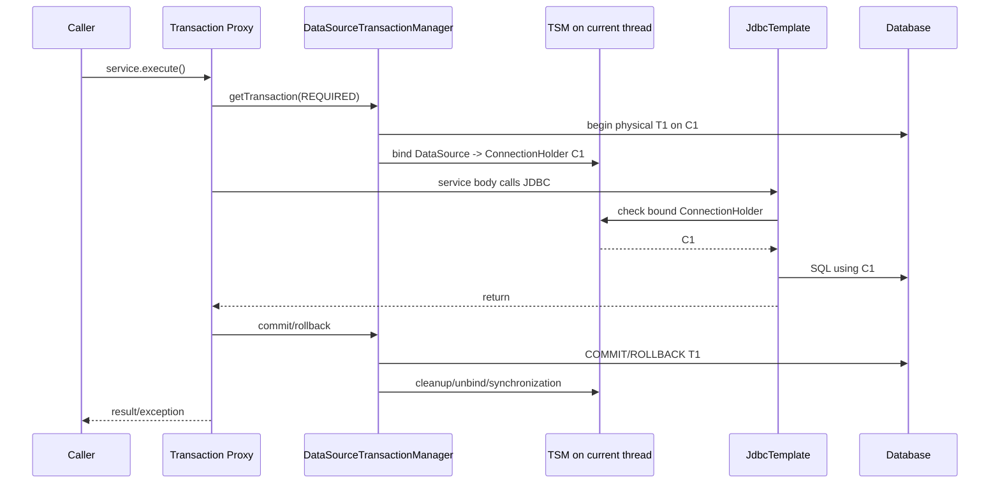

# TransactionSynchronizationManager và tài nguyên gắn với luồng trong Spring

## 1. Bức tranh tổng thể

`TransactionSynchronizationManager` (TSM) là thành phần **hạ tầng** của Spring Framework, dùng để quản lý **resource gắn với thread hiện tại** và các **transaction synchronization callbacks** trong mô hình transaction mệnh lệnh (*imperative transaction management*).

Một service `@Transactional` có thể gọi nhiều DAO dùng cùng `DataSource`. Spring transaction manager mở một physical JDBC transaction và **bind `ConnectionHolder` theo khóa `DataSource` lên thread**, giúp những câu SQL từ `JdbcTemplate` sử dụng connection đang tham gia transaction. Đó là lý do service có thể triển khai nhiều lệnh SQL trong một unit-of-work mà không phải truyền `java.sql.Connection` qua mọi method.

**Nguyên tắc chính:**

> Thread-bound resource là **ngữ cảnh sử dụng tài nguyên**, không phải chính physical transaction, không phải lời hứa commit thành công và không phải một transaction tự động chia sẻ qua các thread khác nhau.

Hai phép kiểm tra quan trọng:

- `TransactionSynchronizationManager.isActualTransactionActive()`: current thread có được đánh dấu đang gắn với **actual transaction** không?
- `TransactionSynchronizationManager.isSynchronizationActive()`: current thread có một **synchronization scope** có thể đăng ký callback không?

Chúng **không tương đương**. Ví dụ một `SUPPORTS` hoặc `NOT_SUPPORTED` scope có thể kích hoạt synchronization theo chính sách của transaction manager mà không bắt đầu physical transaction.

Đây là bài độc lập về Spring Framework 6.x, Java 17+, `PlatformTransactionManager`, Spring JDBC và JPA. Phần cuối có ví dụ Maven/Spring JDBC/H2 quan sát resource được bind, suspend và resume, cũng như thread mới không tự nhận transaction.

## 2. Cơ chế ThreadLocal và resource map

### 2.1. Resource gắn với một thread

Java `ThreadLocal` tạo các giá trị theo từng thread. Bên trong TSM imperative, Spring lưu:

- **Resource map:** key là resource factory, value là resource holder.
- **Synchronization collection:** các `TransactionSynchronization` đã đăng ký.
- **Transaction characteristics:** tên, read-only flag, isolation level, actual-transaction-active flag.

Ví dụ mô hình:

```text
Thread A (xử lý request #1)
  TSM:
    DataSource ordersDb -> ConnectionHolder(connection C1)
    actualTransactionActive = true
    synchronizationActive = true

  CheckoutService.checkout()
    -> OrderDao.insert()      dùng C1
    -> InventoryDao.reserve() dùng C1
    -> PaymentLogDao.insert() dùng C1

Thread B (xử lý request #2)
  TSM:
    DataSource ordersDb -> ConnectionHolder(connection C2)
    actualTransactionActive = true
    synchronizationActive = true
```

Thread B có resource map riêng. `C1` và `C2` không tự trở thành một transaction chung, dù hai threads cùng dùng một `DataSource` bean.

Với `DataSourceTransactionManager`, key thường là chính `DataSource`, value là `ConnectionHolder`. Với JPA resource-local, `JpaTransactionManager` có thể bind một `EntityManagerHolder` theo `EntityManagerFactory`, cùng các resource liên quan.

### 2.2. Một key chỉ có một resource binding hiện hành

TSM hỗ trợ **một resource cho mỗi key tại một thời điểm** trên current thread. `bindResource(key, value)` có thể ném `IllegalStateException` nếu key đã được bind. Khi cần suspend một outer transaction rồi mở `REQUIRES_NEW`, transaction manager sẽ **tạm unbind holder outer** trước khi bind holder inner; nó không lưu hai values đồng thời dưới cùng key trong active map.

`getResourceMap()` có thể hữu ích khi debug, nhưng chủ yếu phục vụ infrastructure. Đừng dump cả map vào production logs: nó có thể chứa connection holders và các thông tin resource nội bộ.

### 2.3. Resource binding không phải global transaction

Nếu DAO A dùng `ordersDataSource` và DAO B dùng `reportingDataSource`, có thể có **hai resource keys** khác nhau, nhưng điều đó không bảo đảm hai connections thuộc cùng một XA/distributed transaction. Mỗi `PlatformTransactionManager` quản lý các resource phù hợp với nó. Cần JTA/XA hoặc kiến trúc consistency phù hợp nếu nghiệp vụ đòi atomicity giữa nhiều resource.

Các HTTP requests, emails, queues hay payment gateways không tự gia nhập local JDBC transaction vì chúng chạy bên trong method `@Transactional`.

## 3. Những API cần phân biệt

Dùng class imperative:

```java
import org.springframework.transaction.support.TransactionSynchronizationManager;
```

| API | Công dụng | Không được suy ra |
| --- | --- | --- |
| `isActualTransactionActive()` | Có actual transaction context ở current thread? | Mọi datasource trong app dùng chung transaction |
| `isSynchronizationActive()` | Có synchronization scope để đăng ký callback? | Chắc chắn có physical JDBC transaction |
| `hasResource(Object key)` | Current thread có resource gắn với key? | Resource sẽ commit/rollback cùng nghiệp vụ |
| `getResource(Object key)` | Đọc resource holder hoặc `null` | Value luôn là `Connection` trực tiếp |
| `getResourceMap()` | Xem các bindings trên thread, chủ yếu để debug | Có quyền sửa/di chuyển bindings sang thread khác |
| `getCurrentTransactionName()` | Tên transaction đang expose hoặc `null` | Database transaction ID duy nhất |
| `getCurrentTransactionIsolationLevel()` | Isolation level được Spring expose hoặc `null` | Truy vấn chính xác setting mọi DB connection |
| `isCurrentTransactionReadOnly()` | Read-only metadata/hint | Database chắc chắn cấm mọi thao tác ghi |
| `getSynchronizations()` | Snapshot các synchronization đã đăng ký | Có thể sửa trực tiếp list rồi manager sẽ nhận thay đổi |
| `registerSynchronization(sync)` | Đăng ký transaction lifecycle callback | Có thể gọi khi synchronization chưa active |
| `bindResource`, `unbindResource` | Binding cấp thấp cho resource integration | API nên dùng trong service nghiệp vụ |
| `initSynchronization`, `clearSynchronization`, `clear` | Quản lý trạng thái synchronization/characteristics | Có thể thay thế `commit/rollback` hoặc resource cleanup |

### 3.1. Hai boolean dễ bị nhầm

```java
boolean actual =
    TransactionSynchronizationManager.isActualTransactionActive();
boolean sync =
    TransactionSynchronizationManager.isSynchronizationActive();
boolean dsBound =
    TransactionSynchronizationManager.hasResource(dataSource);
```

Đây là Java snippet cần biến `dataSource`. Khi `DataSourceTransactionManager` vừa tạo T1 cho `@Transactional(REQUIRED)`, thông thường `actual=true`, `sync=true` và `dsBound=true`.

Nhưng với `PROPAGATION_SUPPORTS` khi **chưa có transaction**, `AbstractPlatformTransactionManager` có thể vẫn tạo synchronization scope nếu chính sách là `SYNCHRONIZATION_ALWAYS`. Khi đó `sync=true` nhưng `actual=false`.

Tương tự, với `NOT_SUPPORTED` ở bên trong T1, Spring có thể suspend T1 và vẫn tạo một synchronization-only scope cho inner. Không nên assert `isSynchronizationActive()==false` cho mọi `NOT_SUPPORTED`.

### 3.2. Có resource nhưng không có actual transaction

Ví dụ với **Open EntityManager in View**, một `EntityManager` có thể được bind cho request ngay cả ngoài actual transaction. Với `SUPPORTS`, JDBC resource có thể được bind **lazily** khi data access diễn ra trong synchronization-only scope. Vì vậy `hasResource(key)=true` không chứng minh physical transaction đang active.

Nếu cần biết một method có transaction thực sự không, xem đồng thời `isActualTransactionActive`, manager, resource key, proxy path, JDBC/JPA provider và thời điểm physical commit/rollback. Không chỉ nhìn một cờ.

## 4. Luồng xử lý khi @Transactional được intercept

Spring `TransactionInterceptor` đọc transaction attribute, dùng `PlatformTransactionManager` mở hoặc tham gia transaction, gọi business method và quyết định completion.



Sơ đồ minh họa `DataSourceTransactionManager` trên một local datasource. Với JTA/JPA hoặc custom manager, resource details khác; database không nhất thiết nhận một câu SQL `BEGIN` đúng dạng.

**Đừng nhầm** sự kết thúc của một inner method với physical commit. Nếu `@Transactional(REQUIRED)` inner tham gia outer T1, inner có logical scope riêng nhưng physical connection C1 vẫn thuộc T1 và chỉ commit/rollback khi owner kết thúc.

### 4.1. Vai trò của DataSourceUtils

`JdbcTemplate` lấy connection theo cơ chế Spring, thường thông qua `DataSourceUtils`. Code JDBC cấp thấp tích hợp đúng có dạng:

```java
import java.sql.Connection;
import javax.sql.DataSource;
import org.springframework.jdbc.datasource.DataSourceUtils;

Connection connection = DataSourceUtils.getConnection(dataSource);
try {
    // Dùng JDBC Statement/PreparedStatement trên connection này.
} finally {
    DataSourceUtils.releaseConnection(connection, dataSource);
}
```

Đây là snippet: các biến và JDBC work phải được khai báo trong ứng dụng. `getConnection` có thể trả transaction-bound C1. `releaseConnection` hiểu khi nào connection thuộc transaction và **không đóng sớm resource đang bound**, còn connection không bound được đóng/trả theo cơ chế phù hợp.

Nếu code tự gọi `dataSource.getConnection()` từ datasource thông thường mà không qua Spring-aware access, nó có thể nhận C2 mới, **không thuộc T1**, và auto-commit ngoài transaction. `TransactionAwareDataSourceProxy` có thể dùng cho legacy API cần truy cập kiểu `DataSource.getConnection()`; với code mới, ưu tiên `JdbcTemplate` hoặc Spring-managed repositories.

### 4.2. Không truyền Connection xuyên suốt business code

Service nên phụ thuộc repository/DAO thay vì `Connection`. Việc tái sử dụng C1 do TSM và manager điều phối là chi tiết hạ tầng. Không lưu C1 vào singleton field, không gửi cho async worker và không coi Connection là object an toàn để nhiều threads dùng đồng thời.

## 5. Propagation thay đổi binding thế nào?

| Propagation inner, khi outer T1 active | Physical resource | Quan sát thường gặp |
| --- | --- | --- |
| `REQUIRED` | Tham gia C1/T1 | `isNewTransaction=false`, same transaction-bound connection |
| `SUPPORTS` | Tham gia T1 | T1 vẫn active; không tự tạo T2 |
| `MANDATORY` | Tham gia T1; thiếu outer thì lỗi | Không tạo physical transaction mới |
| `REQUIRES_NEW` | Suspend C1, bind C2/T2, hoàn tất rồi resume C1 | Có một transaction vật lý độc lập |
| `NOT_SUPPORTED` | Suspend T1, chạy không có actual T1 | `isActualTransactionActive=false` trong inner |
| `NESTED` với JDBC savepoint | C1/T1, thêm savepoint | `hasSavepoint=true` khi được hỗ trợ |
| `NEVER` | Nếu có T1 thì từ chối | Không âm thầm suspend T1 |
| `REQUIRED` ở thread mới không có context T1 | Có thể tạo physical T2 của chính thread đó | Không tự join T1 của caller |

Các kết luận có điều kiện: **lời gọi đi qua Spring proxy**, manager hỗ trợ propagation, cùng resource được quản lý và không có custom transaction synchronization configuration khác.

### 5.1. REQUIRED: hai intercepted calls, một physical transaction

```java
@Service
class PaymentService {
    private final LedgerService ledger;

    PaymentService(LedgerService ledger) {
        this.ledger = ledger;
    }

    @Transactional
    public void pay() {
        ledger.writeEntry();
    }
}

@Service
class LedgerService {
    @Transactional(propagation = Propagation.REQUIRED)
    public void writeEntry() {
        // Join physical transaction đang có.
    }
}
```

Đây là snippets chưa có repository/imports. Nếu `pay` bắt đầu T1 và `writeEntry` được intercept qua injected bean proxy, outer và inner có logical scope riêng nhưng thường dùng chung C1. Một inner rollback-only có thể khiến **cả T1 rollback**, kể cả outer catch exception rồi return bình thường.

### 5.2. REQUIRES_NEW: suspend và resume

Khi inner `REQUIRES_NEW`:

1. Spring tạm suspend synchronization/resource binding của outer T1.
2. `DataSourceTransactionManager` có thể unbind `ConnectionHolder(C1)` khỏi thread.
3. Inner bắt đầu T2 trên C2 và bind holder C2 theo cùng key `DataSource`.
4. Inner commit/rollback T2, cleanup C2.
5. Manager khôi phục outer C1 và synchronizations, outer tiếp tục T1.

```text
Trước inner: DataSource -> ConnectionHolder(C1, T1)

Đang inner: [C1 được manager giữ trong suspended resources]
            DataSource -> ConnectionHolder(C2, T2)

Sau inner:   DataSource -> ConnectionHolder(C1, T1) [đã resume]
```

**Không có hai values cùng bound với một resource key tại một thời điểm.** T1 vẫn mở trong lúc T2 chạy; outer connection có thể còn giữ lock, và T2 có thể cần connection thứ hai. Khi pool nhỏ, `REQUIRES_NEW` có thể gây cạn connection hoặc lock wait nếu cả T1/T2 cùng muốn cập nhật một row.

### 5.3. NOT_SUPPORTED: không có actual transaction, nhưng vẫn có thể có sync

```java
@Transactional(propagation = Propagation.NOT_SUPPORTED)
public void outsideTransaction() {
    boolean actual =
        TransactionSynchronizationManager.isActualTransactionActive();
    // Thường false khi outer T1 được suspend.
}
```

Đây là snippet. Nếu JDBC data access diễn ra bằng auto-commit connection ngoài T1, SQL có thể commit riêng. `NOT_SUPPORTED` không phải read-only security policy, không bảo đảm các thao tác sẽ rollback khi outer rollback.

Trong setup mặc định, `isSynchronizationActive()` có thể là `true` dù `actual=false`. Nếu method kiểm tra `hasResource(ds)` **trước** khi lấy connection, thường là false; sau JDBC access có thể khác nếu synchronization quản lý resource lazily.

### 5.4. NESTED: savepoint trên cùng resource

Với `DataSourceTransactionManager` và JDBC savepoint support, inner `NESTED` dùng cùng physical connection C1, có `TransactionStatus.hasSavepoint()==true`. Inner thành công có thể release savepoint **mà không COMMIT T1**. Inner rollback về savepoint có thể cho outer tiếp tục; lock behavior tùy database.

Không thể kết luận NESTED từ “connection giống nhau” vì REQUIRED cũng giống; phải quan sát status/savepoint và đúng intercepted boundary.

### 5.5. Self-invocation không tạo inner scope

```java
@Service
class SingleService {
    @Transactional
    public void outer() {
        this.inner(); // Không đi qua Spring proxy trong proxy mode.
    }

    @Transactional(propagation = Propagation.REQUIRES_NEW)
    public void inner() {
        // Không tự suspend T1 qua self-invocation.
    }
}
```

Nếu outer được intercept và mở T1, code inner vẫn có thể thấy `isActualTransactionActive=true` vì cùng thread, nhưng annotation inner chưa chắc có tác dụng. Muốn một boundary mới, chuyển inner sang bean khác được inject và gọi qua proxy, hoặc dùng `TransactionTemplate`.

## 6. @Async, CompletableFuture và Reactive không cùng ThreadLocal

### 6.1. Thread mới không kế thừa C1

```java
@Transactional
public void process() {
    jdbc.update("UPDATE wallet SET balance=balance+1 WHERE id=1");

    CompletableFuture.runAsync(() -> {
        boolean actual =
            TransactionSynchronizationManager.isActualTransactionActive();
        // Worker thread không tự nhận T1 của caller.
    });
}
```

Đây là snippet, cần fields/imports. Imperative `PlatformTransactionManager` dùng ThreadLocal ở current thread. `@Async`, `new Thread(...)`, `CompletableFuture.supplyAsync` và executor khác không tự copy transaction-bound JDBC resource.

Nếu worker gọi một Spring proxied `@Transactional` method, nó có thể mở **transaction mới trên thread của worker**, không phải join T1 chỉ vì outer chưa commit. Không copy `getResourceMap()` hoặc `ConnectionHolder` thủ công sang worker: connection có thể không an toàn khi truy cập đồng thời và outer có thể cleanup trong lúc worker đang dùng.

### 6.2. Reactive là mô hình khác

Imperative class:

```java
org.springframework.transaction.support.TransactionSynchronizationManager
```

Reactive class:

```java
org.springframework.transaction.reactive.TransactionSynchronizationManager
```

Reactive manager dùng **Reactor subscriber context**, không phải imperative ThreadLocal. Với R2DBC, dùng `R2dbcTransactionManager` hoặc `TransactionalOperator` theo đúng pipeline. Không dùng `isActualTransactionActive()` static của imperative class làm phép thử cho mọi reactive transaction.

### 6.3. Request/security context không phải transaction context

MDC correlation ID, Spring Security context hoặc request attributes có thể được propagate bằng cơ chế riêng. Điều đó **không** đồng nghĩa transaction JDBC được chuyển an toàn sang thread khác. Dù Java 21 virtual threads có thể giúp concurrency, mỗi virtual thread vẫn có context/binding riêng cho mô hình imperative.

## 7. TransactionSynchronization: hooks khi commit/rollback

### 7.1. Đăng ký callback đúng lúc

Khi `isSynchronizationActive()` là true, code integration có thể đăng ký:

```java
TransactionSynchronizationManager.registerSynchronization(
    new TransactionSynchronization() {
        @Override
        public void afterCommit() {
            System.out.println("Committed");
        }

        @Override
        public void afterCompletion(int status) {
            System.out.println("Completed with " + status);
        }
    }
);
```

Đây là snippet cần imports và synchronization scope thật. `registerSynchronization` có thể ném `IllegalStateException` khi synchronization chưa active.

### 7.2. Các callbacks quan trọng

| Callback | Ý nghĩa | Cần lưu ý |
| --- | --- | --- |
| `beforeCommit(readOnly)` | Chuẩn bị trước commit dự kiến | Có thể vẫn rollback về sau |
| `beforeCompletion()` | Cleanup trước completion | Không phải đảm bảo commit |
| `afterCommit()` | Gọi khi physical commit thành công | Resource có thể vẫn bound trước cleanup |
| `afterCompletion(status)` | Completion thành công/rollback/unknown | Thích hợp cleanup hoặc theo dõi outcome |
| `suspend()`, `resume()` | Khi synchronization của outer tạm dừng/khôi phục | Hữu ích cho resource integration |
| `savepoint(...)`, `savepointRollback(...)` | Callback liên quan savepoint trong Spring 6.2 | Không phải commit vật lý độc lập |

Các hằng trạng thái thường dùng: `TransactionSynchronization.STATUS_COMMITTED`, `STATUS_ROLLED_BACK`, `STATUS_UNKNOWN`. `getSynchronizations()` trả snapshot danh sách synchronizations; không sửa trực tiếp snapshot.

### 7.3. Bẫy afterCommit

Sau callback `afterCommit`, database transaction đã commit nhưng Spring có thể **chưa cleanup resource holder và thread-bound metadata hoàn toàn**. Một SQL mới chạy trong callback có thể vẫn truy cập original transaction-bound resources, **không có physical commit thứ hai theo sau**.

Nếu callback cần ghi database trong transaction **mới**, hãy gọi một **bean khác qua proxy** với `@Transactional(propagation = Propagation.REQUIRES_NEW)`, hoặc dùng outbox cho workflow bền vững. Không gọi helper `REQUIRED` rồi giả định nó sẽ commit độc lập.

### 7.4. Không dọn thread bằng clear() từ service

`TransactionSynchronizationManager.clear()` và `clearSynchronization()` chỉ thao tác các phần trạng thái TSM theo API; **chúng không thay commit/rollback và không thay cleanup đúng resource lifecycle**. Trong business code, tự gọi `unbindResource(...)` hoặc `clear()` có thể làm hỏng suspend/resume, gây leak hoặc khiến framework tìm không thấy holder T1. Để transaction manager thực hiện cleanup.

## 8. Java 17 runnable demo: cùng connection, transaction mới và thread khác

Demo này dùng Spring Framework **6.2.19**, H2 **2.3.232**, Java 17 và Maven; không cần Spring Boot. `DataSourceTransactionManager` dùng `DriverManagerDataSource`, thuận tiện để quan sát hai physical JDBC connections khác nhau.

Các trường hợp:

1. Ngoài transaction: không có actual transaction/resource binding.
2. Outer `REQUIRED` bắt đầu T1, bind JDBC holder C1.
3. Inner `REQUIRED` được proxy intercept và nhận **cùng C1**.
4. Inner `NESTED` nhận C1, đồng thời có savepoint.
5. Inner `REQUIRES_NEW` nhận C2 khác C1, commit audit record riêng.
6. Inner `NOT_SUPPORTED` không còn actual T1 trong scope.
7. Thread mới không tự có T1.
8. Outer resume C1, commit và gọi synchronization callbacks.

### 8.1. Cấu trúc

```text
tx-thread-demo/
├── pom.xml
└── src/main/java/demo/tx/TransactionThreadDemo.java
```

### 8.2. pom.xml

```xml
<project xmlns="http://maven.apache.org/POM/4.0.0"
         xmlns:xsi="http://www.w3.org/2001/XMLSchema-instance"
         xsi:schemaLocation="http://maven.apache.org/POM/4.0.0
                             https://maven.apache.org/xsd/maven-4.0.0.xsd">
    <modelVersion>4.0.0</modelVersion>
    <groupId>demo</groupId>
    <artifactId>tx-thread-demo</artifactId>
    <version>1.0.0</version>
    <properties>
        <maven.compiler.release>17</maven.compiler.release>
        <project.build.sourceEncoding>UTF-8</project.build.sourceEncoding>
    </properties>
    <dependencies>
        <dependency>
            <groupId>org.springframework</groupId>
            <artifactId>spring-context</artifactId>
            <version>6.2.19</version>
        </dependency>
        <dependency>
            <groupId>org.springframework</groupId>
            <artifactId>spring-jdbc</artifactId>
            <version>6.2.19</version>
        </dependency>
        <dependency>
            <groupId>com.h2database</groupId>
            <artifactId>h2</artifactId>
            <version>2.3.232</version>
        </dependency>
    </dependencies>
    <build>
        <plugins>
            <plugin>
                <groupId>org.apache.maven.plugins</groupId>
                <artifactId>maven-compiler-plugin</artifactId>
                <version>3.13.0</version>
            </plugin>
            <plugin>
                <groupId>org.codehaus.mojo</groupId>
                <artifactId>exec-maven-plugin</artifactId>
                <version>3.5.1</version>
            </plugin>
        </plugins>
    </build>
</project>
```

### 8.3. src/main/java/demo/tx/TransactionThreadDemo.java

```java
package demo.tx;

import java.sql.Connection;
import javax.sql.DataSource;

import org.springframework.context.annotation.AnnotationConfigApplicationContext;
import org.springframework.context.annotation.Bean;
import org.springframework.context.annotation.Configuration;
import org.springframework.jdbc.core.JdbcTemplate;
import org.springframework.jdbc.datasource.DataSourceTransactionManager;
import org.springframework.jdbc.datasource.DataSourceUtils;
import org.springframework.jdbc.datasource.DriverManagerDataSource;
import org.springframework.transaction.PlatformTransactionManager;
import org.springframework.transaction.annotation.EnableTransactionManagement;
import org.springframework.transaction.annotation.Propagation;
import org.springframework.transaction.annotation.Transactional;
import org.springframework.transaction.interceptor.TransactionAspectSupport;
import org.springframework.transaction.support.TransactionSynchronization;
import org.springframework.transaction.support.TransactionSynchronizationManager;

public final class TransactionThreadDemo {

    public static void main(String[] args) {
        try (var ctx = new AnnotationConfigApplicationContext(Config.class)) {
            DataSource ds = ctx.getBean(DataSource.class);
            JdbcTemplate jdbc = ctx.getBean(JdbcTemplate.class);
            OuterService service = ctx.getBean(OuterService.class);

            jdbc.execute("CREATE TABLE wallet (" +
                    "id INT PRIMARY KEY, amount INT NOT NULL)");
            jdbc.execute("CREATE TABLE audit_event (" +
                    "id INT PRIMARY KEY, message VARCHAR(30))");
            jdbc.update("INSERT INTO wallet (id, amount) VALUES (1, 100)");

            show("outside-before", ds);
            service.run();
            show("outside-after", ds);

            Integer amount = jdbc.queryForObject(
                    "SELECT amount FROM wallet WHERE id=1", Integer.class);
            Integer auditCount = jdbc.queryForObject(
                    "SELECT COUNT(*) FROM audit_event", Integer.class);
            System.out.println("amount=" + amount
                    + ", auditRows=" + auditCount);
        }
    }

    private static void show(String name, DataSource ds) {
        System.out.println(name
                + ": active="
                + TransactionSynchronizationManager.isActualTransactionActive()
                + ", bound="
                + TransactionSynchronizationManager.hasResource(ds));
    }

    @Configuration(proxyBeanMethods = false)
    @EnableTransactionManagement(proxyTargetClass = true)
    public static class Config {
        @Bean
        public DataSource dataSource() {
            return new DriverManagerDataSource(
                    "jdbc:h2:mem:tx_thread_demo;DB_CLOSE_DELAY=-1", "sa", "");
        }

        @Bean
        public PlatformTransactionManager transactionManager(DataSource ds) {
            return new DataSourceTransactionManager(ds);
        }

        @Bean
        public JdbcTemplate jdbcTemplate(DataSource ds) {
            return new JdbcTemplate(ds);
        }

        @Bean
        public InnerService innerService(JdbcTemplate jdbc, DataSource ds) {
            return new InnerService(jdbc, ds);
        }

        @Bean
        public OuterService outerService(
                JdbcTemplate jdbc, DataSource ds, InnerService inner) {
            return new OuterService(jdbc, ds, inner);
        }
    }

    public static class InnerService {
        private final JdbcTemplate jdbc;
        private final DataSource ds;

        public InnerService(JdbcTemplate jdbc, DataSource ds) {
            this.jdbc = jdbc;
            this.ds = ds;
        }

        @Transactional(propagation = Propagation.REQUIRED)
        public void required(Connection outerConnection) {
            show("inner REQUIRED", ds);
            Connection current = DataSourceUtils.getConnection(ds);
            try {
                System.out.println("REQUIRED sameConnection="
                        + (current == outerConnection));
            } finally {
                DataSourceUtils.releaseConnection(current, ds);
            }
        }

        @Transactional(propagation = Propagation.NESTED)
        public void nested(Connection outerConnection) {
            show("inner NESTED", ds);
            Connection current = DataSourceUtils.getConnection(ds);
            try {
                boolean savepoint =
                        TransactionAspectSupport.currentTransactionStatus()
                                .hasSavepoint();
                System.out.println("NESTED sameConnection="
                        + (current == outerConnection)
                        + ", savepoint=" + savepoint);
            } finally {
                DataSourceUtils.releaseConnection(current, ds);
            }
        }

        @Transactional(propagation = Propagation.REQUIRES_NEW)
        public void requiresNew(Connection outerConnection) {
            show("inner REQUIRES_NEW", ds);
            Connection current = DataSourceUtils.getConnection(ds);
            try {
                System.out.println("REQUIRES_NEW sameConnection="
                        + (current == outerConnection));
                jdbc.update(
                        "INSERT INTO audit_event (id, message) VALUES (1, 'T2')");
            } finally {
                DataSourceUtils.releaseConnection(current, ds);
            }
        }

        @Transactional(propagation = Propagation.NOT_SUPPORTED)
        public void withoutTransaction() {
            show("inner NOT_SUPPORTED", ds);
        }
    }

    public static class OuterService {
        private final JdbcTemplate jdbc;
        private final DataSource ds;
        private final InnerService inner;

        public OuterService(JdbcTemplate jdbc, DataSource ds,
                            InnerService inner) {
            this.jdbc = jdbc;
            this.ds = ds;
            this.inner = inner;
        }

        @Transactional
        public void run() {
            show("outer", ds);
            Connection original = DataSourceUtils.getConnection(ds);
            try {
                jdbc.update(
                        "UPDATE wallet SET amount=amount+10 WHERE id=1");

                TransactionSynchronizationManager.registerSynchronization(
                    new TransactionSynchronization() {
                        @Override
                        public void afterCommit() {
                            System.out.println("outer afterCommit");
                        }

                        @Override
                        public void afterCompletion(int status) {
                            String result = status == STATUS_COMMITTED
                                    ? "COMMITTED" : "OTHER";
                            System.out.println(
                                    "outer afterCompletion=" + result);
                        }
                    });

                inner.required(original);
                inner.nested(original);
                inner.requiresNew(original);
                inner.withoutTransaction();

                Thread observer = new Thread(
                        () -> show("worker-thread", ds), "observer-thread");
                observer.start();
                try {
                    observer.join();
                } catch (InterruptedException ex) {
                    Thread.currentThread().interrupt();
                    throw new IllegalStateException("Interrupted", ex);
                }

                Connection resumed = DataSourceUtils.getConnection(ds);
                try {
                    System.out.println("outer restored sameConnection="
                            + (resumed == original));
                } finally {
                    DataSourceUtils.releaseConnection(resumed, ds);
                }
            } finally {
                DataSourceUtils.releaseConnection(original, ds);
            }
        }
    }
}
```

### 8.4. Chạy

Tại thư mục `tx-thread-demo`:

```bash
mvn -q compile exec:java -Dexec.mainClass=demo.tx.TransactionThreadDemo
```

**Các dòng do chương trình in ra**, không tính log riêng của Maven/Spring:

```text
outside-before: active=false, bound=false
outer: active=true, bound=true
inner REQUIRED: active=true, bound=true
REQUIRED sameConnection=true
inner NESTED: active=true, bound=true
NESTED sameConnection=true, savepoint=true
inner REQUIRES_NEW: active=true, bound=true
REQUIRES_NEW sameConnection=false
inner NOT_SUPPORTED: active=false, bound=false
worker-thread: active=false, bound=false
outer restored sameConnection=true
outer afterCommit
outer afterCompletion=COMMITTED
outside-after: active=false, bound=false
amount=110, auditRows=1
```

### 8.5. Diễn giải kết quả

- **Outside:** main thread không có T1; các bước tạo schema/seed trước đó đã hoàn tất.
- **Outer:** transaction interceptor bắt đầu T1, bind JDBC `ConnectionHolder(C1)`.
- **REQUIRED:** inner logical scope tham gia T1; `DataSourceUtils` trả cùng object C1 đang bound.
- **NESTED:** Spring JDBC và H2 dùng savepoint trong T1, nên vẫn là C1; `hasSavepoint=true`.
- **REQUIRES_NEW:** outer C1 bị suspend; inner T2 dùng C2 khác, audit row id=1 commit khi method hoàn tất.
- **NOT_SUPPORTED:** actual transaction false trong inner. `show()` chạy trước JDBC access, vì vậy không thấy outer C1 bound.
- **Worker-thread:** một Java thread mới không kế thừa ThreadLocal context T1 của caller.
- **Outer restored:** sau inner scopes, manager resume C1; `DataSourceUtils` trả lại đúng handle C1.
- **afterCommit/afterCompletion:** outer callback chạy lúc T1 thực sự commit, không phải lúc inner `REQUIRED` return.
- **Outside-after:** resource và transaction metadata được cleanup sau proxied call.
- **Database:** wallet tăng 100 → 110 ở T1; audit_event có 1 record ghi từ T2.

So sánh `Connection` bằng `==` trong ví dụ thuần `DriverManagerDataSource` chỉ để minh họa resource reuse. Trên pool/proxy thực tế, cần bổ sung assertion **độc lập commit/rollback và resource lifecycle**, không dựa duy nhất vào Java object identity. Demo đã rà soát logic; nên chạy trong chính runtime/driver mục tiêu để xác minh output.

## 9. Những lỗi thường gặp

### 9.1. Tự bindResource hoặc clear transaction context

`TransactionSynchronizationManager` được thiết kế cho infrastructure. Tự gọi `bindResource` trong service có thể xung đột holder sẵn có, gây connection leaks và làm sai ownership. Gọi `clear()` không phải cách commit/rollback và không thay việc manager dọn resource. Hãy để Spring manager điều phối.

### 9.2. Chỉ nhìn hasResource rồi khẳng định transaction hoạt động

Resource có thể bound vì OSIV hoặc synchronization-only scope. Cần thêm actual transaction flag, datasource identity và kiểm chứng DB state sau completion.

### 9.3. @Async dùng chung transaction của caller

Không đúng trong imperative Spring ThreadLocal model. Async worker phải có transaction boundary riêng nếu cần, hoặc dùng workflow/outbox để bảo đảm thứ tự và consistency.

### 9.4. Cho rằng REQUIRES_NEW vẫn dùng C1

Không, khi outer T1 active và manager hỗ trợ suspend, inner T2 là physical transaction độc lập. T1 giữ connection/lock của mình và có thể gây pool/row-lock contention.

### 9.5. Ghi database ngay trong afterCommit bằng REQUIRED

Không an toàn vì resource có thể chưa được dọn và không còn physical commit tiếp theo cho original context. Nếu cần ghi mới, dùng proxy `REQUIRES_NEW` hoặc một workflow/outbox.

### 9.6. Đánh đồng DataSourceTransactionManager và ReactiveTransactionManager

Imperative sử dụng ThreadLocal; reactive sử dụng Reactor context. Không copy code kiểm tra TSM static sang R2DBC rồi tin nó phản ánh reactive transaction.

### 9.7. Nhiều transaction managers nhưng chỉ log active=true

Flag không chứng minh mọi resource thuộc cùng physical transaction. Khi nhiều datasources/EntityManagerFactories, dùng đúng manager qualifier, key và DB evidence.

## 10. Test cases cần có

| Test | Cách kiểm tra | Kết quả mong đợi |
| --- | --- | --- |
| Ngoài transaction | Gọi TSM introspection từ caller thread | Thường `active=false` và không bound datasource |
| Outer JDBC REQUIRED | Proxy mở T1, dùng `JdbcTemplate` | Resource bound, actual transaction true |
| Inner JDBC REQUIRED | Bean khác, gọi qua proxy, cùng datasource | Cùng transaction-bound connection C1, không commit riêng |
| Inner REQUIRES_NEW | Outer T1 active, inner T2 commit | C2 độc lập; resume C1; T2 có thể tồn tại dù T1 rollback |
| Inner NESTED | JDBC manager hỗ trợ savepoint | Dùng C1, status `hasSavepoint=true` |
| Inner NOT_SUPPORTED | Gọi qua proxy khi T1 đang active | Actual transaction false, không assert sync=false một cách máy móc |
| Thread mới | Outer active, new Thread đọc TSM | Không tự nhận transaction holder T1 |
| Callback commit | Outer đăng ký synchronization và commit | afterCommit và afterCompletion(COMMITTED) |
| Callback rollback | Outer ném unchecked exception | Không có afterCommit; có afterCompletion(ROLLED_BACK) |
| Self-invocation | `this.innerRequiresNew()` | Không có transaction proxy boundary inner trong proxy mode |
| JPA OSIV | Request chưa mở transaction nhưng có OSIV | EntityManager bound có thể true, actual transaction false |
| Cleanup + thread reuse | Chạy nhiều requests trên pooled thread | Không còn stale holder sau completion |

Với Spring Test, `@Transactional` trên test method thường tạo một **outer test transaction** và rollback cuối test. Điều đó có thể khiến service `REQUIRED` chỉ tham gia test transaction; test commit riêng nên dùng test không có outer test transaction hoặc `TestTransaction` có chủ đích. Quan sát cuối cùng phải xác nhận trạng thái database sau transaction completion, không chỉ flags.

## 11. Câu hỏi tự kiểm tra

**Câu 1.** `isSynchronizationActive()==true` có bảo đảm có JDBC transaction không?

*Đáp án:* Không; có thể synchronization-only scope, ví dụ SUPPORTS/NOT_SUPPORTED.

**Câu 2.** Hai DAO dùng cùng datasource trong một transaction Spring lấy cùng connection bằng cách nào?

*Đáp án:* DataSourceTransactionManager bind `ConnectionHolder` theo datasource vào current thread; DataSourceUtils/JdbcTemplate truy cập binding đó.

**Câu 3.** Inner REQUIRES_NEW có phải đổi key datasource để tạo T2 không?

*Đáp án:* Không cần. Spring có thể suspend holder C1 đang bound với key cũ, bind holder C2 của T2 dưới cùng key, rồi resume C1.

**Câu 4.** Vì sao `hasResource(entityManagerFactory)=true` không chứng minh SQL đang ở transaction?

*Đáp án:* JPA OSIV có thể bind EntityManager cho request ngay cả ngoài actual transaction.

**Câu 5.** Cần sửa cờ `setActualTransactionActive(false)` để commit không?

*Đáp án:* Không. Cờ TSM là metadata hạ tầng, không thực hiện physical commit/rollback. Dùng transaction manager và boundary phù hợp.

**Câu 6.** Thread mới có tự thấy ThreadLocal JDBC transaction của caller không?

*Đáp án:* Không. Worker mới cần một Spring-managed transaction riêng khi cần.

**Câu 7.** `afterCommit` chạy nghĩa là tất cả resources đã bị unbind chưa?

*Đáp án:* Không nhất thiết; resource có thể vẫn accessible trước cleanup. Nếu cần write mới, dùng REQUIRES_NEW hoặc outbox.

**Câu 8.** `NESTED` dùng cùng connection là bằng chứng nó tạo savepoint không?

*Đáp án:* Chưa đủ; REQUIRED cũng dùng cùng connection. Kiểm tra `TransactionStatus.hasSavepoint()` và manager/driver support.

**Câu 9.** Có nên copy TSM.getResourceMap() sang executor thread để có transaction propagation không?

*Đáp án:* Không. Điều đó vi phạm resource lifecycle/thread-safety assumptions.

**Câu 10.** `getCurrentTransactionIsolationLevel()==null` có nghĩa database không có isolation không?

*Đáp án:* Không; có thể Spring không expose explicit isolation setting, DB vẫn có default isolation.

## 12. Tóm tắt

- TSM quản lý **transaction resource bindings và synchronizations theo current thread** trong imperative Spring.
- Với JDBC, binding thường là **DataSource → ConnectionHolder**; Spring-managed DAO sử dụng `DataSourceUtils` để tham gia đúng physical transaction.
- **Actual transaction**, **synchronization scope** và **resource bound** là ba trạng thái liên quan nhưng không đồng nghĩa.
- **REQUIRED** thường dùng lại C1/T1; **REQUIRES_NEW** suspend C1 và dùng C2/T2; **NESTED** dùng savepoint trên C1; **NOT_SUPPORTED** chạy không có actual transaction của outer.
- **Thread mới/@Async không tự kế thừa** imperative transaction; reactive transactions dùng **Reactor context** chứ không dùng cùng TSM ThreadLocal.
- `TransactionSynchronization` callbacks hỗ trợ commit/rollback lifecycle, nhưng **afterCommit không phải một transaction mới**.
- Không tự bind/unbind/clear resource trong business code; để `PlatformTransactionManager` quản lý begin, commit, rollback, suspend/resume và cleanup.
- Kiểm thử phải đối chiếu **resource behavior lẫn dữ liệu DB sau completion**.

## Tài liệu tham khảo

- [Spring Framework API — TransactionSynchronizationManager (imperative)](https://docs.spring.io/spring-framework/docs/6.2.x/javadoc-api/org/springframework/transaction/support/TransactionSynchronizationManager.html)
- [Spring Framework API — TransactionSynchronization](https://docs.spring.io/spring-framework/docs/6.2.x/javadoc-api/org/springframework/transaction/support/TransactionSynchronization.html)
- [Spring Framework API — DataSourceUtils](https://docs.spring.io/spring-framework/docs/6.2.x/javadoc-api/org/springframework/jdbc/datasource/DataSourceUtils.html)
- [Spring Framework API — DataSourceTransactionManager](https://docs.spring.io/spring-framework/docs/6.2.x/javadoc-api/org/springframework/jdbc/datasource/DataSourceTransactionManager.html)
- [Spring Framework — Synchronizing Resources with Transactions](https://docs.spring.io/spring-framework/reference/data-access/transaction/tx-resource-synchronization.html)
- [Spring Framework — Transaction Propagation](https://docs.spring.io/spring-framework/reference/data-access/transaction/declarative/tx-propagation.html)
- [Spring Framework — Declarative Transaction Implementation](https://docs.spring.io/spring-framework/reference/data-access/transaction/declarative/tx-decl-explained.html)
- [Spring Framework API — Reactive TransactionSynchronizationManager](https://docs.spring.io/spring-framework/docs/6.2.x/javadoc-api/org/springframework/transaction/reactive/TransactionSynchronizationManager.html)
