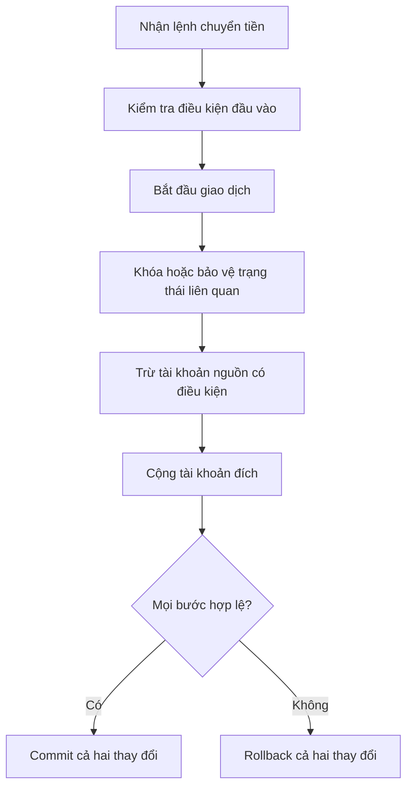

# Ràng buộc dữ liệu và bất biến nghiệp vụ trong giao dịch Spring

## 1. Mục tiêu của bài học

Sau bài này, người học có thể:

- Phân biệt **ràng buộc dữ liệu** (data constraint), **bất biến nghiệp vụ** (business invariant), kiểm tra dữ liệu đầu vào và tính nhất quán giao dịch.
- Chọn đúng nơi thực thi từng quy tắc: API, domain/service, cơ sở dữ liệu và cơ chế kiểm soát đồng thời.
- Dùng `@Transactional` để gom nhiều thay đổi thành một đơn vị thành công hoặc thất bại, đồng thời hiểu vì sao `@Transactional` **không tự bảo đảm** mọi bất biến.
- Thiết kế và kiểm thử một nghiệp vụ chuyển tiền sao cho không tạo số dư âm, không mất tiền, không cộng tiền hai lần khi có các yêu cầu cạnh tranh hoặc gửi lại.

Trọng tâm là **quy tắc phải luôn đúng trước và sau khi một giao dịch nghiệp vụ hoàn tất**, cùng các biện pháp giữ quy tắc đó đúng khi có lỗi và truy cập đồng thời.

## 2. Khái niệm và ranh giới

**Ràng buộc dữ liệu** là điều kiện áp trên dữ liệu lưu trữ, thường được cơ sở dữ liệu kiểm tra: `NOT NULL`, `UNIQUE`, `PRIMARY KEY`, `FOREIGN KEY`, `CHECK`, kiểu dữ liệu, độ dài... Ví dụ: `balance_minor >= 0` hoặc mã yêu cầu chuyển tiền phải duy nhất.

**Bất biến nghiệp vụ** là mệnh đề phải luôn đúng tại các điểm quan sát hợp lệ của hệ thống. Nó có thể liên quan đến **nhiều bản ghi, nhiều bảng hoặc trạng thái chuyển tiếp**. Ví dụ: sau một lần chuyển tiền giữa hai tài khoản cùng loại tiền, tổng số dư của chúng không đổi; một đơn hàng đã hoàn tiền không thể tiếp tục được thu tiền như đơn mới.

**Kiểm tra đầu vào** xác nhận một lệnh có hình dạng và giá trị hợp lệ: số tiền dương, tài khoản nguồn khác tài khoản đích, mã yêu cầu không rỗng. Nó giúp trả lỗi sớm, nhưng một lần kiểm tra hợp lệ lúc nhận HTTP request không chứng minh dữ liệu vẫn hợp lệ lúc ghi DB.

**Tính nhất quán giao dịch** nghĩa là khi giao dịch được xác nhận (commit), dữ liệu đáp ứng các ràng buộc và bất biến đã thiết kế. `@Transactional` điều phối ranh giới commit/rollback; mã nghiệp vụ, ràng buộc DB và cách đồng bộ cạnh tranh mới xác định bất biến nào thực sự được bảo vệ.

| Quy tắc | Phòng tuyến chủ đạo | Vì sao |
| --- | --- | --- |
| Mỗi tài khoản có ID duy nhất | `PRIMARY KEY` | DB từ chối hai bản ghi trùng khóa |
| Số dư không âm | `CHECK (balance_minor >= 0)`, cộng với lệnh cập nhật có điều kiện | Bảo vệ ngay cả khi một đường ghi khác bỏ qua kiểm tra ở service |
| Số tiền chuyển lớn hơn 0 | Kiểm tra ở service và `CHECK` ở bảng yêu cầu | Phản hồi sớm và bảo vệ dữ liệu lưu |
| Không chuyển tiền cho chính mình | Kiểm tra domain, có thể thêm `CHECK (from_id <> to_id)` | Đây là quy tắc của lệnh chuyển |
| Trừ và cộng đúng một lần trong một lần chuyển | Một giao dịch DB bao cả hai lệnh | Không được để tồn tại kết quả “đã trừ nhưng chưa cộng” |
| Không chi quá số dư khi hai lệnh chạy song song | Khóa, cập nhật có điều kiện hoặc kiểm soát phiên bản | Kiểm tra trước khi ghi có thể đã lỗi thời |
| Một mã yêu cầu chỉ thực thi một lần | `UNIQUE`/`PRIMARY KEY` cho idempotency key và giao dịch bao cả kết quả | Retry HTTP không được tạo thêm một lần chuyển |

Không có một tầng nào thay thế mọi tầng khác: service diễn đạt ý nghĩa nghiệp vụ; DB là phòng tuyến nhất quán chung cho mọi luồng ghi; giao dịch và cơ chế đồng thời bảo đảm các kiểm tra vẫn đúng trong lúc trạng thái thay đổi.

## 3. Ví dụ xuyên suốt: chuyển tiền giữa hai tài khoản

Giả sử hai tài khoản cùng đơn vị tiền tệ, lưu số tiền bằng **đơn vị nhỏ nhất** (ví dụ đồng nguyên hoặc xu), dùng số nguyên `BIGINT` thay vì `double`:

- A có 150.000; B có 40.000.
- Chuyển 60.000 từ A sang B thành công → A = 90.000; B = 100.000.
- Tổng trước và sau đều bằng 190.000.
- Chuyển số âm, chuyển cho chính mình hoặc chuyển vượt số dư phải bị từ chối; khi bị từ chối, **không tài khoản nào đổi số dư**.

Các điều kiện có thể viết thành tiền điều kiện và hậu điều kiện:

- **Tiền điều kiện:** `amount > 0`, `source != target`, hai tài khoản tồn tại và đủ số dư.
- **Hậu điều kiện khi thành công:** `sourceAfter = sourceBefore - amount`, `targetAfter = targetBefore + amount` và `sourceAfter + targetAfter = sourceBefore + targetBefore`.
- **Hậu điều kiện khi thất bại:** trạng thái bền vững sau rollback giống trước giao dịch.
- **Điều kiện đồng thời:** nếu hai yêu cầu cùng muốn chi từ một tài khoản, không được quyết định dựa trên hai lần đọc cùng một số dư cũ.

Lưu ý: “tổng không đổi” ở đây áp dụng cho **thao tác chuyển nội bộ**. Nạp tiền, rút tiền, thu phí hoặc điều chỉnh kế toán là các nghiệp vụ riêng, có bất biến và sổ ghi nhận riêng. Không được mặc định mọi loại thay đổi số dư đều bảo toàn tổng.

### Giao dịch là một ranh giới nguyên tử



Nếu thực hiện hai câu `UPDATE` ở chế độ auto-commit, bước trừ có thể đã commit trong khi bước cộng lỗi. Nếu cả hai nằm trong **cùng giao dịch DB**, một lỗi cần rollback sẽ đưa các thay đổi đã thực hiện trong giao dịch đó về trạng thái trước khi bắt đầu.

## 4. Biến ràng buộc thành DDL ở cơ sở dữ liệu

Ví dụ với PostgreSQL:

```sql
CREATE TABLE account (
    id BIGINT PRIMARY KEY,
    balance_minor BIGINT NOT NULL,
    CONSTRAINT ck_account_balance_nonnegative
        CHECK (balance_minor >= 0)
);

INSERT INTO account (id, balance_minor)
VALUES (1, 150000), (2, 40000);
```

Ở đây:

- `PRIMARY KEY` cấm ID trùng và không cho ID rỗng.
- `NOT NULL` cấm số dư null. Riêng `CHECK (balance_minor >= 0)` không thay `NOT NULL` vì biểu thức `CHECK` cho kết quả unknown/null không nhất thiết bị coi là vi phạm.
- `CHECK` chặn lệnh SQL trực tiếp tạo số dư âm, kể cả lệnh không đi qua mã Java.
- `BIGINT` có giới hạn; cộng vượt giới hạn sẽ bị DB từ chối. Ứng dụng vẫn phải chọn giới hạn nghiệp vụ thích hợp và xử lý lỗi.

Nếu nghiệp vụ có tài khoản thuộc các loại tiền khác nhau, phải thêm đơn vị tiền tệ và cấm chuyển sai đơn vị hoặc có quy tắc quy đổi minh bạch. Nếu ứng dụng quản lý tiền có yêu cầu kiểm toán, nên lưu các bút toán/ledger và tham chiếu giao dịch, không chỉ giữ một cột số dư.

**Giới hạn của `CHECK`:** PostgreSQL không dùng `CHECK` đơn giản để bảo đảm tổng của **nhiều hàng** hay số lượng đặt chỗ của cả một tập bản ghi. Điều kiện như “tổng tiền A+B không đổi qua một thao tác” phải được bảo vệ bằng luồng ghi giao dịch, thiết kế dữ liệu/ledger, hoặc cơ chế DB phù hợp (trigger, thủ tục, khóa và quyền ghi). Một `CHECK` trên từng hàng không thể chứng minh tính nguyên tử của hai câu `UPDATE`.

## 5. Ví dụ Spring: thực hiện chuyển tiền an toàn trong một DB

Điều kiện chạy ví dụ: ứng dụng Spring Boot sử dụng Java 17+, có `spring-boot-starter-jdbc`, driver PostgreSQL, `DataSource` và transaction manager tương ứng; bảng `account` đã được tạo như trên. Đây là một **lớp service dùng trong ứng dụng Spring**, không phải file Java độc lập chạy bằng `java TransferService.java`.

```java
package example.transaction;

import org.springframework.jdbc.core.JdbcTemplate;
import org.springframework.stereotype.Service;
import org.springframework.transaction.annotation.Transactional;

@Service
public class TransferService {
    private final JdbcTemplate jdbc;

    public TransferService(JdbcTemplate jdbc) {
        this.jdbc = jdbc;
    }

    @Transactional
    public void transfer(long fromId, long toId, long amountMinor) {
        if (amountMinor <= 0) {
            throw new IllegalArgumentException("Amount must be positive");
        }
        if (fromId == toId) {
            throw new IllegalArgumentException("Accounts must differ");
        }

        // Luôn khóa theo thứ tự ID để giảm nguy cơ deadlock
        // khi nhiều giao dịch chuyển tiền ngược chiều.
        long firstId = Math.min(fromId, toId);
        long secondId = Math.max(fromId, toId);
        lockAccount(firstId);
        lockAccount(secondId);

        // Kiểm tra số dư và trừ tiền trong CÙNG một câu UPDATE.
        int debited = jdbc.update("""
            UPDATE account
               SET balance_minor = balance_minor - ?
             WHERE id = ? AND balance_minor >= ?
            """, amountMinor, fromId, amountMinor);
        if (debited != 1) {
            throw new IllegalStateException(
                "Source account has insufficient balance");
        }

        int credited = jdbc.update("""
            UPDATE account
               SET balance_minor = balance_minor + ?
             WHERE id = ?
            """, amountMinor, toId);
        if (credited != 1) {
            throw new IllegalStateException(
                "Target account does not exist");
        }
    }

    private void lockAccount(long id) {
        // Khi không có hàng, queryForObject ném một
        // DataAccessException (runtime), làm giao dịch rollback.
        jdbc.queryForObject(
            "SELECT id FROM account WHERE id = ? FOR UPDATE",
            Long.class,
            id
        );
    }
}
```

**Diễn giải cơ chế:**

1. `@Service` khiến lớp được Spring quản lý; lời gọi từ bên ngoài bean đi qua proxy giao dịch khi transaction management được bật. Spring Boot thường cấu hình hạ tầng giao dịch khi có dependency thích hợp.
2. `@Transactional` mở hoặc tham gia giao dịch (mặc định `Propagation.REQUIRED`). Các lệnh của `JdbcTemplate` dùng cùng `DataSource` và transaction manager sẽ cùng commit/rollback.
3. PostgreSQL `SELECT ... FOR UPDATE` giữ khóa hàng cho tới khi giao dịch kết thúc; hai tài khoản được khóa theo thứ tự tăng dần ID để tránh mô hình deadlock phổ biến A→B đối đầu B→A.
4. `UPDATE ... WHERE balance_minor >= ?` biến “kiểm tra đủ tiền + trừ tiền” thành **một thao tác có điều kiện trong DB**. Nếu không cập nhật được đúng một hàng, service ném ngoại lệ. Dù đã khóa trước, điều kiện trong `UPDATE` vẫn là phòng tuyến hữu ích.
5. Lệnh cộng tiền chỉ chạy sau khi trừ thành công. Nếu cộng lỗi, lỗi DB hoặc ngoại lệ runtime thoát khỏi phương thức khiến Spring rollback việc trừ trước đó. Nếu cả hai thành công, Spring commit cả hai cùng lúc.

**Giới hạn phạm vi của ví dụ:** đây là thao tác chuyển tiền **không kèm khóa chống gửi lại yêu cầu (idempotency key)**, chỉ trên **một cơ sở dữ liệu**. Một lần gọi thành công rồi client gửi lại cùng lệnh sẽ chuyển thêm lần nữa. Mục 8 xử lý tình huống đó. Ngoài ra, mọi đường cập nhật số dư khác đều phải tôn trọng các quy tắc tương tự; nếu cho phép SQL tùy ý thay đổi số dư thì không thể khẳng định bất biến tổng tiền được bảo vệ trên toàn hệ thống.

### Vì sao không chỉ `SELECT` số dư rồi `UPDATE`?

Mã kiểu sau có lỗi cạnh tranh:

```text
T1 đọc số dư A = 100
T2 đọc số dư A = 100
T1 kiểm tra 100 >= 80 => đúng
T2 kiểm tra 100 >= 70 => đúng
T1 ghi kết quả của mình
T2 ghi kết quả của mình
```

Nếu mỗi luồng dựa trên dữ liệu cũ, hệ thống có thể **chi vượt số dư**, ghi đè cập nhật (lost update) hoặc trả kết quả sai. `@Transactional` một mình **không đảm bảo** hai lần kiểm tra tuần tự tuyệt đối khi hai giao dịch khác nhau chạy đồng thời. Giải pháp tùy bài toán: dùng lệnh cập nhật có điều kiện, khóa hàng, optimistic locking hoặc mức cô lập cao hơn đi cùng retry.

### Mô phỏng hai lệnh cạnh tranh

A có 150.000; T1 muốn chuyển 100.000, T2 muốn chuyển 80.000. Với service ở trên:

- Giao dịch nào khóa A trước sẽ cập nhật A và commit (giả sử tài khoản đích hợp lệ).
- Giao dịch sau đợi khóa, rồi thấy số dư A đã giảm; `UPDATE ... balance_minor >= amount` không cho chi tiếp nếu không đủ.
- Kết quả hợp lệ: **chỉ một yêu cầu thành công**, yêu cầu còn lại thất bại và không thay đổi dữ liệu. Tổng số dư sau giao dịch thành công vẫn được bảo toàn.

Không thể đoán trước giao dịch nào thắng. Đó là tính không xác định của lịch chạy; tính đúng đắn phải giữ với mọi lịch hợp lệ.

## 6. Chọn cách bảo vệ bất biến khi có đồng thời

| Kỹ thuật | Dùng khi | Lưu ý |
| --- | --- | --- |
| `UPDATE ... WHERE ...` nguyên tử | Một điều kiện và thay đổi trên cùng hàng, như trừ tiền khi đủ số dư | Kiểm tra số hàng bị ảnh hưởng; không chia thành `SELECT` trước rồi cập nhật dựa trên giá trị cũ |
| Khóa bi quan `SELECT ... FOR UPDATE` | Cần đọc và quyết định trên trạng thái sẽ bị thay đổi, thường trên vài hàng biết trước | Giữ khóa ngắn; khóa theo thứ tự ổn định; có thể xảy ra chờ và deadlock |
| Khóa lạc quan `@Version`/cột `version` | Xung đột ít, có thể từ chối và thử lại toàn bộ lệnh | Cập nhật phải điều kiện hóa theo version; xung đột phải rollback và xử lý retry an toàn |
| Isolation `SERIALIZABLE` | Bất biến trên nhiều hàng, dễ có write skew/phantom | Phải xử lý lỗi serialization và retry **toàn bộ giao dịch**; chi phí có thể cao |
| `UNIQUE`, `FOREIGN KEY`, `CHECK` | Tính hợp lệ bền vững của dữ liệu | Luôn bật ở DB, nhưng không thay thế ranh giới giao dịch và luật nghiệp vụ đa hàng |

Một ví dụ khác là **giới hạn 5 chỗ**: hai giao dịch cùng chạy `SELECT COUNT(*)` thấy 4, rồi mỗi giao dịch thêm một chỗ; kết quả 6 nếu không có bảo vệ cạnh tranh. `READ COMMITTED` và `@Transactional` đơn thuần không làm phép đếm trở thành điều kiện độc quyền. Cách phổ biến là có hàng `event_capacity` với `reserved_count` và cập nhật nguyên tử `UPDATE ... SET reserved_count = reserved_count + 1 WHERE reserved_count < capacity`, hoặc khóa đúng tài nguyên sở hữu giới hạn, hoặc dùng serializable và retry. Đặt ràng buộc lên **đại lượng sở hữu bất biến** thường dễ kiểm chứng hơn kiểm tra tự do trên nhiều bảng.

Với JPA/Hibernate, `@Version` giúp phát hiện hai giao dịch cùng cập nhật một entity; nó không tự bảo vệ một điều kiện tổng hợp nếu các giao dịch sửa các hàng khác nhau. Đừng nhầm “entity có version” với “mọi quy tắc nghiệp vụ đã được bảo vệ”.

## 7. Rollback và các giới hạn cần hiểu của Spring

Các cấu hình mặc định quan trọng của `@Transactional` trong Spring:

- `propagation = REQUIRED`: tham gia giao dịch hiện có hoặc tạo giao dịch mới nếu chưa có.
- `isolation = DEFAULT`: dùng mức cô lập mặc định của nguồn giao dịch/DB; không tự nâng lên `SERIALIZABLE`.
- Mặc định rollback khi `RuntimeException` hoặc `Error` thoát khỏi lời gọi giao dịch. Checked exception không tự kích hoạt rollback theo cấu hình mặc định; có thể đặt `rollbackFor` hoặc cấu hình quy tắc chung phù hợp phiên bản Spring.

Ví dụ nếu dùng checked exception để báo nghiệp vụ:

```java
@Transactional(rollbackFor = TransferRejectedException.class)
public void transferWithCheckedFailure() throws TransferRejectedException {
    // Thay đổi dữ liệu qua repository/JdbcTemplate...
    throw new TransferRejectedException("Cannot finish transfer");
}
```

Đoạn này minh họa quy tắc rollback; `TransferRejectedException` là loại checked exception do ứng dụng định nghĩa. Nếu dùng `IllegalArgumentException`/`IllegalStateException` như ví dụ chính, đó là runtime exception nên đã thuộc quy tắc rollback mặc định.

Các lỗi thiết kế thường gặp:

1. **Bắt ngoại lệ rồi nuốt lỗi** trong method transactional. Ví dụ trừ tiền xong, một kiểm tra thuần Java ném `RuntimeException` nhưng code bắt và trả về “thành công”; Spring có thể thấy phương thức kết thúc bình thường và commit. Hãy để lỗi phù hợp lan ra, hoặc đánh dấu rollback một cách tường minh khi có lý do chính đáng.
2. **Self-invocation:** `this.innerMethod()` không đi qua proxy giao dịch mặc định. Nếu chỉ `innerMethod` có `@Transactional`, lời gọi nội bộ này không tự tạo ranh giới giao dịch. Đặt `@Transactional` trên entry point public được bean khác gọi hoặc tổ chức lại service.
3. **Làm nhiều lần ghi ngoài một transaction manager/nguồn dữ liệu:** giao dịch trên DB A không tự rollback thay đổi tại DB B hay HTTP service C.
4. **Gọi mạng trong lúc giữ khóa DB:** khóa lâu, timeout, deadlock và lỗi mạng khó xử lý. Thường commit trạng thái cùng một bản ghi outbox, rồi xử lý gửi thông báo sau commit.
5. **Tin rằng `readOnly = true` là cơ chế chặn mọi ghi:** đây chủ yếu là chỉ dẫn/tối ưu cho hạ tầng và không phải bất biến bảo mật hoặc ràng buộc dữ liệu đáng tin cậy.
6. **Đổi isolation mà không thiết kế retry:** deadlock, lock timeout và serialization failure có thể xảy ra. Chỉ retry toàn bộ giao dịch khi thao tác có thể lặp lại an toàn; tránh lặp tác dụng phụ bên ngoài.

Một bất biến cần được duy trì tại **commit/điểm quan sát hợp lệ**; trong nội bộ giao dịch có thể tồn tại trạng thái trung gian (chẳng hạn đã trừ A nhưng chưa cộng B) chưa hiển thị cho các giao dịch khác tùy mức cô lập. Dù vậy, một số `CHECK`/`UNIQUE` của DB được kiểm ngay khi chạy từng câu lệnh, nên không được tùy tiện tạo trạng thái trung gian vi phạm ràng buộc DB rồi hy vọng sửa vào cuối giao dịch.

## 8. Bất biến khi client retry: không thực hiện hai lần

Timeout HTTP có thể xảy ra **sau khi server đã commit nhưng trước khi client nhận phản hồi**. Client không biết giao dịch đã thành công hay chưa và gửi lại cùng yêu cầu. `@Transactional` chỉ bảo đảm một lần thực thi nguyên tử; nó **không nhận biết** lần gọi thứ hai là trùng lần trước.

Có thể gắn cho mỗi lệnh nghiệp vụ một `request_id` duy nhất do client tạo và lưu cùng kết quả trong **cùng DB transaction**:

```sql
CREATE TABLE transfer_request (
    request_id VARCHAR(100) PRIMARY KEY,
    from_id BIGINT NOT NULL REFERENCES account(id),
    to_id BIGINT NOT NULL REFERENCES account(id),
    amount_minor BIGINT NOT NULL CHECK (amount_minor > 0),
    CONSTRAINT ck_transfer_accounts_differ CHECK (from_id <> to_id)
);
```

Quy trình idempotent ở tầng service:

1. Kiểm tra tính hợp lệ cơ bản; bắt đầu giao dịch.
2. Thử ghi `transfer_request` cho `request_id`. Với PostgreSQL có thể dùng `INSERT ... ON CONFLICT (request_id) DO NOTHING` và kiểm tra số hàng chèn.
3. Nếu chèn được 1 hàng: thực hiện trừ/cộng tiền **trong cùng giao dịch** rồi commit. Nếu trừ/cộng lỗi, record yêu cầu cũng rollback, cho phép thử lại đúng nghĩa.
4. Nếu chèn được 0 hàng: tra record đã commit, **so sánh cả `from_id`, `to_id` và `amount_minor`**; nếu cùng lệnh, trả kết quả “đã xử lý”, nếu khác payload dùng chung key thì trả lỗi xung đột. Không chuyển tiền lần nữa.
5. Xử lý tình huống hai request cùng key đến đồng thời theo hành vi unique constraint và isolation của DB. Trong PostgreSQL `READ COMMITTED`, thao tác INSERT có thể phải chờ giao dịch còn treo kết thúc; cần cấu hình timeout/retry có kiểm soát.

Đây là **hướng mở rộng thiết kế**, chưa nằm trong `TransferService` ở mục 5. Nếu cần lưu trạng thái tiến trình, kết quả và mã lỗi, thiết kế bảng yêu cầu/ledger phải thể hiện rõ ý nghĩa “đang xử lý”, “đã hoàn tất” và cách khôi phục sau crash. Không được đánh dấu “đã hoàn tất” trước khi chuyển tiền thành công.

## 9. Kiểm thử bất biến: kiểm kết quả ở DB, không chỉ kiểm exception

Bài kiểm thử tích hợp nên chạy với PostgreSQL thật hoặc Testcontainers PostgreSQL nếu production sử dụng PostgreSQL. Dùng hai kết nối/giao dịch độc lập để kiểm tra cạnh tranh; một test đơn luồng với mock repository không chứng minh khóa và isolation hoạt động đúng.

| Kịch bản | Dữ liệu trước | Kết quả bắt buộc |
| --- | --- | --- |
| Chuyển hợp lệ | A=150.000, B=40.000; chuyển 60.000 | A=90.000, B=100.000; tổng không đổi |
| Không đủ số dư | A=50.000; yêu cầu 60.000 | Báo lỗi; A và B giữ nguyên |
| Số tiền 0/âm, trùng tài khoản | Bất kỳ | Báo lỗi; không ghi gì |
| Tài khoản đích không tồn tại | A hợp lệ, ID đích sai | Rollback; không còn thay đổi ở A |
| Lỗi khi cộng sau khi trừ | A đủ, nhưng cập nhật B gây lỗi DB, ví dụ tràn `BIGINT` | Rollback cả hai câu `UPDATE` |
| Hai lệnh chi cùng tài khoản | A=150.000; hai luồng đồng thời chi 100.000 và 80.000 | Tối đa một lệnh thành công; A không âm; tổng bảo toàn |
| Gửi lại cùng `request_id` | Đã hoàn thành một lệnh | Không chuyển thêm lần nữa **sau khi** đã triển khai cơ chế mục 8 |
| Cùng key, payload khác | ID trùng, số tiền/đích khác | Từ chối; không tạo chuyển tiền mới |

Ví dụ truy vấn hậu kiểm cho **hai tài khoản chỉ chịu tác động của phép chuyển đang xét**:

```sql
SELECT id, balance_minor
FROM account
WHERE id IN (1, 2)
ORDER BY id;

SELECT SUM(balance_minor) AS total_minor
FROM account
WHERE id IN (1, 2);
```

Nếu tổng ban đầu là 190.000, sau một lần chuyển nội bộ thành công tổng vẫn phải là 190.000. Để phát hiện mất tiền giữa nhiều tài khoản hay nhiều bút toán, cần giới hạn phạm vi kiểm tra đúng với nghiệp vụ hoặc dùng ledger đối chiếu toàn hệ thống; một truy vấn tổng không chứng minh không có lỗi ở từng tài khoản.

**Cách tổ chức test:** gọi service qua Spring bean thật (để proxy `@Transactional` hoạt động), đọc lại trạng thái sau khi lời gọi kết thúc và transaction đã commit/rollback. Tránh mặc định đặt `@Transactional` lên chính test kiểm tra commit vì transaction bao ngoài test có thể bị rollback sau test, che mất hành vi commit thực tế. Với concurrency test, đồng bộ thời điểm bắt đầu bằng barrier/latch, đặt timeout phù hợp và chạy lặp các lịch cạnh tranh cần thiết; kiểm tra trạng thái cuối thay vì giả định luồng nào thắng.

## 10. Quy trình thiết kế một nghiệp vụ giao dịch mới

Khi xây dựng đặt chỗ, thanh toán, trừ kho hoặc cập nhật trạng thái đơn hàng, hãy trả lời lần lượt:

1. **Bất biến là gì?** Viết được thành mệnh đề có thể kiểm thử: “số lượng còn lại không âm”, “một mã thanh toán duy nhất”, “tổng nợ và có cân bằng”, “không hoàn tiền quá số đã thanh toán”.
2. **Ai sở hữu dữ liệu quyết định?** Một hàng, một aggregate, nhiều bảng hay nhiều hệ thống? Với mỗi bất biến, chỉ rõ nguồn dữ liệu chuẩn và những đường ghi được phép.
3. **Ràng buộc nào DB bảo vệ trực tiếp?** Thêm `NOT NULL`, `UNIQUE`, `FK`, `CHECK` phù hợp; không đặt kỳ vọng sai vào `CHECK` đa hàng.
4. **Ranh giới nguyên tử nằm đâu?** Bao toàn bộ thay đổi cần đi cùng nhau trong một giao dịch của đúng data source. Nếu cần tác động ngoài DB, xem outbox/saga và quy tắc bù trừ.
5. **Hai yêu cầu đồng thời sẽ làm gì?** Tìm race giữa kiểm tra và ghi. Dùng atomic conditional update, locking, version hoặc isolation với retry tương ứng.
6. **Thất bại và retry có an toàn không?** Xác định ngoại lệ phải rollback, timeout, idempotency key và cách phát hiện yêu cầu đã xử lý.
7. **Chứng minh bằng test nào?** Kiểm happy path, lỗi sau khi ghi một phần, concurrency và trạng thái DB sau commit/rollback.

### Bài tập tự kiểm tra

**Tình huống A:** Hai người cùng đặt chiếc ghế cuối cùng, cả hai cùng thấy `available = 1`. Chỉ thêm `@Transactional` vào hai service method đã đủ chưa?

**Gợi ý:** chưa đủ nếu mỗi method đọc rồi ghi dựa trên snapshot cũ; hãy dùng `UPDATE seat_inventory SET available = available - 1 WHERE id = ? AND available > 0`, kiểm tra số hàng thay đổi, hoặc khóa đúng hàng kiểm soát ghế.

**Tình huống B:** Một method transactional đã trừ tiền, bắt một `IllegalStateException` do bước xác minh sau đó ném ra rồi trả về “OK”. Có thể commit số dư đã trừ không?

**Gợi ý:** có thể, vì ngoại lệ không thoát tới transaction interceptor. Phải xác định rõ kết quả lỗi và rollback, không nuốt lỗi rồi coi là thành công.

**Tình huống C:** Đã có `CHECK(balance_minor >= 0)`, có thể bỏ hẳn kiểm tra số dư ở nghiệp vụ không?

**Gợi ý:** DB vẫn chặn số dư âm, nhưng service cần trả thông báo nghiệp vụ rõ ràng, kiểm số hàng cập nhật, đảm bảo các cập nhật liên quan cùng transaction và quản lý retry/cạnh tranh. Một constraint trên từng hàng không tự bảo vệ bất biến đa hàng.

## 11. Ghi nhớ

- **Constraint** bảo vệ dữ liệu lưu; **business invariant** diễn đạt điều luôn đúng ở các điểm commit; **transaction** gom các bước thành một kết quả nguyên tử; **concurrency control** ngăn những quyết định dựa trên trạng thái cũ.
- `@Transactional` là công cụ quản lý ranh giới giao dịch, **không phải bằng chứng** rằng mọi bất biến đã đúng.
- Bắt đầu từ bất biến, chọn nơi sở hữu dữ liệu và câu lệnh ghi nguyên tử, rồi mới chọn propagation/isolation phù hợp.
- Một thiết kế tốt phải đúng cả khi có **hai giao dịch cạnh tranh**, **lỗi sau bước ghi đầu tiên** và **request bị gửi lại**.

### Tài liệu tham khảo chính thức

- Spring Framework — Using `@Transactional`: https://docs.spring.io/spring-framework/reference/data-access/transaction/declarative/annotations.html
- PostgreSQL — Constraints: https://www.postgresql.org/docs/current/ddl-constraints.html
- PostgreSQL — Explicit Locking: https://www.postgresql.org/docs/current/explicit-locking.html
