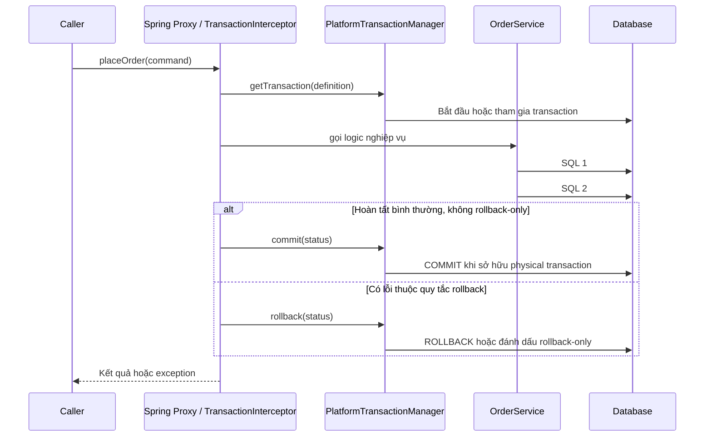

# PlatformTransactionManager cho mã mệnh lệnh

## 1. Vị trí của PlatformTransactionManager trong mô hình giao dịch Spring

Trong một ứng dụng Spring viết theo lối **mệnh lệnh (imperative)**, một lời gọi service thường thực hiện các thao tác tuần tự, ví dụ: đọc số dư → trừ tiền → cộng tiền → lưu lịch sử. Muốn các thao tác cùng tham gia một giao dịch, ứng dụng cần biết **bắt đầu khi nào, dùng tài nguyên nào, commit hay rollback khi nào và dọn dẹp tài nguyên ra sao**.

Spring tách hai trách nhiệm:

- **Mã nghiệp vụ** mô tả công việc cần làm: gọi repository, `JdbcTemplate`, `EntityManager`…
- **Hạ tầng giao dịch** đảm nhiệm vòng đời và ranh giới giao dịch. Điểm trừu tượng cốt lõi là giao diện `org.springframework.transaction.PlatformTransactionManager` (viết tắt PTM).

`PlatformTransactionManager` là **SPI (service provider interface)** để các thành phần của Spring điều khiển giao dịch; nó không phải một connection, không tự phát SQL và cũng không tự chọn database thay ứng dụng. Trong lập trình khai báo, `@Transactional` được Spring AOP/`TransactionInterceptor` diễn giải và gọi PTM. Trong lập trình tường minh, `TransactionTemplate` hoặc chính mã Java của bạn gọi PTM.

**Phân biệt ngay từ đầu:**

- `PlatformTransactionManager`: giao diện đồng bộ cho *imperative transaction* (thường gắn với resource/context của thread đang chạy).
- `ReactiveTransactionManager`: giao diện khác dành cho giao dịch reactive, sử dụng reactive context; không phải một subtype của `PlatformTransactionManager` và không thể coi `@Transactional` reactive như giao dịch dựa trên ThreadLocal.
- `TransactionManager`: giao diện đánh dấu chung mà các transaction manager nói trên mở rộng.

Phạm vi bài này là **PlatformTransactionManager trong mã mệnh lệnh**, gồm contract, cấu hình, vòng đời, programmatic/declarative usage, propagation, rollback và các trường hợp dễ sai.

## 2. Hợp đồng ba phương thức của PlatformTransactionManager

Dạng rút gọn của Spring API:

```java
package org.springframework.transaction;

public interface PlatformTransactionManager extends TransactionManager {
    TransactionStatus getTransaction(TransactionDefinition definition)
            throws TransactionException;

    void commit(TransactionStatus status) throws TransactionException;

    void rollback(TransactionStatus status) throws TransactionException;
}
```

Đây là **trích lược giao diện để giải thích**, không phải file mà ứng dụng cần tự tạo.

| Phương thức | Nhiệm vụ | Điểm cần hiểu |
| --- | --- | --- |
| `getTransaction(definition)` | Bắt đầu giao dịch vật lý mới, tham gia giao dịch hiện tại hoặc áp dụng hành vi propagation tương ứng | Không phải mọi lần gọi đều tạo connection/giao dịch mới. |
| `commit(status)` | Hoàn tất transaction scope theo trạng thái hiện có | Nếu đã bị đánh dấu rollback-only, manager có thể thực hiện rollback thay vì commit; caller có thể gặp `UnexpectedRollbackException`. |
| `rollback(status)` | Yêu cầu rollback phạm vi phù hợp | Với một scope tham gia giao dịch ngoài, Spring có thể chỉ đánh dấu toàn bộ giao dịch là rollback-only thay vì rollback vật lý ngay lập tức. |

`TransactionException` là unchecked exception. Sau khi một `TransactionStatus` đã hoàn thành, không được dùng lại nó để gọi `commit` hay `rollback` lần thứ hai.

### 2.1. TransactionDefinition — yêu cầu khi mở một transaction scope

`TransactionDefinition` mô tả **chính sách** mong muốn:

- **Propagation**: gặp transaction hiện có thì tham gia, treo nó, mở cái mới, hay không dùng transaction?
- **Isolation**: mức cô lập mà hệ quản trị dữ liệu hỗ trợ cho giao dịch mới.
- **Timeout**: thời hạn giao dịch, tính bằng giây theo khả năng của manager/resource; không phải lệnh tự hủy mọi công việc đang chạy.
- **Read-only**: gợi ý cho transaction manager/database/ORM tối ưu truy cập đọc; không mặc nhiên cấm mọi SQL ghi.
- **Name**: tên logic để quan sát/ghi log; không ảnh hưởng đến danh tính transaction trong database.

`DefaultTransactionDefinition` là implementation có thể tạo và cấu hình trực tiếp trong Java. Với `@Transactional`, Spring chuyển metadata của annotation thành transaction attribute/definition thích hợp.

### 2.2. TransactionStatus — trạng thái của lần tham gia

`getTransaction()` trả về `TransactionStatus` để caller điều khiển/quan sát scope:

- `isNewTransaction()`: scope này có tạo giao dịch vật lý mới không?
- `hasSavepoint()`: có savepoint gắn với scope không?
- `setRollbackOnly()`: đánh dấu scope cần rollback.
- `isRollbackOnly()`: đọc trạng thái rollback-only mà status phản ánh.
- `isCompleted()`: status đã hoàn tất chưa?
- `flush()`: yêu cầu flush những synchronization/resource hỗ trợ; **flush không phải commit**.

Hai khái niệm cần phân biệt: **logical transaction scope** là phạm vi quản lý do mỗi lời gọi transactional tạo ra; **physical transaction** là giao dịch thực tế ở JDBC/database hoặc transaction provider. Nhiều logical scope `REQUIRED` có thể cùng chia sẻ **một physical transaction**.

## 3. Chọn implementation phù hợp với tài nguyên

Một bean `PlatformTransactionManager` phải được cấu hình sao cho nó điều khiển đúng tài nguyên mà code sử dụng.

| Implementation | Thường dùng khi | Ghi chú ranh giới |
| --- | --- | --- |
| `DataSourceTransactionManager` | JDBC trên một `DataSource` | Điều khiển JDBC `Connection` từ datasource; repository/JdbcTemplate phải lấy connection theo cơ chế Spring để tham gia. |
| `JdbcTransactionManager` | JDBC trên `DataSource` | Là biến thể của `DataSourceTransactionManager` có hỗ trợ dịch lỗi ở giai đoạn commit/rollback nhất quán hơn với `JdbcTemplate`; thường là lựa chọn tốt cho JDBC thuần. |
| `JpaTransactionManager` | JPA `EntityManagerFactory` | Điều phối transaction của JPA entity manager; có thể hỗ trợ truy cập JDBC qua cùng datasource trong điều kiện tích hợp phù hợp. |
| `JtaTransactionManager` | Hạ tầng JTA/global transaction | Dựa vào JTA provider/coordinator được cấu hình; việc có PTM kiểu JTA **không đủ** nếu participant không hỗ trợ giao dịch phân tán cần thiết. |

Ví dụ, một `JdbcTransactionManager(dataSourceA)` không thể tự rollback thay đổi đã commit thông qua `dataSourceB` hoặc một API HTTP. Hai manager local trên hai `DataSource` cũng không tự tạo một atomic global transaction.

**Với JDBC:** `JdbcTemplate` sử dụng cơ chế lấy connection của Spring (thông qua `DataSourceUtils`), nên các lời gọi cùng `DataSource` có thể tham gia transaction hiện có. Nếu tự gọi `DriverManager.getConnection(...)` để tạo connection độc lập, nó không mặc nhiên tham gia giao dịch mà PTM đang điều phối.

**Với JPA:** application thường dùng Spring-managed `EntityManager`, ví dụ qua `@PersistenceContext` hoặc repository Spring Data JPA. Phải chọn `JpaTransactionManager` tương ứng với `EntityManagerFactory`, tránh suy diễn rằng mọi connection tự động được JPA transaction quản lý.

**Có nhiều transaction manager:** chỉ định manager rõ ràng khi cần, ví dụ `@Transactional(transactionManager = "ordersTxManager")` hoặc inject bằng qualifier. `@Primary` có thể hỗ trợ chọn bean mặc định nhưng không giải quyết bài toán commit nguyên tử qua nhiều datasource.

## 4. Một lời gọi transactional thực sự chạy thế nào?

Giả sử có `OrderService.placeOrder()` được gọi từ một Spring bean khác thông qua proxy, và bên dưới sử dụng `JdbcTemplate` với datasource đúng:



Từ sơ đồ này rút ra bốn kết luận:

1. `@Transactional` là **metadata**; khi chạy bằng proxy mode, lời gọi phải **đi qua proxy Spring** mới có interceptor áp dụng thuộc tính của annotation.
2. PTM quyết định tham gia/khởi tạo transaction dựa trên `TransactionDefinition` và tài nguyên đã được gắn với execution context.
3. Trong imperative transaction, Spring thường lưu trạng thái synchronization và resource binding theo **thread** thông qua `TransactionSynchronizationManager`. Chuyển việc sang thread mới, `@Async` hay callback ngoài luồng không tự kế thừa transaction này.
4. Kết thúc scope phải đi kèm hoàn tất transaction thích hợp và **cleanup**: unbind resource, trả lại connection cho pool, phục hồi context bị suspend nếu có. Đừng tự giữ `Connection`/`EntityManager` làm state toàn cục.

**Chú ý:** nếu scope `REQUIRED` chỉ tham gia một giao dịch vật lý có trước, lời gọi `commit(status)` của nó thường là hoàn tất **scope logic**; commit vật lý thật sự thuộc về transaction ngoài cùng.

## 5. Ví dụ chạy được: JdbcTransactionManager + TransactionTemplate + direct SPI

Ví dụ dưới đây dùng **Java 17+**, **Spring JDBC 6.2.x** và database H2 trong bộ nhớ để thấy ba trạng thái: commit thành công, rollback vì exception và rollback theo `setRollbackOnly()`. Phần cuối gọi trực tiếp contract của `PlatformTransactionManager`. Đây là một ứng dụng Java độc lập có dependency qua Maven, không cần khởi động Spring Boot.

Cấu trúc:

```text
imperative-tx-demo/
├── pom.xml
└── src/main/java/demo/tx/ImperativeTxDemo.java
```

**`pom.xml`:**

```xml
<project xmlns="http://maven.apache.org/POM/4.0.0"
         xmlns:xsi="http://www.w3.org/2001/XMLSchema-instance"
         xsi:schemaLocation="http://maven.apache.org/POM/4.0.0
                             https://maven.apache.org/xsd/maven-4.0.0.xsd">
    <modelVersion>4.0.0</modelVersion>
    <groupId>demo</groupId>
    <artifactId>imperative-tx-demo</artifactId>
    <version>1.0.0</version>

    <properties>
        <maven.compiler.release>17</maven.compiler.release>
        <project.build.sourceEncoding>UTF-8</project.build.sourceEncoding>
    </properties>

    <dependencies>
        <dependency>
            <groupId>org.springframework</groupId>
            <artifactId>spring-jdbc</artifactId>
            <version>6.2.19</version>
        </dependency>
        <dependency>
            <groupId>com.h2database</groupId>
            <artifactId>h2</artifactId>
            <version>2.3.232</version>
        </dependency>
    </dependencies>

    <build>
        <plugins>
            <plugin>
                <groupId>org.apache.maven.plugins</groupId>
                <artifactId>maven-compiler-plugin</artifactId>
                <version>3.13.0</version>
            </plugin>
            <plugin>
                <groupId>org.codehaus.mojo</groupId>
                <artifactId>exec-maven-plugin</artifactId>
                <version>3.5.1</version>
            </plugin>
        </plugins>
    </build>
</project>
```

**`src/main/java/demo/tx/ImperativeTxDemo.java`:**

```java
package demo.tx;

import org.springframework.jdbc.core.JdbcTemplate;
import org.springframework.jdbc.datasource.DriverManagerDataSource;
import org.springframework.jdbc.support.JdbcTransactionManager;
import org.springframework.transaction.PlatformTransactionManager;
import org.springframework.transaction.TransactionStatus;
import org.springframework.transaction.support.DefaultTransactionDefinition;
import org.springframework.transaction.support.TransactionTemplate;

public final class ImperativeTxDemo {
    public static void main(String[] args) {
        var dataSource = new DriverManagerDataSource(
                "jdbc:h2:mem:txdemo;DB_CLOSE_DELAY=-1", "sa", "");
        var jdbc = new JdbcTemplate(dataSource);

        jdbc.execute("CREATE TABLE balance (" +
                "id INT PRIMARY KEY, amount INT NOT NULL)");
        jdbc.update("INSERT INTO balance (id, amount) VALUES (1, 100), (2, 40)");

        PlatformTransactionManager manager =
                new JdbcTransactionManager(dataSource);
        var template = new TransactionTemplate(manager);

        // Transaction 1: hai UPDATE commit cùng nhau.
        template.executeWithoutResult(status -> {
            jdbc.update("UPDATE balance SET amount = amount - 20 WHERE id = 1");
            jdbc.update("UPDATE balance SET amount = amount + 20 WHERE id = 2");
        });
        print("after commit", jdbc);

        // Transaction 2: lỗi sau UPDATE thứ nhất làm rollback.
        try {
            template.executeWithoutResult(status -> {
                jdbc.update("UPDATE balance SET amount = amount - 10 WHERE id = 1");
                throw new IllegalStateException("simulated failure");
            });
        } catch (IllegalStateException ex) {
            System.out.println("caught: " + ex.getMessage());
        }
        print("after rollback", jdbc);

        // Transaction 3: hủy giao dịch chủ động, không cần ném exception.
        template.executeWithoutResult(status -> {
            jdbc.update("UPDATE balance SET amount = amount - 5 WHERE id = 1");
            status.setRollbackOnly();
        });
        print("after rollback-only", jdbc);

        // Transaction 4: sử dụng trực tiếp ba phương thức của SPI.
        var definition = new DefaultTransactionDefinition();
        definition.setName("manual-adjustment");
        TransactionStatus status = manager.getTransaction(definition);
        try {
            jdbc.update("UPDATE balance SET amount = amount + 7 WHERE id = 1");
        } catch (RuntimeException | Error ex) {
            manager.rollback(status);
            throw ex;
        }
        manager.commit(status);
        print("after direct SPI commit", jdbc);
    }

    private static void print(String stage, JdbcTemplate jdbc) {
        Integer a = jdbc.queryForObject(
                "SELECT amount FROM balance WHERE id = 1", Integer.class);
        Integer b = jdbc.queryForObject(
                "SELECT amount FROM balance WHERE id = 2", Integer.class);
        System.out.println(stage + ": A=" + a + ", B=" + b);
    }
}
```

Chạy trong thư mục `imperative-tx-demo` với JDK 17+ và Maven đã được cài đặt:

```bash
mvn -q compile exec:java -Dexec.mainClass=demo.tx.ImperativeTxDemo
```

Các dòng do chương trình in ra (không tính log riêng của Maven/môi trường):

```text
after commit: A=80, B=60
caught: simulated failure
after rollback: A=80, B=60
after rollback-only: A=80, B=60
after direct SPI commit: A=87, B=60
```

**Giải thích vì sao kết quả đúng:**

- Transaction 1: hai câu UPDATE cùng lấy connection được Spring quản lý, nên số dư chuyển từ `(100, 40)` thành `(80, 60)`.
- Transaction 2: sau lệnh trừ 10 xảy ra unchecked exception; `TransactionTemplate` gọi rollback qua manager, số dư vẫn `(80, 60)`.
- Transaction 3: callback gọi `status.setRollbackOnly()` nên thay đổi trừ 5 không commit dù callback kết thúc bình thường.
- Transaction 4: application tự lấy `TransactionStatus`, chạy UPDATE rồi gọi `commit(status)`; tài khoản 1 tăng lên 87.

**Giới hạn ví dụ:** `DriverManagerDataSource` đơn giản, mở connection theo yêu cầu để demo; ứng dụng production thường dùng connection pool. Ví dụ không mô phỏng concurrent requests, timeout, locking hay nhiều database. Trong đoạn direct SPI, `commit()` được đặt **sau** `try/catch` xử lý lỗi của nghiệp vụ để tránh cố rollback lần hai nếu chính commit ném exception; trong production cần thêm ghi log, monitoring và chính sách xử lý commit outcome khi lỗi hạ tầng.

## 6. TransactionTemplate là lớp bọc lập trình tiện dụng

Lời gọi trực tiếp `getTransaction → commit/rollback` hiển thị contract rõ nhất, nhưng trong nghiệp vụ thường nên dùng `TransactionTemplate` nếu cần lập trình giao dịch tường minh. `TransactionTemplate` dùng PTM phía dưới và tự quản lý try/catch/rollback/cleanup cho callback.

Ví dụ trong một Spring bean đã có `JdbcTemplate` và đúng PTM:

```java
import org.springframework.jdbc.core.JdbcTemplate;
import org.springframework.transaction.PlatformTransactionManager;
import org.springframework.transaction.TransactionDefinition;
import org.springframework.transaction.support.TransactionTemplate;

public class BatchWriter {
    private final JdbcTemplate jdbc;
    private final TransactionTemplate tx;

    public BatchWriter(JdbcTemplate jdbc, PlatformTransactionManager manager) {
        this.jdbc = jdbc;
        this.tx = new TransactionTemplate(manager);
        this.tx.setPropagationBehavior(TransactionDefinition.PROPAGATION_REQUIRED);
        this.tx.setTimeout(10);
    }

    public void create(String code) {
        tx.executeWithoutResult(status -> {
            int inserted = jdbc.update(
                    "INSERT INTO job (code) VALUES (?)", code);
            if (inserted != 1) {
                status.setRollbackOnly();
            }
        });
    }
}
```

Đây là **đoạn class dùng bên trong một ứng dụng có bảng `job` và bean được cấu hình**, không phải chương trình độc lập. Điểm chính là lựa chọn policy trên `TransactionTemplate`, còn bên trong callback chỉ cần lo thao tác nghiệp vụ. Một `TransactionTemplate` có cấu hình cố định có thể được dùng lại giữa các lời gọi; nếu các flow cần policy khác nhau, tạo các template được cấu hình riêng, tránh sửa propagation/timeout của một instance đang được nhiều thread dùng đồng thời.

Nên dùng `TransactionTemplate` khi cần transaction chỉ bao quanh **một đoạn ngắn giữa method**, hoặc cần quyết định rollback theo trạng thái trả về. `@Transactional` thường rõ ràng hơn khi toàn bộ public service method cần cùng ranh giới giao dịch.

## 7. @Transactional dùng PlatformTransactionManager ở phía sau

Đối với declarative transaction, thường đặt `@Transactional` ở **service boundary**:

```java
package demo.tx;

import org.springframework.jdbc.core.JdbcTemplate;
import org.springframework.stereotype.Service;
import org.springframework.transaction.annotation.Transactional;

@Service
public class AccountService {
    private final JdbcTemplate jdbc;

    public AccountService(JdbcTemplate jdbc) {
        this.jdbc = jdbc;
    }

    @Transactional
    public void transfer(long fromId, long toId, long amount) {
        if (fromId == toId || amount <= 0) {
            throw new IllegalArgumentException("Invalid transfer");
        }

        int debited = jdbc.update(
                "UPDATE account SET balance = balance - ? " +
                "WHERE id = ? AND balance >= ?",
                amount, fromId, amount);
        if (debited != 1) {
            throw new IllegalStateException("Insufficient balance");
        }

        int credited = jdbc.update(
                "UPDATE account SET balance = balance + ? WHERE id = ?",
                amount, toId);
        if (credited != 1) {
            throw new IllegalStateException("Missing receiver");
        }
    }
}
```

Snippet này biên dịch khi có Spring JDBC/Context/TX và chạy đúng khi ứng dụng có bảng `account`, `DataSource`, transaction manager và Spring proxy được kích hoạt. Khi service được gọi qua proxy, annotation là cơ sở để interceptor gọi `getTransaction`, `commit` hoặc `rollback`; **class AccountService không cần viết ba lệnh này**.

Với cấu hình Spring Framework thủ công, có thể cung cấp bean manager và bật quản lý giao dịch bằng annotation:

```java
package demo.tx;

import javax.sql.DataSource;
import org.springframework.context.annotation.Bean;
import org.springframework.context.annotation.Configuration;
import org.springframework.jdbc.support.JdbcTransactionManager;
import org.springframework.transaction.PlatformTransactionManager;
import org.springframework.transaction.annotation.EnableTransactionManagement;

@Configuration
@EnableTransactionManagement
public class TransactionConfig {
    @Bean
    public PlatformTransactionManager transactionManager(DataSource dataSource) {
        return new JdbcTransactionManager(dataSource);
    }
}
```

Đây là cấu hình **bổ sung cho một Spring application có bean `DataSource`**. Với Spring Boot đã auto-configure đúng transaction manager, thường không cần tự thêm bean tương đương; tránh tạo hai manager không chủ đích.

### Chọn kiểu dùng nào?

| Cách dùng | Ai gọi PTM? | Khi nào thích hợp? |
| --- | --- | --- |
| `@Transactional` | Spring transaction interceptor | Ranh giới giao dịch khớp method service; code nghiệp vụ cần gọn. |
| `TransactionTemplate` | Template gọi PTM | Chỉ một đoạn cần giao dịch, hoặc xử lý rollback theo callback. |
| Gọi trực tiếp PTM | Mã ứng dụng | Viết hạ tầng/adaptor đặc biệt, cần kiểm soát vòng đời rất chi tiết; phải tự chịu trách nhiệm cleanup và lỗi. |

Các cách trên có thể chung một PTM và cùng dùng một physical transaction tùy propagation; **không** phải ba loại transaction khác nhau.

## 8. Propagation: getTransaction có mở giao dịch mới không?

Đây là phần quyết định ý nghĩa của `getTransaction(definition)` khi đã có transaction trong call stack.

| Propagation | Có transaction hiện tại | Chưa có transaction |
| --- | --- | --- |
| `REQUIRED` (mặc định) | Tham gia transaction đang có | Bắt đầu transaction mới |
| `REQUIRES_NEW` | Suspend transaction cũ, tạo physical transaction độc lập | Bắt đầu transaction mới |
| `NESTED` | Tạo nested scope bằng savepoint nếu manager/resource hỗ trợ | Thường hoạt động như transaction mới |
| `SUPPORTS` | Tham gia | Chạy không có transaction thực tế |
| `NOT_SUPPORTED` | Suspend transaction hiện có, chạy không transactional | Chạy không transactional |
| `MANDATORY` | Tham gia | Ném lỗi vì bắt buộc phải có transaction |
| `NEVER` | Ném lỗi vì không được có transaction | Chạy không transactional |

Ba mức thường gây nhầm lẫn:

### REQUIRED: chung physical transaction nhưng nhiều logical scope

`outer()` và `inner()` (hai method được intercept đúng qua proxy) đều `REQUIRED`, thì cùng một giao dịch vật lý. Nếu inner đánh dấu rollback-only, outer **không thể ép commit thành công** bằng cách bắt exception rồi tiếp tục. Khi outer cố commit, Spring có thể ném `UnexpectedRollbackException` để báo rằng thực tế đã rollback.

Ví dụ **mã minh họa trong hai Spring bean riêng**:

```java
@Service
class InnerService {
    @Transactional
    public void execute() {
        throw new IllegalStateException("business failure");
    }
}

@Service
class OuterService {
    private final InnerService inner;

    OuterService(InnerService inner) {
        this.inner = inner;
    }

    @Transactional
    public void execute() {
        try {
            inner.execute(); // Cùng physical transaction (REQUIRED).
        } catch (IllegalStateException ex) {
            // Bắt exception KHÔNG xóa rollback-only.
        }
        // Khi interceptor outer gọi commit, có thể xuất hiện
        // UnexpectedRollbackException thay vì commit thành công.
    }
}
```

Đoạn này cần các import `@Service`, `@Transactional` và phải nằm trong ứng dụng Spring; cố ý rút gọn để minh họa luồng. Nếu inner và outer cùng một object và gọi `this.innerMethod()`, proxy có thể không intercept inner method, làm hành vi khác với ví dụ trên.

### REQUIRES_NEW: một physical transaction độc lập

Outer transaction có thể đang mở, nhưng inner `REQUIRES_NEW` cần tài nguyên riêng. Inner có thể **commit thành công dù sau đó outer rollback**. Đây là lý do không nên nghĩ “đã gọi trong outer @Transactional thì mọi thứ cuối cùng cùng rollback”. `REQUIRES_NEW` có thể cần thêm connection trong lúc connection outer vẫn đang giữ; cấu hình pool không đủ có thể gây thiếu connection, thậm chí deadlock do các request chờ lẫn nhau.

### NESTED: savepoint trong một physical transaction

Với JDBC manager hỗ trợ savepoint, `NESTED` có thể rollback phần thay đổi sau savepoint rồi để outer tiếp tục commit. Đây **không phải** một physical transaction độc lập. Không giả định mọi JPA/JTA manager đều hỗ trợ nested theo cùng cách: kiểm tra implementation cụ thể và database driver.

### Isolation/timeout/readOnly của inner

Khi một `REQUIRED` scope **tham gia** transaction đã tồn tại, thông số isolation/timeout/readOnly khai báo ở inner **không tự thay thế** chính sách của physical transaction ngoài. Spring có thể kiểm tra bất tương thích khi bật chế độ validate existing transaction. Muốn chính sách riêng, phải thiết kế một transaction mới tương thích thay vì chỉ gắn annotation khác.

## 9. Chính sách commit/rollback và exception

Với `@Transactional` theo cấu hình mặc định thông dụng:

- Method hoàn tất bình thường → Spring yêu cầu commit, **trừ khi** transaction đã rollback-only.
- `RuntimeException` hoặc `Error` thoát khỏi method được intercept → rollback.
- Checked `Exception` thoát khỏi method **không mặc nhiên** kích hoạt rollback; cấu hình `rollbackFor` nếu nghiệp vụ muốn rollback.

Ví dụ:

```java
import java.io.IOException;
import org.springframework.transaction.annotation.Transactional;

@Transactional(rollbackFor = IOException.class)
public void importBatch() throws IOException {
    // Các bước cập nhật DB bằng resource do manager quản lý.
    // Nếu xảy ra IOException thoát khỏi method, Spring rollback.
}
```

Đây chỉ là **method fragment minh họa quy tắc rollback**, không phải class độc lập. `rollbackFor` có thể nhận một hoặc nhiều exception class; `noRollbackFor` tạo ngoại lệ ngược lại. Với Spring JDBC, nhiều lỗi SQL được `JdbcTemplate` chuyển thành `DataAccessException` (unchecked), nên mặc định gây rollback.

**Các tình huống thường gây bất ngờ:**

1. **Catch exception rồi trả về bình thường:** interceptor có thể xem method thành công và commit, nếu chưa ai đánh dấu rollback-only. Nếu phải catch, cân nhắc rethrow hoặc đánh dấu rollback-only có chủ đích.
2. **Inner `REQUIRED` đã rollback-only:** outer catch exception vẫn có thể gặp `UnexpectedRollbackException` khi kết thúc; không được trả về “thành công” như thể database đã commit.
3. **Checked exception:** thêm `rollbackFor` khi thật sự cần. Không mặc nhiên giả định mọi exception rollback.
4. **Exception sau khi commit:** thay đổi đã commit không thể được rollback bởi cùng transaction. Cần xử lý nghiệp vụ bù trừ nếu phải đảo kết quả.
5. **Commit failure:** exception từ `commit` không có nghĩa chắc chắn database không commit; với lỗi mạng/khả năng kết quả chưa rõ, phải quan sát và đối soát theo đặc điểm của driver, database, transaction manager.

Nên giữ transaction tương đối ngắn: không mở transaction rồi chờ người dùng, gọi API mạng chậm hoặc xử lý CPU lâu nếu không cần. Transaction dài giữ lock/connection, làm tăng contention và timeout.

## 10. Isolation, timeout và readOnly: hứa đúng phạm vi

| Thuộc tính | Cách cấu hình | Cần kiểm chứng |
| --- | --- | --- |
| Isolation | `@Transactional(isolation = Isolation.READ_COMMITTED)` hoặc `TransactionDefinition` | Mức DB/driver thật sự hỗ trợ; khác biệt phantom/non-repeatable read; thường chỉ áp dụng transaction mới. |
| Timeout | `@Transactional(timeout = 5)` hoặc `TransactionTemplate.setTimeout(5)` | Cơ chế manager/database cưỡng chế; không đảm bảo ngắt lập tức mọi I/O hay HTTP call. |
| Read-only | `@Transactional(readOnly = true)` | Có thể ảnh hưởng flush, optimizer hoặc connection flag; **không** mặc nhiên là security boundary ngăn ghi dữ liệu. |
| Name | `DefaultTransactionDefinition.setName("...")` | Dùng để log/quan sát, không là tên transaction vật lý. |

Isolation database vẫn phải phù hợp bài toán: `READ_COMMITTED` không tự loại bỏ mọi race condition; khi update số dư, giữ chỗ, chống ghi trùng, cần thiết kế lock/atomic SQL/unique constraint/optimistic versioning và kiểm thử song song. Việc dùng PTM **không thay thế** kiểm soát nhất quán nghiệp vụ.

Cấu hình transaction mới độc lập, ví dụ:

```java
var tx = new TransactionTemplate(manager);
tx.setPropagationBehavior(TransactionDefinition.PROPAGATION_REQUIRES_NEW);
tx.setIsolationLevel(TransactionDefinition.ISOLATION_READ_COMMITTED);
tx.setTimeout(5);
tx.setReadOnly(false);
tx.executeWithoutResult(status -> doDatabaseWork());
```

Đoạn mã này **minh họa API trong một method đã có biến `manager` và method `doDatabaseWork()`**, không phải chương trình tự chạy. Với `REQUIRES_NEW`, nhớ xem tải connection pool và các side effect sau khi inner commit.

## 11. Thread-bound resources và những việc PTM không bảo đảm

Trong imperative path, transaction context và nhiều resource được gắn với thread. `TransactionSynchronizationManager` duy trì thông tin hỗ trợ synchronization, resource bound, trạng thái transaction… nhằm để DAO/JdbcTemplate/ORM lấy đúng connection/entity manager.

**Bảo đảm trong phạm vi thích hợp:** nhiều câu SQL trên **cùng datasource** và cùng transaction scope có thể commit hoặc rollback cùng nhau.

**Không tự được bảo đảm:**

- Một method gọi HTTP sang Payment Service: phía Payment có transaction riêng; local PTM không rollback lệnh thanh toán từ xa.
- Ghi hai datasource bằng hai local manager: manager A không tự quyết định commit của manager B. Muốn atomic global commit phải có cơ chế JTA/XA thật sự nếu tài nguyên hỗ trợ; bài toán microservices thường cần workflow/compensation.
- Gửi message đến broker sau insert DB: annotation local không làm DB write và message publish nguyên tử; dùng transactional outbox khi cần chuyển sự kiện đáng tin.
- `CompletableFuture.supplyAsync`, `@Async`, tự tạo thread: không tự truyền thread-bound JDBC transaction sang thread khác.
- Gọi một method private/final hoặc self-invocation `this.someTransactionalMethod()`: trong proxy mode, interceptor không được chạy cho lời gọi không qua proxy; đừng đặt kỳ vọng vào annotation của inner method.
- Truy cập database bằng connection tự mở ngoài cơ chế quản lý của Spring: có thể không tham gia physical transaction đang mở.

Nếu cần làm việc reactive bằng Reactor/WebFlux/R2DBC, tìm hiểu `ReactiveTransactionManager` và `TransactionalOperator`. Không cố ép việc xử lý bất đồng bộ/reactive vào một PTM dựa trên ThreadLocal.

## 12. Chọn ranh giới transaction trong kiến trúc ứng dụng

Một nguyên tắc thực tế là đặt transaction **quanh đơn vị cập nhật nhất quán** và để service orchestration chịu trách nhiệm cho các bước ngoài transaction.

| Nhu cầu | Cách triển khai gợi ý | Lý do |
| --- | --- | --- |
| Cập nhật 3 bảng trong cùng database | Service `@Transactional` + đúng PTM | Một transaction bảo vệ nhiều câu SQL. |
| Một method dài, chỉ một đoạn cần commit/rollback | `TransactionTemplate` quanh đoạn cập nhật | Transaction ngắn và dễ nhìn. |
| Cần policy riêng trong một bước | Thiết kế `TransactionTemplate` riêng hoặc method proxied dùng propagation phù hợp | Ranh giới và policy được xác định tường minh. |
| Repository JPA | `JpaTransactionManager` tương ứng `EntityManagerFactory` | Quản lý persistence context/flush đúng hạ tầng ORM. |
| JDBC sử dụng datasource và SQL thuần | `JdbcTransactionManager` hoặc `DataSourceTransactionManager` | Quản lý physical JDBC transaction và connection binding. |
| Hai resource cần atomic commit và đều hỗ trợ XA | Đánh giá JTA coordinator, participant, recovery | Chỉ có PTM local là không đủ cho global commit. |
| Gọi nhiều microservice / publish event | Local PTM + saga/outbox/idempotency tùy nghiệp vụ | Các side effect xuyên ranh giới không tự rollback. |

Khi cần nhiều manager, nên đặt tên bean rõ nghĩa và bảo đảm mỗi `@Transactional`/`TransactionTemplate` tham chiếu đúng manager; kiểm thử thực tế trên datasource thay vì chỉ nhìn annotation.

## 13. Cách kiểm thử và chẩn đoán lỗi

### 13.1. Test các kết quả commit/rollback

Với một database test thực (hoặc H2 nếu hành vi được mô phỏng đúng), tạo dữ liệu ban đầu rồi đo **dữ liệu sau khi transaction kết thúc**:

1. Happy path: ghi thành công hai bảng, cả hai bản ghi xuất hiện.
2. Throw unchecked exception sau bước ghi thứ nhất: kiểm tra cả hai thay đổi **không** được commit.
3. Checked exception: xác minh khác biệt giữa không có và có `rollbackFor`.
4. Outer `REQUIRED` bắt exception từ inner `REQUIRED`: kiểm tra rollback-only và `UnexpectedRollbackException` khi outer cố commit.
5. `REQUIRES_NEW`: inner commit, outer rollback → dữ liệu của inner vẫn tồn tại (nếu không bị ràng buộc khác ngăn).
6. Self-invocation: gọi qua proxy và gọi nội bộ rồi quan sát khác biệt transaction behavior; sửa bằng cách tách service bean hoặc thiết kế lại boundary.

Đối với Spring Test, test method được đánh dấu `@Transactional` thường được rollback khi test hoàn tất theo mặc định. Điều này có thể **che mất** khác biệt giữa commit thật và rollback nếu chỉ đọc dữ liệu trong cùng test transaction. Muốn kiểm chứng commit vật lý, dùng chiến lược test phù hợp (ví dụ test không mở outer transaction, hoặc `TestTransaction` để chủ động kết thúc) rồi đọc từ context/connection khác.

### 13.2. Diagnostic checklist

| Triệu chứng | Khả năng cần kiểm tra | Cách xác minh |
| --- | --- | --- |
| `@Transactional` không có tác dụng | Method được gọi bằng `this`, bean không do Spring quản lý, proxy không intercept | Log interceptor, kiểm tra call path/bean/proxy. |
| Một repository commit ngoài dự kiến | Dùng sai datasource/manager, JDBC connection tự mở | Xem manager bean, datasource identity và connection acquisition. |
| Method outer báo `UnexpectedRollbackException` | Inner scope đã đánh dấu shared physical transaction rollback-only | Đọc exception gốc ở inner, propagation, rollback rules. |
| `REQUIRES_NEW` bị chờ connection | Pool không đủ cho outer + inner transaction cùng tồn tại | Kiểm tra active/pending connections và thread dump. |
| `NESTED` không chạy | Driver/manager không hỗ trợ savepoint/nested | Kiểm tra implementation, cấu hình nestedAllowed, JDBC savepoint support. |
| Dữ liệu vẫn ghi dù readOnly=true | Read-only được xử lý như hint | Kiểm tra DB/ORM, rule write permissions và code ghi. |
| Test luôn thấy rollback | Test method đang transactional và rollback mặc định | Tách test commit thực hoặc điều khiển lifecycle test transaction. |

Có thể bật logging phù hợp với môi trường, ví dụ logging cấp DEBUG cho `org.springframework.transaction` hoặc hẹp hơn như `org.springframework.jdbc.datasource` để thấy lifecycle, nhưng cần giữ thông tin nhạy cảm ngoài log. Không chỉ dựa vào log “Creating new transaction”: **trạng thái dữ liệu sau commit/rollback** mới là bằng chứng cuối cùng.

## 14. Những sai lầm phổ biến và cách sửa

**Sai lầm 1 — tưởng `@Transactional` tự sinh transaction ở mọi lời gọi.** Trong proxy mode, annotation cần một intercepted invocation. *Sửa:* đặt boundary ở service bean được gọi từ bên ngoài qua Spring proxy; kiểm tra cấu hình transaction management.

**Sai lầm 2 — nghĩ mọi `getTransaction` đều bắt đầu transaction mới.** `REQUIRED` thường chỉ join một transaction vật lý hiện hữu. *Sửa:* đọc `TransactionDefinition` và `TransactionStatus.isNewTransaction()`, phân biệt scope logic và physical.

**Sai lầm 3 — catch exception thì transaction được “chữa lành”.** Rollback-only của giao dịch chung không tự xóa. *Sửa:* quản lý exception và boundary rõ ràng; dùng transaction mới chỉ khi nghiệp vụ thực sự cần commit độc lập.

**Sai lầm 4 — chọn `REQUIRES_NEW` để “an toàn hơn”.** Nó có thể commit sớm độc lập, tăng số connection cần dùng và phá kỳ vọng all-or-nothing. *Sửa:* chỉ dùng khi có yêu cầu chính đáng về commit riêng, phân tích chi phí concurrency.

**Sai lầm 5 — coi flush là commit hoặc readOnly là lớp bảo mật.** Flush đẩy thay đổi đến database trong transaction, vẫn có thể rollback; readOnly chủ yếu là hint. *Sửa:* xác nhận dữ liệu sau transaction và bảo vệ ghi bằng quyền DB/ràng buộc nghiệp vụ.

**Sai lầm 6 — cho rằng một PTM quản lý toàn bộ hệ thống.** Local PTM chỉ quản lý participant mà nó có thể điều khiển. *Sửa:* lập bản đồ datasource, ORM, broker, HTTP API và ranh giới sở hữu dữ liệu trước khi thiết kế transaction.

## 15. Câu hỏi tự kiểm tra

1. **PlatformTransactionManager có mấy phương thức cốt lõi?** Ba: `getTransaction`, `commit` và `rollback`.
2. **`getTransaction()` có luôn tạo transaction vật lý mới không?** Không. Nó phụ thuộc propagation và transaction hiện có.
3. **`@Transactional` thuộc về PTM hay annotation tự làm commit?** Annotation mô tả policy; interceptor sử dụng PTM để điều khiển transaction.
4. **TransactionTemplate khác gì gọi trực tiếp manager?** Nó đóng gói xử lý lifecycle cho callback và tránh code commit/rollback thủ công.
5. **Vì sao `REQUIRED` có `UnexpectedRollbackException`?** Inner scope có thể đặt rollback-only trên shared physical transaction, khiến outer không thể commit thật.
6. **`REQUIRES_NEW` có đảm bảo inner rollback khi outer rollback không?** Không. Inner có physical transaction riêng nên commit độc lập.
7. **Spring có tự truyền imperative transaction sang `@Async` không?** Không. Transaction context thường gắn với thread và không tự đi qua boundary async.
8. **Gửi HTTP call trong `@Transactional` có biến dịch vụ từ xa thành một participant local không?** Không.
9. **Có thể triển khai JDBC DAO bằng `JdbcTemplate` và transaction manager cùng datasource không?** Có; đó là cách Spring đưa cùng connection vào phạm vi transaction.
10. **Checked exception có luôn rollback không?** Không, phải xét rollback rules, ví dụ `rollbackFor` khi cần.

**Kết luận:** `PlatformTransactionManager` là hợp đồng điều khiển giao dịch imperative cho Spring: **lấy/khởi tạo scope theo TransactionDefinition, theo dõi bằng TransactionStatus, rồi commit hoặc rollback đúng tài nguyên**. Lập trình khai báo (`@Transactional`) và tường minh (`TransactionTemplate`) đều dựa trên hợp đồng này. Hiểu ranh giới resource, propagation, rollback-only và proxy/thread context giúp tránh các lỗi commit/rollback tưởng như “khó giải thích”.

## Tài liệu đối chiếu

- [Spring Framework — Understanding the Transaction Abstraction](https://docs.spring.io/spring-framework/reference/data-access/transaction/strategies.html)
- [Spring Framework — Programmatic Transaction Management](https://docs.spring.io/spring-framework/reference/data-access/transaction/programmatic.html)
- [Spring Framework — @Transactional](https://docs.spring.io/spring-framework/reference/data-access/transaction/declarative/annotations.html)
- [Spring Framework — Transaction Propagation](https://docs.spring.io/spring-framework/reference/data-access/transaction/declarative/tx-propagation.html)
- [Spring API — PlatformTransactionManager](https://docs.spring.io/spring-framework/docs/current/javadoc-api/org/springframework/transaction/PlatformTransactionManager.html)
- [Spring API — TransactionStatus](https://docs.spring.io/spring-framework/docs/current/javadoc-api/org/springframework/transaction/TransactionStatus.html)