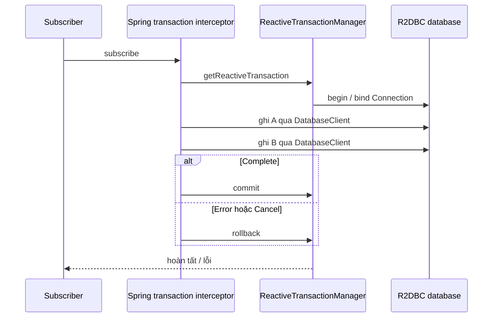

# ReactiveTransactionManager cho chuỗi reactive trong Spring Framework

## 1. Vì sao transaction trong reactive khác transaction thông thường?

Một giao dịch (transaction) gom các thao tác dữ liệu thành một đơn vị cùng commit hoặc rollback. Ví dụ: chuyển 200 điểm từ ví A sang ví B gồm trừ điểm A và cộng điểm B. Nếu ví B không tồn tại thì cập nhật A cũng phải được rollback.

Với ứng dụng JDBC/JPA kiểu imperative, Spring thường dùng `PlatformTransactionManager` và giữ tài nguyên transaction trong `ThreadLocal`: các lời gọi thực thi đồng bộ trên cùng thread có thể tìm lại transaction hiện tại. Reactive Streams lại có đặc điểm:

- `Mono` và `Flux` thông thường là **cold Publisher**: dựng chuỗi không đồng nghĩa với chạy câu SQL; thao tác diễn ra khi có subscription.
- Một subscription có thể chuyển giữa nhiều scheduler/thread, nên `ThreadLocal` không phải chìa khóa ổn định để xác định transaction xuyên toàn chuỗi.
- Kết thúc công việc thể hiện qua tín hiệu `onComplete`, `onError`, hoặc `cancel`; không thể chỉ nhìn thời điểm phương thức Java trả về một `Mono`.

Spring giải quyết bằng **`ReactiveTransactionManager` + Reactor subscriber `Context`**. Mọi thao tác dữ liệu tham gia phải được thực thi trong cùng chuỗi reactive và sử dụng client/connection nhận ra context transaction.

```text
Caller gọi service.transfer(...) --> Mono<Void> được trả về
                                           |
                                     subscribe()
                                           |
                                 Mở/tham gia transaction
                                           |
                   UPDATE nguồn --> UPDATE đích
                                           |
             onComplete: COMMIT | onError: ROLLBACK
                             cancel: ROLLBACK
```

Nếu không subscribe, publisher ghi dữ liệu thường **không chạy**. Nếu tạo hai subscription vào cùng một cold publisher, nghiệp vụ có thể bị thực hiện **hai lần**, mỗi lần với transaction riêng.

## 2. Các thành phần và API cần nắm

| Thành phần | Công dụng | Đặc trưng |
| --- | --- | --- |
| `ReactiveTransactionManager` | SPI quản lý transaction reactive | API trả `Mono`, hỗ trợ begin/commit/rollback |
| `ReactiveTransaction` | Trạng thái transaction đang xử lý | Có thể đánh dấu `setRollbackOnly()` |
| `R2dbcTransactionManager` | Transaction manager cho một `ConnectionFactory` R2DBC | Kết nối được gắn với Reactor context của subscription |
| `ReactiveMongoTransactionManager` | Manager cho giao dịch MongoDB reactive | Chỉ dùng khi MongoDB deployment hỗ trợ transaction |
| `TransactionalOperator` | Bao một đoạn `Publisher` bằng transaction | Hữu ích khi muốn điều khiển phạm vi bằng code |
| `@Transactional` | Khai báo ranh giới ở public service method | Phải được Spring transaction proxy/interceptor áp dụng |
| `DatabaseClient`, `R2dbcEntityTemplate` | Truy cập SQL reactive của Spring | Nhận connection đang tham gia transaction |

Hợp đồng cốt lõi của `org.springframework.transaction.ReactiveTransactionManager` (lược bớt phần khai báo phụ):

```java
public interface ReactiveTransactionManager extends TransactionManager {
    Mono<ReactiveTransaction> getReactiveTransaction(TransactionDefinition definition);
    Mono<Void> commit(ReactiveTransaction transaction);
    Mono<Void> rollback(ReactiveTransaction transaction);
}
```

`getReactiveTransaction()` mở hoặc tham gia giao dịch theo `TransactionDefinition` và context tại thời điểm subscription. `commit()`/`rollback()` cũng là publisher cần được subscribe và nối tuần tự. Thông thường ứng dụng **không trực tiếp** gọi ba hàm này; để `@Transactional` hoặc `TransactionalOperator` điều phối sẽ tránh lỗi quên kết thúc tài nguyên khi code thất bại hoặc bị hủy.

### So sánh mô hình imperative và reactive

| Nội dung | Imperative | Reactive |
| --- | --- | --- |
| Transaction manager | `PlatformTransactionManager` | `ReactiveTransactionManager` |
| Nơi giữ transaction context | `ThreadLocal` | Reactor `Context` của subscriber |
| SQL client phổ biến | `JdbcTemplate` / JPA | R2DBC `DatabaseClient` |
| Hình thức tính toán | Lệnh đồng bộ | `Publisher` và subscription |
| API programmatic | `TransactionTemplate` | `TransactionalOperator` |
| Thời điểm hoàn tất | Lời gọi đồng bộ kết thúc | Publisher phát complete/error/cancel |

**Không nhầm ReactiveTransactionManager với “chạy trên nhiều thread”**: reactive có thể dùng một hoặc nhiều thread, nhưng giao dịch đi theo **subscription context**, không đi theo ID thread.

## 3. Vòng đời transaction trong một subscription

Khi một đối tượng bên ngoài gọi phương thức Spring bean có `@Transactional` trả về `Mono`/`Flux`:

1. Spring AOP proxy nhận lời gọi, xác định cấu hình `@Transactional` và transaction manager tương ứng.
2. Một publisher đã được bọc transaction được trả về. Chưa có lý do để tin SQL đã chạy nếu chưa subscribe.
3. Lúc subscribe, transaction interceptor yêu cầu manager tạo/tham gia transaction và gắn state/resource vào **Reactor subscriber `Context`**.
4. `DatabaseClient` và những client hỗ trợ transaction-aware lấy đúng R2DBC connection từ context.
5. Các `Mono`/`Flux` của nghiệp vụ thực hiện thao tác theo thứ tự được compose.
6. Khi chuỗi kết thúc bình thường, manager commit; khi phát lỗi hoặc cancel, manager xử lý rollback (theo semantics và thời điểm tín hiệu).
7. Connection và tài nguyên transaction được cleanup; caller nhận completion hoặc error.



Một `Context` của Reactor là ánh xạ key/value bất biến được truyền theo subscriber. Nó không phải cùng một thứ với `ThreadLocal`, dữ liệu HTTP request, logging MDC hay một biến field trong singleton service.

`publishOn` hoặc `subscribeOn` trong **cùng pipeline Reactor** thường vẫn duy trì Reactor context dù chuyển scheduler. Điều làm mất transaction thường là tách một **subscription mới**, thoát sang một framework không bảo toàn context, hoặc dùng connection được mở không qua cơ chế transaction-aware của Spring.

## 4. Ví dụ thực hành Java 17+: Spring Boot + R2DBC

Ta dùng H2 in-memory qua R2DBC nên có thể quan sát commit và rollback mà không cần cài một DB server. Mã hướng tới Spring Boot 3.3.x (Java 17+) với Gradle. Tạo một dự án Spring Boot bằng Spring Initializr có Gradle wrapper; đặt các file theo đường dẫn chỉ ra dưới đây. Ví dụ không dùng JDBC/JPA cho các lệnh SQL.

### 4.1. `build.gradle`

```groovy
plugins {
    id 'java'
    id 'org.springframework.boot' version '3.3.5'
    id 'io.spring.dependency-management' version '1.1.6'
}

group = 'example'
version = '1.0.0'

java {
    toolchain {
        languageVersion = JavaLanguageVersion.of(17)
    }
}

repositories {
    mavenCentral()
}

dependencies {
    implementation 'org.springframework.boot:spring-boot-starter-data-r2dbc'
    runtimeOnly 'io.r2dbc:r2dbc-h2'
}

tasks.named('test') {
    useJUnitPlatform()
}
```

`spring-boot-starter-data-r2dbc` cung cấp tích hợp Spring Data R2DBC, `DatabaseClient` và các thư viện reactive cần thiết. Khi chuyển sang PostgreSQL/MySQL, phải chọn **driver R2DBC** tương ứng và xem xét mức hỗ trợ transaction của driver/DBMS.

### 4.2. `src/main/resources/application.yml`

```yaml
spring:
  main:
    web-application-type: none
  r2dbc:
    url: "r2dbc:h2:mem:///reactive_tx_demo?options=DB_CLOSE_DELAY=-1"
  sql:
    init:
      mode: always
```

Đây là ứng dụng CLI nên không cần WebFlux server. `mode: always` khiến Spring Boot chạy script schema lúc khởi động. `DB_CLOSE_DELAY=-1` giúp database H2 in-memory không biến mất khi hết connection đang mở giữa các bước của demo.

### 4.3. `src/main/resources/schema.sql`

```sql
CREATE TABLE wallet (
    id BIGINT PRIMARY KEY,
    balance BIGINT NOT NULL CHECK (balance >= 0)
);

INSERT INTO wallet (id, balance) VALUES (1, 1000);
INSERT INTO wallet (id, balance) VALUES (2, 500);
```

Mỗi transaction chuyển điểm có hai `UPDATE`. Ta cần kiểm tra số hàng được cập nhật, vì `UPDATE` không có lỗi SQL khi `WHERE` không khớp hàng nào.

### 4.4. `src/main/java/example/reactivetx/WalletService.java`

```java
package example.reactivetx;

import org.springframework.r2dbc.core.DatabaseClient;
import org.springframework.stereotype.Service;
import org.springframework.transaction.annotation.Transactional;
import reactor.core.publisher.Mono;

@Service
public class WalletService {
    private final DatabaseClient db;

    public WalletService(DatabaseClient db) {
        this.db = db;
    }

    @Transactional(transactionManager = "reactiveTxManager")
    public Mono<Void> transfer(long sourceId, long targetId, long amount) {
        return Mono.defer(() -> {
            if (amount <= 0 || sourceId == targetId) {
                return Mono.error(
                    new IllegalArgumentException("Invalid transfer")
                );
            }

            return debit(sourceId, amount)
                .flatMap(rows -> {
                    if (rows != 1) {
                        return Mono.<Integer>error(
                            new IllegalStateException("Source missing or insufficient funds")
                        );
                    }
                    return credit(targetId, amount);
                })
                .flatMap(rows -> {
                    if (rows != 1) {
                        return Mono.<Integer>error(
                            new IllegalStateException("Destination missing")
                        );
                    }
                    return Mono.just(rows);
                })
                .then();
        });
    }

    private Mono<Integer> debit(long id, long amount) {
        return db.sql("""
                UPDATE wallet
                SET balance = balance - :amount
                WHERE id = :id AND balance >= :amount
                """)
            .bind("amount", amount)
            .bind("id", id)
            .fetch()
            .rowsUpdated();
    }

    private Mono<Integer> credit(long id, long amount) {
        return db.sql("""
                UPDATE wallet
                SET balance = balance + :amount
                WHERE id = :id
                """)
            .bind("amount", amount)
            .bind("id", id)
            .fetch()
            .rowsUpdated();
    }
}
```

Giải thích từng phần:

- `transfer()` trả **`Mono<Void>`**, không mở transaction rồi tự trả một kết quả đồng bộ. Spring bắt đầu reactive transaction khi publisher được subscribe qua proxy.
- `Mono.defer` giúp validation và việc dựng pipeline diễn ra trong lúc subscription, không gây một tác vụ ghi “chạy trước”.
- Câu `UPDATE` nguồn kết hợp trừ điểm và điều kiện `balance >= :amount` trong **một câu SQL**; tránh khoảng hở giữa đọc, kiểm tra và ghi.
- `.flatMap` thứ nhất chỉ gọi `credit` khi `debit` cập nhật đúng một hàng; `.flatMap` thứ hai báo lỗi nếu ví đích không tồn tại.
- Khi lỗi `Destination missing` phát qua `onError`, interceptor rollback toàn bộ transaction, kể cả `UPDATE` nguồn đã chạy.
- `debit` và `credit` là helper `private` **không cần annotation**; chúng được compose vào Publisher của `transfer`, và chạy trong context của transaction do `transfer` tạo.
- Mẫu kiểm tra `rowsUpdated()` là hợp lệ với `DatabaseClient` Spring Framework 6.x (ở đây `Mono<Integer>`). Khi dùng phiên bản API khác cần kiểm tra type thực tế.

### 4.5. `src/main/java/example/reactivetx/ReactiveTxApplication.java`

```java
package example.reactivetx;

import io.r2dbc.spi.ConnectionFactory;
import org.springframework.boot.ApplicationRunner;
import org.springframework.boot.SpringApplication;
import org.springframework.boot.autoconfigure.SpringBootApplication;
import org.springframework.context.annotation.Bean;
import org.springframework.r2dbc.connection.R2dbcTransactionManager;
import org.springframework.r2dbc.core.DatabaseClient;
import org.springframework.transaction.ReactiveTransactionManager;

@SpringBootApplication
public class ReactiveTxApplication {
    public static void main(String[] args) {
        SpringApplication.run(ReactiveTxApplication.class, args);
    }

    @Bean
    ReactiveTransactionManager reactiveTxManager(ConnectionFactory factory) {
        return new R2dbcTransactionManager(factory);
    }

    @Bean
    ApplicationRunner demo(WalletService service, DatabaseClient db) {
        return args -> {
            service.transfer(1, 2, 200).block();
            System.out.println("Sau commit: " + balances(db));

            try {
                service.transfer(1, 999, 50).block();
            } catch (IllegalStateException e) {
                System.out.println("Loi du kien: " + e.getMessage());
            }
            System.out.println("Sau rollback: " + balances(db));
        };
    }

    private static String balances(DatabaseClient db) {
        return db.sql("SELECT id, balance FROM wallet ORDER BY id")
            .map((row, metadata) ->
                row.get("id", Long.class) + "=" +
                row.get("balance", Long.class))
            .all()
            .collectList()
            .map(values -> String.join(", ", values))
            .block();
    }
}
```

Bean `reactiveTxManager` dùng `R2dbcTransactionManager` trên đúng `ConnectionFactory` được `DatabaseClient` sử dụng. Trong cấu hình đơn giản, Spring Boot cũng có thể tự cung cấp reactive transaction manager; định nghĩa bean tường minh ở đây để thấy rõ nguyên tắc wiring.

Chạy trong thư mục dự án qua Gradle wrapper:

```bash
./gradlew bootRun
```

PowerShell trên Windows dùng `.\gradlew.bat bootRun`. Ngoài log Spring/Gradle, ba dòng **do ứng dụng in ra** là:

```text
Sau commit: 1=800, 2=700
Loi du kien: Destination missing
Sau rollback: 1=800, 2=700
```

Lần chuyển đầu trừ 200 ở ví 1 và cộng 200 ở ví 2 rồi commit. Lần thứ hai tạm trừ 50 ở ví 1 nhưng không tìm thấy ví 999; publisher phát lỗi, transaction rollback nên hai số dư không đổi. Mỗi lần chạy ứng dụng mới với H2 in-memory được khởi tạo lại từ `schema.sql`.

**Vì sao có `.block()` trong `ApplicationRunner`?** Đó là điểm chuyển từ chương trình CLI đồng bộ sang subscriber để demo có thể chờ kết quả và in stdout. **Không gọi `block()` trong reactive service hoặc trên WebFlux event-loop**; controller WebFlux nên trả `Mono`/`Flux` để framework subscribe.

## 5. `@Transactional` hoạt động thế nào với `Mono` và `Flux`?

### 5.1. Điều kiện để annotation thật sự có hiệu lực

Spring transaction interceptor xác định cách quản lý theo kiểu trả về của phương thức và manager được chọn. Với `ReactiveTransactionManager` thông dụng, method phải trả **reactive `Publisher`**, ví dụ `Mono<Void>`, `Mono<Receipt>`, `Flux<Item>`. Method trả `void`, `String` hoặc POJO đồng bộ không tạo đúng reactive transaction bằng cơ chế này.

Trong proxy mode, interceptor chỉ bắt lời gọi **đi qua Spring proxy**. Vì vậy:

- Bean service phải do Spring quản lý; `new WalletService(...)` thủ công không tự có proxy.
- Gọi `this.transfer(...)` từ method khác **trong cùng instance** không đi qua proxy và có thể bỏ qua `@Transactional`.
- Không khởi động công việc trong `@PostConstruct` rồi mong proxy đã hoạt động đầy đủ.
- Cần chọn đúng transaction manager, đặc biệt khi ứng dụng đồng thời có `DataSourceTransactionManager`/JPA và R2DBC.

Ví dụ mẫu ở mục 4 gọi `service.transfer(...)` từ `ApplicationRunner` được Spring inject, qua proxy, nên annotation trên `transfer` có hiệu lực.

### 5.2. Spring theo dõi **Publisher trả về**, không theo mọi tác vụ phát sinh

**Sai: tự tạo subscription tách rời trong method transactional.**

```java
@Transactional(transactionManager = "reactiveTxManager")
public Mono<Void> broken(DatabaseClient db) {
    db.sql("UPDATE wallet SET balance = balance + 1 WHERE id = 1")
      .fetch().rowsUpdated()
      .subscribe(); // Subscription khác, không đợi completion.
    return Mono.empty();
}
```

Transaction mà interceptor bọc có thể commit ngay khi `Mono.empty()` hoàn tất, trong khi lệnh UPDATE ở subscription mới chạy bên ngoài context của nó. Chữ `@Transactional` không “thu gom” các subscription tạo ra ở nơi khác.

**Đúng: trả về chuỗi được compose duy nhất.**

```java
@Transactional(transactionManager = "reactiveTxManager")
public Mono<Void> composed(DatabaseClient db) {
    return db.sql("UPDATE wallet SET balance = balance + 1 WHERE id = 1")
        .fetch()
        .rowsUpdated()
        .then();
}
```

Ví dụ trên là hai phương thức minh họa độc lập, dành cho một Spring bean đã có `DatabaseClient`; không đặt thêm chúng bên trong method `transfer` và không gọi `subscribe()` ở tầng service.

### 5.3. Propagation và rollback rules

`@Transactional` reactive vẫn sử dụng các thuộc tính quan trọng của Spring:

| Thuộc tính | Ý nghĩa | Lưu ý |
| --- | --- | --- |
| `propagation = REQUIRED` | Tham gia transaction hiện có cùng context hoặc mở transaction mới | Là giá trị mặc định |
| `REQUIRES_NEW` | Yêu cầu transaction độc lập | Khả năng suspend/resource và số connection phụ thuộc manager |
| `NESTED` | Lồng dựa trên savepoint nếu được hỗ trợ | Không mặc định khả dụng ở mọi driver/manager |
| `isolation` | Đề nghị mức cô lập SQL cho transaction mới | Kết quả thực tế phụ thuộc DBMS |
| `readOnly` | Thông tin hint/thiết lập tối ưu | Không phải cam kết tuyệt đối không thể ghi |
| `timeout` | Thời hạn transaction | Phối hợp với thời gian SQL/driver và cancellation |
| `rollbackFor` | Quy tắc rollback bổ sung | Mặc định thường rollback `RuntimeException`/`Error` |

Với transaction đã mở, annotation trên method `REQUIRED` bên trong không mặc định thay đổi isolation của transaction bên ngoài. Cần hiểu manager, connection và database cụ thể. Chọn mức isolation, constraint, khóa và optimistic version theo invariant; `@Transactional` không tự loại bỏ lost update hay write skew.

## 6. `TransactionalOperator`: quản lý một đoạn pipeline bằng code

`org.springframework.transaction.reactive.TransactionalOperator` là API programmatic dành cho reactive; vai trò tương tự `TransactionTemplate` nhưng làm việc trên Publisher. Dùng khi ranh giới cần thể hiện trong chuỗi và có thể nhỏ hơn toàn method.

```java
import org.springframework.r2dbc.core.DatabaseClient;
import org.springframework.stereotype.Service;
import org.springframework.transaction.ReactiveTransactionManager;
import org.springframework.transaction.reactive.TransactionalOperator;
import reactor.core.publisher.Mono;

@Service
public class BonusService {
    private final DatabaseClient db;
    private final TransactionalOperator tx;

    public BonusService(DatabaseClient db, ReactiveTransactionManager manager) {
        this.db = db;
        this.tx = TransactionalOperator.create(manager);
    }

    public Mono<Void> addBonus(long walletId, long amount) {
        return Mono.defer(() -> {
            if (amount <= 0) {
                return Mono.error(new IllegalArgumentException("Invalid amount"));
            }
            return db.sql("""
                    UPDATE wallet SET balance = balance + :amount
                    WHERE id = :walletId
                    """)
                .bind("amount", amount)
                .bind("walletId", walletId)
                .fetch()
                .rowsUpdated()
                .flatMap(rows -> rows == 1
                    ? Mono.<Void>empty()
                    : Mono.<Void>error(
                        new IllegalStateException("Wallet not found")))
                .as(tx::transactional);
        });
    }
}
```

`publisher.as(tx::transactional)` và `tx.transactional(publisher)` cùng nói rằng đoạn publisher này phải chạy trong transaction. Không cần thêm `@Transactional` lên `addBonus` khi đã bọc bằng operator.

`TransactionalOperator` còn có `execute(TransactionCallback<T>)`, cho callback nhận `ReactiveTransaction` và có thể gọi `status.setRollbackOnly()` nếu muốn rollback do một quy tắc nghiệp vụ mà không ném lỗi. Cấu hình riêng propagation/isolation/timeout qua `DefaultTransactionDefinition`:

```java
DefaultTransactionDefinition definition = new DefaultTransactionDefinition();
definition.setPropagationBehavior(TransactionDefinition.PROPAGATION_REQUIRED);
definition.setIsolationLevel(TransactionDefinition.ISOLATION_READ_COMMITTED);
definition.setTimeout(20);

TransactionalOperator tx = TransactionalOperator.create(manager, definition);
```

Đoạn cấu hình sử dụng các biến `manager` và imports Spring tương ứng trong một service/configuration đã có, không phải file độc lập. Không có nhu cầu quản lý thủ công lifecycle bằng `getReactiveTransaction()`/`commit()`/`rollback()` khi operator đã bao toàn đoạn công việc.

### Chọn vị trí bọc operator

Đặt ranh giới theo đúng đơn vị nghiệp vụ:

```text
[đọc/kiểm tra cần transaction -> ghi A -> ghi B]
              .as(tx::transactional)
                      |
               commit hoàn tất
                      |
                tạo response
```

Nếu còn gửi email hay HTTP call bên ngoài, chúng không trở thành rollbackable chỉ vì nằm trong publisher được bọc. R2DBC transaction điều phối **database connection**, không có quyền hủy một email đã gửi hay một HTTP request đã được bên thứ ba xử lý. Với event quan trọng, hãy cân nhắc ghi một bản ghi **transactional outbox** trong transaction DB, sau đó phát message từ worker riêng và xử lý idempotent ở consumer.

## 7. Tín hiệu `complete`, `error`, `cancel` và lỗi commit nhầm

| Tình huống | Transaction thông thường |
| --- | --- |
| Publisher transactional phát `onComplete` | Yêu cầu COMMIT; commit vẫn có thể thất bại |
| Publisher transactional phát `onError` | Yêu cầu ROLLBACK theo rollback semantics |
| Subscriber gửi `cancel` trước khi hoàn tất | Spring reactive transaction rollback khi cancellation (từ Spring 5.3) |
| Không ai subscribe | Chưa chạy cold Publisher và chưa thực thi transaction |
| Subscribe lần nữa vào cold Publisher | Có thể mở transaction khác và lặp toàn bộ các lệnh ghi |

### 7.1. Nuốt lỗi trước ranh giới có thể khiến commit

Sai về nghiệp vụ: `onErrorResume` biến lỗi thành completion **bên trong** vùng transaction.

```java
Mono<Void> dangerous = db.sql(
        "UPDATE wallet SET balance = balance - 10 WHERE id = 1")
    .fetch().rowsUpdated().then()
    .then(Mono.<Void>error(new IllegalStateException("Step 2 failed")))
    .onErrorResume(ex -> Mono.empty()) // Error trở thành complete
    .as(tx::transactional);           // Transaction có thể COMMIT
```

Ở snippet trên, `db` là `DatabaseClient`, `tx` là `TransactionalOperator` đã cấu hình. Nếu lỗi đáng lẽ làm rollback, phải **để nó đi qua operator**. Nếu cần biến lỗi thành response/fallback, đặt xử lý sau ranh giới:

```java
Mono<Void> safer = db.sql(
        "UPDATE wallet SET balance = balance - 10 WHERE id = 1")
    .fetch().rowsUpdated().then()
    .then(Mono.<Void>error(new IllegalStateException("Step 2 failed")))
    .as(tx::transactional)
    .onErrorResume(ex -> Mono.empty()); // Sau rollback mới xử lý
```

Cả hai là snippet giải thích về tín hiệu, không nằm trong demo mục 4. Dù lỗi được xử lý sau rollback, API vẫn phải phản ánh chính xác nghiệp vụ thất bại; không âm thầm báo giao dịch thành công.

### 7.2. Cancellation không phải commit một phần

Các operator như `take(1)`, `next()` và `timeout(...)` có thể hủy subscription upstream. Với `Flux` transaction chứa nhiều thao tác, đọc được phần tử đầu tiên **không chứng minh** các thao tác đã commit. Spring xem cancellation là đường rollback; nhiều trường hợp cần consume đầy đủ transactional Publisher để có completion.

Ví dụ tư duy: một `Flux` thực hiện cập nhật 10 hàng và phát một kết quả sau mỗi hàng. Nếu downstream `take(1)` ngắt ngay sau phần tử đầu, transaction có thể rollback toàn bộ phần đã ghi. Hãy thiết kế Publisher trả kết quả sau khi hoàn tất transaction, hoặc bố trí operator ở ranh giới phù hợp.

### 7.3. Retry phải dựa trên cả transaction

Nếu gặp deadlock/serialization failure hoặc lỗi transient tương thích với retry, thông thường cần:

```text
transaction 1 -> onError -> rollback
                      |
             retry ở bên ngoài scope
                      |
transaction 2 -> chạy lại toàn đơn vị -> commit / rollback
```

Tránh retry một statement trong transaction đã hỏng và đừng retry vô hạn. Bộ lọc lỗi, số lần thử, backoff và idempotency phải được thiết kế rõ. Với yêu cầu thanh toán/chuyển tiền, API cần request-id duy nhất để không làm lại nghiệp vụ khi client không biết commit trước đó đã thành công hay chưa.

## 8. Các sai lầm về Context, connection và luồng thực thi

### 8.1. `publishOn` không tương đương mất transaction

Trong một reactive pipeline Reactor hợp lệ, `publishOn`/`subscribeOn` thường bảo toàn subscriber context dù công việc chuyển scheduler. Việc cố ghi connection vào `ThreadLocal` riêng lại có thể thất bại khi chuyển thread. Không kiểm tra transaction bằng cách so thread ID của hai statement.

### 8.2. Mở connection riêng phá transaction

`R2dbcTransactionManager` điều phối một `ConnectionFactory`, gắn connection giao dịch trong subscriber context. `DatabaseClient`/`R2dbcEntityTemplate` dùng cách lấy connection tương thích với Spring. Nếu code thấp tầng gọi `connectionFactory.create()` tùy tiện, nó có thể nhận **connection khác**, không tham gia transaction.

Khi cần API thấp tầng, xem `ConnectionFactoryUtils.getConnection(connectionFactory)` và quy tắc release; đừng lưu connection vào field singleton hoặc đưa resource này giữa hai subscription.

### 8.3. JDBC/JPA trong `Mono` vẫn là JDBC/JPA

```java
Mono<Integer> call = Mono.fromCallable(
    () -> jdbcTemplate.update(
        "UPDATE wallet SET balance = balance + 1 WHERE id = 1")
);
```

Code trên chỉ trì hoãn một lời gọi **blocking JDBC**; nó không biến JDBC thành R2DBC và không làm JDBC tự tham gia transaction của `R2dbcTransactionManager`. Chuyển sang `Schedulers.boundedElastic()` cũng không thay đổi ownership của transaction. Nếu nghiệp vụ cần hai database khác nhau, phải thiết kế consistency, saga/compensation hoặc transaction phối hợp thực sự được hỗ trợ.

### 8.4. Tác vụ tách rời, hot Publisher và concurrency

- Tự gọi `.subscribe()` trong service tạo chuỗi tách rời và làm transaction khó kiểm soát.
- `CompletableFuture`, callback ngoài Reactor và task riêng không tự bảo toàn context transaction.
- `share()`/`cache()`/hot Publisher thay đổi cách nhiều subscriber tiêu thụ hoặc tái dùng kết quả; đừng dùng để “cache” thao tác ghi nếu chưa thiết kế semantics lặp.
- `flatMap` với nhiều lệnh SQL đồng thời trên **một connection R2DBC** có thể gây tranh chấp/vi phạm giới hạn của driver. Khi nhiều ghi cần thực hiện trong một transaction, dùng `then` hoặc `concatMap` nếu cần xử lý tuần tự.
- Giữ transaction mở lúc chờ network, lock, timer hoặc người dùng có thể làm cạn connection pool và tăng contention.

## 9. Kiểm thử giao dịch reactive

Kiểm thử cần chứng minh **trạng thái sau commit/rollback**, không dừng ở chỗ publisher phát đúng loại `Mono`.

| Kịch bản | Fixture ban đầu | Kết quả mong đợi |
| --- | --- | --- |
| Chuyển 200 từ 1 sang 2 | 1=1000, 2=500 | Hoàn tất, 1=800 và 2=700 |
| Đích 999 không tồn tại | 1=1000, 2=500 | `onError`; sau rollback vẫn 1=1000, 2=500 |
| Nguồn không đủ điểm | 1=1000, 2=500 | `onError`; không có thay đổi |
| Hủy trước khi transaction hoàn tất | Fixture độc lập | Phần ghi chưa commit được rollback |
| Subscribe hai lần cold pipeline | Fixture độc lập | Có thể thực hiện nghiệp vụ hai lần; yêu cầu idempotency nếu cần |
| Hai request cạnh tranh trên cùng ví | Fixture độc lập | Không vi phạm số dư tối thiểu; kết quả đúng isolation và atomic SQL |

Có thể dùng Reactor Test và Spring Boot Test. Bổ sung:

```groovy
testImplementation 'org.springframework.boot:spring-boot-starter-test'
testImplementation 'io.projectreactor:reactor-test'
```

Assertion minh họa trong test class đã inject `WalletService` và reset fixture:

```java
StepVerifier.create(walletService.transfer(1L, 999L, 200L))
    .expectErrorMatches(error ->
        error instanceof IllegalStateException
            && "Destination missing".equals(error.getMessage()))
    .verify();
```

Sau `verify()`, dùng `DatabaseClient` qua một subscription/transaction đọc riêng để xác minh ví nguồn vẫn là 1.000. Đây là **trích đoạn assertion**, cần các imports JUnit/Reactor Test và fixture setup trong một lớp test thực tế. `@Transactional` ở cấp test theo Spring Test thường rollback khi test kết thúc; tránh để transaction của test che giấu việc service có commit/rollback thật hay không. Kiểm thử cancellation phải bảo đảm rollback/cleanup hoàn thành trước khi xác minh.

## 10. Bảng lỗi thực tế và hướng xử lý

| Hiện tượng | Nguyên nhân nên kiểm tra | Hướng xử lý |
| --- | --- | --- |
| Phương thức trả `Mono` nhưng DB không đổi | Không có subscription | Trả Publisher cho WebFlux hoặc subscribe tại entrypoint phù hợp |
| UPDATE đầu đã commit dù bước sau lỗi | Subscription bị tách, manager sai, lỗi bị nuốt | Compose thành một Publisher, để error đi qua ranh giới |
| Annotation không tạo transaction | `this.method()`, `new Service()`, proxy không được gọi | Kiểm tra bean wiring và lời gọi qua Spring proxy |
| Exception ở service nhưng không rollback | `onErrorResume` trước ranh giới hoặc rollback rule | Chỉnh vị trí xử lý lỗi và cấu hình rollback |
| Không có connection được gắn transaction | Dùng client/factory khác hoặc `create()` trực tiếp | Dùng Spring R2DBC resource-aware |
| Lỗi với nhiều SQL đồng thời | Tranh chấp trên một connection | Tuần tự hóa bằng `then`/`concatMap` khi phù hợp |
| `Flux.take(1)` khiến dữ liệu biến mất | Cancellation rollback | Consume đầy đủ hoặc thiết kế kết quả sau commit |
| Nghiệp vụ tự chạy hai lần | Nhiều subscriber, `retry` hoặc `repeat` | Kiểm soát subscription và idempotency |
| Kết hợp JDBC trong reactive tx không rollback | JDBC dùng manager/connection riêng | Tách ranh giới và có chiến lược consistency |
| DB quá tải vì nhiều transaction | Transaction dài, pool nhỏ, nhiều khóa | Rút ngắn transaction; đo latency, lock, connection và retry |

## 11. Tự kiểm tra kiến thức

1. `Mono<Void> mono = service.transfer(...);` đã chạy SQL chưa? **Thông thường chưa, vì chưa subscribe.**
2. Vì sao Spring không dùng `ThreadLocal` để quản lý transaction reactive? **Vì chuỗi có thể đổi thread; subscriber `Context` mới bám theo pipeline.**
3. `TransactionalOperator` dùng khi nào? **Khi muốn bao transaction quanh một Publisher hoặc một callback cụ thể.**
4. `@Transactional` trên method trả `void` có thể được điều phối bởi `ReactiveTransactionManager` như `Mono<Void>` không? **Không theo đường thực thi reactive của Spring; phải trả kiểu reactive.**
5. Tại sao `.subscribe()` riêng bên trong service nguy hiểm? **Nó tạo một subscription độc lập, không được caller/interceptor chờ và có thể không chung transaction context.**
6. `onErrorResume` biến lỗi thành `Mono.empty()` trước operator có thể làm gì? **Operator nhìn thấy completion và có thể commit sai.**
7. `take(1)` trên một transaction `Flux` có phải commit một phần không? **Không; cancel thường kích hoạt rollback.**
8. `R2dbcTransactionManager` có rollback được HTTP call hay email đã gửi không? **Không, vì chúng không tham gia R2DBC connection transaction.**
9. Hai SQL chạy khác thread vẫn có thể cùng reactive transaction không? **Có, nếu cùng subscription context và sử dụng resource-aware client.**

## 12. Checklist áp dụng

1. Xác định rõ tài nguyên/DBMS hỗ trợ transaction reactive và **đơn vị nghiệp vụ phải cùng commit**.
2. Khai báo manager phù hợp (`R2dbcTransactionManager` với R2DBC) và chọn đúng manager khi có nhiều loại.
3. Đặt `@Transactional` trên service bean được gọi qua proxy, với phương thức trả `Mono`/`Flux`, hoặc dùng `TransactionalOperator` ở phạm vi cần thiết.
4. Giữ mọi câu SQL trong **một Publisher được compose**, không subscribe/block tách rời bên trong reactive service.
5. Dùng `DatabaseClient`/client tích hợp Spring, kiểm tra connection tham gia đúng context.
6. Xử lý `onError`, `cancel`, retry, timeout và nhiều subscription có chủ đích; đừng nuốt lỗi trước ranh giới.
7. Dùng DB constraint, affected-row checks, locking/isolation thích hợp; đừng kỳ vọng annotation tự sửa business logic.
8. Kiểm thử trạng thái sau commit/rollback thật; thêm các kịch bản concurrent và cancellation.
9. Tách side-effect ngoài DB hoặc dùng transactional outbox/idempotency khi gửi message và gọi service ngoài.

## Tài liệu tham khảo chính thức

- Spring Framework — Transaction Abstraction: https://docs.spring.io/spring-framework/reference/6.2/data-access/transaction/strategies.html
- Spring Framework — Declarative Transaction Implementation: https://docs.spring.io/spring-framework/reference/6.2/data-access/transaction/declarative/tx-decl-explained.html
- Spring Framework — Using `@Transactional`: https://docs.spring.io/spring-framework/reference/6.2/data-access/transaction/declarative/annotations.html
- Spring Framework — Programmatic Transaction Management (`TransactionalOperator`, cancellation): https://docs.spring.io/spring-framework/reference/6.2/data-access/transaction/programmatic.html
- Spring Framework — Data Access with R2DBC: https://docs.spring.io/spring-framework/reference/6.2/data-access/r2dbc.html