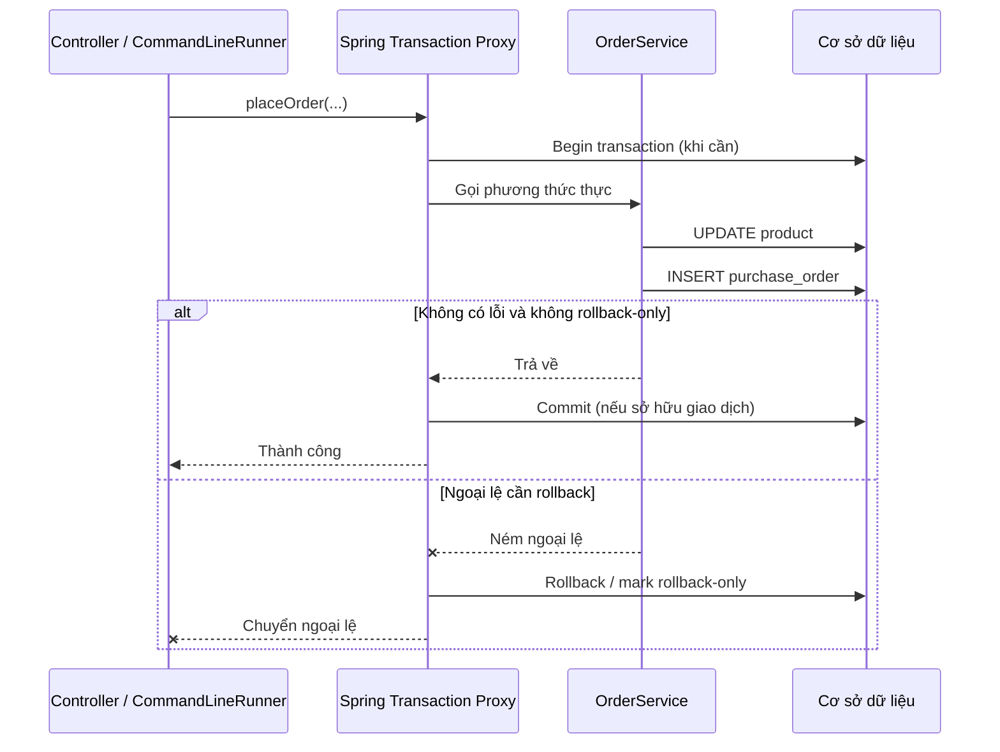

# Đặt @Transactional tại phương thức dịch vụ trong Spring

## 1. Mục tiêu: một nghiệp vụ, một giao dịch

Một yêu cầu nghiệp vụ thường gồm **nhiều thao tác đọc/ghi**. Ví dụ, khi đặt hàng, ứng dụng phải giảm số lượng sản phẩm còn trong kho **và** tạo bản ghi đơn hàng. Nếu giảm kho thành công nhưng tạo đơn hàng thất bại, dữ liệu đã sai: hàng bị trừ mà không có đơn tương ứng.

Trong Spring, cách bắt đầu thường gặp là đánh dấu **phương thức public của lớp dịch vụ** điều phối toàn bộ nghiệp vụ bằng `@Transactional`:

```java
@Service
public class OrderService {
    @Transactional
    public void placeOrder(...) {
        // Kiểm tra yêu cầu
        // Trừ tồn kho
        // Lưu đơn hàng
        // Ném lỗi khi không thể hoàn tất
    }
}
```

Đây là **mã mô tả cấu trúc**, chưa phải một lớp Java biên dịch độc lập. Ví dụ hoàn chỉnh có thể chạy được nằm ở mục 4.

Sau bài này, bạn sẽ biết:

- Vì sao ranh giới giao dịch thường thuộc về phương thức **service thực hiện một use case**, thay vì chia thành nhiều giao dịch rời ở controller hoặc mỗi lệnh repository.
- `@Transactional` bắt đầu, commit và rollback khi nào; dữ liệu được bảo vệ như thế nào khi một bước thất bại.
- Cách tạo chương trình Spring Boot Java 17+ có thể chạy để **tự quan sát rollback**.
- Điều kiện để Spring thực sự áp dụng annotation: bean do Spring quản lý, lời gọi đi qua proxy, transaction manager phù hợp, và ngoại lệ kích hoạt rollback.
- Những vấn đề `@Transactional` **không tự giải quyết**: cạnh tranh giữa các giao dịch, giao tiếp hệ thống ngoài, gửi lệnh trùng, nhiều nguồn dữ liệu.

## 2. Chọn đúng ranh giới: một use case từ đầu đến cuối

Xem luồng xử lý điển hình:

```text
HTTP Controller
    |
    | gọi placeOrder(...)
    v
OrderService                  <-- @Transactional bắt đầu ở đây
    |
    +--> kiểm tra yêu cầu
    +--> cập nhật tồn kho
    +--> tạo bản ghi đơn hàng
    +--> trả kết quả          <-- commit nếu hoàn tất bình thường
         hoặc ném lỗi         <-- rollback nếu lỗi thuộc quy tắc rollback
```

**Controller** chuyển đổi HTTP request/response và kiểm tra cú pháp cơ bản. **Service** hiểu một thao tác nghiệp vụ hoàn chỉnh cần thay đổi những gì. **Repository/DAO** thực hiện truy cập dữ liệu. Vì vậy một phương thức service có thể gọi nhiều repository mà vẫn nằm trong **cùng một ranh giới giao dịch**.

Ví dụ nếu controller gọi tuần tự:

```java
stockRepository.decreaseStock(productId, quantity);
orderRepository.save(order);
```

thì hai thao tác có thể sử dụng hai giao dịch độc lập, tùy cấu hình repository và tầng gọi. Lần ghi đầu có thể commit trước khi lần thứ hai thất bại. Đặt giao dịch ở service bao quanh **cả hai** làm cho thành công/thất bại được quyết định chung.

**Quy tắc thực hành:** hãy bắt đầu bằng câu “Một hành động nghiệp vụ nào phải hoàn tất nguyên vẹn?” rồi đặt `@Transactional` lên **điểm vào công khai do Spring gọi** để thực hiện hành động đó. Một service có thể có nhiều phương thức; mỗi phương thức có thể đại diện một use case khác nhau.

Không phải mọi phương thức trong service đều cần giao dịch ghi. Phương thức chỉ tính toán thuần Java không cần mở transaction. Với truy vấn thuần đọc, cân nhắc `@Transactional(readOnly = true)` nếu có lợi cho tính nhất quán/lazy loading/tối ưu theo hạ tầng.

## 3. Cơ chế hoạt động khi đặt @Transactional ở service

Trong chế độ transaction management thường dùng của Spring, lời gọi được chặn bởi **Spring AOP proxy**. Ta có thể hình dung:

1. Bean khác gọi `orderService.placeOrder(...)`.
2. Proxy của Spring tìm transaction manager phù hợp. Với `Propagation.REQUIRED` mặc định, nó **tham gia giao dịch hiện có** hoặc **bắt đầu giao dịch mới**.
3. Phương thức thực hiện các thao tác truy cập DB qua hạ tầng tham gia cùng giao dịch.
4. Nếu method kết thúc bình thường và transaction không bị đánh dấu rollback-only, transaction manager tiến hành **commit**; với giao dịch đã có từ trước, quyền commit cuối cùng thuộc ranh giới bên ngoài.
5. Nếu method ném lỗi thuộc quy tắc rollback, Spring **đánh dấu rollback hoặc rollback giao dịch** tùy người sở hữu transaction. Nếu lời gọi ngoài cùng sở hữu giao dịch, các thay đổi của giao dịch đó được hủy.



Với một cơ sở dữ liệu quan hệ, đây là cơ chế dùng transaction của **cơ sở dữ liệu**, không phải Java tự ghi nhớ bản sao của mọi object để khôi phục. Vì thế, các thao tác phải tham gia **đúng transaction manager và kết nối**. Thay đổi file, gọi HTTP API hay gửi email không tự biến mất khi DB rollback.

Một chi tiết quan trọng: `@Transactional` **không đợi đến cuối method mới thực hiện SQL**. SQL có thể chạy ngay trong method, nhưng những thay đổi đã được thực hiện vẫn chưa commit theo ranh giới giao dịch. Với Spring Data JPA/Hibernate, một phần SQL còn có thể được trì hoãn đến khi flush/commit.

## 4. Ví dụ chạy được: giảm tồn kho và tạo đơn hàng cùng một giao dịch

Dưới đây là một ứng dụng nhỏ dùng **Spring Boot, Java 17+, Spring JDBC và H2 in-memory**. Mục đích là quan sát sự khác nhau giữa thành công và thất bại sau khi đã cập nhật một phần dữ liệu.

### 4.1. Chuẩn bị dự án

Tạo dự án Maven bằng Spring Initializr, chọn một phiên bản Spring Boot ổn định tương thích Java 17+, với:

- Java: **17** hoặc mới hơn;
- Dependencies: **JDBC API/Spring JDBC** (thường là `spring-boot-starter-jdbc`) và **H2 Database**;
- Package gốc ví dụ: `com.example.transactiondemo`.

Dùng `pom.xml` do Spring Initializr sinh ra để quản lý phiên bản tương thích; với cấu hình Maven điển hình, phần dependencies chứa:

```xml
<dependencies>
    <dependency>
        <groupId>org.springframework.boot</groupId>
        <artifactId>spring-boot-starter-jdbc</artifactId>
    </dependency>
    <dependency>
        <groupId>com.h2database</groupId>
        <artifactId>h2</artifactId>
        <scope>runtime</scope>
    </dependency>
</dependencies>
```

Đây là **phần tử dependencies** để đối chiếu với project khởi tạo; nó không phải toàn bộ file `pom.xml`. Project khởi tạo còn có parent/plugin và các trường Maven khác. H2 cho phép chạy nhanh mà không cần cài PostgreSQL hay MySQL. Khi ứng dụng dùng một `DataSource` JDBC thích hợp, Spring Boot thông thường tự cấu hình transaction manager cho nó.

Cấu trúc file:

```text
src/
  main/
    java/com/example/transactiondemo/
      TransactionDemoApplication.java
      OrderService.java
    resources/
      schema.sql
```

### 4.2. Tạo bảng bằng schema.sql

File `src/main/resources/schema.sql`:

```sql
CREATE TABLE product (
    id BIGINT PRIMARY KEY,
    stock INT NOT NULL CHECK (stock >= 0)
);

CREATE TABLE purchase_order (
    id BIGINT PRIMARY KEY,
    product_id BIGINT NOT NULL,
    quantity INT NOT NULL CHECK (quantity > 0),
    CONSTRAINT fk_purchase_order_product
        FOREIGN KEY (product_id) REFERENCES product(id)
);
```

Bảng `product` giữ số lượng còn lại; `purchase_order` giữ đơn đã đặt. Ràng buộc `CHECK` giúp DB từ chối số lượng âm; `PRIMARY KEY` ngăn trùng ID đơn.

Khi dùng H2 embedded với cấu hình khởi tạo SQL mặc định của Spring Boot, `schema.sql` sẽ được chạy lúc tạo ứng dụng. Nếu đã thay đổi cấu hình SQL initialization hoặc dùng database ngoài, cần thiết lập tương ứng; ví dụ `spring.sql.init.mode=always` sẽ bật script initialization cho database không embedded.

### 4.3. Đặt @Transactional ở phương thức public của OrderService

File `src/main/java/com/example/transactiondemo/OrderService.java`:

```java
package com.example.transactiondemo;

import org.springframework.jdbc.core.JdbcTemplate;
import org.springframework.stereotype.Service;
import org.springframework.transaction.annotation.Transactional;

@Service
public class OrderService {
    private final JdbcTemplate jdbc;

    public OrderService(JdbcTemplate jdbc) {
        this.jdbc = jdbc;
    }

    @Transactional
    public void placeOrder(long orderId, long productId, int quantity) {
        if (quantity <= 0) {
            throw new IllegalArgumentException("Quantity must be positive");
        }

        // Bước 1: giảm kho chỉ khi còn đủ hàng.
        int changed = jdbc.update("""
            UPDATE product
               SET stock = stock - ?
             WHERE id = ? AND stock >= ?
            """, quantity, productId, quantity);

        if (changed != 1) {
            throw new IllegalStateException(
                "Product not found or insufficient stock");
        }

        // Bước 2: tạo đơn. Nếu lỗi, bước giảm kho cũng rollback.
        jdbc.update("""
            INSERT INTO purchase_order (id, product_id, quantity)
            VALUES (?, ?, ?)
            """, orderId, productId, quantity);
    }
}
```

Chú ý cách bố trí:

- `@Service` tạo bean do Spring quản lý. `OrderService` được injection vào bên gọi; không tạo bằng `new OrderService(...)` bên ngoài container.
- `@Transactional` nằm trực tiếp trên **phương thức public `placeOrder`**: toàn bộ cập nhật kho và thêm đơn cùng một giao dịch.
- `JdbcTemplate` dùng `DataSource` được transaction manager quản lý. Các câu SQL nằm trong cùng JDBC transaction nếu lời gọi đi qua proxy dịch vụ.
- `UPDATE ... WHERE stock >= ?` kiểm tra đủ hàng **ngay trong câu SQL**. Nếu không có bản ghi phù hợp, `changed` bằng 0 và method ném lỗi.
- Nếu `INSERT` thất bại vì trùng `purchase_order.id`, driver/JDBC phát sinh lỗi, `JdbcTemplate` chuyển thành `DataAccessException` (một `RuntimeException`); theo mặc định Spring sẽ rollback giao dịch.
- Ràng buộc ở DB và kiểm tra nghiệp vụ vẫn cần thiết: `@Transactional` quyết định sự nguyên tử, không thay thế validation hay khóa cạnh tranh.

### 4.4. Gọi service qua Spring bean và quan sát kết quả

File `src/main/java/com/example/transactiondemo/TransactionDemoApplication.java`:

```java
package com.example.transactiondemo;

import org.springframework.boot.CommandLineRunner;
import org.springframework.boot.SpringApplication;
import org.springframework.boot.autoconfigure.SpringBootApplication;
import org.springframework.context.annotation.Bean;
import org.springframework.dao.DataAccessException;
import org.springframework.jdbc.core.JdbcTemplate;

@SpringBootApplication
public class TransactionDemoApplication {

    public static void main(String[] args) {
        SpringApplication.run(TransactionDemoApplication.class, args);
    }

    @Bean
    CommandLineRunner demonstrate(JdbcTemplate jdbc, OrderService orders) {
        return args -> {
            jdbc.update(
                "INSERT INTO product (id, stock) VALUES (?, ?)", 1L, 10);

            // Đơn đầu tiên: kho 10 -> 7; thêm 1 đơn.
            orders.placeOrder(101L, 1L, 3);
            System.out.printf("After success: stock=%d, orders=%d%n",
                stock(jdbc), countOrders(jdbc));

            // Cố tạo đơn có ID=101 lần nữa.
            // Bước giảm kho đã chạy, nhưng INSERT vi phạm PRIMARY KEY.
            try {
                orders.placeOrder(101L, 1L, 2);
            } catch (DataAccessException ex) {
                System.out.println("Duplicate order rejected");
            }

            System.out.printf("After failure: stock=%d, orders=%d%n",
                stock(jdbc), countOrders(jdbc));
        };
    }

    private static int stock(JdbcTemplate jdbc) {
        Integer value = jdbc.queryForObject(
            "SELECT stock FROM product WHERE id = ?",
            Integer.class, 1L);
        return value;
    }

    private static int countOrders(JdbcTemplate jdbc) {
        Integer value = jdbc.queryForObject(
            "SELECT COUNT(*) FROM purchase_order",
            Integer.class);
        return value;
    }
}
```

Chạy trong thư mục dự án Maven:

```bash
./mvnw spring-boot:run
```

Trên Windows PowerShell, dùng:

```powershell
.\mvnw.cmd spring-boot:run
```

Các **dòng do chương trình in ra** (ngoài các log khởi động Spring/Maven) là:

```text
After success: stock=7, orders=1
Duplicate order rejected
After failure: stock=7, orders=1
```

Diễn giải từng giai đoạn:

1. Ban đầu: sản phẩm có `stock=10`, chưa có đơn.
2. Gọi `placeOrder(101, 1, 3)` thành công: `UPDATE` đưa kho còn 7 và `INSERT` thêm đơn 101; Spring commit cả hai.
3. Gọi `placeOrder(101, 1, 2)`: câu `UPDATE` **đã chạy bên trong giao dịch** và tạm giảm kho; tiếp đó `INSERT` bị lỗi vì khóa chính 101 đã tồn tại.
4. Lỗi runtime thoát ra qua proxy; transaction manager rollback, nên kho **vẫn bằng 7**, số đơn **vẫn bằng 1** sau khi catch exception ở `CommandLineRunner`.

Lưu ý vị trí `catch`: ví dụ bắt exception **bên ngoài phương thức transactional**. Proxy đã nhìn thấy ngoại lệ và xử lý rollback trước khi `CommandLineRunner` bắt nó. Đây là điều khác hoàn toàn với việc service tự bắt ngoại lệ trong giao dịch rồi âm thầm trả về thành công.

**Thử nghiệm tư duy:** nếu bỏ `@Transactional` và mỗi câu JDBC tự commit độc lập, lần tạo đơn thứ hai có thể giảm kho từ 7 xuống 5 rồi thất bại ở `INSERT`; DB chỉ còn một đơn nhưng đã trừ thêm 2 sản phẩm. Đây chính là lỗi mà ranh giới giao dịch ở service được thiết kế để tránh.

## 5. Có thể đặt @Transactional ở đâu và nên đặt ở đâu?

Trong Spring, `@Transactional` có thể đặt ở **lớp hoặc phương thức** hỗ trợ bởi hạ tầng transaction management. Tuy nhiên, “annotation được viết ở đâu” và “có lời gọi qua proxy hay không” là hai câu hỏi khác nhau.

| Vị trí | Khi nào hợp lý | Điểm cần nhớ |
| --- | --- | --- |
| **Phương thức public trong `@Service`** | Một nghiệp vụ phối hợp nhiều repository/DAO | Thường là lựa chọn rõ ràng nhất; đặt đúng ranh giới use case |
| Lớp `@Service` | Hầu hết các phương thức đủ điều kiện cùng dùng một chính sách transaction | Dễ vô tình mở transaction cho phương thức không cần; method-level có thể ghi đè |
| Repository/DAO | Một thao tác lưu/đọc riêng lẻ cần transaction | Không tự ghép nhiều repository thành một giao dịch của nghiệp vụ bên ngoài |
| Controller | Có thể có cơ chế kỹ thuật, nhưng không phải ranh giới mặc định nên chọn cho nghiệp vụ | Dễ kéo transaction xuyên phần xử lý HTTP, mapping, I/O không cần thiết |
| Phương thức `private` hoặc lời gọi nội bộ `this.method()` | **Không dùng để kích hoạt proxy transaction mặc định** | Lời gọi nội bộ không đi qua proxy nên annotation có thể không có hiệu lực |

Cách đọc code theo hướng nghiệp vụ:

```java
@RestController
class OrderController {
    private final OrderService orders;

    OrderController(OrderService orders) {
        this.orders = orders;
    }

    @PostMapping("/orders")
    void create(@RequestBody CreateOrderRequest request) {
        orders.placeOrder(
            request.orderId(),
            request.productId(),
            request.quantity());
    }
}
```

Đây chỉ là **đoạn minh họa quan hệ controller → service**; `CreateOrderRequest` cần được khai báo thêm trong ứng dụng Web. Ví dụ chạy được ở mục 4 dùng `CommandLineRunner` để không cần web starter. Tại controller, việc gọi một Spring bean `OrderService` được injection là yếu tố giúp lời gọi đi qua proxy.

Nếu dùng Spring Data JPA, nhiều phương thức repository có cấu hình transactional riêng. Một lời gọi service gắn `@Transactional` sẽ khiến các repository được gọi qua cùng transaction manager phù hợp **tham gia cùng giao dịch hiện có**, thay vì commit từng thao tác trước khi use case kết thúc.

## 6. Các giá trị mặc định quan trọng

Với `org.springframework.transaction.annotation.Transactional`, những hành vi mặc định thường cần biết là:

| Thuộc tính | Mặc định | Tác động thực tế |
| --- | --- | --- |
| `propagation` | `REQUIRED` | Tham gia transaction có sẵn; nếu chưa có thì tạo mới |
| `isolation` | `DEFAULT` | Theo mức cô lập mặc định của DB/transaction manager |
| `readOnly` | `false` | Transaction có thể dùng cho đọc/ghi; `true` chủ yếu là chỉ dẫn tối ưu |
| `timeout` | Giá trị mặc định của hệ thống | Không tự đặt hạn mức riêng nếu chưa cấu hình |
| `rollbackFor`/`noRollbackFor` | Chưa tùy biến | Theo quy tắc rollback mặc định: `RuntimeException`/`Error` gây rollback; checked exception không mặc định gây rollback |

### 6.1. Cần rollback khi gặp checked exception?

Java chia ngoại lệ thành checked (ví dụ `IOException`) và unchecked (đa số `RuntimeException`). Theo **quy tắc mặc định** của Spring, nếu method đã ghi DB rồi ném checked exception, Spring có thể **commit** khi không có quy tắc rollback khác. Muốn rollback cho loại này, khai báo tường minh:

```java
@Transactional(rollbackFor = java.io.IOException.class)
public void importOrders() throws java.io.IOException {
    // Ghi DB qua repository/JdbcTemplate...
    // Nếu ném IOException ra ngoài, giao dịch sẽ rollback.
}
```

Đây là đoạn **minh họa cấu hình**, không phải chương trình chạy riêng. Trong dự án thật, hãy đặt method ở một Spring bean và để checked exception thực sự thoát qua proxy. Đối với lỗi nghiệp vụ, cũng có thể định nghĩa một `RuntimeException` riêng để dùng quy tắc mặc định, nhưng loại ngoại lệ phải phản ánh ý nghĩa thực của lỗi.

### 6.2. Chỉ đọc thì sao?

```java
@Transactional(readOnly = true)
public OrderView findOrder(long id) {
    // Truy vấn và ánh xạ dữ liệu.
    return ...;
}
```

Đoạn này minh họa chữ ký, cần khai báo `OrderView` và phần truy vấn trong ứng dụng. `readOnly = true` có thể giúp ORM/driver tối ưu hoặc thể hiện ý định, nhưng **không phải lớp kiểm soát quyền ghi đáng tin cậy cho mọi DB**. Cấm ghi thực sự phải dựa trên quyền DB và thiết kế giao dịch phù hợp.

### 6.3. Khi một service đã có giao dịch, service khác gọi vào

```java
@Service
class CheckoutService {
    private final InventoryService inventory;
    private final OrderRepository orders;

    @Transactional
    public void checkout(...) {
        inventory.reserve(...);
        orders.save(...);
    }
}
```

Đây là **mã cấu trúc** với các kiểu phụ thuộc chưa định nghĩa. Nếu `InventoryService.reserve` cũng có `@Transactional` mặc định `REQUIRED`, nó thường tham gia giao dịch của `checkout`, không tự commit riêng. Ngoại lệ ở một bước có thể dẫn đến rollback cả use case.

Với `REQUIRES_NEW`, Spring sẽ tạm ngưng transaction hiện tại và mở giao dịch riêng nếu transaction manager hỗ trợ; việc commit trong giao dịch mới **không tự đảo ngược** khi transaction ngoài rollback. Không đổi propagation chỉ để “chắc ăn” vì nó có thể tạo dữ liệu đã commit một phần trái yêu cầu nghiệp vụ.

## 7. Bẫy thường gặp: có annotation nhưng không có transaction như kỳ vọng

### 7.1. Self-invocation: gọi phương thức cùng lớp bằng this

```java
@Service
public class ReportService {
    public void generateReport() {
        saveReport(); // Lời gọi trực tiếp trong cùng đối tượng.
    }

    @Transactional
    public void saveReport() {
        // Ghi DB.
    }
}
```

Nếu một bean khác gọi `generateReport()`, Spring proxy chỉ chặn lời gọi **generateReport**; lời gọi `saveReport()` từ bên trong cùng đối tượng **không đi qua proxy** trong chế độ proxy-based thông thường. Vì thế annotation riêng trên `saveReport()` không khởi động giao dịch như nhiều người dự đoán.

Hai hướng sửa dễ hiểu:

- Nếu toàn bộ nghiệp vụ là `generateReport`, đặt `@Transactional` lên **phương thức public `generateReport()`**. `saveReport()` lúc đó có thể là helper không cần annotation.
- Nếu `saveReport()` là một use case độc lập, chuyển nó sang Spring service bean riêng và gọi thông qua dependency được injection, để lời gọi đi qua proxy.

Đừng coi `@Transactional` là lời gọi hàm “mở transaction” có hiệu lực chỉ vì JVM đã vào method.

### 7.2. new một service rồi gọi

```java
OrderService orders = new OrderService(jdbc);
orders.placeOrder(101L, 1L, 3);
```

Đoạn này tạo một đối tượng Java trực tiếp, **không phải bean/proxy được Spring cung cấp**. Annotation trên method không tự hoạt động với đối tượng được tạo thủ công. Ở điểm vào, hãy dùng constructor injection của Spring hoặc truy xuất bean qua container theo thiết kế ứng dụng.

### 7.3. Method private/final và cấu hình proxy

Trong proxy mode, method `private` không thể trở thành điểm chặn transaction của proxy. Với proxy tạo subclass, method `final` cũng không thể được override để chặn. Đối với bài nhập môn, chọn **public, non-final method** trên một Spring-managed service bean là cách ít bất ngờ nhất. Spring có những chi tiết phụ thuộc kiểu proxy/phiên bản đối với method không-public; không dựa vào chúng khi xây ranh giới nghiệp vụ cơ bản.

### 7.4. Bắt rồi nuốt ngoại lệ bên trong method transactional

```java
@Transactional
public void placeOrderSilently(...) {
    updateStock(...);
    try {
        writeOrder(...);
        throw new IllegalStateException("Validation failed");
    } catch (IllegalStateException ex) {
        // Sai nếu caller vẫn được báo thành công:
        // ngoại lệ runtime không thoát ra ngoài proxy.
    }
}
```

Đây là **mã giả Java dùng tên hàm chưa định nghĩa** để làm rõ lỗi. Với lỗi thuần Java bị bắt và nuốt như ví dụ, method có thể kết thúc bình thường và Spring có thể commit các câu SQL đã chạy. Nếu có lỗi DB thì DB/transaction manager đôi khi đã đánh dấu transaction rollback-only; cũng không nên phụ thuộc vào việc nuốt ngoại lệ đó. Hãy để lỗi nghiệp vụ phù hợp thoát ra hoặc chủ động thiết kế kết quả thất bại và rollback đúng cách.

Một biến thể khác: phương thức transactional bắt checked exception rồi trả về mã lỗi; quy tắc rollback không được áp dụng nếu exception không thoát qua proxy.

### 7.5. Trên method có @Transactional nhưng transaction manager sai

Ví dụ dùng hai `DataSource` khác nhau. Một `DataSourceTransactionManager` hoặc `JpaTransactionManager` chỉ quản lý tài nguyên nó được cấu hình. Nếu service cập nhật hai DB độc lập, `@Transactional` mặc định **không tạo giao dịch phân tán nguyên tử** cho cả hai. Cần chỉ rõ transaction manager tương ứng, hoặc giải quyết nhất quán liên hệ thống bằng thiết kế thích hợp (outbox, saga, phối hợp giao dịch nếu thật sự cần).

### 7.6. Kéo transaction quá dài

Không nên giữ DB transaction và khóa hàng mở trong suốt một cuộc gọi HTTP ra ngoài, gửi email, chờ người dùng nhập liệu hay xử lý file rất lâu. Những hoạt động này vừa không được DB rollback hộ, vừa làm tăng lock contention/timeout. Với sự kiện cần phát sau commit, cân nhắc lưu bản ghi **outbox** trong cùng giao dịch rồi xử lý gửi bất đồng bộ.

### 7.7. @Async và luồng khác

Với transaction JDBC/JPA thông thường, ngữ cảnh giao dịch gắn với luồng thực thi; gọi công việc bằng `@Async` hoặc tạo thread mới **không tự mang theo transaction của luồng gọi**. Phương thức bất đồng bộ cần ranh giới transaction riêng nếu nó ghi DB. Reactive transaction lại dựa vào cơ chế context của Reactive Streams; đó là mô hình khác, không áp dụng trực tiếp ví dụ `JdbcTemplate` ở đây.

## 8. Đặt ở service là cần thiết nhưng chưa đủ để tránh race condition

Quay lại nghiệp vụ đặt hàng: nếu chỉ viết:

```text
Đọc stock = 5
Nếu stock >= quantity thì...
UPDATE stock = số đã đọc - quantity
```

hai transaction song song có thể cùng nhìn thấy `stock = 5` và ra quyết định dựa trên dữ liệu cũ. Việc cả hai phương thức đều có `@Transactional` **không tự khiến hai nghiệp vụ chạy lần lượt như một hàng đợi**: mức cô lập mặc định của database và lịch thực thi vẫn quan trọng.

Trong ví dụ đã viết, câu SQL bảo vệ ngay lúc ghi:

```sql
UPDATE product
   SET stock = stock - 3
 WHERE id = 1 AND stock >= 3;
```

Nếu stock đã giảm xuống 2, câu lệnh không cập nhật hàng nào. Service kiểm tra số hàng thay đổi và ném lỗi để rollback toàn bộ use case. Với invariant nhiều hàng/phức tạp hơn, có thể cần khóa bi quan, optimistic locking qua version, cấu trúc dữ liệu khác hoặc isolation cao hơn kèm retry thích hợp. `@Transactional` tạo **ranh giới**, còn luật dữ liệu và concurrency control quyết định **tính đúng đắn** bên trong ranh giới đó.

Tương tự, nếu client gửi lại cùng yêu cầu sau khi timeout, `@Transactional` không tự biết đó là cùng một đơn. Bài toán chống xử lý trùng thường cần **idempotency key** và ràng buộc `UNIQUE` hoặc cơ chế tương đương, lưu trong cùng DB transaction với kết quả. Ví dụ dùng `orderId=101` trùng sẽ bị từ chối, nhưng các HTTP request tạo ID mới liên tục vẫn có thể tạo nhiều đơn nếu ứng dụng không áp dụng quy tắc idempotency.

## 9. Cách kiểm tra @Transactional đã hoạt động đúng

Đừng chỉ nhìn thấy annotation trong code rồi kết luận thành công. Hãy kiểm tra **kết quả bền vững sau khi method hoàn tất** và cách service được gọi.

| Trường hợp | Kết quả cần thấy trong DB |
| --- | --- |
| Đặt hàng hợp lệ | Tồn kho giảm và đơn hàng mới xuất hiện trong cùng lần commit |
| INSERT đơn lỗi sau khi đã UPDATE kho | Tồn kho được khôi phục, không có đơn mới |
| Số lượng âm hoặc bằng 0 | Bị từ chối trước thao tác ghi |
| Số lượng vượt kho | Không tạo đơn; stock không đổi |
| Hai yêu cầu mua cùng lượng hàng cuối | Stock không âm và số lượng đơn thành công phù hợp số hàng thực sự trừ được |
| Gọi trực tiếp bằng `new` hoặc self-invocation | Test giúp phát hiện annotation không áp dụng; sửa điểm vào thay vì tin vào tên method |
| Lỗi checked exception | Kiểm tra kết quả commit/rollback có khớp `rollbackFor` đã thiết kế |
| Gọi ngoài transaction, sau đó truy vấn lại | Kết quả được đọc **sau commit/rollback thực tế**, không chỉ trạng thái trong persistence context |

Với kiểm thử tích hợp, dùng Spring-managed `OrderService` thật và database tương ứng. H2 đủ để học transaction căn bản; nếu production dùng PostgreSQL/MySQL, nên có thêm test tích hợp với cùng loại database vì constraint, isolation, locking và lỗi SQL có thể khác.

Một bẫy khi viết test: `@Transactional` trực tiếp trên test trong một số framework test Spring làm test nằm trong transaction bao ngoài và rollback sau test. Điều đó có thể che mất thời điểm commit thực của service. Khi muốn kiểm tra behavior commit/rollback **sau lời gọi service**, hãy thiết kế test để transaction của service thực sự kết thúc trước khi truy vấn trạng thái cuối.

Có thể bật logging giao dịch khi cần quan sát proxy và transaction manager:

```properties
logging.level.org.springframework.transaction=DEBUG
```

Log giúp chẩn đoán, nhưng bằng chứng quan trọng vẫn là trạng thái DB sau khi thao tác thành công hoặc thất bại.

## 10. Checklist khi viết một phương thức service mới

1. **Xác định use case:** Những thay đổi nào phải thành công hoặc thất bại cùng nhau? Nếu một phần commit mà phần khác lỗi, hậu quả là gì?
2. **Chọn phương thức entry point:** Thường là public method của một `@Service` được controller, scheduler hoặc consumer bean khác gọi.
3. **Đặt `@Transactional` lên đúng method:** Đừng chỉ đặt lên helper private hoặc method được gọi nội bộ bằng `this`.
4. **Bảo đảm tất cả thao tác DB tham gia đúng transaction manager:** JDBC, JPA hoặc repository phải dùng tài nguyên mà transaction quản lý.
5. **Thiết kế lỗi:** Khi nghiệp vụ không thể hoàn tất, ném ngoại lệ thích hợp; thêm `rollbackFor` cho checked exception nếu cần; không nuốt lỗi rồi trả thành công.
6. **Bảo vệ quy tắc dữ liệu và đồng thời:** Dùng `NOT NULL`, `UNIQUE`, `FOREIGN KEY`, `CHECK`, SQL có điều kiện, locking hoặc version theo bài toán.
7. **Giữ transaction gọn:** Hạn chế gọi mạng/đợi bên ngoài trong lúc DB transaction còn mở.
8. **Kiểm thử rollback bằng một lỗi xảy ra sau lần ghi đầu tiên:** Sau lỗi, đọc lại toàn bộ dữ liệu liên quan và chứng minh không có thay đổi một nửa.

### Câu hỏi tự luyện

**Câu 1.** Vì sao đặt `@Transactional` riêng trên `decreaseStock()` và `saveOrder()` có thể chưa đủ?

Vì nếu chúng được gọi tuần tự ngoài một giao dịch service bao trùm, mỗi method có thể tự hoàn tất transaction riêng. Cần ranh giới quanh **toàn bộ `placeOrder()`**.

**Câu 2.** `placeOrder()` có `@Transactional`, nhưng lập trình viên gọi bằng `new OrderService(jdbc)`. Điều gì xảy ra?

Đối tượng tự tạo không đi qua transaction proxy của Spring; annotation không tự được chặn. Phải lấy service bean do Spring quản lý.

**Câu 3.** Sau `UPDATE` thành công, service ném `IllegalStateException` và ngoại lệ thoát khỏi proxy. Với cài đặt transaction thông thường, DB còn giữ cập nhật đó không?

Không, nếu cập nhật đã tham gia đúng transaction vừa rollback. `IllegalStateException` là `RuntimeException` nên kích hoạt rollback mặc định.

**Câu 4.** Có phải mọi checked exception đều rollback theo mặc định?

Không. Theo rollback rule mặc định, checked exception không tự gây rollback. Có thể dùng `rollbackFor` hoặc cấu hình rollback rule chung nếu hạ tầng hỗ trợ.

**Câu 5.** Hai người cùng bấm “Đặt chiếc vé cuối cùng”. Chỉ thêm `@Transactional` đã đủ chắc chắn chưa?

Chưa. Phải dùng điều kiện ghi nguyên tử/khóa/isolation phù hợp để bảo vệ số vé, rồi kiểm thử bằng hai transaction cạnh tranh.

## 11. Kết luận kiến thức

- Đặt `@Transactional` trên **phương thức dịch vụ công khai biểu diễn một nghiệp vụ hoàn chỉnh**, để các thao tác DB liên quan cùng một ranh giới commit/rollback.
- Annotation được Spring thực thi qua **cơ chế proxy/interceptor** trong cấu hình thông thường; self-invocation và tạo đối tượng bằng `new` có thể làm nó không có tác dụng.
- Mặc định, `REQUIRED` tham gia giao dịch hiện có và ngoại lệ unchecked thường kích hoạt rollback. Checked exception phải có quy tắc rollback thích hợp nếu muốn hủy giao dịch.
- `@Transactional` không thay thế validation, ràng buộc DB, concurrency control hoặc xử lý tính nhất quán với hệ thống ngoài.
- Cách chứng minh đã dùng đúng transaction là **gây lỗi sau một thao tác ghi**, chờ service kết thúc, rồi kiểm tra DB không còn trạng thái một nửa.

### Tài liệu chính thức để đọc thêm

- Spring Framework — Declarative Transaction Management: https://docs.spring.io/spring-framework/reference/data-access/transaction/declarative.html
- Spring Framework — Using `@Transactional`: https://docs.spring.io/spring-framework/reference/data-access/transaction/declarative/annotations.html
- Spring Framework — Understanding the Spring Framework's Declarative Transaction Implementation: https://docs.spring.io/spring-framework/reference/data-access/transaction/declarative/tx-decl-explained.html
- Spring Boot — SQL Database Initialization: https://docs.spring.io/spring-boot/how-to/data-initialization.html
