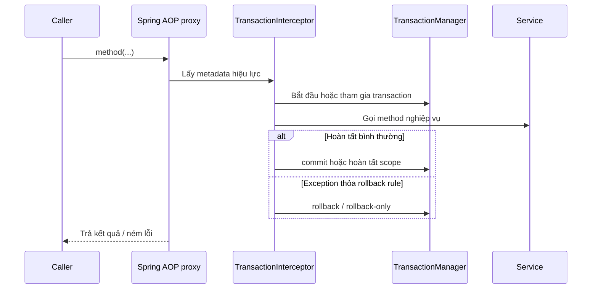

# Khai báo @Transactional ở phương thức, lớp và các quy tắc kế thừa

## 1. Ba câu hỏi phải tách riêng

Trong Spring Framework, `@Transactional` có thể được khai báo trên **method**, **class**, **superclass** hoặc **interface**. Thế nhưng, một annotation xuất hiện trong source code không đồng nghĩa một transaction thực sự đã được mở.

Cần tách ba bước:

1. **Metadata ở đâu?** Lớp có `@Transactional(readOnly = true)`, còn method có annotation riêng không? Lớp cha hay interface có khai báo gì?
2. **Spring chọn chính sách nào?** Các thuộc tính như `propagation`, `readOnly`, `rollbackFor`, `timeout` và transaction manager được quyết định từ metadata nào?
3. **Lời gọi có được intercept không?** Trong proxy mode thông dụng, chỉ cuộc gọi đi qua Spring AOP proxy mới nhận transactional advice; `this.method()` không tự tạo một lần interception.

Ví dụ:

```java
@Transactional(readOnly = true)
public class ProductService {
    public void find() { /* đọc dữ liệu */ }

    @Transactional
    public void update() { /* cập nhật dữ liệu */ }
}
```

Khi gọi **qua proxy** với transaction manager đúng:

- `find()` không có annotation riêng, nên nhận default của class: `readOnly = true`.
- `update()` có `@Transactional` riêng. Annotation method **ưu tiên** so với annotation class và mang bộ thuộc tính mặc định của chính nó, tức `readOnly = false`.
- Nếu `update()` được gọi nội bộ bằng `this.update()` từ method khác trong cùng object, metadata method đó không tạo một transactional advice mới.

Đoạn Java ở trên là snippet minh họa vị trí annotation, không phải chương trình độc lập đã có database và transaction manager. Bài viết dùng hành vi Spring Framework **6.x**, đồng thời chỉ ra các giới hạn theo loại proxy và phiên bản.

## 2. @Transactional là metadata của Java và Spring

Spring annotation nằm ở:

```java
import org.springframework.transaction.annotation.Transactional;
```

Về mặt khai báo, `@Transactional` có target `TYPE` và `METHOD`, retention `RUNTIME` và Java meta-annotation `@Inherited`.

**Điểm quan trọng:** `@Inherited` của Java chỉ áp dụng cho annotation trên **class** theo chuỗi superclass. Nó **không** làm annotation trên method tự chuyển sang overriding method và **không** làm interface annotation được Java kế thừa như superclass annotation.

Spring có **quy tắc tìm transaction metadata riêng** qua method, target class và hierarchy. Vì vậy, kết quả của `getAnnotation()` trong Java Reflection không đủ để suy ra Spring interceptor có nhận được một annotation từ superclass/interface hay không.

### 2.1. Muốn transaction chạy thì cần gì?

- Đối tượng phải do Spring quản lý hoặc được tạo proxy bằng cơ chế tương đương, không phải một object tùy ý tạo bằng `new`.
- Transaction management phải được bật, chẳng hạn `@EnableTransactionManagement`, hoặc Spring Boot đã auto-configure đúng hạ tầng.
- Có `PlatformTransactionManager` (đối với imperative code) điều khiển đúng datasource/persistence context.
- Trong **proxy mode**, lời gọi phải vào qua proxy. Annotation không trực tiếp gọi `begin`, `commit` hay `rollback`.
- Lỗi xảy ra phải khớp rollback rule và tác động dữ liệu phải thật sự nằm trong transaction được manager quản lý.



Không nên đồng nhất “method có annotation” với “method tự mở physical transaction”: `REQUIRED` có thể tham gia transaction hiện hữu; `REQUIRES_NEW` chỉ tạo transaction mới nếu có advice phù hợp.

## 3. Khai báo trực tiếp trên phương thức

Đặt `@Transactional` trên một **public service method** giúp thấy ranh giới nghiệp vụ rõ nhất. Ví dụ:

```java
package example.orders;

import org.springframework.stereotype.Service;
import org.springframework.transaction.annotation.Propagation;
import org.springframework.transaction.annotation.Transactional;

@Service
public class OrderService {
    @Transactional(readOnly = true)
    public long countOrders() {
        return countFromRepository();
    }

    @Transactional
    public void createOrder(long orderId) {
        saveToRepository(orderId);
    }

    @Transactional(propagation = Propagation.REQUIRES_NEW)
    public void recordAudit(long orderId) {
        saveAudit(orderId);
    }

    // Helper giả lập; ứng dụng thực sẽ dùng repository/DAO.
    private long countFromRepository() {
        throw new UnsupportedOperationException("Demo helper");
    }
    private void saveToRepository(long id) {
        throw new UnsupportedOperationException("Demo helper");
    }
    private void saveAudit(long id) {
        throw new UnsupportedOperationException("Demo helper");
    }
}
```

Đây là ví dụ về placement và policy; các helper chưa triển khai nên **không phải service chạy nghiệp vụ hoàn chỉnh**.

- `countOrders()` chọn transaction đọc; `readOnly` là **hint**, không phải chốt bảo mật khiến mọi SQL ghi phải thất bại.
- `createOrder()` dùng `REQUIRED`, `Isolation.DEFAULT`, `readOnly=false`; unchecked exception thường dẫn đến rollback theo mặc định.
- `recordAudit()` yêu cầu `REQUIRES_NEW` **khi được intercept**. Nếu `createOrder()` gọi `this.recordAudit(...)` thì Spring proxy không tạo transaction mới cho lời gọi nội bộ.

Những thuộc tính quan trọng của annotation:

| Thuộc tính | Ví dụ | Ý nghĩa |
| --- | --- | --- |
| `propagation` | `REQUIRED`, `REQUIRES_NEW`, `NESTED` | Cách method tham gia hoặc tạo transaction. |
| `isolation` | `Isolation.READ_COMMITTED` | Mức cô lập khi transaction mới được tạo, tùy manager/database. |
| `readOnly` | `true` | Gợi ý tối ưu hóa đọc, không bảo đảm chặn ghi. |
| `timeout` | `10` | Thời gian transaction theo khả năng hạ tầng, không nhất thiết là timeout của HTTP. |
| `rollbackFor` | `IOException.class` | Chỉ định thêm checked exception cần rollback. |
| `noRollbackFor` | `NotFoundException.class` | Chỉ định exception không yêu cầu rollback; không xóa trạng thái rollback-only đã có. |
| `transactionManager` | `"ordersTxManager"` | Chọn transaction manager cụ thể nếu có nhiều manager. |

Method annotation là lựa chọn tốt khi nhiều method có policy khác nhau hoặc một method cần transaction boundary rõ ràng, độc lập với các method khác.

## 4. Khai báo cấp lớp: default cho các method đủ điều kiện

Nếu phần lớn phương thức dùng cùng chính sách, đặt `@Transactional` trên concrete class:

```java
import org.springframework.stereotype.Service;
import org.springframework.transaction.annotation.Transactional;

@Service
@Transactional(readOnly = true)
public class CatalogService {
    public void listProducts() {
        // Mặc định readOnly=true từ class.
    }

    public void countProducts() {
        // Cũng dùng mặc định từ class.
    }

    @Transactional(readOnly = false)
    public void renameProduct(long id, String name) {
        // Method có policy riêng để ghi dữ liệu.
    }
}
```

Class-level annotation là **một default**, không có nghĩa mọi method bất kể cách gọi đều được advice. `private`, `static`, các giới hạn của `final`, lời gọi nội bộ, phiên bản Spring và loại proxy vẫn quyết định method nào được intercept. Chi tiết nằm ở mục 7.

Trong ứng dụng service, pattern phổ biến là:

- Class-level `@Transactional(readOnly = true)` cho nhóm method truy vấn.
- Method-level `@Transactional(readOnly = false)` tại các method sửa dữ liệu.
- Hoặc class-level `@Transactional` mặc định ghi và method-level `@Transactional(readOnly = true)` cho vài method đọc đặc biệt.

Chọn cách nào tùy trách nhiệm của class; quan trọng nhất là **policy cụ thể ở method phải được thể hiện bằng annotation method**, và test qua proxy.

## 5. Precedence: metadata ở method thắng metadata của class

Theo tài liệu Spring, **vị trí cụ thể hơn (most derived) được ưu tiên** khi đánh giá transaction settings. Trong trường hợp cùng một concrete class, annotation trên method được ưu tiên hơn annotation trên class.

```java
import org.springframework.transaction.annotation.Propagation;
import org.springframework.transaction.annotation.Transactional;

@Transactional(readOnly = true, timeout = 30)
public class BillingService {
    public void listInvoices() {
        // Nhận readOnly=true, timeout=30.
    }

    @Transactional
    public void charge() {
        // readOnly=false, timeout mặc định của hệ thống giao dịch.
    }

    @Transactional(
        readOnly = false,
        timeout = 5,
        propagation = Propagation.REQUIRES_NEW)
    public void settle() {
        // Method có policy đầy đủ riêng.
    }
}
```

Đây là snippet chỉ minh họa annotation; không có SQL thực tế.

| Method | Metadata hiệu lực khi được intercept | Nguồn |
| --- | --- | --- |
| `listInvoices()` | `readOnly=true`, `timeout=30`, mặc định `REQUIRED` | Annotation trên class. |
| `charge()` | `readOnly=false`, timeout mặc định, `REQUIRED` | Annotation trên method không tham số. |
| `settle()` | `readOnly=false`, `timeout=5`, `REQUIRES_NEW` | Annotation trên method cụ thể. |

### 5.1. Không merge từng thuộc tính giữa hai @Transactional

Spring **không** hoạt động như quy tắc CSS trong đó method chỉ ghi đè một thuộc tính còn các thuộc tính khác tự kế thừa từ class. Khi một annotation method được chọn, nó cung cấp **cả bộ transaction attributes**, bao gồm default cho thuộc tính không được đặt tường minh.

Do đó, viết:

```java
@Transactional(readOnly = true, timeout = 30)
class ReportService {
    @Transactional(propagation = Propagation.REQUIRES_NEW)
    public void regenerate() {
        // readOnly=false, timeout mặc định, REQUIRES_NEW.
    }
}
```

không có nghĩa `regenerate()` giữ `readOnly=true` và `timeout=30`. Nếu muốn giữ hai thuộc tính ấy, hãy khai báo lại trên method hoặc dùng composed annotation được thiết kế chính xác.

Điều này còn áp dụng với `rollbackFor` và lựa chọn `transactionManager`: không coi annotation trên method là phần bổ sung tự động vào toàn bộ policy cấp class. Nếu nhiều manager, xác minh chính xác manager mà method đang dùng.

### 5.2. Method đủ điều kiện vẫn phụ thuộc transaction đang tồn tại

Metadata `isolation`, `timeout` có ý nghĩa trực tiếp khi transaction vật lý mới được tạo; một scope `REQUIRED` tham gia transaction ngoài **không tự thay đổi isolation/timeout** của giao dịch vật lý đang mở. Một method annotation khác class annotation cũng không mặc nhiên tách ra transaction riêng: cần propagation phù hợp và lời gọi qua proxy.

## 6. Kế thừa giữa lớp cha và lớp con

Đây là phần phải phân biệt **hai chiều kế thừa khác nhau**.

### 6.1. Superclass có @Transactional cấp class

```java
import org.springframework.transaction.annotation.Transactional;

@Transactional(readOnly = true)
public class BaseReader {
    public void queryBase() {
        // Method được khai báo trong BaseReader.
    }
}

public class CustomerReader extends BaseReader {
    public void queryCustomer() {
        // Method mới khai báo trong subclass.
    }
}
```

`@Transactional` trên class cha có thể cung cấp **default class-level** cho subclass. Do `@Inherited`, annotation type-level được tìm qua superclass trong Java; Spring còn có cơ chế tìm transaction metadata theo class/method. Khi method `queryCustomer()` đủ điều kiện được proxy intercept, nó có thể nhận policy mặc định trên type cha nếu không có annotation cụ thể hơn.

Nếu subclass tự khai báo một annotation cấp class khác, annotation cụ thể hơn ở subclass có thể thay default đó. Không suy diễn rằng subclass kế thừa tất cả attributes ở class cha rồi chỉ đổi một field; hãy xét annotation hiệu lực như bộ metadata.

### 6.2. Chỉ subclass có @Transactional: method inherited từ cha không tự được bao phủ

Đây là ngoại lệ quan trọng được Spring tài liệu ghi rõ: **annotation cấp class của subclass không áp dụng ngược lên các method được khai báo trong ancestor class**. Method kế thừa cần được **locally redeclared** tại subclass nếu muốn nhận default từ subclass.

```java
import org.springframework.transaction.annotation.Transactional;

public class BaseReportService {
    public void exportReport() {
        // Method khai báo trong ancestor không có annotation.
    }
}

@Transactional(readOnly = true)
public class MonthlyReportService extends BaseReportService {
    public void countReports() {
        // Method khai báo tại subclass: nhận default readOnly=true.
    }

    @Override
    public void exportReport() {
        // Redeclare/override tại subclass để nhận default cấp lớp con.
        super.exportReport();
    }
}
```

Cách đọc:

- `countReports()` là method khai báo tại `MonthlyReportService` nên class-level annotation của class này có thể áp dụng.
- Nếu **bỏ `@Override exportReport()`**, implementation thực tế của method vẫn được khai báo ở `BaseReportService`; không được mặc nhiên coi annotation trên class con là policy của inherited ancestor method.
- Khi override như trên, lời gọi **từ bean proxy bên ngoài** có thể được intercept theo metadata cấp subclass.
- `super.exportReport()` là lời gọi nội bộ từ overriding method; nó không tự đi qua proxy thêm một lần.

Đây là các class minh họa, chưa có DAO. Khi dự án có nhiều tầng kế thừa, đặt annotation trực tiếp trên **concrete method override** cũng là lựa chọn rõ ràng, nhất là với policy nhạy cảm.

### 6.3. Annotation trên method của superclass và override tại subclass

```java
import java.io.IOException;
import org.springframework.transaction.annotation.Transactional;

public class BaseImportService {
    @Transactional(rollbackFor = IOException.class)
    public void importData() throws IOException {
        // ...
    }
}

public class CustomerImportService extends BaseImportService {
    @Override
    public void importData() throws IOException {
        // ...
    }
}
```

**Java không tự sao chép method annotation vào overriding method.** Gọi Java Reflection trên `CustomerImportService.importData()` không tự nhận annotation method của `BaseImportService.importData()` theo `@Inherited`. Tuy nhiên, **Spring có cơ chế tìm transaction metadata trong method/type hierarchy**, nên không thể chỉ dùng Java Reflection để khẳng định Spring interceptor bỏ qua mọi annotation ancestor.

Cách xây dựng code dễ hiểu nhất là annotate **concrete overriding method** một cách tường minh khi policy có ý nghĩa nghiệp vụ:

```java
@Override
@Transactional(rollbackFor = IOException.class)
public void importData() throws IOException {
    // ...
}
```

Đây là method fragment để đặt vào class con và cần import phù hợp. Nếu đổi chính sách trong overriding method, ghi toàn bộ thuộc tính quan trọng; annotation method mới sẽ có ưu tiên theo quy tắc cụ thể hơn.

## 7. Interface, proxy và quy tắc visibility

### 7.1. Có thể đặt annotation trên interface không?

Có thể:

```java
import org.springframework.transaction.annotation.Transactional;

public interface PaymentOperations {
    @Transactional
    void capture(long paymentId);
}
```

Và triển khai:

```java
import org.springframework.stereotype.Service;

@Service
public class PaymentService implements PaymentOperations {
    @Override
    public void capture(long paymentId) {
        // Dùng repository/database phù hợp.
    }
}
```

Đây là hai file mẫu đơn giản, chưa có database. Spring Framework từ **5.0** hỗ trợ annotation trên interface/interface method trong **proxy mode** cho cả interface-based và class-based proxy. Tuy nhiên, Java không kế thừa annotation interface theo `@Inherited`, và **AspectJ weaving mode không nhận interface-declared transaction annotation theo cách proxy mode thực hiện**. Vì vậy Spring khuyến nghị annotate **concrete class/method**, nhất là khi dự án có thể thay đổi cơ chế AOP.

Phiên bản rõ ràng hơn:

```java
@Service
public class PaymentService implements PaymentOperations {
    @Override
    @Transactional
    public void capture(long paymentId) {
        // Policy hiển thị ngay ở implementation.
    }
}
```

Đây là snippet sửa `PaymentService`, với import `@Transactional` cần thêm. Nếu nhiều interface khai báo policy khác nhau cho một method, hãy quyết định chính sách ngay trên implementation; tránh phụ thuộc vào thứ tự tìm metadata khó quan sát.

### 7.2. So sánh JDK proxy và class-based proxy

| Method/tình huống | JDK interface proxy | Class-based proxy, Spring 6.x |
| --- | --- | --- |
| `public` nằm trong interface được proxy | Có thể advice khi metadata hợp lệ | Có thể advice khi method có thể bị override |
| `public` chỉ tồn tại trên concrete class | Không gọi qua interface proxy tương ứng | Có thể advice |
| `protected` hoặc package-visible | Không được expose như method của JDK interface proxy | Có thể advice theo mặc định từ Spring 6.0 nếu đủ điều kiện |
| `private` | Không advice | Không override được, không advice trong proxy mode |
| `static` | Không là lời gọi instance qua proxy | Không là lời gọi instance qua proxy |
| `final` implementation method | Lời gọi public **qua interface** vẫn có thể được JDK proxy advice | Class-based proxy không override final method để advice |
| `this.method()` | Bỏ qua proxy | Bỏ qua proxy |
| Bean tự tạo bằng `new` | Không có Spring proxy | Không có Spring proxy |

**Chi tiết phiên bản:** với Spring 6.0+, protected hoặc package-visible method có thể được transaction advice trong **class-based proxy** theo cấu hình mặc định; Spring 5.3 và các mặc định cũ chủ yếu hỗ trợ public methods. Có thể cấu hình `AnnotationTransactionAttributeSource(true)` để giới hạn chỉ public methods khi cần hành vi nhất quán. Với JDK proxy, transactional method phải là **public** và có mặt trong proxied interface.

**Thực hành đơn giản nhất:** đặt `@Transactional` trên **public method của concrete Spring service** và gọi service từ một bean khác. Nếu dự án dùng Kotlin, lưu ý class/method mặc định là `final`; có thể cần cơ chế all-open/kotlin-spring cho class proxy.

### 7.3. Self-invocation: metadata đúng nhưng advice không chạy

```java
@Service
public class OrderFacade {
    public void placeOrder() {
        this.saveOrder();
    }

    @Transactional
    public void saveOrder() {
        // ...
    }
}
```

Snippet trên cần import `@Service` và `@Transactional`. Trong Spring **proxy mode** thông dụng, lời gọi `placeOrder()` từ bên ngoài **không làm `this.saveOrder()` đi qua proxy**. Do đó annotation trên `saveOrder()` không tự tạo transaction cho self-invocation.

Nếu `OrderFacade` có annotation cấp class và `placeOrder()` đã mở transaction, `saveOrder()` vẫn chạy trong transaction của outer method; chỉ có điều metadata riêng của `saveOrder()` **không được áp dụng qua một interception mới**. Đây là khác biệt quan trọng giữa “đang nằm trong transaction” và “method annotation đã được kích hoạt”.

Các cách xử lý rõ ràng là: gọi service khác qua bean proxy, chuyển boundary ra public entry method, hoặc dùng `TransactionTemplate` khi cần bao một khối công việc cụ thể. `AdviceMode.ASPECTJ` có thể xử lý self-invocation bằng weaving, nhưng cần hạ tầng `spring-aspects` và compile-time/load-time weaving; đây không phải cấu hình mặc định.

Không dựa vào transaction proxy trong constructor hoặc `@PostConstruct`: bean chưa ở trạng thái proxy hoàn chỉnh cho các lời gọi nội bộ khi khởi tạo.

## 8. Ví dụ chạy được với Java 17 và Spring 6.2

Ví dụ sau chạy bằng Maven, không cần Spring Boot. Nó tạo Spring context, `DataSourceTransactionManager` và H2 in-memory. Không có SQL cập nhật vì mục đích là **quan sát metadata hiệu lực** ở class/method và sự khác biệt self-invocation.

Cấu trúc:

```text
tx-placement-demo/
├── pom.xml
└── src/main/java/demo/tx/TransactionalPlacementDemo.java
```

**`pom.xml`:**

```xml
<project xmlns="http://maven.apache.org/POM/4.0.0"
         xmlns:xsi="http://www.w3.org/2001/XMLSchema-instance"
         xsi:schemaLocation="http://maven.apache.org/POM/4.0.0
                             https://maven.apache.org/xsd/maven-4.0.0.xsd">
    <modelVersion>4.0.0</modelVersion>
    <groupId>demo</groupId>
    <artifactId>tx-placement-demo</artifactId>
    <version>1.0.0</version>
    <properties>
        <maven.compiler.release>17</maven.compiler.release>
        <project.build.sourceEncoding>UTF-8</project.build.sourceEncoding>
    </properties>
    <dependencies>
        <dependency>
            <groupId>org.springframework</groupId>
            <artifactId>spring-context</artifactId>
            <version>6.2.19</version>
        </dependency>
        <dependency>
            <groupId>org.springframework</groupId>
            <artifactId>spring-jdbc</artifactId>
            <version>6.2.19</version>
        </dependency>
        <dependency>
            <groupId>com.h2database</groupId>
            <artifactId>h2</artifactId>
            <version>2.3.232</version>
        </dependency>
    </dependencies>
    <build>
        <plugins>
            <plugin>
                <groupId>org.apache.maven.plugins</groupId>
                <artifactId>maven-compiler-plugin</artifactId>
                <version>3.13.0</version>
            </plugin>
            <plugin>
                <groupId>org.codehaus.mojo</groupId>
                <artifactId>exec-maven-plugin</artifactId>
                <version>3.5.1</version>
            </plugin>
        </plugins>
    </build>
</project>
```

**`src/main/java/demo/tx/TransactionalPlacementDemo.java`:**

```java
package demo.tx;

import javax.sql.DataSource;
import org.springframework.context.annotation.AnnotationConfigApplicationContext;
import org.springframework.context.annotation.Bean;
import org.springframework.context.annotation.Configuration;
import org.springframework.jdbc.datasource.DataSourceTransactionManager;
import org.springframework.jdbc.datasource.DriverManagerDataSource;
import org.springframework.transaction.PlatformTransactionManager;
import org.springframework.transaction.annotation.EnableTransactionManagement;
import org.springframework.transaction.annotation.Transactional;
import org.springframework.transaction.support.TransactionSynchronizationManager;

public final class TransactionalPlacementDemo {
    public static void main(String[] args) {
        try (var context = new AnnotationConfigApplicationContext(Config.class)) {
            CatalogService service = context.getBean(CatalogService.class);
            service.find();
            service.save();
            service.selfCall();
        }
    }

    private static void trace(String method) {
        System.out.printf("%s | active=%s | readOnly=%s%n",
                method,
                TransactionSynchronizationManager.isActualTransactionActive(),
                TransactionSynchronizationManager.isCurrentTransactionReadOnly());
    }

    @Configuration
    @EnableTransactionManagement(proxyTargetClass = true)
    public static class Config {
        @Bean
        public DataSource dataSource() {
            return new DriverManagerDataSource(
                    "jdbc:h2:mem:placement;DB_CLOSE_DELAY=-1", "sa", "");
        }

        @Bean
        public PlatformTransactionManager transactionManager(DataSource dataSource) {
            return new DataSourceTransactionManager(dataSource);
        }

        @Bean
        public CatalogService catalogService() {
            return new CatalogService();
        }
    }

    @Transactional(readOnly = true)
    public static class CatalogService {
        public void find() {
            trace("find");
        }

        @Transactional
        public void save() {
            trace("save");
        }

        public void selfCall() {
            trace("selfCall");
            this.save();
        }
    }
}
```

Chạy với Java 17+ và Maven trong thư mục `tx-placement-demo`:

```bash
mvn -q compile exec:java -Dexec.mainClass=demo.tx.TransactionalPlacementDemo
```

**Các dòng do chương trình in ra**, không tính log riêng của Maven:

```text
find | active=true | readOnly=true
save | active=true | readOnly=false
selfCall | active=true | readOnly=true
save | active=true | readOnly=true
```

Giải thích:

1. `service.find()` đi qua proxy. Method không có annotation riêng nên nhận default `readOnly=true` của class.
2. `service.save()` đi qua proxy. Annotation `@Transactional` trên method được ưu tiên và có `readOnly=false` mặc định.
3. `service.selfCall()` đi qua proxy. Nó nhận class-level `readOnly=true` và mở/đi vào transaction theo policy đó.
4. `this.save()` bên trong `selfCall()` không qua proxy. Lệnh `trace()` của `save()` quan sát transaction đã có từ `selfCall()`, nên `readOnly` vẫn là `true` thay vì áp dụng policy method.

`TransactionSynchronizationManager.isActualTransactionActive()` cho biết **đang có transaction**, chứ không chứng minh riêng method hiện tại đã tạo transaction vật lý mới. Ví dụ không có lệnh SQL ghi nên **không** nhằm chứng minh khả năng chặn ghi của `readOnly` hoặc rollback.

Thử đổi annotation trên `save()` thành `@Transactional(propagation = Propagation.REQUIRES_NEW)` (thêm import `Propagation`): gọi `service.save()` qua proxy sẽ áp dụng policy đó, còn lời gọi `this.save()` vẫn không tạo `REQUIRES_NEW` độc lập.

## 9. Method override, overload, interface và composed annotation

### 9.1. Overload là hai method khác nhau

```java
public class StockService {
    @Transactional
    public void reserve(long productId) { /* ... */ }

    public void reserve(long productId, int quantity) { /* ... */ }
}
```

Annotation trên `reserve(long)` **không** tự áp dụng cho `reserve(long, int)`: hai chữ ký khác nhau. Nếu overload thứ hai cũng cần transaction, annotate nó riêng hoặc đặt một default cấp class.

### 9.2. Override ở subclass nên công khai policy quan trọng

Nếu method gốc có `@Transactional(rollbackFor = IOException.class)`, method override trong concrete class **không tự có annotation ấy theo Java `@Inherited`**. Spring có thuật toán lookup riêng, nhưng để loại bỏ mơ hồ trong thiết kế, khai báo trực tiếp trên overriding method hoặc test metadata qua Spring context.

Nếu override có một `@Transactional` mới, các thuộc tính không được khai báo trên annotation mới trở về default; **không** coi đây là phép cộng tiếp rollback rules/timeout/readOnly từ ancestor.

### 9.3. Composed annotation khi lặp cùng một chính sách

Có thể tạo annotation nghiệp vụ tái sử dụng:

```java
package example.tx;

import java.lang.annotation.ElementType;
import java.lang.annotation.Retention;
import java.lang.annotation.RetentionPolicy;
import java.lang.annotation.Target;
import org.springframework.transaction.annotation.Transactional;

@Target({ElementType.TYPE, ElementType.METHOD})
@Retention(RetentionPolicy.RUNTIME)
@Transactional(readOnly = true)
public @interface ReadTransaction {}
```

Dùng:

```java
@ReadTransaction
public class QueryService {
    public void search() {
        // ...
    }
}
```

Đây là hai file minh họa và cần import `ReadTransaction` đúng package. Spring hỗ trợ meta-annotation; nhưng annotation tự tạo vẫn phải được thiết kế target/retention, cân nhắc `@Inherited` nếu cần class-level Java inheritance, và vẫn phụ thuộc proxy/interception. Không chồng nhiều composed annotation có thuộc tính xung đột lên cùng một element với hy vọng Spring tự hợp nhất chúng.

## 10. Checklist chọn chỗ đặt annotation và kiểm thử

| Bối cảnh | Khai báo rõ ràng | Rủi ro phải kiểm tra |
| --- | --- | --- |
| Một service method cần commit/rollback | `@Transactional` trực tiếp trên public method | Bean/proxy và exception rollback rules. |
| Nhiều method cùng policy đọc | `@Transactional(readOnly=true)` trên concrete class | Method ghi phải có annotation override phù hợp. |
| Method cần policy khác class | Annotation method ghi đầy đủ thuộc tính quan trọng | Không merge attribute với annotation class. |
| Superclass đã annotated | Xác minh default cấp superclass/subclass | Override hoặc policy cụ thể hơn ở con. |
| Chỉ subclass annotated, method inherited từ parent | Redeclare/override method ở subclass hoặc annotate concrete method | Không giả định annotation class con áp ngược lên ancestor method. |
| Interface có `@Transactional` | Có thể dùng proxy mode, ưu tiên annotate implementation | AspectJ weaving không kế thừa interface annotation. |
| Method protected/package-visible | Dùng class-based proxy Spring 6+ nếu phù hợp | Không hoạt động như JDK proxy và không vượt qua self-invocation. |
| Final/private/static method | Thiết kế public service boundary có thể advice | Class-based proxy không advice final/private, static không đi qua proxy. |
| Method gọi từ chính object | Tách bean hoặc dùng `TransactionTemplate` | `this.method()` không mở advice mới. |

Khi viết test, **lấy bean từ Spring context**, gọi qua proxy từ một caller không có sẵn transaction, rồi đối chiếu trạng thái và dữ liệu **sau khi transaction kết thúc**. Test có `@Transactional` trên method test trong Spring Test có thể mặc định rollback, làm sai lệch kết luận về commit thật của service. Với code update dữ liệu, cần các ca kiểm thử:

1. Lời gọi ngoài vào method annotated: ghi thành công → dữ liệu commit.
2. Ném `RuntimeException` giữa nhiều thao tác JDBC cùng resource → dữ liệu rollback.
3. Checked exception: đối chiếu hành vi mặc định và `rollbackFor`.
4. Class `readOnly=true` cùng method annotation riêng: xác minh policy hiệu lực, không đoán qua tên method.
5. Gọi một method bằng `bean.method()` và bằng `this.method()`: chứng minh sự khác biệt về interception.
6. Inherited method không redeclare và phiên bản có override trong subclass: kiểm tra chính xác theo cấu hình proxy.
7. Nếu đổi JDK proxy sang class-based proxy hoặc ngược lại, chạy lại ca interface annotations/visibility.

**Đừng chỉ nhìn log “Creating new transaction”:** khi caller đã có transaction, method có thể chạy bên trong cùng transaction dù annotation nội bộ của nó không được áp dụng. Hãy đo policy và kết quả nghiệp vụ ở boundary phù hợp.

## 11. Ghi nhớ

- **Cấp method thắng cấp class** khi method có annotation riêng; các thuộc tính không khai báo ở method **không tự kế thừa từng trường** từ annotation class.
- **Annotation cấp class của cha** có thể làm default cho subclass. **Annotation chỉ trên class con** không tự áp dụng ngược cho inherited method khai báo ở ancestor; khi cần, redeclare/override ở con.
- `@Inherited` của Java **không** làm method annotation hoặc interface annotation được Java tự kế thừa. Spring có cơ chế lookup metadata riêng và hỗ trợ annotation interface trong proxy mode, nhưng AspectJ weaving có giới hạn khác.
- **Proxy và call path quyết định việc advice chạy.** Public concrete service method được gọi qua Spring proxy là lựa chọn dễ dự đoán nhất. Self-invocation, constructor/init, private/static/final với class proxy có các hạn chế cụ thể.
- **Đánh giá bằng integration test:** quan sát transaction context, commit/rollback thật, và trường hợp override/hierarchy; đừng kết luận chỉ từ vị trí annotation trong source code.

## Tài liệu tham khảo

- [Spring Framework 6.2 — Using @Transactional](https://docs.spring.io/spring/reference/6.2/data-access/transaction/declarative/annotations.html)
- [Spring Framework 6.2 API — @Transactional](https://docs.spring.io/spring-framework/docs/6.2.x/javadoc-api/org/springframework/transaction/annotation/Transactional.html)
- [Spring Framework — Understanding Declarative Transaction Implementation](https://docs.spring.io/spring-framework/reference/data-access/transaction/declarative/tx-decl-explained.html)
- [Spring Framework — Proxying Mechanisms](https://docs.spring.io/spring-framework/reference/core/aop/proxying.html)
- [Java 17 API — java.lang.annotation.Inherited](https://docs.oracle.com/en/java/javase/17/docs/api/java.base/java/lang/annotation/Inherited.html)
