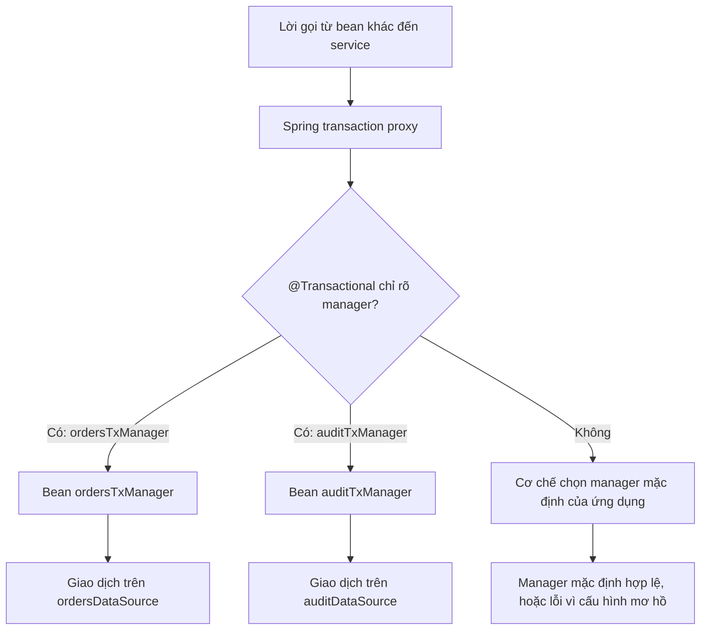

# Chọn TransactionManager bằng @Transactional(transactionManager = ...) hoặc @Transactional(value = ...)

## 1. Tình huống và mục tiêu học tập

Trong một ứng dụng Spring chỉ dùng **một cơ sở dữ liệu và một transaction manager**, annotation `@Transactional` thường đã đủ để một phương thức service tham gia giao dịch. Nhưng khi ứng dụng có **nhiều nguồn dữ liệu, nhiều transaction manager hoặc đồng thời dùng JDBC/JPA và R2DBC**, Spring cần biết **manager nào** thực hiện bắt đầu, commit và rollback cho lời gọi cụ thể.

Ví dụ một hệ thống quản lý đơn hàng có:

- Database **orders** lưu đơn và số tiền đặt hàng.
- Database **audit** lưu nhật ký thao tác.
- Hai bean transaction manager độc lập: `ordersTxManager` và `auditTxManager`.

Lúc này, người viết service cần chỉ rõ mục tiêu:

```java
@Transactional(transactionManager = "ordersTxManager")
public void createOrder(...) { ... }

@Transactional(value = "auditTxManager")
public void writeAudit(...) { ... }
```

Hai cú pháp trên chọn **manager khác nhau**, nhưng `transactionManager` và `value` là **hai tên của cùng một thuộc tính** trong `@Transactional`. Sự khác biệt nằm ở tên bean được truyền vào, không nằm ở tên thuộc tính.

Mục tiêu của bài:

1. Hiểu `TransactionManager` làm gì và vì sao chọn đúng manager gắn với nguồn dữ liệu là điều bắt buộc.
2. Nắm chính xác ý nghĩa và cú pháp tương đương của `transactionManager`, `value` và cách viết tắt `@Transactional("...")`.
3. Tạo và chạy một ví dụ Java 17+ có **hai H2 database, hai JdbcTemplate và hai PlatformTransactionManager**.
4. Biết dùng **bean name hoặc qualifier** để chọn transaction manager, và xử lý trường hợp không có manager mặc định rõ ràng.
5. Nhận diện lỗi chọn nhầm manager, kỳ vọng rollback xuyên nhiều database, self-invocation và nhầm lẫn giữa `@Qualifier` khi inject repository với manager của transaction.

> Phạm vi: bài này tập trung vào **cách lựa chọn transaction manager bằng thuộc tính của `@Transactional`**. Phần isolation, propagation và thuật toán nghiệp vụ được giải thích vừa đủ để không hiểu sai kết quả của việc chọn manager.

## 2. Transaction manager là gì?

Khi `@Transactional` có hiệu lực, cơ chế giao dịch của Spring sử dụng một bean triển khai hợp đồng `TransactionManager` tương ứng với kiểu thực thi để điều phối các hành động liên quan đến giao dịch.

Trong ứng dụng **imperative** (JDBC, JPA thông thường), bean cụ thể thường triển khai `PlatformTransactionManager`, chẳng hạn:

- `DataSourceTransactionManager` hoặc `JdbcTransactionManager` cho các thao tác JDBC dùng một `DataSource`;
- `JpaTransactionManager` cho một `EntityManagerFactory` dùng JPA/Hibernate.

Với **reactive** (ví dụ Spring Data R2DBC), cần `ReactiveTransactionManager` cho các thao tác tham gia **Reactor Context**. Không chọn một manager JDBC kiểu thread-bound rồi kỳ vọng nó quản lý giao dịch R2DBC trong pipeline reactive.

Trong trường hợp JDBC, manager nhận nhiệm vụ mở/tham gia transaction, gắn tài nguyên kết nối với luồng phù hợp và điều phối commit/rollback. `JdbcTemplate` phải truy cập **cùng DataSource** mà manager quản lý để các SQL của nó tham gia giao dịch đó.

### Sơ đồ chọn manager



**Hệ quả cốt lõi:** chọn một manager quyết định **tài nguyên nào được manager đó bảo vệ**. Nó không biến tất cả các kết nối database trong JVM thành một giao dịch nguyên tử duy nhất.

## 3. Ba cách viết tương đương cho cùng một manager

Xem ba khai báo sau:

```java
@Transactional(transactionManager = "ordersTxManager")
public void methodA() { /* ... */ }

@Transactional(value = "ordersTxManager")
public void methodB() { /* ... */ }

@Transactional("ordersTxManager")
public void methodC() { /* ... */ }
```

Đây là **mã minh họa cú pháp**, không phải một class hoàn chỉnh. Cả ba đều chỉ định cùng transaction manager có định danh `ordersTxManager`.

| Cú pháp | Ý nghĩa | Khi nào dùng |
| --- | --- | --- |
| `@Transactional(transactionManager = "ordersTxManager")` | Ghi rõ tên thuộc tính chọn manager | Dễ đọc nhất khi service dùng nhiều annotation option |
| `@Transactional(value = "ordersTxManager")` | Dùng tên thuộc tính `value` | Hoàn toàn tương đương về chức năng chọn manager |
| `@Transactional("ordersTxManager")` | Viết tắt khi chỉ cần truyền `value` | Ngắn gọn, phù hợp khi lựa chọn đã rõ |

Trong Java annotation, tham số không ghi tên thuộc tính sẽ được gán cho `value`. Spring định nghĩa `value()` và `transactionManager()` là **alias hai chiều** thông qua cơ chế `@AliasFor`. Vì vậy:

- Không phải `value` biểu thị “tên transaction” còn `transactionManager` biểu thị “bean manager”. **Cả hai đều chọn transaction manager**.
- Không đặt hai alias thành **hai giá trị xung đột** trong cùng một annotation, ví dụ `@Transactional(value = "ordersTxManager", transactionManager = "auditTxManager")`. Đây là cấu hình sai, không phải cách quản lý đồng thời hai DB.
- Chuỗi bạn truyền thường là **bean name** hoặc một **qualifier value** của bean `TransactionManager`.

Trong nhiều dự án, nên thống nhất một cách viết; `transactionManager = "..."` giúp người mới đọc hiểu rõ ý định, còn `@Transactional("...")` tiện khi dùng lặp lại.

## 4. Tên bean và qualifier: Spring tìm manager theo cách nào?

Giả sử cấu hình có bean:

```java
@Bean("ordersTxManager")
PlatformTransactionManager ordersTxManager(DataSource dataSource) {
    return new DataSourceTransactionManager(dataSource);
}
```

Đây là đoạn rút gọn; trong cấu hình nhiều DataSource, tham số `dataSource` phải được chọn đúng bằng `@Qualifier` hoặc tên bean, như ví dụ đầy đủ ở mục 5.

Tên `ordersTxManager` chính là định danh có thể dùng ở:

```java
@Transactional(transactionManager = "ordersTxManager")
```

Spring cũng cho phép khớp với **qualifier** của bean manager. Ví dụ:

```java
@Bean("primaryOrderManager")
@Qualifier("orders")
PlatformTransactionManager primaryOrderManager(
        @Qualifier("ordersDataSource") DataSource ds) {
    return new DataSourceTransactionManager(ds);
}
```

Với bean như vậy, phương thức có thể chọn:

```java
@Transactional("orders")
public void writeOrder() { /* ... */ }
```

`"orders"` ở đây là qualifier của **transaction manager bean**; nó không bắt buộc là tên bean. Việc gắn `@Qualifier("ordersJdbc")` lên một tham số constructor `JdbcTemplate` lại là cơ chế **dependency injection khác**, không tự chọn transaction manager cho method đó. Hai lựa chọn phải **phối hợp đúng**.

**Lưu ý phiên bản:** Spring Framework 6.2+ còn hỗ trợ xét qualifier khai báo ở **type-level của bean service** cho các transaction definitions không chỉ định riêng manager. Đây là lựa chọn nâng cao có phụ thuộc phiên bản; ở bài nhập môn và hệ thống nhiều DB, khai báo manager tường minh trên phương thức chính vẫn dễ kiểm chứng hơn.

## 5. Ví dụ chạy được: hai database độc lập, hai manager tường minh

Bài thực hành dùng Java 17+, Spring Boot, Spring JDBC và H2. Để học cách **chọn đúng manager**, mỗi database có tên bean rõ ràng:

| Database | Bean DataSource | Bean JdbcTemplate | Bean manager |
| --- | --- | --- | --- |
| Orders | `ordersDataSource` | `ordersJdbc` | `ordersTxManager` |
| Audit | `auditDataSource` | `auditJdbc` | `auditTxManager` |

Khi gọi `createOrder(...)`, service dùng `ordersTxManager`. Khi gọi `writeAudit(...)`, nó dùng `auditTxManager`. Mỗi manager điều phối **một database riêng**.

### 5.1. Tạo dự án

Tạo một project Java 17+ bằng Spring Initializr, chọn Spring Boot phù hợp, Maven, dependencies **Spring JDBC** và **H2 Database**. Giữ `pom.xml` do Initializr sinh ra để quản lý các phiên bản tương thích. Hai dependency cần có là:

```xml
<dependencies>
    <dependency>
        <groupId>org.springframework.boot</groupId>
        <artifactId>spring-boot-starter-jdbc</artifactId>
    </dependency>
    <dependency>
        <groupId>com.h2database</groupId>
        <artifactId>h2</artifactId>
        <scope>runtime</scope>
    </dependency>
</dependencies>
```

Đây là **phần dependencies**, không phải toàn bộ `pom.xml`. Ví dụ không cần web starter vì sử dụng `CommandLineRunner`.

Tạo các file dưới package `com.example.multitx`:

```text
src/main/java/com/example/multitx/
├── MultiTxApplication.java
├── DatabaseConfig.java
└── OrderAuditService.java
```

### 5.2. Định nghĩa hai DataSource và hai manager

File `DatabaseConfig.java`:

```java
package com.example.multitx;

import javax.sql.DataSource;

import org.springframework.beans.factory.annotation.Qualifier;
import org.springframework.context.annotation.Bean;
import org.springframework.context.annotation.Configuration;
import org.springframework.jdbc.core.JdbcTemplate;
import org.springframework.jdbc.datasource.DataSourceTransactionManager;
import org.springframework.jdbc.datasource.DriverManagerDataSource;
import org.springframework.transaction.PlatformTransactionManager;

@Configuration
public class DatabaseConfig {

    @Bean("ordersDataSource")
    DataSource ordersDataSource() {
        DriverManagerDataSource ds = new DriverManagerDataSource();
        ds.setDriverClassName("org.h2.Driver");
        ds.setUrl("jdbc:h2:mem:ordersdb;DB_CLOSE_DELAY=-1");
        ds.setUsername("sa");
        ds.setPassword("");
        return ds;
    }

    @Bean("auditDataSource")
    DataSource auditDataSource() {
        DriverManagerDataSource ds = new DriverManagerDataSource();
        ds.setDriverClassName("org.h2.Driver");
        ds.setUrl("jdbc:h2:mem:auditdb;DB_CLOSE_DELAY=-1");
        ds.setUsername("sa");
        ds.setPassword("");
        return ds;
    }

    @Bean("ordersJdbc")
    JdbcTemplate ordersJdbc(
            @Qualifier("ordersDataSource") DataSource ds) {
        return new JdbcTemplate(ds);
    }

    @Bean("auditJdbc")
    JdbcTemplate auditJdbc(
            @Qualifier("auditDataSource") DataSource ds) {
        return new JdbcTemplate(ds);
    }

    @Bean("ordersTxManager")
    PlatformTransactionManager ordersTxManager(
            @Qualifier("ordersDataSource") DataSource ds) {
        return new DataSourceTransactionManager(ds);
    }

    @Bean("auditTxManager")
    PlatformTransactionManager auditTxManager(
            @Qualifier("auditDataSource") DataSource ds) {
        return new DataSourceTransactionManager(ds);
    }
}
```

**Vì sao cấu hình này quan trọng?**

- Hai URL H2 có database name khác nhau (`ordersdb`, `auditdb`), nên dữ liệu ở hai DB **độc lập**. `DB_CLOSE_DELAY=-1` giúp database in-memory tiếp tục tồn tại khi kết nối cuối cùng đóng trong vòng đời JVM.
- Hai `JdbcTemplate` được tạo từ đúng `DataSource` thông qua `@Qualifier` ở tham số.
- `ordersTxManager` và `auditTxManager` đều là `PlatformTransactionManager` nhưng quản lý **hai DataSource khác nhau**.
- Đây là cấu hình minh họa để học. `DriverManagerDataSource` không có connection pool; ứng dụng production thường dùng pool như HikariCP và quản lý secrets qua cấu hình an toàn.
- Vì có hai `DataSource`/manager, không dựa vào auto-config một `JdbcTemplate` hoặc một transaction manager duy nhất của Spring Boot; các bean quan trọng đều được định nghĩa rõ.

### 5.3. Viết service với cả hai alias

File `OrderAuditService.java`:

```java
package com.example.multitx;

import org.springframework.beans.factory.annotation.Qualifier;
import org.springframework.jdbc.core.JdbcTemplate;
import org.springframework.stereotype.Service;
import org.springframework.transaction.annotation.Transactional;

@Service
public class OrderAuditService {
    private final JdbcTemplate ordersJdbc;
    private final JdbcTemplate auditJdbc;

    public OrderAuditService(
            @Qualifier("ordersJdbc") JdbcTemplate ordersJdbc,
            @Qualifier("auditJdbc") JdbcTemplate auditJdbc) {
        this.ordersJdbc = ordersJdbc;
        this.auditJdbc = auditJdbc;
    }

    @Transactional(transactionManager = "ordersTxManager")
    public void createOrder(long orderId,
                            long amount,
                            boolean forceFailure) {
        if (amount <= 0) {
            throw new IllegalArgumentException(
                "Amount must be positive");
        }

        ordersJdbc.update(
            "INSERT INTO purchase_order (id, amount) VALUES (?, ?)",
            orderId, amount);

        if (forceFailure) {
            throw new IllegalStateException("Simulated order failure");
        }
    }

    @Transactional(value = "auditTxManager")
    public void writeAudit(long eventId, String description) {
        auditJdbc.update(
            "INSERT INTO audit_log (id, description) VALUES (?, ?)",
            eventId, description);
    }
}
```

Ở method `createOrder(...)`:

- Chuỗi `ordersTxManager` chọn manager của database orders.
- `ordersJdbc` dùng `ordersDataSource`, đúng nguồn dữ liệu do manager đó quản lý.
- Nếu `forceFailure = true`, `IllegalStateException` thoát khỏi method. Với mặc định rollback trên `RuntimeException`, Spring rollback bản ghi vừa insert vào orders.

Ở method `writeAudit(...)`:

- `value = "auditTxManager"` là alias của `transactionManager = "auditTxManager"`.
- `auditJdbc` dùng đúng `auditDataSource`.
- Có thể thay nguyên annotation thành `@Transactional("auditTxManager")` mà không đổi ý nghĩa.

**Quan trọng:** manager được chỉ định cho **phương thức mà proxy intercept**. Một transaction manager không được chọn vì method có tên `writeAudit`, hoặc vì class chứa trường `auditJdbc`; nó được chọn theo metadata giao dịch và cấu hình bean.

### 5.4. Gọi service qua Spring và xem rollback

File `MultiTxApplication.java`:

```java
package com.example.multitx;

import org.springframework.boot.CommandLineRunner;
import org.springframework.boot.SpringApplication;
import org.springframework.boot.autoconfigure.SpringBootApplication;
import org.springframework.beans.factory.annotation.Qualifier;
import org.springframework.context.annotation.Bean;
import org.springframework.transaction.annotation.EnableTransactionManagement;
import org.springframework.jdbc.core.JdbcTemplate;

@SpringBootApplication
@EnableTransactionManagement
public class MultiTxApplication {

    public static void main(String[] args) {
        SpringApplication.run(MultiTxApplication.class, args);
    }

    @Bean
    CommandLineRunner demo(
            @Qualifier("ordersJdbc") JdbcTemplate ordersJdbc,
            @Qualifier("auditJdbc") JdbcTemplate auditJdbc,
            OrderAuditService service) {

        return args -> {
            ordersJdbc.execute("""
                CREATE TABLE purchase_order (
                    id BIGINT PRIMARY KEY,
                    amount BIGINT NOT NULL
                )
                """);

            auditJdbc.execute("""
                CREATE TABLE audit_log (
                    id BIGINT PRIMARY KEY,
                    description VARCHAR(100) NOT NULL
                )
                """);

            service.createOrder(101L, 500L, false);

            try {
                service.createOrder(102L, 700L, true);
            } catch (IllegalStateException ex) {
                System.out.println("Order transaction rolled back");
            }

            service.writeAudit(201L, "order created");

            Integer orders = ordersJdbc.queryForObject(
                "SELECT COUNT(*) FROM purchase_order",
                Integer.class);
            Integer audits = auditJdbc.queryForObject(
                "SELECT COUNT(*) FROM audit_log",
                Integer.class);

            System.out.println("orders rows=" + orders);
            System.out.println("audit rows=" + audits);
        };
    }
}
```

Chạy từ thư mục gốc của dự án Maven:

```bash
./mvnw spring-boot:run
```

Trên Windows PowerShell:

```powershell
.\mvnw.cmd spring-boot:run
```

Bỏ qua log khởi động thông thường của Spring Boot và Maven, các dòng do chương trình in ra là:

```text
Order transaction rolled back
orders rows=1
audit rows=1
```

**Giải thích kết quả:**

1. `createOrder(101, 500, false)` insert thành công vào **ordersdb** và commit, vì nó sử dụng `ordersTxManager`.
2. `createOrder(102, 700, true)` thực hiện insert rồi ném `IllegalStateException` trước khi kết thúc; proxy sử dụng `ordersTxManager` rollback. Không còn bản ghi 102.
3. `writeAudit(201, "order created")` insert vào **auditdb** trong transaction do `auditTxManager` quản lý và commit.
4. Tổng số hàng cuối cùng: orders 1, audit 1. Kết quả cho thấy từng method dùng đúng manager tương ứng.

Nếu thứ tự câu lệnh SQL thay đổi, logger có thể in thông tin khác, nhưng ba dòng `System.out.println` trên giữ nguyên trong cấu hình và dữ liệu khởi tạo của ví dụ. `JdbcTemplate` tự tham gia giao dịch Spring thông qua cách Spring quản lý kết nối, miễn là nó dùng DataSource đúng.

## 6. Khi nào không cần chỉ định transactionManager?

Khi ứng dụng có **một transaction manager duy nhất** và cấu hình transaction management được thiết lập đúng, nhiều service có thể viết:

```java
@Service
class CustomerService {
    @Transactional
    public void updateCustomer() {
        // Truy cập một DataSource phù hợp.
    }
}
```

Đây là đoạn minh họa cấu trúc, không phải class chạy độc lập. Khi có một manager phù hợp và cấu hình mặc định rõ ràng, Spring có thể tự chọn manager mà không cần qualifier riêng trên mỗi method.

Nhưng nếu có hai hay nhiều bean thuộc loại `TransactionManager`:

- Không coi `@Transactional` không tham số là **bằng chứng** Spring sẽ chọn đúng database theo repository bên trong method.
- Tùy cấu hình transaction infrastructure, có thể phát sinh **lỗi không xác định được manager**, hoặc manager mặc định được chọn nhưng **khác manager bạn muốn**.
- Chọn bằng bean name/qualifier trên annotation để logic được ghi rõ tại điểm sử dụng: `@Transactional(transactionManager = "ordersTxManager")`.
- Khi nhiều phương thức thực sự dùng một manager mặc định, có thể cấu hình chính sách mặc định tường minh, ví dụ bằng `TransactionManagementConfigurer`, thay vì ngầm trông chờ vào lựa chọn bất định.

**Nguyên tắc:** lựa chọn của transaction manager là quyết định về tính nhất quán dữ liệu. Khi có nhiều manager, tên tường minh thường là một phần quan trọng của hợp đồng nghiệp vụ.

### Ví dụ mặc định qua TransactionManagementConfigurer

Đây là cấu hình tùy chọn, **không cần thêm vào project thực hành** ở trên vì các method đã chỉ định manager tường minh:

```java
@Configuration
@EnableTransactionManagement
class DefaultTxConfiguration
        implements TransactionManagementConfigurer {

    private final PlatformTransactionManager ordersTxManager;

    DefaultTxConfiguration(
            @Qualifier("ordersTxManager")
            PlatformTransactionManager ordersTxManager) {
        this.ordersTxManager = ordersTxManager;
    }

    @Override
    public TransactionManager annotationDrivenTransactionManager() {
        return ordersTxManager;
    }
}
```

Các import cho đoạn minh họa là `org.springframework.transaction.TransactionManager`, `org.springframework.transaction.PlatformTransactionManager`, `org.springframework.transaction.annotation.TransactionManagementConfigurer`, `org.springframework.transaction.annotation.EnableTransactionManagement`, `org.springframework.context.annotation.Configuration` và `org.springframework.beans.factory.annotation.Qualifier`. Khi dùng cấu hình này, những method không có qualifier có thể lấy `ordersTxManager` làm manager mặc định của annotation-driven transaction management. Method chỉ rõ `auditTxManager` vẫn yêu cầu manager đó.

Chỉ dùng một nơi duy nhất để quyết định manager mặc định và kiểm tra kết quả thực tế. Không chồng nhiều cách chọn mặc định rồi dựa vào suy đoán.

## 7. Đặt manager ở lớp hay phương thức?

Spring cho phép đặt `@Transactional` ở **class-level** để các phương thức phù hợp thừa hưởng thuộc tính transaction. Một phương thức có annotation riêng có thể ghi đè cấu hình ở cấp class:

```java
@Service
@Transactional(transactionManager = "ordersTxManager")
public class BusinessService {

    public void saveOrder() {
        // Kế thừa ordersTxManager.
    }

    @Transactional(transactionManager = "auditTxManager")
    public void saveAudit() {
        // Dùng auditTxManager ở mức phương thức.
    }
}
```

Đây là **đoạn minh họa**, chưa định nghĩa các repository bên trong. Nếu hầu hết methods dùng orders và chỉ một số dùng audit, cấu hình class-level có thể gọn. Tuy nhiên, khi nhiều database có trách nhiệm riêng, việc **tách service theo nguồn dữ liệu hoặc use case** và gắn manager rõ tại method thường dễ đọc, dễ kiểm thử hơn.

Không được quên **self-invocation**:

```java
@Service
class ExampleService {
    public void outside() {
        inside(); // Gọi nội bộ cùng object: không qua proxy.
    }

    @Transactional("auditTxManager")
    public void inside() {
        // Dự định dùng audit manager.
    }
}
```

Trong chế độ **Spring AOP proxy thông thường**, lời gọi `inside()` từ `outside()` của cùng object không đi qua transaction interceptor. Annotation `@Transactional("auditTxManager")` trên `inside()` **không được áp dụng riêng cho lời gọi nội bộ này**. Nếu `outside()` đã có một transaction, thao tác có thể tiếp tục trong transaction đó theo tài nguyên được truy cập; không có việc chọn audit manager tự động do lời gọi nội bộ.

Giải pháp thường là đặt transaction trên **public entry point được gọi qua Spring bean proxy**, hoặc tách hành vi cần transaction manager khác thành service bean riêng, rồi gọi qua bean đó. Spring cũng có chế độ AspectJ weaving với cách intercept khác, nhưng không cần dùng để học lựa chọn manager căn bản.

## 8. Vì sao chọn nhầm manager gây lỗi nguy hiểm?

Giả sử method có:

```java
@Transactional(transactionManager = "ordersTxManager")
public void mistakenlyWriteAudit() {
    auditJdbc.update(
        "INSERT INTO audit_log (id, description) VALUES (?, ?)",
        202L, "outside the intended audit transaction");
    throw new IllegalStateException("Simulated failure");
}
```

Đây là **mã cảnh báo được đặt bên trong một bean** có `auditJdbc` được inject như ví dụ. `ordersTxManager` quản lý `ordersDataSource`, còn SQL bên trong lại chạy qua `auditDataSource`.

Trong cấu hình JDBC hai DataSource độc lập của ví dụ, câu `INSERT` trên audit có thể chạy **ngoài transaction của audit** và được auto-commit; ngoại lệ sau đó chỉ kích hoạt rollback trên giao dịch do `ordersTxManager` quản lý. Kết quả có thể là **bản ghi audit vẫn tồn tại dù method báo lỗi**.

Đây là lỗi đáng chú ý: Spring không nhất thiết “nhìn thấy” biến `auditJdbc` để tự đổi manager. Việc có annotation giao dịch và thậm chí kiểm tra thấy một transaction đang active **không chứng minh** rằng SQL ở nguồn dữ liệu bạn vừa dùng đã được bảo vệ.

Cần kiểm tra đồng thời ba yếu tố:

1. **Manager được chọn:** `@Transactional(transactionManager = "auditTxManager")`.
2. **Nguồn dữ liệu manager quản lý:** `auditDataSource`.
3. **Nguồn dữ liệu JDBC/JPA thực sự dùng:** `auditJdbc` phải được tạo từ `auditDataSource`.

Nếu một trong ba không khớp, rollback có thể không đạt kết quả mong muốn.

## 9. Hai manager không tương đương một giao dịch phân tán

Một ứng dụng có thể có cả hai service:

```java
@Service
class AuditService {
    @Transactional("auditTxManager")
    public void record(...) {
        // Ghi auditdb rồi commit.
    }
}

@Service
class OrderService {
    private final AuditService audit;

    @Transactional("ordersTxManager")
    public void submit(...) {
        // Ghi ordersdb trong orders transaction.
        audit.record(...); // Lời gọi qua bean khác, dùng audit transaction.
        throw new IllegalStateException("Fail after audit");
    }
}
```

Đây là **mã mô tả luồng**, các kiểu đối số và repository đã lược bỏ; không phải file Java chạy độc lập.

Nếu `audit.record(...)` hoàn tất và commit bằng `auditTxManager`, sau đó `submit(...)` ném runtime exception làm `ordersTxManager` rollback, **audit transaction đã commit không bị rollback theo**. Chỉ định hai manager ở hai method không tự tạo transaction phân tán, cũng không tự liên kết hai transaction thành một kết quả nguyên tử.

Với nhiều nguồn dữ liệu, cần trả lời mục tiêu nhất quán:

- Nếu chỉ cần **mỗi database có transaction riêng**, cấu hình hai manager là đủ, đồng thời chấp nhận và xử lý trạng thái cuối có thể không đồng bộ nhất thời.
- Nếu cần “ghi orders DB xong chắc chắn sẽ có event xử lý audit sau đó”, thường cân nhắc **transactional outbox** trong cùng orders DB và một consumer đáng tin cậy để chuyển event sang audit.
- Nếu cần nguyên tử thực sự giữa nhiều tài nguyên, phải đánh giá các cơ chế phân tán phù hợp (ví dụ JTA/XA khi được hạ tầng hỗ trợ) và chi phí vận hành. **Không** dùng hai local manager rồi gọi đó là một giao dịch ACID chung.

Đây là giới hạn của bài toán **đa tài nguyên**, khác với việc viết đúng alias `transactionManager` hay `value`.

## 10. Phân biệt imperative và reactive manager

Chọn manager còn phải tương ứng với **mô hình thực thi**:

| Luồng xử lý | Manager thường dùng | Ngữ cảnh |
| --- | --- | --- |
| JDBC / JdbcTemplate | `DataSourceTransactionManager` hoặc `JdbcTransactionManager` | Transaction gắn với tài nguyên kết nối, thường thread-bound |
| JPA / Hibernate | `JpaTransactionManager` | EntityManager và nguồn dữ liệu JPA tương ứng |
| R2DBC / Reactor | `R2dbcTransactionManager` | Reactive transaction trong Reactor Context |

Ví dụ khi có cả JDBC và reactive transaction manager:

```java
@Transactional(transactionManager = "jdbcTxManager")
public void saveImperative() {
    // Dùng JDBC, return void.
}

@Transactional(transactionManager = "r2dbcTxManager")
public Mono<Void> saveReactive() {
    // Trả về pipeline R2DBC reactive.
    return ...;
}
```

Đây là **minh họa chữ ký**, không phải chương trình hoàn chỉnh; kiểu `Mono` cần Reactor và cần triển khai pipeline. Với Spring, transaction interceptor phân biệt đường đi imperative và reactive dựa trên loại phương thức/return type và loại manager. Đừng chỉ thay tên manager rồi mong `JdbcTemplate` tham gia một reactive transaction; cũng không dùng thread mới và mong tài nguyên JDBC transaction cũ tự truyền sang.

## 11. Kiểm chứng lựa chọn manager: bằng kết quả dữ liệu

Một cách kiểm tra đáng tin là **đưa ra lỗi sau khi đã ghi**, rồi quan sát dữ liệu bền vững trong đúng database.

### Kịch bản test quan trọng

| Kịch bản | Mong đợi |
| --- | --- |
| Gọi method chọn `ordersTxManager` và ghi ordersdb thành công | Dữ liệu orders được commit |
| Gọi method chọn `ordersTxManager`, ghi ordersdb rồi ném runtime exception | Ghi orders rollback |
| Gọi method chọn `auditTxManager` và ghi auditdb thành công | Dữ liệu audit được commit |
| Gọi method chọn `auditTxManager`, ghi auditdb rồi ném runtime exception | Ghi audit rollback |
| Ghi auditdb nhưng khai báo `ordersTxManager` | Test phát hiện audit có thể không rollback như dự kiến |
| Gọi method annotated bằng self-invocation | Test phát hiện lời gọi không được proxy intercept như kỳ vọng |
| Không chỉ định manager khi có nhiều manager | Cấu hình phải có kết quả rõ ràng hoặc báo lỗi; không được âm thầm dùng sai DB |

Nếu sử dụng Spring Boot, có thể bật log để quan sát transaction interceptor và manager:

```properties
logging.level.org.springframework.transaction.interceptor=TRACE
logging.level.org.springframework.jdbc.datasource.DataSourceTransactionManager=DEBUG
```

Thông điệp log cụ thể phụ thuộc phiên bản. Hãy tìm dấu hiệu **lời gọi method transactional** và transaction begin/commit/rollback theo manager, nhưng kết luận cuối cùng vẫn phải dựa vào dữ liệu DB đọc **sau khi giao dịch đã kết thúc**.

Có thể kiểm tra:

```java
boolean active =
    TransactionSynchronizationManager.isActualTransactionActive();
```

Trong Spring-managed JDBC transaction, giá trị này có thể giúp chẩn đoán có transaction hiện hành trên luồng. Tuy vậy nó **không cho biết một JdbcTemplate bất kỳ đang dùng đúng DataSource của manager nào**. Vì thế, không lấy một biến `active == true` làm bằng chứng đầy đủ về lựa chọn manager chính xác.

### Kế hoạch thực hành mở rộng

Sau khi chạy ví dụ chính:

1. Đổi annotation của `createOrder(...)` từ `transactionManager = "ordersTxManager"` sang `value = "ordersTxManager"`. Kết quả phải giống nhau.
2. Đổi tiếp thành `@Transactional("ordersTxManager")`. Kết quả vẫn giống nhau.
3. Trên `writeAudit(...)`, thử viết `@Transactional(transactionManager = "auditTxManager")` thay cho `value = "auditTxManager"`; kết quả không đổi.
4. Trong một bản thử nghiệm riêng, cố tình chọn sai manager cho method ghi audit rồi ném runtime exception. So sánh kết quả để thấy nguy cơ ghi ngoài giao dịch được quản lý; xóa/tạo lại database H2 khi lặp thực hành để tránh trùng ID.
5. Thử gọi một method annotated từ bên trong chính class và kiểm tra proxy boundary, sau đó chuyển lời gọi qua một Spring bean khác.

Không thực hiện thử nghiệm thay manager sai trên dữ liệu production. Mục tiêu là chứng minh bằng dữ liệu, không dựa vào chú thích trong code.

## 12. Những lỗi thường gặp và cách sửa

**Lỗi 1 — Tưởng hai thuộc tính có vai trò khác nhau.** Viết `@Transactional(value = "ordersTxManager")` rồi nghĩ `value` là tên transaction hiển thị trên log. Thực tế, `value` là alias của `transactionManager`. Sửa bằng cách dùng một trong hai nhất quán.

**Lỗi 2 — Gõ sai tên bean.** Viết `@Transactional("orderTxManager")` trong khi bean thật tên `ordersTxManager`. Spring sẽ không giải quyết đúng target manager theo qualifier đã yêu cầu; lời gọi có thể thất bại lúc proxy xử lý. Sửa bằng tên bean/qualifier chính xác, test lúc chạy.

**Lỗi 3 — Chọn đúng manager nhưng inject sai JdbcTemplate.** Method khai báo `ordersTxManager` nhưng gọi `auditJdbc`. Sửa bằng đồng bộ ba ánh xạ bean: manager → DataSource → DAO/JdbcTemplate.

**Lỗi 4 — Dựa vào @Primary hoặc mặc định một cách mơ hồ.** Ứng dụng có nhiều transaction manager mà không xác định hợp đồng lựa chọn; một thay đổi cấu hình bean có thể làm method dùng manager khác. Sửa bằng qualifier tường minh hoặc cấu hình một mặc định có chủ đích và test rõ.

**Lỗi 5 — Nghĩ mỗi @Transactional trong chuỗi lời gọi luôn tự tạo transaction mới.** Với `Propagation.REQUIRED` mặc định, một method gọi qua proxy với cùng manager thường **tham gia giao dịch đang có**; không commit riêng. Với hai manager khác nhau, chúng quản lý tài nguyên độc lập và không tự gộp thành một transaction.

**Lỗi 6 — Tưởng rollback của manager A sẽ rollback DB B.** Hai local manager độc lập không đảm bảo nguyên tử xuyên hai DB. Sửa thiết kế theo yêu cầu nhất quán: cùng DB, outbox, saga hoặc cơ chế phân tán thích hợp.

**Lỗi 7 — Gọi trực tiếp bằng new hoặc self-invocation.** Proxy không được dùng, annotation không hoạt động như dự kiến. Sửa bằng Spring bean injection và điểm vào public đi qua proxy.

**Lỗi 8 — Nuốt exception bên trong method transactional.** Nếu lỗi runtime được catch rồi method trả về bình thường, manager có thể commit những thay đổi còn lại. Quy tắc mặc định rollback khi `RuntimeException` hoặc `Error` **thoát** khỏi ranh giới transactional, trừ trường hợp giao dịch bị đánh dấu rollback-only bằng cơ chế khác.

## 13. Bài tập suy luận

**Bài 1.** Cấu hình có hai manager bean `salesTxManager` và `reportTxManager`. Bạn muốn method `generateSales()` chạy với `salesTxManager`. Ba cách viết nào tương đương?

**Đáp án:**

```java
@Transactional(transactionManager = "salesTxManager")
@Transactional(value = "salesTxManager")
@Transactional("salesTxManager")
```

Đây là **ba lựa chọn thay thế cho cùng một method**, không đặt ba annotation đồng thời lên một method.

**Bài 2.** Có bean `@Bean("realManager") @Qualifier("billing") PlatformTransactionManager ...`. Có thể viết `@Transactional("billing")` không?

**Đáp án:** Có, khi qualifier khai báo trên bean manager và được Spring nhận diện đúng; chuỗi ở `@Transactional` được phép khớp bean name hoặc qualifier của manager.

**Bài 3.** Gắn `@Qualifier("ordersJdbc")` lên constructor của service có tự động chọn `ordersTxManager` không?

**Đáp án:** Không. Constructor qualifier chọn bean dependency; annotation transaction/transaction infrastructure mới quyết định manager. Phải kiểm tra ánh xạ của cả hai.

**Bài 4.** Một method ghi DB orders và audit được gắn `@Transactional(transactionManager = "ordersTxManager")`. Nếu method ném exception, có chắc cả hai DB rollback?

**Đáp án:** Không. `ordersTxManager` chỉ quản lý tài nguyên orders mà nó được cấu hình; auditdb có thể commit độc lập. Cần một thiết kế nhất quán đa tài nguyên nếu nghiệp vụ yêu cầu.

**Bài 5.** Một service gọi `this.writeAudit()`, còn `writeAudit()` có `@Transactional(value = "auditTxManager")`. Annotation có chắc được áp dụng?

**Đáp án:** Không, ở proxy mode mặc định lời gọi nội bộ không đi qua proxy. Cần gọi qua Spring bean proxy hoặc tổ chức lại ranh giới transactional.

## 14. Checklist áp dụng trong dự án thật

- [ ] Đã thống kê **mọi transaction manager bean** và tên/qualifier của từng bean.
- [ ] Mỗi manager đã được cấu hình với **đúng DataSource/EntityManagerFactory/ConnectionFactory**.
- [ ] Mỗi phương thức transactional có lựa chọn manager **rõ ràng** nếu ứng dụng có nhiều manager.
- [ ] Nếu method không có qualifier, cơ chế manager mặc định đã được định nghĩa và kiểm chứng.
- [ ] `JdbcTemplate`, JPA repository hoặc R2DBC repository sử dụng đúng tài nguyên của manager được chọn.
- [ ] Lời gọi transactional thực sự đi qua Spring proxy; không dựa vào self-invocation.
- [ ] Đã test cả commit và rollback bằng trạng thái database sau method, đặc biệt trên từng DataSource.
- [ ] Nếu một use case thay đổi nhiều database, đã có quyết định rõ về nhất quán liên hệ thống; không nhầm hai local manager với một transaction phân tán.

### Ghi nhớ cuối bài

**`transactionManager` và `value` trong `@Transactional` là hai alias của cùng một lựa chọn.** Viết `@Transactional(transactionManager = "ordersTxManager")`, `@Transactional(value = "ordersTxManager")` hay `@Transactional("ordersTxManager")` đều nhắm đến cùng manager.

Điều thực sự quyết định tính đúng đắn là **manager đó quản lý tài nguyên nào**, **DAO/repository dùng tài nguyên nào**, và **lời gọi có đi qua transaction interceptor của Spring hay không**. Luôn kiểm tra lựa chọn bằng hành vi commit/rollback thực tế.

### Tài liệu tham khảo chính thức

- Spring Framework — Using `@Transactional`, mục *Multiple Transaction Managers with @Transactional*: https://docs.spring.io/spring-framework/reference/data-access/transaction/declarative/annotations.html
- Spring Framework — `@Transactional` Javadoc (`value` và `transactionManager` dùng `@AliasFor`): https://docs.spring.io/spring-framework/docs/current/javadoc-api/org/springframework/transaction/annotation/Transactional.html
- Spring Framework — Declarative Transaction Management: https://docs.spring.io/spring-framework/reference/data-access/transaction/declarative/tx-decl-explained.html
- Spring Framework — `TransactionManagementConfigurer`: https://docs.spring.io/spring-framework/docs/current/javadoc-api/org/springframework/transaction/annotation/TransactionManagementConfigurer.html
