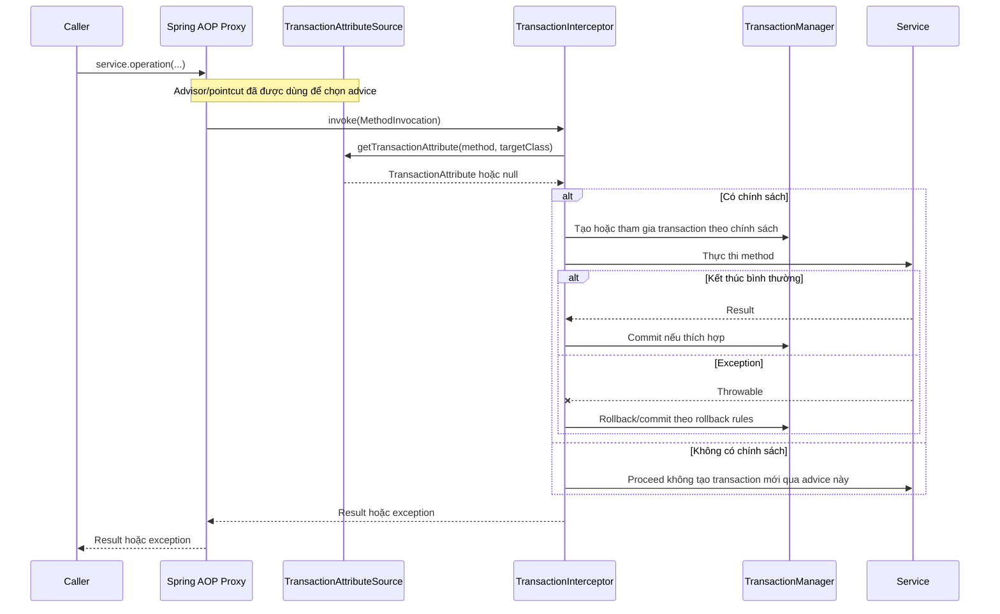

# TransactionAttributeSource và quá trình đọc chính sách giao dịch trong Spring

## 1. Bài toán: Spring biết một phương thức cần giao dịch bằng cách nào?

Khi lập trình viên viết:

```java
@Service
@Transactional(readOnly = true)
public class InvoiceService {

    public Invoice find(long id) {
        // Đọc dữ liệu.
        return null;
    }

    @Transactional(readOnly = false, rollbackFor = IOException.class)
    public void issue(long id) throws IOException {
        // Tạo hóa đơn và cập nhật dữ liệu.
    }
}
```

hai annotation chỉ là **metadata** trong mã Java. JVM không tự bắt đầu transaction khi thấy `@Transactional`. Spring phải trả lời các câu hỏi:

1. Phương thức vừa được gọi có chính sách transaction không?
2. Nếu annotation nằm cả trên class và method, chính sách nào được áp dụng?
3. Nếu lời gọi xuất phát từ interface nhưng implementation chứa annotation, phải tra cứu ở đâu?
4. Các lựa chọn `readOnly`, `propagation`, `isolation`, `timeout`, `rollbackFor`, `transactionManager` được biểu diễn thành đối tượng gì?
5. Đối tượng nào lấy kết quả tra cứu để quyết định mở transaction, commit hoặc rollback?

**`TransactionAttributeSource`** là một mắt xích quan trọng của lời giải: một hợp đồng truy vấn chính sách transaction cho **một phương thức trên một lớp đích**. Nó đọc và cung cấp chính sách; **nó không tự mở transaction**.

Trong bài học này, bạn sẽ tự kiểm tra cách Spring tìm ra chính sách, hiểu đường đi từ `@Transactional` đến transaction interceptor, nắm quy tắc ưu tiên và cache, rồi đọc được lỗi thường gặp khi annotation hiện diện mà lời gọi không chạy trong transaction.

> Phạm vi: cơ chế **proxy-based declarative transaction management** thường dùng với Spring Framework 6.x, Spring Boot 3.x và các bản mới hơn có cùng hợp đồng cốt lõi. Một số chi tiết về visibility, class/interface và nội bộ tối ưu có thể khác theo phiên bản/cách cấu hình; mỗi điểm phụ thuộc phiên bản được nêu rõ bên dưới.

## 2. Phân biệt bốn thành phần dễ nhầm

| Thành phần | Vai trò chính | Không chịu trách nhiệm |
| --- | --- | --- |
| `@Transactional` | Khai báo ý định và các thuộc tính của transaction | Không tự chặn lời gọi Java |
| `TransactionAttributeSource` | Đọc chính sách của method/target class và trả về `TransactionAttribute` hoặc `null` | Không mở kết nối, không commit/rollback |
| `TransactionInterceptor` / `TransactionAspectSupport` | Áp dụng advice quanh lời gọi, lấy chính sách, chọn manager và điều phối thực thi | Không tự biến annotation thành dữ liệu bền vững của DB |
| `PlatformTransactionManager` / `ReactiveTransactionManager` | Thực sự bắt đầu/tham gia/commit/rollback transaction theo tài nguyên được quản lý | Không tự quyết định method nào có `@Transactional` |

Phân biệt thêm hai khái niệm:

- **Transaction definition:** các tùy chọn điều khiển tạo/tham gia giao dịch: propagation, isolation, timeout, read-only và tên/nhãn tùy triển khai.
- **Transaction attribute:** ngoài phần definition còn có **quy tắc rollback theo ngoại lệ**. Giao diện `TransactionAttribute` mở rộng `TransactionDefinition` và bổ sung cách hỏi `rollbackOn(Throwable)`.

Điểm kiểm chứng: dù một method được metadata resolver xác nhận là transactional, lời gọi vẫn cần **đi qua hạ tầng giao dịch phù hợp**. Gọi trực tiếp một object tự tạo bằng `new`, hay gọi nội bộ bằng `this.method()` trong chế độ proxy mặc định, không làm annotation tự có hiệu lực.

## 3. Hợp đồng TransactionAttributeSource

Giao diện ở package `org.springframework.transaction.interceptor` có phương thức cốt lõi:

```java
@Nullable
TransactionAttribute getTransactionAttribute(
        Method method, @Nullable Class<?> targetClass);
```

Đây là **chữ ký API rút gọn** để trình bày ý nghĩa; `@Nullable` phụ thuộc bộ annotation của bản Spring đang dùng.

Ý nghĩa từng tham số:

- `method`: đối tượng `java.lang.reflect.Method` mô tả method của lời gọi. Với JDK dynamic proxy, method này **có thể được khai báo trên interface**.
- `targetClass`: lớp thực tế phía sau proxy, ví dụ `InvoiceServiceImpl.class`. Nó giúp resolver tra annotation trên **implementation method** thay vì chỉ nhìn interface.
- Giá trị trả về là `TransactionAttribute` khi có chính sách phù hợp, hoặc **`null`** nếu không tìm được chính sách transaction cho cặp method/class đã hỏi.

Ví dụ minh họa:

```java
Method method = InvoiceService.class.getMethod("issue", long.class);
TransactionAttribute attr =
        source.getTransactionAttribute(method, InvoiceService.class);

if (attr != null) {
    System.out.println(attr.isReadOnly());
}
```

Đây là **đoạn minh họa sử dụng API**, cần có lớp `InvoiceService` và biến `source` được khai báo phù hợp. Mục 7 có chương trình đầy đủ có thể chạy.

**Điều quan trọng:** `getTransactionAttribute(...)` không có ý nghĩa “giao dịch hiện tại đang active” và không trả về `TransactionStatus`. Nó chỉ trả về **cấu hình cần áp dụng** nếu advice giao dịch thật sự xử lý lời gọi.

Một số phiên bản Spring còn có phương thức trợ giúp `hasTransactionAttribute(method, targetClass)` để trả lời có chính sách hay không. Hạ tầng AOP có thể dùng phương thức này lúc chọn method cần advice.

## 4. AnnotationTransactionAttributeSource: đọc annotation thành chính sách

Trong ứng dụng dùng `@Transactional`, triển khai rất quan trọng là:

```text
TransactionAttributeSource                    (giao diện)
    ^
    |
AbstractFallbackTransactionAttributeSource   (tìm kiếm fallback + cache)
    ^
    |
AnnotationTransactionAttributeSource         (đọc và phân tích annotation)
```

**`AnnotationTransactionAttributeSource`** có thể nhận diện `org.springframework.transaction.annotation.Transactional` và các dạng khai báo được cấu hình hỗ trợ. Theo các dependency hiện diện, Spring cũng hỗ trợ những chuẩn transaction annotation khác. Ở đây ta tập trung vào `@Transactional` của Spring.

Lớp này sử dụng các **transaction annotation parser**. Với Spring `@Transactional`, `SpringTransactionAnnotationParser` diễn giải metadata và tạo một dạng `TransactionAttribute`, thường là `RuleBasedTransactionAttribute`.

Luồng khái niệm:

```text
@Transactional(
    propagation = Propagation.REQUIRES_NEW,
    readOnly = true,
    timeout = 15,
    rollbackFor = IOException.class
)
         |
         v
AnnotationTransactionAttributeSource
         |
         v
SpringTransactionAnnotationParser
         |
         v
RuleBasedTransactionAttribute
  - propagation = REQUIRES_NEW
  - readOnly = true
  - timeout = 15
  - rollback rules gồm IOException
```

Đó là bước **chuyển metadata sang cấu hình có cấu trúc**, chưa phải bắt đầu transaction.

### Những thuộc tính nào được đưa vào chính sách?

| Annotation | Dữ liệu trong transaction attribute |
| --- | --- |
| `propagation = REQUIRED` | `getPropagationBehavior()` thể hiện REQUIRED |
| `isolation = READ_COMMITTED` | `getIsolationLevel()` thể hiện READ_COMMITTED |
| `readOnly = true` | `isReadOnly() == true` |
| `timeout = 15` / `timeoutString = "15"` | Timeout được đặt cho transaction khi tạo mới, có thể qua bước giải quyết chuỗi |
| `rollbackFor = IOException.class` | Quy tắc `rollbackOn(new IOException(...))` trả `true` |
| `noRollbackFor = SomeException.class` | Quy tắc rollback có ngoại lệ được cấu hình không rollback |
| `transactionManager = "billingTxManager"` hoặc `value = "billingTxManager"` | Qualifier/tên manager được lưu trong chính sách để interceptor lựa chọn |
| `label = {"billing"}` | Nhãn mô tả/options mà manager hỗ trợ có thể diễn giải |

Một vài điểm không được hiểu sai:

- `@Transactional(readOnly = true)` cung cấp **gợi ý giao dịch chỉ đọc**, không đảm bảo DB từ chối mọi câu UPDATE trong mọi cấu hình.
- `propagation`, `isolation`, `timeout` là **chính sách được mô tả**. Khi thực sự tham gia một transaction đã tồn tại, một số thuộc tính áp cho transaction mới có thể không thay đổi transaction ngoài.
- Quy tắc rollback mặc định của Spring thường là **rollback cho `RuntimeException` và `Error`**, còn checked exception thì không, trừ khi được cấu hình khác.
- `value` trong `@Transactional` là alias của `transactionManager`; đây **không phải** chuỗi định danh tùy ý cho tên transaction.

## 5. Spring tra cứu annotation ở method hay class trước?

Hãy xét:

```java
@Transactional(readOnly = true, timeout = 20)
public class CustomerService {

    public Customer find(long id) {
        // Chính sách từ class.
        return null;
    }

    @Transactional(propagation = Propagation.REQUIRES_NEW)
    public void update(long id) {
        // Chính sách từ method.
    }
}
```

Đây là **mã minh họa**; `Customer` và repository chưa được triển khai.

**Kết quả:**

- `find(...)` không có annotation riêng, nên nhận **cả chính sách class**: `readOnly = true`, `timeout = 20` và propagation mặc định REQUIRED.
- `update(...)` có annotation riêng nên dùng **chính sách method**: propagation REQUIRES_NEW, nhưng `readOnly` trở về giá trị mặc định `false` và timeout trở về mặc định khi không khai báo tại method.

Một nhầm lẫn phổ biến là nghĩ method annotation chỉ “ghi đè mỗi trường đã khai báo” rồi **kế thừa những trường còn lại của class**. Trong cách phân giải chính sách này, **method attribute thắng toàn bộ class attribute**; không có phép merge từng trường giữa hai `@Transactional` độc lập.

### Thứ tự fallback cốt lõi

Khi proxy gọi một interface method, Spring có thể phải tìm implementation method tương ứng. `AbstractFallbackTransactionAttributeSource` hiện thực thứ tự tra cứu khái quát:

1. **Phương thức cụ thể ở lớp đích** (most specific target method).
2. **Lớp khai báo phương thức cụ thể đó** (target class/declaration class).
3. **Phương thức ban đầu** của lời gọi, ví dụ method từ interface.
4. **Lớp/interface khai báo phương thức ban đầu**.

Ở mỗi bước, nếu tìm được chính sách phù hợp, resolver trả về ngay và không tiếp tục tìm nơi ưu tiên thấp hơn. Bước fallback về method/class ban đầu chỉ cần khi method cụ thể khác method ban đầu. Spring dùng các kiểm tra phù hợp về method visibility và user-level method.

Ví dụ:

```java
public interface PaymentGateway {
    @Transactional(readOnly = true)
    void view();
}

public class PaymentGatewayImpl implements PaymentGateway {
    @Override
    public void view() {
        // Không gắn annotation ở implementation.
    }
}
```

Đây là **ví dụ minh họa cấu trúc**, không phải một file Java duy nhất vì có hai `public` top-level type. Khi tra cứu method trên interface với `PaymentGatewayImpl.class` làm target class, resolver tìm implementation trước, sau đó có thể fallback về annotation trên interface method.

Dù Spring proxy có hỗ trợ metadata ở interface trong nhiều cấu hình hiện đại, tài liệu Spring khuyến nghị **đặt `@Transactional` trực tiếp trên concrete class/method** để tránh sự khác biệt giữa proxy mode, interface inheritance và AspectJ weaving.

### Minh họa precedence

| Vị trí annotation | Có annotation khác ưu tiên cao hơn? | Chính sách được chọn |
| --- | --- | --- |
| Concrete method | Không | Chính sách của concrete method |
| Concrete class | Concrete method không khai báo | Chính sách của class |
| Interface method | Concrete method/class không khai báo, fallback áp dụng | Chính sách của interface method |
| Interface type | Các vị trí ưu tiên hơn không có, fallback áp dụng | Chính sách của interface type |
| Không tìm thấy | — | `null`: không có transaction attribute cho method |

Khi có kế thừa class, bridge methods của generic hoặc meta-annotations, việc đọc annotation còn phụ thuộc vào cơ chế merged annotation của Spring và lớp khai báo thật. Không nên dùng bảng trên để suy diễn rằng **mọi phương thức ở superclass đều tự nhận mọi annotation lớp con**. Hãy kiểm tra trường hợp thực tế bằng `getTransactionAttribute(...)` hoặc kiểm thử proxy.

## 6. Vai trò của AbstractFallbackTransactionAttributeSource và cache

Việc phản chiếu Java để tìm annotation cho một method, xem kiểu đích và diễn giải các option sẽ tốn chi phí nếu làm lại ở mọi lời gọi. Lớp cơ sở `AbstractFallbackTransactionAttributeSource` giữ **cache thuộc tính giao dịch đã được phân giải**.

Với các phiên bản Spring có implementation này:

- Khóa cache gắn với **method và target class** (một dạng `MethodClassKey`), nhằm phân biệt các implementation khác nhau và method overload.
- Khi có chính sách, cache giữ `TransactionAttribute` đã phân giải.
- Khi một truy vấn đầy đủ kết luận **không có** chính sách, implementation có thể lưu một sentinel tương đương “không có attribute” để lần sau không phải tìm lại.
- Những đường kiểm tra ứng viên sớm như `hasTransactionAttribute` có thể **không cache kết quả null** tùy đường gọi/phiên bản. Không biến chi tiết tối ưu này thành hợp đồng nghiệp vụ.

**Cache ở đây là cache metadata**, không phải cache transaction đang mở, không chứa connection và không lưu trạng thái commit/rollback. Nó không có nghĩa mọi lời gọi của method đều dùng chung một transaction.

### Vì sao cần cả method lẫn targetClass trong khóa?

Giả sử hai lớp `FastInvoiceService` và `SafeInvoiceService` cùng triển khai một interface `InvoiceOperations`, nhưng mỗi lớp có `@Transactional` khác nhau. Nếu chỉ cache theo method từ interface, resolver có thể trả nhầm chính sách giữa hai implementation. Việc cân nhắc **lớp đích** làm kết quả phân giải phù hợp với object thực tế.

### Khi nào chính sách được đọc?

Không nên hiểu đơn giản là “mỗi HTTP request đều đọc annotation bằng reflection”.

- Khi cấu hình AOP, advisor/pointcut có thể hỏi một method **có transaction attribute hay không** để quyết định bean/method có cần advice.
- Khi lời gọi đi qua `TransactionInterceptor`, interceptor cần chính sách để áp dụng. Các lookup sau thường dùng cache của resolver.
- Tại các lớp hạ tầng khác nhau, thời điểm khởi tạo proxy và tra cứu phương thức phụ thuộc cấu hình và cách Spring dựng bean. Chúng có thể diễn ra ở startup hoặc ở lần gọi thực tế.

Điểm chắc chắn là **chính sách phải được phân giải cho method/class** trước khi transaction interceptor áp dụng quy tắc tương ứng; hệ thống có thể tái sử dụng kết quả để tránh parse lặp lại.

## 7. Ví dụ Java 17+ chạy được: tự đọc TransactionAttributeSource

Mục tiêu của bài thực hành là chứng minh **method annotation thắng class annotation**, không merge từng trường, và method không có annotation/không nằm trong class annotated sẽ trả `null`.

Đây là ví dụ **đọc metadata thuần**, không cần mở database và không thực sự thực hiện commit/rollback. Đó là lựa chọn có chủ đích vì nội dung đang học là `TransactionAttributeSource`.

### 7.1. Tạo project

Tạo một project Maven Spring Boot bằng Spring Initializr, dùng **Java 17+** và chọn bản Spring Boot tương thích. Giữ cấu hình `pom.xml` do Initializr sinh ra; đảm bảo có dependency `spring-boot-starter` và thêm Spring Transaction:

```xml
<dependencies>
    <dependency>
        <groupId>org.springframework.boot</groupId>
        <artifactId>spring-boot-starter</artifactId>
    </dependency>

    <dependency>
        <groupId>org.springframework</groupId>
        <artifactId>spring-tx</artifactId>
    </dependency>
</dependencies>
```

Đây là **đoạn dependencies**, không phải toàn bộ `pom.xml`. Spring Boot quản lý version tương thích nếu đang dùng cấu hình dependency management của project do Initializr tạo. Không cần JDBC, H2 hay HTTP server cho phép thử metadata này.

Cấu trúc file:

```text
src/main/java/com/example/txpolicy/
    TxPolicyApplication.java
    PolicyExample.java
    PlainExample.java
```

### 7.2. Tạo class có chính sách mặc định và phương thức ghi đè

File `PolicyExample.java`:

```java
package com.example.txpolicy;

import java.io.IOException;

import org.springframework.transaction.annotation.Propagation;
import org.springframework.transaction.annotation.Transactional;

@Transactional(readOnly = true, timeout = 15)
public class PolicyExample {

    public void find() {
        // Không có annotation method: nhận policy class.
    }

    @Transactional(
        propagation = Propagation.REQUIRES_NEW,
        rollbackFor = IOException.class
    )
    public void save() {
        // Annotation riêng ghi đè toàn bộ policy class.
    }
}
```

Nhận xét trước khi chạy:

- `find()` được kỳ vọng đọc từ class `@Transactional(readOnly = true, timeout = 15)`. Các thuộc tính chưa khai báo khác dùng mặc định, ví dụ REQUIRED.
- `save()` được kỳ vọng nhận REQUIRES_NEW và rollback cho `IOException`; vì annotation này **không khai báo `readOnly` và `timeout`**, kết quả là readOnly mặc định `false` và timeout mặc định, **không phải 15**.
- Không có business logic thực sự, không có proxy, không có cơ sở dữ liệu. Nội dung method không ảnh hưởng tới quá trình phân giải annotation.

File `PlainExample.java`:

```java
package com.example.txpolicy;

public class PlainExample {
    public void ping() {
        // Không có @Transactional ở class hoặc method.
    }
}
```

### 7.3. Tạo chương trình in chính sách được phân giải

File `TxPolicyApplication.java`:

```java
package com.example.txpolicy;

import java.io.IOException;
import java.lang.reflect.Method;

import org.springframework.boot.CommandLineRunner;
import org.springframework.boot.SpringApplication;
import org.springframework.boot.autoconfigure.SpringBootApplication;
import org.springframework.context.annotation.Bean;
import org.springframework.transaction.TransactionDefinition;
import org.springframework.transaction.annotation.AnnotationTransactionAttributeSource;
import org.springframework.transaction.interceptor.TransactionAttribute;

@SpringBootApplication
public class TxPolicyApplication {

    public static void main(String[] args) {
        SpringApplication.run(TxPolicyApplication.class, args);
    }

    @Bean
    CommandLineRunner inspectAttributes() {
        return args -> {
            // Public-method policy, phù hợp ví dụ hiện tại.
            var source = new AnnotationTransactionAttributeSource(true);

            printPolicy(source, PolicyExample.class, "find");
            printPolicy(source, PolicyExample.class, "save");
            printPolicy(source, PlainExample.class, "ping");
        };
    }

    private static void printPolicy(
            AnnotationTransactionAttributeSource source,
            Class<?> targetClass,
            String methodName) throws NoSuchMethodException {

        Method method = targetClass.getMethod(methodName);
        TransactionAttribute attr =
                source.getTransactionAttribute(method, targetClass);

        if (attr == null) {
            System.out.println(methodName + ": none");
            return;
        }

        String timeout = attr.getTimeout() == TransactionDefinition.TIMEOUT_DEFAULT
                ? "default"
                : Integer.toString(attr.getTimeout());

        String propagation = switch (attr.getPropagationBehavior()) {
            case TransactionDefinition.PROPAGATION_REQUIRED -> "REQUIRED";
            case TransactionDefinition.PROPAGATION_REQUIRES_NEW -> "REQUIRES_NEW";
            default -> Integer.toString(attr.getPropagationBehavior());
        };

        System.out.printf(
                "%s: readOnly=%s; propagation=%s; timeout=%s; "
                        + "rollback(IOException)=%s%n",
                methodName,
                attr.isReadOnly(),
                propagation,
                timeout,
                attr.rollbackOn(new IOException("checked")));
    }
}
```

Đây là **ba file Java hoàn chỉnh** trong cùng package; dùng Java 17 switch expression, không cần thêm mã phụ trợ.

Chạy project Maven ở thư mục có `pom.xml`:

```bash
./mvnw spring-boot:run
```

Trên Windows PowerShell:

```powershell
.\mvnw.cmd spring-boot:run
```

Ngoài các log Spring/Maven, phần **stdout do `printPolicy` tạo ra** sẽ là:

```text
find: readOnly=true; propagation=REQUIRED; timeout=15; rollback(IOException)=false
save: readOnly=false; propagation=REQUIRES_NEW; timeout=default; rollback(IOException)=true
ping: none
```

### 7.4. Giải thích chính xác từng dòng

**`find`:** method không có annotation, resolver nhận chính sách trên `PolicyExample`. `readOnly=true`, `timeout=15`, propagation mặc định REQUIRED. `IOException` là checked exception, không được cấu hình rollback nên `rollbackOn(IOException)` trả false.

**`save`:** annotation method được chọn thay chính sách class. `readOnly=false` và `timeout=default` vì không kế thừa hai giá trị class. `rollbackFor=IOException.class` được parser chuyển thành rollback rule nên kết quả true.

**`ping`:** cả method lẫn class không chứa `@Transactional`, resolver trả `null`; chương trình in `none`.

### 7.5. Vì sao ví dụ không in số transaction active?

Vì mục đích đang là **phân giải chính sách**, ví dụ chỉ tạo `AnnotationTransactionAttributeSource` và hỏi nó qua reflection. Không có transaction manager được khai báo và không có method nào được gọi qua transaction proxy.

Ngay cả khi metadata của `save()` cho biết `REQUIRES_NEW`, không có transaction mới nào được tạo trong ví dụ trên. Nếu muốn kiểm thử giao dịch thực sự, cần cấu hình nguồn dữ liệu/transaction manager và gọi một bean được Spring proxy intercept, rồi kiểm tra commit/rollback trong DB.

**Bài tập nhỏ:** sửa `PolicyExample.save()` thêm `readOnly = true, timeout = 5` vào annotation method, chạy lại. Kết quả của dòng `save` phải đổi thành `readOnly=true` và `timeout=5`. Đây là cách tự chứng minh metadata method quyết định **đầy đủ chính sách của chính nó**.

## 8. Từ TransactionAttributeSource đến proxy giao dịch

Khi bật hỗ trợ declarative transaction (ví dụ `@EnableTransactionManagement` với mode PROXY hoặc cấu hình tương ứng do Spring Boot áp dụng), Spring tạo hạ tầng AOP có các thành phần thường gặp:

- **Transaction attribute source:** như `AnnotationTransactionAttributeSource`.
- **Advisor/pointcut:** như `BeanFactoryTransactionAttributeSourceAdvisor` sử dụng `TransactionAttributeSourcePointcut` để nhận diện method phù hợp.
- **Advice/interceptor:** `TransactionInterceptor`, thực hiện lời gọi transactional quanh method mục tiêu.

Luồng tổng quát:



Sơ đồ này diễn đạt **trách nhiệm**, không phải một thứ tự callback cố định cho mọi chiến lược manager. Trong đường xử lý thông thường của Spring, `TransactionInterceptor.invoke(...)` xác định target class và ủy quyền cho `TransactionAspectSupport.invokeWithinTransaction(...)` để lấy thuộc tính, chọn manager, thực hiện lời gọi và hoàn tất giao dịch.

### Advisor hỏi chính sách để chọn method

Trong Spring, `TransactionAttributeSourcePointcut` có thể dùng kết quả tương đương:

```java
boolean matches(Method method, Class<?> targetClass) {
    return transactionAttributeSource.hasTransactionAttribute(
            method, targetClass);
}
```

Đây là **mô tả rút gọn** của ý tưởng, không phải bản copy nguyên vẹn implementation nội bộ. Vì advisor cần biết method có metadata không, việc tra cứu thuộc tính có thể xuất hiện **trước khi method được gọi lần đầu**.

Điểm phân biệt:

- **Pointcut:** method nào được advice transactional quan tâm?
- **Attribute source:** với method này, có policy nào?
- **Interceptor:** dùng policy đó để xử lý lời gọi ra sao?
- **Transaction manager:** thao tác transaction trên tài nguyên nào?

### Nếu policy trả về null thì sao?

`null` có nghĩa resolver **không tìm thấy transaction metadata** cho cặp method/target class đó. Transaction interceptor **không mở transaction chỉ vì method này**.

Tuy nhiên, điều đó **không đồng nghĩa** “tuyệt đối không có transaction nào đang tồn tại”. Một method không gắn annotation vẫn có thể được gọi **bên trong transaction của phương thức khác** và JDBC/JPA của nó có thể tham gia transaction ngoài. Phải phân biệt **không tạo transaction ở ranh giới này** với **toàn bộ luồng đang không có transaction**.

## 9. Những yếu tố ảnh hưởng việc tìm ra chính sách

### 9.1. Method visibility và kiểu proxy

Với Spring Framework 6.x:

- **Public method** là đường học và triển khai dễ dự đoán nhất.
- Với **class-based proxy**, từ Spring 6.0, method `protected` hoặc package-visible có thể được xử lý transactional theo mặc định khi có thể intercept hợp lệ.
- Với **JDK interface-based proxy**, method phải là `public` và được expose qua interface proxy.
- **Private method** không thể là điểm vào được Spring proxy chặn. Phương thức `final` cũng không thể bị subclass proxy override; với JDK proxy cần thỏa hợp đồng interface để lời gọi được intercept.

Khi muốn resolver chỉ công nhận **public method** trong ví dụ tự kiểm tra, dùng:

```java
new AnnotationTransactionAttributeSource(true)
```

Đối số `true` là cấu hình `publicMethodsOnly`. Nó chỉ ảnh hưởng **chính sách được resolver công nhận**; không thay đổi ngữ nghĩa Java hay khiến self-invocation đi qua proxy.

### 9.2. Annotation đặt trên interface

Spring có thể đọc annotation từ interface trong một số trường hợp nhờ fallback và hệ thống merged annotations. Tuy vậy, annotation của interface không được Java kế thừa như class annotation và **AspectJ weaving** có cách áp dụng khác. Để tránh những trường hợp phụ thuộc proxy strategy, nên khai báo transaction ở **concrete service method/class**.

### 9.3. Self-invocation: có metadata vẫn không có advice

```java
@Service
class CheckoutService {

    public void checkout() {
        saveOrder(); // gọi trên chính this
    }

    @Transactional
    public void saveOrder() {
        // Thao tác DB.
    }
}
```

Đây là đoạn minh họa. Nếu bean khác chỉ gọi `checkout()`, Spring proxy intercept lời gọi đến `checkout()` (nếu có advice khác phù hợp), nhưng lời gọi `saveOrder()` từ chính object target **không đi qua transaction proxy** thông thường. `TransactionAttributeSource` vẫn có thể trả về policy khi ta trực tiếp hỏi `saveOrder()`; điều đó không làm lời gọi nội bộ có transaction mới.

Nếu toàn bộ checkout phải nguyên tử, đặt `@Transactional` ở **public method `checkout()`** được gọi qua proxy. Nếu `saveOrder()` đại diện use case độc lập, chuyển nó sang bean riêng và gọi qua dependency injection.

### 9.4. Annotation có nhưng transaction manager chưa phù hợp

Policy có thể được parse chính xác mà lời gọi vẫn lỗi khi transaction interceptor **không chọn được manager** hoặc chọn manager quản lý sai tài nguyên. Ví dụ `@Transactional(transactionManager = "ordersTxManager")` yêu cầu tìm bean manager với qualifier/tên tương ứng. `TransactionAttributeSource` lưu định danh policy; transaction infrastructure/manager mới chịu trách nhiệm dùng định danh đó.

### 9.5. Composed annotation và alias

Spring hỗ trợ xây annotation nghiệp vụ dựa trên `@Transactional`:

```java
package com.example.txpolicy;

import java.lang.annotation.ElementType;
import java.lang.annotation.Retention;
import java.lang.annotation.RetentionPolicy;
import java.lang.annotation.Target;

import org.springframework.transaction.annotation.Transactional;

@Target({ElementType.TYPE, ElementType.METHOD})
@Retention(RetentionPolicy.RUNTIME)
@Transactional(readOnly = true)
public @interface ReadOnlyTx {
}
```

Đây là **file Java độc lập định nghĩa annotation**; tạo trong project thích hợp. Một method mang `@ReadOnlyTx` có thể được `AnnotationTransactionAttributeSource` nhận diện qua hỗ trợ **meta-annotation**. Nếu thiết kế annotation tùy biến có thuộc tính cần ghi đè thuộc tính của `@Transactional`, cần dùng `@AliasFor` đúng cách. Không tự giả định mọi annotation tùy biến đều có transaction semantics nếu không meta-annotate/cấu hình parser tương ứng.

## 10. Mô phỏng các trường hợp đọc chính sách

Bảng dưới là cách lập luận trước khi chạy test. Giả sử annotation ở concrete method/class trong cấu hình proxy mặc định và lời gọi đủ điều kiện intercept.

| Khai báo | Kết quả chính sách | Giải thích |
| --- | --- | --- |
| `@Transactional` trên class; method không gắn | Có attribute của class | Class làm mặc định cho các method hợp lệ |
| `@Transactional(readOnly=true)` trên class; `@Transactional` trên method | Có attribute của method, `readOnly=false` | Method override toàn bộ policy class |
| `@Transactional(rollbackFor=IOException.class)` trên method | Rollback khi IOException thoát khỏi lời gọi | Parser tạo rule-based attribute |
| `@Transactional(transactionManager="reportTx")` trên method | Attribute mang qualifier `reportTx` | Manager được chọn ở bước interceptor |
| Method/class đều không có metadata phù hợp | `null` | Không có policy ở ranh giới method này |
| Method có `@Transactional` nhưng gọi bằng `this.method()` | Metadata vẫn có, advice không chạy cho lời gọi nội bộ | Resolver và proxy interception là hai vấn đề khác |
| Method private có annotation | Có thể vẫn được nhận diện nếu đọc thẳng bằng resolver không hạn chế public, nhưng proxy không chặn private method | Không coi metadata là bằng chứng của transaction thực tế |

### Quy tắc ưu tiên lỗi ngoại lệ

Khi parser nhận `rollbackFor` và `noRollbackFor`, nó tạo bộ quy tắc cho `rollbackOn(Throwable)`. Nếu nhiều rule khớp, Spring ưu tiên rule **cụ thể nhất theo quan hệ lớp ngoại lệ**; trường hợp tie theo cách rules được khai báo và parser cụ thể phải kiểm chứng thay vì đoán.

Ví dụ:

```java
@Transactional(
    rollbackFor = Exception.class,
    noRollbackFor = IllegalArgumentException.class
)
public void save() {
    throw new IllegalArgumentException("Bad request");
}
```

Đây là code minh họa method. `IllegalArgumentException` cụ thể hơn `Exception`, nên chính sách dự kiến là **không rollback vì chính ngoại lệ đó** (nếu không có nguyên nhân rollback-only khác). Thí nghiệm phải được chạy qua proxy với manager phù hợp để thấy kết quả commit/rollback thực.

## 11. Quan sát và gỡ lỗi trong ứng dụng thật

### 11.1. Kiểm tra trực tiếp TransactionAttributeSource

Đối với một method đã biết, có thể viết kiểm thử metadata:

```java
AnnotationTransactionAttributeSource source =
        new AnnotationTransactionAttributeSource(true);
Method m = PolicyExample.class.getMethod("find");
TransactionAttribute tx =
        source.getTransactionAttribute(m, PolicyExample.class);

assert tx != null;
assert tx.isReadOnly();
```

Đây là **đoạn minh họa ngắn**, cần import và bật Java assertions nếu dùng `assert`. Với kiểm thử dự án, nên dùng JUnit assertions để luôn được đánh giá dù JVM có bật `-ea` hay không. Quan trọng là **kiểm tra policy**, không suy diễn transaction đã mở.

### 11.2. Kiểm tra runtime qua interceptor và DB

Một test tích hợp cần:

1. Lấy service qua **Spring ApplicationContext** để dùng bean đã được proxy nếu hạ tầng tạo proxy.
2. Gọi method từ bean khác hoặc từ test ở ngoài target, tránh self-invocation.
3. Thực hiện hai câu SQL trong một transaction; cố tình ném runtime exception sau câu SQL thứ nhất.
4. Đọc lại DB **sau khi method và transaction hoàn tất**.
5. Xác nhận cả hai câu SQL đều commit khi thành công hoặc không có thay đổi một nửa khi rollback.

Nếu chỉ muốn kiểm thử precedence của annotation, ví dụ metadata ở mục 7 là đủ. Nếu muốn chứng minh transactional behavior, phải có **kiểm thử integration có manager và DB thật**.

### 11.3. Log có ích

Trong `application.properties`, tùy cấu hình và phiên bản, có thể tăng log để xem interceptor và hỗ trợ transaction:

```properties
logging.level.org.springframework.transaction.interceptor=TRACE
logging.level.org.springframework.transaction.support=DEBUG
logging.level.org.springframework.jdbc.datasource=DEBUG
```

Log có thể chỉ ra method nào được coi là transactional, transaction manager nào được dùng, khi nào transaction commit/rollback. Thông điệp log cụ thể phụ thuộc phiên bản, vì vậy không dựa vào một chuỗi log cố định. Để kiểm chứng, luôn kết hợp **metadata test** và **trạng thái DB sau lời gọi**.

### 11.4. Câu hỏi chẩn đoán theo thứ tự

Khi thấy method có `@Transactional` nhưng rollback không như mong đợi, kiểm tra:

1. **Bean:** service có thực sự là bean do Spring quản lý không?
2. **Proxy:** caller có gọi thông qua Spring proxy không, hay gọi bằng `new`/`this`?
3. **Metadata:** `TransactionAttributeSource.getTransactionAttribute(method,targetClass)` trả gì? Annotation ở method hay class nào đang thắng?
4. **Manager:** attribute có chọn transaction manager thích hợp không; kết nối truy cập DB có được manager đó quản lý không?
5. **Ngoại lệ:** exception thuộc quy tắc rollback nào và có thực sự thoát qua transaction interceptor không?
6. **Transaction ngoài:** `REQUIRED` có tham gia transaction đang có không, và một giao dịch ngoài có thể quyết định commit cuối cùng hay không?
7. **Thời điểm quan sát:** đã đọc trạng thái sau commit/rollback thực, thay vì chỉ nhìn object Java chưa flush chưa?
8. **Giới hạn tài nguyên:** gọi HTTP, phát email, ghi file hoặc DB thứ hai có nằm ngoài tài nguyên transaction manager đang quản lý không?

Chỉ “grep thấy `@Transactional` trên method” mới trả lời **phần đầu** của bài toán.

## 12. Những nhầm lẫn thường gặp

**Nhầm 1 — TransactionAttributeSource là transaction manager.** Không. Source trả lời “method cần policy nào?”; manager mới thực hiện thao tác trên tài nguyên giao dịch.

**Nhầm 2 — Mọi method call đều parse annotation lại.** Không. Metadata resolver có cache, đồng thời hạ tầng advisor có thể hỏi chính sách từ lúc xây proxy. Thời điểm chi tiết tùy cấu hình nhưng không nên giả định reflection cho mỗi request.

**Nhầm 3 — Method annotation và class annotation merge từng thuộc tính.** Không. Policy method cụ thể ưu tiên hơn **toàn bộ** policy class. Nếu method chỉ khai `propagation=REQUIRES_NEW`, các giá trị không khai khác quay về default của chính annotation method.

**Nhầm 4 — Có metadata đồng nghĩa đang trong transaction.** Không. Metadata có thể được đọc độc lập với lời gọi qua proxy. Private, self-invocation, proxy chưa được kích hoạt hoặc thiếu manager đều có thể ngăn semantics dự kiến.

**Nhầm 5 — Tìm theo interface method thì không bao giờ thấy annotation của implementation.** Sai. Resolver nhận `targetClass` để tìm specific method, rồi mới fallback. Vì thế tham số targetClass rất quan trọng.

**Nhầm 6 — `readOnly=true` làm mọi thao tác ghi DB chắc chắn thất bại.** Sai. Đây là chỉ dẫn/tối ưu tùy transaction manager/DB, không thay thế quyền ghi và ràng buộc DB.

**Nhầm 7 — @Transactional ở class con tự áp cho mọi inherited method.** Không luôn đúng. Class annotation trên subclass không tự lan ngược đến ancestor class; các method kế thừa có thể cần được redeclare hoặc áp annotation ở vị trí đúng.

**Nhầm 8 — `null` từ source nghĩa là transaction ngoài không tồn tại.** Sai. Một method có thể không có policy riêng nhưng vẫn được gọi bên trong transaction tạo từ điểm vào bên ngoài.

**Nhầm 9 — Thay manager ở method làm một transaction gộp nhiều database.** Không. Source có thể chỉ ra qualifier, nhưng local manager chỉ quản lý tài nguyên tương ứng; tính nguyên tử liên tài nguyên là bài toán thiết kế riêng.

## 13. Bài tập tự kiểm tra

**Bài 1 — Ưu tiên giữa class và method**

Cho:

```java
@Transactional(readOnly = true, timeout = 40)
class InventoryService {

    public void list() {}

    @Transactional(propagation = Propagation.REQUIRES_NEW)
    public void adjust() {}
}
```

Hỏi: `adjust()` có `readOnly=true` và timeout 40 không?

**Đáp án:** Không. Method-level `@Transactional` tạo policy riêng, trong đó `readOnly=false` và timeout mặc định. Chỉ `list()` lấy policy ở class.

**Bài 2 — Method trên interface**

Một JDK proxy nhận `Method` của interface, nhưng annotation nằm trên public method implementation. Resolver cần thêm thông tin gì để tìm đúng annotation?

**Đáp án:** `targetClass` của implementation. Resolver dùng nó để tìm most-specific method rồi thực hiện ưu tiên/fallback.

**Bài 3 — Metadata so với invocation**

Gọi trực tiếp `getTransactionAttribute(...)` trả về `REQUIRES_NEW`, sau đó gọi `this.save()` trong cùng service. Có đảm bảo transaction mới được mở không?

**Đáp án:** Không. Resolver đã đọc metadata, nhưng self-invocation trong proxy mode thường không đi qua interceptor để thực hiện chính sách đó.

**Bài 4 — Cache dùng để làm gì?**

Nếu nguồn metadata được cache theo `MethodClassKey`, có phải hai lời gọi cùng method dùng chung một transaction không?

**Đáp án:** Không. Cache chỉ tái sử dụng **transaction attribute**, còn transaction manager tạo/tham gia transaction theo từng lời gọi và ngữ cảnh runtime.

**Bài 5 — Null có nghĩa gì?**

`getTransactionAttribute(m, Target.class)` trả null. Method này có thể chạy khi một transaction khác đang active không?

**Đáp án:** Có. Nó không có **chính sách transaction riêng ở điểm vào đó**, nhưng có thể chạy như bước con trong một transaction do caller bên ngoài đã bắt đầu.

## 14. Sơ đồ ghi nhớ

```text
Mã nguồn Java:
    @Transactional trên method/class
                 |
                 v
    AnnotationTransactionAttributeSource
    + Annotation parser
                 |
    (fallback method/class, cache)
                 |
                 v
    TransactionAttribute:
    propagation / isolation / readOnly / timeout
    manager qualifier / rollbackOn(Throwable)
                 |
                 v
    Advisor + TransactionInterceptor
    (chỉ với lời gọi qua proxy phù hợp)
                 |
                 v
    TransactionManager
    (giao dịch trên đúng tài nguyên)
                 |
                 v
    Service thực thi -> commit / rollback theo kết quả
```

**Cốt lõi:** `TransactionAttributeSource` là nơi Spring **biến metadata thành chính sách đã phân giải cho method cụ thể**. Phân giải đúng giúp interceptor biết phải làm gì; interception và manager phù hợp mới biến chính sách đó thành hành vi commit/rollback thực tế.

### Tài liệu chính thức và mã nguồn để đối chiếu

- Spring Framework — Using `@Transactional`: https://docs.spring.io/spring-framework/reference/data-access/transaction/declarative/annotations.html
- Spring Framework — Understanding Declarative Transaction Implementation: https://docs.spring.io/spring-framework/reference/data-access/transaction/declarative/tx-decl-explained.html
- Spring API — `TransactionAttributeSource`: https://docs.spring.io/spring-framework/docs/current/javadoc-api/org/springframework/transaction/interceptor/TransactionAttributeSource.html
- Spring API — `AnnotationTransactionAttributeSource`: https://docs.spring.io/spring-framework/docs/current/javadoc-api/org/springframework/transaction/annotation/AnnotationTransactionAttributeSource.html
- Spring source — `AbstractFallbackTransactionAttributeSource`: https://github.com/spring-projects/spring-framework/blob/main/spring-tx/src/main/java/org/springframework/transaction/interceptor/AbstractFallbackTransactionAttributeSource.java
- Spring source — `TransactionInterceptor`: https://github.com/spring-projects/spring-framework/blob/main/spring-tx/src/main/java/org/springframework/transaction/interceptor/TransactionInterceptor.java
