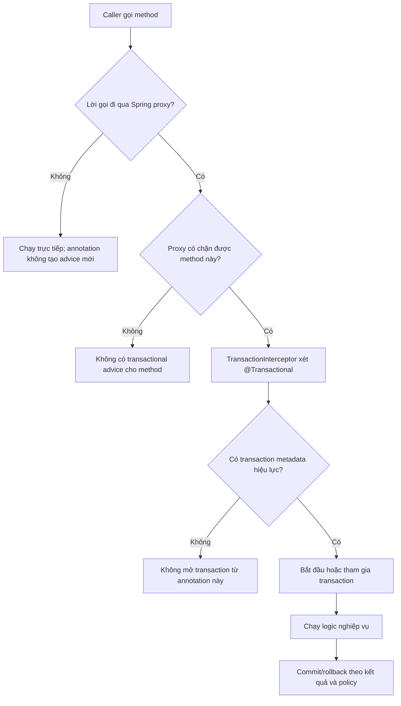
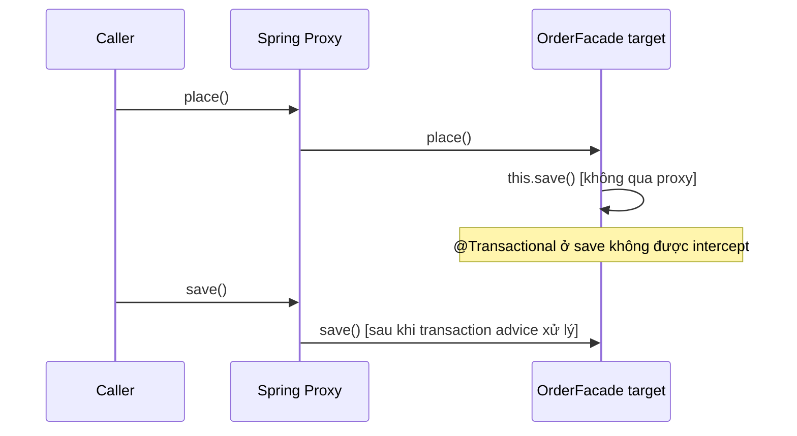

# Giới hạn phương thức private, final và static trong cơ chế proxy của Spring

## 1. Câu hỏi trung tâm: tại sao có @Transactional mà giao dịch không chạy?

Trong Spring Framework, việc viết `@Transactional` trên một method chỉ **khai báo metadata giao dịch**. Với cấu hình phổ biến là **proxy mode**, Spring còn cần một lời gọi method **đi qua proxy** để transaction interceptor mở, tham gia, commit hoặc rollback giao dịch.

Ba từ khóa Java `private`, `final` và `static` tác động trực tiếp đến khả năng proxy chặn lời gọi:

- `private` không thể bị subclass override và không phải method được expose qua proxy interface; annotation trên private method không tạo transactional interception trong Spring proxy AOP.
- `final` ngăn subclass override. Vì vậy **class-based proxy (CGLIB)** không thể advice final method. Tuy nhiên, **JDK dynamic proxy** vẫn có thể intercept lời gọi qua public interface method rồi ủy quyền đến một final implementation method.
- `static` thuộc về class, lời gọi biên dịch thành lời gọi tĩnh, không đi qua một instance proxy. Gắn `@Transactional` trên static method không khiến Spring proxy mở transaction.

Điều dễ gây nhầm nhất: một `private`/`final`/`static` method **có thể chạy trong transaction đã được mở bởi caller**, nhưng điều đó **không chứng minh annotation đặt trên chính method ấy đã được kích hoạt**.

Bài này tập trung vào **Spring AOP proxy mode** (Spring Framework 6.x, Java 17+), phân biệt interface proxy và class-based proxy, làm rõ các trường hợp dễ sai và đưa ra một ví dụ Java có thể tự chạy để quan sát transaction context.

## 2. Cơ chế proxy tạo ra giới hạn như thế nào?

Spring AOP thường sử dụng một trong hai kiểu proxy:

1. **JDK dynamic proxy**: tạo đối tượng triển khai một hoặc nhiều interface của target. Lời gọi thông qua interface proxy được intercept trước khi target method thật được gọi.
2. **Class-based proxy (CGLIB)**: tạo một **subclass** của target class tại runtime, override các method có thể override để xen vào advice.

Với transaction declarative, advisor/interceptor tìm thông tin `@Transactional`, dùng transaction manager phù hợp và điều khiển transaction quanh lời gọi được intercept.



Từ sơ đồ trên, **hai điều kiện đều cần đúng**: lời gọi phải đi qua proxy *và* proxy phải có khả năng advice method đó.

Khi không đáp ứng, annotation vẫn có thể tồn tại trong class file và Java Reflection vẫn có thể đọc được, nhưng transactional advice không được thực thi cho lời gọi. Đây là nguyên nhân khiến một số test happy path “có vẻ chạy” trong khi rollback thực tế không xảy ra.

### Đừng nhầm “đang có transaction” với “annotation ở đây đã chạy”

Xét một public method ngoài đã có `@Transactional`:

```java
@Transactional
public void process() {
    validatePrivately();
}

@Transactional(propagation = Propagation.REQUIRES_NEW)
private void validatePrivately() {
    // ...
}
```

Đây là method fragment; các import và class bao quanh được lược bỏ. Khi `process()` được gọi qua proxy, `validatePrivately()` chạy **bên trong transaction của process()**. Nhưng `@Transactional(REQUIRES_NEW)` trên private method **không được intercept** để mở transaction độc lập. Gọi `TransactionSynchronizationManager.isActualTransactionActive()` trong private method có thể trả về `true` — phép kiểm tra đó **không xác nhận** `REQUIRES_NEW` đã có hiệu lực.

## 3. Ma trận chính xác theo loại method và proxy

| Method / tình huống | JDK dynamic proxy | Class-based proxy (CGLIB) |
| --- | --- | --- |
| `public` được khai báo trong interface mà proxy expose | Có thể intercept nếu transaction metadata hợp lệ | Có thể intercept nếu target method có thể override |
| `public` chỉ tồn tại ở concrete class, không thuộc proxied interface | Không được gọi thông qua JDK interface proxy tương ứng | Có thể intercept |
| `protected` | Không là public interface method | Spring 6.0+ có thể transactional theo mặc định nếu method override được và lời gọi qua class proxy |
| Package-visible (không modifier) | Không là public interface method | Spring 6.0+ có thể transactional, nếu có đủ khả năng truy cập/override |
| `private` | Không thể là API method được advice qua interface proxy | Không override được nên không advice |
| `final` instance method | **Có thể** intercept lời gọi qua public interface method, dù target implementation là final | Không override được, nên không advice |
| `static` method | Không là instance dispatch qua proxy | Không là instance dispatch qua proxy |
| `final class` | Có thể dùng JDK proxy nếu class triển khai một interface phù hợp | Không thể tạo subclass của final class |
| `this.otherMethod()` trong cùng target object | Không đi qua proxy lần nữa | Không đi qua proxy lần nữa |

**Giới hạn phiên bản:** Spring 6.0 trở lên mở rộng khả năng xử lý `protected`/package-visible method với class-based proxy theo mặc định. Các phiên bản và cấu hình cũ thường giới hạn transactional proxy vào public method. Có thể cấu hình `AnnotationTransactionAttributeSource(true)` để chỉ xem public methods nếu dự án muốn chính sách đồng nhất. Với JDK interface proxy, transactional method phải là public và có trong interface được proxy.

Một trường hợp đặc biệt khác: method package-visible khai báo ở superclass thuộc **package khác** có thể không override/visible phù hợp cho subclass proxy, nên không thể được advice như method công khai thông thường. Vì vậy không nên dựa vào modifier ít phổ biến để đặt ranh giới giao dịch quan trọng.

## 4. Vì sao private method không được intercept?

Trong Java, `private` giới hạn method trong phạm vi class khai báo. Subclass không override được private method, và interface proxy cũng không thể trình bày private implementation method như một public interface method.

```java
import org.springframework.stereotype.Service;
import org.springframework.transaction.annotation.Transactional;

@Service
public class PaymentService {
    public void submitPayment() {
        writePayment();
    }

    @Transactional
    private void writePayment() {
        // Lệnh INSERT/UPDATE ở đây không được mở transaction
        // bởi annotation private này trong proxy mode.
    }
}
```

Code chỉ minh họa, chưa có DAO. Nếu gọi `paymentService.submitPayment()` từ ngoài mà `submitPayment()` **không transactional**, lời gọi vào `writePayment()` không có advice transaction của chính private method. Các câu SQL có thể tự commit tùy datasource, connection, repository và transaction boundary khác; không được kết luận cả cụm thao tác có một local ACID transaction.

### 4.1. Nếu caller đã transactional thì sao?

```java
@Transactional
public void submitPayment() {
    writePayment();
}

@Transactional(propagation = Propagation.REQUIRES_NEW)
private void writePayment() {
    // Vẫn là lời gọi private nội bộ.
}
```

Khi public `submitPayment()` được gọi qua proxy, transaction được mở tại public boundary. Private method có thể dùng cùng connection/transaction đó qua Spring-managed DAO, nhưng annotation `REQUIRES_NEW` trên private method **không tạo transaction mới**. Nếu public method rollback, các thay đổi local chưa commit ở private method có thể cũng rollback vì chúng nằm trong **transaction ngoài**.

Đây là khác biệt giữa:

- **Tham gia transaction hiện có** do caller/transaction manager đã mở.
- **Tự tạo transaction scope mới** theo annotation của chính private method.

### 4.2. Cách sửa thường nên chọn

Đặt `@Transactional` trên public service boundary:

```java
@Service
public class PaymentService {
    @Transactional
    public void submitPayment() {
        validateRequest();
        writePayment();
    }

    private void validateRequest() {
        // Helper nội bộ; không cần annotation.
    }

    private void writePayment() {
        // DAO dùng đúng datasource của transaction manager.
    }
}
```

Đây là design snippet; thêm import Spring và repository cho application thực tế. Transaction bao quanh đơn vị công việc công khai; private helpers nằm bên trong transaction đã có, không cần tự được intercept.

Khi chỉ một đoạn của method cần transaction hoặc cần propagation riêng, sử dụng `TransactionTemplate`:

```java
private void writePaymentWithinNewTransaction() {
    transactionTemplate.executeWithoutResult(status -> {
        paymentRepository.save(...);
    });
}
```

Đoạn trên là pseudo-code Java trong service có sẵn `TransactionTemplate` và repository; `...` không phải biểu thức Java đầy đủ. Điểm chính: `TransactionTemplate` gọi `PlatformTransactionManager` trực tiếp và **không cần AOP proxy** để mở giao dịch. Muốn transaction độc lập phải cấu hình `PROPAGATION_REQUIRES_NEW` đúng trên template; nếu dùng default `REQUIRED` thì template có thể tham gia transaction ngoài.

## 5. Final method: không thể override trong class-based proxy

Với class-based proxy, Spring tạo subclass để xen logic trước/sau method. Java cấm subclass override một method khai báo `final`. Do đó:

```java
import org.springframework.stereotype.Service;
import org.springframework.transaction.annotation.Transactional;

@Service
public class InvoiceService {
    @Transactional
    public final void issueInvoice() {
        // Với CGLIB/class-based proxy, lời gọi method final
        // không được transaction advice intercept.
    }
}
```

Nếu class có thể proxied vì còn method đủ điều kiện khác, `issueInvoice()` vẫn là final method **không thể được advice bằng override**. Nếu class chỉ có final methods hoặc cấu hình khác, Spring có thể không tạo transactional proxy có ích cho chúng. Điều cần kiểm chứng là *lời gọi vào final method có thực sự chạy trong transaction mong muốn không*, không chỉ nhìn Spring có tạo một bean proxy.

### 5.1. Final method khác với final class

`final method` cấm override **một method**; `final class` cấm tạo subclass **toàn bộ class**. Nếu một final class cần CGLIB proxy, việc tạo subclass sẽ thất bại. Một Java `record` cũng là final class, nên không phải ứng viên phù hợp cho class-based proxy. Final DTO/record vẫn rất hữu ích khi làm data object; hạn chế này liên quan đến việc đem chúng làm **AOP target**.

Ví dụ bị giới hạn bởi class proxy:

```java
@Service
public final class NotificationService {
    @Transactional
    public void saveNotification() {
        // Class final: CGLIB không thể subclass để intercept.
    }
}
```

Đây là snippet, không dùng làm chương trình demo chạy. Với `proxyTargetClass=true`, class final có method cần advice có thể gây lỗi tạo proxy lúc khởi động; không nên chỉ giả định annotation bị bỏ qua êm lặng. Nếu lớp không có interface proxy phù hợp, cần thay đổi thiết kế hoặc loại bỏ yêu cầu subclass.

### 5.2. Ngoại lệ quan trọng: JDK proxy có thể intercept final implementation method

JDK dynamic proxy **không kế thừa target class**. Proxy implement interface và intercept lời gọi `interface.method()` trước, sau đó mới ủy quyền vào target. Vì vậy final implementation method **không tự ngăn** interceptor của JDK proxy.

```java
public interface LedgerOperations {
    void appendEntry();
}

public final class LedgerService implements LedgerOperations {
    @Override
    @Transactional
    public final void appendEntry() {
        // Có thể transactional khi caller gọi qua
        // JDK interface proxy của LedgerOperations.
    }
}
```

Đoạn này gồm hai type và thiếu import `@Transactional`, là ví dụ khái niệm. Với `@EnableTransactionManagement(proxyTargetClass=false)` và cấu hình AOP tương thích, một bean trả về qua interface `LedgerOperations` có thể được JDK proxy intercept dù `LedgerService` là final và `appendEntry()` cũng final.

Cần thỏa đủ: metadata được Spring tìm thấy, method là public trong interface được proxy, caller dùng bean proxy, có transaction manager đúng. **Không thể cast JDK proxy về LedgerService**, vì proxy không phải subclass của target. Ngược lại, nếu cấu hình ép class proxy, final class không thể proxied.

Đây là lý do kết luận “mọi final method đều không thể @Transactional” **quá rộng**. Kết luận chính xác là: *final chặn advice bằng class-based subclass proxy; interface-based JDK proxy có thể advice public interface invocation tới final method*.

### 5.3. Không dùng final method làm service transaction boundary với class proxy

Một class-based proxy có thể giữ final method nhưng không thể override nó. Cơ chế tạo proxy có thể dẫn tới những tình huống khó hiểu nếu final method sử dụng instance field trên proxy được tạo theo cách tối ưu hóa constructor; vì thế không nên dựa vào hành vi ngầm khi gọi final method trên bean được CGLIB proxy.

Ưu tiên public, **non-final service methods** cho các transaction boundary được class-based proxy quản lý. Nếu có yêu cầu giữ class final, cân nhắc interface + JDK proxy và integration test chứng minh thật sự có transaction.

## 6. Static method: không phải lời gọi instance qua proxy

Java `static` thuộc về class. Lời gọi `Utility.method()` được giải quyết như static invocation, không thông qua dynamic dispatch trên một Spring bean instance:

```java
public class PaymentUtilities {
    @Transactional
    public static void reconcile() {
        // Spring AOP proxy không intercept lệnh gọi static này.
    }
}
```

Ngay cả khi Java cho phép đặt `@Transactional` trên static method, annotation đó **không làm static call tự mở transaction** trong Spring proxy mode.

Các điểm dễ hiểu sai:

- `@Transactional` trên static method không thể được “kích hoạt” bằng `@EnableTransactionManagement` vì cơ chế proxy không intercept `invokestatic`.
- Gọi static method bằng cú pháp `bean.reconcile()` (Java cho phép nhưng không khuyến khích) vẫn là static invocation sau khi biên dịch, không trở thành virtual dispatch qua proxy.
- Static helper có thể thực hiện một thao tác database **bên trong transaction đã mở trước đó** trên cùng thread và đúng resource; nó không có transactional advice riêng.
- Một `static final` method càng không phải target cho instance proxy; modifier final không thay đổi bản chất static call.

### 6.1. Cách thay thế: bean instance method hoặc TransactionTemplate

Thay static transaction entry point bằng Spring-managed service:

```java
@Service
public class ReconciliationService {
    private final PaymentRepository repository;

    public ReconciliationService(PaymentRepository repository) {
        this.repository = repository;
    }

    @Transactional
    public void reconcile() {
        repository.reconcilePending();
    }
}
```

Đây là snippet trong ứng dụng có `PaymentRepository`, không phải file tự chạy. Caller phải inject bean và gọi `reconciliationService.reconcile()` qua proxy.

Nếu một utility tĩnh buộc phải tồn tại, đừng phụ thuộc vào annotation static. Tổ chức transaction ở service boundary **trước khi gọi utility**, hoặc dùng một component nhận `PlatformTransactionManager` và `TransactionTemplate` tường minh theo cấu trúc ứng dụng. Tránh đặt transaction manager trong static global state vì làm mờ dependency, lifecycle và khả năng test.

## 7. Self-invocation không phụ thuộc modifier

Ngay cả với **public non-final** method, proxy mode cũng không intercept lời gọi `this.method()` trong cùng object:

```java
@Service
public class OrderFacade {
    public void place() {
        this.save();  // Không đi qua proxy.
    }

    @Transactional(propagation = Propagation.REQUIRES_NEW)
    public void save() {
        // Nếu place() không transactional thì
        // @Transactional của save() không kích hoạt ở đây.
    }
}
```

Đây là ví dụ khái niệm. Nếu `place()` cũng được intercept và có transaction, `save()` có thể dùng transaction đó nhưng `REQUIRES_NEW` của `save()` vẫn không được áp dụng. Ngược lại, gọi `save()` từ **bean khác** qua proxy có thể kích hoạt transaction mới theo metadata.

Sơ đồ:



**Cách sửa** thường là chuyển transactional method sang bean khác hoặc đặt boundary ở entry method đã được gọi qua proxy. Nếu cần bảo đảm một transaction bên trong method dù là private helper, `TransactionTemplate` là cơ chế tường minh. Tránh self-injection proxy hoặc `AopContext.currentProxy()` như lựa chọn mặc định vì dễ tạo coupling và cần cấu hình bổ sung.

## 8. Ví dụ đầy đủ Java 17+: chứng minh private, final, static và JDK-final

Ví dụ này có thể chạy bằng **Java 17+**, Maven, Spring Framework **6.2.19**, H2. Nó dùng `TransactionSynchronizationManager.isActualTransactionActive()` để kiểm tra transaction context khi method chạy.

Hai Spring context độc lập được tạo:

1. **CGLIB context:** ép `proxyTargetClass=true`; public method có `@Transactional` được intercept, private/final/static method không mở transactional advice riêng.
2. **JDK context:** giữ `proxyTargetClass=false` và bean final class triển khai interface; gọi public interface method có final implementation vẫn được intercept.

Ví dụ dùng các method chỉ in trạng thái, không ghi dữ liệu, để làm rõ **interception**. Muốn kiểm chứng rollback thật, cần thêm SQL và test database sau khi transaction kết thúc.

### 8.1. Cấu trúc project

```text
proxy-limit-demo/
├── pom.xml
└── src/main/java/demo/tx/ProxyLimitDemo.java
```

### 8.2. pom.xml

```xml
<project xmlns="http://maven.apache.org/POM/4.0.0"
         xmlns:xsi="http://www.w3.org/2001/XMLSchema-instance"
         xsi:schemaLocation="http://maven.apache.org/POM/4.0.0
                             https://maven.apache.org/xsd/maven-4.0.0.xsd">
    <modelVersion>4.0.0</modelVersion>
    <groupId>demo</groupId>
    <artifactId>proxy-limit-demo</artifactId>
    <version>1.0.0</version>
    <properties>
        <maven.compiler.release>17</maven.compiler.release>
        <project.build.sourceEncoding>UTF-8</project.build.sourceEncoding>
    </properties>
    <dependencies>
        <dependency>
            <groupId>org.springframework</groupId>
            <artifactId>spring-context</artifactId>
            <version>6.2.19</version>
        </dependency>
        <dependency>
            <groupId>org.springframework</groupId>
            <artifactId>spring-jdbc</artifactId>
            <version>6.2.19</version>
        </dependency>
        <dependency>
            <groupId>com.h2database</groupId>
            <artifactId>h2</artifactId>
            <version>2.3.232</version>
        </dependency>
    </dependencies>
    <build>
        <plugins>
            <plugin>
                <groupId>org.apache.maven.plugins</groupId>
                <artifactId>maven-compiler-plugin</artifactId>
                <version>3.13.0</version>
            </plugin>
            <plugin>
                <groupId>org.codehaus.mojo</groupId>
                <artifactId>exec-maven-plugin</artifactId>
                <version>3.5.1</version>
            </plugin>
        </plugins>
    </build>
</project>
```

### 8.3. src/main/java/demo/tx/ProxyLimitDemo.java

```java
package demo.tx;

import javax.sql.DataSource;

import org.springframework.context.annotation.AnnotationConfigApplicationContext;
import org.springframework.context.annotation.Bean;
import org.springframework.context.annotation.Configuration;
import org.springframework.jdbc.datasource.DataSourceTransactionManager;
import org.springframework.jdbc.datasource.DriverManagerDataSource;
import org.springframework.transaction.PlatformTransactionManager;
import org.springframework.transaction.annotation.EnableTransactionManagement;
import org.springframework.transaction.annotation.Transactional;
import org.springframework.transaction.support.TransactionSynchronizationManager;

public final class ProxyLimitDemo {
    public static void main(String[] args) {
        try (var context =
                     new AnnotationConfigApplicationContext(ClassProxyConfig.class)) {
            ClassActions service = context.getBean(ClassActions.class);

            service.publicWork();
            service.entry();
            service.finalWork();
            ClassActions.staticWork();
        }

        try (var context =
                     new AnnotationConfigApplicationContext(JdkProxyConfig.class)) {
            Operation api = context.getBean(Operation.class);
            api.callFinal();
        }
    }

    private static void trace(String method) {
        boolean active =
                TransactionSynchronizationManager.isActualTransactionActive();
        System.out.println(method + " active=" + active);
    }

    @Configuration
    @EnableTransactionManagement(proxyTargetClass = true)
    public static class ClassProxyConfig {
        @Bean
        public DataSource dataSource() {
            return new DriverManagerDataSource(
                    "jdbc:h2:mem:classproxy;DB_CLOSE_DELAY=-1", "sa", "");
        }

        @Bean
        public PlatformTransactionManager transactionManager(DataSource ds) {
            return new DataSourceTransactionManager(ds);
        }

        @Bean
        public ClassActions classActions() {
            return new ClassActions();
        }
    }

    public static class ClassActions {
        @Transactional
        public void publicWork() {
            trace("publicWork");
        }

        public void entry() {
            trace("entry");
            this.privateWork();
            this.finalWork();
            ClassActions.staticWork();
            this.publicWork();
        }

        @Transactional
        private void privateWork() {
            trace("privateWork");
        }

        @Transactional
        public final void finalWork() {
            // Không truy cập field instance: final method của CGLIB
            // không được proxy override/ủy quyền như advised method.
            trace("finalWork");
        }

        @Transactional
        public static void staticWork() {
            trace("staticWork");
        }
    }

    public interface Operation {
        void callFinal();
    }

    public static final class FinalImplementation implements Operation {
        @Override
        @Transactional
        public final void callFinal() {
            trace("JDK final target");
        }
    }

    @Configuration
    @EnableTransactionManagement(proxyTargetClass = false)
    public static class JdkProxyConfig {
        @Bean
        public DataSource dataSource() {
            return new DriverManagerDataSource(
                    "jdbc:h2:mem:jdkproxy;DB_CLOSE_DELAY=-1", "sa", "");
        }

        @Bean
        public PlatformTransactionManager transactionManager(DataSource ds) {
            return new DataSourceTransactionManager(ds);
        }

        @Bean
        public Operation operation() {
            return new FinalImplementation();
        }
    }
}
```

### 8.4. Lệnh chạy và output dự kiến

Trong thư mục `proxy-limit-demo` có Maven và JDK 17+:

```bash
mvn -q compile exec:java -Dexec.mainClass=demo.tx.ProxyLimitDemo
```

Các dòng chương trình in ra, không tính log của Maven hoặc Spring:

```text
publicWork active=true
entry active=false
privateWork active=false
finalWork active=false
staticWork active=false
publicWork active=false
finalWork active=false
staticWork active=false
JDK final target active=true
```

**Đọc kết quả:**

- `service.publicWork()` được gọi qua class-based proxy: `@Transactional` có hiệu lực, `active=true`.
- `service.entry()` không có annotation giao dịch: `active=false`.
- `this.privateWork()`, `this.finalWork()`, `ClassActions.staticWork()` bên trong `entry()` đều không có interception mở transaction: `active=false`.
- `this.publicWork()` cũng in `active=false` vì **self-invocation**, dù method public và có annotation.
- Gọi `service.finalWork()` từ ngoài trên class-based proxy vẫn không được advised vì method final.
- Gọi `ClassActions.staticWork()` từ bên ngoài cũng không được advised vì là static.
- `api.callFinal()` qua JDK interface proxy có `active=true`, dù concrete target class và implementation method là final.

**Điểm tinh tế:** chương trình kiểm tra *transaction đang active tại điểm chạy method*. Nếu một method được gọi bên trong transaction do method khác mở, phép kiểm tra có thể cho `true` dù annotation ở method đang xét không kích hoạt. Vì vậy demo cố ý gọi những method bị giới hạn khi chưa có outer transaction.

**Giới hạn:** đây là ví dụ kiểm chứng bằng runtime context; nó không tạo bảng, không đo dữ liệu commit/rollback. Để đánh giá atomicity thật, hãy ghi hai hàng trong một database transaction, ném unchecked exception giữa các câu SQL, rồi đọc dữ liệu từ bên ngoài transaction sau khi nó kết thúc.

## 9. Nếu private/final/static nằm trong outer @Transactional thì sao?

Một câu trả lời thường sai là “mọi private/final/static method đều chạy ngoài transaction”. Chính xác hơn:

**Annotation trên chính method không được proxy advice** trong các trường hợp giới hạn; nhưng mã bên trong nó **có thể tham gia transaction hiện có** nếu resource truy cập được Spring quản lý và cùng transaction context/thread.

```java
@Service
public class PaymentWorkflow {
    @Transactional
    public void run() {
        validatePrivately();
        writeFinal();
        AuditHelper.mark();
    }

    @Transactional(propagation = Propagation.REQUIRES_NEW)
    private void validatePrivately() { /* ... */ }

    @Transactional(propagation = Propagation.REQUIRES_NEW)
    public final void writeFinal() { /* ... */ }

    public static final class AuditHelper {
        @Transactional
        public static void mark() { /* ... */ }
    }
}
```

Snippet này là minh họa, cần import `@Service`, `@Transactional`, `Propagation` và một Spring-managed bean/proxy. Khi `run()` được gọi qua một proxy có thể advice nó, các helper có thể chạy với outer transaction đang active, nhưng **không có ba transaction REQUIRES_NEW như cách đặt annotation gợi ý**. Static helper cũng không có transaction riêng. Nếu `run()` không transactional, chúng không tự khởi tạo transaction từ các annotation vừa nêu.

Chính transaction manager, propagation của **entry boundary được intercept**, cách DAO lấy connection và thread context quyết định thao tác database có thật sự được bao trong transaction đang hoạt động hay không. Không có lý do để gắn `@Transactional` lên private helper chỉ để thể hiện rằng nó “được gọi từ một public transaction”.

## 10. Thay thế đúng theo yêu cầu nghiệp vụ

### 10.1. Một giao dịch bao toàn bộ nghiệp vụ

Đặt transaction tại public service method được gọi qua bean proxy:

```java
@Service
public class CheckoutService {
    private final OrderRepository orders;

    public CheckoutService(OrderRepository orders) {
        this.orders = orders;
    }

    @Transactional
    public void checkout(long orderId) {
        validate(orderId);
        persist(orderId);
    }

    private void validate(long orderId) { /* kiểm tra */ }

    private void persist(long orderId) {
        orders.markCheckedOut(orderId);
    }
}
```

Đây là snippet trong ứng dụng có `OrderRepository`. `validate` và `persist` có thể để private vì **không cần transactional advice riêng**; chúng chạy trong cùng transaction được mở tại `checkout` nếu dùng đúng datasource/manager.

### 10.2. Cần một transaction độc lập cho bước nội bộ

Chuyển bước đó sang **bean khác**, public non-final method, gọi qua proxy:

```java
@Service
public class AuditService {
    private final AuditRepository audits;

    public AuditService(AuditRepository audits) {
        this.audits = audits;
    }

    @Transactional(propagation = Propagation.REQUIRES_NEW)
    public void record(long orderId) {
        audits.insert(orderId);
    }
}

@Service
public class CheckoutService {
    private final AuditService audit;

    public CheckoutService(AuditService audit) {
        this.audit = audit;
    }

    @Transactional
    public void checkout(long orderId) {
        audit.record(orderId); // Đi qua proxy của AuditService.
        // Các cập nhật local khác.
    }
}
```

Đây là hai class snippet, cần import và repository bean. Vì `REQUIRES_NEW` là giao dịch độc lập, audit có thể commit dù transaction outer của checkout rollback sau đó. Nó có thể giữ thêm JDBC connection, làm tăng áp lực pool; **không** dùng nó như cách sửa “annotation không hoạt động” khi nghiệp vụ thật sự cần tất cả thao tác cùng rollback.

### 10.3. Cần programmatic transaction trong helper

`TransactionTemplate` dùng transaction manager trực tiếp, không dựa vào interceptor trên method có modifier nào:

```java
import org.springframework.transaction.PlatformTransactionManager;
import org.springframework.transaction.TransactionDefinition;
import org.springframework.transaction.support.TransactionTemplate;

public class TransactionalTask {
    private final TransactionTemplate requiresNew;

    public TransactionalTask(PlatformTransactionManager manager) {
        this.requiresNew = new TransactionTemplate(manager);
        this.requiresNew.setPropagationBehavior(
                TransactionDefinition.PROPAGATION_REQUIRES_NEW);
    }

    public void perform() {
        executePrivately();
    }

    private void executePrivately() {
        requiresNew.executeWithoutResult(status -> {
            // DAO writes dùng tài nguyên do manager này quản lý.
        });
    }
}
```

Đây là class Java hợp lệ bên trong ứng dụng có Spring transaction dependencies; muốn thực sự thao tác dữ liệu cần thêm DAO và manager bean phù hợp. Method private là nơi **gọi template**, còn template tự quản lý mở/commit/rollback qua `PlatformTransactionManager`. Trong Spring application đã có `@Transactional` cho outer method, cân nhắc rõ semantics khi template cấu hình `REQUIRES_NEW`, chứ không dùng mặc định `REQUIRED` nếu thực sự cần giao dịch độc lập.

### 10.4. Nếu bắt buộc giữ class final

Một **final implementation class có interface** có thể dùng JDK interface proxy để intercept public interface methods; nên inject interface và đảm bảo proxy mode thực tế là JDK. Kiểm tra `AopUtils.isJdkDynamicProxy(bean)` trong integration test nếu cần xác nhận. Nếu dự án ép `proxyTargetClass=true`, final class không thể tạo subclass proxy — cần thiết kế lại class, cấu hình proxy hoặc chuyển transaction boundary sang bean có thể advice.

**Kotlin:** class/method mặc định thường final. Với class-based proxy, có thể sử dụng `kotlin-spring`/all-open plugin cho Spring stereotype hoặc thiết kế interface; vẫn phải xác minh proxy type và external call. Đây không phải lý do để biến tất cả Kotlin method thành public mà không cân nhắc encapsulation.

## 11. AspectJ weaving có loại bỏ những giới hạn trên không?

Spring cung cấp `@EnableTransactionManagement(mode = AdviceMode.ASPECTJ)` với hạ tầng Spring AspectJ transaction aspect và compile-time/load-time weaving. Thay vì chỉ intercept lời gọi đi **qua proxy**, weaving sửa bytecode để áp advice tại join point tương ứng; do đó nó có thể xử lý self-invocation và những method không override được bằng class proxy trong phạm vi pointcut/weaving hỗ trợ.

Tuy nhiên:

- Không được coi việc đổi sang AspectJ mode là một thay đổi cấu hình vô hại; phải có `spring-aspects`, cấu hình weaving và kiểm thử môi trường chạy thực tế.
- Metadata annotation đặt trên interface có hạn chế kế thừa theo Java khi dùng AspectJ; Spring khuyên annotate **concrete classes/methods**.
- Với **static method**, không nên giả định riêng việc bật AspectJ transaction mode sẽ tự cho kết quả mong đợi trong mọi trường hợp. Cần xác minh pointcut, weaving, transaction manager và đường gọi thực tế; service instance boundary vẫn rõ ràng hơn.
- AspectJ mode không biến HTTP API, broker hoặc hai resource local manager độc lập thành một giao dịch ACID toàn cục.

Hầu hết dịch vụ Spring nên chọn public, non-final **instance methods** và proxy mode đơn giản; chỉ dùng AspectJ khi thật sự có nhu cầu interception vượt proxy boundary và chấp nhận chi phí cấu hình, build và vận hành.

## 12. Kiểm thử và chẩn đoán lỗi thực tế

Để kiểm chứng transaction trong dự án, chạy **integration test qua Spring context**, không gọi trực tiếp object bằng `new`. Các kiểm tra quan trọng:

1. **Xác nhận loại proxy**: `AopUtils.isAopProxy(bean)`, `isJdkDynamicProxy`, `isCglibProxy`. Đừng suy đoán từ việc class có interface hay không vì cấu hình Boot/AOP có thể ép proxy type.
2. **Gọi khi không có outer transaction**: test public annotated method rồi private/final/static entry. Nếu luôn gọi từ method test có transaction, `isActualTransactionActive()` có thể trả về true ở mọi nơi và tạo false positive.
3. **Xác minh rollback bằng database state**: cho một method update hai dòng trong cùng datasource rồi ném `RuntimeException`. Đọc dữ liệu sau khi transaction kết thúc; hai thay đổi phải cùng rollback khi method thật sự được advised.
4. **Phân biệt self-invocation**: gọi `bean.publicTransactional()` và `this.publicTransactional()` từ method khác, quan sát rõ khác biệt.
5. **Kiểm tra final class khởi động**: với class proxy, final class có transaction advice cần thiết thường gặp lỗi tạo proxy. Với JDK interface proxy, kiểm tra bean có thể được inject qua interface và advice hoạt động.
6. **Phân biệt propagation**: thử `REQUIRES_NEW` ở một bean service riêng được gọi qua proxy; so với `REQUIRES_NEW` trên private/final method trong class proxy để nhận ra chỉ trường hợp đầu áp policy mới.

### Bảng chẩn đoán nhanh

| Triệu chứng | Nguyên nhân khả dĩ | Hướng xử lý |
| --- | --- | --- |
| Private method có annotation nhưng transaction không mở | Không có interceptor cho private method | Đặt transaction ở public service method hoặc dùng `TransactionTemplate` |
| Final method không rollback khi class dùng CGLIB | Không override được final method | Bỏ final ở boundary hoặc dùng JDK interface proxy phù hợp |
| Final class không khởi tạo được proxy | CGLIB không tạo subclass của final class | Tách service có thể proxy, hoặc cấu hình interface proxy |
| Static method có annotation nhưng SQL tự commit | `invokestatic` không đi qua instance proxy | Đưa nghiệp vụ vào instance service boundary |
| Public method gọi bằng `this.` không có transaction mới | Self-invocation bypass proxy | Gọi qua bean khác hoặc dùng programmatic transaction |
| Method bị giới hạn vẫn báo `active=true` | Caller đã mở transaction từ trước | Test từ entry point không có outer transaction và kiểm tra propagation thực tế |
| Có proxy nhưng transaction không bao DAO | Sai manager/datasource, hoặc connection tự quản lý | Kiểm tra resource identity và SQL sau commit/rollback |
| Checked exception không gây rollback | Default rollback rule khác với kỳ vọng | Xét `rollbackFor` và exception có thoát ra khỏi interceptor không |

**Cẩn thận với Spring Test:** method test được `@Transactional` có thể rollback theo mặc định sau test, che khuất sự khác biệt giữa transaction service thực sự hoạt động và chỉ có transaction từ test framework. Nếu muốn xác nhận commit, viết test không có outer test transaction hoặc điều khiển `TestTransaction` rồi kiểm tra dữ liệu từ phạm vi độc lập.

### Checklist trước khi kết luận annotation có hiệu lực

- Bean là Spring-managed và transaction advice được bật.
- Lời gọi xuất phát từ bên ngoài bean và đi qua **đúng proxy**.
- Method không nằm trong nhóm bị giới hạn bởi loại proxy: private/static; hoặc final trên class-based proxy.
- Với JDK proxy, method là public và có trên proxied interface.
- Transaction manager điều khiển đúng datasource và resource.
- Rollback rule khớp exception thực tế; exception không bị swallow nếu nghiệp vụ cần rollback.
- Bằng chứng là transaction boundary và database state sau giao dịch, không chỉ annotation, log hoặc một giá trị `active=true` đơn lẻ.

## 13. Ghi nhớ

1. **`private`:** Spring proxy AOP không thể advice private method; có thể chạy bên trong outer transaction nhưng không mở transaction mới theo annotation riêng.
2. **`final`:** CGLIB/class-based proxy không thể override để advice final method hoặc subclass final class. **JDK interface proxy là ngoại lệ có điều kiện:** public interface method vẫn có thể được advice dù target implementation/class final.
3. **`static`:** static invocation không đi qua instance proxy; gắn `@Transactional` trên static method không tự mở transaction.
4. **Self-invocation:** ngay cả public non-final method cũng bỏ qua advice mới khi gọi bằng `this.method()` trong proxy mode.
5. **Thiết kế ổn định:** đặt transaction tại public non-final instance method của Spring service, gọi qua proxy; dùng bean khác hoặc `TransactionTemplate` nếu cần transaction riêng; kiểm thử rollback trên dữ liệu thật.

## Tài liệu tham khảo chính thức

- [Spring Framework 6.2 — Proxying Mechanisms](https://docs.spring.io/spring-framework/reference/6.2/core/aop/proxying.html)
- [Spring Framework 6.2 — Using @Transactional](https://docs.spring.io/spring-framework/reference/6.2/data-access/transaction/declarative/annotations.html)
- [Spring Framework — Declarative Transaction Management](https://docs.spring.io/spring-framework/reference/data-access/transaction/declarative.html)
- [Spring Framework — Transaction Propagation](https://docs.spring.io/spring-framework/reference/data-access/transaction/declarative/tx-propagation.html)
- [Spring Framework — Programmatic Transaction Management](https://docs.spring.io/spring-framework/reference/data-access/transaction/programmatic.html)
- [Java Language Specification — Method Modifiers](https://docs.oracle.com/javase/specs/jls/se17/html/jls-8.html#jls-8.4.3)
