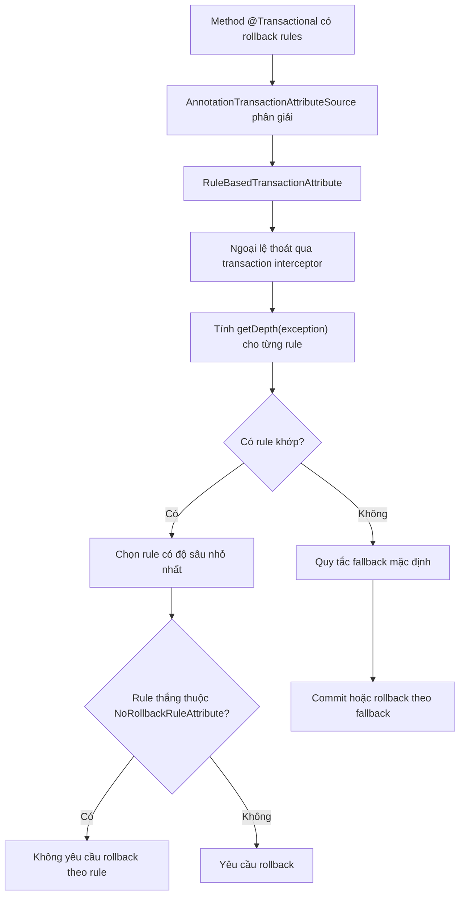

# Quy tắc phù hợp nhất khi nhiều khai báo rollback cùng khớp trong Spring

## 1. Vấn đề: một ngoại lệ khớp nhiều quy tắc thì Spring chọn quy tắc nào?

Khi đánh dấu phương thức service bằng `@Transactional`, lập trình viên có thể khai báo cả quy tắc **buộc rollback** và **không rollback**. Chẳng hạn:

```java
@Transactional(
    rollbackFor = Exception.class,
    noRollbackFor = BusinessException.class
)
public void process() throws BusinessException {
    // Thao tác cơ sở dữ liệu và nghiệp vụ.
}
```

Đây là đoạn minh họa cú pháp; `BusinessException` là lớp ngoại lệ nghiệp vụ do ứng dụng định nghĩa.

Nếu `BusinessException extends Exception` được ném ra thì **cả hai khai báo đều khớp**:

- `rollbackFor = Exception.class` áp dụng cho `Exception` và mọi lớp con.
- `noRollbackFor = BusinessException.class` áp dụng cho `BusinessException` và mọi lớp con.

Spring xử lý xung đột theo nguyên tắc **quy tắc khớp mạnh nhất (strongest matching rule) thắng**, nghĩa là quy tắc **gần lớp ngoại lệ thực tế nhất trong chuỗi kế thừa** được chọn. Với `BusinessException`, `noRollbackFor = BusinessException.class` là khớp trực tiếp và thắng quy tắc rộng `Exception.class`. Kết quả: Spring **không chủ động rollback vì ngoại lệ này**; trong một transaction mới còn có khả năng commit những thay đổi đã thực hiện.

Bài học này giải thích chính xác cơ chế khớp đó, cách so sánh độ sâu, điểm nguy hiểm khi dùng tên ngoại lệ dưới dạng chuỗi, điều xảy ra khi hòa độ sâu và cách chứng minh quyết định bằng chương trình Spring Boot chạy được.

**Mục tiêu sau khi học:**

1. Phân biệt `rollbackFor`, `noRollbackFor`, `rollbackForClassName` và `noRollbackForClassName`.
2. Tính được độ sâu khớp và tự suy luận quy tắc nào thắng với một cây ngoại lệ.
3. Hiểu `RuleBasedTransactionAttribute`, `RollbackRuleAttribute` và `NoRollbackRuleAttribute` xử lý quyết định như thế nào.
4. Tránh xung đột khó đoán giữa nhiều pattern, đặc biệt pattern `"Exception"` quá rộng.
5. Kiểm chứng kết quả **commit/rollback thật** khi ngoại lệ checked, unchecked hoặc ngoại lệ nghiệp vụ thoát khỏi một service.
6. Phân biệt **quy tắc quyết định rollback** với các yếu tố khác như transaction đã rollback-only, lỗi DB, lời gọi không qua proxy và transaction đã có từ trước.

## 2. Điểm xuất phát: quy tắc rollback mặc định

Theo hành vi truyền thống của Spring declarative transactions:

- Ngoại lệ `RuntimeException` và các lớp con gây **rollback** mặc định.
- `Error` và các lớp con cũng gây **rollback** mặc định.
- Checked exception (ví dụ `IOException`, `Exception` tự định nghĩa nhưng không kế thừa `RuntimeException`) **không gây rollback mặc định**.
- Kết thúc phương thức bình thường thường dẫn đến commit nếu transaction đó thuộc quyền hoàn tất của lời gọi và không bị đánh dấu rollback-only.

Ví dụ:

```java
@Transactional
public void save() throws IOException {
    jdbc.update("INSERT INTO demo_event(id) VALUES (?)", 1);
    throw new IOException("External operation failed");
}
```

Đây là đoạn minh họa trong một Spring service có `JdbcTemplate` được inject. Trong cấu hình rollback mặc định thông thường, `IOException` **không tự yêu cầu rollback**; nếu không có lỗi khác và transaction do method mở, việc insert có thể vẫn được commit dù người gọi nhận ngoại lệ.

Ngược lại, thay `IOException` bằng `IllegalStateException` thì ngoại lệ unchecked sẽ kích hoạt rollback mặc định.

Để checked exception cũng rollback, có thể dùng:

```java
@Transactional(rollbackFor = IOException.class)
public void save() throws IOException {
    // Các thao tác DB cần hủy khi IOException thoát ra.
}
```

**Lưu ý phiên bản:** từ **Spring Framework 6.2**, `@EnableTransactionManagement(rollbackOn = RollbackOn.ALL_EXCEPTIONS)` cho phép thay đổi **mặc định toàn cục** để rollback cả checked exception. Nếu ứng dụng bật chế độ này hoặc dùng transaction infrastructure với default rule tùy chỉnh, câu “checked exception mặc định commit” không còn áp dụng cho những method đó. Dù vậy, quy tắc tường minh phù hợp nhất trên method vẫn có quyền ưu tiên so với default rộng.

Bài thực hành phía dưới dùng chính sách mặc định truyền thống và khai báo quy tắc rõ ràng, nên kết quả không phụ thuộc vào việc nhớ mẹo “checked/unchecked” cho mọi ngoại lệ.

## 3. Bốn thuộc tính của @Transactional dùng khai báo quy tắc

| Thuộc tính | Cú pháp ví dụ | Hành động nếu là quy tắc thắng |
| --- | --- | --- |
| `rollbackFor` | `rollbackFor = IOException.class` | Chọn rollback |
| `noRollbackFor` | `noRollbackFor = BusinessException.class` | Không yêu cầu rollback do ngoại lệ đó |
| `rollbackForClassName` | `rollbackForClassName = "com.example.IOExceptionLike"` | Chọn rollback nếu **pattern tên lớp** khớp |
| `noRollbackForClassName` | `noRollbackForClassName = "BusinessWarningException"` | Không yêu cầu rollback nếu pattern khớp |

Hai thuộc tính có hậu tố `ClassName` dùng **mẫu chuỗi**. Hai thuộc tính còn lại dùng **`Class<? extends Throwable>`**, thường an toàn và rõ nghĩa hơn vì được kiểm tra lúc biên dịch.

Có thể khai báo nhiều kiểu:

```java
@Transactional(
    rollbackFor = {IOException.class, SQLException.class},
    noRollbackFor = {MinorBusinessException.class},
    rollbackForClassName = {"com.example.ExternalCheckedException"},
    noRollbackForClassName = {"com.example.LegacyNonFatalException"}
)
public void process() throws IOException, SQLException, MinorBusinessException {
    // ...
}
```

Đây là ví dụ cú pháp; các ngoại lệ `MinorBusinessException`, `ExternalCheckedException` và `LegacyNonFatalException` phải có định nghĩa phù hợp trong ứng dụng thật. **Spring không chọn theo thứ tự từ trái sang phải của các thuộc tính** như một chuỗi `if/else` do người dùng viết; nó chuyển các khai báo thành một tập quy tắc rồi xét mức độ khớp.

Giá trị của `rollbackFor/noRollbackFor` hỗ trợ `Throwable` và các lớp con, không chỉ các checked exceptions. Điều đó không có nghĩa bạn nên khai báo `Throwable.class` ở mọi method; điều kiện rộng có thể che khuất sai lầm nghiệp vụ hoặc khiến retry/cleanup phức tạp.

## 4. Mô hình nội bộ: RuleBasedTransactionAttribute

Khi Spring đọc `@Transactional` thông qua `AnnotationTransactionAttributeSource` và parser tương ứng, nó biểu diễn chính sách dưới dạng `TransactionAttribute`, thường là `RuleBasedTransactionAttribute`.

Các lớp liên quan:

- `RuleBasedTransactionAttribute`: chứa danh sách rollback rules và quyết định `rollbackOn(Throwable)`.
- `RollbackRuleAttribute`: quy tắc **rollback** nếu ngoại lệ khớp một kiểu hoặc pattern.
- `NoRollbackRuleAttribute`: lớp con của `RollbackRuleAttribute` biểu thị trường hợp **không rollback**.
- `DefaultTransactionAttribute`: cung cấp hành vi fallback khi không có quy tắc tùy chỉnh nào khớp (trong mặc định truyền thống: rollback với `RuntimeException` và `Error`).

Luồng xử lý:



Cơ chế chọn rule không cần biết ngoại lệ checked hay unchecked ở bước đầu. Checked/unchecked trở nên quan trọng khi **không có rule tường minh thắng**, khiến Spring phải dùng fallback truyền thống hoặc default tùy chỉnh.

## 5. Độ sâu khớp (match depth): số càng nhỏ càng mạnh

Hãy có cây kế thừa ngoại lệ:

```text
java.lang.Throwable
└── java.lang.Exception
    └── com.example.BusinessException
        ├── RecoverableBusinessException
        └── CriticalBusinessException
```

Với ngoại lệ thực tế `new CriticalBusinessException(...)`:

| Quy tắc | Độ sâu khớp | Giải thích |
| --- | ---: | --- |
| `rollbackFor = CriticalBusinessException.class` | **0** | Trùng chính xác lớp ngoại lệ đang ném |
| `noRollbackFor = BusinessException.class` | **1** | Khớp lớp cha trực tiếp |
| `rollbackFor = Exception.class` | **2** | Khớp lớp ông |
| `rollbackFor = Throwable.class` | **3** | Khớp tiếp một cấp cha |
| `noRollbackFor = IOException.class` | **-1** | Không có quan hệ kế thừa phù hợp |

Ý nghĩa các giá trị `RollbackRuleAttribute.getDepth(Throwable)`:

- `-1`: quy tắc **không khớp**.
- `0`: quy tắc khớp ngay lớp ngoại lệ thực tế.
- Số nguyên dương: quy tắc khớp ở một lớp cha, và con số là số cạnh kế thừa từ lớp ngoại lệ đến lớp cha khớp.

**Quy tắc thắng là rule có depth nhỏ nhất trong các depth >= 0.**

Vì thế, nếu ba rule trong bảng cùng được khai báo, `rollbackFor = CriticalBusinessException.class` thắng với depth 0. Spring sẽ chọn **rollback**, dù `BusinessException.class` là một no-rollback rule cũng khớp ở depth 1.

### Ví dụ gọn để nhớ

```java
@Transactional(
    rollbackFor = {
        Exception.class,
        CriticalBusinessException.class
    },
    noRollbackFor = BusinessException.class
)
public void execute() throws BusinessException {
    throw new CriticalBusinessException("Critical");
}
```

Đây là method minh họa, với các lớp ngoại lệ được định nghĩa tại mục thực hành. Thứ tự suy luận chính xác là:

1. Ngoại lệ thoát ra: `CriticalBusinessException`.
2. `Exception.class`: khớp depth 2, yêu cầu rollback.
3. `CriticalBusinessException.class`: khớp depth 0, yêu cầu rollback.
4. `BusinessException.class`: khớp depth 1, không rollback.
5. Depth nhỏ nhất là **0** → chọn `CriticalBusinessException.class` → **rollback**.

Cùng annotation đó, nếu thay ngoại lệ thực tế bằng `RecoverableBusinessException`:

- `Exception.class` khớp depth 2.
- `BusinessException.class` khớp depth 1.
- `CriticalBusinessException.class` không khớp.
- Rule thắng là **noRollbackFor = BusinessException.class** → Spring không rollback vì ngoại lệ này.

Đây là lý do chiến lược “một quy tắc tổng quát và vài ngoại lệ cụ thể” thường dễ biểu diễn bằng inheritance rõ ràng.

## 6. Thuật toán chọn winner và ý nghĩa của trường hợp hòa

Về nguyên tắc, logic trong `RuleBasedTransactionAttribute.rollbackOn(Throwable)` tương đương:

```text
winner = không có
bestDepth = vô cùng

cho mỗi rule trong danh sách:
    depth = rule.getDepth(thrownException)

    nếu depth >= 0 và depth < bestDepth:
        bestDepth = depth
        winner = rule

nếu winner không có:
    return rollback theo default

nếu winner là NoRollbackRuleAttribute:
    return false

return true
```

Điều quan trọng là phép so sánh **`depth < bestDepth`** chứ không phải `<=` trong implementation Spring đã đối chiếu. Nó giải thích vì sao khi hai rule có **cùng độ sâu**, rule nào được duyệt **trước** trong danh sách nội bộ sẽ giữ vị trí winner.

Tuy nhiên, **đừng thiết kế nghiệp vụ dựa trên thứ tự hai rule xung đột có cùng độ sâu**, nhất là khi chúng xuất phát từ nhiều thuộc tính annotation và có pattern. Tài liệu API nhấn mạnh “strongest matching rule”; thứ tự ngang độ sâu là chi tiết triển khai của cách lắp danh sách rule, khó đọc và dễ thay đổi khi cấu hình được tái cấu trúc.

### Ví dụ hòa độ sâu: nên tránh

```java
@Transactional(
    rollbackFor = PaymentException.class,
    noRollbackFor = PaymentException.class
)
public void pay() throws PaymentException {
    // ...
}
```

Cả hai rule đều khớp **depth 0** với `PaymentException`. Đây là cấu hình **mâu thuẫn chủ đích**: cùng một loại ngoại lệ vừa yêu cầu rollback vừa không rollback. Nên loại bỏ một trong hai thay vì trông chờ thứ tự parser tạo danh sách nội bộ.

Với danh sách `RollbackRuleAttribute` được tạo **thủ công**, bạn có thể kiểm chứng đặc điểm duyệt theo thứ tự:

```java
RuleBasedTransactionAttribute attr =
    new RuleBasedTransactionAttribute();

attr.setRollbackRules(List.of(
    new NoRollbackRuleAttribute(IOException.class),
    new RollbackRuleAttribute(IOException.class)
));

boolean rollback = attr.rollbackOn(new IOException("demo"));
// false với thuật toán duyệt hiện tại: no-rollback rule đứng trước.
```

Đây là **đoạn minh họa API** cần import các lớp Spring, `List` và `IOException`; không phải file độc lập. Đảo thứ tự hai phần tử sẽ đổi kết quả theo implementation được mô tả. Ví dụ giúp hiểu tie, **không phải đề xuất sử dụng hai rule đối nghịch cùng depth**.

### Khi kiểu và pattern cùng khớp depth 0

Không tồn tại một quy tắc chung rằng “rule khai báo bằng `Class` luôn thắng rule khai báo bằng chuỗi”. Khi pattern tên lớp khớp ngay ngoại lệ thực tế và một type rule cũng khớp ngay lớp đó, **cả hai có depth 0**. Vì thế, chọn type-safe rule làm nguồn cấu hình chính và tránh pattern trùng/đụng là cách bền vững nhất.

## 7. Type rule và pattern rule khác nhau thế nào?

### 7.1. Type-safe matching

`rollbackFor = BusinessException.class` dùng quan hệ kiểu Java:

- Khớp chính xác `BusinessException`.
- Khớp subclass như `RecoverableBusinessException`.
- **Không** khớp lớp không kế thừa dù tên giống, ví dụ `BusinessExceptionV2` độc lập.

Ưu điểm: compiler biết lớp ngoại lệ, IDE hỗ trợ refactor tên, và không xảy ra trùng khớp chỉ vì chuỗi ký tự.

### 7.2. Pattern matching theo chuỗi tên lớp

`rollbackForClassName = "BusinessException"` có thể khớp **substring của tên lớp đã bao gồm package**. Đây không phải regex và không có wildcard `*`.

Ví dụ khi dùng pattern `"com.example.CustomException"`:

- Khớp `com.example.CustomException`.
- Có thể khớp `com.example.CustomExceptionV2` nếu đó là một lớp tên tương tự.
- Có thể khớp `com.example.CustomException$AnotherException` với lớp nested.
- Nếu những tên này nằm đúng ở lớp ngoại lệ thực tế, pattern có thể nhận depth 0 dù các lớp **không có quan hệ extends** như người viết dự kiến.

Đặc biệt, pattern `"Exception"` sẽ khớp gần như mọi lớp ngoại lệ có chữ `Exception` trong tên, chẳng hạn `IOException`, `IllegalArgumentException`, `PaymentException` và nhiều lớp ngoại lệ tùy biến. Nó có thể vô tình tạo rule depth 0, đánh bại rule kiểu tổng quát nằm ở superclass.

### Ví dụ nguy hiểm

```java
@Transactional(
    rollbackFor = RuntimeException.class,
    noRollbackForClassName = "Exception"
)
public void modify() {
    throw new IllegalStateException("problem");
}
```

Với `IllegalStateException`:

- `rollbackFor = RuntimeException.class` khớp ở lớp cha (depth 1).
- Pattern `"Exception"` có trong tên `java.lang.IllegalStateException` của **chính lớp đang ném**, nên có thể khớp depth 0.
- **No-rollback pattern thắng** theo độ sâu, bất chấp đây là runtime exception. Nếu transaction đang hợp lệ, các cập nhật trước đó có thể được commit.

Vì thế, **tránh pattern chung chung** và ưu tiên `Class` trừ khi bạn có lý do cần match một ngoại lệ chỉ biết tên ở runtime. Nếu buộc dùng chuỗi, nên ghi **fully qualified class name** cụ thể và có test kiểm tra các lớp cùng tên gần giống.

## 8. Khi không rule nào khớp: fallback được áp dụng

Giả sử:

```java
@Transactional(
    rollbackFor = PaymentException.class,
    noRollbackFor = BusinessException.class
)
public void service() {
    throw new IllegalStateException("Unexpected bug");
}
```

Nếu `IllegalStateException` không nằm trong cây kế thừa `PaymentException`/`BusinessException`, các rule đã khai báo đều có depth -1. Spring dùng default:

- `IllegalStateException` là `RuntimeException` → **rollback** theo mặc định truyền thống.
- Nếu ngoại lệ không khớp lại là `IOException` → **không rollback** theo mặc định truyền thống, trừ khi có default rule được thay đổi.
- Nếu không khớp là `AssertionError` → **rollback** theo mặc định truyền thống.

**Đừng hiểu** có `noRollbackFor = BusinessException.class` nghĩa là “mọi exception khác phải rollback”. Nó chỉ xử lý các exception khớp rule đó; phần còn lại phụ thuộc các rule khác và fallback.

Trường hợp `@EnableTransactionManagement(rollbackOn = RollbackOn.ALL_EXCEPTIONS)` từ Spring 6.2 có thể làm fallback cho checked exceptions khác đi, nhưng rule cụ thể thắng vẫn được dùng trước default rộng.

## 9. Thực hành chạy được: nhìn thấy rule thắng qua kết quả database

Trong bài này, ta tạo ứng dụng **Spring Boot 3.x, Java 17+, Spring JDBC và H2**. Service cố tình ghi một hàng trước khi ném từng loại ngoại lệ. Sau khi lời gọi qua Spring proxy kết thúc, chương trình truy vấn lại database để xác nhận hàng đó **đã commit hay bị rollback**.

### 9.1. Chuẩn bị project

Tạo Maven project từ Spring Initializr:

- Java 17 hoặc cao hơn, Spring Boot 3.x tương thích;
- Dependencies: **JDBC API** (`spring-boot-starter-jdbc`) và **H2 Database**;
- Package: `com.example.rollbackrules`.

Giữ `pom.xml` hoàn chỉnh của Spring Initializr. Phần `dependencies` phải có:

```xml
<dependencies>
    <dependency>
        <groupId>org.springframework.boot</groupId>
        <artifactId>spring-boot-starter-jdbc</artifactId>
    </dependency>
    <dependency>
        <groupId>com.h2database</groupId>
        <artifactId>h2</artifactId>
        <scope>runtime</scope>
    </dependency>
</dependencies>
```

Đây chỉ là **phần dependencies**, không phải toàn bộ `pom.xml`. H2 ở chế độ in-memory giúp thử nghiệm ngay mà không cần cài PostgreSQL hoặc MySQL.

Bốn loại ngoại lệ sẽ được dùng:

```text
Exception
└── BusinessException
    ├── RecoverableBusinessException
    └── CriticalBusinessException

IOException     (checked; không kế thừa BusinessException)
IllegalStateException (unchecked; kế thừa RuntimeException)
```

Cấu trúc Java:

```text
src/main/java/com/example/rollbackrules/
    RollbackRulesApplication.java
    AttemptService.java
    BusinessException.java
```

### 9.2. Định nghĩa cây ngoại lệ riêng

File `BusinessException.java`:

```java
package com.example.rollbackrules;

public class BusinessException extends Exception {
    public BusinessException(String message) {
        super(message);
    }
}

class RecoverableBusinessException extends BusinessException {
    RecoverableBusinessException(String message) {
        super(message);
    }
}

class CriticalBusinessException extends BusinessException {
    CriticalBusinessException(String message) {
        super(message);
    }
}
```

Chỉ `BusinessException` là public top-level class; hai lớp còn lại package-private để ba lớp có thể đặt trong **cùng một file Java hợp lệ**. `AttemptService` nằm trong cùng package nên sử dụng được cả ba.

### 9.3. Viết service với ba rule cạnh tranh

File `AttemptService.java`:

```java
package com.example.rollbackrules;

import java.io.IOException;

import org.springframework.jdbc.core.JdbcTemplate;
import org.springframework.stereotype.Service;
import org.springframework.transaction.annotation.Transactional;

@Service
public class AttemptService {

    private final JdbcTemplate jdbc;

    public AttemptService(JdbcTemplate jdbc) {
        this.jdbc = jdbc;
    }

    @Transactional(
        rollbackFor = {
            Exception.class,
            CriticalBusinessException.class
        },
        noRollbackFor = BusinessException.class
    )
    public void attempt(long id, String scenario)
            throws BusinessException, IOException {

        jdbc.update(
            "INSERT INTO attempt_log (id, scenario) VALUES (?, ?)",
            id, scenario);

        switch (scenario) {
            case "ok" -> { /* Kết thúc bình thường. */ }
            case "business" ->
                throw new BusinessException("Business rejection");
            case "recoverable" ->
                throw new RecoverableBusinessException("Recoverable");
            case "critical" ->
                throw new CriticalBusinessException("Critical");
            case "io" ->
                throw new IOException("IO failed");
            case "runtime" ->
                throw new IllegalStateException("Unexpected problem");
            default ->
                throw new IllegalArgumentException("Unknown scenario");
        }
    }
}
```

**Ý nghĩa từng rule:**

- `rollbackFor = Exception.class`: quy tắc bao quát checked và runtime exceptions thuộc `Exception`.
- `noRollbackFor = BusinessException.class`: ngoại lệ nghiệp vụ không nghiêm trọng và các subclass thường **không yêu cầu rollback**.
- `rollbackFor = CriticalBusinessException.class`: dù là subclass của `BusinessException`, loại critical cụ thể được ưu tiên và **phải rollback**.

Đây là cấu hình minh họa chính sách cho mục tiêu giảng dạy. Trong dự án thật, việc “business exception thoát ra nhưng vẫn commit ghi dữ liệu” chỉ đúng khi nghiệp vụ **cố ý duy trì phần dữ liệu đó**. Không áp dụng máy móc cho một quy trình phải nguyên tử.

### 9.4. Gọi service qua Spring proxy và kiểm tra kết quả

File `RollbackRulesApplication.java`:

```java
package com.example.rollbackrules;

import java.io.IOException;

import org.springframework.boot.CommandLineRunner;
import org.springframework.boot.SpringApplication;
import org.springframework.boot.autoconfigure.SpringBootApplication;
import org.springframework.context.annotation.Bean;
import org.springframework.jdbc.core.JdbcTemplate;
import org.springframework.transaction.annotation.EnableTransactionManagement;

@SpringBootApplication
@EnableTransactionManagement
public class RollbackRulesApplication {

    public static void main(String[] args) {
        SpringApplication.run(RollbackRulesApplication.class, args);
    }

    @Bean
    CommandLineRunner demonstrate(
            JdbcTemplate jdbc,
            AttemptService service) {

        return args -> {
            jdbc.execute("""
                CREATE TABLE attempt_log (
                    id BIGINT PRIMARY KEY,
                    scenario VARCHAR(40) NOT NULL
                )
                """);

            runCase(service, jdbc, 1L, "ok");
            runCase(service, jdbc, 2L, "business");
            runCase(service, jdbc, 3L, "recoverable");
            runCase(service, jdbc, 4L, "critical");
            runCase(service, jdbc, 5L, "io");
            runCase(service, jdbc, 6L, "runtime");
        };
    }

    private static void runCase(
            AttemptService service,
            JdbcTemplate jdbc,
            long id,
            String scenario) {

        try {
            service.attempt(id, scenario);
        } catch (BusinessException | IOException | IllegalStateException ex) {
            // Chỉ bắt sau khi exception đã đi qua Spring proxy,
            // để interceptor quyết định commit hay rollback trước.
        }

        Integer count = jdbc.queryForObject(
            "SELECT COUNT(*) FROM attempt_log WHERE id = ?",
            Integer.class, id);

        System.out.printf(
            "%s -> %s%n",
            scenario,
            count == 1 ? "COMMIT" : "ROLLBACK");
    }
}
```

Chạy trong thư mục có `pom.xml`:

```bash
./mvnw spring-boot:run
```

Trên Windows PowerShell:

```powershell
.\mvnw.cmd spring-boot:run
```

Bỏ qua các log khởi động Spring/Maven, các dòng **do `System.out.printf` in ra** là:

```text
ok -> COMMIT
business -> COMMIT
recoverable -> COMMIT
critical -> ROLLBACK
io -> ROLLBACK
runtime -> ROLLBACK
```

### 9.5. Phân tích từng kết quả theo depth

| Scenario | Throwable thực tế | Rule thắng | Kết quả |
| --- | --- | --- | --- |
| `ok` | Không có lỗi | Không cần xét rule | COMMIT |
| `business` | `BusinessException` | `noRollbackFor=BusinessException`, depth 0; `Exception` depth 1 | COMMIT |
| `recoverable` | `RecoverableBusinessException` | `noRollbackFor=BusinessException`, depth 1; `Exception` depth 2 | COMMIT |
| `critical` | `CriticalBusinessException` | `rollbackFor=CriticalBusinessException`, depth 0; `BusinessException` depth 1 | ROLLBACK |
| `io` | `IOException` | `rollbackFor=Exception`, depth 1 | ROLLBACK |
| `runtime` | `IllegalStateException` | `rollbackFor=Exception`, depth 2 | ROLLBACK |

**Vì sao có thể kiểm chứng bằng truy vấn?** Khi `service.attempt(...)` được gọi từ `CommandLineRunner` thông qua bean do Spring quản lý, transaction interceptor chạy quanh lời gọi. Khi ngoại lệ thoát khỏi method, Spring xử lý commit/rollback trước khi ngoại lệ tới `catch` trong `runCase`. Truy vấn `SELECT COUNT(*)` **sau** lời gọi vì thế phản ánh dữ liệu đã commit hoặc đã rollback.

Nếu bạn chuyển `catch` vào **bên trong method annotated** và nuốt ngoại lệ, proxy có thể thấy method trả về bình thường, khiến kết quả khác. Đây là một sai khác về ranh giới xử lý ngoại lệ, không phải thay đổi thuật toán độ sâu.

### 9.6. Cách tự biến đổi thí nghiệm

Thử từng thay đổi **một lần** và chạy lại với H2 in-memory mới:

1. Bỏ `CriticalBusinessException.class` khỏi `rollbackFor`. Khi đó `critical` sẽ dùng `noRollbackFor = BusinessException.class` ở depth 1, mạnh hơn `Exception.class` depth 2 → **COMMIT**.
2. Bỏ `noRollbackFor = BusinessException.class`. Khi đó `business` và `recoverable` chỉ khớp `rollbackFor=Exception.class` → **ROLLBACK**.
3. Bỏ `rollbackFor=Exception.class` nhưng giữ rule critical và no-rollback business. Khi đó `io` (checked) không khớp rule nào và dùng fallback truyền thống → **COMMIT**; `runtime` vẫn rollback mặc định.
4. Thử pattern rộng `noRollbackForClassName="Exception"` trong một ví dụ test tách biệt và xác nhận nó có thể làm thay đổi kết quả của nhiều ngoại lệ khác nhau. Không dùng cấu hình như vậy trong service production.

Các thay đổi trên mang tính thực hành có kiểm soát, giúp chứng minh rule được chọn theo **loại ngoại lệ thực tế**, không chỉ theo việc method khai báo `throws Exception` trong chữ ký.

## 10. Phân biệt hai kiểu “ưu tiên” dễ bị trộn lẫn

Trong Spring có ít nhất hai lớp lựa chọn:

**Lớp lựa chọn A — Phương thức dùng chính sách transaction nào?**

`@Transactional` đặt trên **concrete method** thường ưu tiên chính sách đặt trên class. Nếu class có:

```java
@Transactional(rollbackFor = Exception.class)
class BillingService {

    @Transactional(noRollbackFor = BusinessException.class)
    public void execute() throws BusinessException {
        // ...
    }
}
```

Đây là ví dụ rút gọn, chưa có mã nghiệp vụ. Method-level annotation được chọn làm **chính sách đầy đủ cho method**, không phải merge thêm mọi trường từ annotation của class. Do đó, trong `execute()` chỉ có no-rollback rule tường minh cho `BusinessException`; `rollbackFor=Exception.class` ở class **không được ghép vào**.

**Lớp lựa chọn B — Trong chính sách đã được chọn, rule nào thắng khi một ngoại lệ khớp nhiều rule?**

Khi một `@Transactional` có cả `rollbackFor=Exception.class` và `noRollbackFor=BusinessException.class`, mới dùng **match depth** để quyết định rule thắng.

Đây là hai thuật toán khác nhau:

```text
(method, target class)
  -> tìm một TransactionAttribute áp dụng
      -> nhận tập rollback rules của attribute đã chọn
          -> khi Throwable thoát ra: so getDepth của từng rule
              -> chọn winner hoặc fallback
```

Không lấy nguyên tắc “method thắng class” để giải thích “noRollbackFor thắng rollbackFor”; cũng không lấy “rule cụ thể thắng rule tổng quát” để giả định class annotation được merge vào method annotation.

## 11. Ngoại lệ nguyên nhân (cause) và ngoại lệ thoát ra

Một điểm quan trọng là Spring xét **Throwable thực sự đi qua ranh giới transaction**. Nó không tự lục mọi lớp trong chuỗi `getCause()` để chọn rule gần nhất nếu không có cơ chế riêng thay đổi ngoại lệ.

Ví dụ:

```java
@Transactional(noRollbackFor = BusinessException.class)
public void process() {
    try {
        throw new BusinessException("Business detail");
    } catch (BusinessException ex) {
        throw new IllegalStateException("Wrapped failure", ex);
    }
}
```

Đây là method minh họa; `BusinessException` là checked exception được định nghĩa ở phần thực hành.

Ngoại lệ thoát khỏi method là `IllegalStateException`. `BusinessException` chỉ nằm trong trường `cause`, không phải lớp của `Throwable` được truyền cho `rollbackOn(...)`. Vì thế, `noRollbackFor = BusinessException.class` **không khớp**, và `IllegalStateException` thông thường khiến rollback theo mặc định.

Nếu muốn no-rollback cho chính tình huống wrapper, phải thiết kế chính sách trên loại exception **thực sự thoát ra**, hoặc tổ chức lại tầng exception handling để loại ngoại lệ có ý nghĩa nghiệp vụ phù hợp được ném ra ngoài. Đừng thêm rule quá rộng để “đè” mọi `RuntimeException` chỉ vì một case riêng.

## 12. Rule thắng chưa chắc đảm bảo được commit

Phát biểu “`noRollbackFor` thắng” có nghĩa là **transaction interceptor không chủ động yêu cầu rollback do loại ngoại lệ đó**. Nó **không phải bảo đảm 100%** rằng mọi thay đổi DB đã hoặc sẽ được commit.

Những nguyên nhân khác vẫn có thể làm giao dịch không commit:

1. **Transaction đã bị đánh dấu rollback-only** do một thành phần khác. Ví dụ một method con thuộc cùng transaction nhận một runtime exception và đánh dấu rollback-only, sau đó caller bắt exception. Method ngoài có thể cố commit và nhận `UnexpectedRollbackException`.
2. **Database đã đưa giao dịch vào trạng thái lỗi.** Một số lỗi constraint/SQL làm transaction không còn có thể commit bình thường cho tới khi rollback, tùy DB.
3. **Transaction bị timeout** hoặc kết nối mất trong lúc xử lý.
4. **Giao dịch do caller bên ngoài sở hữu.** Một method `@Transactional(REQUIRED)` tham gia transaction sẵn có không tự quyết định commit cuối cùng.
5. **Tài nguyên không được manager quản lý** như gửi email, ghi file, gọi REST sang dịch vụ khác hoặc ghi DB qua một DataSource khác. Commit/rollback của manager hiện tại không bù trừ những tác động ngoài đó.

### Ví dụ inner transaction đánh dấu rollback-only

```text
OuterService.outer()  @Transactional(REQUIRED)
  |
  +-- InnerService.inner()  @Transactional(REQUIRED)
  |     +-- ghi DB
  |     +-- ném RuntimeException, inner interceptor đánh dấu rollback-only
  |
  +-- outer() bắt exception và tiếp tục
  |
  +-- outer() hoàn tất bình thường
        -> transaction chung vẫn rollback-only
        -> commit cuối bị ngăn, có thể báo UnexpectedRollbackException
```

Ở đây không có quy tắc depth nào “đảo ngược” một trạng thái rollback-only đã được thiết lập. Hãy để exception và ranh giới transaction diễn đạt đúng tính nguyên tử nghiệp vụ, thay vì cố sửa bằng `noRollbackFor` ở outer method.

### “No rollback” và lỗi constraint

Ví dụ service đã chạy `INSERT` vi phạm unique constraint rồi muốn tiếp tục commit các câu trước đó nhờ `noRollbackFor = DataIntegrityViolationException.class`. Đây là thiết kế rủi ro: ngoài chính sách Spring, DB có thể đã từ chối hoặc làm giao dịch không hợp lệ. Với PostgreSQL, nhiều SQL errors khiến transaction bị aborted, chỉ có thể rollback toàn bộ (nếu không có savepoint handling phù hợp). Giải pháp không phải ép annotation “không rollback” mà là sửa luồng ghi, kiểm tra dữ liệu, dùng savepoint/transaction phù hợp hoặc chuyển lỗi thành outcome được thiết kế rõ.

## 13. Vì sao nên viết quy tắc cụ thể, ít xung đột?

Một chiến lược thực tế cho service ghi DB:

- Dùng **runtime exception** cho lỗi thực sự phải rollback theo mặc định, hoặc dùng checked exception với `rollbackFor` tường minh.
- Nếu một ngoại lệ biểu thị **kết quả nghiệp vụ dự kiến, cho phép giữ dữ liệu đã ghi**, dùng `noRollbackFor` với **loại exception cụ thể**; không dùng `noRollbackFor=Exception.class` một cách rộng rãi.
- Dùng **cây kế thừa exception ngắn và có nghĩa**, ví dụ `BusinessWarningException` và `BusinessFatalException`, để chính sách cụ thể nhất dễ diễn giải.
- Tránh trộn type rules với pattern rules có thể khớp cùng mức độ. Nếu cần pattern, dùng tên đủ cụ thể và có test bao phủ tên tương tự/nested class.
- Không khai báo cả rollback và no-rollback cho đúng một type, khiến kết quả hòa depth 0.
- Test **trạng thái DB sau lời gọi**, không chỉ kiểm tra loại exception được ném.

### Mẫu thiết kế dễ đọc

```java
@Transactional(
    rollbackFor = BusinessException.class,
    noRollbackFor = IgnorableBusinessException.class
)
public void handle() throws BusinessException {
    // ...
}
```

Đây là ví dụ syntax; `IgnorableBusinessException extends BusinessException`. Quy tắc tổng quát rollback, nhưng loại con cụ thể `IgnorableBusinessException` không rollback. Chính sách dễ đọc hơn việc dùng `rollbackForClassName = "Exception"` và nhiều pattern phủ định khó suy luận.

Tất nhiên, chỉ chọn no-rollback khi hành vi đó **phù hợp nghiệp vụ**. Ví dụ một bước ghi trạng thái “đã từ chối” rồi trả exception cho caller có thể cố ý commit lịch sử từ chối; nhưng nghiệp vụ chuyển tiền thất bại sau khi trừ tiền thường phải rollback chứ không được giữ trừ một phần.

## 14. Kiểm thử rule matcher một cách riêng biệt

Có hai lớp kiểm thử bổ sung cho nhau.

### Lớp A — kiểm thử chính sách thuần

Có thể tạo `RuleBasedTransactionAttribute` trực tiếp rồi gọi `rollbackOn(...)`, không cần database. Một kiểm thử kiểu này cho biết **rule nào dẫn đến boolean rollback**.

```java
import java.io.IOException;
import java.util.List;

import org.springframework.transaction.interceptor.NoRollbackRuleAttribute;
import org.springframework.transaction.interceptor.RollbackRuleAttribute;
import org.springframework.transaction.interceptor.RuleBasedTransactionAttribute;

public class RuleDecisionDemo {

    public static void main(String[] args) {
        RuleBasedTransactionAttribute attr =
            new RuleBasedTransactionAttribute();

        attr.setRollbackRules(List.of(
            new RollbackRuleAttribute(Exception.class),
            new NoRollbackRuleAttribute(IOException.class)
        ));

        System.out.println(
            "IOException rollback=" +
            attr.rollbackOn(new IOException("checked")));

        System.out.println(
            "IllegalStateException rollback=" +
            attr.rollbackOn(new IllegalStateException("runtime")));
    }
}
```

Đây là **file Java hoàn chỉnh** tên `RuleDecisionDemo.java`; cần có dependency Spring Transaction trên classpath, ví dụ trong project Maven đã tạo ở mục 9. Chạy lớp riêng bằng lệnh IDE “Run main” với classpath dự án; nếu dùng Maven CLI phải bổ sung cấu hình chạy lớp tùy workflow. Output:

```text
IOException rollback=false
IllegalStateException rollback=true
```

Giải thích: `IOException` khớp rollback `Exception.class` ở depth 1 và no-rollback `IOException.class` ở depth 0 → false. `IllegalStateException` chỉ khớp rollback `Exception.class` (qua `RuntimeException`) → true.

Có thể in độ sâu cho từng rule:

```java
RollbackRuleAttribute broad =
    new RollbackRuleAttribute(Exception.class);
NoRollbackRuleAttribute narrow =
    new NoRollbackRuleAttribute(IOException.class);

System.out.println(broad.getDepth(new IOException("test")));  // 1
System.out.println(narrow.getDepth(new IOException("test"))); // 0
```

Đây là đoạn minh họa, cần import như file `RuleDecisionDemo.java` phía trên.

### Lớp B — kiểm thử tích hợp

Chạy phương thức Spring-managed `@Transactional` thông qua proxy với `DataSource` và transaction manager thật, rồi đọc lại DB. Bài ở mục 9 đã làm điều này.

Dù unit test `rollbackOn(...)` trả đúng, lỗi self-invocation, chọn sai manager, code bắt rồi nuốt exception, hoặc DB aborted vẫn có thể làm hành vi thực tế khác. Vì thế, cần **cả chính sách đúng và ranh giới thực thi đúng**.

### Bảng kiểm thử nên có

| Input/điều kiện | Mục tiêu |
| --- | --- |
| Checked exception không có rule | Xác minh fallback đã cấu hình |
| Runtime exception không có rule | Xác minh rollback mặc định |
| Broad positive và narrow negative | Narrow negative thắng |
| Broad negative và narrow positive | Narrow positive thắng |
| Hai rule hòa depth cùng quyết định | Kết quả nhất quán nhưng nên giảm dư thừa |
| Hai rule hòa depth đối nghịch | Phát hiện cấu hình mâu thuẫn, sửa rule |
| Pattern substring trùng tên ngoại lệ khác | Phát hiện false positive |
| Exception chỉ nằm trong cause | Phân biệt thrown type và root cause |
| Inner method đánh dấu rollback-only | Tránh hiểu sai noRollbackFor ở outer |
| Method-level và class-level annotation | Đảm bảo chỉ chính sách ưu tiên được chọn |

## 15. Bài tập suy luận

**Bài 1 — Rule nào thắng?**

Cho:

```java
@Transactional(
    rollbackFor = Exception.class,
    noRollbackFor = IllegalArgumentException.class
)
public void run() {
    throw new IllegalArgumentException("invalid");
}
```

**Đáp án:** `IllegalArgumentException` là loại trực tiếp của no-rollback rule (depth 0), còn `Exception.class` khớp ở lớp ông qua `RuntimeException` (depth 2). **No-rollback thắng**. Nếu không có rollback-only hay lỗi khác, giao dịch có thể commit.

**Bài 2 — Cụ thể hơn một cấp**

`RollbackFor = CriticalBusinessException.class`, `noRollbackFor = BusinessException.class`; ngoại lệ là `CriticalBusinessException`. Kết quả?

**Đáp án:** Rollback, vì rule positive depth 0 thắng negative depth 1.

**Bài 3 — Không có rule nào khớp**

Chỉ có `noRollbackFor = BusinessException.class`, ngoại lệ thực tế `IllegalStateException`. Kết quả trong cấu hình mặc định truyền thống?

**Đáp án:** Các rule tùy chỉnh không khớp → fallback; `IllegalStateException` là runtime exception → rollback.

**Bài 4 — Pattern nhìn có vẻ cụ thể**

`noRollbackForClassName = "com.example.FooException"` có thể áp dụng cho `com.example.FooExceptionV2` không?

**Đáp án:** Có thể. Pattern là phép tìm chuỗi trong tên class; không yêu cầu kiểu chính xác. Vì vậy đừng thay type-safe rule bằng pattern nếu không cần.

**Bài 5 — Đã no-rollback nhưng vẫn không commit**

`noRollbackFor = BusinessException.class` thắng, nhưng transaction do một method con đã đánh dấu rollback-only. Kết quả?

**Đáp án:** Không thể buộc commit chỉ bằng no-rollback. Transaction ngoài vẫn có thể rollback và báo `UnexpectedRollbackException`.

**Bài 6 — Class và method đều có annotation**

Class có `@Transactional(rollbackFor = Exception.class)`; method có `@Transactional(noRollbackFor = BusinessException.class)`. Có thể lấy cả hai rule vào một lần so khớp không?

**Đáp án:** Theo nguyên tắc method annotation ưu tiên, method có **chính sách riêng**, không tự merge danh sách rollback rules từ class. Không được suy luận như hai rule cùng nằm trong một annotation.

## 16. Quy trình áp dụng khi review code

Để hiểu một service có nhiều quy tắc và ngoại lệ, đọc theo thứ tự:

1. Xác định **entry point** mà caller gọi qua Spring proxy, và transaction manager sẽ quản lý tài nguyên nào.
2. Xác định **một `TransactionAttribute` thực sự được chọn**: method hay class, có policy override nào không.
3. Liệt kê các type-based rollback/no-rollback rules, rồi pattern rules nếu có; ghi rõ loại exception thực tế có thể thoát khỏi method.
4. Với từng exception thực tế, tính depth của từng rule; bỏ depth -1, chọn depth nhỏ nhất. Nếu có nhiều rule đối nghịch cùng depth, đánh dấu cấu hình mâu thuẫn cần sửa.
5. Nếu không rule nào khớp, xác định fallback của phiên bản/cấu hình Spring đang chạy.
6. Xác nhận ngoại lệ **thực sự thoát qua interceptor**, không bị catch và nuốt trước đó.
7. Kiểm tra trạng thái rollback-only, lỗi DB và transaction ngoài để không đồng nhất “no rollback rule” với “commit chắc chắn”.
8. Viết test tích hợp với **lỗi sau bước ghi đầu**; quan sát dữ liệu cuối cùng sau khi transaction kết thúc.

### Ghi nhớ

**Spring chọn rollback rule phù hợp nhất theo độ sâu kế thừa của ngoại lệ thực tế.** Depth 0 mạnh hơn depth 1, depth 1 mạnh hơn depth 2; không khớp được biểu diễn bằng -1. Rule thắng thuộc `RollbackRuleAttribute` thì yêu cầu rollback; nếu thuộc `NoRollbackRuleAttribute` thì không chủ động rollback do ngoại lệ đó. Không có rule thắng thì dùng default. Pattern theo chuỗi có thể tạo khớp không mong muốn ở depth 0, nên ưu tiên khai báo theo class và tránh tie xung đột.

### Tài liệu chính thức

- Spring Framework — *Rolling Back a Declarative Transaction*: https://docs.spring.io/spring-framework/reference/data-access/transaction/declarative/rolling-back.html
- Spring Framework — *Using @Transactional*: https://docs.spring.io/spring-framework/reference/data-access/transaction/declarative/annotations.html
- Spring Javadoc — *RuleBasedTransactionAttribute*: https://docs.spring.io/spring-framework/docs/current/javadoc-api/org/springframework/transaction/interceptor/RuleBasedTransactionAttribute.html
- Spring Javadoc — *RollbackRuleAttribute*: https://docs.spring.io/spring-framework/docs/current/javadoc-api/org/springframework/transaction/interceptor/RollbackRuleAttribute.html
- Spring Javadoc — *NoRollbackRuleAttribute*: https://docs.spring.io/spring-framework/docs/current/javadoc-api/org/springframework/transaction/interceptor/NoRollbackRuleAttribute.html
- Spring Framework source — *RuleBasedTransactionAttribute.java*: https://github.com/spring-projects/spring-framework/blob/main/spring-tx/src/main/java/org/springframework/transaction/interceptor/RuleBasedTransactionAttribute.java
