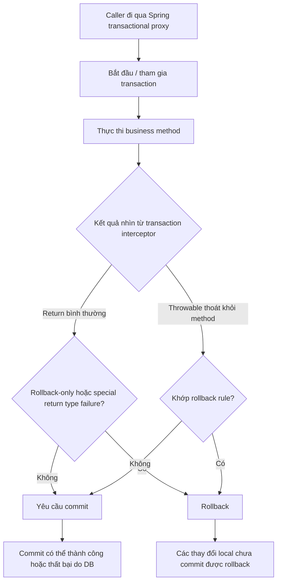

# Lỗi nghiệp vụ trả về như dữ liệu không tự kích hoạt rollback

## 1. Vấn đề: trả về lỗi khác với ném exception

Một ứng dụng Spring có thể báo một nghiệp vụ thất bại theo nhiều cách:

- Ném `IllegalStateException` hoặc một `RuntimeException` nghiệp vụ.
- Trả về `false`, `null`, `Optional.empty()`, enum `DECLINED`.
- Trả về object như `Result.failure("OUT_OF_STOCK")`, `Either.Left(error)`, `ApiResponse.error(...)`.
- Trong ứng dụng web, trả `ResponseEntity.status(409).body(...)` hoặc trả response JSON có `success=false`.

Với Spring `@Transactional` trong **cấu hình thông dụng**, một kết quả trả về biểu diễn lỗi nghiệp vụ bằng **dữ liệu bình thường** không khiến transaction interceptor tự động rollback. Nếu phương thức hoàn tất bình thường và transaction không bị đánh dấu rollback-only, Spring sẽ cố gắng **commit** giao dịch, dù object trả về có `success=false` hay HTTP response có status 400/409/500.

Ví dụ:

```java
@Transactional
public Result reserve(Order order) {
    inventoryRepository.decrease(order.productId(), order.quantity());
    if (order.isRejected()) {
        return Result.failure("ORDER_REJECTED");
    }
    return Result.success();
}
```

Đây là **snippet minh họa**, giả định các type/repository đã được định nghĩa. Nếu `decrease()` thật sự tham gia transaction của method, và không phát sinh lỗi DB hoặc rollback-only khác, nhánh trả về `Result.failure(...)` vẫn **commit thao tác giảm tồn kho**. Dữ liệu có thể đã thay đổi trong khi caller thấy nghiệp vụ thất bại.

**Điểm cần nhớ:** rollback không dựa trên ý nghĩa mà lập trình viên gán cho field `success`, `errorCode` hay HTTP status. Nó dựa trên **quy tắc giao dịch** được Spring áp dụng và trạng thái giao dịch thực tế.

> Phạm vi: Spring Framework 6.x, imperative service dùng `PlatformTransactionManager`/`@Transactional`. Có **hai ngoại lệ return-type được Spring hỗ trợ đặc biệt** (Vavr `Try.Failure` và một số `Future` lỗi ngay lúc trả về) được trình bày ở mục 8. Do đó không nên diễn đạt quá rộng rằng “Spring không bao giờ xét giá trị trả về”.

## 2. Spring quyết định commit hoặc rollback ở đâu?

Khi một lời gọi đi qua Spring transactional proxy, `TransactionInterceptor` xác định transaction attribute, chọn manager, bắt đầu hoặc tham gia transaction, gọi method rồi hoàn tất theo outcome.



Một `Result.failure(...)` thông thường vẫn là **return bình thường**. Nếu không có rollback-only hoặc cơ chế đặc biệt, interceptor không suy diễn từ chuỗi `"FAIL"`, enum `ERROR` hay thuộc tính `success=false` rằng phải rollback.

Các quy tắc mặc định quan trọng:

1. `RuntimeException` hoặc `Error` **thoát ra** khỏi intercepted method: rollback theo mặc định.
2. **Checked** `Exception` thoát ra: theo mặc định **không** đánh dấu rollback; có thể khai báo `rollbackFor` hoặc cấu hình rollback rules khác.
3. Method trả về bình thường và **không rollback-only**: thường commit, **kể cả khi dữ liệu trả về có thông báo thất bại nghiệp vụ**.
4. `TransactionStatus.setRollbackOnly()` hoặc trạng thái rollback-only đã được đặt từ scope khác: yêu cầu rollback dù method trả về bình thường.
5. Ngoại lệ hạ tầng (constraint violation, database transaction aborted, lỗi commit) có thể ngăn commit độc lập với ý nghĩa của giá trị trả về.

Lời hứa “trả về lỗi thì rollback” chỉ đúng khi **ứng dụng tự thực thi chính sách đó** hoặc sử dụng loại giá trị được transaction infrastructure hỗ trợ đặc biệt, chứ không phải behavior mặc định cho mọi kiểu `Result`.

## 3. Bảng tình huống: cùng một lỗi nghiệp vụ, outcome khác nhau

Giả sử method đã cập nhật bảng trong một transaction hợp lệ, chưa xảy ra lỗi database, và được gọi từ **bên ngoài Spring proxy** khi chưa có outer transaction.

| Method kết thúc thế nào? | Quyết định thông thường | Lý do |
| --- | --- | --- |
| `return Result.failure("DECLINED")` | Commit | Trả object bình thường; mã lỗi là dữ liệu. |
| `return false` | Commit | Boolean không tự là rollback signal. |
| `return Optional.empty()` | Commit | Empty không phải Throwable. |
| `return ResponseEntity.status(409).build()` | Commit | HTTP status 409 không có nghĩa interceptor thấy exception. |
| `return Either.left(error)` của thư viện thông thường | Commit | Spring không tự hiểu mọi `Left` như rollback rule. |
| `throw new BusinessDeniedException()`, class extends `RuntimeException` | Rollback mặc định | Unchecked exception vượt qua transactional boundary. |
| `throw new BusinessCheckedException()`, class extends `Exception` | Commit mặc định | Checked exception không tự rollback theo default. |
| Checked exception với `@Transactional(rollbackFor = BusinessCheckedException.class)` | Rollback | Rollback rule được khai báo rõ. |
| Trả `Result.failure(...)` sau `setRollbackOnly()` | Rollback | Trạng thái transaction đã được đánh dấu rollback-only. |
| Trả `Vavr Try.Failure` | Có hỗ trợ rollback đặc biệt | Spring hiểu Vavr `Try`; không suy ra cho mọi kiểu result khác. |
| Trả `CompletableFuture.failedFuture(ex)` đã lỗi **ngay tại thời điểm return** (Spring 6.1+) | Có thể rollback theo exception/rule | Spring hỗ trợ inspect Future đã exceptionally completed. |

**Quan trọng:** bảng giả định transaction manager đang quản lý đúng datasource; nếu method không được proxy intercept thì annotation có thể không có hiệu lực. Nếu caller đã mở transaction hoặc resource bị lỗi, kết quả thực tế còn phụ thuộc propagation, rollback-only và trạng thái DB.

## 4. Tại sao mã trả lỗi sau khi ghi lại nguy hiểm?

Một luồng phổ biến:

1. Bắt đầu local transaction.
2. Ghi thay đổi vào database, ví dụ giảm số dư hoặc giữ hàng.
3. Gọi quy tắc nghiệp vụ kế tiếp; nhận thông tin không hợp lệ.
4. Trả object thất bại `Result(false, "REJECTED")`.
5. Interceptor thấy method **trả bình thường**, nên thực hiện commit.
6. Caller nhận “thất bại”, nhưng thay đổi bước 2 đã bền vững.

```mermaid
sequenceDiagram
    participant C as Caller
    participant P as Transaction Proxy
    participant S as Service
    participant DB as Database
    C->>P: reserve()
    P->>DB: BEGIN
    P->>S: Thực hiện business method
    S->>DB: UPDATE inventory (-2)
    S-->>P: Result.failure("REJECTED")
    Note over P: Không có Throwable; chưa rollback-only
    P->>DB: COMMIT
    P-->>C: Result.failure("REJECTED")
    Note over C,DB: Caller thấy thất bại; DB vẫn giảm tồn kho
```

Tương tự, một controller trả status 400/409 **không tự rollback local database transaction**. HTTP response status được xử lý ở lớp web; Spring transaction infrastructure quyết định theo outcome của method transactional.

Không nên viết integration test chỉ khẳng định `result.success() == false` rồi kết luận không có dữ liệu nào được lưu. Phải **đọc lại trạng thái database sau khi transaction hoàn tất**.

## 5. Giải pháp 1: kiểm tra điều kiện trước khi ghi

Khi có thể biết nghiệp vụ thất bại trước thao tác side effect, ưu tiên **validate first, mutate second**:

```java
@Transactional
public Result reserve(Order order) {
    if (!policy.allows(order)) {
        return Result.failure("ORDER_REJECTED");
    }
    inventoryRepository.decrease(order.productId(), order.quantity());
    return Result.success();
}
```

Đây là snippet minh họa. Nhánh reject trả về bình thường nhưng **chưa thay đổi database**, nên không cần rollback chỉ để “undo” thao tác chưa xảy ra.

Tuy nhiên, kiểm tra trước **không thay thế cơ chế an toàn đồng thời**. Giữa một SELECT kiểm tra tồn kho và một UPDATE, một giao dịch khác có thể thay đổi dữ liệu. Với invariant quan trọng, dùng điều kiện ngay trong UPDATE, khóa hàng/optimistic versioning hoặc ràng buộc database phù hợp.

Ví dụ SQL trừ tồn kho có điều kiện:

```sql
UPDATE inventory
SET quantity = quantity - :amount
WHERE product_id = :productId
  AND quantity >= :amount;
```

Nếu số hàng cập nhật là `0`, trả `Result.failure("INSUFFICIENT_STOCK")` **mà không có thay đổi** do câu SQL này thực hiện. Nếu đã ghi các dữ liệu khác trước khi gặp kết quả `0`, phải quyết định rollback cho **toàn bộ transaction** hoặc chấp nhận kết quả một phần một cách chủ ý.

## 6. Giải pháp 2: ném exception để kích hoạt rollback theo policy

Một cách rõ ràng là ném unchecked business exception **ra khỏi method transactional**:

```java
public class OrderRejectedException extends RuntimeException {
    public OrderRejectedException(String code) {
        super(code);
    }
}

@Transactional
public Result reserve(Order order) {
    inventoryRepository.decrease(order.productId(), order.quantity());

    if (order.isRejected()) {
        throw new OrderRejectedException("ORDER_REJECTED");
    }
    return Result.success();
}
```

Các snippet trên cần class/repository phù hợp, chưa phải chương trình độc lập. Với một local transaction trên đúng datasource, và exception thoát qua `TransactionInterceptor`, Spring rollback theo mặc định.

Nếu ứng dụng HTTP cần response có JSON lỗi, để exception **đi ra ngoài transactional service boundary**, sau đó map nó ở tầng web:

```java
@RestControllerAdvice
public class OrderErrorAdvice {
    @ExceptionHandler(OrderRejectedException.class)
    public ResponseEntity<Map<String, String>> rejected(
            OrderRejectedException ex) {
        return ResponseEntity.status(409)
                .body(Map.of("code", ex.getMessage()));
    }
}
```

Snippet này cần imports Spring Web/`Map` và đặt trong ứng dụng MVC. Lưu ý: advice xử lý exception ở ngoài transactional service invocation; transaction interceptor đã thấy exception và quyết định rollback **trước khi** exception được controller advice chuyển thành HTTP 409.

### 6.1. Checked exception không tự rollback mặc định

```java
@Transactional(rollbackFor = OrderRejectedCheckedException.class)
public void reserve(Order order) throws OrderRejectedCheckedException {
    inventoryRepository.decrease(order.productId(), order.quantity());
    if (order.isRejected()) {
        throw new OrderRejectedCheckedException("ORDER_REJECTED");
    }
}
```

Đây là snippet giả định đã định nghĩa một checked exception extends `Exception`. `rollbackFor` cần thiết khi muốn rollback từ checked exception đó theo chính sách mặc định. Đổi sang `@Transactional(noRollbackFor = OrderRejectedException.class)` có thể khiến unchecked exception tương ứng **không được rollback** theo rule của method, nên không nên nói “cứ ném RuntimeException là Spring luôn rollback” mà bỏ qua cấu hình.

### 6.2. Bắt exception bên trong boundary làm thay đổi kết quả

```java
@Transactional
public Result reserve(Order order) {
    try {
        inventoryRepository.decrease(order.productId(), order.quantity());
        if (order.isRejected()) {
            throw new OrderRejectedException("ORDER_REJECTED");
        }
        return Result.success();
    } catch (OrderRejectedException ex) {
        return Result.failure(ex.getMessage());
    }
}
```

Nếu không có trạng thái rollback-only/DB failure nào khác, interceptor chỉ thấy **return bình thường** nên có thể commit. Việc ném exception **rồi tự catch trong cùng method** không bảo đảm rollback. Nếu cần chuyển exception sang dữ liệu, hãy làm ở **bên ngoài** transactional service boundary, hoặc đặt rollback-only rõ ràng trong boundary.

Một trường hợp tinh tế: exception từ inner `@Transactional(REQUIRED)` được intercept **có thể đã đánh dấu shared transaction rollback-only** trước khi outer bắt exception. Outer trả `Result.failure(...)` không “chữa” được transaction; lúc outer commit có thể gặp `UnexpectedRollbackException`. Do đó không thể khẳng định cứ catch exception là chắc chắn commit; phải kiểm tra có scope giao dịch nào đã set rollback-only hay không.

## 7. Giải pháp 3: trả lỗi như dữ liệu và đánh dấu rollback-only

Khi API chủ ý trả `Result`/`Either` thay vì ném exception, nhưng đã có thao tác ghi cần hoàn tác, có thể đánh dấu giao dịch **rollback-only**.

### 7.1. Trong method @Transactional đã được intercept

```java
import org.springframework.transaction.interceptor.TransactionAspectSupport;

@Transactional
public Result reserve(Order order) {
    inventoryRepository.decrease(order.productId(), order.quantity());
    if (order.isRejected()) {
        TransactionAspectSupport.currentTransactionStatus()
                .setRollbackOnly();
        return Result.failure("ORDER_REJECTED");
    }
    return Result.success();
}
```

Đây là snippet cần repository và type nghiệp vụ, không phải chương trình độc lập. `setRollbackOnly()` bảo Spring rằng transaction scope cần rollback, ngay cả khi method kết thúc bằng giá trị trả về bình thường.

**Giới hạn cần hiểu:**

- `TransactionAspectSupport.currentTransactionStatus()` chỉ dùng được khi đang có transaction invocation context thích hợp do Spring interceptor thiết lập. Nếu gọi ngoài cơ chế này, có thể không có transaction status hiện hành và phát sinh `NoTransactionException`.
- Kỹ thuật này gắn business code với Spring transaction API. Nên dùng có chủ ý, không đặt tùy tiện trong mọi helper.
- Nếu method tham gia **transaction ngoài bằng `REQUIRED`**, đánh dấu rollback-only có thể làm outer transaction không commit được. Tùy phạm vi gọi, caller ngoài có thể nhận `UnexpectedRollbackException`, thay vì giá trị `Result.failure` như bạn dự kiến.
- Nó chỉ rollback **tác động chưa commit được transaction manager quản lý**. Email đã gửi, HTTP payment bên ngoài, hoặc database khác đã commit sẽ không tự được bù trừ.

### 7.2. Với TransactionTemplate: không cần proxy ở entry method

```java
import org.springframework.transaction.PlatformTransactionManager;
import org.springframework.transaction.support.TransactionTemplate;

public class StockApplicationService {
    private final StockRepository stock;
    private final TransactionTemplate transactions;

    public StockApplicationService(
            StockRepository stock,
            PlatformTransactionManager manager) {
        this.stock = stock;
        this.transactions = new TransactionTemplate(manager);
    }

    public Result reserve(Order order) {
        return transactions.execute(status -> {
            stock.decrease(order.productId(), order.quantity());
            if (order.isRejected()) {
                status.setRollbackOnly();
                return Result.failure("ORDER_REJECTED");
            }
            return Result.success();
        });
    }
}
```

Đây là class trong ứng dụng đã có `StockRepository`, `Order` và `Result`; không phải Java SE class tự chạy. `TransactionTemplate` gọi manager trực tiếp, chạy callback rồi commit/rollback theo status; do đó có thể dùng với mô hình *result-as-data* mà không cần ném exception chỉ để báo lỗi. Tuy nhiên `TransactionTemplate` mặc định dùng propagation `REQUIRED`; nếu join transaction ngoài, cách xử lý rollback-only của outer vẫn cần được thiết kế.

Nếu chỉ cần validate đầu tiên và trả lỗi, **không bắt buộc** đánh dấu rollback-only cho mọi nhánh thất bại khi chưa có side effect.

## 8. Hai ngoại lệ quan trọng: Spring có hỗ trợ một số kiểu return đặc biệt

Khẳng định “mọi giá trị trả về đều không bao giờ gây rollback” là **không chính xác** ở Spring Framework hiện đại. Theo tài liệu Spring, mặc định có hỗ trợ đặc biệt cho **Vavr `Try`** và từ Spring Framework **6.1** hỗ trợ tình huống `Future`/`CompletableFuture` đã hoàn tất bằng exception tại thời điểm method trả về.

### 8.1. Vavr Try.Failure

Khi `@Transactional` method trả về `io.vavr.control.Try`, Spring có logic nhận diện `Failure` và có thể rollback theo exception chứa trong failure và transaction rules.

```java
@Transactional
public Try<String> execute() {
    return Try.of(() -> {
        repository.updateRecord();
        throw new IllegalStateException("REJECTED");
    });
}
```

Đoạn code này cần thư viện Vavr, repository và import `Try`; không phải chương trình độc lập. `Try.of` bắt exception rồi biểu diễn thành `Try.Failure`. **Khác với một `Result.failure` do bạn tự tạo**, Vavr `Try` có hỗ trợ riêng trong Spring transaction infrastructure.

Không được suy ra rằng mọi thư viện có `Either.Left`, `Result.Err`, `Option.None` hoặc `Validation.Invalid` đều tự kích hoạt rollback. Với custom result type, phải chủ động điều chỉnh architecture/transaction policy.

### 8.2. Future/CompletableFuture đã exceptionally completed tại thời điểm return

Trong Spring **6.1+**, transaction infrastructure có xử lý đặc biệt đối với một `Future`/`CompletableFuture` trả về mà **đã hoàn tất bằng exception ngay tại thời điểm return**:

```java
@Transactional
public CompletableFuture<String> perform() {
    try {
        String result = repository.performWrite();
        return CompletableFuture.completedFuture(result);
    } catch (RuntimeException ex) {
        return CompletableFuture.failedFuture(ex);
    }
}
```

Ví dụ cần import `CompletableFuture` và repository. Đây không phải một lời hứa “Spring sẽ chờ mọi async task”: khi method trả về một future **còn pending**, transaction interceptor không tự chờ future kết thúc sau đó rồi rollback transaction đã commit. Future báo lỗi muộn không thể hồi tố rollback transaction vật lý đã hoàn tất.

Các ví dụ dễ phân biệt:

| Giá trị trả về | Khi nào được nhìn nhận là lỗi? | Hệ quả về transaction |
| --- | --- | --- |
| `CompletableFuture.completedFuture(Result.failure(...))` | Future thành công chứa *dữ liệu* thất bại nghiệp vụ | Không tự kích hoạt rollback theo nội dung `Result`. |
| `CompletableFuture.failedFuture(new IllegalStateException(...))` | Future đã exceptional ngay khi trả về | Spring 6.1+ có thể áp dụng rollback rule tương ứng. |
| `new CompletableFuture<>()` rồi completeExceptionally sau khi method đã return và commit | Exception chỉ xuất hiện *sau* transaction boundary | Không tự rollback transaction đã kết thúc. |

Với `@Async`, còn phải xét transaction áp dụng trong thread/lời gọi thực tế và thứ tự proxy/advice; đừng tự giả định thread transaction của caller được truyền sang thread async. Bài này nói về **quy tắc nhận diện outcome**, không khẳng định mọi flow bất đồng bộ đều có cùng transaction scope.

**Quy tắc diễn đạt chuẩn:** custom business failure trả về như dữ liệu **không tự rollback**; Spring có **hỗ trợ riêng đã được tài liệu hóa** cho một số return type cụ thể, và phải kiểm tra đúng version, trạng thái trả về và rollback rules.

## 9. Ví dụ Java 17+ chạy được với Spring và H2

Ví dụ độc lập dưới đây cho thấy **cùng một lỗi nghiệp vụ `DENIED`** có thể dẫn đến bốn outcome khác nhau:

1. Ghi DB rồi trả `Decision(false, "DENIED")` → **commit**.
2. Ghi DB rồi ném unchecked exception → **rollback**.
3. Ghi DB, `setRollbackOnly()` rồi trả `Decision(false, "DENIED")` → **rollback**.
4. Kiểm tra trước khi ghi → trả lỗi bình thường mà **không phát sinh thay đổi**; nhánh hợp lệ vẫn commit.

Ứng dụng dùng **Java 17**, **Spring Framework 6.2.19**, **H2 2.3.232**, Maven. Không cần Spring Boot hoặc servlet container. Kết quả là output của chính chương trình; log riêng của Maven/SLF4J có thể khác nhau tùy môi trường.

### 9.1. Cấu trúc project

```text
result-rollback-demo/
├── pom.xml
└── src/main/java/demo/tx/ResultRollbackDemo.java
```

### 9.2. pom.xml

```xml
<project xmlns="http://maven.apache.org/POM/4.0.0"
         xmlns:xsi="http://www.w3.org/2001/XMLSchema-instance"
         xsi:schemaLocation="http://maven.apache.org/POM/4.0.0
                             https://maven.apache.org/xsd/maven-4.0.0.xsd">
    <modelVersion>4.0.0</modelVersion>
    <groupId>demo</groupId>
    <artifactId>result-rollback-demo</artifactId>
    <version>1.0.0</version>
    <properties>
        <maven.compiler.release>17</maven.compiler.release>
        <project.build.sourceEncoding>UTF-8</project.build.sourceEncoding>
    </properties>
    <dependencies>
        <dependency>
            <groupId>org.springframework</groupId>
            <artifactId>spring-context</artifactId>
            <version>6.2.19</version>
        </dependency>
        <dependency>
            <groupId>org.springframework</groupId>
            <artifactId>spring-jdbc</artifactId>
            <version>6.2.19</version>
        </dependency>
        <dependency>
            <groupId>com.h2database</groupId>
            <artifactId>h2</artifactId>
            <version>2.3.232</version>
        </dependency>
    </dependencies>
    <build>
        <plugins>
            <plugin>
                <groupId>org.apache.maven.plugins</groupId>
                <artifactId>maven-compiler-plugin</artifactId>
                <version>3.13.0</version>
            </plugin>
            <plugin>
                <groupId>org.codehaus.mojo</groupId>
                <artifactId>exec-maven-plugin</artifactId>
                <version>3.5.1</version>
            </plugin>
        </plugins>
    </build>
</project>
```

### 9.3. src/main/java/demo/tx/ResultRollbackDemo.java

```java
package demo.tx;

import javax.sql.DataSource;

import org.springframework.context.annotation.AnnotationConfigApplicationContext;
import org.springframework.context.annotation.Bean;
import org.springframework.context.annotation.Configuration;
import org.springframework.jdbc.core.JdbcTemplate;
import org.springframework.jdbc.datasource.DataSourceTransactionManager;
import org.springframework.jdbc.datasource.DriverManagerDataSource;
import org.springframework.transaction.PlatformTransactionManager;
import org.springframework.transaction.annotation.EnableTransactionManagement;
import org.springframework.transaction.annotation.Transactional;
import org.springframework.transaction.interceptor.TransactionAspectSupport;

public final class ResultRollbackDemo {
    public static void main(String[] args) {
        try (var context = new AnnotationConfigApplicationContext(Config.class)) {
            JdbcTemplate jdbc = context.getBean(JdbcTemplate.class);
            WalletService service = context.getBean(WalletService.class);

            jdbc.execute("CREATE TABLE account (" +
                    "id INT PRIMARY KEY, balance INT NOT NULL)");
            jdbc.update("INSERT INTO account (id, balance) VALUES (1, 100)");

            System.out.println("initial balance=" + balance(jdbc));

            Decision returned = service.returnFailureAfterWrite();
            print("return result", returned, jdbc);

            try {
                service.throwAfterWrite();
            } catch (BusinessDeniedException ex) {
                System.out.println("throw exception: " + ex.getMessage()
                        + ", balance=" + balance(jdbc));
            }

            Decision rolledBack = service.markRollbackOnly();
            print("rollback-only", rolledBack, jdbc);

            Decision rejected = service.validateBeforeWrite(false);
            print("precheck reject", rejected, jdbc);

            Decision accepted = service.validateBeforeWrite(true);
            print("precheck accept", accepted, jdbc);
        }
    }

    private static int balance(JdbcTemplate jdbc) {
        Integer result = jdbc.queryForObject(
                "SELECT balance FROM account WHERE id=1", Integer.class);
        return result;
    }

    private static void print(String label, Decision result, JdbcTemplate jdbc) {
        System.out.println(label + ": " + result.code()
                + ", balance=" + balance(jdbc));
    }

    public record Decision(boolean accepted, String code) {
        public static Decision denied() {
            return new Decision(false, "DENIED");
        }

        public static Decision approved() {
            return new Decision(true, "APPROVED");
        }
    }

    public static final class BusinessDeniedException extends RuntimeException {
        public BusinessDeniedException() {
            super("DENIED");
        }
    }

    @Configuration(proxyBeanMethods = false)
    @EnableTransactionManagement(proxyTargetClass = true)
    public static class Config {
        @Bean
        public DataSource dataSource() {
            return new DriverManagerDataSource(
                    "jdbc:h2:mem:business_result;DB_CLOSE_DELAY=-1", "sa", "");
        }

        @Bean
        public PlatformTransactionManager transactionManager(DataSource dataSource) {
            return new DataSourceTransactionManager(dataSource);
        }

        @Bean
        public JdbcTemplate jdbcTemplate(DataSource dataSource) {
            return new JdbcTemplate(dataSource);
        }

        @Bean
        public WalletService walletService(JdbcTemplate jdbc) {
            return new WalletService(jdbc);
        }
    }

    public static class WalletService {
        private final JdbcTemplate jdbc;

        public WalletService(JdbcTemplate jdbc) {
            this.jdbc = jdbc;
        }

        @Transactional
        public Decision returnFailureAfterWrite() {
            jdbc.update("UPDATE account SET balance = balance - 10 WHERE id=1");
            return Decision.denied();
        }

        @Transactional
        public void throwAfterWrite() {
            jdbc.update("UPDATE account SET balance = balance - 20 WHERE id=1");
            throw new BusinessDeniedException();
        }

        @Transactional
        public Decision markRollbackOnly() {
            jdbc.update("UPDATE account SET balance = balance - 30 WHERE id=1");
            TransactionAspectSupport.currentTransactionStatus()
                    .setRollbackOnly();
            return Decision.denied();
        }

        @Transactional
        public Decision validateBeforeWrite(boolean approved) {
            if (!approved) {
                return Decision.denied();
            }
            jdbc.update("UPDATE account SET balance = balance - 5 WHERE id=1");
            return Decision.approved();
        }
    }
}
```

### 9.4. Chạy và quan sát

Tại thư mục `result-rollback-demo`, với JDK 17+ và Maven:

```bash
mvn -q compile exec:java -Dexec.mainClass=demo.tx.ResultRollbackDemo
```

Output của code:

```text
initial balance=100
return result: DENIED, balance=90
throw exception: DENIED, balance=90
rollback-only: DENIED, balance=90
precheck reject: DENIED, balance=90
precheck accept: APPROVED, balance=85
```

**Đối chiếu số dư:**

- `initial=100`.
- `returnFailureAfterWrite()` giảm 10 rồi trả `Decision.denied()`: interceptor nhìn thấy **return bình thường** → commit, còn `90`.
- `throwAfterWrite()` giảm 20 rồi ném `BusinessDeniedException` là unchecked: proxy rollback transaction → số dư vẫn `90`.
- `markRollbackOnly()` giảm 30 rồi đánh dấu rollback-only, trả lỗi như dữ liệu: transaction rollback → vẫn `90`.
- `validateBeforeWrite(false)` từ chối trước khi ghi: bình thường có thể commit scope rỗng nhưng không thay đổi số dư.
- `validateBeforeWrite(true)` giảm 5 rồi return thành công → commit, còn `85`.

**Điều kiện để hiểu đúng output:** `WalletService` là Spring bean được inject từ context, không phải `new WalletService(...)` ngoài Spring; các lời gọi vào public method đi qua class-based proxy; `JdbcTemplate` và transaction manager dùng cùng `DataSource`. H2 in-memory chỉ minh họa local transaction, không phải distributed transaction. Ví dụ được thiết kế để chạy độc lập với dependency trong `pom.xml`; không bao gồm việc gửi HTTP hay publish broker message.

### 9.5. Biến thể test quan trọng

Thử sửa `returnFailureAfterWrite()` để gọi `throw new BusinessDeniedException()` thay vì `return Decision.denied()`: trạng thái DB không giảm vì rollback. Sau đó giữ return failure nhưng thêm `setRollbackOnly()` trước return: số dư cũng không giảm.

Khi kiểm thử trong Spring Test, đừng chỉ viết `@Transactional` trên test method rồi đọc dữ liệu trong cùng test transaction: mặc định Spring Test thường rollback khi test kết thúc, làm khó quan sát service có commit độc lập hay chỉ chạy trong transaction của test. Nên kiểm tra qua test không có outer transaction hoặc quản lý lifecycle test transaction tường minh.

## 10. Thiết kế API: phân biệt lỗi dự kiến và lỗi cần hoàn tác

Không phải mọi business failure đều cần **exception**. Có thể phân nhóm rõ:

| Tình huống | Chính sách gợi ý | Lý do |
| --- | --- | --- |
| Dữ liệu không hợp lệ được xác định **trước khi ghi** | Trả `Result.failure`; không cần rollback thủ công | Chưa có side effect để hoàn tác. |
| Đã thực hiện nhiều câu SQL rồi phát hiện invariant bị vi phạm | Ném unchecked exception hoặc đánh dấu rollback-only | Cần rollback các thao tác local chưa commit. |
| Checked business exception thật sự cần rollback | `rollbackFor = ThatException.class` | Default thường không rollback checked exception. |
| Muốn API luôn trả Result nhưng cần atomicity | `TransactionTemplate` + `status.setRollbackOnly()`, hoặc dịch exception ra Result ngoài service boundary | Outcome và transaction policy rõ ràng. |
| Bước ghi đã commit, bước sau báo lỗi | Compensation/workflow, không thể rollback commit cũ | Transaction đã kết thúc. |
| Gọi HTTP payment hoặc gửi email trong method transactional | Thiết kế idempotency/compensation/outbox tùy tác động | Local transaction manager không rollback hệ thống ngoài. |
| Domain trả lỗi thường xuyên, không muốn exception cho mọi validation | Prevalidate và ghi có điều kiện; tách transaction boundary rõ | Giữ API dạng dữ liệu mà không làm mất tính nguyên tử. |

Một ứng dụng có thể quyết định lỗi nghiệp vụ nào **được phép commit**. Ví dụ, tạo bản ghi audit `DECLINED` có thể là hành vi mong muốn; hoặc muốn lưu một sự kiện “yêu cầu bị từ chối” trong transaction khác. Điều cần tránh là **tưởng return failure mặc nhiên rollback tất cả**.

### Nếu cần ghi audit ngay cả khi nghiệp vụ chính rollback

Một `@Transactional(propagation = Propagation.REQUIRES_NEW)` ở **bean khác** có thể commit audit độc lập nếu thực sự được gọi qua proxy và có resource/connection phù hợp. Tuy vậy, `REQUIRES_NEW` có thể cần thêm connection từ pool và sẽ không tự được áp dụng nếu self-invocation. Không sử dụng nó chỉ như một mẹo bỏ qua rollback; xác định rõ chính sách dữ liệu và trạng thái nghiệp vụ.

## 11. Các lỗi phổ biến khi sửa code

### Sai lầm 1: dùng @Transactional(rollbackFor=...) cho một error object

`rollbackFor` đối chiếu **exception type** khi interceptor xử lý Throwable (hoặc các trường hợp special return được hỗ trợ), không đọc `Result.errorCode` tùy ý. Nó không thể biến một Java record/enum/DTO thành exception chỉ vì tên chứa `Error`.

### Sai lầm 2: nghĩ HTTP status 500 tự động rollback

`ResponseEntity.status(500)` vẫn là object trả bình thường. Nếu controller/service đã ghi database trong transactional scope và không đánh dấu rollback-only, nó có thể commit. Để HTTP 500 phản ánh lỗi do exception, cho exception đi qua transactional boundary trước khi mapping sang response.

### Sai lầm 3: nuốt RuntimeException và trả Result.failure

Nếu exception bị catch **bên trong cùng transactional method**, proxy có thể không thấy nó. Nếu inner transaction đã đánh dấu rollback-only, outer có thể bị unexpected rollback, nhưng không nên phụ thuộc vào side effect vô tình đó. Quyết định rõ: rethrow, mark rollback-only, hoặc chuyển exception-to-result conversion ra ngoài transaction.

### Sai lầm 4: setRollbackOnly trên một thread khác

Imperative transaction context thường gắn với thread. Một callback `@Async` hoặc `CompletableFuture` chạy về sau trên thread khác không tự có `TransactionStatus` của lời gọi đã kết thúc. Muốn phối hợp bất đồng bộ phải thiết kế transaction tại execution boundary thích hợp.

### Sai lầm 5: tưởng rollback được thay đổi ngoài database

`@Transactional` quản lý tài nguyên transaction manager điều khiển. Nếu method gửi email, gọi payment gateway, hoặc gửi message broker và sau đó rollback local database, tác động bên ngoài có thể đã hoàn thành. Xem xét transactional outbox, idempotency, retry và compensation.

### Sai lầm 6: kiểm thử chỉ nhìn object trả về

Một assert như `assertFalse(result.accepted())` là chưa đủ. Kiểm tra database **sau khi transaction kết thúc**, tốt nhất bằng một transaction/connection đọc độc lập. Tạo ca “ghi rồi trả lỗi” để chắc rằng rollback policy đúng với yêu cầu nghiệp vụ.

## 12. Checklist review service trả lỗi như dữ liệu

1. **Transaction boundary**: method có thực sự được gọi qua Spring proxy? Có self-invocation, final/private method hoặc manager sai không?
2. **Điều kiện lỗi**: được phát hiện trước hay sau khi update database?
3. **Return type**: plain `Result`/`Either`/`boolean`/`ResponseEntity` hay loại special như Vavr `Try`/exceptional `Future`?
4. **Rollback rule**: exception có thoát method không? Unchecked/checked? Có `rollbackFor`/`noRollbackFor` đặc biệt không?
5. **Rollback-only**: ai đánh dấu? Là scope mới hay `REQUIRED` tham gia outer transaction? Outer caller có hiểu có thể gặp `UnexpectedRollbackException` không?
6. **Phạm vi resource**: các câu SQL có thuộc đúng datasource/manager không? Có side effect ngoài transaction không?
7. **Kiểm thử**: có assert database state sau khi method hoàn tất và có ca parallel/constraint failure phù hợp không?
8. **Contract với caller**: API trả `Result.failure` là “không có thay đổi”, “thất bại nhưng có audit”, hay “đã xử lý một phần”? Phải định nghĩa rõ, tránh kết quả mập mờ.

## 13. Tự kiểm tra

**Câu 1.** Service `@Transactional` giảm tồn kho 1 đơn vị rồi `return false`. Không có lỗi DB hay rollback-only. Tồn kho có được phục hồi không?

*Đáp án:* Không. Interceptor thấy return bình thường; transaction thường commit, số lượng giảm 1.

**Câu 2.** Dùng `@Transactional(rollbackFor=Exception.class)` có tự rollback khi `return Result.error(...)` không?

*Đáp án:* Không. Rule nhận biết exception; custom error object vẫn là dữ liệu thông thường.

**Câu 3.** Service ném unchecked exception, controller bên ngoài bắt và chuyển thành HTTP 409. Transaction của service có rollback không?

*Đáp án:* Có theo default, nếu exception đã thoát qua interceptor của service trước khi được controller catch.

**Câu 4.** Service bắt exception bên trong chính method rồi trả `Result.failure`. Có chắc rollback không?

*Đáp án:* Không. Nếu chưa rollback-only và database chưa lỗi, proxy có thể commit. Nhưng nếu inner scope đã đánh dấu rollback-only thì transaction vẫn có thể rollback; phải kiểm tra thực tế.

**Câu 5.** Future bị completeExceptionally **sau** khi method `@Transactional` đã return và commit. Spring có đảo commit cũ không?

*Đáp án:* Không. Hỗ trợ `Future` đặc biệt từ Spring 6.1 chỉ xét trạng thái exceptional **ngay tại thời điểm return**, theo rollback rules.

**Câu 6.** Muốn giữ `Result.failure` nhưng đã ghi dữ liệu, làm thế nào?

*Đáp án:* Có thể gọi `TransactionAspectSupport.currentTransactionStatus().setRollbackOnly()` trong invocation phù hợp; hoặc dùng `TransactionTemplate` để trả Result và đánh dấu status rollback-only. Phân tích rõ phạm vi transaction ngoài.

## 14. Tóm lược kiến thức

- **Lỗi nghiệp vụ trả về dưới dạng dữ liệu thông thường không tự kích hoạt rollback.** Một `Result.failure`, `false` hay HTTP status 409 không phải exception đối với transaction interceptor.
- **Spring mặc định rollback khi unchecked exception/Error thoát qua intercepted method; checked exception thường cần quy tắc rollback riêng.** Có thể chủ động `setRollbackOnly()` để rollback dù method trả bình thường.
- **Đã ghi trước khi trả failure thì dữ liệu có thể commit.** Ưu tiên xác định điều kiện thất bại trước khi ghi, hoặc bảo đảm transactional rollback khi invariant quan trọng không thỏa.
- **Có các ngoại lệ return type chuyên biệt** trong Spring: Vavr `Try.Failure` và `Future`/`CompletableFuture` đã exceptionally completed tại lúc method return (Spring 6.1+). Không suy diễn cho mọi custom result.
- **Kiểm tra dữ liệu sau transaction**, phân biệt scope logic và physical transaction, và không kỳ vọng local rollback hoàn tác tác động ngoài resource.

## Tài liệu tham khảo

- [Spring Framework 6.2 — Rolling Back a Declarative Transaction](https://docs.spring.io/spring-framework/reference/6.2/data-access/transaction/declarative/rolling-back.html)
- [Spring Framework — @Transactional Settings](https://docs.spring.io/spring-framework/reference/data-access/transaction/declarative/annotations.html)
- [Spring Framework — Understanding Declarative Transaction Implementation](https://docs.spring.io/spring-framework/reference/data-access/transaction/declarative/tx-decl-explained.html)
- [Spring Framework — Programmatic Transaction Management](https://docs.spring.io/spring-framework/reference/data-access/transaction/programmatic.html)
- [Spring Framework — Transaction Propagation](https://docs.spring.io/spring-framework/reference/data-access/transaction/declarative/tx-propagation.html)
- [Spring Framework API — TransactionAspectSupport](https://docs.spring.io/spring-framework/docs/6.2.x/javadoc-api/org/springframework/transaction/interceptor/TransactionAspectSupport.html)
